# Chaos Attractor Lab

I’m hunting for attractor shapes nobody has seen before, and for other odd things chaotic systems can do. When [a single orbit draws two rings](#two-and-four-nested-rings-from-one-orbit), I want to know what makes it jump from one to the other.

I run this experiment from my phone through Codex, using the most capable models available at the time of each commit. I do it for fun. If I turn up a little new mathematics or give someone else an idea to chase, I’ll be happy. My work here is [MIT-licensed](LICENSE).

## Contents

- **Shape searches** · [Rings, basins and optical fans](docs/chaotic-forms-20261122.md) · [Knots, links and spatial maps](docs/shape-search-20261121.md) · [Further portraits](#further-portraits)
- **Follow-up proofs** · [Periodic orbits and ring entropy](results/low_hanging_20261122/README.md) · [Fifteen outcomes on a line and unbounded growth per lap](results/attractor_followup_2/README.md)
- **Mathematical art** · [One photograph, two histories](results/art_20261122/double-exposure/README.md) · [Optical memory transplant](results/art_20261122/memory-transplant/README.md) · [All studies and sketches](results/art_20261122/README.md)
- **By system** · [Constructed flows](#constructed-flows) · [Numerical algorithms](#numerical-algorithms) · [Molecular motors](#molecular-motor-dynamics) · [Constructed data](#constructed-data)
- **Reports and data** · [Research index](#research-index) · [Articles](docs/README.md) · [Reproduction](docs/reproduction.md) · [Data and certificates](results/README.md)

Each portrait gives its system, equation and parameters. A **Case** number identifies a saved parameter set within its study. The [ring search](results/wow_search_20261122/symmetry/README.md#screening-and-independent-checks) shows how the parameter sets were sampled and shortlisted. Panels list their settings from left to right. Rotations show a fixed point cloud at constant scale. A **certificate** proves the stated property. Measured growth rates describe finite trajectories.

## Constructed flows

### Icosahedral flow

Thirty spiral regions surround a stable center. Cases 177 and 183 show sustained expansion over 16,000 time units. An independent solver also finds positive growth. The absorbing bounds and local equilibria have proofs. Whether the spiral motion itself is chaotic remains open.


<!-- drawing-date -->
*First recorded portrait: **2026-11-01**.*
<!-- /drawing-date -->


<!-- drawing-date -->
*First recorded portrait: **2026-11-01**.*
<!-- /drawing-date -->

<!-- portrait-equation icosahedral -->

**Icosahedrally equivariant Gaussian vortex flow**

```math
\dot x=-\gamma x+\Omega\sum_{G\in I}\big[(Gu)\times(x-Gc)\big]\exp\!\left(-\frac{\lVert x-Gc\rVert^2}{2\sigma^2}\right).
```

I consists of the 60 proper icosahedral rotations. Each rotation acts on both the seed center c and its axis u. [Model and parameters](docs/icosahedral-flow.md#equation-and-selection)

**Parameters used for this portrait**

**Left · Case 177** σ ≈ 0.187166, γ ≈ 0.304625, Ω ≈ 12.5675. **Right · Case 183** σ ≈ 0.502108, γ ≈ 0.0129644, Ω ≈ 8.41251. [Exact seeds and initial states](docs/icosahedral-flow.md) · [Stored 60 rotations and field arrays](results/icosahedral-flow/icosa-v1/input.npz)

<details>
<summary>Full numerical settings</summary>

```json
{
  "Case 177": {
    "center_c": [0.3213743110381084, 0.33337145812310887, 0.8863306511193514],
    "axis_u": [-0.9861789830371915, 0.00844992784220647, 0.16546785831451416],
    "sigma": 0.1871655274834484,
    "gamma": 0.3046252981039999,
    "Omega": 12.567476945458692,
    "initial_xyz": [-0.8540205471217632, -0.5178900741040706, 0.586555241793394]
  },
  "Case 183": {
    "center_c": [-0.6541024696644714, -0.25846930169810095, 0.7108752205967903],
    "axis_u": [-0.3116266521766094, -0.8137996562705287, -0.49052925407886505],
    "sigma": 0.5021080202050507,
    "gamma": 0.01296443751986359,
    "Omega": 8.412505832135071,
    "initial_xyz": [-1.1424379482865332, -0.25617291927337643, 0.18412337824702263]
  },
  "scrambled_Sobol_seed_for_original_survey": 2026110143
}
```

</details>

<!-- /portrait-equation -->

Both panels show the full three-dimensional state.

[Equations and evidence](docs/icosahedral-flow.md) · [Equilibria](docs/icosahedral-structure.md) · [Periodic orbits](docs/icosahedral-cycles.md) · [Return map and prior art](docs/icosahedral-returns.md)

## Numerical algorithms

### RAAR projection algorithm

Relaxed reflections between two circles produce a folded set in space. In Case 1051 a trapping region contains a certified fold and periodic orbits of every least period 49, 56, 63, … . At period 700 alone there are at least 75,683,050 distinct orbits. [Counting proof and stronger entropy bound](results/low_hanging_20261122/algorithms/README.md) How much of this set the pictured orbit visits is open. Case 1483 is a numerical comparison.

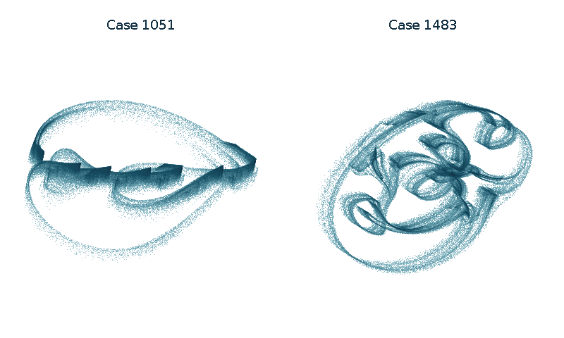

<!-- drawing-date -->
*First recorded portrait: **2026-11-01**.*
<!-- /drawing-date -->


<!-- drawing-date -->
*First recorded portrait: **2026-11-01**.*
<!-- /drawing-date -->

<!-- portrait-equation raar -->

**Relaxed averaged alternating reflections (RAAR) between two spatial circles**

```math
b=P_B(x_n),\quad v=2b-x_n,\quad x_{n+1}=\beta x_n+\beta P_A(v)+(1-2\beta)b.
```

P_A and P_B are nearest-point projections onto circumferences. A is the unit xy circle. B is the circle c+r(cos t, cos θ sin t, sin θ sin t). [Model and parameters](docs/raar-circles.md#explicit-existing-map)

**Parameters used for this portrait**

**Left · Case 1051** β ≈ 0.970882, r ≈ 1.98869, θ ≈ 0.902882 rad, c ≈ (-0.143541, 0.57455, -0.774512), plotted start ≈ (0.00952374, -3.09521, 3.66492). **Right · Case 1483** β ≈ 0.947922, r ≈ 1.71141, θ ≈ 1.38062 rad, c ≈ (-0.201525, -1.29239, -0.35809), plotted start ≈ (-0.449589, 3.8443, -0.106236). [Exact rendering parameters and starts](results/raar-circles/render/analysis.json)

<details>
<summary>Full numerical settings</summary>

```json
{
  "Case 1051": {
    "beta": 0.9708823579074815,
    "B_radius": 1.9886915469542146,
    "B_tilt_radians": 0.9028818255996501,
    "B_center": [-0.1435409113764763, 0.5745496526360512, -0.7745124697685242],
    "initial_xyz": [0.009523742348526727, -3.0952071681541753, 3.6649164929455513]
  },
  "Case 1483": {
    "beta": 0.9479219977855682,
    "B_radius": 1.7114126864820718,
    "B_tilt_radians": 1.380623693686775,
    "B_center": [-0.2015250399708748, -1.2923902235925198, -0.3580900579690933],
    "initial_xyz": [-0.44958919265689057, 3.8442991780580735, -0.10623585395022994]
  }
}
```

</details>

<!-- /portrait-equation -->

Both panels show the full three-dimensional state.

[Trapping theorem and article](docs/raar-trapping.md) · [Fold membership and article](docs/raar-critical-membership.md) · [Symbolic certificate](docs/raar-symbolic-dynamics.md) · [Model and trajectories](docs/raar-circles.md) · [Prior art](docs/raar-priority.md)

### Circle and finite-point projections

A circle and three active sites produce layers of curved sheets. Cases 1504 and 1725 retained positive leading growth over five million steps, across 33 starts and at 70- and 100-digit precision.

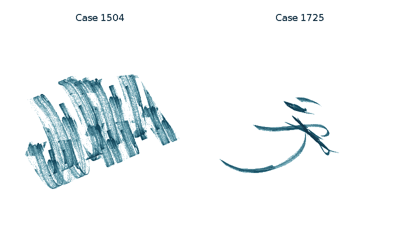

<!-- drawing-date -->
*First recorded portrait: **2026-11-01**.*
<!-- /drawing-date -->


<!-- drawing-date -->
*First recorded portrait: **2026-11-01**.*
<!-- /drawing-date -->

<!-- portrait-equation raar-constellations -->

**Unit-circle / nearest-site relaxed averaged alternating reflections (RAAR)**

```math
b=P_B(x_n),\quad v=2b-x_n,\quad x_{n+1}=\beta x_n+\beta P_A(v)+(1-2\beta)b.
```

P_B selects the nearest vertex of a finite spatial set. P_A(v) normalizes the xy component and sets z to zero. Case 1504 has four sites and Case 1725 has six. [Model and parameters](docs/raar-constellations.md#model)

**Parameters used for this portrait**

**Left · Case 1504** β ≈ 0.93285, 4 tetrahedral sites. **Right · Case 1725** β ≈ 0.970661, 6 octahedral sites. Both start at (0.317, −0.211, 0.419). [Exact site coordinates and coefficients](results/raar-constellations/runs/raar-constellation-long01/report.json)

<details>
<summary>Full numerical settings</summary>

```json
{
  "Case 1504": {
    "beta": 0.9328500449163839,
    "sites_xyz": [
      [-0.5452810451212622, 0.7768672162540745, -0.9689293906747655],
      [-0.2139735633469862, 0.4471930198824702, 1.2281976984679148],
      [0.9911037663845871, -0.7076912599605877, -0.2750814168715705],
      [-1.1957311214077784, -1.148208466112786, -0.011424568495736384]
    ]
  },
  "Case 1725": {
    "beta": 0.970660805775784,
    "sites_xyz": [
      [0.7581790402815731, -1.0211273510035648, -0.5182476998469157],
      [0.3727798208282578, -0.8325990871058122, 0.21937310028676482],
      [0.14357891711598558, -0.4295408778562685, -0.4969864010304195],
      [0.5692114337994665, -0.009221402925573496, 0.11155974279849956],
      [0.9546106532527818, -0.197749666823326, -0.6260610573351809],
      [1.183811556965054, -0.6008078760728698, 0.09029844398200343]
    ]
  },
  "shared_initial_xyz": [0.317, -0.211, 0.419]
}
```

</details>

<!-- /portrait-equation -->

Full three-state iterates; rigid camera and equal spatial units within each panel.

[Model, controls and prior art](docs/raar-constellations.md)

### Gaussian posterior mean and a circle

The sampled orbit in Case 156 traces a folded band. The map has a certified connected attracting set. Seven verified crossings give an entropy lower bound of `log(2)/6` per step. The set contains periodic points with one and two unstable directions. In Case 29 the two lobes alternate in the numerical orbit.


<!-- drawing-date -->
*First recorded portrait: **2026-11-01**.*
<!-- /drawing-date -->


<!-- drawing-date -->
*First recorded portrait: **2026-11-01**.*
<!-- /drawing-date -->

<!-- portrait-equation soft-constellations -->

**Gaussian posterior-mean reflection map with a unit circle**

```math
m(x)=\frac{\sum_j b_j e^{-\lVert x-b_j\rVert^2/\tau}}{\sum_j e^{-\lVert x-b_j\rVert^2/\tau}},\quad v=2m(x_n)-x_n,\quad x_{n+1}=\beta x_n+\beta P(v)+(1-2\beta)m(x_n).
```

P(v) normalizes the xy component and sets z to zero. The bⱼ are equally weighted sites, τ is temperature and β is relaxation. [Model and parameters](docs/soft-constellations.md#model-and-known-ingredients)

**Parameters used for this portrait**

**Left · Case 29** β ≈ 0.985124, τ ≈ 0.265201, 4 tetrahedral sites. **Right · Case 156** β ≈ 0.970661, τ ≈ 0.0373168, 6 octahedral sites. Both start at (0.317, −0.211, 0.419). [Exact site coordinates and coefficients](results/soft-constellations/runs/soft-constellation-long01/report.json)

<details>
<summary>Full numerical settings</summary>

```json
{
  "Case 29": {
    "beta": 0.9851239318186418,
    "tau": 0.26520140042010554,
    "sites_xyz": [
      [0.43025192179357286, -0.025723691074069105, 0.07762098242124493],
      [0.23166630300611102, -0.721996216797328, -0.455139961345115],
      [1.032737115349656, -0.31954168692824353, -0.5213351746779145],
      [0.2916658289886147, 0.10564726617682224, -0.8007875032738261]
    ]
  },
  "Case 156": {
    "beta": 0.970660805775784,
    "tau": 0.03731678183231506,
    "sites_xyz": [
      [0.7581790402815731, -1.0211273510035648, -0.5182476998469157],
      [0.3727798208282578, -0.8325990871058122, 0.21937310028676482],
      [0.14357891711598558, -0.4295408778562685, -0.4969864010304195],
      [0.5692114337994665, -0.009221402925573496, 0.11155974279849956],
      [0.9546106532527818, -0.197749666823326, -0.6260610573351809],
      [1.183811556965054, -0.6008078760728698, 0.09029844398200343]
    ]
  },
  "shared_initial_xyz": [0.317, -0.211, 0.419]
}
```

</details>

<!-- /portrait-equation -->

Full three-state iterates; rigid camera and equal spatial units within each panel.

[Entropy and periodic-structure article](docs/soft-symbolic-dynamics/manuscript.md) · [Trapping and entry certificate](docs/soft-constellation-trapping.md) · [Model and numerical controls](docs/soft-constellations.md) · [Equivalent formulations and prior art](docs/soft-constellation-priority.md)

### Gaussian posterior mean and a sphere

Two site configurations produce folded strands and curled lobes. Cases 155 and 251 gave positive leading growth over five million steps, across 33 starts and at 70- and 100-digit precision.

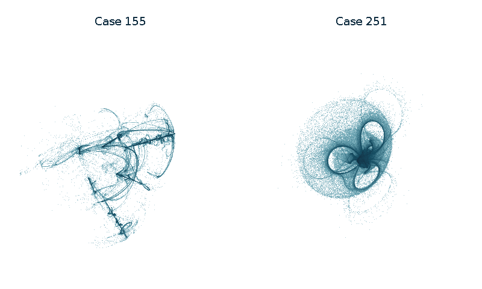

<!-- drawing-date -->
*First recorded portrait: **2026-11-01**.*
<!-- /drawing-date -->


<!-- drawing-date -->
*Drawn: **2026-11-01**.*
<!-- /drawing-date -->

<!-- portrait-equation soft-sphere -->

**Gaussian posterior-mean reflection map with a unit sphere**

```math
m(x)=\frac{\sum_j b_j e^{-\lVert x-b_j\rVert^2/\tau}}{\sum_j e^{-\lVert x-b_j\rVert^2/\tau}},\quad v=2m(x_n)-x_n,\quad x_{n+1}=\beta x_n+\beta\frac{v}{\lVert v\rVert}+(1-2\beta)m(x_n).
```

The normalized vector projects onto the unit sphere. The bⱼ are equally weighted spatial sites, τ is temperature and β is relaxation. [Model and parameters](docs/soft-sphere/manuscript.md#2-map-derivative-and-elementary-bound)

**Parameters used for this portrait**

**Left · Case 155** β ≈ 0.957378, τ ≈ 0.0127572, 8 cubic sites. **Right · Case 251** β ≈ 0.93285, τ ≈ 0.0585393, 4 tetrahedral sites. Both start at (0.317, −0.211, 0.419). [Exact site coordinates and coefficients](results/soft-sphere/runs/soft-sphere-verification01/report.json)

<details>
<summary>Full numerical settings</summary>

```json
{
  "Case 155": {
    "beta": 0.957377939824015,
    "tau": 0.012757228142451395,
    "sites_xyz": [
      [-0.9322570027248573, 1.0379800640719612, 0.290899329679078],
      [-0.44544110951975, 1.108649847369068, -0.053921486802414986],
      [-1.0801032849409766, 0.5449601300713851, -0.018871794120815993],
      [-0.5932873917358693, 0.6156299133684919, -0.36369261060230895],
      [-0.612824551985902, 0.7020895253035737, 0.6730325302886263],
      [-0.1260086587807947, 0.7727593086006805, 0.3282117138071333],
      [-0.7606708342020213, 0.20906959130299768, 0.36326140648873234],
      [-0.27385494099691404, 0.2797393746001044, 0.018440590007239355]
    ]
  },
  "Case 251": {
    "beta": 0.9328500449163839,
    "tau": 0.05853931540315792,
    "sites_xyz": [
      [-0.5452810451212622, 0.7768672162540745, -0.9689293906747655],
      [-0.2139735633469862, 0.4471930198824702, 1.2281976984679148],
      [0.9911037663845871, -0.7076912599605877, -0.2750814168715705],
      [-1.1957311214077784, -1.148208466112786, -0.011424568495736384]
    ]
  },
  "shared_initial_xyz": [0.317, -0.211, 0.419]
}
```

</details>

<!-- /portrait-equation -->

Native three-state iterates; rigid camera and equal spatial units within each panel.

[Numerical article, controls and comparison limits](docs/soft-sphere/manuscript.md) · [Evidence and reproduction](results/soft-sphere/README.md) · [Equivalent formulations and prior art](docs/soft-constellation-priority.md)

### Canonical posterior maps: ribbon and spatial folds

Tetrahedral and cubic site configurations produce a ribbon and a folded sheet. In cubic Case 653, all 33 starts gave two positive finite-time growth rates. A separate proof for this map places two merging histories and a return to the same saddle inside a trapping box. Whether the orbit fills that attracting set is open.


<!-- drawing-date -->
*First recorded portrait: **2026-11-01**.*
<!-- /drawing-date -->


<!-- drawing-date -->
*First recorded portrait: **2026-11-01**.*
<!-- /drawing-date -->

<!-- portrait-equation canonical-sphere -->

**Canonical tetrahedral and cubic posterior–sphere maps**

```math
m(x)=\frac{\sum_j b_j e^{-\lVert x-b_j\rVert^2/\tau}}{\sum_j e^{-\lVert x-b_j\rVert^2/\tau}},\quad v=2m(x_n)-x_n,\quad x_{n+1}=\beta x_n+\beta\frac{v}{\lVert v\rVert}+(1-2\beta)m(x_n).
```

The canonical sites are b=c+aσ. Case 163 uses the four sign triples with σ₁σ₂σ₃=1 (tetrahedron), and Case 653 uses all eight sign triples (cube). τ is temperature and β is relaxation. [Model and parameters](docs/canonical-sphere/manuscript.md#2-model-and-exact-ideal-reductions)

**Parameters used for this portrait**

**Left · Case 163** β = 0.93, τ = 0.1, a = 0.8, c = (-0.1, -0.2, 0.2) (tetrahedral sites). **Right · Case 653** β = 0.99, τ = 0.08, a = 0.35, c = (-0.5, -0.5, -0.5) (cubic sites). Both start at (0.317, −0.211, 0.419). [Exact site coordinates and coefficients](results/canonical-sphere/runs/canonical-sphere-verification01/report.json)

<details>
<summary>Full numerical settings</summary>

```json
{
  "Case 163": {
    "beta": 0.93,
    "tau": 0.1,
    "sites_xyz": [
      [0.7000000000000001, 0.6000000000000001, 1.0],
      [0.7000000000000001, -1.0, -0.6000000000000001],
      [-0.9, 0.6000000000000001, -0.6000000000000001],
      [-0.9, -1.0, 1.0]
    ],
    "site_center": [-0.1, -0.2, 0.2],
    "site_halfwidth_a": 0.8
  },
  "Case 653": {
    "beta": 0.99,
    "tau": 0.08,
    "sites_xyz": [
      [-0.85, -0.85, -0.85],
      [-0.85, -0.85, -0.15000000000000002],
      [-0.85, -0.15000000000000002, -0.85],
      [-0.85, -0.15000000000000002, -0.15000000000000002],
      [-0.15000000000000002, -0.85, -0.85],
      [-0.15000000000000002, -0.85, -0.15000000000000002],
      [-0.15000000000000002, -0.15000000000000002, -0.85],
      [-0.15000000000000002, -0.15000000000000002, -0.15000000000000002]
    ],
    "site_center": [-0.5, -0.5, -0.5],
    "site_halfwidth_a": 0.35
  },
  "shared_initial_xyz": [0.317, -0.211, 0.419]
}
```

</details>

<!-- /portrait-equation -->

Native three-state iterates; fixed data, rigid camera and equal spatial units within each panel.

[Article and proofs](docs/canonical-sphere/manuscript.md) · [Numerical campaign](results/canonical-sphere/README.md) · [Collision and homoclinic certificates](results/canonical-collision/README.md) · [Equivalent formulations and prior art](docs/soft-constellation-priority.md)

### Product alphabets: folded wings and layered arches

Two levels per coordinate give four folded wings (Case 988). Four levels give layered arches (Case 489). Both showed expansion over 100 million steps. Case 988 has a certified positive-entropy core containing a period-92 orbit with an orientation-reversing return. The core is unstable, and attraction of the larger four-wing shape remains open.

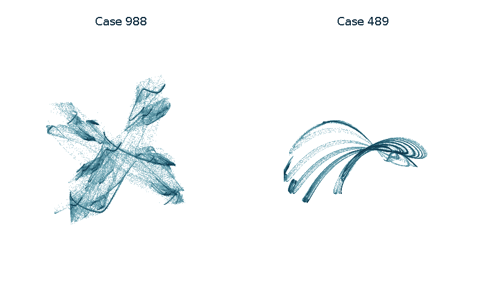

<!-- drawing-date -->
*First recorded portrait: **2026-11-01**.*
<!-- /drawing-date -->


<!-- drawing-date -->
*First recorded portrait: **2026-11-01**.*
<!-- /drawing-date -->

<!-- portrait-equation product-alphabet -->

**Cartesian product-alphabet posterior–sphere map**

```math
m_i(x)=\frac{\sum_{\ell\in A_i}\ell\,e^{-(x_i-\ell)^2/\tau}}{\sum_{\ell\in A_i}e^{-(x_i-\ell)^2/\tau}},\quad v=2m(x_n)-x_n,\quad x_{n+1}=\beta x_n+\beta\frac{v}{\lVert v\rVert}+(1-2\beta)m(x_n).
```

Aᵢ is the stored alphabet along coordinate i. Case 988 uses two levels per coordinate and Case 489 uses four. Independent Gaussian weights give the mean m; β controls relaxation and τ is temperature. [Model and parameters](docs/product-alphabet/manuscript.md)

**Parameters used for this portrait**

**Left · Case 988** β ≈ 0.926809, τ ≈ 0.0209357, 2 levels per axis. **Right · Case 489** β ≈ 0.969938, τ ≈ 0.0358258, 4 levels per axis. Both start at (0.317, −0.211, 0.419). [Exact coordinate alphabets and coefficients](results/product-alphabet/runs/product-alphabet-verification02/report.json)

<details>
<summary>Full numerical settings</summary>

```json
{
  "Case 988": {
    "beta": 0.9268088431125507,
    "tau": 0.020935697765931374,
    "levels_x_y_z": [
      [-1.1340147094801067, 0.8635723875835538],
      [-0.6955703573301434, 1.132117827422917],
      [-1.207180842384696, 1.066126063093543]
    ],
    "halfwidths_xyz": [0.9987935485318303, 0.9138440923765302, 1.1366534527391194],
    "center_xyz": [-0.13522116094827652, 0.2182737350463868, -0.07052738964557648]
  },
  "Case 489": {
    "beta": 0.9699380761357025,
    "tau": 0.035825792302107334,
    "levels_x_y_z": [
      [-0.9244054118171333, -0.23851865461717048, 0.44736810258279236, 1.1332548597827552],
      [-0.7305470814928413, -0.6134534236664574, -0.49635976584007346, -0.37926610801368954],
      [-0.264372487179935, -0.13884664718061684, -0.013320807181298744, 0.11220503281801938]
    ],
    "halfwidths_xyz": [1.0288301357999443, 0.17564048673957586, 0.18828875999897718],
    "center_xyz": [0.104424723982811, -0.5549065947532654, -0.0760837271809578]
  },
  "shared_initial_xyz": [0.317, -0.211, 0.419]
}
```

</details>

<!-- /portrait-equation -->

Native three-state iterates; rigid orthogonal camera and equal spatial units within each panel. Panel scales and density saturation differ.

[Survey and portraits](results/product-alphabet/README.md) · [Entropy](results/product-symbolic/README.md) · [Reversed return](results/product-orientation/README.md) · [Rare exits](results/product-horizon/README.md) · [Core instability](results/product-mechanism/README.md) · [Tests of attraction](results/product-larger-attractor/README.md) · [Nearby singularity](results/product-attractor-status/README.md)

### Folded shells from nonuniform quantizer levels

Uneven quantizer levels produce two curled shells. Both retained positive leading growth over 20 million steps, 33 starts and at 70- and 100-digit precision. Case 7 twice left the enlarged portrait bounds on its longer run.

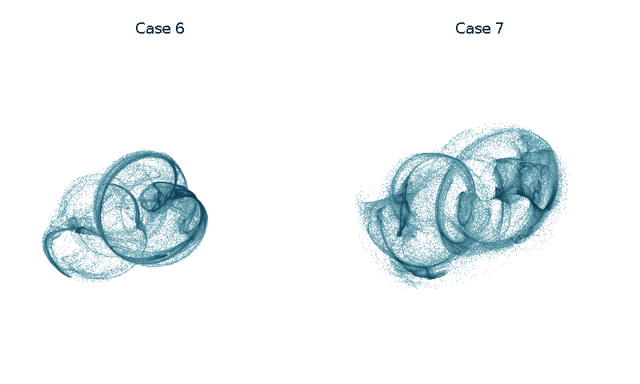

<!-- drawing-date -->
*First recorded portrait: **2026-11-01**.*
<!-- /drawing-date -->


<!-- drawing-date -->
*First recorded portrait: **2026-11-01**.*
<!-- /drawing-date -->

<!-- portrait-equation product-irregular -->

**Nonuniform product-alphabet posterior–sphere map**

```math
m_i(x)=\frac{\sum_{\ell\in A_i}\ell\,e^{-(x_i-\ell)^2/\tau}}{\sum_{\ell\in A_i}e^{-(x_i-\ell)^2/\tau}},\quad v=2m(x_n)-x_n,\quad x_{n+1}=\beta x_n+\beta\frac{v}{\lVert v\rVert}+(1-2\beta)m(x_n).
```

The levels in each coordinate alphabet Aᵢ have nonuniform spacing. Case 6 has four levels per coordinate and Case 7 has five. Their temperatures τ differ while β is shared. [Model and parameters](docs/product-alphabet/manuscript.md#32-nonuniform-alphabets-and-folded-shells)

**Parameters used for this portrait**

**Left · Case 6** τ ≈ 0.17863, 4 levels per axis. **Right · Case 7** τ ≈ 0.100479, 5 levels per axis. Shared β ≈ 0.998414. Both start at (0.317, −0.211, 0.419). [Exact coordinate alphabets and coefficients](results/product-highorder/runs/product-irregular-verification01/report.json)

<details>
<summary>Full numerical settings</summary>

```json
{
  "Case 6": {
    "beta": 0.9984140746686607,
    "tau": 0.17863014837168806,
    "levels_x_y_z": [
      [-0.7341878755949438, -0.591929277217119, -0.561714844093892, 0.43788822731003174],
      [-0.049005913734436024, -0.024496948041278277, 0.0487758121620068, 0.33897679150104526],
      [-0.37641734816133976, -0.1322577004015329, -0.011010519773386171, 0.26616191305220127]
    ]
  },
  "Case 7": {
    "beta": 0.9984140746686607,
    "tau": 0.10047945845907452,
    "levels_x_y_z": [
      [-0.7341878755949438, -0.591929277217119, -0.561714844093892, 0.3134663536067597, 0.43788822731003174],
      [-0.049005913734436024, -0.024496948041278277, 0.007173589638398342, 0.0487758121620068, 0.33897679150104526],
      [-0.37641734816133976, -0.3070297858742759, -0.1322577004015329, -0.011010519773386171, 0.26616191305220127]
    ]
  },
  "shared_initial_xyz": [0.317, -0.211, 0.419]
}
```

</details>

<!-- /portrait-equation -->

Native three-state discrete iterates; rigid orthogonal cameras and equal units within each panel. Panel scales and density saturation differ. Case numbers are local to the nonuniform-alphabet survey.

[Model, approach trajectories and visual precedents](docs/product-alphabet/manuscript.md#32-nonuniform-alphabets-and-folded-shells) · [Complete higher-order and nonuniform searches](results/product-highorder/README.md)

### Acceleration memory in a scalar iteration

The scalar iteration converges to a unique fixed point. When Anderson acceleration uses its last three states, the memory traces an irregular shape that persists in 80- and 110-digit calculations.

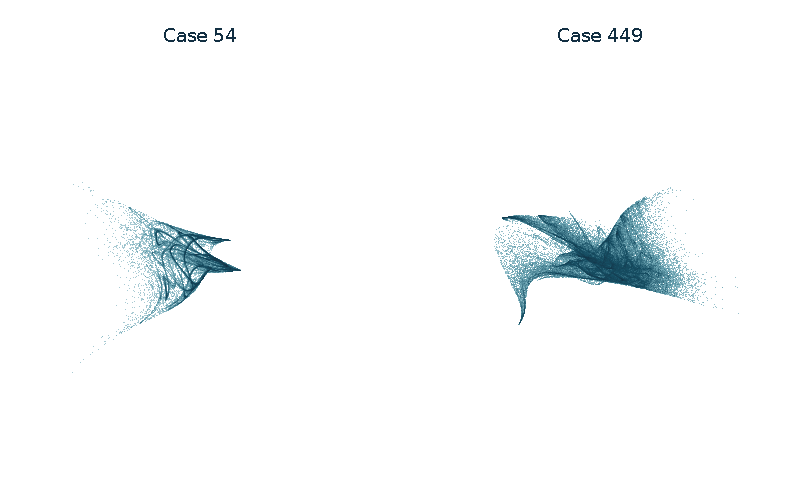

<!-- drawing-date -->
*First recorded portrait: **2026-11-01**.*
<!-- /drawing-date -->

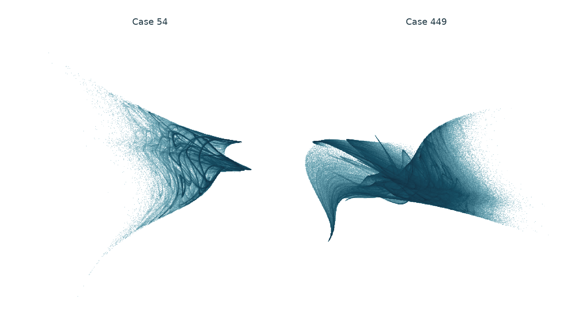

<!-- drawing-date -->
*First recorded portrait: **2026-11-01**.*
<!-- /drawing-date -->

<!-- portrait-equation anderson -->

**Three-history regularized Anderson acceleration of a scalar tanh iteration**

```math
(x_0,x_1,x_2)^+=\left(x_1,x_2,\sum_{i=0}^2\alpha_i g(x_i)\right),\quad \alpha=\arg\min_{\sum_i a_i=1}\left[(a^\top r)^2+\lambda\|a\|^2\right]
```

The residual is rᵢ = g(xᵢ) − xᵢ for g(x) = c + k tanh(x). The coefficient λ sets the regularization. [Model and parameters](docs/anderson-memory.md#the-exact-algorithm)

**Parameters used for this portrait**

**Left · Case 54** k ≈ 3.66546, c ≈ 2.06188, λ ≈ 0.0332963, scalar start ≈ -1.55803. **Right · Case 449** k ≈ 2.60333, c ≈ -1.05471, λ ≈ 0.00071673, scalar start ≈ 1.47542. Each initial history is (x, g(x), g(g(x))). [Exact coefficients and cold histories](results/unexpected-search/facts.json)

<details>
<summary>Full numerical settings</summary>

```json
{
  "Case 54": {
    "k": 3.6654575131969844,
    "c": 2.061882544308901,
    "regularization_lambda": 0.03329627201071343,
    "scalar_start": -1.558028880506754,
    "initial_history": [-1.558028880506754, -1.2923796328820014, -1.089489036686178]
  },
  "Case 449": {
    "k": 2.603332208979775,
    "c": -1.0547139253467321,
    "regularization_lambda": 0.0007167296313181746,
    "scalar_start": 1.4754167087376118,
    "initial_history": [1.4754167087376118, 1.2898619702994667, 1.1817837410397556]
  }
}
```

</details>

<!-- /portrait-equation -->

Three-history state.

[Model, controls and limitations](docs/anderson-memory.md) · [Reproduction](research/unexpected_search/README.md)

### Adaptive integration of a decaying oscillator

The oscillator decays to rest. Near its error tolerance, the RK45 solver keeps changing its step size, tracing this irregular shape in position, velocity and proposed step. Five-million-step runs, higher precision and the original library reproduce the behavior.


<!-- drawing-date -->
*First recorded portrait: **2026-11-01**.*
<!-- /drawing-date -->


<!-- drawing-date -->
*First recorded portrait: **2026-11-01**.*
<!-- /drawing-date -->

<!-- portrait-equation rk45 -->

**Dormand–Prince RK45 adaptive controller on a damped harmonic oscillator**

```math
\begin{aligned}v&=R(hA)y,\quad e=E(hA)y,\quad A=\begin{pmatrix}0&1\\-1&-2\zeta\end{pmatrix},\\R(z)&=\sum_{j=0}^{5} z^j/j!+z^6/600,\quad E(z)=z^5(5z^2-39z+97)/120000,\\w&=\sqrt{\tfrac12\sum_i\left[\frac{e_i}{\tau+\rho\max(|y_i|,|v_i|)}\right]^2}.\end{aligned}
```

Dormand–Prince 5(4) on the damped oscillator y = (q,p). With absolute and relative tolerances τ, ρ, accept v if w < 1 and multiply h by min(10, 0.9 w^(−1/5)), capped at one after a rejection. Otherwise retry y with factor max(0.2, 0.9 w^(−1/5)). Zero error selects the maximum allowed growth. [Model and parameters](docs/rk45-controller-structure.md)

**Parameters used for this portrait**

The normalized absolute tolerance is τ = 1. Values are ordered as `(ζ, ρ)`. Left · Case 335 `(0.8877198030073196, 1.4674009503231292e-10)`. Right · Case 448 `(0.9463349944557995, 6.210996908104011e-06)`. [Archived settings and portrait starts](results/rk45-controller/oscillator/render/analysis.json)

<details>
<summary>Full numerical settings</summary>

The portrait runs start at `(q/τ, p/τ, log h)`. Left · Case 335 `(-0.028238232407149795, 1.0336784721796828, 1.1390327731401952)`. Right · Case 448 `(-0.4615785377519197, 0.24120353832840974, 1.7301417445681706)`. Discard 100,000 updates and retain the next 8,000,000.

</details>

<!-- /portrait-equation -->

Position / atol, velocity / atol, proposed step.

[RK45 results](docs/rk45-oscillator.md) · [RK23 results](docs/rk23-oscillator.md) · [RK45 manuscript](docs/rk45-controller/manuscript.md) · [Prior art](docs/rk45-priority.md)

### Optimizer memory on a scalar quadratic

The tanh variant of Yogi produces two positive finite-time growth rates on a scalar quadratic objective. Five-million-step runs, higher precision and TensorFlow reproduce the effect in the optimizer’s internal state.

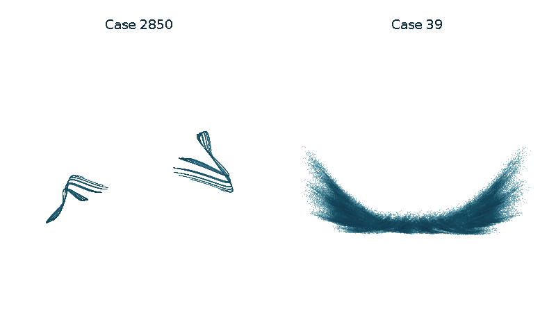

<!-- drawing-date -->
*First recorded portrait: **2026-11-01**.*
<!-- /drawing-date -->

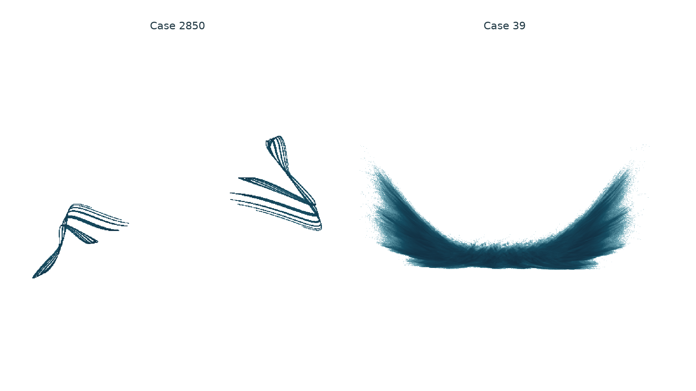

<!-- drawing-date -->
*First recorded portrait: **2026-11-01**.*
<!-- /drawing-date -->

<!-- portrait-equation yogi-tanh -->

**Autonomous tanh-Yogi iteration on a scalar quadratic**

```math
m^+=bm+(1-b)x,\quad v^+=v-(1-c)x^2\tanh\!\big(k(v-x^2)\big),\quad x^+=x-\frac{m^+}{\sqrt{v^+}+e}
```

The memory coefficients are b and c. The activation scale is k = 10α² and the normalized offset is e = ε/α. [Model and parameters](docs/yogi-tanh.md)

**Parameters used for this portrait**

Values are ordered as `(b, c, e, k)`. Left · Case 2850 `(0.05067918724846095, 0.39045379066839814, 0.00122058437219709, 15.279463603263238)`. Right · Case 39 `(0.9891246411297471, 0.4454789482569322, 6.93550097565182e-05, 2446.6273997990243)`. [Archived settings and portrait starts](results/yogi-tanh/render/analysis.json)

<details>
<summary>Full numerical settings</summary>

The portrait runs start at `(x, m, v)`. Left · Case 2850 `(0.43612120565008095, -0.39924136020937107, 0.20702930318377716)`. Right · Case 39 `(-0.008287309241901561, 0.021414882890013615, 0.06678833829691441)`. Discard 10,000 updates and retain the next 8,000,000.

</details>

<!-- /portrait-equation -->

Normalized optimizer state (x, m, v).

[Smooth Yogi](docs/yogi-tanh.md) · [Manuscript](docs/yogi-memory/manuscript.md) · [Standard Yogi](docs/yogi-parameter-plane.md) · [Adamax](docs/adamax-geometry.md) · [AdaBelief](docs/adabelief-quadratic.md)

### Matrix scaling with unequal rates

Unequal row and column update rates produce curved bands when scaling a 3 × 2 matrix. Cases 150 and 987 gave two positive finite-time rates after 106 million steps. Independent high-precision runs confirmed the leading rate. Some starts in Case 150 escape.


<!-- drawing-date -->
*First recorded portrait: **2026-11-01**.*
<!-- /drawing-date -->


<!-- drawing-date -->
*Drawn: **2026-11-01**.*
<!-- /drawing-date -->

<!-- portrait-equation sinkhorn-balanced -->

**Unequally overrelaxed Sinkhorn matrix scaling**

```math
u_i^+=u_i^{1-\omega_x}\!\left(\frac{a_i}{(Kv)_i}\right)^{\omega_x},\qquad v_j^+=v_j^{1-\omega_y}\!\left(\frac{b_j}{(K^\top u^+)_j}\right)^{\omega_y}
```

K is a positive 3 × 2 matrix with row sums a and column sums b. The three plotted variables are log ratios to the first entry of each scaling vector. [Model and parameters](docs/sinkhorn-unequal-rates.md#map-and-input-design)

**Parameters used for this portrait**

Both panels use a 3 × 2 kernel. In row–column order (ωₓ, ωᵧ), Left · Case 150 uses `(2.1, 1.8)`. Right · Case 987 uses `(2.02, 1.9)`. [Log kernels and continuation states](results/sinkhorn-unequal-rates/selected-100m/3x2-rows0000.json)

<details>
<summary>Full numerical settings</summary>

Left · Case 150. The rows of log K are `(-1.6639291409387758, -1.4243707448014886)`, `(-1.5578692222215644, -7.730052181693201)`, `(-13.572727452145351, -1.024650777414537)`. The archived continuation starts at `(-1.4402247774019465, 0.5868452665227508, -0.5124343148594364)` in `(x₁, x₂, y₁)`.

Right · Case 987. The rows of log K are `(-1.8443759468735423, -1.2319344974789257)`, `(-1.62906560702368, -11.01032108032506)`, `(-14.52684209044253, -1.0384058501592393)`. The archived continuation starts at `(0.5855617366517104, 0.07574917600584613, -0.14865100525559172)` in `(x₁, x₂, y₁)`.

</details>

<!-- /portrait-equation -->

All three anchored log coordinates; rigid PCA rotation with equal units and no rescaling. Each panel contains 250,000 consecutive states.

[Map, complete screen and prior art](docs/sinkhorn-unequal-rates.md) · [Evidence and reproduction](results/sinkhorn-unequal-rates/README.md)

## Molecular-motor dynamics

### Four-row irregular motion

Changing the transition-rate asymmetry turns a narrow braid into a broader band. The eleven-dimensional model has positive leading growth in long numerical runs. These three displacement contrasts show one projection of its motion.


<!-- drawing-date -->
*First recorded portrait: **2026-11-01**.*
<!-- /drawing-date -->

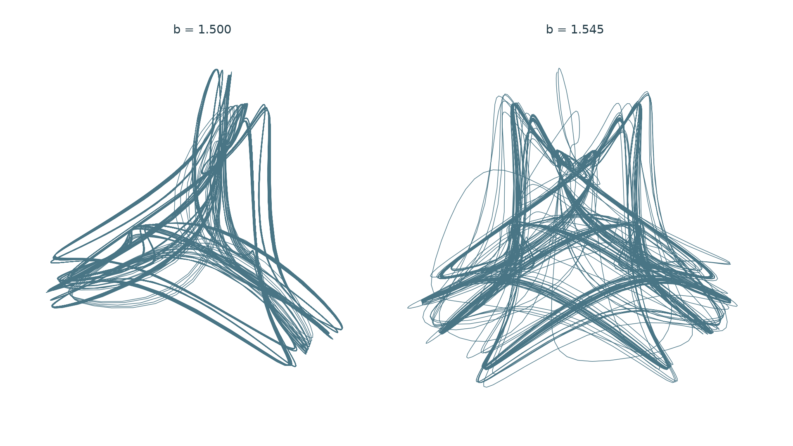

<!-- drawing-date -->
*First recorded portrait: **2026-11-01**.*
<!-- /drawing-date -->

<!-- portrait-equation motor-four -->

**Alouges et al. collective molecular-motor model with four rows**

```math
\begin{aligned}
 V_j&=-\rho X_j+r(s_j-\bar s),\qquad \dot X_j=V_j,\\
 \dot c_j&=1-c_j-V_js_j,\qquad \dot s_j=b-s_j+V_jc_j,\\
 \bar s&=N^{-1}\sum_{k=1}^{N}s_k,\qquad \sum_{j=1}^{N}X_j=0.
\end{aligned}
```

For row j, c and s are the cosine and sine occupancy coefficients, X is displacement and V is velocity. [Model and parameters](docs/motor-rows-gpu-survey.md#what-the-system-represents)

**Parameters used for this portrait**

N = 4, ρ = 2.0238144033191343, r = 5.193274038098629. Left · Case 3142 uses b = 1.500. Right · Case 298 uses b = 1.545. [Left run](results/motor-four-extension/motor-four-100k/protocol.json) · [Right run](results/motor-four-b-study/motor-four-symmetric-long/protocol.json)

<details>
<summary>Full numerical settings</summary>

The stored order is all cosine occupancies c, all sine occupancies s, then the first N − 1 displacements X. The last displacement is fixed by the zero-sum constraint.

Left · `(0.7778339475280193, 0.9772950123235913, 0.22809943836724209, 0.13780598859187057, 1.2898333376096789, 1.3101296062454415, 1.2186131969365344, 0.6990841555244417, 0.7898843795834658, 1.1876135670549404, 0.04482156443046654)`.

Right · `(0.4359496406479541, 0.08400727167673762, 0.5968330642392213, 0.1444524815302945, 1.386215165255454, 1.1547205674722596, 1.4904160200645618, 0.4627654774639831, 0.9533973425062237, -0.0215309988724776, 1.42734821908359)`.

</details>

<!-- /portrait-equation -->

Three orthonormal displacement contrasts; final 1,200 saved time units; common scale.

[Four-row comparison](docs/motor-four-b-study.md) · [Five-row geometry](docs/motor-five-geometry.md) · [Source equations](docs/motor-rows-source-audit.md)

### Eight-row periodic attraction

At the periodic setting, a five-cluster orbit attracts nearby states in all 22 transverse directions. At the irregular setting, the same model gives six positive finite-time exponents over 20,000 time units.

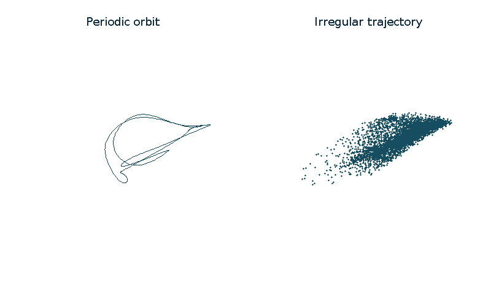

<!-- drawing-date -->
*First recorded portrait: **2026-10-30** · Current rendering: 2026-11-01.*
<!-- /drawing-date -->

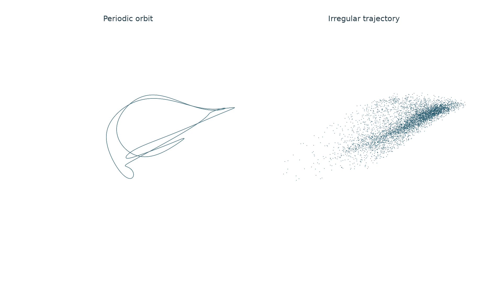

<!-- drawing-date -->
*First recorded portrait: **2026-10-30** · Current rendering: 2026-11-01.*
<!-- /drawing-date -->

<!-- portrait-equation motor-eight -->

**Alouges et al. collective molecular-motor model with eight rows**

```math
\begin{aligned}
 V_j&=-\rho X_j+r(s_j-\bar s),\qquad \dot X_j=V_j,\\
 \dot c_j&=1-c_j-V_js_j,\qquad \dot s_j=b-s_j+V_jc_j,\\
 \bar s&=N^{-1}\sum_{k=1}^{N}s_k,\qquad \sum_{j=1}^{N}X_j=0.
\end{aligned}
```

For row j, c and s are the cosine and sine occupancy coefficients, X is displacement and V is velocity. Eight rows have 23 independent states. The left panel shows a five-cluster periodic orbit and the right shows an irregular trajectory. [Model and parameters](docs/motor-rows-gpu-survey.md#what-the-system-represents)

**Parameters used for this portrait**

N = 8. Left · periodic Case 16 uses `(ρ, r, b) = (2.3454545454545457, 4.7551460477513405, 1.0)`. Right · irregular lane 69 uses `(ρ, r, b) = (2.934090909090909, 4.7551460477513405, 1.0)`. [Periodic orbit](results/motor-activity-continuation/probe-destinations/case-16/periodic/analysis.json) · [Irregular continuation](results/motor-activity-continuation/cpu/run-01/input.json)

<details>
<summary>Full numerical settings</summary>

The stored order is all cosine occupancies c, all sine occupancies s, then the first N − 1 displacements X. The last displacement is fixed by the zero-sum constraint. The starting points below are the first full states in the two plotted arrays.

Left · `(-0.11695569924419315, 0.5365226791175068, 0.5365226791175068, -0.11695569924419315, 0.2996866142896809, 1.2229020083722062, 1.2229020083722062, 1.0810049835553737, 0.9228018565782007, 1.067324911204996, 1.067324911204996, 0.9228018565782007, -0.7215578890354091, 0.6077722222746984, 0.6077722222746984, 0.7467587938440362, 0.0, 0.6069234087405941, 0.6069234087405941, 0.0, -2.095603708524847, 0.3011287498219546, 0.3011287498219546)`.

Right · `(0.9866544379243679, 1.1446176533428414, 0.9079349663187947, 1.2013879950340507, 0.9018021169088802, 1.0601291344724773, 1.1659948018851851, 0.05536083706261172, 0.9723248017962212, 0.8107125571527152, 1.048427397166614, 0.6937377124236542, 0.9081804170329403, 0.8651659764402028, 0.6438715403924499, 1.0046299982290943, 0.1426492568011055, 0.12059014371905978, 0.18394276627520859, 0.04589795280545451, 0.1347985918872766, -0.27357974317748635, -0.05116952086707107)`.

</details>

<!-- /portrait-equation -->

Physical coordinates (X0, X1, s0) of the 23D model; common scale.

[Periodic-attractor certificate](docs/motor-five-cycle-certificate.md) · [Replication instability](docs/motor-five-replication-limit.md) · [Irregular regimes](docs/motor-activity-continuation.md)

## Constructed data

### Structured-data FastICA

On a constructed 720-row dataset, the attracting set of standard cubic FastICA maps onto a circle. Each iteration triples the angle on that circle. For coupling from 0 to 1/25, the attracting set has entropy at least `log(3)` per iteration, including after identifying opposite weight vectors. The left panel lies in that proved range. The right panel is a numerical comparison.


<!-- drawing-date -->
*First recorded portrait: **2026-11-01**.*
<!-- /drawing-date -->

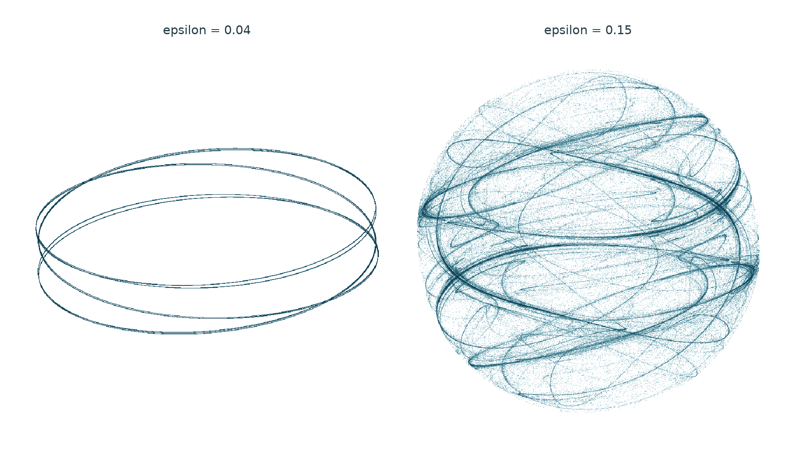

<!-- drawing-date -->
*Drawn: **2026-11-01**.*
<!-- /drawing-date -->

<!-- portrait-equation fastica-tripling -->

**One-unit cubic FastICA on a deterministic 720-observation sample**

```math
h(w)=\mathbb E[X(X^\top w)^3]-3\mathbb E[(X^\top w)^2]w,\qquad w^+=\frac{h(w)}{\|h(w)\|}
```

The expectation averages the 720 specified, equally weighted four-dimensional observations. The two panels use the same cubic FastICA update and the structured data at ε = 0.04 and 0.15, respectively. [Model and parameters](docs/fastica-tripling.md#data-and-update)

**Parameters used for this portrait**

The left dataset uses ε = 0.04 and the right ε = 0.15. Both start from the unit vector obtained by normalizing (0.83, 0.29, −0.13, 0.11), discard 10,000 updates and retain 500,000 consecutive unit-weight vectors. [Left run](results/fastica-tripling/long-01/portrait-040.json) · [Right run](results/fastica-tripling/long-01/portrait-150.json)

<details>
<summary>Full numerical settings</summary>

Each base point (x,y) among (±1,0), (0,±1) occurs four times, and each among (±√6,0), (0,±√6) occurs once. For each of these 20 entries, take all 36 ordered pairs (ξ,η) from the list (√3,−√3,0,0,0,0), with repetition by index. Set R = x²+y², σ = √(1−6ε²) and form observations (x,y,εx(R−4)+σξ,εy(R−4)+ση). All 720 rows have equal weight. [Deterministic data construction](docs/fastica-tripling.md#data-and-update)

</details>

<!-- /portrait-equation -->

Projection `(A,B,C)` of a unit weight in four dimensions; equal units and a common scale. The parameter `epsilon` controls the coupling in the fixed input data. Each panel contains 500,000 consecutive iterates.

[Construction and entropy](docs/fastica-tripling.md) · [Local noninjectivity](docs/fastica-tripling-structure.md) · [Rejected intrinsic-collision candidate](docs/fastica-preimage-rejection.md) · [Numerical controls and reproduction](results/fastica-tripling/README.md)

<!-- shape-search-20261121-selected -->
## Shape search of 2026-11-21

### Six-loop rosette and six-sided spiral lattice

Cases 132 and 306 give two distinct sixfold silhouettes in cyclic harmonic flows. Each has a positive leading numerical rate with four initial states and an independent adaptive solver.


<!-- drawing-date -->
*First recorded portrait: **2026-11-21**.*
<!-- /drawing-date -->


<!-- drawing-date -->
*Drawn: **2026-11-21**.*
<!-- /drawing-date -->

<!-- portrait-equation shapes-20261121-harmonic -->

**Cyclic three-coordinate harmonic flow**

```math
\dot x_i=-d_i x_i+a_i\sin(x_j+\phi_i)+b_i\sin(x_k+\psi_i)+c_i\sin(m_i x_j+n_i x_k+\chi_i).
```

The indices (i, j, k) run cyclically through the three native Cartesian coordinates. Cases 132 and 306 use different coefficient sets for the six-loop rosette and six-sided spiral lattice. [Model and parameters](results/shape_search_20261121/flows/README.md#cartesian-harmonic-coupling)

**Parameters used for this portrait**

Each coordinate uses the same nine coefficients. In the order (d, a, b, c, φ, ψ, χ, m, n), left Case 132 uses (0.074779, 1, −0.76644, −0.37633, 0, 0, 0, 1, 1) and right Case 306 uses (0.18021, 1, 0.94226, 0.26911, 0, 0, 0, 2, −1), rounded. [Case 132 coefficients and start](results/shape_search_20261121/flows/manifest.json#L10) · [Case 306 coefficients and start](results/shape_search_20261121/flows/manifest.json#L77) · [Reproduce the portraits](research/shape_search_20261121/flows/replay_case.py)

<details>
<summary>Full numerical settings</summary>

```text
Left — Case 132
(d, a, b, c, phi, psi, chi, m, n), common to all three axes = [0.07477892057799321, 1.0, -0.7664416731170509, -0.37632670029570203, 0.0, 0.0, 0.0, 1.0, 1.0]
initial native XYZ = [0.4117172296953253, -0.7952687514091004, -0.46899562046827814]

Right — Case 306
(d, a, b, c, phi, psi, chi, m, n), common to all three axes = [0.1802116096938173, 1.0, 0.9422594064983798, 0.2691126067118914, 0.0, 0.0, 0.0, 2.0, -1.0]
initial native XYZ = [-0.8083560469249171, 1.6382409895925187, 3.8732594090301227]
```

</details>

<!-- /portrait-equation -->

Full spatial states at equal axis scales. The camera looks along (1, 1, 1). [Equations, controls and prior work](docs/shape-search-20261121.md)

### Nested scrolls and ribbed fans

A Gaussian posterior reflector paired with a torus produces a nested scroll and two ribbed fans. Leading finite-time exponents stay positive over five million double-precision iterations.


<!-- drawing-date -->
*First recorded portrait: **2026-11-21**.*
<!-- /drawing-date -->


<!-- drawing-date -->
*Drawn: **2026-11-21**.*
<!-- /drawing-date -->

<!-- portrait-equation shapes-20261121-torus -->

**Gaussian posterior reflection on a ring torus**

```math
m(x)=\frac{\sum_j b_j e^{-\lVert x-b_j\rVert^2/\tau}}{\sum_j e^{-\lVert x-b_j\rVert^2/\tau}},\quad v=2m(x_n)-x_n,\quad x_{n+1}=\beta x_n+\beta P(v)+(1-2\beta)m(x_n).
```

For a centerline circle Cᵢ, let cᵢ be its nearest point to v and Pᵢ(v)=cᵢ+r(v−cᵢ)/‖v−cᵢ‖. C₀ is the unit xy circle. Both Case 301027 and Case 370279 use P=P₀, with different sites bⱼ, temperatures τ, tube radii r and relaxations β. [Model and parameters](results/shape_search_20261121/projection/README.md#map-and-geometry) · [Case 301027](results/shape_search_20261121/projection/case-301027.json) · [Case 370279](results/shape_search_20261121/projection/case-370279.json)

**Parameters used for this portrait**

The reference major radius is 1. The stored inverse temperature is q = 1/τ. Left Case 301027 uses 8 sites, relaxation β ≈ 0.99525, inverse temperature q ≈ 1.1301 and tube radius r ≈ 0.10989. Right Case 370279 uses 4 sites, relaxation β ≈ 0.98654, inverse temperature q ≈ 2.8933 and tube radius r ≈ 0.081705. [Case 301027 site coordinates and parameters](results/shape_search_20261121/projection/case-301027.json) · [Case 370279 site coordinates and parameters](results/shape_search_20261121/projection/case-370279.json) · [Reproduce the portraits](research/shape_search_20261121/projection/reproduce.py)

<details>
<summary>Full numerical settings</summary>

```text
Left — Case 301027
reference major radius = 1.0
tube radius r = 0.10989369451999664
relaxation beta = 0.995246171951294
Gaussian inverse temperature q = 1/tau = 1.1301413774490356
temperature tau = 0.8848450467827381
reference centerline C0 = unit xy circle about (0, 0, 0)
site 1 = [-0.8812902569770813, 0.07612097263336182, 0.7732897400856018]
site 2 = [-0.5336582660675049, -0.020198090001940727, -0.9754204750061035]
site 3 = [-0.6531791090965271, -0.40267273783683777, 0.8450087308883667]
site 4 = [-0.3055470585823059, -0.49899181723594666, -0.9037014842033386]
site 5 = [-0.434047132730484, 0.3006657063961029, 0.8498307466506958]
site 6 = [-0.0864151269197464, 0.2043466418981552, -0.8988794088363647]
site 7 = [-0.20593594014644623, -0.17812800407409668, 0.9215497374534607]
site 8 = [0.14169606566429138, -0.27444708347320557, -0.8271604180335999]
initial native XYZ = [0.31700000166893005, -0.210999995470047, 0.4189999997615814]

Right — Case 370279
reference major radius = 1.0
tube radius r = 0.08170489221811295
relaxation beta = 0.9865415692329407
Gaussian inverse temperature q = 1/tau = 2.893308401107788
temperature tau = 0.34562509811160147
reference centerline C0 = unit xy circle about (0, 0, 0)
site 1 = [0.0934947058558464, -0.23779988288879395, -0.4001636505126953]
site 2 = [0.3930797278881073, 0.2676146924495697, 0.6604105830192566]
site 3 = [-0.13227902352809906, 1.1522095203399658, -0.18401023745536804]
site 4 = [0.9565003514289856, 0.764326274394989, -0.5502326488494873]
initial native XYZ = [0.31700000166893005, -0.210999995470047, 0.4189999997615814]
```

</details>

<!-- /portrait-equation -->

Consecutive three-state iterates in equal units. Each panel has its own spatial scale. [Equations, controls and prior work](docs/shape-search-20261121.md)

### Three-phase curls and four-phase crescents

Two dissipative twist maps visit three and four spatial groups in order. Positive growth persists on long runs. The phase count describes successive visits within a single orbit.


<!-- drawing-date -->
*First recorded portrait: **2026-11-21**.*
<!-- /drawing-date -->

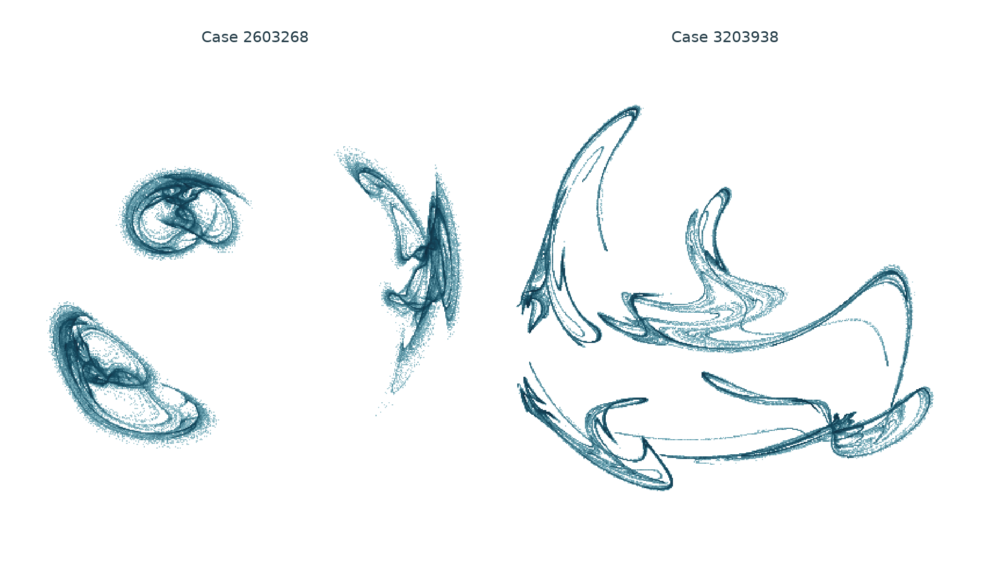

<!-- drawing-date -->
*Drawn: **2026-11-21**.*
<!-- /drawing-date -->

<!-- portrait-equation shapes-20261121-phase -->

**Dissipative three-axis twist map**

```math
z^{(0)}=r x_n+(1-r)e_1,\quad z^{(j)}=R_{i_j k_j}\!\left(a_j+b_jw_j+h_jw_j^3\right)z^{(j-1)},\quad x_{n+1}=z^{(3)}.
```

The rotations act in the xy, yz and zx planes in that order. Each wⱼ is the remaining coordinate immediately before its rotation, r is the contraction ratio and e₁=(1,0,0). Case 2603268 visits three spatial groups and Case 3203938 visits four. [Model and parameters](docs/twist-geometry.md#definition-and-exact-structural-properties) · [Maps report](results/shape_search_20261121/maps/README.md)

**Parameters used for this portrait**

The xy, yz and zx rotations use offsets a, linear coefficients b (archived as k) and cubic coefficients h, in that order. Left Case 2603268 uses contraction r ≈ 0.85487, offsets a ≈ (−0.14926, −0.83867, 1.7537), linear coefficients b ≈ (−10.112, −2.4086, −10.625) and cubic coefficients h ≈ (21.101, −15.662, 3.915). Right Case 3203938 uses contraction r ≈ 0.85238, offsets a ≈ (−2.754, −1.9656, −2.2385), linear coefficients b ≈ (−0.49013, −2.2456, 3.6036) and cubic coefficients h ≈ (−26.81, 4.859, −39.704). [Case 2603268 exact coefficients](results/shape_search_20261121/maps/checks/2603268.json) · [Case 3203938 exact coefficients](results/shape_search_20261121/maps/checks/3203938.json) · [Reproduce the portraits](research/shape_search_20261121/maps/replay.py)

<details>
<summary>Full numerical settings</summary>

```text
Left — Case 2603268
contraction r = 0.8548706215037367
angle offsets a (xy, yz, zx) = [-0.1492648004954276, -0.8386668720139375, 1.753694391339408]
linear twist b, archived as k (xy, yz, zx) = [-10.112001021790856, -2.4086161368631442, -10.625358999414095]
cubic twist h (xy, yz, zx) = [21.101325145325976, -15.661928548663237, 3.9150465675127624]
initial native XYZ = [0.1, 0.2, 0.3]

Right — Case 3203938
contraction r = 0.8523766521686973
angle offsets a (xy, yz, zx) = [-2.7540168172517228, -1.9656069914623395, -2.238497215663707]
linear twist b, archived as k (xy, yz, zx) = [-0.4901298360679912, -2.2456296936367033, 3.6035528906025687]
cubic twist h (xy, yz, zx) = [-26.809936723351267, 4.85899399694934, -39.70375654439732]
initial native XYZ = [0.1, 0.2, 0.3]
```

</details>

<!-- /portrait-equation -->

Consecutive three-state iterates in equal units. Each panel has its own spatial scale. [Equations, controls and prior work](docs/shape-search-20261121.md)

### Different core knots at the same winding and determinant

Both maps have winding four and determinant-one first cores. Their Alexander polynomials have spans ten and eight, respectively, and exclude all torus knots. Both solenoids have entropy log 4 per iterate.

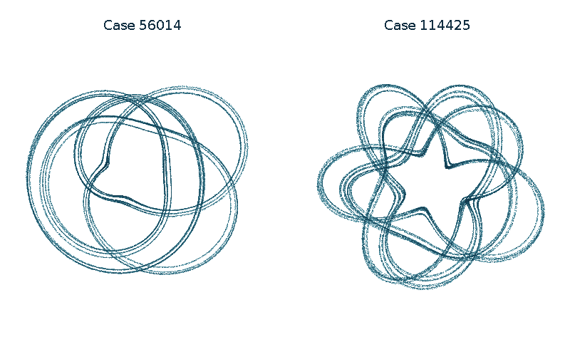

<!-- drawing-date -->
*First recorded portrait: **2026-11-21**.*
<!-- /drawing-date -->


<!-- drawing-date -->
*Drawn: **2026-11-21**.*
<!-- /drawing-date -->

<!-- portrait-equation shapes-20261121-braids -->

**Fourier-core solenoid map on a solid torus**

```math
\begin{aligned}\theta^+&=p\theta+0.14\sin(p\theta)+0.137\pmod{2\pi},\\z^+&=C(\theta)+\rho e^{i(m\theta+0.31)}z,\quad C(\theta)=s^{-1}\sum_k(u_k+i v_k)e^{ik\theta}.\end{aligned}
```

The complex coordinate z lies in the unit disk. Cases 56014 and 114425 have the same angular degree p = 4 and different Fourier cores. Their coefficients, scale s, fiber contraction ρ and twist m are specified in the linked case certificates. [Model and parameters](research/shape_search_20261121/braids/README.md#map-and-trapping-region)

**Parameters used for this portrait**

Both maps have degree p = 4, ripple 0.14, base shift 0.137 and fiber phase 0.31. A Fourier triple is (frequency k, real coefficient uₖ, imaginary coefficient vₖ). Left Case 56014 has scale 40, contraction ρ = 0.109, twist m = 2 and Fourier triples (−5, 16, 6), (−3, −7, 6), (−6, 6, −2), (−2, 8, −1). Right Case 114425 has scale 31, contraction ρ = 0.157, twist m = −2 and Fourier triples (10, 2, 14), (−9, −8, 0). [Case 56014 coefficients](results/shape_search_20261121/braids/certificates.json#L766) · [Case 114425 coefficients](results/shape_search_20261121/braids/certificates.json#L866) · [Reproduce the portraits](research/shape_search_20261121/braids/sample.py)

<details>
<summary>Full numerical settings</summary>

```text
Left — Case 56014
degree = 4
base ripple = 0.14
base offset = 0.137
scale = 40
fiber radius = 0.109
fiber turns = 2
fiber phase = 0.31
harmonics = [[-5, 16, 6], [-3, -7, 6], [-6, 6, -2], [-2, 8, -1]]
harmonic ordering = (k, Re coefficient, Im coefficient)
cylindrical embedding major radius = 1.15
initial (theta, Re z, Im z) = (0.71, 0.24, -0.03)

Right — Case 114425
degree = 4
base ripple = 0.14
base offset = 0.137
scale = 31
fiber radius = 0.157
fiber turns = -2
fiber phase = 0.31
harmonics = [[10, 2, 14], [-9, -8, 0]]
harmonic ordering = (k, Re coefficient, Im coefficient)
cylindrical embedding major radius = 1.15
initial (theta, Re z, Im z) = (0.71, 0.24, -0.03)
```

</details>

<!-- /portrait-equation -->

Three-dimensional states in the same fixed Euclidean embedding of the solid torus. [Equations, controls and prior work](docs/shape-search-20261121.md)

### Four-lobed and eight-lobed resonant flows

Rotationally symmetric flows fold into a four-lobed sheet and an eight-lobed crown. Independent integration and five starting states retained positive finite-time expansion in both cases.


<!-- drawing-date -->
*First recorded portrait: **2026-11-21**.*
<!-- /drawing-date -->

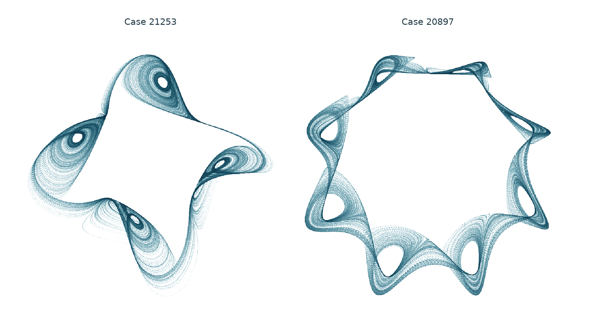

<!-- drawing-date -->
*Drawn: **2026-11-21**.*
<!-- /drawing-date -->

<!-- portrait-equation shapes-20261121-rings -->

**Saturated angular-resonance flow**

```math
\begin{aligned}
\dot u &= u[\alpha-s+\beta z+i(\omega+\kappa z+\tau s)]
          +A h^{(n-2)/2}\overline{u}^{n-1},\\
\dot z &= -d z+e\frac{s-1}{1+s}
          + f h^{n/2}\mathrm{Re}(e^{i\phi}u^n).
\end{aligned}
```

Here u = x + iy, s = |u|² and h = 2/(1+s). Case 21253 uses resonance order n = 4 and Case 20897 uses n = 8. [Model and parameters](results/shape_search_20261121/flows/README.md#angular-resonance)

**Parameters used for this portrait**

With the angular order first, the coefficients (n, α, β, ω, κ, τ, A, d, e, f, φ) are approximately (4, 0.94118, −0.14172, 1.6093, −1.8913, −1.9971, 0.91217, 0.33489, 0.8694, 0.56074, 1.8185) for left Case 21253 and (8, 1.108, −0.21318, −0.0055476, −2.8128, −0.93216, 0.46846, 0.32378, −0.597, −0.67065, 0.20631) for right Case 20897. [Case 21253 coefficients and start](results/shape_search_20261121/flows/manifest.json#L278) · [Case 20897 coefficients and start](results/shape_search_20261121/flows/manifest.json#L323) · [Reproduce the portraits](research/shape_search_20261121/flows/replay_case.py)

<details>
<summary>Full numerical settings</summary>

```text
Left — Case 21253
(order, alpha, beta, omega, kappa, tau, A, d, e, f, phi) = [4.0, 0.9411838290891947, -0.14172019415390258, 1.6092750726713088, -1.891302660862244, -1.997093046218, 0.9121710443918273, 0.33489235344466384, 0.8693987129451934, 0.5607411169455898, 1.8185365643350169]
initial native XYZ = [-0.7585906968498259, 0.651567459786702, -0.10754842480570659]

Right — Case 20897
(order, alpha, beta, omega, kappa, tau, A, d, e, f, phi) = [8.0, 1.108022397625541, -0.21317658723482014, -0.005547617943269856, -2.812826784825292, -0.9321582755321347, 0.4684582691445136, 0.32377809280649156, -0.596995487788702, -0.6706527176998085, 0.20631296183529413]
initial native XYZ = [0.8620033105888245, -0.5069026460119405, 0.014925477169952295]
```

</details>

<!-- /portrait-equation -->

Full spatial states shown from a steep inclination. [Equations, controls and prior work](docs/shape-search-20261121.md)

### A domed shell and a stack of cusps

A single torus gives the domed shell at left. Choosing between two linked tori gives the layered cusps at right. Both have two positive finite-time exponents. Case 516308 also has a certified stable fixed point.


<!-- drawing-date -->
*First recorded portrait: **2026-11-21**.*
<!-- /drawing-date -->


<!-- drawing-date -->
*Drawn: **2026-11-21**.*
<!-- /drawing-date -->

<!-- portrait-equation shapes-20261121-hyper -->

**Gaussian posterior reflection on one torus (left) and a nearest linked pair (right)**

```math
m(x)=\frac{\sum_j b_j e^{-\lVert x-b_j\rVert^2/\tau}}{\sum_j e^{-\lVert x-b_j\rVert^2/\tau}},\quad v=2m(x_n)-x_n,\quad x_{n+1}=\beta x_n+\beta P(v)+(1-2\beta)m(x_n).
```

For a centerline circle Cᵢ, let cᵢ be its nearest point to v and Pᵢ(v)=cᵢ+r(v−cᵢ)/‖v−cᵢ‖. C₀ is the unit xy circle. Case 516308 uses P=P₀. In Case 1291273, C₁ is the unit xz circle centered at (1,0,0); P selects whichever of P₀(v) and P₁(v) is closer to v, choosing P₀ on a tie. [Model and parameters](results/shape_search_20261121/projection/README.md#map-and-geometry) · [Case 516308](results/shape_search_20261121/projection/case-516308.json) · [Case 1291273](results/shape_search_20261121/projection/case-1291273.json)

**Parameters used for this portrait**

The reference major radius is 1. The stored inverse temperature is q = 1/τ. Left Case 516308 uses 4 sites, relaxation β ≈ 0.99499, inverse temperature q ≈ 7.8295 and tube radius r ≈ 0.90509. Right Case 1291273 uses 8 sites, relaxation β ≈ 0.98771, inverse temperature q ≈ 31.38 and tube radius r ≈ 0.17842. [Case 516308 site coordinates and parameters](results/shape_search_20261121/projection/case-516308.json) · [Case 1291273 site coordinates and parameters](results/shape_search_20261121/projection/case-1291273.json) · [Reproduce the portraits](research/shape_search_20261121/projection/reproduce.py)

<details>
<summary>Full numerical settings</summary>

```text
Left — Case 516308
reference major radius = 1.0
tube radius r = 0.9050893783569336
relaxation beta = 0.9949931502342224
Gaussian inverse temperature q = 1/tau = 7.829545974731445
temperature tau = 0.1277213267828471
reference centerline C0 = unit xy circle about (0, 0, 0)
site 1 = [-0.476844847202301, -0.029999179765582085, -0.5935524702072144]
site 2 = [0.5102580785751343, -0.2649281322956085, -0.33344870805740356]
site 3 = [0.1584462821483612, -0.812048614025116, 0.00965076219290495]
site 4 = [-0.5419641733169556, -0.04396410658955574, 0.1388368308544159]
initial native XYZ = [0.31700000166893005, -0.210999995470047, 0.4189999997615814]

Right — Case 1291273
reference major radius = 1.0
tube radius r = 0.1784224808216095
relaxation beta = 0.9877138733863831
Gaussian inverse temperature q = 1/tau = 31.380462646484375
temperature tau = 0.031866961659089255
centerline C0 = unit xy circle about (0, 0, 0)
centerline C1 = unit xz circle about (1, 0, 0)
projection choice = nearer of the two projected points; ties choose C0
site 1 = [0.37258726358413696, 1.5776089429855347, -0.35644152760505676]
site 2 = [0.8156394958496094, -0.06180589273571968, -1.3564754724502563]
site 3 = [0.8516068458557129, 0.5428922176361084, 1.5520544052124023]
site 4 = [1.2946590185165405, -1.096522569656372, 0.5520206093788147]
site 5 = [1.05595862865448, 1.7950170040130615, -0.41009244322776794]
site 6 = [1.4990108013153076, 0.1556021124124527, -1.4101263284683228]
site 7 = [1.5349781513214111, 0.7603002190589905, 1.498403549194336]
site 8 = [1.9780303239822388, -0.8791146278381348, 0.4983696937561035]
initial native XYZ = [0.31700000166893005, -0.210999995470047, 0.4189999997615814]
```

</details>

<!-- /portrait-equation -->

The two projections use equal spatial units within each panel. [Equations, controls and prior work](docs/shape-search-20261121.md)

### A periodic knot and a nearby chaotic band

Case 28756 approaches a stable knotted cycle. Changing one coefficient produces a band near a numerical continuation of the knot, now unstable. In Case 180844, five starts and an independent solver gave positive finite-time growth in the band.

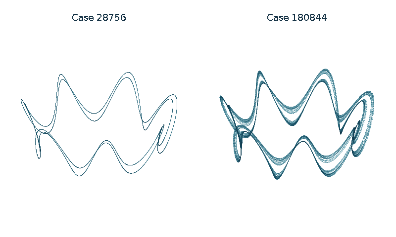

<!-- drawing-date -->
*First recorded portrait: **2026-11-21**.*
<!-- /drawing-date -->


<!-- drawing-date -->
*Drawn: **2026-11-21**.*
<!-- /drawing-date -->

<!-- portrait-equation shapes-20261121-knotted-band -->

**Sevenfold saturated angular-resonance flow**

```math
\begin{aligned}
\dot u &= u[\alpha-s+\beta z+i(\omega+\kappa z+\tau s)]
          +A h^{(n-2)/2}\overline{u}^{n-1},\\
\dot z &= -d z+e\frac{s-1}{1+s}
          + f h^{n/2}\mathrm{Re}(e^{i\phi}u^n).
\end{aligned}
```

Here u = x + iy, s = |u|² and h = 2/(1+s). Both panels use the same order-seven flow. Changing only e from −0.4297716 in Case 28756 to −0.3538341 in Case 180844 links the stable knotted cycle to the chaotic-band parameter. [Model and parameters](results/shape_search_20261121/flows/README.md#angular-resonance)

**Parameters used for this portrait**

The shared coefficients (n, α, β, ω, κ, τ, A, d, f, φ) are approximately (7, 1.2026, −0.57328, −0.81409, 1.7371, −0.17822, 0.70279, 0.17289, −1.6408, −3.0103). Only radial feedback e changes, from −0.42977 in left Case 28756 to −0.35383 in right Case 180844. [Case 28756 coefficients and start](results/shape_search_20261121/flows/manifest.json#L2138) · [Case 180844 coefficients and start](results/shape_search_20261121/flows/manifest.json#L1958) · [Reproduce the portraits](research/shape_search_20261121/flows/replay_case.py)

<details>
<summary>Full numerical settings</summary>

```text
Left — Case 28756
(order, alpha, beta, omega, kappa, tau, A, d, e, f, phi) = [7.0, 1.202576906027744, -0.5732787999438418, -0.8140901063542096, 1.7370637864372105, -0.17822146970368546, 0.7027899675496161, 0.1728854718184622, -0.4297716347835525, -1.6408334890398675, -3.010340964085613]
initial native XYZ = [0.0075025084257606045, -0.9172876284753183, 1.1123371437639415]
period used to integrate the sampled orbit = 26.57967912669519

Right — Case 180844
(order, alpha, beta, omega, kappa, tau, A, d, e, f, phi) = [7.0, 1.202576906027744, -0.5732787999438418, -0.8140901063542096, 1.7370637864372105, -0.17822146970368546, 0.7027899675496161, 0.1728854718184622, -0.3538341347835525, -1.6408334890398675, -3.010340964085613]
initial native XYZ = [0.0075025084257606045, -0.9172876284753183, 1.1123371437639415]
```

</details>

<!-- /portrait-equation -->

Native spatial coordinates. Each panel preserves equal axis scales. [Equations, controls and prior work](docs/shape-search-20261121.md)

### Interlocking triplets and quartets of periodic orbits

Case 2479 has three coexisting numerical cycles with pairwise absolute linking number 30. Case 26471 has four, with absolute linking number 6 for each of the six pairs. Exact polygon checks agree in three projections and at two resolutions.


<!-- drawing-date -->
*First recorded portrait: **2026-11-21**.*
<!-- /drawing-date -->


<!-- drawing-date -->
*Drawn: **2026-11-21**.*
<!-- /drawing-date -->

<!-- portrait-equation shapes-20261121-links -->

**Cyclic harmonic flow (left) and eightfold angular-resonance flow (right)**

```math
\begin{aligned}
 \text{2479: }\dot x_i&=-d_ix_i+a_i\sin(x_j+\phi_i)+b_i\sin(x_k+\psi_i)+c_i\sin(m_ix_j+n_ix_k+\chi_i),\\
 \text{26471: }\dot u&=u[\alpha-s+\beta z+i(\omega+\kappa z+\tau s)]+Ah^{(n-2)/2}\bar u^{n-1},\\
 \dot z&=-dz+e(s-1)/(1+s)+fh^{n/2}\mathrm{Re}(e^{i\phi}u^n).
\end{aligned}
```

The left triplet solves the cyclic Cartesian harmonic equation. The right quartet solves the angular equation with u = x + iy, s = |u|², h = 2/(1+s) and n = 8. Each panel overlays coexisting solutions at one parameter set. [Model and parameters](results/shape_search_20261121/flows/README.md#equations)

**Parameters used for this portrait**

Left Case 2479 has cyclic coefficients (d, a, b, c, φ, ψ, χ, m, n) ≈ (0.17937, 1, −0.72687, 0.45979, 2.5422, 0.11039, −1.7366, 3, −1). Right Case 26471 has angular and feedback coefficients (n, α, β, ω, κ, τ, A, d, e, f, φ) ≈ (8, 1.0843, −0.24131, 0.27158, −0.70056, −1.1848, 1.0199, 0.18404, 0.97091, −1.3873, 0.071181). [Case 2479 coefficients and start](results/shape_search_20261121/flows/manifest.json#L2686) · [Case 26471 coefficients and start](results/shape_search_20261121/flows/manifest.json#L2861) · [Reproduce the portraits](research/shape_search_20261121/flows/replay_case.py) · [Case 2479 component transforms](results/shape_search_20261121/flows/manifest.json#L4346) · [Case 26471 component transforms](results/shape_search_20261121/flows/manifest.json#L4435)

<details>
<summary>Full numerical settings</summary>

```text
Left — Case 2479
(d, a, b, c, phi, psi, chi, m, n), common to all three axes = [0.1793668239925487, 1.0, -0.7268687483116232, 0.4597898042823474, 2.5422184179548406, 0.11038944602710599, -1.736630635085846, 3.0, -1.0]
initial native XYZ = [-0.08935622640505653, -2.5201929412988795, -1.0271191060229663]
period used to integrate the sampled orbit = 94.60857056697279
row-vector transforms applied to this orbit = [[[1.0, 0.0, 0.0], [0.0, 1.0, 0.0], [0.0, 0.0, 1.0]], [[0.0, 0.0, 1.0], [1.0, 0.0, 0.0], [0.0, 1.0, 0.0]], [[0.0, 1.0, 0.0], [0.0, 0.0, 1.0], [1.0, 0.0, 0.0]]]

Right — Case 26471
(order, alpha, beta, omega, kappa, tau, A, d, e, f, phi) = [8.0, 1.084265556863346, -0.24130877401874185, 0.27157674269128496, -0.7005570720724741, -1.184809198313229, 1.0199151571300842, 0.18404172716022577, 0.9709130222222053, -1.3873091554392039, 0.0711811197971155]
initial native XYZ = [-3.62595116003553, -0.08717101056532564, -23.767584723832375]
period used to integrate the sampled orbit = 5.828396362615013
row-vector transforms applied to this orbit = [[[1.0, 0.0, 0.0], [-0.0, 1.0, 0.0], [0.0, 0.0, 1.0]], [[0.7071067811865476, 0.7071067811865476, 0.0], [-0.7071067811865476, 0.7071067811865476, 0.0], [0.0, 0.0, 1.0]], [[6.123233995736766e-17, 1.0, 0.0], [-1.0, 6.123233995736766e-17, 0.0], [0.0, 0.0, 1.0]], [[-0.7071067811865475, 0.7071067811865476, 0.0], [-0.7071067811865476, -0.7071067811865475, 0.0], [0.0, 0.0, 1.0]]]
```

</details>

<!-- /portrait-equation -->

Each panel combines complete trajectories of the coexisting cycles. The rotation includes every component. [Equations, controls and prior work](docs/shape-search-20261121.md)

### Helical chain and four curled fins

Case 2189166 exhibits a helical chain and Case 394727 gives curled fins. Local interval certificates establish positive topological entropy for invariant subsystems. Long numerical trajectories produce the displayed shapes.


<!-- drawing-date -->
*First recorded portrait: **2026-11-21**.*
<!-- /drawing-date -->


<!-- drawing-date -->
*Drawn: **2026-11-21**.*
<!-- /drawing-date -->

<!-- portrait-equation shapes-20261121-returns -->

**Gaussian posterior reflection with blended linked tori (left) and one torus (right)**

```math
m(x)=\frac{\sum_j b_j e^{-\lVert x-b_j\rVert^2/\tau}}{\sum_j e^{-\lVert x-b_j\rVert^2/\tau}},\quad v=2m(x_n)-x_n,\quad x_{n+1}=\beta x_n+\beta P(v)+(1-2\beta)m(x_n).
```

For a centerline circle Cᵢ, let cᵢ be its nearest point to v and Pᵢ(v)=cᵢ+r(v−cᵢ)/‖v−cᵢ‖. C₀ is the unit xy circle. Case 2189166 uses the blended projection P=α₀P₀+α₁P₁, with αᵢ proportional to exp(−‖v−Pᵢ(v)‖²/κ) and α₀+α₁=1. C₁ is the unit xz circle centered at (1,0,0). Case 394727 uses P=P₀. [Model and parameters](results/shape_search_20261121/projection/README.md#map-and-geometry) · [Case 2189166](results/shape_search_20261121/projection/case-2189166.json) · [Case 394727](results/shape_search_20261121/projection/case-394727.json)

**Parameters used for this portrait**

The reference major radius is 1. The stored inverse temperature is q = 1/τ. Left Case 2189166 uses 8 sites, relaxation β ≈ 0.99668, inverse temperature q ≈ 9.6648 and tube radius r ≈ 0.10782, blending temperature κ ≈ 0.21084. Right Case 394727 uses 8 sites, relaxation β ≈ 0.99768, inverse temperature q ≈ 13.453 and tube radius r ≈ 0.07671. [Case 2189166 site coordinates and parameters](results/shape_search_20261121/projection/case-2189166.json) · [Case 394727 site coordinates and parameters](results/shape_search_20261121/projection/case-394727.json) · [Reproduce the portraits](research/shape_search_20261121/projection/reproduce.py)

<details>
<summary>Full numerical settings</summary>

```text
Left — Case 2189166
reference major radius = 1.0
tube radius r = 0.10781774669885635
relaxation beta = 0.9966758489608765
Gaussian inverse temperature q = 1/tau = 9.664791107177734
temperature tau = 0.10346835114287485
centerline C0 = unit xy circle about (0, 0, 0)
centerline C1 = unit xz circle about (1, 0, 0)
projection choice = Gaussian blend of the two projected points
linked projection blending temperature kappa = 0.2108386904001236
site 1 = [0.5919821262359619, 1.2079998254776, 0.11991553753614426]
site 2 = [0.8512720465660095, 1.3994275331497192, 0.3109048902988434]
site 3 = [2.255056381225586, -0.3788388669490814, -0.5474168062210083]
site 4 = [2.5143463611602783, -0.18741105496883392, -0.35642746090888977]
site 5 = [0.2304871529340744, 0.19631540775299072, 1.6246931552886963]
site 6 = [0.4897770583629608, 0.3877432346343994, 1.8156825304031372]
site 7 = [1.8935614824295044, -1.3905231952667236, 0.9573608636856079]
site 8 = [2.1528513431549072, -1.199095368385315, 1.1483502388000488]
initial native XYZ = [0.31700000166893005, -0.210999995470047, 0.4189999997615814]

Right — Case 394727
reference major radius = 1.0
tube radius r = 0.07670976966619492
relaxation beta = 0.9976834654808044
Gaussian inverse temperature q = 1/tau = 13.453453063964844
temperature tau = 0.07433035929478254
reference centerline C0 = unit xy circle about (0, 0, 0)
site 1 = [-0.6067301034927368, -0.7918051481246948, -1.693468689918518]
site 2 = [-0.5725927948951721, -0.6160153150558472, 0.6780835390090942]
site 3 = [-0.7641551494598389, -0.4167174696922302, -1.7190057039260864]
site 4 = [-0.730017900466919, -0.24092765152454376, 0.6525464057922363]
site 5 = [-0.2765079438686371, -0.654228150844574, -1.7084197998046875]
site 6 = [-0.24237065017223358, -0.4784383177757263, 0.6631323099136353]
site 7 = [-0.4339330494403839, -0.2791404724121094, -1.7339569330215454]
site 8 = [-0.3997957408428192, -0.10335064679384232, 0.6375952363014221]
initial native XYZ = [0.31700000166893005, -0.210999995470047, 0.4189999997615814]
```

</details>

<!-- /portrait-equation -->

Equal-unit spatial projection of consecutive map states. [Equations, controls and prior work](docs/shape-search-20261121.md)

### Forked sail and horned cup

Both three-dimensional maps have three positive finite-time Lyapunov exponents. Over five million updates the spectra are approximately (0.265, 0.132, 0.021) in Case 6616162 and (0.229, 0.115, 0.026) in Case 6583985. All 17 starts gave three positive rates.

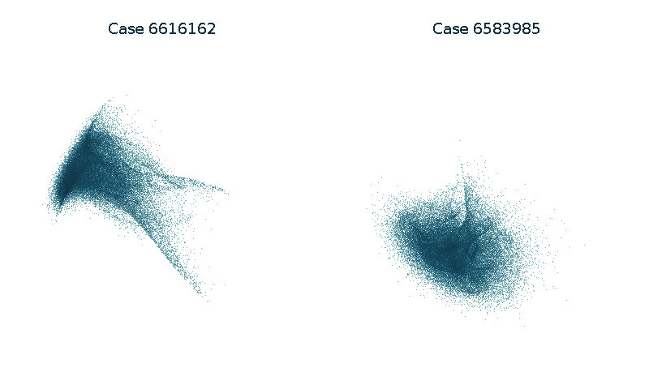

<!-- drawing-date -->
*First recorded portrait: **2026-11-21**.*
<!-- /drawing-date -->


<!-- drawing-date -->
*Drawn: **2026-11-21**.*
<!-- /drawing-date -->

<!-- portrait-equation shapes-20261121-three -->

**Gaussian posterior reflection on a ring torus**

```math
m(x)=\frac{\sum_j b_j e^{-\lVert x-b_j\rVert^2/\tau}}{\sum_j e^{-\lVert x-b_j\rVert^2/\tau}},\quad v=2m(x_n)-x_n,\quad x_{n+1}=\beta x_n+\beta P(v)+(1-2\beta)m(x_n).
```

For a centerline circle Cᵢ, let cᵢ be its nearest point to v and Pᵢ(v)=cᵢ+r(v−cᵢ)/‖v−cᵢ‖. C₀ is the unit xy circle. Both cases use P=P₀. Case 6616162 has four posterior sites and Case 6583985 has seven. [Model and parameters](results/shape_search_20261121/projection/README.md#map-and-geometry) · [Case 6616162](results/shape_search_20261121/projection/three/case-6616162.json) · [Case 6583985](results/shape_search_20261121/projection/three/case-6583985.json)

**Parameters used for this portrait**

The reference major radius is 1. The stored inverse temperature is q = 1/τ. Left Case 6616162 uses 4 sites, relaxation β ≈ 0.99944, inverse temperature q ≈ 8.9378 and tube radius r ≈ 0.12438. Right Case 6583985 uses 7 sites, relaxation β ≈ 0.99947, inverse temperature q ≈ 7.0108 and tube radius r ≈ 0.069959. [Case 6616162 site coordinates and parameters](results/shape_search_20261121/projection/three/case-6616162.json) · [Case 6583985 site coordinates and parameters](results/shape_search_20261121/projection/three/case-6583985.json) · [Reproduce the portraits](research/shape_search_20261121/projection/reproduce.py)

<details>
<summary>Full numerical settings</summary>

```text
Left — Case 6616162
reference major radius = 1.0
tube radius r = 0.1243806928396225
relaxation beta = 0.9994353652000427
Gaussian inverse temperature q = 1/tau = 8.937809944152832
temperature tau = 0.11188423184744557
reference centerline C0 = unit xy circle about (0, 0, 0)
site 1 = [1.2058839797973633, 0.25318223237991333, 1.135263442993164]
site 2 = [-0.8949857354164124, -0.15508970618247986, -0.2065238207578659]
site 3 = [0.4803432822227478, 1.2726001739501953, 0.08248023688793182]
site 4 = [-0.684842050075531, -0.35479745268821716, 1.446357011795044]
initial native XYZ = [0.31700000166893005, -0.210999995470047, 0.4189999997615814]

Right — Case 6583985
reference major radius = 1.0
tube radius r = 0.06995917111635208
relaxation beta = 0.9994696378707886
Gaussian inverse temperature q = 1/tau = 7.010759353637695
temperature tau = 0.14263790119698327
reference centerline C0 = unit xy circle about (0, 0, 0)
site 1 = [1.153024435043335, 0.15981049835681915, 1.262202262878418]
site 2 = [-0.9018531441688538, -0.21569906175136566, -0.19477030634880066]
site 3 = [0.40389999747276306, 1.463563323020935, 0.0036940532736480236]
site 4 = [-0.7231247425079346, -0.3271140456199646, 1.3616976737976074]
site 5 = [1.1370998620986938, 0.7001271843910217, 1.7662441730499268]
site 6 = [-0.5032225847244263, -0.5395309925079346, 1.3286676406860352]
site 7 = [0.6094200015068054, 0.8142260909080505, 0.29658371210098267]
initial native XYZ = [0.31700000166893005, -0.210999995470047, 0.4189999997615814]
```

</details>

<!-- /portrait-equation -->

Each panel uses equal physical units and the same camera in its signed principal-axis frame. The saved camera matrices specify both views in native coordinates. [Equations, controls and prior work](docs/shape-search-20261121.md)

### Twin density peaks and alternating spatial lobes

Cases 409700 and 2298665 have three positive numerical Lyapunov exponents in three-dimensional maps with deformed torus projections. The two density peaks of Case 409700 occasionally repeat on consecutive steps. In Case 2298665 a plane separates the odd and even states of the displayed sample.

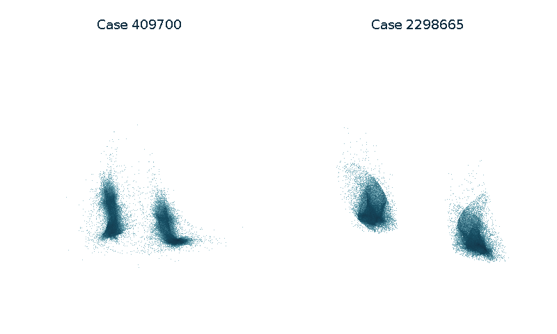

<!-- drawing-date -->
*First recorded portrait: **2026-11-21**.*
<!-- /drawing-date -->

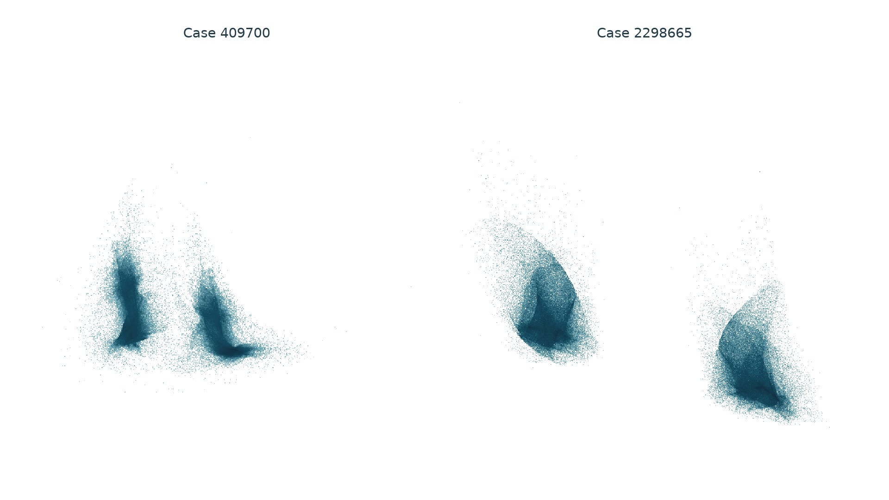

<!-- drawing-date -->
*Drawn: **2026-11-21**.*
<!-- /drawing-date -->

<!-- portrait-equation shapes-20261121-extension-gpu -->

**Gaussian posterior reflection on an affinely scaled torus (left) and a quadratically sheared torus (right)**

```math
\begin{aligned}m(x)&=\frac{\sum_j b_j e^{-q\lVert x-b_j\rVert^2}}{\sum_j e^{-q\lVert x-b_j\rVert^2}},\quad v=2m(x_n)-x_n,\\ x_{n+1}&=\beta x_n+\beta(\Phi\circ P_0\circ\Phi^{-1})(v)+(1-2\beta)m(x_n),\\ \Phi(u)&=\mathrm{diag}(s_x,s_y,s_z)\big(u_x,u_y,u_z+w(u_x^2-u_y^2)\big)^\mathsf{T}.\end{aligned}
```

For a centerline circle Cᵢ, let cᵢ be its nearest point to v and Pᵢ(v)=cᵢ+r(v−cᵢ)/‖v−cᵢ‖. C₀ is the unit xy circle. Here q is inverse temperature and the scales sᵢ deform the torus. Case 409700 is affine (w=0); Case 2298665 also has quadratic shear (w≈−0.04253). [Model and parameters](results/shape_search_20261121/extension/projection/README.md#physical-map) · [Case 409700](results/shape_search_20261121/extension/projection/cases/case-409700.json) · [Case 2298665](results/shape_search_20261121/extension/projection/cases/case-2298665.json)

**Parameters used for this portrait**

The reference major radius is 1. The stored inverse temperature is q = 1/τ. Left Case 409700 uses 4 sites, relaxation β ≈ 0.99657, inverse temperature q ≈ 8.3115 and tube radius r ≈ 0.053206, axis scales (1.1314, 1.2124, 0.81281), shear w = 0. Right Case 2298665 uses 7 sites, relaxation β ≈ 0.99929, inverse temperature q ≈ 12.777 and tube radius r ≈ 0.056886, axis scales (0.82553, 1.4719, 0.80005), shear w = −0.042529. [Case 409700 site coordinates and parameters](results/shape_search_20261121/extension/projection/cases/case-409700.json) · [Case 2298665 site coordinates and parameters](results/shape_search_20261121/extension/projection/cases/case-2298665.json) · [Reproduce the portraits](research/shape_search_20261121/extension/projection/replay.py)

<details>
<summary>Full numerical settings</summary>

```text
Left — Case 409700
reference major radius = 1
tube radius r = 0.05320582538843155
relaxation beta = 0.9965706467628479
Gaussian inverse temperature q = 1/tau = 8.311548233032227
reference centerline C0 = unit xy circle about (0, 0, 0)
physical scales (sx, sy, sz) = [1.1313683986663818, 1.2123956680297852, 0.8128060102462769]
quadratic shear w = 0
site 1 = [1.4473832845687866, 0.2658805549144745, 0.9215773940086365]
site 2 = [-0.9575591683387756, -0.1495715081691742, -0.16351501643657684]
site 3 = [0.46760883927345276, 1.6153254508972168, 0.08114907145500183]
site 4 = [-0.8322792649269104, -0.2501956820487976, 1.231136679649353]
initial native XYZ = [0.31700000166893005, -0.210999995470047, 0.4189999997615814]

Right — Case 2298665
reference major radius = 1
tube radius r = 0.056885622441768646
relaxation beta = 0.9992870688438416
Gaussian inverse temperature q = 1/tau = 12.777137756347656
reference centerline C0 = unit xy circle about (0, 0, 0)
physical scales (sx, sy, sz) = [0.825529932975769, 1.4718718528747559, 0.8000514507293701]
quadratic shear w = -0.042529311031103134
site 1 = [0.9580839276313782, 0.681617259979248, 1.0413870811462402]
site 2 = [-0.6839945316314697, -0.36023643612861633, -0.10120832175016403]
site 3 = [0.40815919637680054, 2.545955181121826, 0.1225418746471405]
site 4 = [-0.520964503288269, -0.5282296538352966, 1.2000095844268799]
site 5 = [0.031210171058773994, 2.5245180130004883, 0.5945496559143066]
site 6 = [1.1926658153533936, 1.8253003358840942, 1.1698487997055054]
site 7 = [0.8258750438690186, 2.6510345935821533, -0.38533815741539]
initial native XYZ = [0.31700000166893005, -0.210999995470047, 0.4189999997615814]
```

</details>

<!-- /portrait-equation -->

Native Cartesian states with a principal-axis camera and equal axis scales. The displayed clouds contain 250,000 consecutive iterations per case. [Equations, controls and prior work](docs/shape-search-20261121.md)

### Triple links selected by a driven cubic

Cases 47087142 and 48000003 use a single driven cubic to determine all three sheets. In the degree-two return map each sheet contains a chaotic solenoid. The triples have absolute core linking invariants one and three and are inequivalent in three-space.

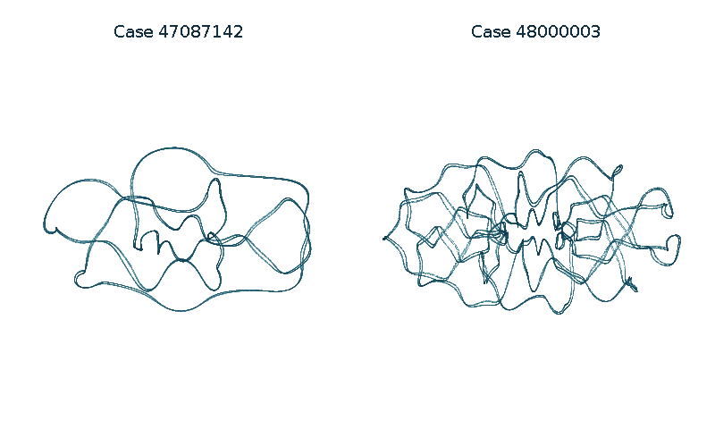

<!-- drawing-date -->
*First recorded portrait: **2026-11-21**.*
<!-- /drawing-date -->

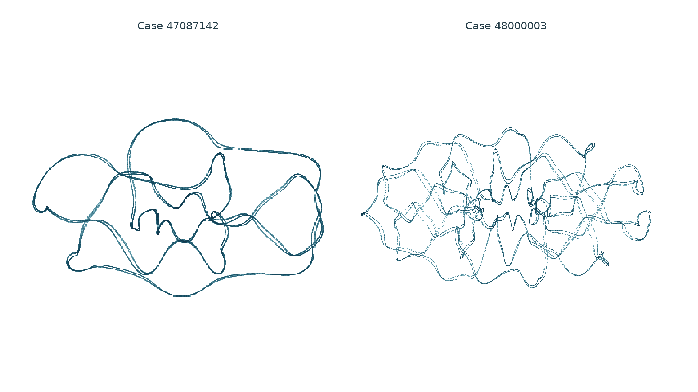

<!-- drawing-date -->
*Drawn: **2026-11-21**.*
<!-- /drawing-date -->

<!-- portrait-equation shapes-20261121-cubic -->

**Driven cubic root-cover solenoid return map**

```math
\begin{aligned}p_\theta(z)&=z^3-3z+b(\theta),\qquad \theta'=2\theta+0.12\sin(2\theta)+0.137\pmod{2\pi},\\p_{\theta'}(z')&=0.2\,p_\theta(z)+0.6D e^{i\theta}.\end{aligned}
```

Continue on the same cubic sheet, with residual radius $`D`$ from the case certificate. The left drive is $`b=-4\sin(3\theta)+4\sin(4\theta)+3i\sin(7\theta)`$. The right drive is $`b=\tfrac14\sin\theta-4\sin(9\theta)+3i\sin(18\theta)`$. [Model and parameters](results/shape_search_20261121/frontiers/cubic/README.md)

**Parameters used for this portrait**

Both use angular degree 2, ripple 0.12, shift 0.137, residual contraction 0.2 and forcing amplitude 0.6D. The cylindrical embedding radius is 3.25. Left Case 47087142 uses b(θ) = −4 sin(3θ) + 4 sin(4θ) + 3i sin(7θ) and residual radius D = 0.50390625. Right Case 48000003 uses b(θ) = ¼ sin(θ) − 4 sin(9θ) + 3i sin(18θ) and residual radius D = 0.6171875. [Case 47087142 drive and certificate](results/shape_search_20261121/frontiers/cubic/certificates.json#L539) · [Case 48000003 drive and certificate](results/shape_search_20261121/frontiers/cubic/certificates.json#L885) · [Reproduce the portraits](research/shape_search_20261121/frontiers/cubic/sample.py)

<details>
<summary>Full numerical settings</summary>

```text
Left — Case 47087142
real-drive numerator: constant, cosine coefficient array, sine coefficient array = [0, [0, 0, 0, 0], [0, 0, -4, 4]]
real-drive divisor = 1
imaginary-drive sine frequency k = 7
imaginary-drive amplitude = 3
residual radius D = 0.50390625
cylindrical embedding radius = 3.25
angular degree = 2; ripple = 0.12; shift = 0.137
residual contraction = 0.2; angular forcing amplitude = 0.6 D
sheet starting phases = (0.27, 1.34, 3.16); initial residual = 0

Right — Case 48000003
real-drive numerator: constant, cosine coefficient array, sine coefficient array = [0, [0, 0, 0, 0, 0, 0, 0, 0, 0], [1, 0, 0, 0, 0, 0, 0, 0, -16]]
real-drive divisor = 4
imaginary-drive sine frequency k = 18
imaginary-drive amplitude = 3
residual radius D = 0.6171875
cylindrical embedding radius = 3.25
angular degree = 2; ripple = 0.12; shift = 0.137
residual contraction = 0.2; angular forcing amplitude = 0.6 D
sheet starting phases = (0.27, 1.34, 3.16); initial residual = 0
```

</details>

<!-- /portrait-equation -->

Native cylindrical embedding at equal Cartesian scales. Each panel contains 28,000 consecutive states per component. The rotation includes all three components. [Equations, controls and prior work](docs/shape-search-20261121.md)
<!-- /shape-search-20261121-selected -->

<!-- wow-20261122-true -->
## Shape search of 2026-11-22

<a id="a-straight-orbit-on-a-fifteen-handle-attractor"></a>

### A straight geodesic on a surface with fifteen handles

After opposite faces of the periodic cell are identified, the position surface has fifteen handles. Position and unit tangent velocity together form the three-dimensional attractor. One exactly straight closed orbit has a linearized perturbation that grows by a factor between 4.45 and 4.47 million per lap along its unstable direction. Varying one wave amplitude gives straight orbits of fixed length with [unbounded growth per lap](results/attractor_followup_2/geodesics/README.md).

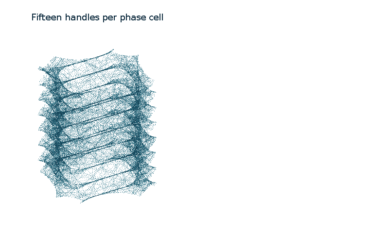

<!-- drawing-date -->
*First recorded portrait: **2026-11-22**.*
<!-- /drawing-date -->

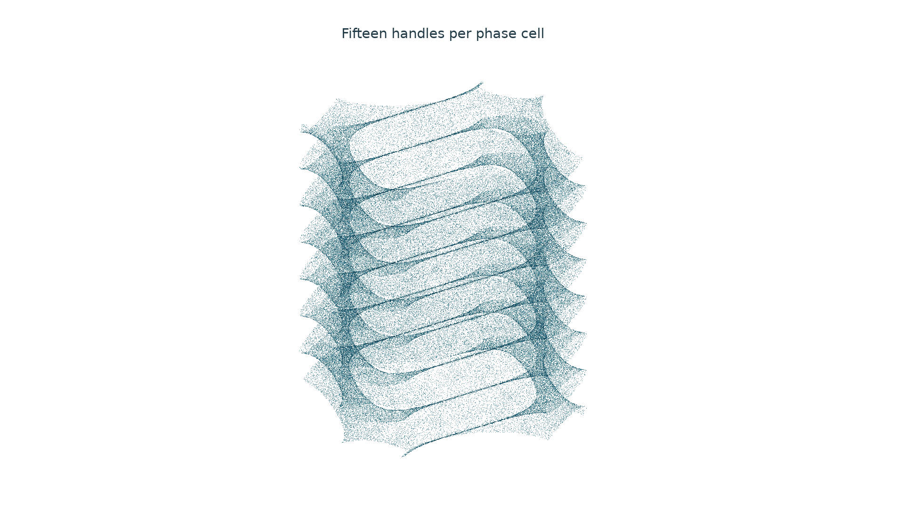

<!-- drawing-date -->
*Drawn: **2026-11-22**.*
<!-- /drawing-date -->

<!-- portrait-equation forms-20261122-lattice -->

**Dissipative geodesic flow on a sheared cover of the three-cosine surface**

```math
\begin{aligned}
F(q)&=\cos x+\cos y+k\cos(x-y+nz),\quad u=v-g(g\cdot v)/|g|^2,\\
\dot q&=v,\quad \dot v=-g\,(v^THv+3g\cdot v+2F)/|g|^2+(1-|u|^2)u .
\end{aligned}
```

Here g and H are the gradient and Hessian of F. Each phase has period 2π. The portrait projects the unit tangent attractor to its positions. [Model and parameters](results/wow_search_20261122/lattice/README.md)

**Parameters used for this portrait**

n = 7, k = 0.375. Start at (π/2, π/2, π/14). Rotate the unit straight-ray velocity along (1, −1, −2/7) within the tangent plane by +0.321 radians toward the unit vector along g × v. The step is 0.0125 and every eighth state is retained. [Exact numerical start and trajectory hash](results/wow_search_20261122/lattice/control.json)

<!-- /portrait-equation -->

The pictured orbit starts at an angle of 0.321 radians to the exact straight ray. The still uses 280,000 successive positions in one cubic phase cell, and the rotation shows the last 60,000. [View the straight and tilted orbits together](results/wow_search_20261122/lattice/README.md) · [Study and reproduction](docs/chaotic-forms-20261122.md#a-straight-line-inside-a-uniformly-chaotic-flow)


Eight straight geodesics cut the surface into 140 tiles on the left. When two wave amplitudes match, the gold lines appear and the count doubles to 280. [How the mosaic is folded and counted](results/art_20261122/weave/README.md)

### One boundary for fifteen Newton basins

Look at every ninth Newton step. Six roots and nine phases of one attracting cycle give fifteen outcomes with the same Julia boundary. Approaching the principal pole along either horizontal ray gives all fifteen outcomes at arbitrarily small scales. A 24° sector above that pole leads to one root, and a 24° sector below it leads to another. [Directional basin proof](results/attractor_followup_2/newton/README.md)

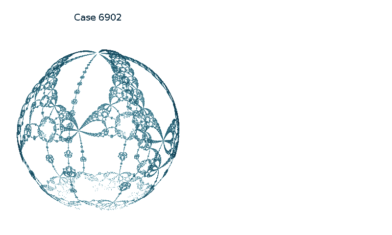

<!-- drawing-date -->
*First recorded portrait: **2026-11-22**.*
<!-- /drawing-date -->

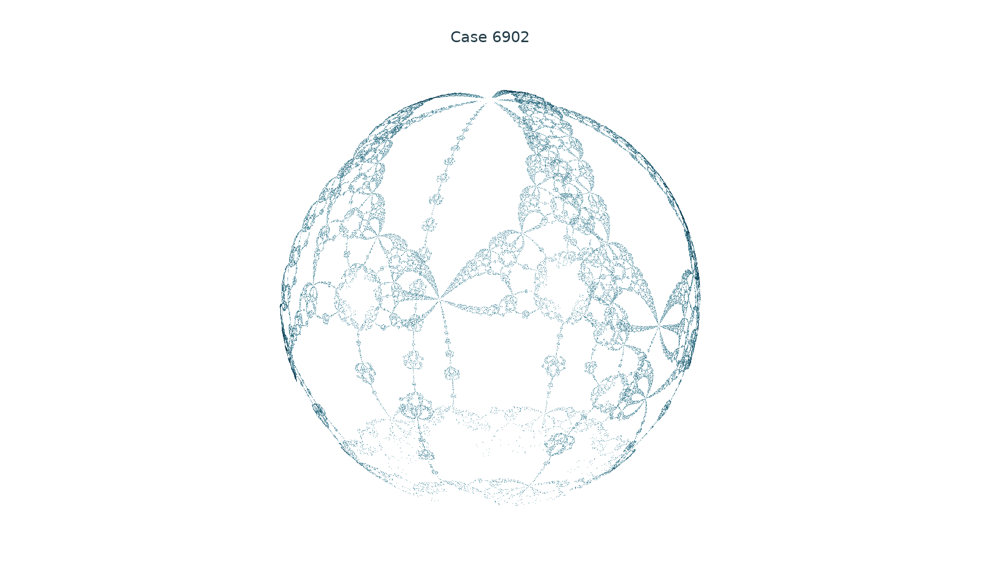

<!-- drawing-date -->
*Drawn: **2026-11-22**.*
<!-- /drawing-date -->

<!-- portrait-equation forms-20261122-boundary -->

**Newton's rational map for a degree-six complex polynomial**

```math
p_a(z)=z^6-az+a,\qquad N_a(z)=z-\frac{p_a(z)}{p'_a(z)}=\frac{5z^6-a}{6z^5-a},\qquad R=N_a^9.
```

The nine phases become fixed points of R. The plotted Julia set is their shared basin boundary, sampled by inverse iteration from the poles of N. [Model and parameters](results/wow_search_20261122/boundary/README.md)

**Parameters used for this portrait**

Case 6902 uses the isolated complex solution of Nₐ⁹(0) = 0 near a = 1.2779613580322 + 0.0745500698270i. Here 0 has exact period nine. Start the inverse construction at the five poles z⁵ = a/6 and retain distinct sphere cells of width 0.004 through depth 23.

<details>
<summary>Full numerical settings</summary>

The parameter is an algebraic number. The certified isolating disk has radius 10⁻¹⁴² around the stored dyadic center. This specifies the coefficient beyond the displayed decimal approximation. [Isolating disk, attractors and basin witnesses](results/wow_search_20261122/boundary/certificate.json) · [Inverse sampling receipt](results/wow_search_20261122/boundary/stratified-inverse.json)

</details>

<!-- /portrait-equation -->

Both views use 99,423 retained numerical preimages of poles, sampled through depth 23 to approximate the Julia boundary. Under exact forward iteration a pole preimage reaches infinity. Points in the adjacent open basins approach one of the six roots or the nine-cycle. [Study and reproduction](docs/chaotic-forms-20261122.md)


<!-- drawing-date -->
*Drawn: **2026-11-22**.*
<!-- /drawing-date -->

The torus is a way to display the basins. One trip around its hole covers nine zoom steps near a pole, each by a factor of 6/5 in the linearizing coordinate. The six root colors stay fixed, while the nine cycle colors shift one place per step and match again at the seam. [Unwrap the torus](results/art_20261122/newton/README.md)

### A scalloped fan from pulsed optical feedback

One orbit of an optical field draws the entire scalloped fan. Its detuning peaks most often lie twenty steps apart. Sixteen additional starting states reproduced the same numerical regime.

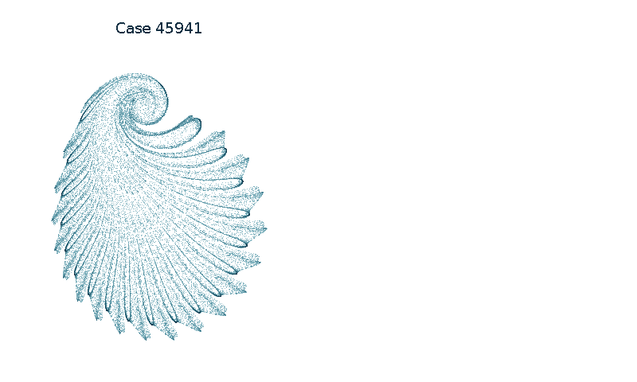

<!-- drawing-date -->
*First recorded portrait: **2026-11-22**.*
<!-- /drawing-date -->

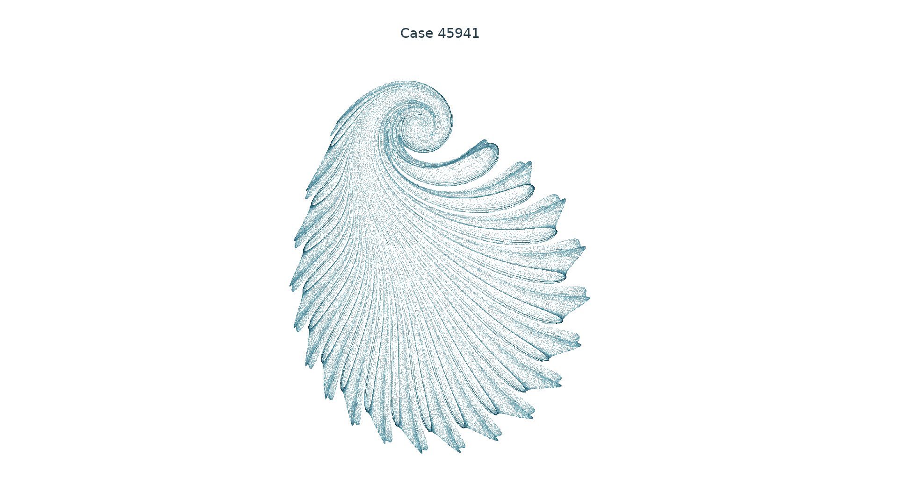

<!-- drawing-date -->
*Drawn: **2026-11-22**.*
<!-- /drawing-date -->

<!-- portrait-equation forms-20261122-fan -->

**Driven optical cavity map with saturable phase shift and relaxing detuning**

```math
u=\frac{|E|^2}{1+|E|^2},\qquad E^+=P+aE e^{i(\delta+ku+T)},\qquad T^+=(1-h)T+hgu.
```

The real pump P adds a fixed field on every update. The instantaneous intensity and detuning T control how far the returning field E rotates. [Model and parameters](results/wow_search_20261122/orbit/README.md)

**Parameters used for this portrait**

Case 45941 uses (P, a, δ, k, g, h) = (2.203066349029541, 0.9630072116851807, -1.3305402994155884, 9.051758766174316, -1.6761609315872192, 0.6959419250488281). Initial (Re E, Im E, T) = (0.173, −0.341, 0.271). The cloud consists of the last 786,432 states from 3,145,728 measured updates following 131,072 warm-up steps. [Input and independent checks](results/wow_search_20261122/orbit/case-45941.json)

<!-- /portrait-equation -->

Native complex-field plane in the still. The rotation uses the field and memory coordinates at equal scale. The full stored cloud contains 786,432 consecutive states. [Study and reproduction](docs/chaotic-forms-20261122.md)

### Two detuning regimes at identical optical settings

The same six coefficients yield two separated detuning ranges in the sampled starts. After 131,072 warm-up steps, each of eight runs stayed on one side of the observed gap for all 16,777,216 measured steps.

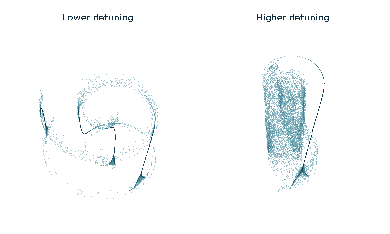

<!-- drawing-date -->
*First recorded portrait: **2026-11-22**.*
<!-- /drawing-date -->

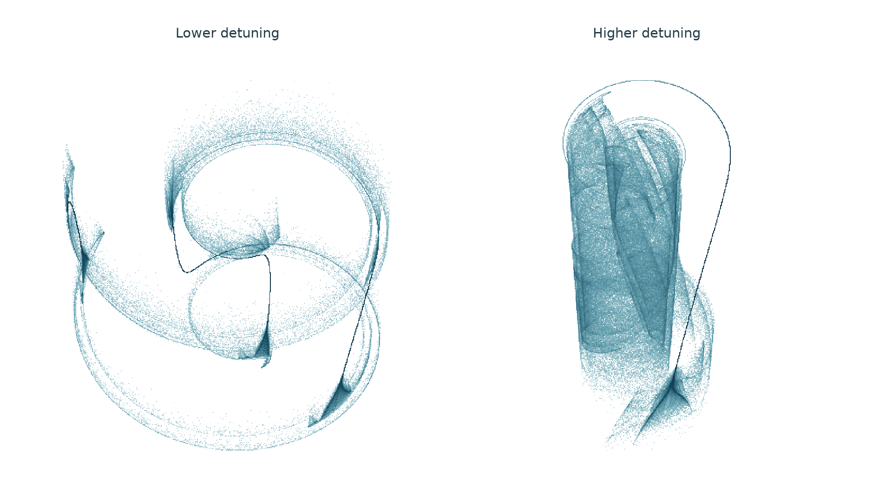

<!-- drawing-date -->
*Drawn: **2026-11-22**.*
<!-- /drawing-date -->

<!-- portrait-equation forms-20261122-optical-basins -->

**Driven optical cavity map with saturable phase shift and relaxing detuning**

```math
u=\frac{|E|^2}{1+|E|^2},\qquad E^+=P+aE e^{i(\delta+ku+T)},\qquad T^+=(1-h)T+hgu.
```

The complex field E and the detuning T form the three real state coordinates. [Model and parameters](results/wow_search_20261122/orbit/README.md)

**Parameters used for this portrait**

Both panels use Case 86780, with (P, a, δ, k, g, h) = (0.6838027238845825, 0.4769441485404968, 0.6492727398872375, -17.94019889831543, 19.38252067565918, 0.0038743906188756227). Left start (Re E, Im E, T) = (0.173, −0.341, 0.271). Right start (0.7124512033204118, −0.4674104975241916, 9.823930680698279). [Basin scan and independent histories](results/wow_search_20261122/orbit/case-86780-basins.json)

<!-- /portrait-equation -->

Each panel contains 786,432 consecutive native field and memory states. The camera and units are shared, with independent centering and portrait bounds. The study includes a common-scale comparison. [Study and reproduction](docs/chaotic-forms-20261122.md)

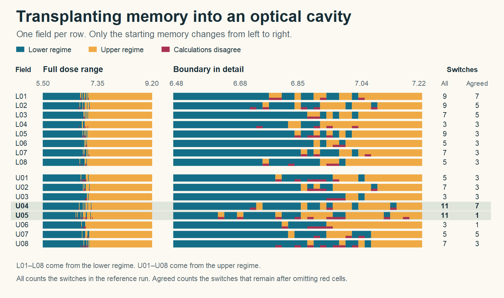

Take the light field from one run and the cavity memory from another. All 256 pairings followed the memory donor in both observation windows, including a 160-bit replay. Near the boundary, the two double-precision implementations sometimes agreed with each other and differed from higher-precision runs. On 21 consecutive starting memories, replays at 640, 1,280 and 2,560 bits agreed on seven switches for field U04 and five for L01. [Transplant experiment, grid and precision checks](results/art_20261122/memory-transplant/README.md)

<!-- /wow-20261122-true -->

## Further portraits

[Constructed systems](#constructed-systems) · [Algorithms](#algorithmic-dynamics) · [Physical and biological models](#physical-and-biological-models) · [Spatial maps and flows](#spatial-maps-and-flows) · [Planar rings](#two-and-four-nested-rings-from-one-orbit)

### Constructed systems

#### Tetrahedral Gaussian flow

Cases 421 and 565 have a stable central equilibrium and sustained irregular outer motion. Three-dimensional tetrahedral chaos is established prior work.

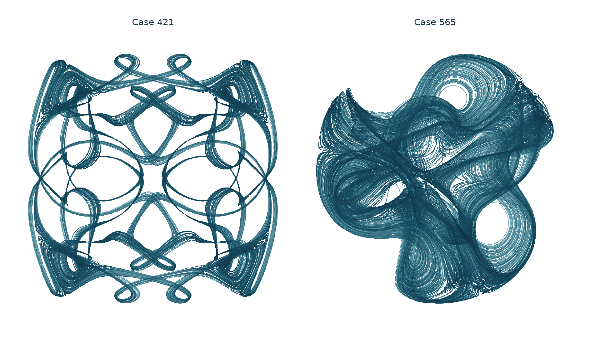

<!-- drawing-date -->
*First recorded portrait: **2026-11-01**.*
<!-- /drawing-date -->

<!-- portrait-equation tetrahedral -->

**Tetrahedrally equivariant Gaussian vortex flow**

```math
\dot x=-\gamma x+\sum_{G\in T}\big[(Gu)\times(x-Gc)\big]\exp\!\left(-\frac{\lVert x-Gc\rVert^2}{2\sigma^2}\right).
```

T consists of the 12 proper tetrahedral rotations. The seed center c and unit axis u generate the vortex family. [Model and parameters](docs/tetrahedral-flow.md#construction)

**Parameters used for this portrait**

**Left · Case 421** σ ≈ 0.304249, γ ≈ 0.0169314. **Right · Case 565** σ ≈ 0.406287, γ ≈ 0.0423407. [Exact seeds and initial states](results/unexpected-search/facts.json)

<details>
<summary>Full numerical settings</summary>

```json
{
  "Case 421": {
    "center_c": [0.8769147566112935, 0.09402153599204394, 0.47136022361571045],
    "axis_u": [0.9240596655762272, 0.18186634412120997, 0.33621178939938545],
    "sigma": 0.3042492946330458,
    "gamma": 0.016931384507344594,
    "initial_xyz": [-0.1818382680416107, 0.05152458027005195, 1.0345324896275996]
  },
  "Case 565": {
    "center_c": [0.8977573044196864, 0.08480352409607292, 0.4322501413093873],
    "axis_u": [0.8575828868421683, 0.5053735092247597, -0.09565149433910847],
    "sigma": 0.4062874343432486,
    "gamma": 0.04234070462564754,
    "initial_xyz": [1.152040397375822, 0.898293936252594, 0.56929023116827]
  }
}
```

</details>

<!-- /portrait-equation -->

Both panels show the full three-dimensional state.

[Report](docs/tetrahedral-flow.md)

#### Localized Gaussian vortices

Case 77 survives a 30,000-unit spectrum and independent integration. A competing periodic orbit and resemblance to known threefold geometries limit interpretation.


<!-- drawing-date -->
*First recorded portrait: **2026-11-01**.*
<!-- /drawing-date -->

<!-- portrait-equation gaussian-vortex -->

**Cyclic three-center Gaussian vortex flow**

```math
r_j=x-d e_j,\qquad\dot x=-\gamma x+b+\sum_{j=0}^2\omega_j(e_{j+1}\times r_j)\exp\!\left(-\frac{\lVert r_j\rVert^2}{2\sigma_j^2}\right).
```

The basis index is taken modulo three. Case 77 uses three equally strong vortices of equal width and a constant drift b with equal components. [Model and parameters](docs/gaussian-vortex.md#the-equation)

**Parameters used for this portrait**

**Case 77** γ ≈ 0.185575, ω₀=ω₁=ω₂ ≈ 5.61179, σ₀=σ₁=σ₂ ≈ 0.690724, d ≈ 1.61178, and each drift component ≈ 0.100028. Start (0.1, 0.2, 0.3). [Exact coefficients](results/gaussian-vortex/candidates.json)

<details>
<summary>Full numerical settings</summary>

```json
{
  "Case 77": {
    "gamma": 0.18557545144110918,
    "common_omega": 5.611788131296635,
    "common_sigma": 0.690724453702569,
    "center_distance_d": 1.6117840299382804,
    "common_drift_component": 0.1000276630744338,
    "initial_xyz": [0.1, 0.2, 0.3]
  }
}
```

</details>

<!-- /portrait-equation -->

The portrait shows the full three-dimensional state.

[Report](docs/gaussian-vortex.md)

#### Dissipative three-axis twist map

Cases 1709 and 3254 retain positive finite-time growth under long and high-precision controls. The first case also has a regular regime.

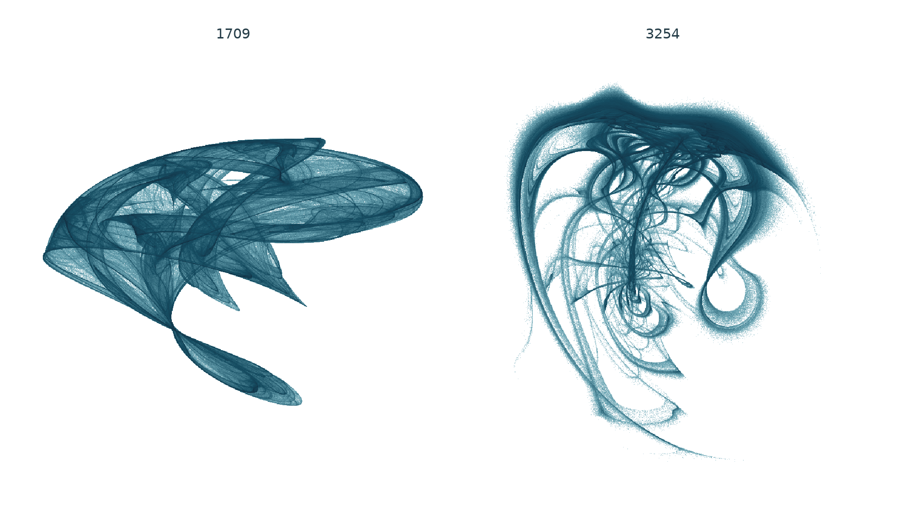

<!-- drawing-date -->
*First recorded portrait: **2026-11-01**.*
<!-- /drawing-date -->

<!-- portrait-equation twist -->

**Dissipative three-axis twist map**

```math
z^{(0)}=r x_n+(1-r)e_1,\quad z^{(j)}=R_{i_j k_j}\!\left(a_j+b_jw_j+h_jw_j^3\right)z^{(j-1)},\quad x_{n+1}=z^{(3)}.
```

The rotations act in the xy, yz and zx planes in that order. Each wⱼ is the remaining coordinate immediately before its rotation, r is the contraction ratio and e₁=(1,0,0). [Model and parameters](docs/twist-geometry.md#definition-and-exact-structural-properties) · [Twist map](research/twist_map.py) · [Candidates](results/twist-geometry/candidates.json)

**Parameters used for this portrait**

**Left · Case 1709** r ≈ 0.76182, a ≈ (-0.0355765, -1.21049, 3.00036), b ≈ (-7.34404, 9.62359, -9.67438), h = (0, 0, 0). **Right · Case 3254** r ≈ 0.842454, a ≈ (2.39089, -1.33438, 0.865227), b ≈ (8.86895, -0.406103, -3.92743), h ≈ (0.0697721, -1.12101, 2.28998). Both start at (0.1, 0.2, 0.3). Coefficient triples are in xy, yz, zx order. [Exact twist coefficients](results/twist-geometry/candidates.json)

<details>
<summary>Full numerical settings</summary>

```json
{
  "Case 1709": {
    "r": 0.7618200839310885,
    "a_xy_yz_zx": [-0.03557654092287299, -1.210488773441916, 3.000358680113612],
    "b_xy_yz_zx": [-7.344044879078865, 9.6235865727067, -9.674380637705326],
    "h_xy_yz_zx": [0.0, 0.0, 0.0],
    "initial_xyz": [0.1, 0.2, 0.3]
  },
  "Case 3254": {
    "r": 0.842454347833991,
    "a_xy_yz_zx": [2.390892993535714, -1.3343825390059783, 0.8652272272040964],
    "b_xy_yz_zx": [8.868952140212059, -0.4061026945710182, -3.927433133125305],
    "h_xy_yz_zx": [0.06977212429046631, -1.1210147440433502, 2.289981424808502],
    "initial_xyz": [0.1, 0.2, 0.3]
  }
}
```

</details>

<!-- /portrait-equation -->

Both panels show the full three-dimensional state.

[Report](docs/twist-geometry.md)

### Algorithmic dynamics

#### Finite-point RAAR: fragmented columns and sheets

A circle reflector and a finite set of sites produce fragmented columns and sheets. The selected runs retained positive leading growth over five million steps and across 33 starts.

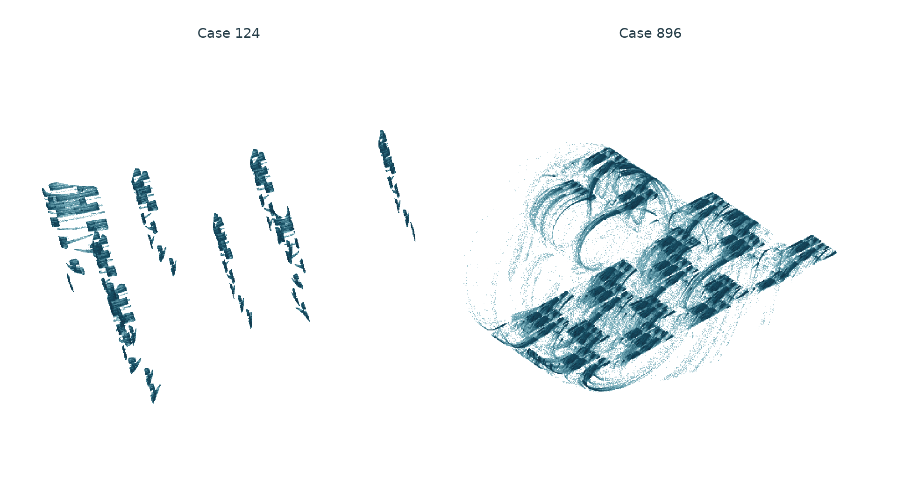

<!-- drawing-date -->
*First recorded portrait: **2026-11-01**.*
<!-- /drawing-date -->

<!-- portrait-equation raar-constellation-columns -->

**Unit-circle / nearest-site relaxed averaged alternating reflections (RAAR)**

```math
b=P_B(x_n),\quad v=2b-x_n,\quad x_{n+1}=\beta x_n+\beta P_A(v)+(1-2\beta)b.
```

P_B selects the nearest vertex in the finite set for Case 124 (left) or 896 (right). P_A(v) normalizes the xy component and sets z to zero. β controls relaxation. [Model and parameters](docs/raar-constellations.md#model) · [Search raar constellations](research/search_raar_constellations.py)

**Parameters used for this portrait**

**Left · Case 124** β ≈ 0.985124, 4 tetrahedral sites. **Right · Case 896** β ≈ 0.984863, 4 tetrahedral sites. Both start at (0.317, −0.211, 0.419). [Exact site coordinates and coefficients](results/raar-constellations/runs/raar-constellation-long01/report.json)

<details>
<summary>Full numerical settings</summary>

```json
{
  "Case 124": {
    "beta": 0.9851239318186418,
    "sites_xyz": [
      [0.43025192179357286, -0.025723691074069105, 0.07762098242124493],
      [0.23166630300611102, -0.721996216797328, -0.455139961345115],
      [1.032737115349656, -0.31954168692824353, -0.5213351746779145],
      [0.2916658289886147, 0.10564726617682224, -0.8007875032738261]
    ]
  },
  "Case 896": {
    "beta": 0.9848625433025882,
    "sites_xyz": [
      [-1.9158764657521776, -0.22816758379286672, 0.24138683638958175],
      [0.29232762894069764, -0.39160294418092856, 0.5021957416746716],
      [-0.7095077579502059, 1.5906477294500831, 0.6968899901313689],
      [-0.5456111532127097, 0.6159182775829315, -1.301593966406148]
    ]
  },
  "shared_initial_xyz": [0.317, -0.211, 0.419]
}
```

</details>

<!-- /portrait-equation -->

Full three-state iterates, centered and rigidly rotated. Equal spatial units within each panel; independent scales. Two million consecutive states per static portrait.

[Report and prior art](docs/raar-constellations.md)

#### Finite-point RAAR: fans and sparse branches

Changing the point configuration produces fans and sparse branches. The selected runs retained positive leading growth over five million steps and across 33 starts.


<!-- drawing-date -->
*First recorded portrait: **2026-11-01**.*
<!-- /drawing-date -->

<!-- portrait-equation raar-constellation-fans -->

**Unit-circle / nearest-site relaxed averaged alternating reflections (RAAR)**

```math
b=P_B(x_n),\quad v=2b-x_n,\quad x_{n+1}=\beta x_n+\beta P_A(v)+(1-2\beta)b.
```

P_B selects the nearest vertex in the finite set for Case 611 (left) or 1873 (right). P_A(v) normalizes the xy component and sets z to zero. β controls relaxation. [Model and parameters](docs/raar-constellations.md#model) · [Search raar constellations](research/search_raar_constellations.py)

**Parameters used for this portrait**

**Left · Case 611** β ≈ 0.941139, 12 icosahedral sites. **Right · Case 1873** β ≈ 0.872491, 6 octahedral sites. Both start at (0.317, −0.211, 0.419). [Exact site coordinates and coefficients](results/raar-constellations/runs/raar-constellation-long01/report.json)

<details>
<summary>Full numerical settings</summary>

```json
{
  "Case 611": {
    "beta": 0.9411392396707088,
    "sites_xyz": [
      [1.5425668334683245, -1.2986299453678265, 1.3161551759025425],
      [0.6255150832281006, -0.18925933868717926, -0.6055702006021515],
      [0.7131977908268085, -0.4465190586345218, 2.203837216416933],
      [-0.20385395941341544, 0.6628515480461254, 0.28211183991223876],
      [1.8363287288079946, 0.15063425786910922, 1.4396970525912574],
      [0.0691532963379522, -1.4720413962395416, 1.3462615629466135],
      [1.2695595777169568, 0.8362629989178405, 0.2520054528681678],
      [-0.49761585475308556, -0.7864126551908103, 0.15856996322352412],
      [1.8864173278080618, -0.5058270336419431, 0.10985680570775769],
      [0.5444700275971279, 0.872917343276356, 1.5461565184629023],
      [0.7942428464577811, -1.508695740598057, 0.052110497351879004],
      [-0.5477044537531528, -0.1299513636797579, 1.4884102101070238]
    ]
  },
  "Case 1873": {
    "beta": 0.8724905055323615,
    "sites_xyz": [
      [0.15025122986076178, 1.193129865396619, -0.5409014083982812],
      [1.8994301114863117, 0.0025445076168383873, 0.2510875924226384],
      [1.078873718130879, -0.42978018418407865, -1.8090457522151553],
      [0.7690196014857503, -1.9151128034478428, -0.13508509913669967],
      [-0.9801592801397996, -0.7245274456680622, -0.9270740999576192],
      [-0.15960288678436685, -0.29220275386714517, 1.1330592446801746]
    ]
  },
  "shared_initial_xyz": [0.317, -0.211, 0.419]
}
```

</details>

<!-- /portrait-equation -->

Full three-state iterates, centered and rigidly rotated. Equal spatial units within each panel; independent scales. Two million consecutive states per static portrait.

[Report and prior art](docs/raar-constellations.md)

#### RK23 step-size controller

The physical linear oscillator decays. The adaptive solver has a persistent irregular internal state near its error tolerance, reproduced with the original library and high-precision arithmetic.

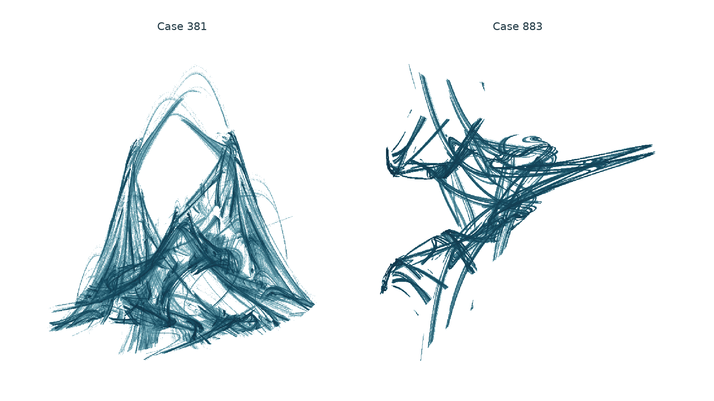

<!-- drawing-date -->
*First recorded portrait: **2026-11-01**.*
<!-- /drawing-date -->

<!-- portrait-equation rk23 -->

**Bogacki–Shampine RK23 adaptive controller on a damped harmonic oscillator**

```math
\begin{aligned}v&=R(hA)y,\quad e=E(hA)y,\quad A=\begin{pmatrix}0&1\\-1&-2\zeta\end{pmatrix},\\R(z)&=1+z+z^2/2+z^3/6,\quad E(z)=z^3(1+z)/48,\\w&=\sqrt{\tfrac12\sum_i\left[\frac{e_i}{\tau+\rho\max(|y_i|,|v_i|)}\right]^2}.\end{aligned}
```

Bogacki–Shampine 3(2) on the damped oscillator y = (q,p). With absolute and relative tolerances τ, ρ, accept v if w < 1 and multiply h by min(10, 0.9 w^(−1/3)), capped at one after a rejection. Otherwise retry y with factor max(0.2, 0.9 w^(−1/3)). Zero error selects the maximum allowed growth. [Model and parameters](docs/rk23-controller-structure.md)

**Parameters used for this portrait**

The normalized absolute tolerance is τ = 1. Values are ordered as `(ζ, ρ)`. Left · Case 381 `(0.4435243054088205, 3.3379616873243337e-10)`. Right · Case 883 `(0.9588936367407441, 3.71684809666591e-12)`. [Archived settings and portrait starts](results/rk23-controller/oscillator/render/analysis.json)

<details>
<summary>Full numerical settings</summary>

The portrait runs start at `(q/τ, p/τ, log h)`. Left · Case 381 `(1.2732297750873243, -0.22318262946004302, 1.0491518784085208)`. Right · Case 883 `(-0.9661370094507652, 0.942807068955222, 0.6287097868467605)`. Discard 100,000 updates and retain the next 8,000,000.

</details>

<!-- /portrait-equation -->

Position / atol, velocity / atol, proposed step.

[Report](docs/rk23-oscillator.md)

#### Yogi parameter-plane candidate

Case 670 is retained after five million steps and independent controls. Case 125 has stronger evidence for a second expanding direction; their rates remain finite-time quantities.

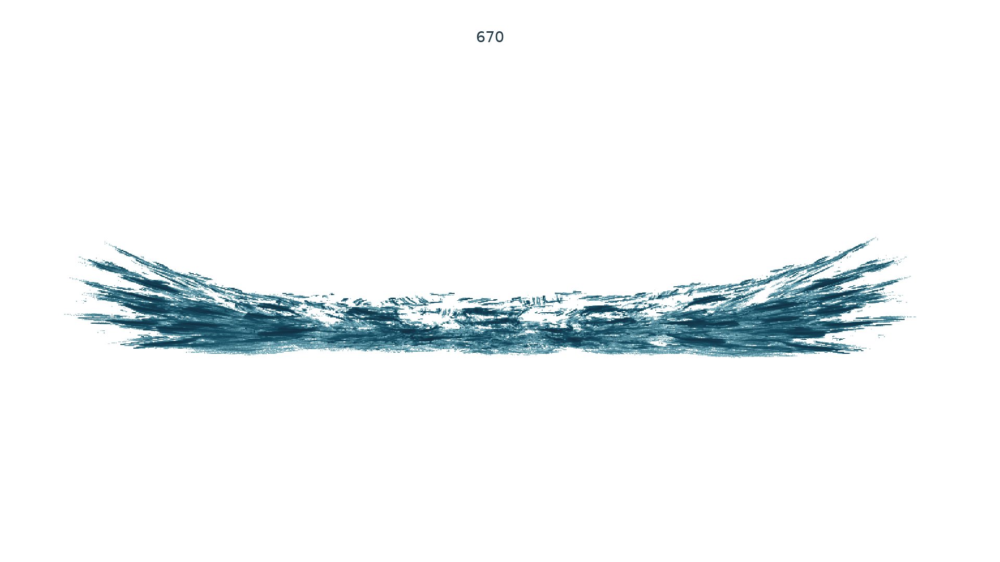

<!-- drawing-date -->
*First recorded portrait: **2026-11-01**.*
<!-- /drawing-date -->

<!-- portrait-equation yogi-arc -->

**Autonomous sign-Yogi iteration on a scalar quadratic**

```math
m^+=bm+(1-b)x,\quad v^+=v-(1-c)x^2\mathrm{sgn}(v-x^2),\quad x^+=x-\frac{m^+}{\sqrt{v^+}+e}
```

Sign-Yogi on the scalar quadratic in normalized coordinates (x,m,v). Here b and c are memory coefficients, e = ε/α and sign(0) = 0. [Model and parameters](docs/yogi-parameter-plane.md)

**Parameters used for this portrait**

Values are ordered as `(b, c, e)`. Case 670 `(0.9806451612903226, 0.6006451612903226, 9.301461332493893e-05)`. [Archived settings and portrait starts](results/yogi-plane/plane-arc02/analysis.json)

<details>
<summary>Full numerical settings</summary>

The portrait runs start at `(x, m, v)`. Case 670 `(0.1626129378580938, 0.00456704588293853, 0.03144266349142377)`. Discard 10,000 updates and retain the next 8,000,000.

</details>

<!-- /portrait-equation -->

Normalized optimizer state (x, m, v).

[Report](docs/yogi-parameter-plane.md)

#### Yogi memory

Cases 44 and 7590 are visually distinct numerical regimes of the same published optimizer. Initialization and precision controls are retained in the report.


<!-- drawing-date -->
*First recorded portrait: **2026-11-01**.*
<!-- /drawing-date -->

<!-- portrait-equation yogi -->

**Autonomous sign-Yogi iteration on a scalar quadratic**

```math
m^+=bm+(1-b)x,\quad v^+=v-(1-c)x^2\mathrm{sgn}(v-x^2),\quad x^+=x-\frac{m^+}{\sqrt{v^+}+e}
```

Sign-Yogi on the scalar quadratic in normalized coordinates (x,m,v). Here b and c are memory coefficients, e = ε/α and sign(0) = 0. [Model and parameters](docs/yogi-geometry.md)

**Parameters used for this portrait**

Values are ordered as `(b, c, e)`. Left · Case 44 `(0.028770145056769253, 0.4958280871436, 0.1)`. Right · Case 7590 `(0.7993178686406464, 0.17948984372805632, 1.4848448093079407e-06)`. [Archived settings and portrait starts](results/yogi-geometry/render/analysis.json)

<details>
<summary>Full numerical settings</summary>

The portrait runs start at `(x, m, v)`. Left · Case 44 `(0.3007792874087321, -0.3022872405521554, 0.15080125393312555)`. Right · Case 7590 `(-0.16047298458015205, 0.0014326981340373607, 0.02369820216928808)`. Discard 10,000 updates and retain the next 8,000,000.

</details>

<!-- /portrait-equation -->

Normalized optimizer state (x, m, v).

[Report](docs/yogi-geometry.md)

#### Yogi: additional expanding regimes

Cases 4214 and 125 have numerical evidence for two expanding directions. Window lengths, library differences and branch discontinuities are reported separately.

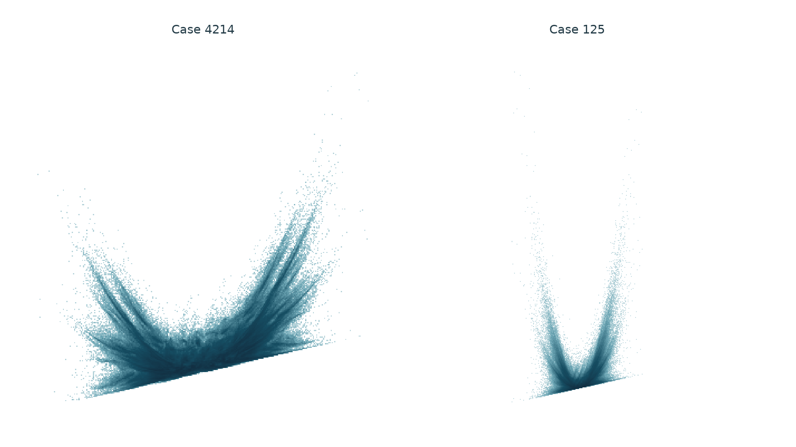

<!-- drawing-date -->
*First recorded portrait: **2026-11-01**.*
<!-- /drawing-date -->

<!-- portrait-equation yogi-expansion -->

**Autonomous sign-Yogi iteration on a scalar quadratic**

```math
m^+=bm+(1-b)x,\quad v^+=v-(1-c)x^2\mathrm{sgn}(v-x^2),\quad x^+=x-\frac{m^+}{\sqrt{v^+}+e}
```

Sign-Yogi on the scalar quadratic in normalized coordinates (x,m,v). Here b and c are memory coefficients, e = ε/α and sign(0) = 0. [Model and parameters](docs/yogi-parameter-plane.md)

**Parameters used for this portrait**

Values are ordered as `(b, c, e)`. Left · Case 4214 `(0.9674843403231352, 0.2785769798150225, 9.301461332493893e-05)`. Right · Case 125 `(0.9662903225806452, 0.10709677419354839, 9.301461332493893e-05)`. [Left · Case 4214 record](results/yogi-geometry/previews/analysis.json) · [Right · Case 125 record](results/yogi-plane/plane-preview/analysis.json)

<details>
<summary>Full numerical settings</summary>

The portrait runs start at `(x, m, v)`. Left · Case 4214 `(-0.1946440814749672, 0.024218913462394506, 0.017001337742178095)`. Right · Case 125 `(0.21152008976822653, 0.03883965743199418, 0.07878441588021758)`. Discard 10,000 updates and retain the next 2,000,000.

</details>

<!-- /portrait-equation -->

Normalized optimizer states; archived preview cameras. Panels have separate scales.

[Report](docs/yogi-parameter-plane.md) · [Related result](docs/yogi-geometry.md)

#### Adamax memory

Four-million-step, high-precision and PyTorch controls support the selected regimes. Case 4099 coexists with two reflected periodic orbits.

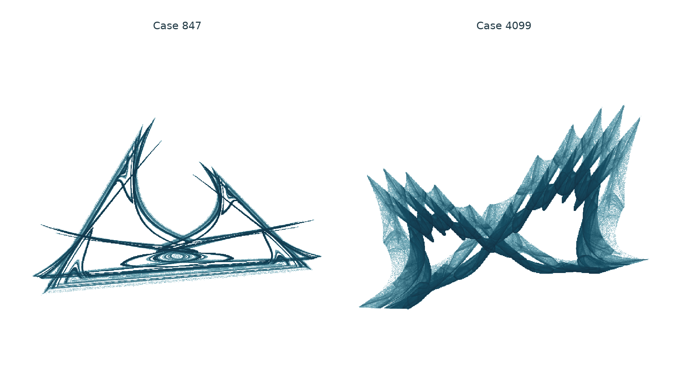

<!-- drawing-date -->
*First recorded portrait: **2026-11-01**.*
<!-- /drawing-date -->

<!-- portrait-equation adamax -->

**Autonomous Adamax iteration on a scalar quadratic**

```math
m^+=b m+(1-b)x,\qquad u^+=\max(cu,|x|+e),\qquad x^+=x-\frac{m^+}{u^+}
```

The normalized coordinates are position x, first moment m and infinity-norm memory u. The offset e enters the maximum in the memory update. [Model and parameters](docs/adamax-geometry.md)

**Parameters used for this portrait**

Values are ordered as `(b, c, e)`. Left · Case 847 `(0.36351296468637884, 0.42910876222886146, 5e-06)`. Right · Case 4099 `(0.9, 0.5, 5e-06)`. [Archived settings and portrait starts](results/adamax-geometry/render/analysis.json)

<details>
<summary>Full numerical settings</summary>

The portrait runs start at `(x, m, u)`. Left · Case 847 `(0.057301147223669816, 0.011328899076091276, 0.1623973245900337)`. Right · Case 4099 `(-0.8690765319904306, 0.0947831992326705, 0.7412042266145691)`. Discard 10,000 updates and retain the next 8,000,000.

</details>

<!-- /portrait-equation -->

Normalized optimizer state.

[Report](docs/adamax-geometry.md)

#### AdaBelief memory

AdaBelief on a scalar quadratic traces irregular paths through position, momentum and variance at the displayed settings.


<!-- drawing-date -->
*First recorded portrait: **2026-11-01**.*
<!-- /drawing-date -->

<!-- portrait-equation adabelief -->

**Nonrectified autonomous AdaBelief iteration on a scalar quadratic**

```math
m^+=b m+(1-b)x,\quad s^+=c s+(1-c)(x-m^+)^2+e,\quad x^+=x-\frac{m^+}{\sqrt{s^+}+d}
```

At learning rate α = 0.01 and ε = 10⁻¹⁶, the two normalized offsets are e = ε/α² and d = ε/α. [Model and parameters](docs/adabelief-quadratic.md#exact-model-and-selected-parameters)

**Parameters used for this portrait**

Use `(b, c, e, d) = (0.52, 0.15, 1e-12, 1e-14)` and start at `(x, m, s) = (0.73, 0, 0)`. [Run 000](results/adabelief-quadratic/long/summary.json)

<!-- /portrait-equation -->

Normalized state (x, m, s); equal displayed coordinate units.

[Report](docs/adabelief-quadratic.md)

#### Finite-sample FastICA

Cases 204 and 351 retained positive leading growth over five million steps and at 70- and 100-digit precision. Other starts in Case 351 reached regular motion.

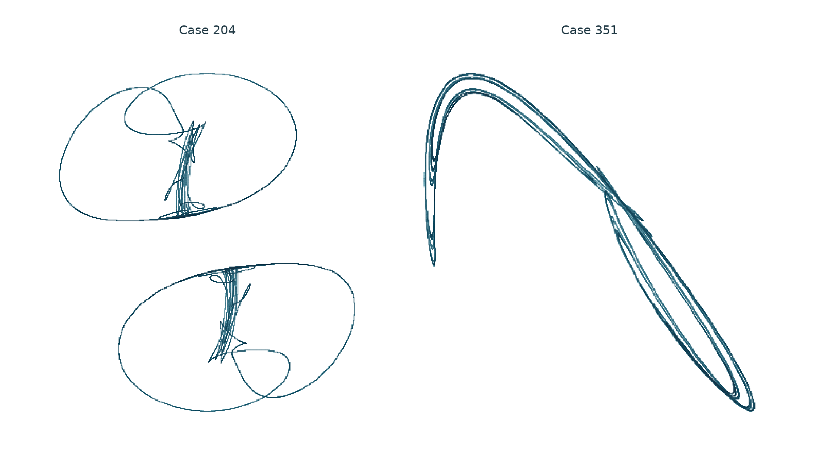

<!-- drawing-date -->
*First recorded portrait: **2026-11-01**.*
<!-- /drawing-date -->

<!-- portrait-equation fastica -->

**One-unit empirical FastICA with the Gaussian nonlinearity**

```math
u_i=x_i^\top w,\quad h=\frac1N\sum_{i=1}^N\!\left[x_i g(u_i)-g'(u_i)w\right],\quad w^+=\frac{h}{\|h\|},\quad g(u)=u e^{-u^2/2}
```

The fixed whitened observations xᵢ lie in four dimensions. Case 204 uses N = 32 normal samples and Case 351 uses N = 16 Student-t samples. Both panels follow the first FastICA weight on the unit 3-sphere. [Model and parameters](docs/fastica-dynamics.md#map-and-input-conventions)

**Parameters used for this portrait**

In four dimensions, the left panel (Case 204) uses 32 whitened normal observations (seed 1190196705), and the right panel (Case 351) uses 16 whitened Student-t observations with 2.5 degrees of freedom (seed 460786286). Both use g(u) = u exp(−u²/2). [Left data and start](results/fastica/follow-01/case-204-input.json) · [Right data and start](results/fastica/follow-01/case-351-input.json)

<details>
<summary>Full numerical settings</summary>

The exact whitened observation matrices are the X arrays of the two input files. The starting weight vectors before normalization are left [-0.6660440683481935, 0.40750103987154973, -1.1463745154453362, -0.6816622331272629] and right [-0.10954381680645076, -1.4785357225268183, 0.19851379294396682, -1.964859574858424]. Each portrait discards 10,000 updates and retains 1,000,000 consecutive states at stride 1. The survey master seed was 2026110101. [Data generator](results/fastica/source-original/pilot.py) · [Histogram protocol](results/fastica/histograms/render-inputs.json)

</details>

<!-- /portrait-equation -->

Projection of the unit weight on $`(w_1,w_2,w_4)`$; every consecutive state is
retained. No sign folding. Spatial scale and density saturation differ between
panels. Case numbers identify the exact data sets in the report.

[Report and stopping-rule audit](docs/fastica-dynamics.md)

### Physical and biological models

#### Five motor rows

Two views of the same fourteen-dimensional trajectory reveal how the five-row ribbon bends across its four displacement contrasts.

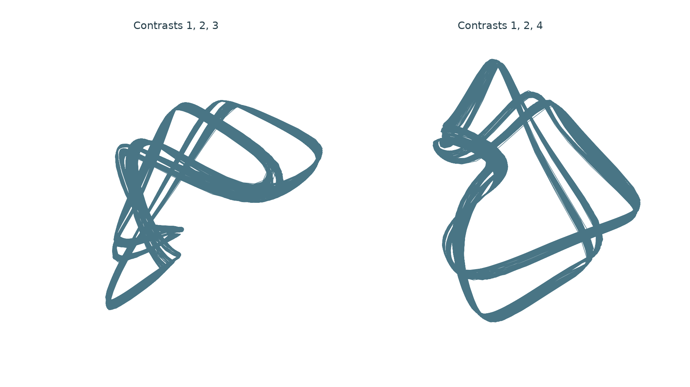

<!-- drawing-date -->
*First recorded portrait: **2026-11-01**.*
<!-- /drawing-date -->

<!-- portrait-equation motor-five -->

**Alouges et al. collective molecular-motor model with five rows**

```math
\begin{aligned}
 V_j&=-\rho X_j+r(s_j-\bar s),\qquad \dot X_j=V_j,\\
 \dot c_j&=1-c_j-V_js_j,\qquad \dot s_j=b-s_j+V_jc_j,\\
 \bar s&=N^{-1}\sum_{k=1}^{N}s_k,\qquad \sum_{j=1}^{N}X_j=0.
\end{aligned}
```

For row j, c and s are the cosine and sine occupancy coefficients, X is displacement and V is velocity. The same five-row trajectory appears in both panels, through displacement contrasts (1, 2, 3) and (1, 2, 4). [Model and parameters](docs/motor-five-geometry.md#model-and-selection)

**Parameters used for this portrait**

Both panels use Case 2816. N = 5, `(ρ, r, b) = (13.652749130273284, 31.74947392484949, 0.7)`. [Run protocol and initial state](results/motor-five-geometry/long/protocol.json)

<details>
<summary>Full numerical settings</summary>

The stored order is all cosine occupancies c, all sine occupancies s, then the first N − 1 displacements X. The last displacement is fixed by the zero-sum constraint.

Start at `(0.5564638405923832, 0.14088141167094723, 0.644575919618252, 0.38157521135949923, 0.3852203026620375, 0.5693332571132717, -0.40941463083471935, 0.6704022090246402, 0.3316753969561484, 0.5872596552640421, 0.6734804904516998, -1.940794767961532, 0.9760440113175902, -0.33065289290570243)`.

</details>

<!-- /portrait-equation -->

Fourier displacement contrasts; final 800 saved time units.

[Report](docs/motor-five-geometry.md)

#### Three motor rows with unequal rates

Case 2566 is an eight-dimensional numerical candidate. The projection uses a fixed orthogonal rotation of the three cosine occupancies.

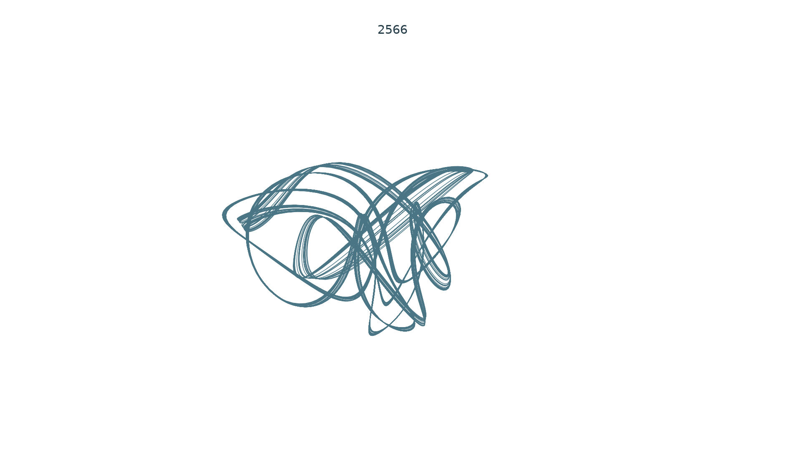

<!-- drawing-date -->
*First recorded portrait: **2026-10-31** · Current rendering: 2026-11-01.*
<!-- /drawing-date -->

<!-- portrait-equation motor-three-asymmetric -->

**Alouges et al. collective molecular-motor model with three asymmetric rows**

```math
\begin{aligned}
 V_j&=-\rho X_j+r(s_j-\bar s),\qquad \dot X_j=V_j,\\
 \dot c_j&=1-c_j-V_js_j,\qquad \dot s_j=b-s_j+V_jc_j,\\
 \bar s&=N^{-1}\sum_{k=1}^{N}s_k,\qquad \sum_{j=1}^{N}X_j=0.
\end{aligned}
```

For row j, c and s are the cosine and sine occupancy coefficients, X is displacement and V is velocity. The axes are an orthogonal rotation of the three cosine occupancies. [Model and parameters](docs/motor-rows-gpu-survey.md#what-the-system-represents)

**Parameters used for this portrait**

Case 2566. N = 3, `(ρ, r, b) = (2.0238144033191343, 5.193274038098629, 0.7)`. [Run protocol and initial state](results/motor-asymmetry/long/protocol.json)

<details>
<summary>Full numerical settings</summary>

The stored order is all cosine occupancies c, all sine occupancies s, then the first N − 1 displacements X. The last displacement is fixed by the zero-sum constraint.

Start at `(0.182796914392684, 0.6700280946470301, 0.7792223150467322, 0.9366361295207505, -0.14760382286461787, 0.5837665861846354, 1.1825317873647738, -1.8587161411914803)`.

</details>

<!-- /portrait-equation -->

Rotated cosine occupancies; final 600 saved time units; stride 2.

[Report](docs/motor-asymmetry-geometry.md)

#### Three symmetric motor rows

Case 783 has an independently computed eight-dimensional spectrum with one positive and one near-zero rate. This image shows the three sine occupancies.

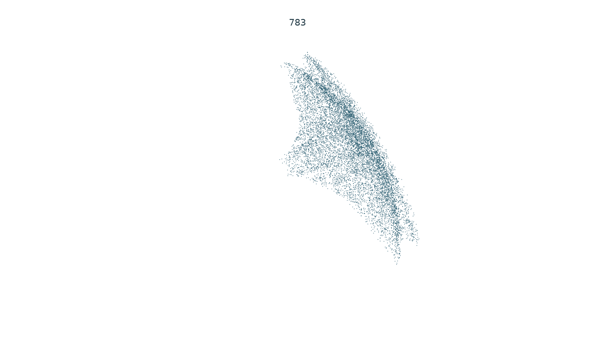

<!-- drawing-date -->
*First recorded portrait: **2026-10-30** · Current rendering: 2026-11-01.*
<!-- /drawing-date -->

<!-- portrait-equation motor-three -->

**Alouges et al. collective molecular-motor model with three symmetric rows**

```math
\begin{aligned}
 V_j&=-\rho X_j+r(s_j-\bar s),\qquad \dot X_j=V_j,\\
 \dot c_j&=1-c_j-V_js_j,\qquad \dot s_j=b-s_j+V_jc_j,\\
 \bar s&=N^{-1}\sum_{k=1}^{N}s_k,\qquad \sum_{j=1}^{N}X_j=0.
\end{aligned}
```

For row j, c and s are the cosine and sine occupancy coefficients, X is displacement and V is velocity. Three-row Case 783 uses b = 1. The coordinates are the three sine occupancies. [Model and parameters](docs/motor-rows-gpu-survey.md#what-the-system-represents)

**Parameters used for this portrait**

Case 783 uses N = 3, ρ = 4.609100387635, r = 7.026038245590061 and b = 1. The portrait shows the three sine occupancies over 2,000 time units after a 200-unit warm-up. [Run and starting state](results/motor-rows/cpu-candidate-N3-783.json)

<details>
<summary>Full numerical settings</summary>

Initial (c₀, c₁, c₂, s₀, s₁, s₂, X₀, X₁) = [1.0725874965760862, 1.3010612162763018, -0.07702059094303701, 0.6869031081140339, 0.14810255454956475, 1.0994667392260709, -0.10600726678819143, -0.4389941106721724]. The third displacement follows from zero total displacement. DOP853 used relative and absolute tolerances 1e−11 and 1e−13, maximum step 0.03 and QR interval 0.2.

</details>

<!-- /portrait-equation -->

Sine occupancies (s0, s1, s2); a projection of the 8D flow.

[Report](docs/motor-rows-gpu-survey.md)

#### Motor-pair model

Case 444 retained positive leading growth in an independent CPU calculation. The estimate of the neutral exponent had yet to converge.

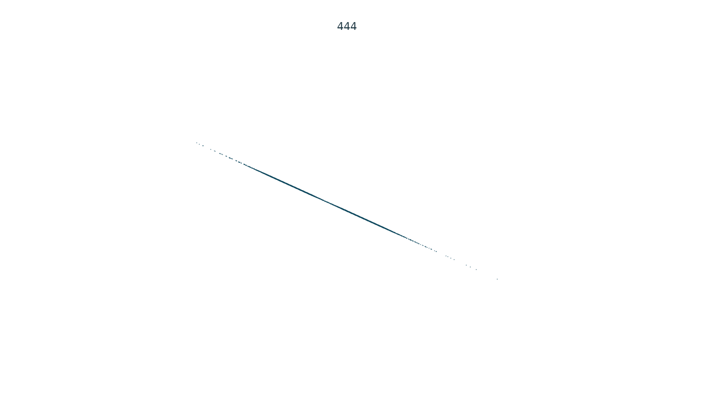

<!-- drawing-date -->
*First recorded portrait: **2026-10-30** · Current rendering: 2026-11-01.*
<!-- /drawing-date -->

<!-- portrait-equation motor-pair -->

**Oriola et al. collective molecular-motor pair, three-state reduction**

```math
\begin{aligned}
h'&=[-\rho+r(1-Z)]h-rY,\\
Y'&=h(1-Z)-Y,\\
Z'&=hY-Z.
\end{aligned}
```

Case 444 is rendered in the dimensionless motor-pair coordinates h, Y and Z. The positive parameters ρ and r control mechanical relaxation and coupling. [Model and parameters](docs/motor-pair-source-audit.md#exact-equations-suitable-for-independent-implementation)

**Parameters used for this portrait**

Case 444 uses ρ = 0.03324597932270942 and r = 1347.217044462391. The portrait covers the final 2,000 time units of the extended trajectory in (h, Y, Z). [Extended run](results/motor-pair/gpu-cpu-444-extended.json)

<details>
<summary>Full numerical settings</summary>

Original (Q, Y, Z) = [0.01, 0.0, 0.0]. The extended CPU replay starts at the saved survey endpoint [0.03696296284197927, 0.01399520069615805, 0.998655805551771], with h = r(Q + Y). It replays 100 warm-up and 400 observed units, then integrates 3,000 additional units. Tolerances 1e−11 and 1e−13, maximum step 0.01, QR interval 0.05. [Both recorded starts](results/motor-pair/gpu-cpu-444.json)

</details>

<!-- /portrait-equation -->

Physical coordinates (h, Y, Z); final 2,000 saved time units.

[Report](docs/motor-pair-gpu-survey.md)

#### Synchronematic oscillators

The plot follows three collective observables in a four-particle system with seven reduced angular coordinates.


<!-- drawing-date -->
*First recorded portrait: **2026-10-29** · Current rendering: 2026-11-01.*
<!-- /drawing-date -->

<!-- portrait-equation synchronematic -->

**Four-particle synchronematic colloid model with first- and third-harmonic coupling**

```math
\begin{aligned}
 f_i&=\sum_{j\ne i}d_{ij}^{-3}F_\theta(\Delta_{ij})\cos\psi_i\cos\psi_j,\qquad \dot\theta_i=f_i-\bar f,\\
 \dot\chi_i&=\sum_{j\ne i}d_{ij}^{-3}F_\chi(\Delta_{ij})\sin\psi_i\cos\psi_j.
\end{aligned}
```

The four phases θ and orientations χ interact at pair distances d. For each pair, Δ is the phase difference θⱼ−θᵢ and ψ measures orientation relative to the pair direction. The source specifies both first- and third-harmonic kernels; f̄ is the four-particle mean. [Model and parameters](docs/synchronematic-research.md#exact-model-and-units)

**Parameters used for this portrait**

Scout geometry 43 fixes four particle centers. In the order cos Δ, sin Δ, cos 3Δ, sin 3Δ, the phase kernel has coefficients (2.921, 2.070, −0.781, 0.312), and the orientation kernel (−5.351, 0.223, 3.009, −1.359). [Geometry and eight initial angles](results/synchronematic/n4-cpu-extended/spectrum.json)

<details>
<summary>Full numerical settings</summary>

Particle centers = [[-1.9790993183779289, 1.985651376724929], [-2.1316466735586115, 0.6928438416303933], [0.07938760284507008, 3.76118009077403], [-2.27015573213214, -0.2975173251633551]]. Initial (θ₁, θ₂, θ₃, θ₄, χ₁, χ₂, χ₃, χ₄) = [2.913353406828512, 2.833032575162968, -1.5464358843040982, -2.3110553288414337, -2.7130582060339155, 2.5901085522356357, -2.635723509309872, 1.2081851313620575] radians. DOP853 discards 2,000 and observes 16,000 time units, with relative and absolute tolerances 1e−12 and 1e−14, maximum step 0.1, samples every 0.25. [Printed Fourier coefficients](docs/synchronematic-research.md#exact-model-and-units)

</details>

<!-- /portrait-equation -->

Collective observables (Re Q, Im Q, C), not state coordinates.

[Report](docs/synchronematic-research.md)

#### Light-driven elastomer slider

The three-state slider model switches between two light responses. The linked study varies the switching width and measures transverse growth.


<!-- drawing-date -->
*First recorded portrait: **2026-10-29** · Current rendering: 2026-11-01.*
<!-- /drawing-date -->

<!-- portrait-equation lce-slider -->

**Light-driven liquid-crystal elastomer slider with a relay illumination threshold**

```math
\dot u=v,\qquad \dot v=k(d-u-\phi)-bv,\qquad
\dot\phi=I H(u)(1-\phi)-\phi.
```

The slider displacement u is measured from the illumination threshold, v is velocity and φ is the light-responsive fraction. The step H switches the light on for u > 0. [Model and parameters](docs/lce-slider-research.md#exact-reduction-of-the-printed-equations)

**Parameters used for this portrait**

Case 2222 uses stiffness k = 816.0170161251663, damping b = 13.491678487182265, intensity I = 0.007235236837126186 and offset d = 0.0002219930226626585. The drawing covers 100 late cycles. [Parameter and section record](results/lce-slider/analytic-2222/spectrum.json)

<details>
<summary>Full numerical settings</summary>

The original upward-section (v, φ) = [0.023299383405718962, 0.0020761739302452855]. After 2,000 transient and 8,000 observed cycles, the plotted segment starts at (u, v, φ) = [0.0, 0.0001097406461435281, 0.00022362066470260102]. The analytic event solver uses 256 subdivisions. The portrait samples each light-on and light-off arc at 65 points. Its scaled axes are u/q, v/(√k q) and φ/q, with q = I/(1+I). [Exact trace-generation code](research/analyze_lce_slider.py)

</details>

<!-- /portrait-equation -->

Scaled full state (u/q, v/(sqrt(k) q), phi/q); scaling is explicitly physical.

[Report](docs/lce-slider-research.md)

#### Two-strain epidemic model

The five-state model produces outbreaks of unequal size. Between outbreaks, the computed prevalence reaches extremely small values.

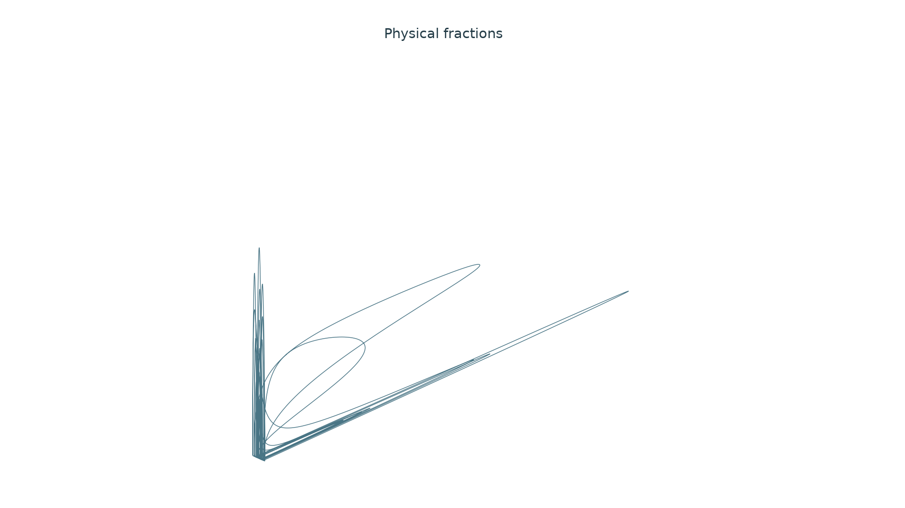

<!-- drawing-date -->
*First recorded portrait: **2026-10-30** · Current rendering: 2026-11-01.*
<!-- /drawing-date -->

<!-- portrait-equation two-strain -->

**Gavish five-compartment two-strain epidemic model**

```math
\begin{aligned}
\dot S &= \mu(1-S)-\beta_1 I_1 S-F_2 S,\\
\dot I_1 &= (\beta_1 S-\mu-\gamma_1)I_1,\\
\dot I_2 &= F_2 S-(\mu+\gamma_2)I_2,\\
\dot I_{12} &= \sigma_{12}F_2R_1-(\mu+\gamma_{12})I_{12},\\
\dot R_1 &= \gamma_1I_1-\sigma_{12}F_2R_1-\mu R_1
\\ F_2&=\beta_2(I_2+\eta_2 I_{12}).
\end{aligned}
```

The five variables are population fractions. S is susceptible, I₁ and I₂ are the two primary infections, I₁₂ is the secondary infection, and R₁ is recovery from the first infection. The portrait shows physical fractions. [Model and parameters](docs/two-strain-research.md#exact-model-and-bounded-state-space)

**Parameters used for this portrait**

Scout 203, refinement 32, uses reproduction numbers 2.5 and 1.87125, μ = 0.00025, γ₁ = 1, γ₂ = 1.1 and σ₁₂ = η₂ = 1.1. The displayed population fractions cover 15,000 additional model-time units, sampled every 0.5. [Render integration](results/two-strain/candidate-render-trace.json)

<details>
<summary>Full numerical settings</summary>

In model order (μ, β₁, β₂, γ₁, γ₂, γ₁₂, σ₁₂, η₂), the stored vector is [0.00025, 2.5006250000000003, 2.0588428125000005, 1.0, 1.1, 1.0007518796992483, 1.1, 1.1]. The rendered trajectory starts from the full-spectrum run’s final log-coordinate state [0.43434895669565277, -140.36802401757126, -10.686977197961914, 0.2435751164057897, 0.1166665315801187], equivalent to (S, I₁, I₂, I₁₂, R₁) = [0.43434895669565277, 2.7345240175881133e-65, 4.319272362853382e-09, 1.3908416967608803e-09, 0.1166665315801187]. DOP853 uses relative and absolute tolerances 1e−12 and 1e−14, maximum step 0.5. [Exact initial-state file, key final_log_state](results/compact-data/7bbb19fca834e73c6221bce184a5d3e257c824a60ffea826cbc25505dbfd8e54.npz)

</details>

<!-- /portrait-equation -->

Projection (S, 1000 I1, 1000 I2); explicit axis units, not an embedding.

[Report](docs/two-strain-research.md)

#### Coupled optical operators

The two coupled optical relays have long irregular transients. Some starts eventually reach periodic cycles.


<!-- drawing-date -->
*First recorded portrait: **2026-10-29** · Current rendering: 2026-11-01.*
<!-- /drawing-date -->

<!-- portrait-equation optical-relay -->

**Coupled optomechanical light-driven oscillators with relay switching**

```math
\begin{aligned}P(D)x_-&=k\,S(x_+-\delta_+),&P(D)x_+&=k\,S(\delta_--x_-),\\P(D)&=(D+1)(D^2+bD+k).\end{aligned}
```

D denotes time differentiation, x₋ and x₊ are the two normalized displacements and S is the Heaviside switch. The baffle thresholds are δ₋ and δ₊; the mechanical stiffness k and damping b set the response in thermal-time units. [Model and parameters](docs/coupled-operators-research.md#structural-checks)

**Parameters used for this portrait**

In (stiffness k, damping b, thresholds δ₋ and δ₊), the left panel (Case 1026) uses approximately (74.15673934, 1.78418042, 0.41395173, 0.25683679) and the right panel (Case 3054) uses approximately (8608.82890275, 4.71772310, 0.87336356, 0.84048879). [Left run](results/light-operators/coupled-cpu-1026.json) · [Right run](results/light-operators/coupled-cpu-3054.json)

<details>
<summary>Full numerical settings</summary>

The exact (k, b, δ₋, δ₊) values are, at left, [74.1567393414624, 1.784180421282182, 0.4139517339970917, 0.25683679452165964] and, at right, [8608.828902752228, 4.7177230976207, 0.8733635635208339, 0.8404887881875038]. The starting (x₋, v₋, y₋, x₊, v₊, y₊) values are, at left, [0.4139517339970917, 0.4583156060996232, 0.5675864861956822, 0.27326780527084316, -0.1778747836727956, 0.27483018755940813] and, at right, [0.8733635635208339, -1.0962513007826296, 0.8729514812666419, 0.821460088264857, -3.0263811939391965, 0.8290834431068447]. Left warm-up/observation = 200/800 and right = 100/400. Both use DOP853, relative tolerance 1e−11 and QR interval 0.05.

</details>

<!-- /portrait-equation -->

Projection (x_minus, x_plus, y_minus - y_plus); all saved adaptive event/QR knots. The knots are nonuniform in time. Point density is sampling density, not an invariant measure.

[Report](docs/coupled-operators-research.md)

#### Smooth optical feedback

At the same switching width, different initial states give regular and irregular histories over the observed interval.


<!-- drawing-date -->
*First recorded portrait: **2026-10-29** · Current rendering: 2026-11-01.*
<!-- /drawing-date -->

<!-- portrait-equation optical-smooth -->

**Coupled optomechanical light-driven oscillators with logistic switching**

```math
\begin{aligned}P(D)x_-&=k\,S(x_+-\delta_+),&P(D)x_+&=k\,S(\delta_--x_-),\\P(D)&=(D+1)(D^2+bD+k),&S(u)&=(1+e^{-u/w})^{-1}.\end{aligned}
```

D is time differentiation. The two displacements drive opposite logistic illumination responses with baffle thresholds δ₋ and δ₊. The irregular and regular trajectories use the same reference-A coefficients and width w = 0.04, with different initial conditions. [Model and parameters](docs/coupled-operators-research.md#finite-optical-width-a-stronger-physical-test)

**Parameters used for this portrait**

Both panels use Case 1026 with logistic width w = 0.04 and (k, b, δ₋, δ₊) ≈ (74.15673934, 1.78418042, 0.41395173, 0.25683679). The two starts give the irregular history at left and the regular history at right. [Left initial and final states](results/light-operators/smooth-cpu-1026-w004.json) · [Right initial and final states](results/light-operators/smooth-cpu-1026-w004-regular.json)

<details>
<summary>Full numerical settings</summary>

Exact (k, b, δ₋, δ₊) = [74.1567393414624, 1.784180421282182, 0.4139517339970917, 0.25683679452165964]. In (x₋, v₋, y₋, x₊, v₊, y₊), the original starts are left [0.4139517339970917, 0.4583156060996232, 0.5675864861956822, 0.27326780527084316, -0.1778747836727956, 0.27483018755940813] and right [0.48457317934628547, 1.0684228218493725, 0.5018485573929711, 0.5145608648115387, 0.3804063790889694, 0.4244498541062365]. The drawing integrations begin at the respective saved endpoints [0.5512244866969063, -0.5755202655520549, 0.48714182218907914, 0.14985799495498134, -0.14460048037938636, 0.19087240987371085] and [0.5270138047181949, -0.13027599787064953, 0.4543420748174679, 0.1854496126337296, -0.13637442102812483, 0.19732103588601815]. Each then runs 200 units (DOP853, tolerances 1e−12/1e−14, maximum step 0.01, spacing 0.005). The portrait uses the final 12,000 and 760 samples respectively. [Sampling code](research/analyze_smooth_operators.py)

</details>

<!-- /portrait-equation -->

Projection (x_minus, x_plus, y_minus - y_plus); common scale.

[Report](docs/coupled-operators-research.md)

<!-- shape-search-20261121-additional -->
### Spatial maps and flows

#### Eye-shaped crest and folded plume in precession

A damped, driven precession flow supports two distinct irregular shapes. For Case 52506 all six nearby starts followed the irregular motion, while four broader starts settled at a steady state.


<!-- drawing-date -->
*Drawn: **2026-11-21**.*
<!-- /drawing-date -->

<!-- portrait-equation shapes-20261121-rotor -->

**Damped precession with constant torque and a quartic potential**

```math
H(v)=a\cdot v+\tfrac12\sum_i q_i v_i^2+\tfrac14\sum_i h_i v_i^4+cxyz,\qquad
\dot v=t-Dv+\frac{v\times\nabla H(v)}{1+|v|^2}.
```

The native state is v = (x, y, z), D is diagonal damping and t is the constant torque. [Model and parameters](results/shape_search_20261121/flows/README.md#forced-quartic-precession)

**Parameters used for this portrait**

Left Case 52506 uses damping (0.12501, 0.21062, 0.22388), torque (0.57309, 0.32027, −0.32964) and mixed potential coefficient c ≈ −7.5736. Right Case 51256 uses damping (0.091655, 0.079807, 0.15399), torque (0.010513, 0.33859, 0.41218) and mixed potential coefficient c ≈ −2.0363. The records give all three linear, quadratic and quartic potential coefficients per axis. [Case 52506 coefficients and start](results/shape_search_20261121/flows/manifest.json#L860) · [Case 51256 coefficients and start](results/shape_search_20261121/flows/manifest.json#L960) · [Reproduce the portraits](research/shape_search_20261121/flows/replay_case.py)

<details>
<summary>Full numerical settings</summary>

```text
Left — Case 52506
diagonal of damping matrix D = [0.1250113704945972, 0.21062255587725118, 0.2238770875958669]
constant torque t = [0.5730914550321164, 0.32026583325585595, -0.32963825008551123]
linear potential coefficients a = [-1.532476766422159, 0.42441947891212584, 0.25910491879054165]
quadratic potential coefficients q = [-0.5067973961611374, -0.26693638498159533, 2.9348840478972944]
quartic potential coefficients h = [0.1713294302170496, 1.1626441415755213, 2.518603471933318]
xyz coupling c = -7.573556867633078
initial native XYZ = [-0.8742768024998431, -1.4683006532900644, -0.22963693939233876]

Right — Case 51256
diagonal of damping matrix D = [0.09165537738041413, 0.07980729508751773, 0.1539885293627368]
constant torque t = [0.010513300922851883, 0.33859156529075396, 0.41218421692685764]
linear potential coefficients a = [1.5648809030198887, -1.8128593164045395, -1.4624374242551346]
quadratic potential coefficients q = [3.261048171702737, -2.6772847434880642, 3.859144931780077]
quartic potential coefficients h = [0.7865322070871947, 2.299349138377382, -1.1284869656733676]
xyz coupling c = -2.0363406857791126
initial native XYZ = [0.08068913518366339, -0.17568587658731483, -0.3054309039560432]
```

</details>

<!-- /portrait-equation -->

Full three-dimensional trajectories in a rigid camera. [Equations, controls and prior work](docs/shape-search-20261121.md)

#### Folded recruitment bands and three expanding directions

Three successive abundances of a delayed scalar recurrence form a banded ring at left. At right a broader distribution has positive growth in all three tangent directions over two million iterations.

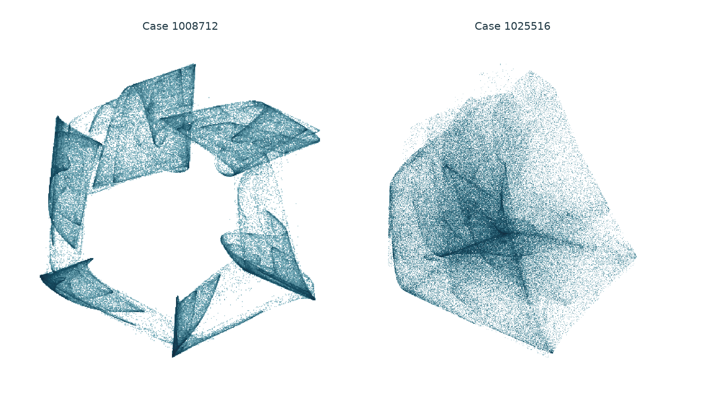

<!-- drawing-date -->
*Drawn: **2026-11-21**.*
<!-- /drawing-date -->

<!-- portrait-equation shapes-20261121-recruits -->

**Three-coordinate delayed Ricker recruitment map**

```math
(x,y,z)^+=\left(sx+(1-s)z\,e^{r(1-ax-by-cz)},x,y\right),\qquad c=1-a-b
```

The three coordinates are successive abundances. The crowding weights a, b and c sum to one. [Model and parameters](research/shape_search_20261121/delay/README.md#dynamics)

**Parameters used for this portrait**

In the order (growth r, crowding weights a, b, c, survival s), the parameters are rounded below. Left Case 1008712 uses (3.0299, 0.0064841, 0.0059257, 0.98759, 0.11481). Right Case 1025516 uses (3.3205, 0.051157, 0.049497, 0.89935, 0.025). [Case 1008712 exact parameters and start](results/shape_search_20261121/delay/manifest.json#L4096) · [Case 1025516 exact parameters and start](results/shape_search_20261121/delay/manifest.json#L2409) · [Reproduce the portraits](research/shape_search_20261121/delay/confirm.py)

<details>
<summary>Full numerical settings</summary>

```text
Left — Case 1008712
(r, a, b, c, s) = [3.029920561662239, 0.006484131624973338, 0.00592572687346046, 0.9875901415015662, 0.11480912402845345]
initial abundances (x, y, z) = [0.59, 1.12, 0.47]

Right — Case 1025516
(r, a, b, c, s) = [3.320469731645198, 0.05115698258954018, 0.04949663174419858, 0.8993463856662612, 0.025]
initial abundances (x, y, z) = [0.59, 1.12, 0.47]
```

</details>

<!-- /portrait-equation -->

Each axis shows abundance in its original units at one of three successive times. [Equations, controls and prior work](docs/shape-search-20261121.md)

#### Quasiperiodic petals and a corrugated rim

A two-frequency rotation forces a pinched interval map. The attracting graph is discontinuous almost everywhere and its transverse exponent is strictly negative. The same torus coordinates are used for both portraits.


<!-- drawing-date -->
*Drawn: **2026-11-21**.*
<!-- /drawing-date -->

<!-- portrait-equation shapes-20261121-pinched -->

**Pinched quasiperiodic skew product over a two-torus**

```math
\begin{aligned}q^+&=q+(\sqrt2-1,\sqrt3-1)\pmod 1,\\h^+&=\frac{\kappa h\prod_j\sin^2\!\big(\pi(k_jq_1+l_jq_2+b_j/32)\big)}{1+(\kappa-1)h}.\end{aligned}
```

Case 156 uses κ = 64 with wave triples (k,l,b) = (5,4,12), (2,3,30). Case 1267 uses κ = 48 with (5,2,24), (0,1,12). [Model and parameters](research/shape_search_20261121/pinched/README.md#dynamics-and-proof)

**Parameters used for this portrait**

Both base angles advance by (√2 − 1, √3 − 1) modulo one. Each triple gives (k, l, b) with phase b/32. Left Case 156 uses κ = 64 and wave triples (5, 4, 12), (2, 3, 30). Right Case 1267 uses κ = 48 and wave triples (5, 2, 24), (0, 1, 12). [Case 156 inputs and starts](results/shape_search_20261121/pinched/manifest.json#L5) · [Case 1267 inputs and starts](results/shape_search_20261121/pinched/manifest.json#L862) · [Reproduce the portraits](research/shape_search_20261121/pinched/search.py)

<details>
<summary>Full numerical settings</summary>

```text
Left — Case 156
kappa = 64
wave triples (k, l, b) = [[5, 4, 12], [2, 3, 30]]
base rotation = (sqrt(2) - 1, sqrt(3) - 1) mod 1
initial (theta, phi, height) = (sqrt(5)/7, sqrt(7)/9, 0.81)

Right — Case 1267
kappa = 48
wave triples (k, l, b) = [[5, 2, 24], [0, 1, 12]]
base rotation = (sqrt(2) - 1, sqrt(3) - 1) mod 1
initial (theta, phi, height) = (sqrt(5)/7, sqrt(7)/9, 0.81)
```

</details>

<!-- /portrait-equation -->

Fixed tubular coordinates encode the two forcing phases and the physical fiber height. [Equations, controls and prior work](docs/shape-search-20261121.md)

#### Two knotted limit cycles in cyclic harmonic flows

The closed orbit polygons of Cases 967 and 2160 have distinct Alexander polynomials. The orbit in Case 967 has period about 215.27 and determinant 243. Stability of the flow cycles is numerical.


<!-- drawing-date -->
*Drawn: **2026-11-21**.*
<!-- /drawing-date -->

<!-- portrait-equation shapes-20261121-knots -->

**Cyclic three-coordinate harmonic flow**

```math
\dot x_i=-d_i x_i+a_i\sin(x_j+\phi_i)+b_i\sin(x_k+\psi_i)+c_i\sin(m_i x_j+n_i x_k+\chi_i).
```

The indices (i, j, k) run cyclically through the three native Cartesian coordinates. Cases 967 and 2160 use different coefficients and each panel shows one attracting periodic orbit. [Model and parameters](results/shape_search_20261121/flows/README.md#cartesian-harmonic-coupling)

**Parameters used for this portrait**

Each coordinate uses the same nine coefficients. In the order (d, a, b, c, φ, ψ, χ, m, n), left Case 967 uses (0.050766, 1, −0.85246, 0.076215, 0.36014, −0.48061, 2.9829, 2, −1) and right Case 2160 uses (0.25389, 1, 1.1909, 0.6205, 0, 0, 0, 1, −1), rounded. [Case 967 coefficients and start](results/shape_search_20261121/flows/manifest.json#L2185) · [Case 2160 coefficients and start](results/shape_search_20261121/flows/manifest.json#L2325) · [Reproduce the portraits](research/shape_search_20261121/flows/replay_case.py)

<details>
<summary>Full numerical settings</summary>

```text
Left — Case 967
(d, a, b, c, phi, psi, chi, m, n), common to all three axes = [0.050765535079655484, 1.0, -0.8524606648871345, 0.07621464004381595, 0.36014170710363924, -0.4806130091106482, 2.9828877419246327, 2.0, -1.0]
initial native XYZ = [-0.9172671353561704, -2.206830119545507, 1.0339829033416192]
period used to integrate the sampled orbit = 215.2679271210591

Right — Case 2160
(d, a, b, c, phi, psi, chi, m, n), common to all three axes = [0.25389150813324757, 1.0, 1.1908764084457237, 0.620497372594307, 0.0, 0.0, 0.0, 1.0, -1.0]
initial native XYZ = [0.001348431811659475, -5.491337399254559, -0.8438105780265323]
period used to integrate the sampled orbit = 138.17345095697522
```

</details>

<!-- /portrait-equation -->

Native spatial states on one circuit of each periodic orbit. [Equations, controls and prior work](docs/shape-search-20261121.md)

#### Attracting sets with four and five components

Cases 2303801 and 2401313 each have a rigorously trapped local attracting set. Their component counts are four and five, respectively, so the two sets are topologically distinguishable.


<!-- drawing-date -->
*Drawn: **2026-11-21**.*
<!-- /drawing-date -->

<!-- portrait-equation shapes-20261121-components -->

**Dissipative three-axis twist map**

```math
z^{(0)}=r x_n+(1-r)e_1,\quad z^{(j)}=R_{i_j k_j}\!\left(a_j+b_jw_j+h_jw_j^3\right)z^{(j-1)},\quad x_{n+1}=z^{(3)}.
```

The rotations act in the xy, yz and zx planes in that order. Each wⱼ is the remaining coordinate immediately before its rotation, r is the contraction ratio and e₁=(1,0,0). Cases 2303801 and 2401313 use the coefficient vectors with four and five certified components respectively. [Model and parameters](docs/twist-geometry.md#definition-and-exact-structural-properties) · [Maps report](results/shape_search_20261121/maps/README.md)

**Parameters used for this portrait**

The xy, yz and zx rotations use offsets a, linear coefficients b (archived as k) and cubic coefficients h, in that order. Left Case 2303801 uses contraction r ≈ 0.41204, offsets a ≈ (2.4079, −1.2101, 0.25682), linear coefficients b ≈ (0.50179, −13.275, −0.162) and cubic coefficients h ≈ (0, 0, 0). Right Case 2401313 uses contraction r ≈ 0.35304, offsets a ≈ (1.1172, 0.39685, −1.5991), linear coefficients b ≈ (0.12526, 11.946, −3.6112) and cubic coefficients h ≈ (0, 0, 0). [Case 2303801 exact coefficients](results/shape_search_20261121/maps/checks/2303801.json) · [Case 2401313 exact coefficients](results/shape_search_20261121/maps/checks/2401313.json) · [Reproduce the portraits](research/shape_search_20261121/maps/replay.py)

<details>
<summary>Full numerical settings</summary>

```text
Left — Case 2303801
contraction r = 0.4120443042500313
angle offsets a (xy, yz, zx) = [2.4079177711807347, -1.2101451736464572, 0.2568230565340386]
linear twist b, archived as k (xy, yz, zx) = [0.5017922050196921, -13.27513165866134, -0.16200108367527832]
cubic twist h (xy, yz, zx) = [0.0, 0.0, 0.0]
initial native XYZ = [0.1, 0.2, 0.3]

Right — Case 2401313
contraction r = 0.3530398122127234
angle offsets a (xy, yz, zx) = [1.1171611015935927, 0.3968461979565194, -1.5991014508852899]
linear twist b, archived as k (xy, yz, zx) = [0.12526072358266638, 11.946152159595423, -3.611151570907507]
cubic twist h (xy, yz, zx) = [0.0, 0.0, 0.0]
initial native XYZ = [0.1, 0.2, 0.3]
```

</details>

<!-- /portrait-equation -->

Both panels show long numerical trajectories in the original three-coordinate maps. [Equations, controls and prior work](docs/shape-search-20261121.md)

#### Three coexisting solenoids with inseparable triple links

Cases 30300001 and 30300007 each contain three chaotic solenoids. Removing any one leaves the other two separated by a sphere. Their triple cannot be separated by a sphere. The two compact triples are inequivalent under ambient homeomorphisms.

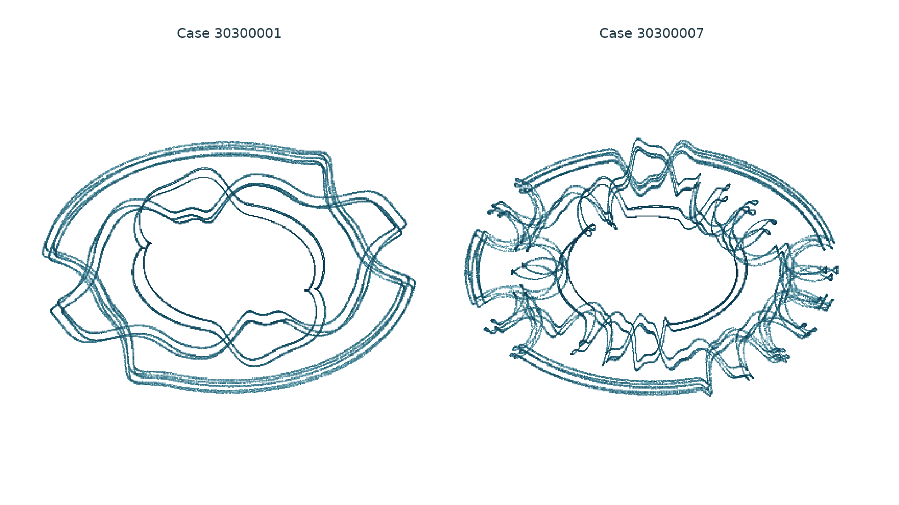

<!-- drawing-date -->
*Drawn: **2026-11-21**.*
<!-- /drawing-date -->

<!-- portrait-equation shapes-20261121-brunnian -->

**Three Smale–Williams solenoids in disjoint braided solid tori**

```math
\begin{aligned}F\big(H_i(\theta,w)\big)&=H_i\big(f_i(\theta),\,0.105w+0.55e^{i\theta}\big),\\f_i(\theta)&=d_i\theta+0.12\sin(d_i\theta)+0.137,\quad (d_1,d_2,d_3)=(2,3,5).\end{aligned}
```

Each Hᵢ embeds its unit-disk fibers around a separate closed braid strand in three-space; angles are modulo 2π. Cases 30300001 and 30300007 have the same internal maps and different three-strand charts, with absolute triple-linking invariants 1 and 7. [Model and parameters](results/shape_search_20261121/extension/brunnian/README.md#local-maps-and-disjoint-trapping-tubes)

**Parameters used for this portrait**

Both use degrees (2, 3, 5), fiber contraction 0.105, fiber offset 0.55, angular ripple 0.12 and angular shift 0.137. The embedding radius is 3 and the tube scale is 0.27. Word letters ±1 and ±2 are signed full twists of adjacent strands. Left Case 30300001 uses the word (1, −2, −1, 2). Right Case 30300007 uses the word (1, −2, −2, −2, −1, −1, 2, −1, 2, 1, 2, 1). [Case 30300001 braid and map](results/shape_search_20261121/extension/brunnian/designs.json#L68) · [Case 30300007 braid and map](results/shape_search_20261121/extension/brunnian/designs.json#L234) · [Reproduce the portraits](research/shape_search_20261121/extension/brunnian/sample.py)

<details>
<summary>Full numerical settings</summary>

```text
Left — Case 30300001
word = [1, -2, -1, 2]
width = 0.27
radius = 3.0
degrees = [2, 3, 5]
fiber contraction = 0.105
fiber offset = 0.55
base ripple = 0.12
base shift = 0.137
three starts (theta, Re w, Im w) = [[0.63891, 0.142, -0.17], [0.95201, 0.011999999999999983, -0.05000000000000002], [1.26511, -0.11800000000000002, 0.06999999999999998]]

Right — Case 30300007
word = [1, -2, -2, -2, -1, -1, 2, -1, 2, 1, 2, 1]
width = 0.27
radius = 3.0
degrees = [2, 3, 5]
fiber contraction = 0.105
fiber offset = 0.55
base ripple = 0.12
base shift = 0.137
three starts (theta, Re w, Im w) = [[0.63891, 0.142, -0.17], [0.95201, 0.011999999999999983, -0.05000000000000002], [1.26511, -0.11800000000000002, 0.06999999999999998]]
```

</details>

<!-- /portrait-equation -->

Native Cartesian positions at equal axis scales. Each panel combines 40,000 states from each of three attracting tubes. [Equations, controls and prior work](docs/shape-search-20261121.md)

#### Fourteen and twelve connected components

Cases 2000254 and 2302642 admit local attracting sets with exactly fourteen and twelve connected components. Each component contains at least two distinct points, as verified by an isolated orbit of twice the return period. The images show sampled trajectories at these parameters.


<!-- drawing-date -->
*Drawn: **2026-11-21**.*
<!-- /drawing-date -->

<!-- portrait-equation shapes-20261121-extension-components -->

**Dissipative three-axis twist map**

```math
z^{(0)}=r x_n+(1-r)e_1,\quad z^{(j)}=R_{i_j k_j}\!\left(a_j+b_jw_j+h_jw_j^3\right)z^{(j-1)},\quad x_{n+1}=z^{(3)}.
```

The rotations act in the xy, yz and zx planes in that order. Each wⱼ is the remaining coordinate immediately before its rotation, r is the contraction ratio and e₁=(1,0,0). Cases 2000254 and 2302642 use the coefficient vectors with fourteen and twelve certified components respectively. [Model and parameters](docs/twist-geometry.md#definition-and-exact-structural-properties) · [Maps report](results/shape_search_20261121/extension/maps/README.md)

**Parameters used for this portrait**

The xy, yz and zx rotations use offsets a, linear coefficients b (archived as k) and cubic coefficients h, in that order. Left Case 2000254 uses contraction r ≈ 0.5416, offsets a ≈ (−0.41534, −0.58859, 2.4441), linear coefficients b ≈ (−0.66931, 0.40291, 0.68895) and cubic coefficients h ≈ (3.8442, −19.54, 28.726). Right Case 2302642 uses contraction r ≈ 0.60063, offsets a ≈ (1.0538, −0.71853, −0.31762), linear coefficients b ≈ (2.7557, −3.2913, 3.4821) and cubic coefficients h ≈ (29.091, 33.608, 6.7858). [Case 2000254 exact coefficients](results/shape_search_20261121/extension/maps/checks/2000254.json) · [Case 2302642 exact coefficients](results/shape_search_20261121/extension/maps/checks/2302642.json) · [Reproduce the portraits](research/shape_search_20261121/maps/replay.py)

<details>
<summary>Full numerical settings</summary>

```text
Left — Case 2000254
contraction r = 0.5416015480947617
angle offsets a (xy, yz, zx) = [-0.4153357143345528, -0.5885881672588562, 2.4441123916862626]
linear twist b, archived as k (xy, yz, zx) = [-0.6693137878770017, 0.4029123362684042, 0.6889532376787297]
cubic twist h (xy, yz, zx) = [3.8441853078382775, -19.53980750285978, 28.72584278427118]
initial native XYZ = [0.1, 0.2, 0.3]

Right — Case 2302642
contraction r = 0.6006262659319646
angle offsets a (xy, yz, zx) = [1.0538400199936093, -0.7185312965403801, -0.31761712362339173]
linear twist b, archived as k (xy, yz, zx) = [2.7557423873747804, -3.2913374180368047, 3.4821410721332855]
cubic twist h (xy, yz, zx) = [29.090783357565154, 33.6084834445843, 6.785766033592481]
initial native XYZ = [0.1, 0.2, 0.3]
```

</details>

<!-- /portrait-equation -->

Native three-axis twist coordinates, shown at equal axis scales with a principal-axis camera. [Equations, controls and prior work](docs/shape-search-20261121.md)
<!-- /shape-search-20261121-additional -->

<!-- wow-20261122-false -->
### Shape search of 2026-11-22

#### Two and four nested rings from one orbit

The seed for the Case 13745 portrait enters the interior of the attractor on step two. From then on, it switches rings at every step and never repeats a point. Two inverse branches in the outer component encode every binary sequence. In Case 5529 one orbit visits four bands in the order first, third, second, fourth. [Entry and nonrepetition](results/attractor_followup_2/annuli/README.md) · [Entropy proof](results/low_hanging_20261122/annuli/README.md)

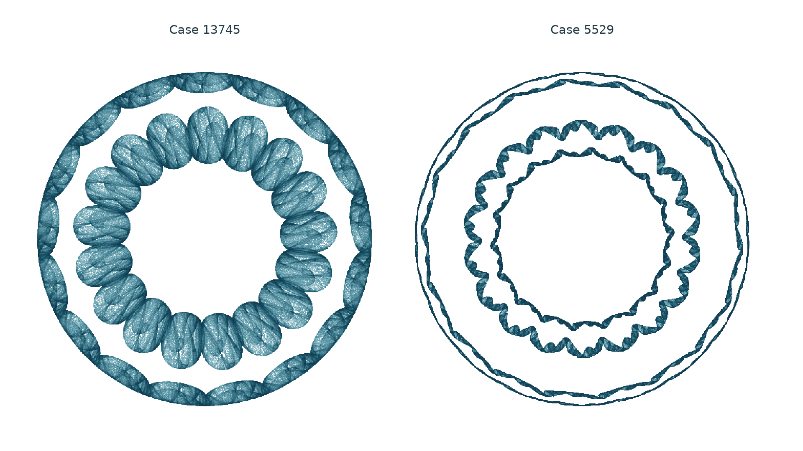

<!-- drawing-date -->
*Drawn: **2026-11-22**.*
<!-- /drawing-date -->

<!-- portrait-equation forms-20261122-nested-crowns -->

**Cyclically equivariant polynomial map of the complex plane**

```math
F(z)=\big[\lambda+i\omega+(\alpha+i\delta)|z|^2+\beta\,\mathrm{Re}(z^n)\big]z+\gamma\bar z^{\,n-1}+\eta\bar z^{\,2n-1}.
```

The coefficients enforce n-fold rotational equivariance. Each panel shows one initial condition iterated directly in the native real and imaginary coordinates. [Model and parameters](results/wow_search_20261122/symmetry/README.md)

**Parameters used for this portrait**

Left · Case 13745 has n = 17 and λ ≈ 2.312147. Right · Case 5529 has n = 18 and λ ≈ 2.286399. All start at z = 0.247 + 0.193i. Discard 100,000 iterations and retain the next two million. [All exact parameter vectors and runs](results/wow_search_20261122/symmetry/numerics.json)

<details>
<summary>Full numerical settings</summary>

Coefficient order is (n, λ, α, β, γ, ω, δ, Re η, Im η).

Case 13745 `(17, 2.312147281840444, -2.979882064741105, 0.00705638956278562, 1.2145798933692276, 0.1358502756245434, -0.3287479327991605, -0.23178551886230708, -0.11128116576001049)`.

Case 5529 `(18, 2.2863991321995853, -3.235570552293211, 0.015576599538326255, 0.8797143139876425, -0.27291807238943877, 0.2012810145970434, 0.212484014313668, -0.3247909559868276)`.

</details>

<!-- /portrait-equation -->

2 panels in native real and imaginary coordinates. All two million measured updates per panel contribute to its density. [Study and reproduction](docs/chaotic-forms-20261122.md)


Tracing where the map folds and iterating those curves draws the crown on the left. At right, orbit visits pick out the tip predicted by the equation. There is one such cusp in each of the 17 sectors. [Cusp count and density check](results/art_20261122/rings/README.md)

#### Three and five nested rings force chaos in the gaps

The two local attractors have exactly three and five connected components. The order in which the map visits the bands forces positive topological entropy on a separate invariant set in the gaps.

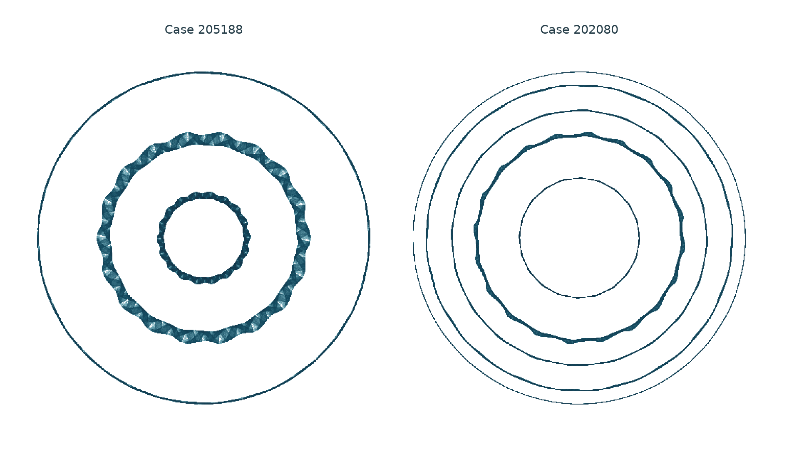

<!-- drawing-date -->
*Drawn: **2026-11-22**.*
<!-- /drawing-date -->

<!-- portrait-equation forms-20261122-odd-cycles -->

**Cyclically equivariant polynomial map of the complex plane**

```math
F(z)=\big[\lambda+i\omega+(\alpha+i\delta)|z|^2+\beta\,\mathrm{Re}(z^n)\big]z+\gamma\bar z^{\,n-1}+\eta\bar z^{\,2n-1}.
```

The coefficients enforce n-fold rotational equivariance. Each panel shows one initial condition iterated directly in the native real and imaginary coordinates. [Model and parameters](results/wow_search_20261122/symmetry/README.md)

**Parameters used for this portrait**

Left · Case 205188 has n = 18 and λ ≈ 2.467358. Right · Case 202080 has n = 20 and λ ≈ 2.396712. All start at z = 0.247 + 0.193i. Discard 100,000 iterations and retain the next two million. [All exact parameter vectors and runs](results/wow_search_20261122/symmetry/numerics.json)

<details>
<summary>Full numerical settings</summary>

Coefficient order is (n, λ, α, β, γ, ω, δ, Re η, Im η).

Case 205188 `(18, 2.4673584890066538, -3.7667032828345723, -0.04713289551436901, 0.16145130503922703, -0.058611005768179895, 0.0819005724042654, -0.08924180686404122, 0.2548252340480455)`.

Case 202080 `(20, 2.396712339599099, -4.318038192105558, -0.04008208259940147, 0.426438063159585, -0.027753127831965686, 0.015960691962391138, -0.1344972140699269, 0.2341164227631805)`.

</details>

<!-- /portrait-equation -->

2 panels in native real and imaginary coordinates. All two million measured updates per panel contribute to its density. [Study and reproduction](docs/chaotic-forms-20261122.md)

#### Three shapes from cyclic polynomial maps

A central four-cornered web, an eight-sided hollow frame, and three chains of loops each arise from one uninterrupted trajectory in the complex plane. The forms and leading expansion are numerical findings.

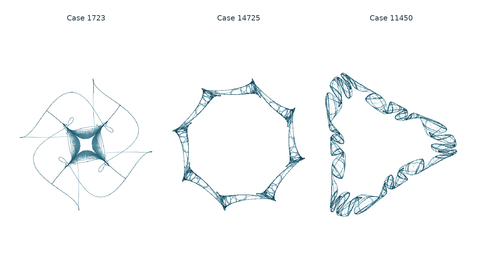

<!-- drawing-date -->
*Drawn: **2026-11-22**.*
<!-- /drawing-date -->

<!-- portrait-equation forms-20261122-planar-icons -->

**Cyclically equivariant polynomial map of the complex plane**

```math
F(z)=\big[\lambda+i\omega+(\alpha+i\delta)|z|^2+\beta\,\mathrm{Re}(z^n)\big]z+\gamma\bar z^{\,n-1}+\eta\bar z^{\,2n-1}.
```

The coefficients enforce n-fold rotational equivariance. Each panel shows one initial condition iterated directly in the native real and imaginary coordinates. [Model and parameters](results/wow_search_20261122/symmetry/README.md)

**Parameters used for this portrait**

Left · Case 1723 has n = 4 and λ ≈ 1.015272. Middle · Case 14725 has n = 8 and λ ≈ -1.667960. Right · Case 11450 has n = 3 and λ ≈ -1.475257. All start at z = 0.247 + 0.193i. Discard 100,000 iterations and retain the next two million. [All exact parameter vectors and runs](results/wow_search_20261122/symmetry/numerics.json)

<details>
<summary>Full numerical settings</summary>

Coefficient order is (n, λ, α, β, γ, ω, δ, Re η, Im η).

Case 1723 `(4, 1.0152718603238464, -0.4927374313119799, 0.491210725530982, -0.9452271513640881, 0.0013964057061821222, 0.18114449107088149, -0.06119981445372105, 0.09918608795851469)`.

Case 14725 `(8, -1.6679601683691145, 1.3656859003417194, -0.13389752069488167, 1.2341027683578432, -0.18035847622901202, -0.0652540335431695, -0.1957832499407232, -0.3894121809862554)`.

Case 11450 `(3, -1.4752569892480971, 2.2683117125593126, 0.4538186067715287, 1.5339731233194471, -0.07809092902578414, -0.30774130020290613, 0.2462412984110415, 0.6479134583845735)`.

</details>

<!-- /portrait-equation -->

3 panels in native real and imaginary coordinates. All two million measured updates per panel contribute to its density. [Study and reproduction](docs/chaotic-forms-20261122.md)

<!-- /wow-20261122-false -->

#### One rosette drawn by two motions

A rigid rotation and a chaotic torus map give exactly the same stationary probability to every patch of this seven-lobed picture. Each exposure below shows the positions visited by one orbit.

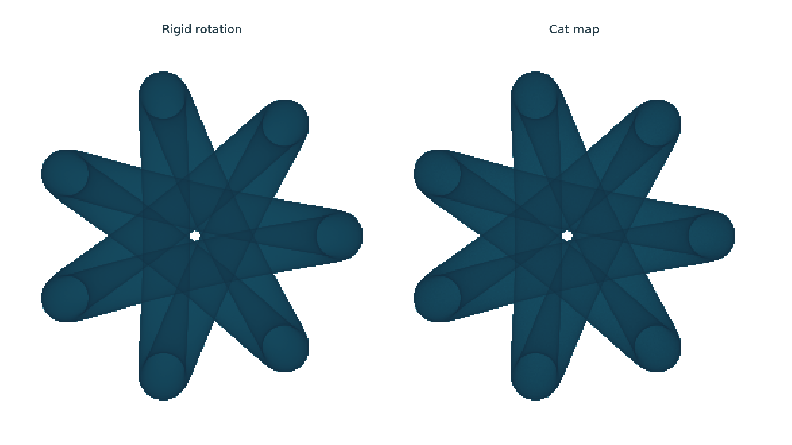

<!-- drawing-date -->
*First recorded portrait: **2026-11-22**.*
<!-- /drawing-date -->

<!-- portrait-equation sevenfold-rosette -->

**Irrational torus translation and Arnold's cat map**

```math
\begin{aligned}R(u,v)&=(u+\alpha,v+\beta),\quad A(u,v)=(2u+v,u+v),\\ Z(u,v)&=e^{3iu}+\tfrac23e^{-4iu}+\tfrac{27}{100}e^{iv}.\end{aligned}
```

Angles are in radians modulo 2π. Each visit contributes one sample to the real and imaginary coordinates of Z. [Model and parameters](results/art_20261122/rosette/README.md)

**Parameters used for this portrait**

Rotation increments (α, β) = (2π/100)(√2, √3). Both maps start at (u, v) = 2π(15485863, 32452843)/(2⁶¹ − 1). Each panel uses 2²⁴ consecutive states. The cat-map update is exact on this rational grid.

<!-- /portrait-equation -->

Each panel contains 16,777,216 consecutive observations. [Why there are fourteen cusps](results/art_20261122/rosette/README.md#where-the-fourteen-cusps-come-from) · [Reproduction guide](docs/reproduction.md#selected-verification-entry-points)


Each dot moves toward its next recorded position. Halfway there, the rigid rotation on the left keeps its petals and the chaotic map on the right draws a star through its center. [Why two frames separate the motions](results/art_20261122/rosette/README.md#look-between-the-samples)


For this experiment the cat map runs on a grid of 2³¹ − 1 sites per axis. We selected 262,144 particles that draw the rosette fifteen steps back and an eye fifteen steps ahead. Two different subpixel shifts preserve the same 320 × 320 present photograph. One leaves the past rosette visible, the other the future eye. [One photograph, two histories](results/art_20261122/double-exposure/README.md)

## Research index

[Shape searches](#shape-search-reports) · [Constructed flows and maps](#constructed-flows-and-maps) · [Algorithms](#numerical-algorithms-1) · [Molecular motors](#molecular-motors) · [Physical and biological models](#other-physical-and-biological-models) · [Negative and incomplete results](#negative-incomplete-and-excluded-searches)

### Shape search reports

| Study | Findings and evidence |
| --- | --- |
| [Mathematical art](results/art_20261122/README.md) | [One photograph, two histories](results/art_20261122/double-exposure/README.md) · [Optical memory transplant](results/art_20261122/memory-transplant/README.md) · [Newton weave](results/art_20261122/newton/README.md) · [Geodesic mosaic](results/art_20261122/weave/README.md) · [Seventeen cusps](results/art_20261122/rings/README.md) · [Two clocks, one rosette](results/art_20261122/rosette/README.md) |
| [Rings, optical fans, Newton basins and geodesics](docs/chaotic-forms-20261122.md) | [Ring permutations](results/wow_search_20261122/symmetry/README.md) · [Optical field](results/wow_search_20261122/orbit/README.md) · [Shared basin boundary](results/wow_search_20261122/boundary/README.md) · [Straight geodesic](results/wow_search_20261122/lattice/README.md) · [Closed routes, ring entropy and optical cycles](results/low_hanging_20261122/README.md) |
| [Four closer looks at the same systems](results/attractor_followup_2/README.md) | [Directional Newton basins](results/attractor_followup_2/newton/README.md) · [Instability at fixed lap length](results/attractor_followup_2/geodesics/README.md) · [Ten optical phases](results/attractor_followup_2/optics/README.md) · [Exact entry times for the rings](results/attractor_followup_2/annuli/README.md) |
| [Spatial attractor search](docs/shape-search-20261121.md) | [Follow-up experiments](docs/shape-search-20261121.md#four-follow-up-experiments) · [Knotted bands](docs/shape-search-20261121.md#a-knotted-chaotic-band) · [Component counts](docs/shape-search-20261121.md#attracting-sets-with-different-numbers-of-components) |

### Constructed flows and maps

| System | Main result | Further evidence |
| --- | --- | --- |
| [Icosahedral Gaussian flow](docs/icosahedral-flow.md) | Numerical chaos; certified absorbing balls | [Equilibria](docs/icosahedral-structure.md), [numerical cycles](docs/icosahedral-cycles.md), [return proposal and known spherical skeleton](docs/icosahedral-returns.md) |
| [Tetrahedral Gaussian flow](docs/tetrahedral-flow.md) | Numerical chaos around a stable center | [Equilibrium certificates](docs/tetrahedral-equilibria.md), [1995 predecessor](docs/tetrahedral-homoclinic-prior.md), [earlier literature audit](docs/polyhedral-priority-followup.md) |
| [Localized Gaussian vortices](docs/gaussian-vortex.md) | Three-state numerical candidate | [Known-shape comparison](docs/attractor-novelty-audit.md) |
| [Dissipative twist map](docs/twist-geometry.md) | Two numerical geometries | [Mechanism and prior art](docs/twist-priority-and-mechanism.md) |

### Numerical algorithms

| System | Main result | Further evidence |
| --- | --- | --- |
| [Spatial-circle RAAR](docs/raar-circles.md) | Certified attracting positive-entropy set at R1051; numerical companion portraits | [Trapping certificate](docs/raar-trapping.md), [fold membership and equivalence obstruction](docs/raar-critical-membership.md), [Symbolic-dynamics certificate](docs/raar-symbolic-dynamics.md), [cycle structure](docs/raar-cycle-structure.md), [folding and preimages](docs/raar-folding.md), [exact structure](docs/raar-structure.md), [prior art](docs/raar-priority.md) |
| [Circle / finite-point RAAR](docs/raar-constellations.md) | Layered spatial numerical candidates; three active sites in the selected observations | [Complete survey and controls](results/raar-constellations/README.md), [known phase-retrieval connections](docs/raar-constellations.md#prior-art-and-equivalent-terms) |
| [Gaussian posterior mean and a circle](docs/soft-constellations.md) | Attracting positive-entropy set and mixed-index cycles for Case 156 | [Article and equivalence obstructions](docs/soft-symbolic-dynamics/manuscript.md), [complete temperature sweep](results/soft-constellations/README.md), [prior art](docs/soft-constellation-priority.md) |
| [Gaussian posterior mean and a sphere](docs/soft-sphere/manuscript.md) | Numerical spatial candidates; no asymptotic or priority certificate | [Complete sweep and reproduction](results/soft-sphere/README.md), [shared prior-art review](docs/soft-constellation-priority.md) |
| [Canonical posterior maps](docs/canonical-sphere/manuscript.md) | Folded ribbon and numerical hyperchaos candidate; certified intrinsic collision and homoclinic return in a trapping set | [Complete 656-case campaign](results/canonical-sphere/README.md), [certificates](results/canonical-collision/README.md), [prior art](docs/soft-constellation-priority.md) |
| [Product-alphabet posterior maps](docs/product-alphabet/manuscript.md) | Four-wing candidate; positive-entropy core is not Lyapunov stable; reversed period-92 return excludes specified neighborhood equivalences | [Complete campaign](results/product-alphabet/README.md), [entropy](results/product-symbolic/README.md), [orientation](results/product-orientation/README.md), [instability and mechanism](results/product-mechanism/README.md), [prior art](docs/product-alphabet/manuscript.md#7-prior-art-and-geometric-comparison) |
| [Nonuniform product posteriors](docs/product-alphabet/manuscript.md#32-nonuniform-alphabets-and-folded-shells) | Two folded-shell numerical candidates; 20-million-step, 33-start and 70/100-digit controls | [Complete alphabet extensions](results/product-highorder/README.md), [visual prior art](records/product-irregular-literature-20261101.json) |
| [Cyclic three-circle RAAR](docs/cyclic-raar-search.md) | Positive finite-time growth, but visually thin configurations | [Complete survey](results/cyclic-raar-search/README.md) |
| [Sphere / finite-point RAAR](docs/spherical-constellation-search.md) | Paired 2,048-case survey; long transient rejected, attracting circle of two-cycles proved | [Exact rational checks and survey](results/spherical-constellations/README.md), [quantized-feedback comparison](docs/quantized-feedback-comparison.md) |
| [Scalar acceleration memory](docs/anderson-memory.md) | Convergent plain iteration and irregular accelerated memory | [Search and controls](research/unexpected_search/README.md) |
| [Overrelaxed Sinkhorn](docs/sinkhorn-screen.md) | 576-case screen; 11 persistent finite-growth cases and 21 periodic recurrences after long transients; no promoted portrait | [All-flag continuations, precision and exact bounds](results/sinkhorn-screen/README.md) |
| [Unequal-rate matrix scaling](docs/sinkhorn-unequal-rates.md) | Two three-state numerical candidates after 106 million steps; 4,864-input campaign with escape and recurrence accounting | [Complete inputs, spectra, precision and controls](results/sinkhorn-unequal-rates/README.md) |
| [Finite-sample FastICA](docs/fastica-dynamics.md) | Four numerical regimes; five-million-step spectra and independent precision controls; one rejected long transient | [Portrait and stopping-rule audit](docs/fastica-dynamics.md), [complete evidence](results/fastica/README.md), [reproduction](research/fastica/README.md) |
| [Structured-data FastICA](docs/fastica-tripling.md) | Exact trapping and entropy interval; ambient local noninjectivity; an extra preimage excluded from the attracting set | [Entropy proof](docs/fastica-tripling.md#attracting-set-and-entropy), [ambient obstruction](docs/fastica-tripling-structure.md), [preimage rejection](docs/fastica-preimage-rejection.md), [reproduction](results/fastica-tripling/README.md) |
| [RK45](docs/rk45-oscillator.md), [RK23](docs/rk23-oscillator.md) | Irregular adaptive-controller states for a decaying oscillator | [RK45 structure](docs/rk45-controller-structure.md), [RK23 structure](docs/rk23-controller-structure.md), [RK45 prior art](docs/rk45-priority.md), [RK23 prior art](docs/rk23-priority.md) |
| [Smooth Yogi](docs/yogi-tanh.md) | Two positive finite growth rates in selected regimes | [Structure](docs/yogi-tanh-structure.md), [manuscript](docs/yogi-memory/manuscript.md) |
| [Yogi parameter plane](docs/yogi-parameter-plane.md) | Retained irregular regimes and regular windows | [Earlier cases](docs/yogi-geometry.md), [smoothing control](docs/yogi-smoothing-control.md), [boundedness theorem](docs/scalar-optimizer-boundedness.md), [prior art](docs/yogi-priority.md) |
| [Adamax](docs/adamax-geometry.md) | Irregular memory and competing cycles | [Structure](docs/adamax-structure.md), [prior art](docs/adamax-priority.md) |
| [AdaBelief](docs/adabelief-quadratic.md) | Numerical scalar-quadratic candidate | [AdaDelta cycle audit](docs/adadelta-cycle-audit.md) |

### Molecular motors

| Result | Evidence |
| --- | --- |
| Exact model and physical normalization | [Motor rows](docs/motor-rows-source-audit.md), [motor pair](docs/motor-pair-source-audit.md) |
| Certified periodic saddle and transverse crossing | [Cycle and least-period audit](docs/motor-cycle-certificate.md), [crossing](docs/motor-crossing-certificate.md), [implementation review](docs/motor-proof-review.md) |
| Certified paired periodic attractor and later saddle | [Paired attractor](docs/motor-paired-certificate.md), [crossing](docs/motor-paired-crossing-certificate.md), [saddle](docs/motor-saddle-certificate.md), [postcritical observations](docs/motor-postcritical.md) |
| Certified five-cluster periodic attraction | [Certificate](docs/motor-five-cycle-certificate.md), [replication limit](docs/motor-five-replication-limit.md), [branch observations](docs/motor-cluster-cycle-branch.md) |
| Numerical irregular geometry | [Four rows](docs/motor-four-geometry.md), [rate-parameter slice](docs/motor-four-b-study.md), [five rows](docs/motor-five-geometry.md), [three asymmetric rows](docs/motor-asymmetry-geometry.md) |
| Collective chaos and hyperchaos candidates | [Activity continuation](docs/motor-activity-continuation.md), [row-count survey](docs/motor-rows-gpu-survey.md), [activity path](docs/motor-rows-activity-path.md), [replication index](docs/motor-replication-index.md) |
| Coordinate and long-time controls | [Motor-pair survey](docs/motor-pair-gpu-survey.md), [physical coordinates](docs/motor-pair-coordinate-audit.md), [log contrasts](docs/motor-log-contrast-audit.md), [long departure](docs/motor-log-seventh-departure.md), [original seed](docs/motor-original-seed-log.md) |
| Additional structural work | [Cluster transverse modes](docs/motor-cluster-transverse.md), [network combinatorics](docs/motor-network-combinatorics.md), [excluded tuple](docs/motor-tuple15-excluded.md) |

### Other physical and biological models

| System | Result and qualifications |
| --- | --- |
| [Synchronematic oscillators](docs/synchronematic-research.md) | Numerical collective motion; [bifurcations](docs/synchronematic-bifurcations.md), [source and priority audit](docs/synchronematic-priority-audit.md) |
| [Elastomer slider](docs/lce-slider-research.md) | Relay-model candidate; [switching-width controls](docs/lce-slider-switching.md), [relay limit](docs/lce-slider-relay-limit.md) |
| [Two-strain epidemic model](docs/two-strain-research.md) | Numerical outbreak irregularity with extremely small prevalence |
| [Coupled optical operators](docs/coupled-operators-research.md) | Irregular histories and periodic captures; [lifetime extension](docs/optical-lifetime-extension.md), [cycle branch](docs/optical-cycle-continuation.md), [arclength continuation](docs/optical-cycle-arclength.md), [saddle departure](docs/optical-saddle-departure.md) |
| Optical model interpretation | [Heat-balance source audit](docs/light-operators-audit.md), [restricted exclusion theorem](docs/coupled-operators-order-audit.md), [known feedback equivalence](docs/coupled-operators-priority-audit.md) |

### Negative, incomplete and excluded searches

The outcome column distinguishes runs that settled to a cycle, runs that stopped early, and models that could not be reconstructed from their sources.

| System | Outcome or unresolved issue |
| --- | --- |
| [NIFTE thermofluidic engine](docs/nifte-research.md) | Periodic controls and unresolved chaos claims; [physical audit](docs/nifte-physical-priority-audit.md) |
| [Rayleigh spring pair](docs/rayleigh-pair-research.md) | Long transients and weak instability; [structural derivation](docs/rayleigh-pair-structure.md) |
| [HHS mechanochemical cell](docs/hhs-research.md) | Periodic and neutral controls; [source audit](docs/hhs-source-audit.md) |
| [Urease reactor](docs/urease-research.md) | No promoted chaotic attractor |
| [Long-cavity whistle](docs/whistle-screen.md) | No retained chaos among 514 declared trajectories |
| [Ice-cloud microphysics](docs/ice-cloud-screen.md) | Weak signals resolve to numerical cycles |
| [Morphoelastic hydrogel filament](docs/hydrogel-variational-checks.md) | [Spatial controls and mesh artifacts](docs/hydrogel-spatial-controls.md), followed by refinement and tangent-growth checks: positive finite growth accompanies slow drift; a longer strong-field run develops close contact and fails. No established chaotic attractor; [earlier planar screen](docs/hydrogel-planar-controls.md) |
| [Core–shell gel](docs/core-shell-gel-research.md) | Stiff cases; one endpoint resolves to a [stable periodic orbit](docs/core-shell-gel-stiff-followup.md) |
| [Rigid microfluidic network](docs/microfluidic-research.md) | Published periodic control not recovered; [supplement audit](docs/microfluidic-source-audit.md) |
| [Contact rotors](docs/dcr-research.md) | Continuation ambiguity at strict event boundaries; [source audit](docs/dcr-source-audit.md) |
| [Pulsating heat pipe](docs/heat-pipe-source-audit.md) | Complete source closure unavailable |
| [Solar-array flutter](docs/thermal-flutter-source-audit.md) | Reduced model not uniquely specified by retrieved material |
| [Mineral protocells](docs/mineral-protocell-screening.md) | Planarity or monotone growth excludes the proposed route |
| Further source and structural screens | [Candidate queue](docs/candidate-queue.md), [material memory](docs/material-memory-screening.md), [physical meminductor](docs/meminductor-followup-audit.md), [thermal sheet](docs/thermomechanical-sheet-audit.md), [epithelial chain](docs/epithelial-chain-audit.md) |

### Archive

[All report files](docs) · [Result directories](results/README.md) · [Sources and checks](RECORDS.md) · [Dependency notices](THIRD_PARTY_NOTICES.md)

[Figure records and rendering conventions](tools/README-portraits.md) · [License](LICENSE)
