# Chaos Attractor Lab

Computational studies of unusual attracting dynamics in continuous systems and numerical algorithms. The repository separates **certified dynamical properties**, **numerical chaos candidates**, and **unresolved or negative results**. Historical novelty is not established by visual appearance or by an unsuccessful literature search.

[2026-11-21 spatial search](docs/shape-search-20261121.md) · [Four follow-up experiments](docs/shape-search-20261121.md#four-follow-up-experiments) · [Further portraits](#further-portraits) · [Research index](#research-index) · [Documentation](docs/README.md) · [Reproduction](docs/reproduction.md) · [Data](results/README.md) · [Storage](docs/data-storage.md)

The selected findings include camera rotations at 25 frames per second, with one revolution every 24 seconds. Each animation uses fixed trajectory data and a constant scale; its full-resolution static portrait appears directly below. Case numbers identify saved parameter sets in the linked reports.

All retained portraits appear on this page. The figures use a common palette and caption convention; coordinate projections and changes of physical units are stated. Density saturation is independent between studies. Drawing dates record our images, not discovery priority.

## Constructed flows

### Icosahedral flow


<!-- drawing-date -->
*First recorded portrait: **2026-11-01**.*
<!-- /drawing-date -->

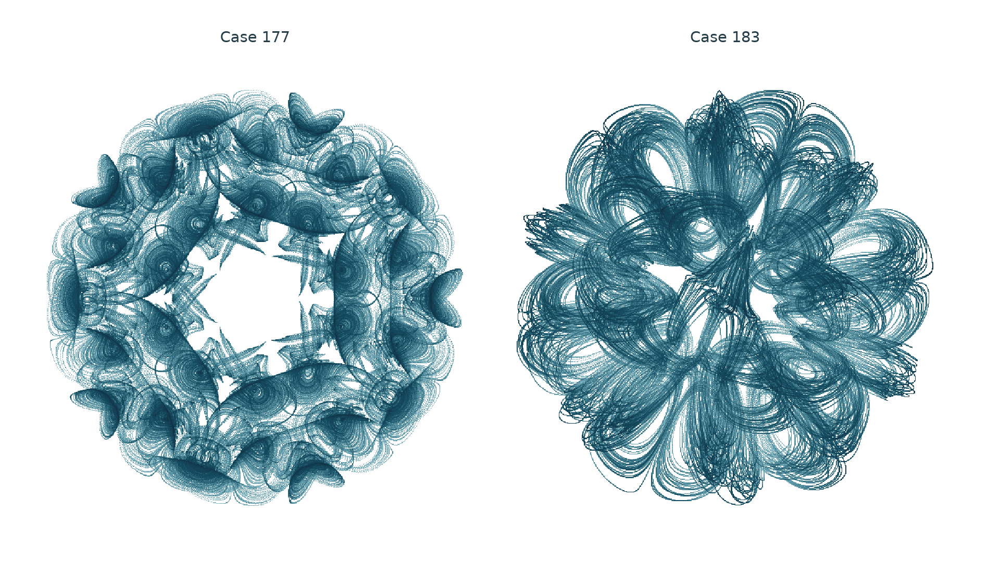

<!-- drawing-date -->
*First recorded portrait: **2026-11-01**.*
<!-- /drawing-date -->

<!-- portrait-equation icosahedral -->

```math
\dot x=-\gamma x+\Omega\sum_{G\in I}\big[(Gu)\times(x-Gc)\big]\exp\!\left(-\frac{\lVert x-Gc\rVert^2}{2\sigma^2}\right).
```

I consists of the 60 proper icosahedral rotations. The seed center c, seed axis u, width σ, strength Ω and damping γ take the values for Case 177 at left and Case 183 at right. [Model and parameters](docs/icosahedral-flow.md#equation-and-selection)

<!-- /portrait-equation -->

Full three-state coordinates; archived orthographic cameras.

**Numerical chaos; certified bounds and local equilibria.** A smooth three-state field produces thirty spiral regions around a stable center. Cases 177 and 183 survive 16,000-unit observations, step refinement and independent integration. The 60-edge geometric skeleton has a known integrable counterpart; the sampled return strips are not yet a covering proof.

[Equations and evidence](docs/icosahedral-flow.md) · [Equilibria](docs/icosahedral-structure.md) · [Periodic orbits](docs/icosahedral-cycles.md) · [Return map and prior art](docs/icosahedral-returns.md)

## Numerical algorithms

### RAAR projection algorithm


<!-- drawing-date -->
*First recorded portrait: **2026-11-01**.*
<!-- /drawing-date -->

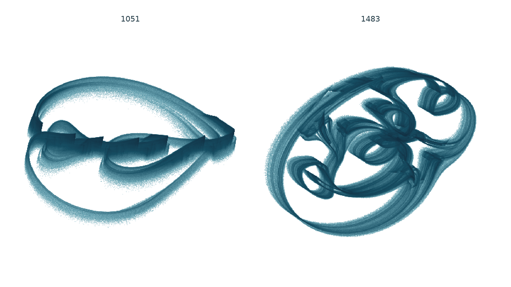

<!-- drawing-date -->
*First recorded portrait: **2026-11-01**.*
<!-- /drawing-date -->

<!-- portrait-equation raar -->

```math
b=P_B(x_n),\quad v=2b-x_n,\quad x_{n+1}=\beta x_n+\beta P_A(v)+(1-2\beta)b.
```

P_A and P_B are nearest-point projections onto circumferences. A is the unit xy circle. B is the circle c+r(cos t, cos θ sin t, sin θ sin t). Cases 1051 and 1483 have different centers, radii, tilts and relaxation β. [Model and parameters](docs/raar-circles.md#explicit-existing-map)

<!-- /portrait-equation -->

Full spatial state (x, y, z); archived orthographic cameras.

**Certified attracting positive-entropy set.** For case 1051, an explicit strict trapping region contains the certified symbolic dynamics. Its maximal invariant set attracts a neighborhood and has topological entropy at least `log(2)/49` per iteration. A certified fold in this attracting set excludes ambient-neighborhood conjugacy to locally injective maps. Transitivity and equality with the numerical portrait remain unresolved; case 1483 is a numerical companion.

[Trapping theorem and article](docs/raar-trapping.md) · [Fold membership and article](docs/raar-critical-membership.md) · [Symbolic certificate](docs/raar-symbolic-dynamics.md) · [Model and trajectories](docs/raar-circles.md) · [Prior art](docs/raar-priority.md)

### Circle and finite-point projections


<!-- drawing-date -->
*First recorded portrait: **2026-11-01**.*
<!-- /drawing-date -->

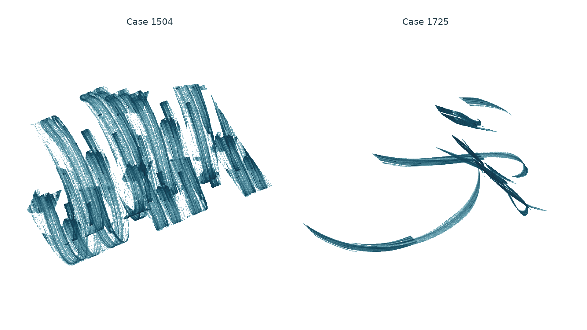

<!-- drawing-date -->
*First recorded portrait: **2026-11-01**.*
<!-- /drawing-date -->

<!-- portrait-equation raar-constellations -->

```math
b=P_B(x_n),\quad v=2b-x_n,\quad x_{n+1}=\beta x_n+\beta P_A(v)+(1-2\beta)b.
```

P_B selects the nearest vertex of a finite spatial set. P_A(v) normalizes the xy component and sets z to zero. Case 1504 has four sites and Case 1725 has six. [Model and parameters](docs/raar-constellations.md#model)

<!-- /portrait-equation -->

Full three-state iterates; rigid camera and equal spatial units within each panel.

**Numerical candidates with layered spatial structure.** A circle and a finite set of points produce separated curved sheets in the three-state RAAR iteration. Cases 1504 and 1725 survive five-million-step observations, 33 initial states and 70/100-digit checks. Both use three sites in the observed post-transient motion. Finite-alphabet phase retrieval and projection-map chaos are known; historical uniqueness of these configurations remains unresolved.

[Model, controls and prior art](docs/raar-constellations.md)

### Gaussian posterior mean and a circle

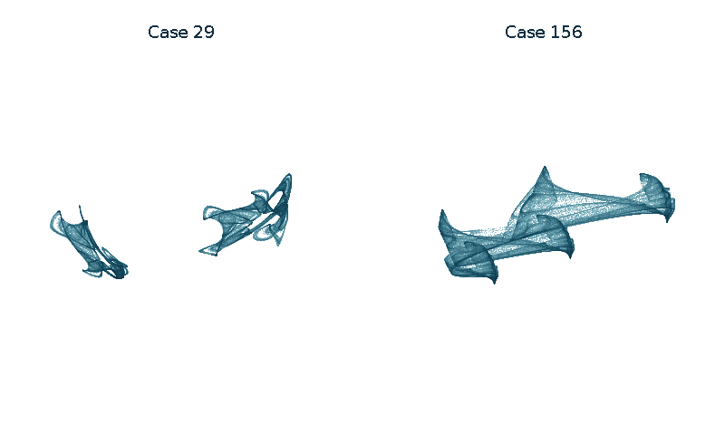

<!-- drawing-date -->
*First recorded portrait: **2026-11-01**.*
<!-- /drawing-date -->

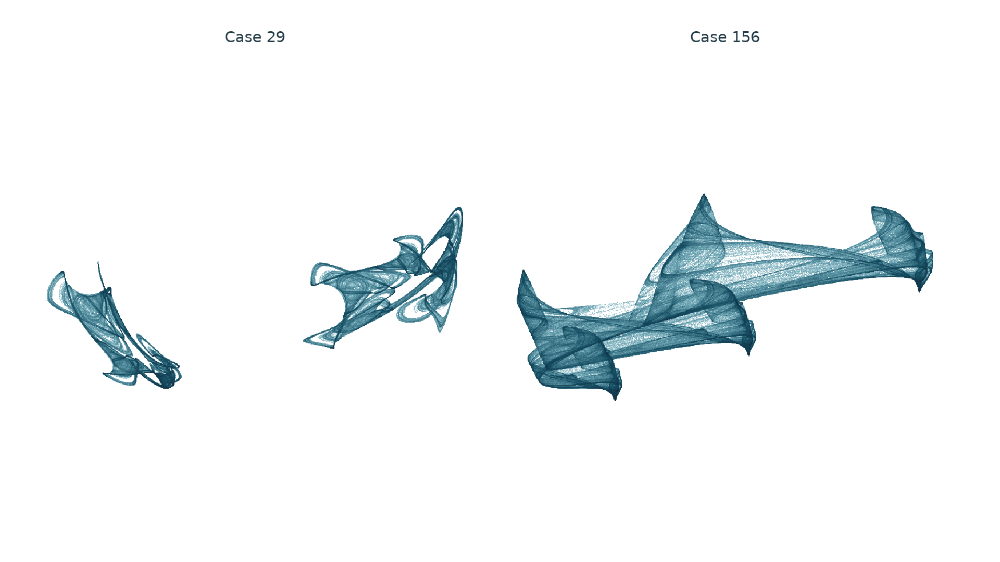

<!-- drawing-date -->
*First recorded portrait: **2026-11-01**.*
<!-- /drawing-date -->

<!-- portrait-equation soft-constellations -->

```math
m(x)=\frac{\sum_j b_j e^{-\lVert x-b_j\rVert^2/\tau}}{\sum_j e^{-\lVert x-b_j\rVert^2/\tau}},\quad v=2m(x_n)-x_n,\quad x_{n+1}=\beta x_n+\beta P(v)+(1-2\beta)m(x_n).
```

P(v) normalizes the xy component and sets z to zero. The bⱼ are equally weighted sites, τ is temperature and β is relaxation. Cases 29 and 156 have four and six sites respectively. [Model and parameters](docs/soft-constellations.md#model-and-known-ingredients)

<!-- /portrait-equation -->

Full three-state iterates; rigid camera and equal spatial units within each panel.

**Certified connected attracting positive-entropy set for Case 156.** Gaussian posterior averaging and a circle reflector produce a folded spatial band. A strict trapping region and seven independently checked crossings prove entropy at least `log(2)/6` per iteration. Certified periodic points have one and two unstable directions. Connectedness and opposite orientation signs force failure of local injectivity on the attracting set, excluding neighborhood conjugacy to invertible models such as three-dimensional Hénon maps. Equivalence restricted to the invariant set, transitivity, equality with the numerical portrait and historical uniqueness remain unresolved. Case 29 is a numerical companion with alternating folded lobes, a behavior known from earlier maps.

[Entropy and periodic-structure article](docs/soft-symbolic-dynamics/manuscript.md) · [Trapping and entry certificate](docs/soft-constellation-trapping.md) · [Model and numerical controls](docs/soft-constellations.md) · [Equivalent formulations and prior art](docs/soft-constellation-priority.md)

### Gaussian posterior mean and a sphere


<!-- drawing-date -->
*First recorded portrait: **2026-11-01**.*
<!-- /drawing-date -->

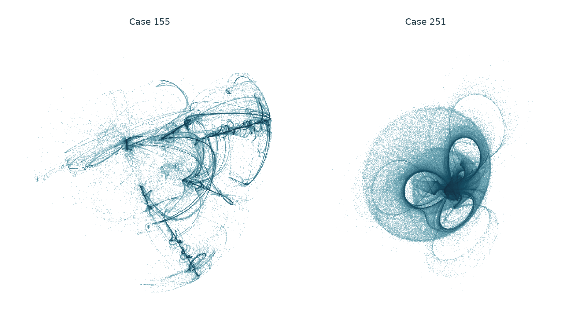

<!-- drawing-date -->
*Drawn: **2026-11-01**.*
<!-- /drawing-date -->

<!-- portrait-equation soft-sphere -->

```math
m(x)=\frac{\sum_j b_j e^{-\lVert x-b_j\rVert^2/\tau}}{\sum_j e^{-\lVert x-b_j\rVert^2/\tau}},\quad v=2m(x_n)-x_n,\quad x_{n+1}=\beta x_n+\beta\frac{v}{\lVert v\rVert}+(1-2\beta)m(x_n).
```

The normalized vector projects onto the unit sphere. The bⱼ are equally weighted spatial sites, τ is temperature and β is relaxation. Cases 155 and 251 use their own site sets and temperatures. [Model and parameters](docs/soft-sphere/manuscript.md#2-map-derivative-and-elementary-bound)

<!-- /portrait-equation -->

Native three-state iterates; rigid camera and equal spatial units within each panel.

**Numerical candidates with folded strands and curled lobes.** Cases 155 and 251 retain positive leading growth over five million steps, all 33 sampled starts and independent 70/100-digit checks. A complete 429-case temperature sweep preserves regular captures and competing outcomes. Mean-shift/MMSE averaging and its use in reflection constructions are known; asymptotic chaotic attraction, nonlinear equivalence and historical uniqueness remain unresolved.

[Numerical article, controls and comparison limits](docs/soft-sphere/manuscript.md) · [Evidence and reproduction](results/soft-sphere/README.md) · [Equivalent formulations and prior art](docs/soft-constellation-priority.md)

### Canonical posterior maps: ribbon and spatial folds

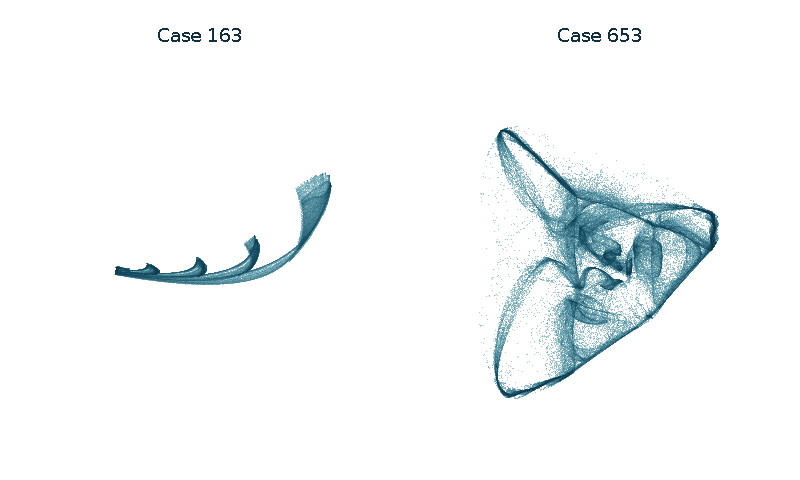

<!-- drawing-date -->
*First recorded portrait: **2026-11-01**.*
<!-- /drawing-date -->

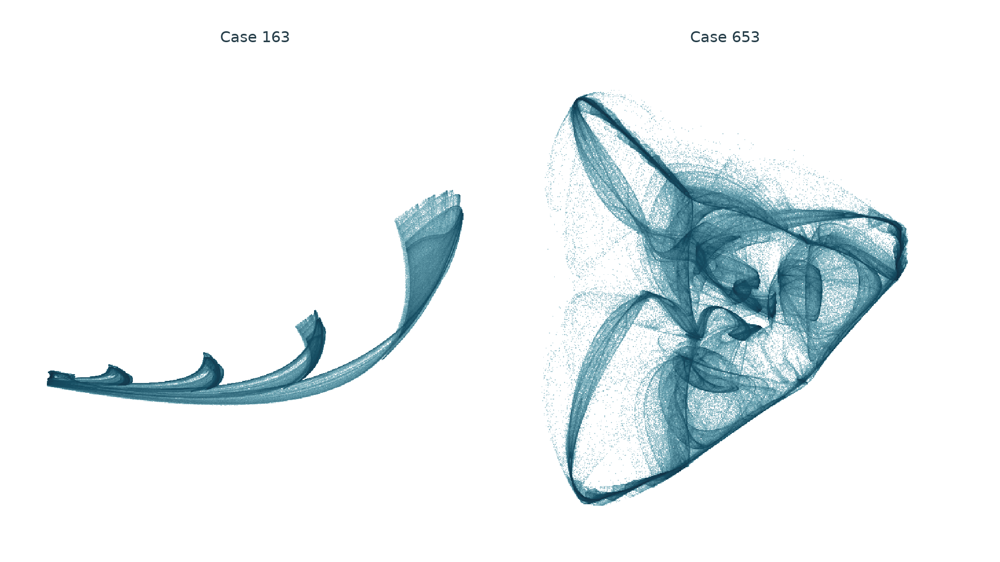

<!-- drawing-date -->
*First recorded portrait: **2026-11-01**.*
<!-- /drawing-date -->

<!-- portrait-equation canonical-sphere -->

```math
m(x)=\frac{\sum_j b_j e^{-\lVert x-b_j\rVert^2/\tau}}{\sum_j e^{-\lVert x-b_j\rVert^2/\tau}},\quad v=2m(x_n)-x_n,\quad x_{n+1}=\beta x_n+\beta\frac{v}{\lVert v\rVert}+(1-2\beta)m(x_n).
```

The canonical sites are b=c+aσ. Case 163 uses the four sign triples with σ₁σ₂σ₃=1 (tetrahedron), and Case 653 uses all eight sign triples (cube). τ is temperature and β is relaxation. [Model and parameters](docs/canonical-sphere/manuscript.md#2-model-and-exact-ideal-reductions)

<!-- /portrait-equation -->

Native three-state iterates; fixed data, rigid camera and equal spatial units within each panel.

**Numerical folded ribbon and hyperchaos candidate.** Simple tetrahedral and cubic site configurations produce Cases 163 and 653 in a complete 656-case campaign. Both survive five-million-step observations, 33 initial states and 70/100-digit controls. Case 653 has two positive finite-time QR rates, also retained across all 33 sampled starts. Exact ideal reductions identify independent-spin and parity-constrained posteriors. Symmetric maps, sigmoid chaos and three-dimensional hyperchaos are known; chaotic attraction and historical uniqueness remain unresolved.

**Certified structure of the cubic map.** A strict trapping box contains an attracting set with distinct histories that merge and a homoclinic return to a saddle. Independent formulas verify the interval bounds. Intrinsic noninjectivity excludes conjugacy of this entire set with an injective map; equality with the pictured cloud remains open.

[Article and proofs](docs/canonical-sphere/manuscript.md) · [Numerical campaign](results/canonical-sphere/README.md) · [Collision and homoclinic certificates](results/canonical-collision/README.md) · [Equivalent formulations and prior art](docs/soft-constellation-priority.md)

### Product alphabets: folded wings and layered arches


<!-- drawing-date -->
*First recorded portrait: **2026-11-01**.*
<!-- /drawing-date -->

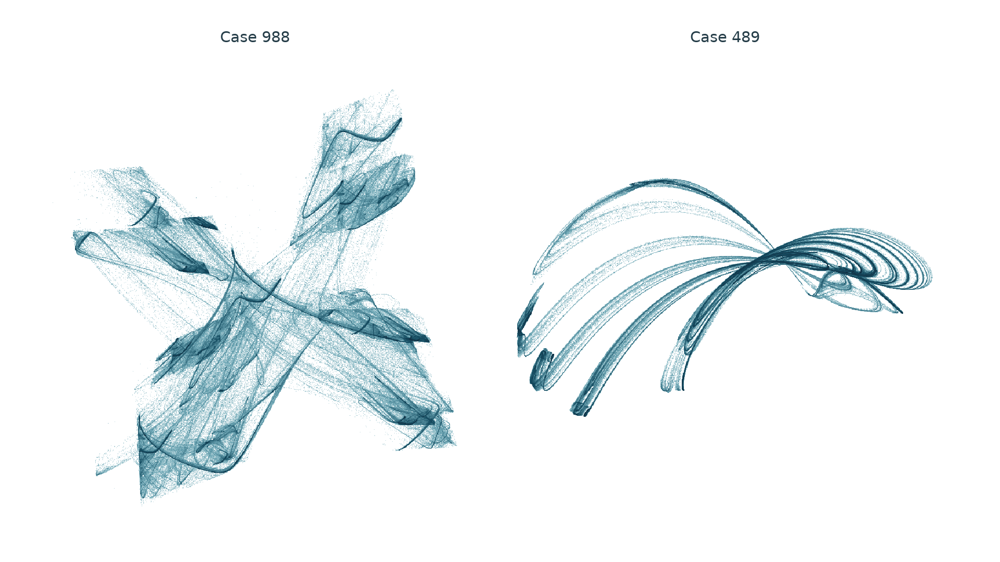

<!-- drawing-date -->
*First recorded portrait: **2026-11-01**.*
<!-- /drawing-date -->

<!-- portrait-equation product-alphabet -->

```math
m_i(x)=\frac{\sum_{\ell\in A_i}\ell\,e^{-(x_i-\ell)^2/\tau}}{\sum_{\ell\in A_i}e^{-(x_i-\ell)^2/\tau}},\quad v=2m(x_n)-x_n,\quad x_{n+1}=\beta x_n+\beta\frac{v}{\lVert v\rVert}+(1-2\beta)m(x_n).
```

Aᵢ is the stored alphabet along coordinate i. Case 988 uses two levels per coordinate and Case 489 uses four. Independent Gaussian weights give the mean m; β controls relaxation and τ is temperature. [Model and parameters](docs/product-alphabet/manuscript.md)

<!-- /portrait-equation -->

Native three-state iterates; rigid orthogonal camera and equal spatial units within each panel. Panel scales and density saturation differ.

**Numerical spatial candidates from quantized-coordinate posteriors.** A complete 1,753-case survey yields four folded wings in the binary Case 988 and layered arches in the four-level Case 489. Both retain positive leading growth over 100 million binary64 iterations and in separate 70/100-digit controls. All 33 tested starts remain irregular in Case 988; Case 489 has twenty competing fixed outcomes. Nearby parameter sets include periodic windows. Spin responses, reflection algorithms and feedback chaos are known; asymptotic chaotic attraction and historical uniqueness remain unresolved.

The portrait shows the frequently visited core. The longer Case 988 record contains 56 rare exits beyond its original coordinate box enlarged by 0.02. Three short escapes are interval-certified; the [full-range diagnostic and evidence](docs/product-alphabet/manuscript.md#41-a-hundred-million-step-horizon-and-rare-excursions) explain why the pictured envelope is not a trapping region.

**Certified dynamics for Case 988:** two interval formulas establish a compact invariant subsystem with entropy above **0.0254 per iteration** and a **least-period-92 orbit with reversed orientation**. The return excludes neighborhood topological conjugacy to standard three-dimensional Henon maps and smooth Euclidean flow return maps. A further proof shows that this particular subsystem is **not Lyapunov stable**; a larger attracting set and its connection to the cloud remain open. Six ordinary folds and two singular preimages are certified. [Critical-set images and parameter slices](docs/product-alphabet/manuscript.md#65-switching-postcritical-images-and-parameter-dependence) explain the numerical geometry using established mechanisms.

**Could the core be part of a larger attractor?** A validated outgoing unstable point reaches within 0.000011199 of the numerical wings, and both numerical branches recover their geometry and statistics. Two fresh 50-million-step runs leave the reverse membership question unresolved. [Comparison figure and precise limits](docs/product-alphabet/manuscript.md#66-testing-containment-in-a-larger-attracting-set).

**Attraction status, 2026-11-02.** All 256 new starts retain positive leading growth through four million observed updates each. A certified point less than 0.000060 from a saved cloud state reaches a normalization singularity after 27 steps. Any smooth-domain trapping region must exclude it; this rules out the specified entire ball, but not every thinner trap. **The full four-wing regime remains an attractor candidate.** [Proof, diagnostic and limits](docs/product-alphabet/manuscript.md#67-attraction-status-and-a-nearby-singular-preimage) · [Reproducible evidence](results/product-attractor-status/README.md).

[Article, approach trajectories and prior art](docs/product-alphabet/manuscript.md) · [Numerical campaign](results/product-alphabet/README.md) · [Entropy certificate](results/product-symbolic/README.md) · [Orientation and equivalence certificate](results/product-orientation/README.md) · [Long horizon and certified excursions](results/product-horizon/README.md) · [Instability, folds and mechanism](results/product-mechanism/README.md) · [Larger-attractor investigation](results/product-larger-attractor/README.md)

### Folded shells from nonuniform quantizer levels


<!-- drawing-date -->
*First recorded portrait: **2026-11-01**.*
<!-- /drawing-date -->

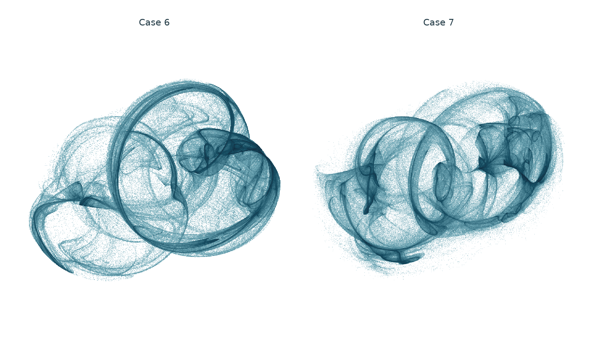

<!-- drawing-date -->
*First recorded portrait: **2026-11-01**.*
<!-- /drawing-date -->

<!-- portrait-equation product-irregular -->

```math
m_i(x)=\frac{\sum_{\ell\in A_i}\ell\,e^{-(x_i-\ell)^2/\tau}}{\sum_{\ell\in A_i}e^{-(x_i-\ell)^2/\tau}},\quad v=2m(x_n)-x_n,\quad x_{n+1}=\beta x_n+\beta\frac{v}{\lVert v\rVert}+(1-2\beta)m(x_n).
```

The levels in each coordinate alphabet Aᵢ have nonuniform spacing. Case 6 has four levels per coordinate and Case 7 has five. Their temperatures τ differ while β is shared. [Model and parameters](docs/product-alphabet/manuscript.md#32-nonuniform-alphabets-and-folded-shells)

<!-- /portrait-equation -->

Native three-state discrete iterates; rigid orthogonal cameras and equal units within each panel. Panel scales and density saturation differ. Case numbers are local to the nonuniform-alphabet survey.

**Two numerical folded-shell candidates.** Unevenly spaced posterior levels produce curled shells in Cases 6 and 7. Both retain positive leading growth over 20 million updates, at all 33 tested starts, and in separate 70/100-digit controls. The stills show two million consecutive states; rotation uses a fixed terminal quarter-million. Case 7 has two rare exits beyond the enlarged rendering envelope in the longer run.

Toroidal and folded-shell motifs have prior examples. Comparisons with 108 frozen reference clouds and primary-source checks do not establish historical uniqueness, topology or chaotic attraction. The certified theorems for Case 988 above do not transfer to these cases.

[Model, approach trajectories and visual precedents](docs/product-alphabet/manuscript.md#32-nonuniform-alphabets-and-folded-shells) · [Complete higher-order and nonuniform searches](results/product-highorder/README.md)

### Acceleration memory in a scalar iteration


<!-- drawing-date -->
*First recorded portrait: **2026-11-01**.*
<!-- /drawing-date -->


<!-- drawing-date -->
*First recorded portrait: **2026-11-01**.*
<!-- /drawing-date -->

<!-- portrait-equation anderson -->

```math
(x_0,x_1,x_2)^+=\left(x_1,x_2,\sum_{i=0}^2\alpha_i g(x_i)\right),\quad \alpha=\arg\min_{\sum_i a_i=1}\left[(a^\top r)^2+\lambda\|a\|^2\right]
```

The residual is rᵢ = g(xᵢ) − xᵢ for g(x) = c + k tanh(x). Cases 54 and 449 use the linked values of c, k and the fixed regularization λ. [Model and parameters](docs/anderson-memory.md#the-exact-algorithm)

<!-- /portrait-equation -->

Three-history state; archived orthographic cameras.

**Numerical chaos with a convergent scalar baseline.** The unaccelerated maps have interval-verified unique fixed points and globally convergent iteration. Adding regularized three-history acceleration produces irregular memory states that persist under 80- and 110-digit checks.

[Model, controls and limitations](docs/anderson-memory.md) · [Reproduction](research/unexpected_search/README.md)

### Adaptive integration of a decaying oscillator

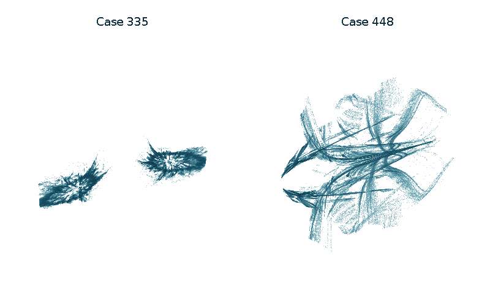

<!-- drawing-date -->
*First recorded portrait: **2026-11-01**.*
<!-- /drawing-date -->

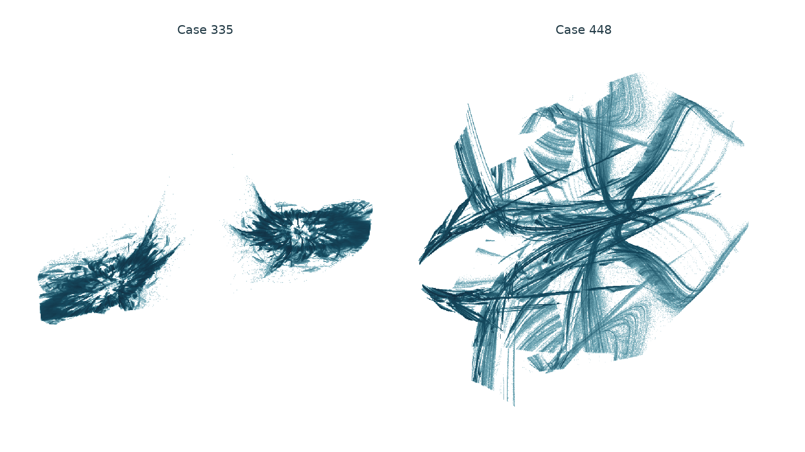

<!-- drawing-date -->
*First recorded portrait: **2026-11-01**.*
<!-- /drawing-date -->

<!-- portrait-equation rk45 -->

```math
\begin{aligned}v&=R(hA)y,\quad e=E(hA)y,\quad A=\begin{pmatrix}0&1\\-1&-2\zeta\end{pmatrix},\\R(z)&=\sum_{j=0}^{5} z^j/j!+z^6/600,\quad E(z)=z^5(5z^2-39z+97)/120000,\\w&=\sqrt{\tfrac12\sum_i\left[\frac{e_i}{\tau+\rho\max(|y_i|,|v_i|)}\right]^2}.\end{aligned}
```

Dormand–Prince 5(4) on the damped oscillator y = (q,p). With absolute and relative tolerances τ, ρ, accept v if w < 1 and multiply h by min(10, 0.9 w^(−1/5)), capped at one after a rejection. Otherwise retry y with factor max(0.2, 0.9 w^(−1/5)). Zero error selects the maximum allowed growth. Cases 335 and 448 use different damping and tolerances. [Model and parameters](docs/rk45-controller-structure.md)

<!-- /portrait-equation -->

Position / atol, velocity / atol, proposed step; archived orthographic cameras.

**Numerical chaos in the solver state.** The physical linear oscillator decays, while RK45's position, velocity and proposed step can remain irregular near the error tolerance. Five-million-step, high-precision and unmodified-library controls agree. RK23 has related retained regimes.

[RK45 results](docs/rk45-oscillator.md) · [RK23 results](docs/rk23-oscillator.md) · [RK45 manuscript](docs/rk45-controller/manuscript.md) · [Prior art](docs/rk45-priority.md)

### Optimizer memory on a scalar quadratic


<!-- drawing-date -->
*First recorded portrait: **2026-11-01**.*
<!-- /drawing-date -->


<!-- drawing-date -->
*First recorded portrait: **2026-11-01**.*
<!-- /drawing-date -->

<!-- portrait-equation yogi-tanh -->

```math
m^+=bm+(1-b)x,\quad v^+=v-(1-c)x^2\tanh\!\big(k(v-x^2)\big),\quad x^+=x-\frac{m^+}{\sqrt{v^+}+e}
```

Normalized autonomous tanh-Yogi on the scalar quadratic. The memories are b, c, the activation scale is k = 10α² and e = ε/α. The panels use Cases 2850 and 39. [Model and parameters](docs/yogi-tanh.md)

<!-- /portrait-equation -->

Normalized optimizer state (x, m, v); archived orthographic cameras.

**Numerical evidence for two expanding directions.** The published tanh variant of Yogi retains two positive growth rates in selected regimes under five-million-step, high-precision and TensorFlow checks. Separate results cover standard Yogi, Adamax and AdaBelief. These are regimes of existing algorithms.

[Smooth Yogi](docs/yogi-tanh.md) · [Manuscript](docs/yogi-memory/manuscript.md) · [Standard Yogi](docs/yogi-parameter-plane.md) · [Adamax](docs/adamax-geometry.md) · [AdaBelief](docs/adabelief-quadratic.md)

### Matrix scaling with unequal rates

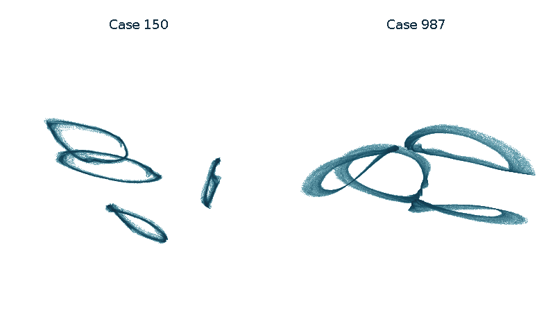

<!-- drawing-date -->
*First recorded portrait: **2026-11-01**.*
<!-- /drawing-date -->

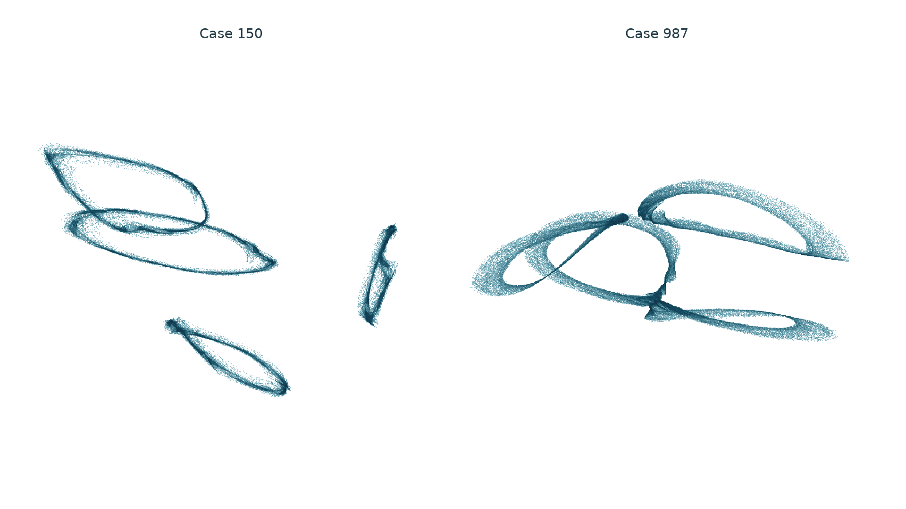

<!-- drawing-date -->
*Drawn: **2026-11-01**.*
<!-- /drawing-date -->

<!-- portrait-equation sinkhorn-balanced -->

```math
u_i^+=u_i^{1-\omega_x}\!\left(\frac{a_i}{(Kv)_i}\right)^{\omega_x},\qquad v_j^+=v_j^{1-\omega_y}\!\left(\frac{b_j}{(K^\top u^+)_j}\right)^{\omega_y}
```

K is a positive 3 × 2 matrix with row sums a and column sums b. The three plotted variables are log ratios to the first entry of each scaling vector. Row and column rates are (2.1, 1.8) in Case 150 and (2.02, 1.9) in Case 987. [Model and parameters](docs/sinkhorn-unequal-rates.md#map-and-input-design)

<!-- /portrait-equation -->

All three anchored log coordinates; rigid PCA rotation with equal units and no rescaling. Each panel contains 250,000 consecutive states.

**Numerical candidates with two expanding directions.** Different fixed row and column relaxation rates produce separated curved bands in a 3 × 2 matrix-scaling problem. Cases 150 and 987 retain two positive QR rates after 106 million steps and pass independent 70/100-digit checks. Case 150 has escaping alternative starts and a nearby regular regime. These rates extend the usual Sinkhorn iteration beyond its convergence safeguards; trapping, asymptotic chaotic attraction and historical uniqueness remain unresolved.

[Map, complete screen and prior art](docs/sinkhorn-unequal-rates.md) · [Evidence and reproduction](results/sinkhorn-unequal-rates/README.md)

## Molecular-motor dynamics

### Four-row irregular motion

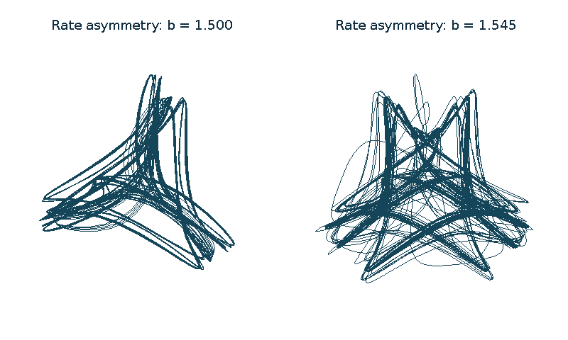

<!-- drawing-date -->
*First recorded portrait: **2026-11-01**.*
<!-- /drawing-date -->


<!-- drawing-date -->
*First recorded portrait: **2026-11-01**.*
<!-- /drawing-date -->

<!-- portrait-equation motor-four -->

```math
\begin{aligned}
 V_j&=-\rho X_j+r(s_j-\bar s),\qquad \dot X_j=V_j,\\
 \dot c_j&=1-c_j-V_js_j,\qquad \dot s_j=b-s_j+V_jc_j,\\
 \bar s&=N^{-1}\sum_{k=1}^{N}s_k,\qquad \sum_{j=1}^{N}X_j=0.
\end{aligned}
```

For row j, c and s are the cosine and sine occupancy coefficients, X is displacement and V is velocity. The four-row panels use the same mechanical coefficients and compare b = 1.500 and 1.545. [Model and parameters](docs/motor-rows-gpu-survey.md#what-the-system-represents)

<!-- /portrait-equation -->

Three orthonormal displacement contrasts; final 1,200 saved time units; common scale.

**Numerical chaos in an eleven-dimensional physical model.** Changing the dimensionless transition-rate asymmetry `b` changes a narrow braid into a broader regime. Long full-spectrum calculations retain a positive leading rate. The portraits show orthonormal displacement contrasts, not three-dimensional embeddings.

[Four-row comparison](docs/motor-four-b-study.md) · [Five-row geometry](docs/motor-five-geometry.md) · [Source equations](docs/motor-rows-source-audit.md)

### Eight-row periodic attraction


<!-- drawing-date -->
*First recorded portrait: **2026-10-30** · Current rendering: 2026-11-01.*
<!-- /drawing-date -->


<!-- drawing-date -->
*First recorded portrait: **2026-10-30** · Current rendering: 2026-11-01.*
<!-- /drawing-date -->

<!-- portrait-equation motor-eight -->

```math
\begin{aligned}
 V_j&=-\rho X_j+r(s_j-\bar s),\qquad \dot X_j=V_j,\\
 \dot c_j&=1-c_j-V_js_j,\qquad \dot s_j=b-s_j+V_jc_j,\\
 \bar s&=N^{-1}\sum_{k=1}^{N}s_k,\qquad \sum_{j=1}^{N}X_j=0.
\end{aligned}
```

For row j, c and s are the cosine and sine occupancy coefficients, X is displacement and V is velocity. Eight rows have 23 independent states. The left panel shows a five-cluster periodic orbit and the right shows an irregular trajectory. [Model and parameters](docs/motor-rows-gpu-survey.md#what-the-system-represents)

<!-- /portrait-equation -->

Physical coordinates (X0, X1, s0) of the 23D model; common scale.

**Certified periodic attraction in 23 dimensions.** At the stated exact parameters, a five-cluster periodic orbit has all 22 transverse Floquet multipliers inside the unit circle. The irregular comparison has six positive finite-time exponents over 20,000 units. The two panels show the same physical projection and scale; only the periodic attractor is certified.

[Periodic-attractor certificate](docs/motor-five-cycle-certificate.md) · [Replication instability](docs/motor-five-replication-limit.md) · [Irregular regimes](docs/motor-activity-continuation.md)

## Constructed data

### Structured-data FastICA

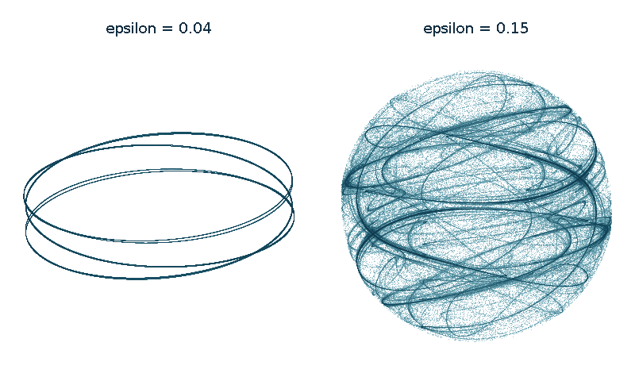

<!-- drawing-date -->
*First recorded portrait: **2026-11-01**.*
<!-- /drawing-date -->


<!-- drawing-date -->
*Drawn: **2026-11-01**.*
<!-- /drawing-date -->

<!-- portrait-equation fastica-tripling -->

```math
h(w)=\mathbb E[X(X^\top w)^3]-3\mathbb E[(X^\top w)^2]w,\qquad w^+=\frac{h(w)}{\|h(w)\|}
```

The expectation averages the 720 specified, equally weighted four-dimensional observations. The two panels use the same cubic FastICA update and the structured data at ε = 0.04 and 0.15, respectively. [Model and parameters](docs/fastica-tripling.md#data-and-update)

<!-- /portrait-equation -->

Projection `(A,B,C)` of a unit weight in four dimensions; equal units and a common scale. The parameter `epsilon` controls the coupling in the fixed input data. Each panel contains 500,000 consecutive iterates.

**Analytically proved attracting positive-entropy set.** A 720-row data construction gives standard cubic FastICA a strict trapping tube and an angle-tripling factor for `0 <= epsilon <= 1/25`, with entropy at least `log(3)` per iteration, including after ICA sign identification. For positive parameters in that interval, the attracting set contains a point where the full map is not locally injective, excluding ambient-neighborhood conjugacy to a classical solenoid embedding. The left panel lies in the proved interval; the right is numerical. Both retain positive growth over five million steps and at 70/100 digits. Historical priority, intrinsic solenoid equivalence and equality of the sampled portrait with the proved set remain unresolved.

[Construction and entropy](docs/fastica-tripling.md) · [Local noninjectivity](docs/fastica-tripling-structure.md) · [Rejected intrinsic-collision candidate](docs/fastica-preimage-rejection.md) · [Numerical controls and reproduction](results/fastica-tripling/README.md)

<!-- shape-search-20261121-selected -->
## Shape search of 2026-11-21

### Six-loop rosette and six-sided spiral lattice

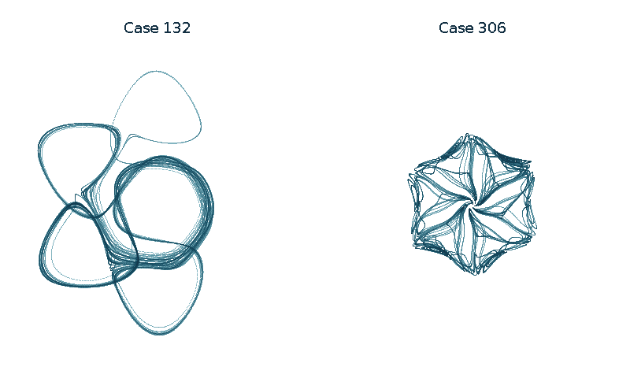

<!-- drawing-date -->
*First recorded portrait: **2026-11-21**.*
<!-- /drawing-date -->

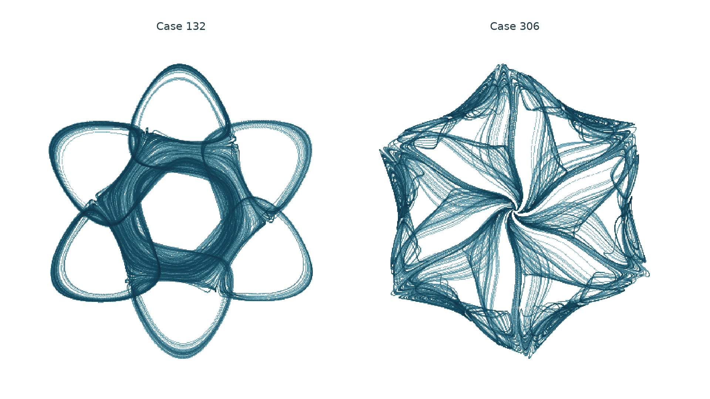

<!-- drawing-date -->
*Drawn: **2026-11-21**.*
<!-- /drawing-date -->

<!-- portrait-equation shapes-20261121-harmonic -->

```math
\dot x_i=-d_i x_i+a_i\sin(x_j+\phi_i)+b_i\sin(x_k+\psi_i)+c_i\sin(m_i x_j+n_i x_k+\chi_i).
```

The indices (i, j, k) run cyclically through the three native Cartesian coordinates. Cases 132 and 306 use different coefficient sets for the six-loop rosette and six-sided spiral lattice. [Model and parameters](results/shape_search_20261121/flows/README.md#cartesian-harmonic-coupling)

<!-- /portrait-equation -->

Cases 132 and 306 give two distinct sixfold silhouettes in cyclic harmonic flows. Each has a positive leading numerical rate with four initial states and an independent adaptive solver.

Full spatial states at equal axis scales. The camera looks along (1, 1, 1). [Equations, controls and prior work](docs/shape-search-20261121.md)

### Nested scrolls and ribbed fans

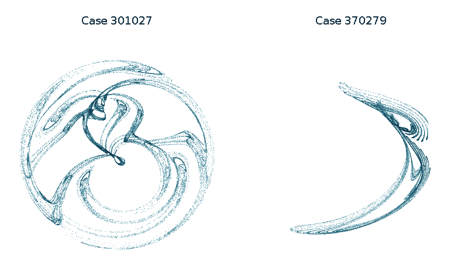

<!-- drawing-date -->
*First recorded portrait: **2026-11-21**.*
<!-- /drawing-date -->

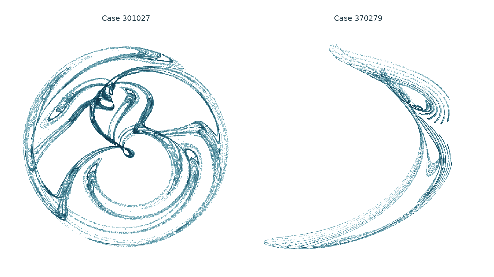

<!-- drawing-date -->
*Drawn: **2026-11-21**.*
<!-- /drawing-date -->

<!-- portrait-equation shapes-20261121-torus -->

```math
m(x)=\frac{\sum_j b_j e^{-\lVert x-b_j\rVert^2/\tau}}{\sum_j e^{-\lVert x-b_j\rVert^2/\tau}},\quad v=2m(x_n)-x_n,\quad x_{n+1}=\beta x_n+\beta P(v)+(1-2\beta)m(x_n).
```

For a centerline circle Cᵢ, let cᵢ be its nearest point to v and Pᵢ(v)=cᵢ+r(v−cᵢ)/‖v−cᵢ‖. C₀ is the unit xy circle. Both Case 301027 and Case 370279 use P=P₀, with different sites bⱼ, temperatures τ, tube radii r and relaxations β. [Model and parameters](results/shape_search_20261121/projection/README.md#map-and-geometry) · [Case 301027](results/shape_search_20261121/projection/case-301027.json) · [Case 370279](results/shape_search_20261121/projection/case-370279.json)

<!-- /portrait-equation -->

A Gaussian posterior reflector paired with a torus produces a nested scroll and two ribbed fans. Leading finite-time exponents stay positive over five million double-precision iterations.

Consecutive three-state iterates in equal units. Each panel has its own spatial scale. [Equations, controls and prior work](docs/shape-search-20261121.md)

### Three-phase curls and four-phase crescents

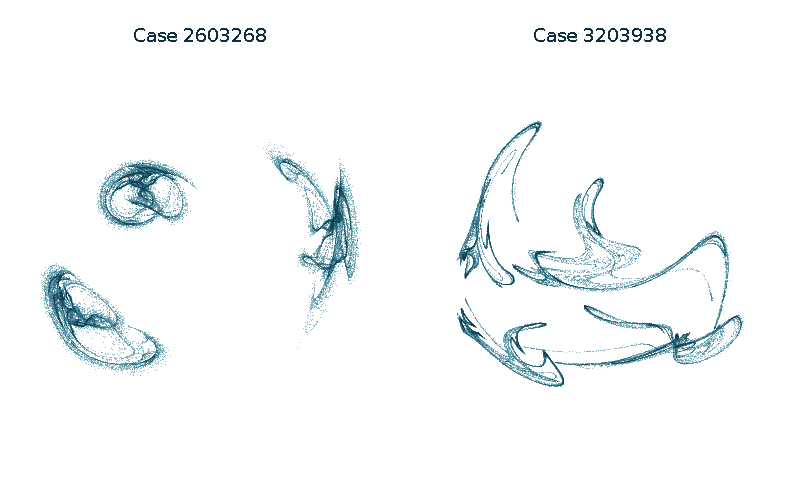

<!-- drawing-date -->
*First recorded portrait: **2026-11-21**.*
<!-- /drawing-date -->


<!-- drawing-date -->
*Drawn: **2026-11-21**.*
<!-- /drawing-date -->

<!-- portrait-equation shapes-20261121-phase -->

```math
z^{(0)}=r x_n+(1-r)e_1,\quad z^{(j)}=R_{i_j k_j}\!\left(a_j+b_jw_j+h_jw_j^3\right)z^{(j-1)},\quad x_{n+1}=z^{(3)}.
```

The rotations act in the xy, yz and zx planes in that order. Each wⱼ is the remaining coordinate immediately before its rotation, r is the contraction ratio and e₁=(1,0,0). Case 2603268 visits three spatial groups and Case 3203938 visits four. [Model and parameters](docs/twist-geometry.md#definition-and-exact-structural-properties) · [Maps report](results/shape_search_20261121/maps/README.md)

<!-- /portrait-equation -->

Two dissipative twist maps visit three and four spatial groups in order. Positive growth persists on long runs. The phase count describes successive visits within a single orbit.

Consecutive three-state iterates in equal units. Each panel has its own spatial scale. [Equations, controls and prior work](docs/shape-search-20261121.md)

### Different core knots at the same winding and determinant


<!-- drawing-date -->
*First recorded portrait: **2026-11-21**.*
<!-- /drawing-date -->

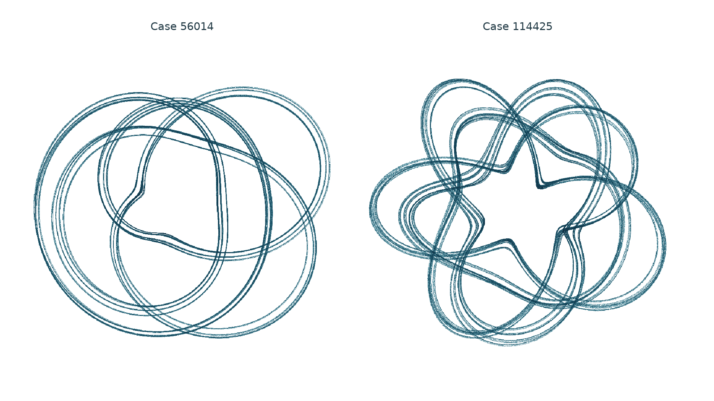

<!-- drawing-date -->
*Drawn: **2026-11-21**.*
<!-- /drawing-date -->

<!-- portrait-equation shapes-20261121-braids -->

```math
\begin{aligned}\theta^+&=p\theta+0.14\sin(p\theta)+0.137\pmod{2\pi},\\z^+&=C(\theta)+\rho e^{i(m\theta+0.31)}z,\quad C(\theta)=s^{-1}\sum_k(u_k+i v_k)e^{ik\theta}.\end{aligned}
```

The complex coordinate z lies in the unit disk. Cases 56014 and 114425 have the same angular degree p = 4 and different Fourier cores. Their coefficients, scale s, fiber contraction ρ and twist m are specified in the linked case certificates. [Model and parameters](research/shape_search_20261121/braids/README.md#map-and-trapping-region)

<!-- /portrait-equation -->

Both maps have winding four and determinant-one first cores. Their Alexander polynomials have spans ten and eight, respectively, and exclude all torus knots. Both solenoids have entropy log 4 per iterate.

Three-dimensional states in the same fixed Euclidean embedding of the solid torus. [Equations, controls and prior work](docs/shape-search-20261121.md)

### Four-lobed and eight-lobed resonant flows

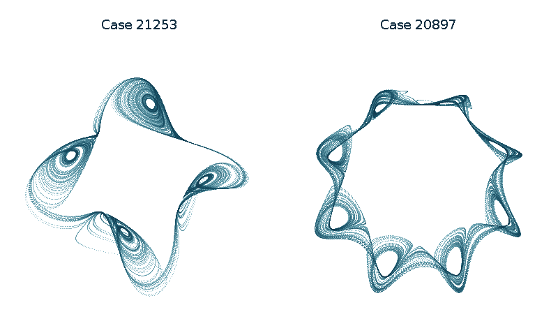

<!-- drawing-date -->
*First recorded portrait: **2026-11-21**.*
<!-- /drawing-date -->


<!-- drawing-date -->
*Drawn: **2026-11-21**.*
<!-- /drawing-date -->

<!-- portrait-equation shapes-20261121-rings -->

```math
\begin{aligned}
\dot u &= u[\alpha-s+\beta z+i(\omega+\kappa z+\tau s)]
          +A h^{(n-2)/2}\overline{u}^{n-1},\\
\dot z &= -d z+e\frac{s-1}{1+s}
          + f h^{n/2}\mathrm{Re}(e^{i\phi}u^n).
\end{aligned}
```

Here u = x + iy, s = |u|² and h = 2/(1+s). Case 21253 uses resonance order n = 4 and Case 20897 uses n = 8. [Model and parameters](results/shape_search_20261121/flows/README.md#angular-resonance)

<!-- /portrait-equation -->

Rotationally symmetric flows fold into a four-lobed sheet and an eight-lobed crown. Independent integration and five starting states retained positive finite-time expansion in both cases.

Full spatial states shown from a steep inclination. [Equations, controls and prior work](docs/shape-search-20261121.md)

### A domed shell and a stack of cusps

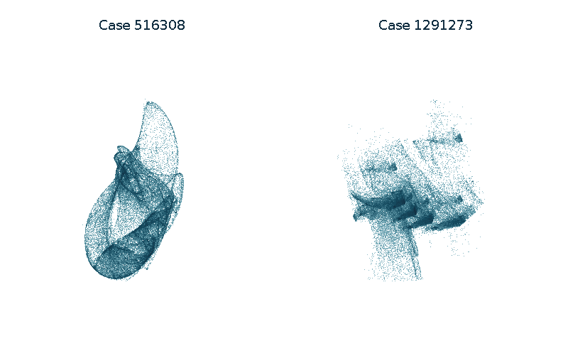

<!-- drawing-date -->
*First recorded portrait: **2026-11-21**.*
<!-- /drawing-date -->

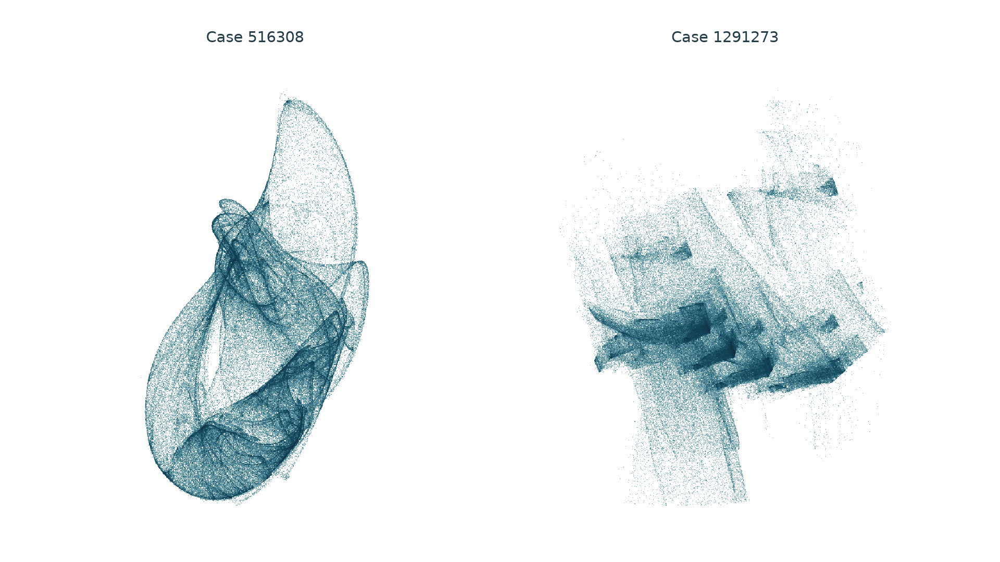

<!-- drawing-date -->
*Drawn: **2026-11-21**.*
<!-- /drawing-date -->

<!-- portrait-equation shapes-20261121-hyper -->

```math
m(x)=\frac{\sum_j b_j e^{-\lVert x-b_j\rVert^2/\tau}}{\sum_j e^{-\lVert x-b_j\rVert^2/\tau}},\quad v=2m(x_n)-x_n,\quad x_{n+1}=\beta x_n+\beta P(v)+(1-2\beta)m(x_n).
```

For a centerline circle Cᵢ, let cᵢ be its nearest point to v and Pᵢ(v)=cᵢ+r(v−cᵢ)/‖v−cᵢ‖. C₀ is the unit xy circle. Case 516308 uses P=P₀. In Case 1291273, C₁ is the unit xz circle centered at (1,0,0); P selects whichever of P₀(v) and P₁(v) is closer to v, choosing P₀ on a tie. [Model and parameters](results/shape_search_20261121/projection/README.md#map-and-geometry) · [Case 516308](results/shape_search_20261121/projection/case-516308.json) · [Case 1291273](results/shape_search_20261121/projection/case-1291273.json)

<!-- /portrait-equation -->

A single torus gives the domed shell at left. Choosing between two linked tori gives the layered cusps at right. Both have two positive finite-time exponents. Case 516308 also has a certified stable fixed point.

The two projections use equal spatial units within each panel. [Equations, controls and prior work](docs/shape-search-20261121.md)

### A periodic knot and a nearby chaotic band


<!-- drawing-date -->
*First recorded portrait: **2026-11-21**.*
<!-- /drawing-date -->

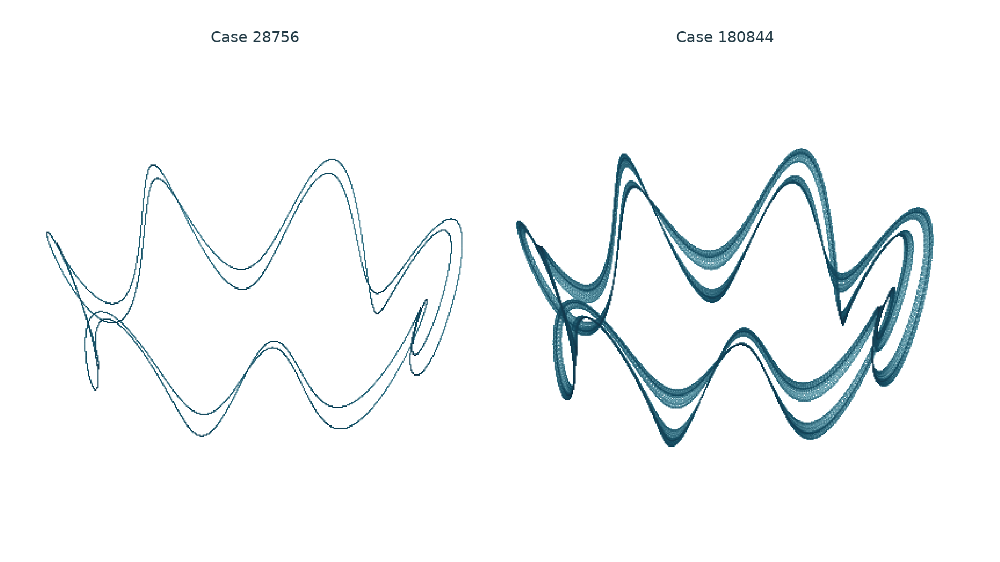

<!-- drawing-date -->
*Drawn: **2026-11-21**.*
<!-- /drawing-date -->

<!-- portrait-equation shapes-20261121-knotted-band -->

```math
\begin{aligned}
\dot u &= u[\alpha-s+\beta z+i(\omega+\kappa z+\tau s)]
          +A h^{(n-2)/2}\overline{u}^{n-1},\\
\dot z &= -d z+e\frac{s-1}{1+s}
          + f h^{n/2}\mathrm{Re}(e^{i\phi}u^n).
\end{aligned}
```

Here u = x + iy, s = |u|² and h = 2/(1+s). Both panels use the same order-seven flow. Changing only e from −0.4297716 in Case 28756 to −0.3538341 in Case 180844 links the stable knotted cycle to the chaotic-band parameter. [Model and parameters](results/shape_search_20261121/flows/README.md#angular-resonance)

<!-- /portrait-equation -->

Case 28756 approaches a stable knotted cycle. After changing one coefficient, Case 180844 gives a chaotic band near a numerical continuation of the same knot, now unstable. Five starts and an adaptive solver retained positive growth in the band.

Native spatial coordinates. Each panel preserves equal axis scales. [Equations, controls and prior work](docs/shape-search-20261121.md)

### Interlocking triplets and quartets of periodic orbits

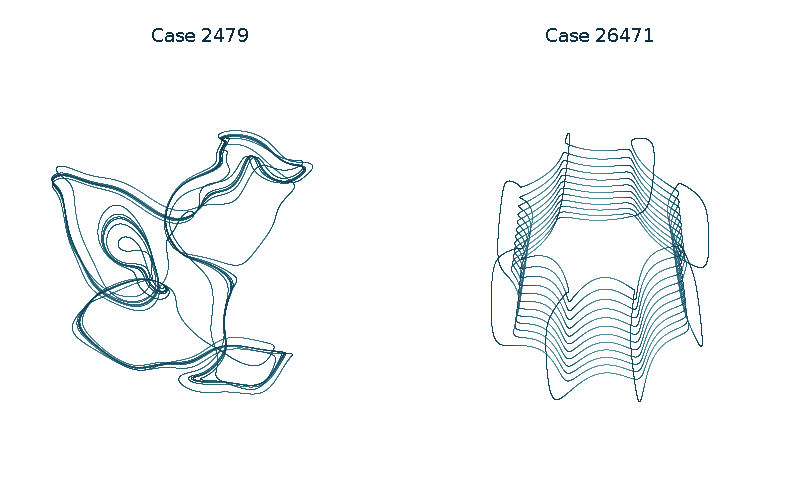

<!-- drawing-date -->
*First recorded portrait: **2026-11-21**.*
<!-- /drawing-date -->

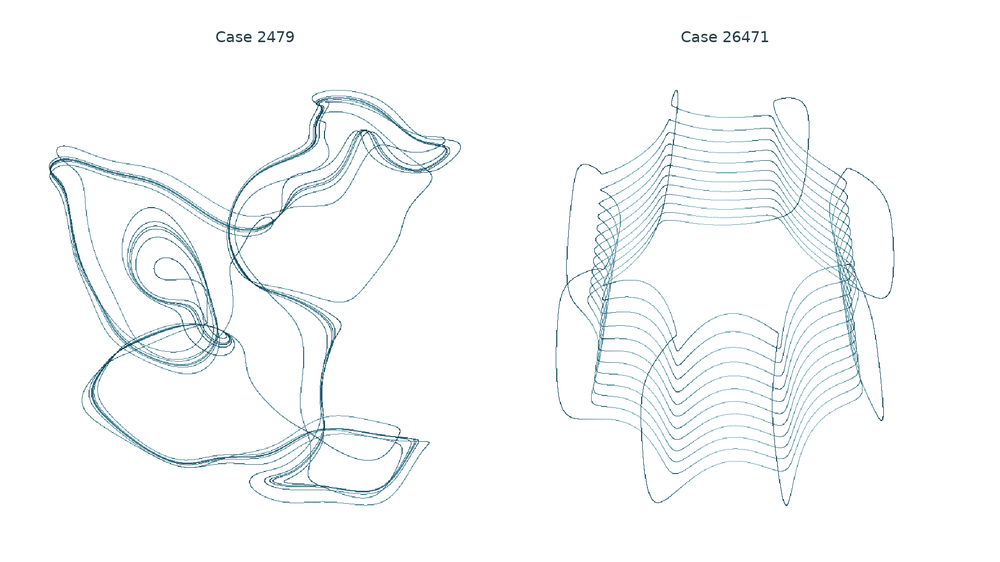

<!-- drawing-date -->
*Drawn: **2026-11-21**.*
<!-- /drawing-date -->

<!-- portrait-equation shapes-20261121-links -->

```math
\begin{aligned}
 \text{2479: }\dot x_i&=-d_ix_i+a_i\sin(x_j+\phi_i)+b_i\sin(x_k+\psi_i)+c_i\sin(m_ix_j+n_ix_k+\chi_i),\\
 \text{26471: }\dot u&=u[\alpha-s+\beta z+i(\omega+\kappa z+\tau s)]+Ah^{(n-2)/2}\bar u^{n-1},\\
 \dot z&=-dz+e(s-1)/(1+s)+fh^{n/2}\mathrm{Re}(e^{i\phi}u^n).
\end{aligned}
```

The left triplet solves the cyclic Cartesian harmonic equation. The right quartet solves the angular equation with u = x + iy, s = |u|², h = 2/(1+s) and n = 8. Each panel overlays coexisting solutions at one parameter set. [Model and parameters](results/shape_search_20261121/flows/README.md#equations)

<!-- /portrait-equation -->

Case 2479 has three coexisting numerical cycles with pairwise absolute linking number 30. Case 26471 has four, with absolute linking number 6 for each of the six pairs. Exact polygon checks agree in three projections and at two resolutions.

Each panel combines complete trajectories of the coexisting cycles. The rotation includes every component. [Equations, controls and prior work](docs/shape-search-20261121.md)

### Helical chain and four curled fins

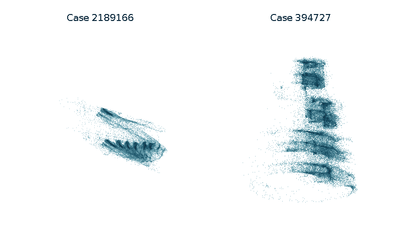

<!-- drawing-date -->
*First recorded portrait: **2026-11-21**.*
<!-- /drawing-date -->

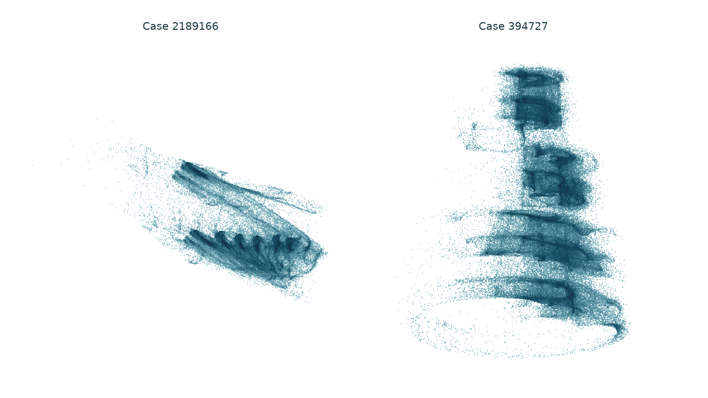

<!-- drawing-date -->
*Drawn: **2026-11-21**.*
<!-- /drawing-date -->

<!-- portrait-equation shapes-20261121-returns -->

```math
m(x)=\frac{\sum_j b_j e^{-\lVert x-b_j\rVert^2/\tau}}{\sum_j e^{-\lVert x-b_j\rVert^2/\tau}},\quad v=2m(x_n)-x_n,\quad x_{n+1}=\beta x_n+\beta P(v)+(1-2\beta)m(x_n).
```

For a centerline circle Cᵢ, let cᵢ be its nearest point to v and Pᵢ(v)=cᵢ+r(v−cᵢ)/‖v−cᵢ‖. C₀ is the unit xy circle. Case 2189166 uses the blended projection P=α₀P₀+α₁P₁, with αᵢ proportional to exp(−‖v−Pᵢ(v)‖²/κ) and α₀+α₁=1. C₁ is the unit xz circle centered at (1,0,0). Case 394727 uses P=P₀. [Model and parameters](results/shape_search_20261121/projection/README.md#map-and-geometry) · [Case 2189166](results/shape_search_20261121/projection/case-2189166.json) · [Case 394727](results/shape_search_20261121/projection/case-394727.json)

<!-- /portrait-equation -->

Case 2189166 exhibits a helical chain and Case 394727 gives curled fins. Local interval certificates establish positive topological entropy for invariant subsystems. Long numerical trajectories produce the displayed shapes.

Equal-unit spatial projection of consecutive map states. [Equations, controls and prior work](docs/shape-search-20261121.md)

### Forked sail and horned cup


<!-- drawing-date -->
*First recorded portrait: **2026-11-21**.*
<!-- /drawing-date -->

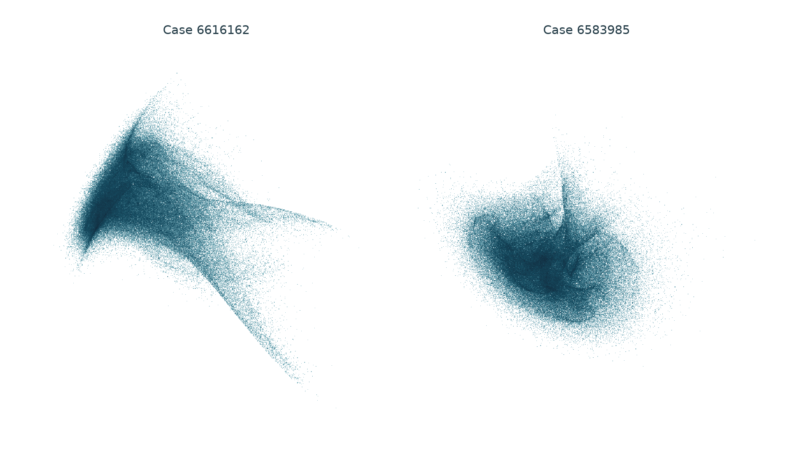

<!-- drawing-date -->
*Drawn: **2026-11-21**.*
<!-- /drawing-date -->

<!-- portrait-equation shapes-20261121-three -->

```math
m(x)=\frac{\sum_j b_j e^{-\lVert x-b_j\rVert^2/\tau}}{\sum_j e^{-\lVert x-b_j\rVert^2/\tau}},\quad v=2m(x_n)-x_n,\quad x_{n+1}=\beta x_n+\beta P(v)+(1-2\beta)m(x_n).
```

For a centerline circle Cᵢ, let cᵢ be its nearest point to v and Pᵢ(v)=cᵢ+r(v−cᵢ)/‖v−cᵢ‖. C₀ is the unit xy circle. Both cases use P=P₀. Case 6616162 has four posterior sites and Case 6583985 has seven. [Model and parameters](results/shape_search_20261121/projection/README.md#map-and-geometry) · [Case 6616162](results/shape_search_20261121/projection/three/case-6616162.json) · [Case 6583985](results/shape_search_20261121/projection/three/case-6583985.json)

<!-- /portrait-equation -->

Cases 6616162 and 6583985 have three positive finite-time Lyapunov exponents in all three native coordinates. Their five-million-update spectra are approximately (0.265, 0.132, 0.021) and (0.229, 0.115, 0.026). All 17 starts showed growth in each direction.

Each panel uses equal physical units and the same camera in its signed principal-axis frame. The saved camera matrices specify both views in native coordinates. [Equations, controls and prior work](docs/shape-search-20261121.md)

### Twin density peaks and alternating spatial lobes


<!-- drawing-date -->
*First recorded portrait: **2026-11-21**.*
<!-- /drawing-date -->


<!-- drawing-date -->
*Drawn: **2026-11-21**.*
<!-- /drawing-date -->

<!-- portrait-equation shapes-20261121-extension-gpu -->

```math
\begin{aligned}m(x)&=\frac{\sum_j b_j e^{-q\lVert x-b_j\rVert^2}}{\sum_j e^{-q\lVert x-b_j\rVert^2}},\quad v=2m(x_n)-x_n,\\ x_{n+1}&=\beta x_n+\beta(\Phi\circ P_0\circ\Phi^{-1})(v)+(1-2\beta)m(x_n),\\ \Phi(u)&=\mathrm{diag}(s_x,s_y,s_z)\big(u_x,u_y,u_z+w(u_x^2-u_y^2)\big)^\mathsf{T}.\end{aligned}
```

For a centerline circle Cᵢ, let cᵢ be its nearest point to v and Pᵢ(v)=cᵢ+r(v−cᵢ)/‖v−cᵢ‖. C₀ is the unit xy circle. Here q is inverse temperature and the scales sᵢ deform the torus. Case 409700 is affine (w=0); Case 2298665 also has quadratic shear (w≈−0.04253). [Model and parameters](results/shape_search_20261121/extension/projection/README.md#physical-map) · [Case 409700](results/shape_search_20261121/extension/projection/cases/case-409700.json) · [Case 2298665](results/shape_search_20261121/extension/projection/cases/case-2298665.json)

<!-- /portrait-equation -->

Cases 409700 and 2298665 have three positive numerical Lyapunov exponents in three-dimensional maps with deformed torus projections. The two density peaks of Case 409700 occasionally repeat on consecutive steps. In Case 2298665 a plane separates the odd and even states of the displayed sample.

Native Cartesian states with a principal-axis camera and equal axis scales. The displayed clouds contain 250,000 consecutive iterations per case. [Equations, controls and prior work](docs/shape-search-20261121.md)

### Triple links selected by a driven cubic


<!-- drawing-date -->
*First recorded portrait: **2026-11-21**.*
<!-- /drawing-date -->


<!-- drawing-date -->
*Drawn: **2026-11-21**.*
<!-- /drawing-date -->

<!-- portrait-equation shapes-20261121-cubic -->

```math
\begin{aligned}p_\theta(z)&=z^3-3z+b(\theta),\qquad \theta'=2\theta+0.12\sin(2\theta)+0.137\pmod{2\pi},\\p_{\theta'}(z')&=0.2\,p_\theta(z)+0.6D e^{i\theta}.\end{aligned}
```

Continue on the same cubic sheet, with residual radius $`D`$ from the case certificate. The left drive is $`b=-4\sin(3\theta)+4\sin(4\theta)+3i\sin(7\theta)`$. The right drive is $`b=\tfrac14\sin\theta-4\sin(9\theta)+3i\sin(18\theta)`$. [Model and parameters](results/shape_search_20261121/frontiers/cubic/README.md)

<!-- /portrait-equation -->

Cases 47087142 and 48000003 use a single driven cubic to determine all three sheets. In the degree-two return map each sheet contains a chaotic solenoid. The triples have absolute core linking invariants one and three and are inequivalent in three-space.

Native cylindrical embedding at equal Cartesian scales. Each panel contains 28,000 consecutive states per component. The rotation includes all three components. [Equations, controls and prior work](docs/shape-search-20261121.md)
<!-- /shape-search-20261121-selected -->

## Further portraits

Additional numerical candidates and comparison regimes, grouped by system. Each entry links to its evidence and limitations.

### Constructed systems

#### Tetrahedral Gaussian flow


<!-- drawing-date -->
*First recorded portrait: **2026-11-01**.*
<!-- /drawing-date -->

<!-- portrait-equation tetrahedral -->

```math
\dot x=-\gamma x+\sum_{G\in T}\big[(Gu)\times(x-Gc)\big]\exp\!\left(-\frac{\lVert x-Gc\rVert^2}{2\sigma^2}\right).
```

T consists of the 12 proper tetrahedral rotations. Cases 421 and 565 specify different seed centers c, unit axes u, widths σ and damping coefficients γ. [Model and parameters](docs/tetrahedral-flow.md#construction)

<!-- /portrait-equation -->

Cases 421 and 565 have a stable central equilibrium and sustained irregular outer motion. Three-dimensional tetrahedral chaos is established prior work.

Full three-state coordinates; archived orthographic cameras.

[Report](docs/tetrahedral-flow.md)

#### Localized Gaussian vortices

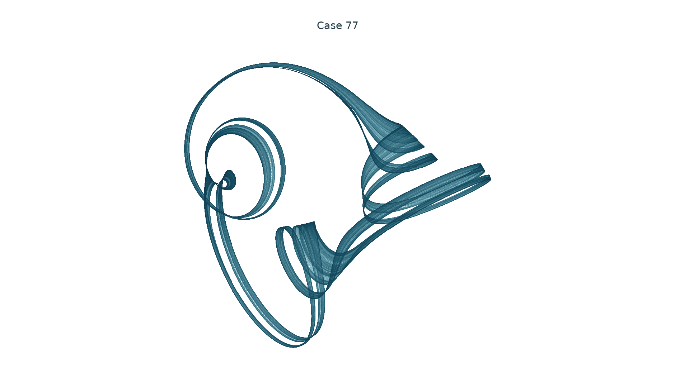

<!-- drawing-date -->
*First recorded portrait: **2026-11-01**.*
<!-- /drawing-date -->

<!-- portrait-equation gaussian-vortex -->

```math
r_j=x-d e_j,\qquad\dot x=-\gamma x+b+\sum_{j=0}^2\omega_j(e_{j+1}\times r_j)\exp\!\left(-\frac{\lVert r_j\rVert^2}{2\sigma_j^2}\right).
```

The basis index is taken modulo three. Case 77 uses three equally strong vortices of equal width and a constant drift b with equal components. [Model and parameters](docs/gaussian-vortex.md#the-equation)

<!-- /portrait-equation -->

Case 77 survives a 30,000-unit spectrum and independent integration. A competing periodic orbit and resemblance to known threefold geometries limit interpretation.

Full three-state coordinates; archived orthographic camera.

[Report](docs/gaussian-vortex.md)

#### Dissipative three-axis twist map


<!-- drawing-date -->
*First recorded portrait: **2026-11-01**.*
<!-- /drawing-date -->

<!-- portrait-equation twist -->

```math
z^{(0)}=r x_n+(1-r)e_1,\quad z^{(j)}=R_{i_j k_j}\!\left(a_j+b_jw_j+h_jw_j^3\right)z^{(j-1)},\quad x_{n+1}=z^{(3)}.
```

The rotations act in the xy, yz and zx planes in that order. Each wⱼ is the remaining coordinate immediately before its rotation, r is the contraction ratio and e₁=(1,0,0). Cases 1709 and 3254 use different fixed coefficient vectors. [Model and parameters](docs/twist-geometry.md#definition-and-exact-structural-properties) · [Twist map](research/twist_map.py) · [Candidates](results/twist-geometry/candidates.json)

<!-- /portrait-equation -->

Cases 1709 and 3254 retain positive finite-time growth under long and high-precision controls. The first case also has a regular regime.

Full three-state coordinates; archived orthographic cameras.

[Report](docs/twist-geometry.md)

### Algorithmic dynamics

#### Finite-point RAAR: fragmented columns and sheets


<!-- drawing-date -->
*First recorded portrait: **2026-11-01**.*
<!-- /drawing-date -->

<!-- portrait-equation raar-constellation-columns -->

```math
b=P_B(x_n),\quad v=2b-x_n,\quad x_{n+1}=\beta x_n+\beta P_A(v)+(1-2\beta)b.
```

P_B selects the nearest vertex in the finite set for Case 124 (left) or 896 (right). P_A(v) normalizes the xy component and sets z to zero. β controls relaxation. [Model and parameters](docs/raar-constellations.md#model) · [Search raar constellations](research/search_raar_constellations.py)

<!-- /portrait-equation -->

Numerical candidates in a known projection algorithm. Five-million-step observations and 33-start cohorts retain positive finite-time growth. Finite-alphabet phase retrieval is established prior art; historical uniqueness remains open.

Full three-state iterates, centered and rigidly rotated. Equal spatial units within each panel; independent scales. Two million consecutive states per static portrait.

[Report and prior art](docs/raar-constellations.md)

#### Finite-point RAAR: fans and sparse branches

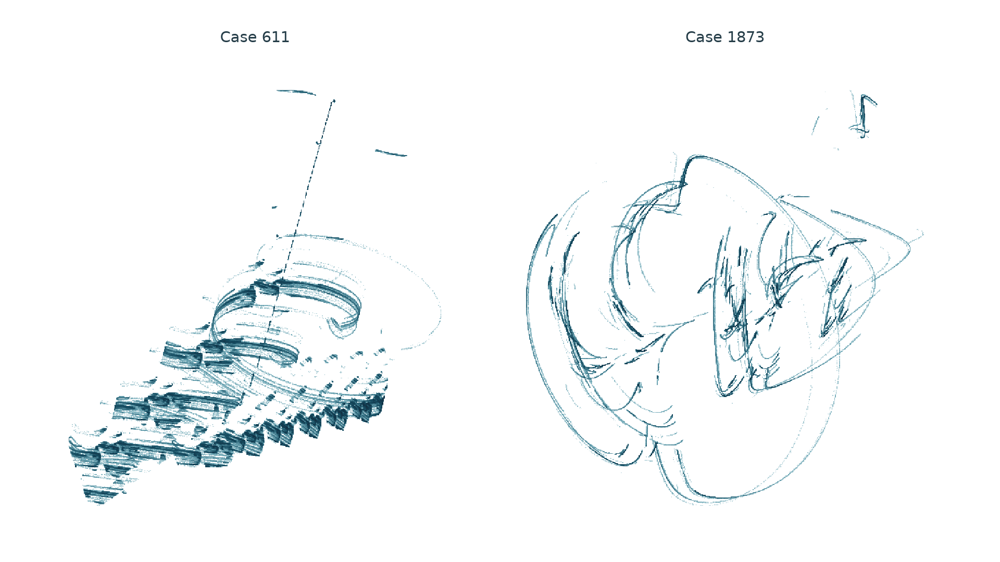

<!-- drawing-date -->
*First recorded portrait: **2026-11-01**.*
<!-- /drawing-date -->

<!-- portrait-equation raar-constellation-fans -->

```math
b=P_B(x_n),\quad v=2b-x_n,\quad x_{n+1}=\beta x_n+\beta P_A(v)+(1-2\beta)b.
```

P_B selects the nearest vertex in the finite set for Case 611 (left) or 1873 (right). P_A(v) normalizes the xy component and sets z to zero. β controls relaxation. [Model and parameters](docs/raar-constellations.md#model) · [Search raar constellations](research/search_raar_constellations.py)

<!-- /portrait-equation -->

Numerical candidates in a known projection algorithm. Five-million-step observations and 33-start cohorts retain positive finite-time growth. Finite-alphabet phase retrieval is established prior art; historical uniqueness remains open.

Full three-state iterates, centered and rigidly rotated. Equal spatial units within each panel; independent scales. Two million consecutive states per static portrait.

[Report and prior art](docs/raar-constellations.md)

#### RK23 step-size controller


<!-- drawing-date -->
*First recorded portrait: **2026-11-01**.*
<!-- /drawing-date -->

<!-- portrait-equation rk23 -->

```math
\begin{aligned}v&=R(hA)y,\quad e=E(hA)y,\quad A=\begin{pmatrix}0&1\\-1&-2\zeta\end{pmatrix},\\R(z)&=1+z+z^2/2+z^3/6,\quad E(z)=z^3(1+z)/48,\\w&=\sqrt{\tfrac12\sum_i\left[\frac{e_i}{\tau+\rho\max(|y_i|,|v_i|)}\right]^2}.\end{aligned}
```

Bogacki–Shampine 3(2) on the damped oscillator y = (q,p). With absolute and relative tolerances τ, ρ, accept v if w < 1 and multiply h by min(10, 0.9 w^(−1/3)), capped at one after a rejection. Otherwise retry y with factor max(0.2, 0.9 w^(−1/3)). Zero error selects the maximum allowed growth. Cases 381 and 883 use different damping and tolerances. [Model and parameters](docs/rk23-controller-structure.md)

<!-- /portrait-equation -->

The physical linear oscillator decays. The adaptive solver has a persistent irregular internal state near its error tolerance, reproduced with the original library and high-precision arithmetic.

Position / atol, velocity / atol, proposed step; archived orthographic cameras.

[Report](docs/rk23-oscillator.md)

#### Yogi parameter-plane candidate


<!-- drawing-date -->
*First recorded portrait: **2026-11-01**.*
<!-- /drawing-date -->

<!-- portrait-equation yogi-arc -->

```math
m^+=bm+(1-b)x,\quad v^+=v-(1-c)x^2\mathrm{sgn}(v-x^2),\quad x^+=x-\frac{m^+}{\sqrt{v^+}+e}
```

Sign-Yogi on the scalar quadratic in normalized coordinates (x,m,v). Here b and c are memory coefficients, e = ε/α and sign(0) = 0. The high-memory grid selection is Case 670. [Model and parameters](docs/yogi-parameter-plane.md)

<!-- /portrait-equation -->

Case 670 is retained after five million steps and independent controls. Case 125 has stronger evidence for a second expanding direction; their rates remain finite-time quantities.

Normalized optimizer state (x, m, v); archived orthographic camera.

[Report](docs/yogi-parameter-plane.md)

#### Yogi memory

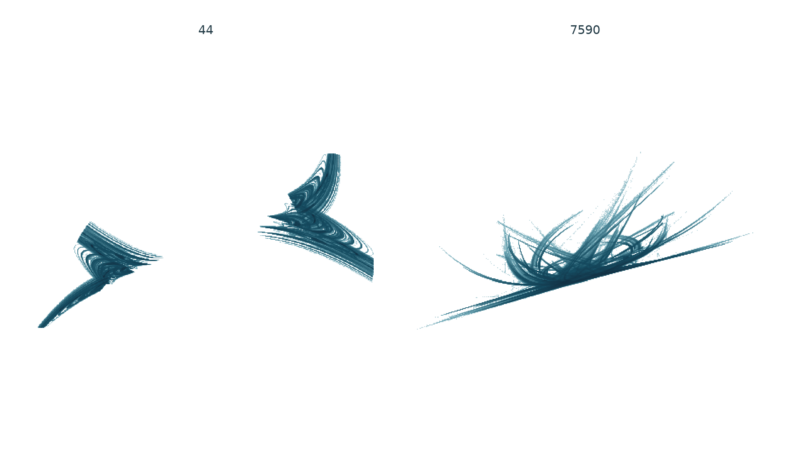

<!-- drawing-date -->
*First recorded portrait: **2026-11-01**.*
<!-- /drawing-date -->

<!-- portrait-equation yogi -->

```math
m^+=bm+(1-b)x,\quad v^+=v-(1-c)x^2\mathrm{sgn}(v-x^2),\quad x^+=x-\frac{m^+}{\sqrt{v^+}+e}
```

Sign-Yogi on the scalar quadratic in normalized coordinates (x,m,v). Here b and c are memory coefficients, e = ε/α and sign(0) = 0. Cases 44 and 7590 have different memory coefficients and epsilon values. [Model and parameters](docs/yogi-geometry.md)

<!-- /portrait-equation -->

Cases 44 and 7590 are visually distinct numerical regimes of the same published optimizer. Initialization and precision controls are retained in the report.

Normalized optimizer state (x, m, v); archived orthographic cameras.

[Report](docs/yogi-geometry.md)

#### Yogi: additional expanding regimes


<!-- drawing-date -->
*First recorded portrait: **2026-11-01**.*
<!-- /drawing-date -->

<!-- portrait-equation yogi-expansion -->

```math
m^+=bm+(1-b)x,\quad v^+=v-(1-c)x^2\mathrm{sgn}(v-x^2),\quad x^+=x-\frac{m^+}{\sqrt{v^+}+e}
```

Sign-Yogi on the scalar quadratic in normalized coordinates (x,m,v). Here b and c are memory coefficients, e = ε/α and sign(0) = 0. The selections are scout Case 4214 and grid Case 125, with different memory settings. [Model and parameters](docs/yogi-parameter-plane.md)

<!-- /portrait-equation -->

Cases 4214 and 125 have numerical evidence for two expanding directions. Window lengths, library differences and branch discontinuities are reported separately.

Normalized optimizer states; archived preview cameras. Panels have separate scales.

[Report](docs/yogi-parameter-plane.md) · [Related result](docs/yogi-geometry.md)

#### Adamax memory


<!-- drawing-date -->
*First recorded portrait: **2026-11-01**.*
<!-- /drawing-date -->

<!-- portrait-equation adamax -->

```math
m^+=b m+(1-b)x,\qquad u^+=\max(cu,|x|+e),\qquad x^+=x-\frac{m^+}{u^+}
```

Normalized late-time Adamax on the scalar quadratic. Both panels use e = 5 × 10⁻⁶. The (b,c) memory pair is approximately (0.363513,0.429109) for Case 847 and (0.9,0.5) for Case 4099. [Model and parameters](docs/adamax-geometry.md)

<!-- /portrait-equation -->

Four-million-step, high-precision and PyTorch controls support the selected regimes. Case 4099 coexists with two reflected periodic orbits.

Normalized optimizer state; archived orthographic cameras.

[Report](docs/adamax-geometry.md)

#### AdaBelief memory

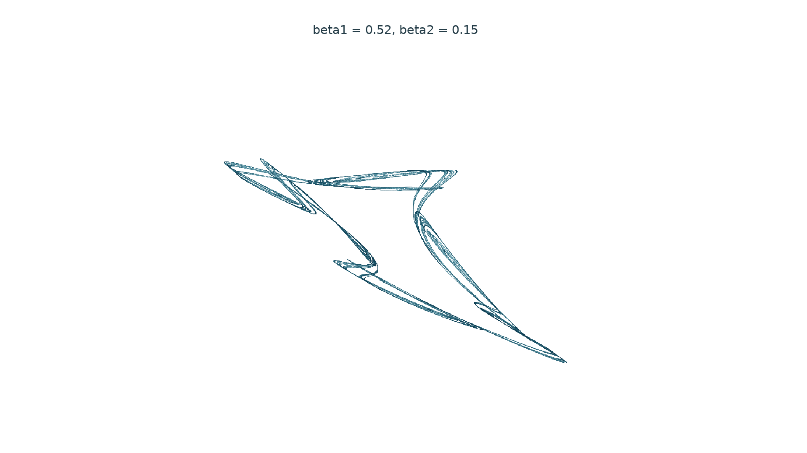

<!-- drawing-date -->
*First recorded portrait: **2026-11-01**.*
<!-- /drawing-date -->

<!-- portrait-equation adabelief -->

```math
m^+=b m+(1-b)x,\quad s^+=c s+(1-c)(x-m^+)^2+e,\quad x^+=x-\frac{m^+}{\sqrt{s^+}+d}
```

Autonomous nonrectified AdaBelief on the scalar quadratic at b = 0.52, c = 0.15. With learning rate α = 0.01 and ε = 10⁻¹⁶, the two normalized offsets are e = ε/α² and d = ε/α. [Model and parameters](docs/adabelief-quadratic.md#exact-model-and-selected-parameters)

<!-- /portrait-equation -->

A scalar quadratic objective supports irregular full optimizer states at the selected memory parameters. Finite-time numerical evidence is separated from convergence and novelty claims.

Normalized state (x, m, s); equal displayed coordinate units.

[Report](docs/adabelief-quadratic.md)

#### Finite-sample FastICA


<!-- drawing-date -->
*First recorded portrait: **2026-11-01**.*
<!-- /drawing-date -->

<!-- portrait-equation fastica -->

```math
u_i=x_i^\top w,\quad h=\frac1N\sum_{i=1}^N\!\left[x_i g(u_i)-g'(u_i)w\right],\quad w^+=\frac{h}{\|h\|},\quad g(u)=u e^{-u^2/2}
```

The fixed whitened observations xᵢ lie in four dimensions. Case 204 uses N = 32 normal samples and Case 351 uses N = 16 Student-t samples. Both panels follow the first FastICA weight on the unit 3-sphere. [Model and parameters](docs/fastica-dynamics.md#map-and-input-conventions)

<!-- /portrait-equation -->

Cases 204 and 351 retain positive finite-time tangent growth over five million
steps and at 70 and 100 digits. Case 351 has regular competing outcomes. These
are regimes of an established algorithm; historical priority and asymptotic
chaotic attraction remain unresolved.

Projection of the unit weight on $`(w_1,w_2,w_4)`$; every consecutive state is
retained. No sign folding. Spatial scale and density saturation differ between
panels. Case numbers identify the exact data sets in the report.

[Report and stopping-rule audit](docs/fastica-dynamics.md)

### Physical and biological models

#### Five motor rows


<!-- drawing-date -->
*First recorded portrait: **2026-11-01**.*
<!-- /drawing-date -->

<!-- portrait-equation motor-five -->

```math
\begin{aligned}
 V_j&=-\rho X_j+r(s_j-\bar s),\qquad \dot X_j=V_j,\\
 \dot c_j&=1-c_j-V_js_j,\qquad \dot s_j=b-s_j+V_jc_j,\\
 \bar s&=N^{-1}\sum_{k=1}^{N}s_k,\qquad \sum_{j=1}^{N}X_j=0.
\end{aligned}
```

For row j, c and s are the cosine and sine occupancy coefficients, X is displacement and V is velocity. The same five-row trajectory appears in both panels, through displacement contrasts (1, 2, 3) and (1, 2, 4). [Model and parameters](docs/motor-five-geometry.md#model-and-selection)

<!-- /portrait-equation -->

The same saved fourteen-dimensional trajectory is shown in two projections of its four displacement contrasts. Neither view defines a three-dimensional embedding.

Fourier displacement contrasts; final 800 saved time units.

[Report](docs/motor-five-geometry.md)

#### Three motor rows with unequal rates


<!-- drawing-date -->
*First recorded portrait: **2026-10-31** · Current rendering: 2026-11-01.*
<!-- /drawing-date -->

<!-- portrait-equation motor-three-asymmetric -->

```math
\begin{aligned}
 V_j&=-\rho X_j+r(s_j-\bar s),\qquad \dot X_j=V_j,\\
 \dot c_j&=1-c_j-V_js_j,\qquad \dot s_j=b-s_j+V_jc_j,\\
 \bar s&=N^{-1}\sum_{k=1}^{N}s_k,\qquad \sum_{j=1}^{N}X_j=0.
\end{aligned}
```

For row j, c and s are the cosine and sine occupancy coefficients, X is displacement and V is velocity. Three-row Case 2566 uses transition-rate asymmetry b = 0.7 and displays an orthogonal rotation of the three cosine occupancies. [Model and parameters](docs/motor-rows-gpu-survey.md#what-the-system-represents)

<!-- /portrait-equation -->

Case 2566 is an eight-dimensional numerical candidate. The projection uses a fixed orthogonal rotation of the three cosine occupancies.

Rotated cosine occupancies; final 600 saved time units; stride 2.

[Report](docs/motor-asymmetry-geometry.md)

#### Three symmetric motor rows


<!-- drawing-date -->
*First recorded portrait: **2026-10-30** · Current rendering: 2026-11-01.*
<!-- /drawing-date -->

<!-- portrait-equation motor-three -->

```math
\begin{aligned}
 V_j&=-\rho X_j+r(s_j-\bar s),\qquad \dot X_j=V_j,\\
 \dot c_j&=1-c_j-V_js_j,\qquad \dot s_j=b-s_j+V_jc_j,\\
 \bar s&=N^{-1}\sum_{k=1}^{N}s_k,\qquad \sum_{j=1}^{N}X_j=0.
\end{aligned}
```

For row j, c and s are the cosine and sine occupancy coefficients, X is displacement and V is velocity. Three-row Case 783 uses b = 1. The coordinates are the three sine occupancies. [Model and parameters](docs/motor-rows-gpu-survey.md#what-the-system-represents)

<!-- /portrait-equation -->

Case 783 has an independently computed eight-dimensional spectrum with one positive and one near-zero rate. This image shows the three sine occupancies.

Sine occupancies (s0, s1, s2); a projection of the 8D flow.

[Report](docs/motor-rows-gpu-survey.md)

#### Motor-pair model


<!-- drawing-date -->
*First recorded portrait: **2026-10-30** · Current rendering: 2026-11-01.*
<!-- /drawing-date -->

<!-- portrait-equation motor-pair -->

```math
\begin{aligned}
h'&=[-\rho+r(1-Z)]h-rY,\\
Y'&=h(1-Z)-Y,\\
Z'&=hY-Z.
\end{aligned}
```

Case 444 is rendered in the dimensionless motor-pair coordinates h, Y and Z. The positive parameters ρ and r control mechanical relaxation and coupling. [Model and parameters](docs/motor-pair-source-audit.md#exact-equations-suitable-for-independent-implementation)

<!-- /portrait-equation -->

Case 444 retains positive growth in a long independent CPU calculation. The neutral rate still needs convergence; priority and asymptotic attraction remain unresolved.

Physical coordinates (h, Y, Z); final 2,000 saved time units.

[Report](docs/motor-pair-gpu-survey.md)

#### Synchronematic oscillators

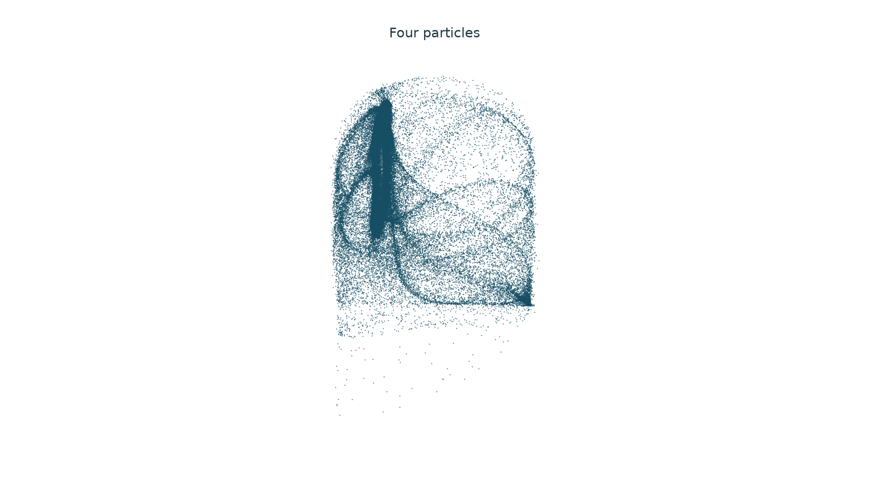

<!-- drawing-date -->
*First recorded portrait: **2026-10-29** · Current rendering: 2026-11-01.*
<!-- /drawing-date -->

<!-- portrait-equation synchronematic -->

```math
\begin{aligned}
 f_i&=\sum_{j\ne i}d_{ij}^{-3}F_\theta(\Delta_{ij})\cos\psi_i\cos\psi_j,\qquad \dot\theta_i=f_i-\bar f,\\
 \dot\chi_i&=\sum_{j\ne i}d_{ij}^{-3}F_\chi(\Delta_{ij})\sin\psi_i\cos\psi_j.
\end{aligned}
```

The four phases θ and orientations χ interact at pair distances d. For each pair, Δ is the phase difference θⱼ−θᵢ and ψ measures orientation relative to the pair direction. The source specifies both first- and third-harmonic kernels; f̄ is the four-particle mean. [Model and parameters](docs/synchronematic-research.md#exact-model-and-units)

<!-- /portrait-equation -->

The four-particle candidate is displayed through gauge-invariant collective observables. These do not form an embedding of the seven-dimensional reduced angular dynamics.

Collective observables (Re Q, Im Q, C), not state coordinates.

[Report](docs/synchronematic-research.md)

#### Light-driven elastomer slider

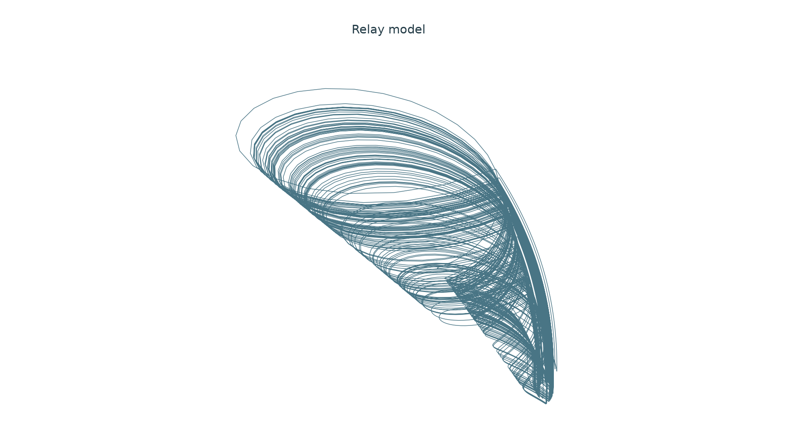

<!-- drawing-date -->
*First recorded portrait: **2026-10-29** · Current rendering: 2026-11-01.*
<!-- /drawing-date -->

<!-- portrait-equation lce-slider -->

```math
\dot u=v,\qquad \dot v=k(d-u-\phi)-bv,\qquad
\dot\phi=I H(u)(1-\phi)-\phi.
```

The slider displacement u is measured from the illumination threshold, v is velocity and φ is the light-responsive fraction. The step H switches the light on for u > 0. [Model and parameters](docs/lce-slider-research.md#exact-reduction-of-the-printed-equations)

<!-- /portrait-equation -->

The retained regime belongs to a three-state relay model. The report separates transverse growth estimates, switching assumptions and known related mechanisms.

Scaled full state (u/q, v/(sqrt(k) q), phi/q); scaling is explicitly physical.

[Report](docs/lce-slider-research.md)

#### Two-strain epidemic model


<!-- drawing-date -->
*First recorded portrait: **2026-10-30** · Current rendering: 2026-11-01.*
<!-- /drawing-date -->

<!-- portrait-equation two-strain -->

```math
\begin{aligned}
\dot S &= \mu(1-S)-\beta_1 I_1 S-F_2 S,\\
\dot I_1 &= (\beta_1 S-\mu-\gamma_1)I_1,\\
\dot I_2 &= F_2 S-(\mu+\gamma_2)I_2,\\
\dot I_{12} &= \sigma_{12}F_2R_1-(\mu+\gamma_{12})I_{12},\\
\dot R_1 &= \gamma_1I_1-\sigma_{12}F_2R_1-\mu R_1
\\ F_2&=\beta_2(I_2+\eta_2 I_{12}).
\end{aligned}
```

The five variables are population fractions. S is susceptible, I₁ and I₂ are the two primary infections, I₁₂ is the secondary infection, and R₁ is recovery from the first infection. The portrait shows physical fractions. [Model and parameters](docs/two-strain-research.md#exact-model-and-bounded-state-space)

<!-- /portrait-equation -->

The numerical five-state regime contains unequal outbreaks and extremely small prevalence. Related epidemic chaos is established; physical interpretation requires the qualifications in the report.

Projection (S, 1000 I1, 1000 I2); explicit axis units, not an embedding.

[Report](docs/two-strain-research.md)

#### Coupled optical operators

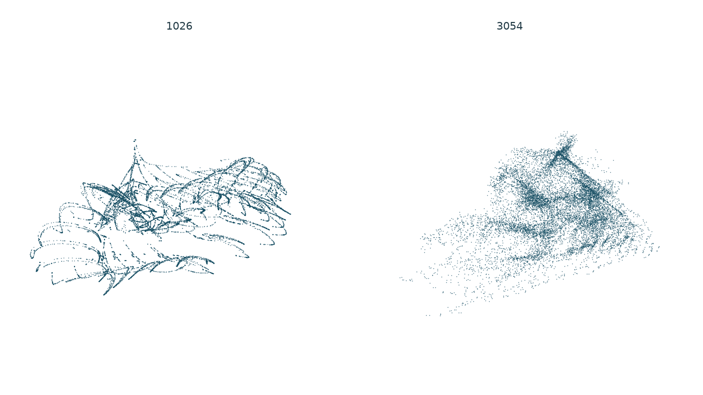

<!-- drawing-date -->
*First recorded portrait: **2026-10-29** · Current rendering: 2026-11-01.*
<!-- /drawing-date -->

<!-- portrait-equation optical-relay -->

```math
\begin{aligned}P(D)x_-&=k\,S(x_+-\delta_+),&P(D)x_+&=k\,S(\delta_--x_-),\\P(D)&=(D+1)(D^2+bD+k).\end{aligned}
```

D denotes time differentiation, x₋ and x₊ are the two normalized displacements and S is the Heaviside switch. The baffle thresholds are δ₋ and δ₊; the mechanical stiffness k and damping b set the response in thermal-time units. Cases 1026 and 3054 use different coefficients. [Model and parameters](docs/coupled-operators-research.md#structural-checks)

<!-- /portrait-equation -->

These six-state relay histories have persistent irregular motion in the recorded observation. Later continuations, captures and source-model assumptions are retained in the report.

Projection (x_minus, x_plus, y_minus - y_plus); all saved adaptive event/QR knots. The knots are nonuniform in time. Point density is sampling density, not an invariant measure.

[Report](docs/coupled-operators-research.md)

#### Smooth optical feedback

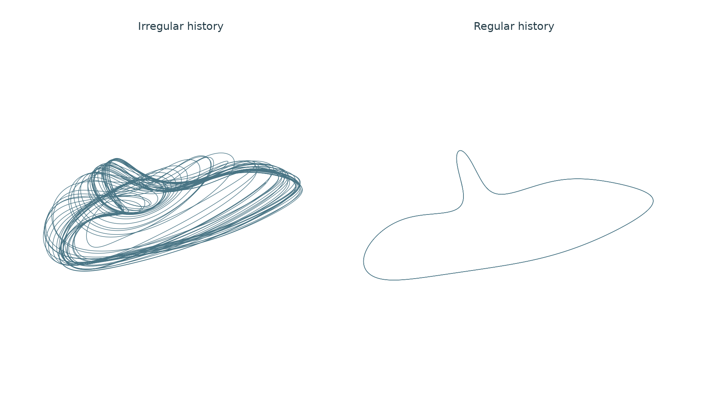

<!-- drawing-date -->
*First recorded portrait: **2026-10-29** · Current rendering: 2026-11-01.*
<!-- /drawing-date -->

<!-- portrait-equation optical-smooth -->

```math
\begin{aligned}P(D)x_-&=k\,S(x_+-\delta_+),&P(D)x_+&=k\,S(\delta_--x_-),\\P(D)&=(D+1)(D^2+bD+k),&S(u)&=(1+e^{-u/w})^{-1}.\end{aligned}
```

D is time differentiation. The two displacements drive opposite logistic illumination responses with baffle thresholds δ₋ and δ₊. The irregular and regular trajectories use the same reference-A coefficients and width w = 0.04, with different initial conditions. [Model and parameters](docs/coupled-operators-research.md#finite-optical-width-a-stronger-physical-test)

<!-- /portrait-equation -->

At the same logistic-width parameters, saved starts produce regular and irregular histories. This is a finite coexistence observation, not an asymptotic attractor classification.

Projection (x_minus, x_plus, y_minus - y_plus); common scale.

[Report](docs/coupled-operators-research.md)

<!-- shape-search-20261121-additional -->
### Eye-shaped crest and folded plume in precession

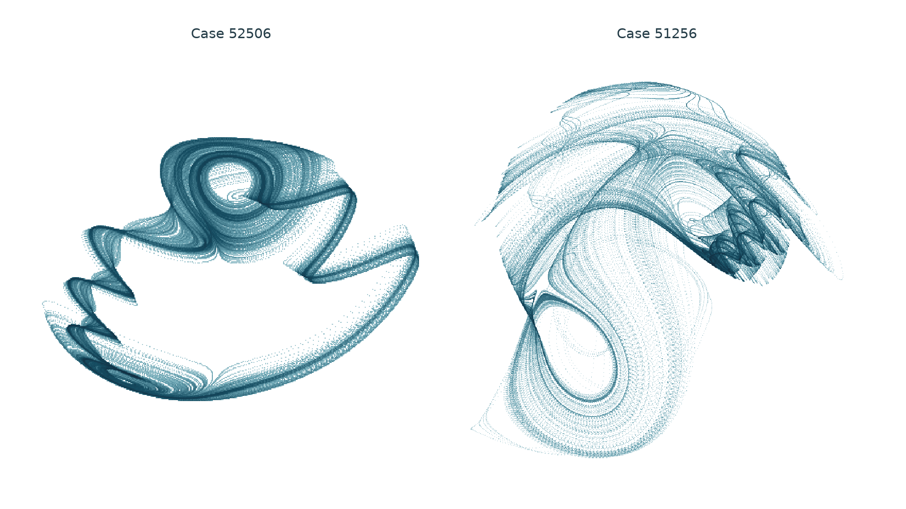

<!-- drawing-date -->
*Drawn: **2026-11-21**.*
<!-- /drawing-date -->

<!-- portrait-equation shapes-20261121-rotor -->

```math
H(v)=a\cdot v+\tfrac12\sum_i q_i v_i^2+\tfrac14\sum_i h_i v_i^4+cxyz,\qquad
\dot v=t-Dv+\frac{v\times\nabla H(v)}{1+|v|^2}.
```

The native state is v = (x, y, z), D is diagonal damping and t is the constant torque. The quartic potential and forcing coefficients differ between Cases 52506 and 51256. [Model and parameters](results/shape_search_20261121/flows/README.md#forced-quartic-precession)

<!-- /portrait-equation -->

A damped, driven precession flow supports two distinct irregular shapes. For Case 52506 all six nearby starts followed the irregular motion, while four broader starts settled at a steady state.

Full three-dimensional trajectories in a rigid camera. [Equations, controls and prior work](docs/shape-search-20261121.md)

### Folded recruitment bands and three expanding directions


<!-- drawing-date -->
*Drawn: **2026-11-21**.*
<!-- /drawing-date -->

<!-- portrait-equation shapes-20261121-recruits -->

```math
(x,y,z)^+=\left(sx+(1-s)z\,e^{r(1-ax-by-cz)},x,y\right),\qquad c=1-a-b
```

The coordinates are three successive abundances. Case 1008712 uses growth r ≈ 3.02992 and survival s ≈ 0.11481; Case 1025516 uses r ≈ 3.32047 and s = 0.025. The source links the full crowding weights and initial states. [Model and parameters](research/shape_search_20261121/delay/README.md#dynamics)

<!-- /portrait-equation -->

Three successive abundances of a delayed scalar recurrence form a banded ring at left. At right a broader distribution has positive growth in all three tangent directions over two million iterations.

Each axis shows abundance in its original units at one of three successive times. [Equations, controls and prior work](docs/shape-search-20261121.md)

### Quasiperiodic petals and a corrugated rim

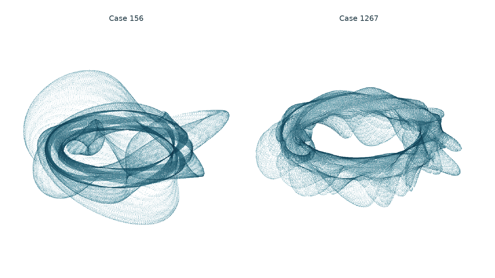

<!-- drawing-date -->
*Drawn: **2026-11-21**.*
<!-- /drawing-date -->

<!-- portrait-equation shapes-20261121-pinched -->

```math
\begin{aligned}q^+&=q+(\sqrt2-1,\sqrt3-1)\pmod 1,\\h^+&=\frac{\kappa h\prod_j\sin^2\!\big(\pi(k_jq_1+l_jq_2+b_j/32)\big)}{1+(\kappa-1)h}.\end{aligned}
```

Case 156 uses κ = 64 with wave triples (k,l,b) = (5,4,12), (2,3,30). Case 1267 uses κ = 48 with (5,2,24), (0,1,12). [Model and parameters](research/shape_search_20261121/pinched/README.md#dynamics-and-proof)

<!-- /portrait-equation -->

A two-frequency rotation forces a pinched interval map. The attracting graph is discontinuous almost everywhere and its transverse exponent is strictly negative. The same torus coordinates are used for both portraits.

Fixed tubular coordinates encode the two forcing phases and the physical fiber height. [Equations, controls and prior work](docs/shape-search-20261121.md)

### Two knotted limit cycles in cyclic harmonic flows

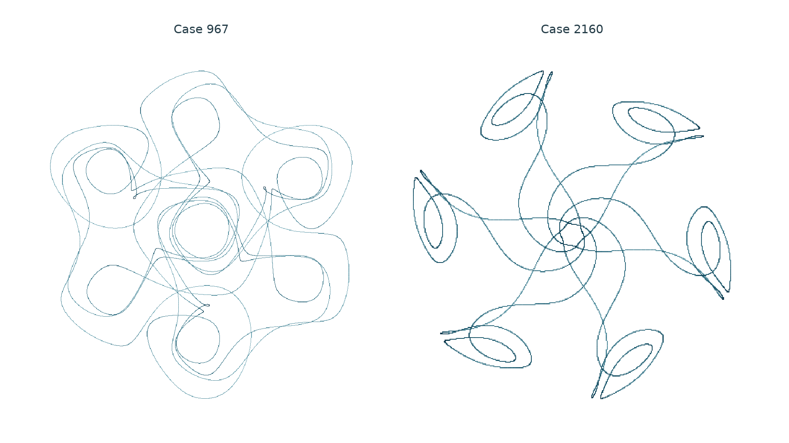

<!-- drawing-date -->
*Drawn: **2026-11-21**.*
<!-- /drawing-date -->

<!-- portrait-equation shapes-20261121-knots -->

```math
\dot x_i=-d_i x_i+a_i\sin(x_j+\phi_i)+b_i\sin(x_k+\psi_i)+c_i\sin(m_i x_j+n_i x_k+\chi_i).
```

The indices (i, j, k) run cyclically through the three native Cartesian coordinates. Cases 967 and 2160 use different coefficients and each panel shows one attracting periodic orbit. [Model and parameters](results/shape_search_20261121/flows/README.md#cartesian-harmonic-coupling)

<!-- /portrait-equation -->

The closed orbit polygons of Cases 967 and 2160 have distinct Alexander polynomials. The orbit in Case 967 has period about 215.27 and determinant 243. Stability of the flow cycles is numerical.

Native spatial states on one circuit of each periodic orbit. [Equations, controls and prior work](docs/shape-search-20261121.md)

### Attracting sets with four and five components

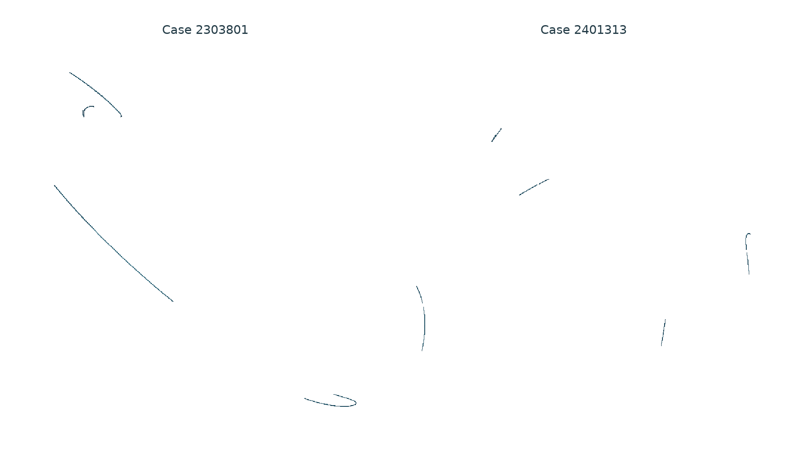

<!-- drawing-date -->
*Drawn: **2026-11-21**.*
<!-- /drawing-date -->

<!-- portrait-equation shapes-20261121-components -->

```math
z^{(0)}=r x_n+(1-r)e_1,\quad z^{(j)}=R_{i_j k_j}\!\left(a_j+b_jw_j+h_jw_j^3\right)z^{(j-1)},\quad x_{n+1}=z^{(3)}.
```

The rotations act in the xy, yz and zx planes in that order. Each wⱼ is the remaining coordinate immediately before its rotation, r is the contraction ratio and e₁=(1,0,0). Cases 2303801 and 2401313 use the coefficient vectors with four and five certified components respectively. [Model and parameters](docs/twist-geometry.md#definition-and-exact-structural-properties) · [Maps report](results/shape_search_20261121/maps/README.md)

<!-- /portrait-equation -->

Cases 2303801 and 2401313 each have a rigorously trapped local attracting set. Their component counts are four and five, respectively, so the two sets are topologically distinguishable.

Both panels show long numerical trajectories in the original three-coordinate maps. [Equations, controls and prior work](docs/shape-search-20261121.md)

### Three coexisting solenoids with inseparable triple links


<!-- drawing-date -->
*Drawn: **2026-11-21**.*
<!-- /drawing-date -->

<!-- portrait-equation shapes-20261121-brunnian -->

```math
\begin{aligned}F\big(H_i(\theta,w)\big)&=H_i\big(f_i(\theta),\,0.105w+0.55e^{i\theta}\big),\\f_i(\theta)&=d_i\theta+0.12\sin(d_i\theta)+0.137,\quad (d_1,d_2,d_3)=(2,3,5).\end{aligned}
```

Each Hᵢ embeds its unit-disk fibers around a separate closed braid strand in three-space; angles are modulo 2π. Cases 30300001 and 30300007 have the same internal maps and different three-strand charts, with absolute triple-linking invariants 1 and 7. [Model and parameters](results/shape_search_20261121/extension/brunnian/README.md#local-maps-and-disjoint-trapping-tubes)

<!-- /portrait-equation -->

Cases 30300001 and 30300007 each contain three chaotic solenoids. Removing any one leaves the other two separated by a sphere. Their triple cannot be separated by a sphere. The two compact triples are inequivalent under ambient homeomorphisms.

Native Cartesian positions at equal axis scales. Each panel combines 40,000 states from each of three attracting tubes. [Equations, controls and prior work](docs/shape-search-20261121.md)

### Fourteen and twelve connected components

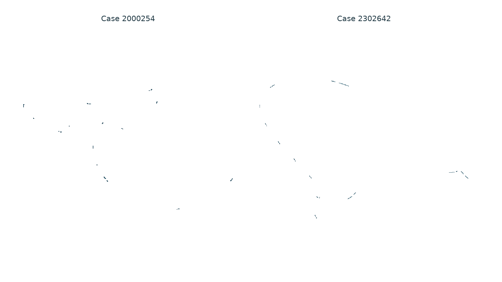

<!-- drawing-date -->
*Drawn: **2026-11-21**.*
<!-- /drawing-date -->

<!-- portrait-equation shapes-20261121-extension-components -->

```math
z^{(0)}=r x_n+(1-r)e_1,\quad z^{(j)}=R_{i_j k_j}\!\left(a_j+b_jw_j+h_jw_j^3\right)z^{(j-1)},\quad x_{n+1}=z^{(3)}.
```

The rotations act in the xy, yz and zx planes in that order. Each wⱼ is the remaining coordinate immediately before its rotation, r is the contraction ratio and e₁=(1,0,0). Cases 2000254 and 2302642 use the coefficient vectors with fourteen and twelve certified components respectively. [Model and parameters](docs/twist-geometry.md#definition-and-exact-structural-properties) · [Maps report](results/shape_search_20261121/extension/maps/README.md)

<!-- /portrait-equation -->

Cases 2000254 and 2302642 admit local attracting sets with exactly fourteen and twelve connected components. Each component contains at least two distinct points, as verified by an isolated orbit of twice the return period. The images show sampled trajectories at these parameters.

Native three-axis twist coordinates, shown at equal axis scales with a principal-axis camera. [Equations, controls and prior work](docs/shape-search-20261121.md)
<!-- /shape-search-20261121-additional -->

## Research index

This index covers the illustrated studies above, periodic captures, failed searches, source discrepancies and structural exclusions.

“Certified” refers to the particular interval or analytical statement in a report. Positive finite-time growth and a persistent point cloud are numerical evidence. Neither category establishes historical priority without a separate comparison.

### Constructed flows and maps

| System | Main result | Further evidence |
| --- | --- | --- |
| [Icosahedral Gaussian flow](docs/icosahedral-flow.md) | Numerical chaos; certified absorbing balls | [Equilibria](docs/icosahedral-structure.md), [numerical cycles](docs/icosahedral-cycles.md), [return proposal and known spherical skeleton](docs/icosahedral-returns.md) |
| [Tetrahedral Gaussian flow](docs/tetrahedral-flow.md) | Numerical chaos around a stable center | [Equilibrium certificates](docs/tetrahedral-equilibria.md), [1995 predecessor](docs/tetrahedral-homoclinic-prior.md), [earlier literature audit](docs/polyhedral-priority-followup.md) |
| [Localized Gaussian vortices](docs/gaussian-vortex.md) | Three-state numerical candidate | [Known-shape comparison](docs/attractor-novelty-audit.md) |
| [Dissipative twist map](docs/twist-geometry.md) | Two numerical geometries | [Mechanism and prior art](docs/twist-priority-and-mechanism.md) |

### Numerical algorithms

| System | Main result | Further evidence |
| --- | --- | --- |
| [Spatial-circle RAAR](docs/raar-circles.md) | Certified attracting positive-entropy set at R1051; numerical companion portraits | [Trapping certificate](docs/raar-trapping.md), [fold membership and equivalence obstruction](docs/raar-critical-membership.md), [Symbolic-dynamics certificate](docs/raar-symbolic-dynamics.md), [cycle structure](docs/raar-cycle-structure.md), [folding and preimages](docs/raar-folding.md), [exact structure](docs/raar-structure.md), [prior art](docs/raar-priority.md) |
| [Circle / finite-point RAAR](docs/raar-constellations.md) | Layered spatial numerical candidates; three active sites in the selected observations | [Complete survey and controls](results/raar-constellations/README.md), [known phase-retrieval connections](docs/raar-constellations.md#prior-art-and-equivalent-terms) |
| [Gaussian posterior mean and a circle](docs/soft-constellations.md) | Attracting positive-entropy set and mixed-index cycles for Case 156 | [Article and equivalence obstructions](docs/soft-symbolic-dynamics/manuscript.md), [complete temperature sweep](results/soft-constellations/README.md), [prior art](docs/soft-constellation-priority.md) |
| [Gaussian posterior mean and a sphere](docs/soft-sphere/manuscript.md) | Numerical spatial candidates; no asymptotic or priority certificate | [Complete sweep and reproduction](results/soft-sphere/README.md), [shared prior-art review](docs/soft-constellation-priority.md) |
| [Canonical posterior maps](docs/canonical-sphere/manuscript.md) | Folded ribbon and numerical hyperchaos candidate; certified intrinsic collision and homoclinic return in a trapping set | [Complete 656-case campaign](results/canonical-sphere/README.md), [certificates](results/canonical-collision/README.md), [prior art](docs/soft-constellation-priority.md) |
| [Product-alphabet posterior maps](docs/product-alphabet/manuscript.md) | Four-wing candidate; positive-entropy core is not Lyapunov stable; reversed period-92 return excludes specified neighborhood equivalences | [Complete campaign](results/product-alphabet/README.md), [entropy](results/product-symbolic/README.md), [orientation](results/product-orientation/README.md), [instability and mechanism](results/product-mechanism/README.md), [prior art](docs/product-alphabet/manuscript.md#7-prior-art-and-geometric-comparison) |
| [Nonuniform product posteriors](docs/product-alphabet/manuscript.md#32-nonuniform-alphabets-and-folded-shells) | Two folded-shell numerical candidates; 20-million-step, 33-start and 70/100-digit controls | [Complete alphabet extensions](results/product-highorder/README.md), [visual prior art](records/product-irregular-literature-20261101.json) |
| [Cyclic three-circle RAAR](docs/cyclic-raar-search.md) | Positive finite-time growth, but visually thin configurations | [Complete survey](results/cyclic-raar-search/README.md) |
| [Sphere / finite-point RAAR](docs/spherical-constellation-search.md) | Paired 2,048-case survey; long transient rejected, attracting circle of two-cycles proved | [Exact rational checks and survey](results/spherical-constellations/README.md), [quantized-feedback comparison](docs/quantized-feedback-comparison.md) |
| [Scalar acceleration memory](docs/anderson-memory.md) | Convergent plain iteration and irregular accelerated memory | [Search and controls](research/unexpected_search/README.md) |
| [Overrelaxed Sinkhorn](docs/sinkhorn-screen.md) | 576-case screen; 11 persistent finite-growth cases and 21 periodic recurrences after long transients; no promoted portrait | [All-flag continuations, precision and exact bounds](results/sinkhorn-screen/README.md) |
| [Unequal-rate matrix scaling](docs/sinkhorn-unequal-rates.md) | Two three-state numerical candidates after 106 million steps; 4,864-input campaign with escape and recurrence accounting | [Complete inputs, spectra, precision and controls](results/sinkhorn-unequal-rates/README.md) |
| [Finite-sample FastICA](docs/fastica-dynamics.md) | Four numerical regimes; five-million-step spectra and independent precision controls; one rejected long transient | [Portrait and stopping-rule audit](docs/fastica-dynamics.md), [complete evidence](results/fastica/README.md), [reproduction](research/fastica/README.md) |
| [Structured-data FastICA](docs/fastica-tripling.md) | Exact trapping and entropy interval; ambient local noninjectivity; an extra preimage excluded from the attracting set | [Entropy proof](docs/fastica-tripling.md#attracting-set-and-entropy), [ambient obstruction](docs/fastica-tripling-structure.md), [preimage rejection](docs/fastica-preimage-rejection.md), [reproduction](results/fastica-tripling/README.md) |
| [RK45](docs/rk45-oscillator.md), [RK23](docs/rk23-oscillator.md) | Irregular adaptive-controller states for a decaying oscillator | [RK45 structure](docs/rk45-controller-structure.md), [RK23 structure](docs/rk23-controller-structure.md), [RK45 prior art](docs/rk45-priority.md), [RK23 prior art](docs/rk23-priority.md) |
| [Smooth Yogi](docs/yogi-tanh.md) | Two positive finite growth rates in selected regimes | [Structure](docs/yogi-tanh-structure.md), [manuscript](docs/yogi-memory/manuscript.md) |
| [Yogi parameter plane](docs/yogi-parameter-plane.md) | Retained irregular regimes and regular windows | [Earlier cases](docs/yogi-geometry.md), [smoothing control](docs/yogi-smoothing-control.md), [boundedness theorem](docs/scalar-optimizer-boundedness.md), [prior art](docs/yogi-priority.md) |
| [Adamax](docs/adamax-geometry.md) | Irregular memory and competing cycles | [Structure](docs/adamax-structure.md), [prior art](docs/adamax-priority.md) |
| [AdaBelief](docs/adabelief-quadratic.md) | Numerical scalar-quadratic candidate | [AdaDelta cycle audit](docs/adadelta-cycle-audit.md) |

### Molecular motors

| Result | Evidence |
| --- | --- |
| Exact model and physical normalization | [Motor rows](docs/motor-rows-source-audit.md), [motor pair](docs/motor-pair-source-audit.md) |
| Certified periodic saddle and transverse crossing | [Cycle and least-period audit](docs/motor-cycle-certificate.md), [crossing](docs/motor-crossing-certificate.md), [implementation review](docs/motor-proof-review.md) |
| Certified paired periodic attractor and later saddle | [Paired attractor](docs/motor-paired-certificate.md), [crossing](docs/motor-paired-crossing-certificate.md), [saddle](docs/motor-saddle-certificate.md), [postcritical observations](docs/motor-postcritical.md) |
| Certified five-cluster periodic attraction | [Certificate](docs/motor-five-cycle-certificate.md), [replication limit](docs/motor-five-replication-limit.md), [branch observations](docs/motor-cluster-cycle-branch.md) |
| Numerical irregular geometry | [Four rows](docs/motor-four-geometry.md), [rate-parameter slice](docs/motor-four-b-study.md), [five rows](docs/motor-five-geometry.md), [three asymmetric rows](docs/motor-asymmetry-geometry.md) |
| Collective chaos and hyperchaos candidates | [Activity continuation](docs/motor-activity-continuation.md), [row-count survey](docs/motor-rows-gpu-survey.md), [activity path](docs/motor-rows-activity-path.md), [replication index](docs/motor-replication-index.md) |
| Coordinate and long-time controls | [Motor-pair survey](docs/motor-pair-gpu-survey.md), [physical coordinates](docs/motor-pair-coordinate-audit.md), [log contrasts](docs/motor-log-contrast-audit.md), [long departure](docs/motor-log-seventh-departure.md), [original seed](docs/motor-original-seed-log.md) |
| Additional structural work | [Cluster transverse modes](docs/motor-cluster-transverse.md), [network combinatorics](docs/motor-network-combinatorics.md), [excluded tuple](docs/motor-tuple15-excluded.md) |

### Other physical and biological models

| System | Result and qualifications |
| --- | --- |
| [Synchronematic oscillators](docs/synchronematic-research.md) | Numerical collective motion; [bifurcations](docs/synchronematic-bifurcations.md), [source and priority audit](docs/synchronematic-priority-audit.md) |
| [Elastomer slider](docs/lce-slider-research.md) | Relay-model candidate; [switching-width controls](docs/lce-slider-switching.md), [relay limit](docs/lce-slider-relay-limit.md) |
| [Two-strain epidemic model](docs/two-strain-research.md) | Numerical outbreak irregularity with extremely small prevalence |
| [Coupled optical operators](docs/coupled-operators-research.md) | Irregular histories and periodic captures; [lifetime extension](docs/optical-lifetime-extension.md), [cycle branch](docs/optical-cycle-continuation.md), [arclength continuation](docs/optical-cycle-arclength.md), [saddle departure](docs/optical-saddle-departure.md) |
| Optical model interpretation | [Heat-balance source audit](docs/light-operators-audit.md), [restricted exclusion theorem](docs/coupled-operators-order-audit.md), [known feedback equivalence](docs/coupled-operators-priority-audit.md) |

### Negative, incomplete and excluded searches

These studies are retained to document tested mechanisms and prevent repeated false positives. An incomplete integration is not a negative result.

| System | Outcome or unresolved issue |
| --- | --- |
| [NIFTE thermofluidic engine](docs/nifte-research.md) | Periodic controls and unresolved chaos claims; [physical audit](docs/nifte-physical-priority-audit.md) |
| [Rayleigh spring pair](docs/rayleigh-pair-research.md) | Long transients and weak instability; [structural derivation](docs/rayleigh-pair-structure.md) |
| [HHS mechanochemical cell](docs/hhs-research.md) | Periodic and neutral controls; [source audit](docs/hhs-source-audit.md) |
| [Urease reactor](docs/urease-research.md) | No promoted chaotic attractor |
| [Long-cavity whistle](docs/whistle-screen.md) | No retained chaos among 514 declared trajectories |
| [Ice-cloud microphysics](docs/ice-cloud-screen.md) | Weak signals resolve to numerical cycles |
| [Morphoelastic hydrogel filament](docs/hydrogel-variational-checks.md) | [Spatial controls and mesh artifacts](docs/hydrogel-spatial-controls.md), followed by refinement and tangent-growth checks: positive finite growth accompanies slow drift; a longer strong-field run develops close contact and fails. No established chaotic attractor; [earlier planar screen](docs/hydrogel-planar-controls.md) |
| [Core–shell gel](docs/core-shell-gel-research.md) | Stiff cases; one endpoint resolves to a [stable periodic orbit](docs/core-shell-gel-stiff-followup.md) |
| [Rigid microfluidic network](docs/microfluidic-research.md) | Published periodic control not recovered; [supplement audit](docs/microfluidic-source-audit.md) |
| [Contact rotors](docs/dcr-research.md) | Continuation ambiguity at strict event boundaries; [source audit](docs/dcr-source-audit.md) |
| [Pulsating heat pipe](docs/heat-pipe-source-audit.md) | Complete source closure unavailable |
| [Solar-array flutter](docs/thermal-flutter-source-audit.md) | Reduced model not uniquely specified by retrieved material |
| [Mineral protocells](docs/mineral-protocell-screening.md) | Planarity or monotone growth excludes the proposed route |
| Further source and structural screens | [Candidate queue](docs/candidate-queue.md), [material memory](docs/material-memory-screening.md), [physical meminductor](docs/meminductor-followup-audit.md), [thermal sheet](docs/thermomechanical-sheet-audit.md), [epithelial chain](docs/epithelial-chain-audit.md) |

### Archive

[All report files](docs) · [Result directories](results/README.md) · [Sources and checks](RECORDS.md) · [Dependency notices](THIRD_PARTY_NOTICES.md)

Portraits use a common rendering convention and declared coordinates. Dates refer to our drawings, not discovery priority. [Figure records](tools/README-portraits.md) · [License](LICENSE)
