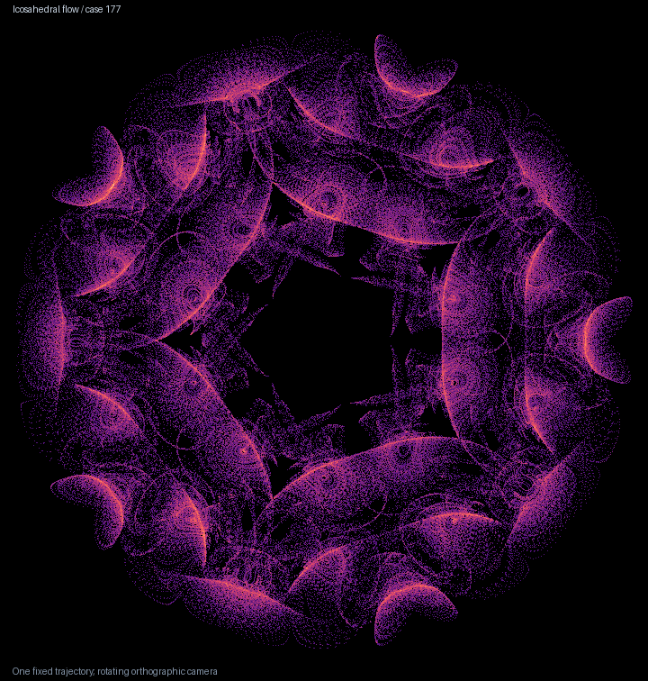
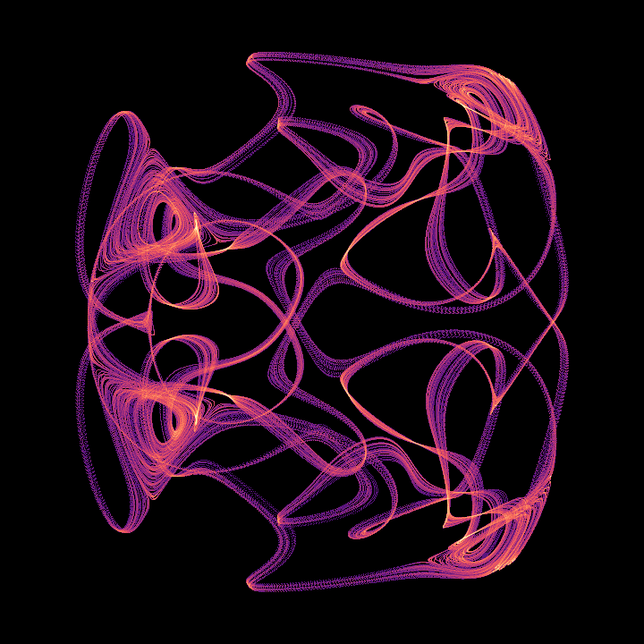
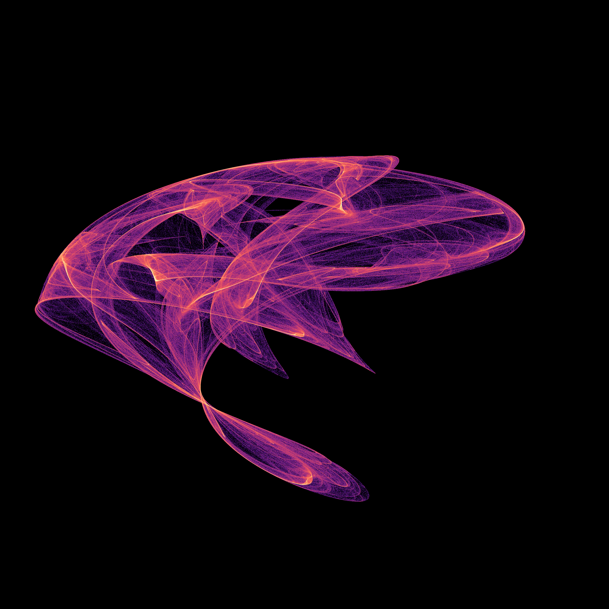
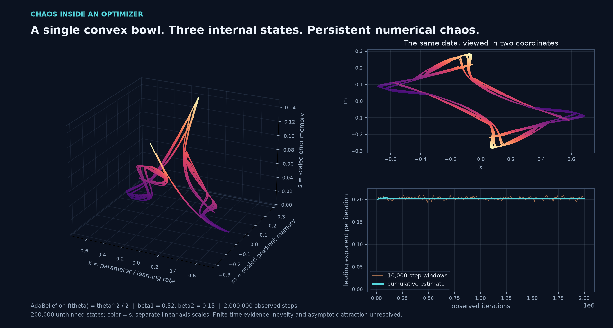

# Chaos Attractor Lab

Reproducible investigations of unusual physical and biological oscillator models, deterministic algorithms and constructed maps, using Python, OpenCL parameter surveys and independent CPU checks. **Historical priority remains under review.** The reports distinguish certified periodic and symbolic dynamics, numerical attractor candidates, known literature results and open hypotheses.

**[Gallery with drawing dates](docs/attractor-gallery.md).** Every portrait has its date beside it. Older dates identify the first recorded drawing in project history; new images record their actual drawing date. These are our image dates, not historical discovery dates. [Date records and workflow](tools/README-render-dates.md).

**[Certified symbolic dynamics behind the serrated RAAR arch](docs/raar-symbolic-dynamics.md).** Eight covering relations pass two interval map implementations. Two 49-step routes realize arbitrary binary sequences and prove a compact invariant set with topological entropy at least log(2)/49. A separate certificate locates a least-period-49 saddle with exactly one unstable multiplier. The [seven-page article](papers/raar-symbolic-dynamics/manuscript.pdf) includes the proof, actual-state figures, all failed proposals and explicit limits: attraction of this set and historical uniqueness remain unresolved.

[Native geometry and certified cycles](docs/assets/raar-symbolic-geometry.png) · [The two-route graph](docs/assets/raar-symbolic-graph.png) · [Coded excursions](docs/assets/raar-symbolic-itineraries.png) · [Reproduce the certificates](papers/raar-symbolic-dynamics/README.md)

**[Sixty rotations in one three-dimensional flow](docs/icosahedral-flow.md).** One trajectory forms a hollow arrangement of folded ribbons and spiral fans. Two selected icosahedral candidates survive three integration steps, 16,000-unit observations and independent adaptive solvers. Interval bounds certify absorbing balls; fresh starts reveal both chaotic attraction and competing regular motion. A replay of Reiter's 1999 map strengthens the prior-art comparison. Historical uniqueness remains open.



<!-- drawing-date -->
*First recorded drawing: **2026-11-01** ([record](https://github.com/Griboedow/chaos-attractor-lab/blob/8d5d8b58d0087a4f0ed59cc4258838b2d22568ac/docs/assets/icosahedral-177.gif)).*
<!-- /drawing-date -->

[Large portrait](docs/assets/icosahedral-177.png) · [Looped companion](docs/assets/icosahedral-183.png) · [Evidence, comparison and reproduction](docs/icosahedral-flow.md)

The [structural follow-up](docs/icosahedral-structure.md) certifies 161 local equilibria for case 177 and records 1,796 transitions between thirty spiral centers along an icosidodecahedral graph. [Watch actual trajectory motion](docs/assets/icosahedral-motion.gif), with a fixed camera and an explicitly dimmed full-cloud background. The empirical graph is not a certified heteroclinic network.

The [cycle follow-up](docs/icosahedral-cycles.md) resolves a neighborhood-size ambiguity: sixty consistently oriented edges remain, and the earlier apparent reversals skip shallow visits. Two unstable numerical orbits circle triangular and pentagonal faces, checked by full-cycle shooting, RK4 and 80/110-digit Taylor integration. [See the circuits inside the cloud](docs/assets/icosahedral-cycles.png). Periodic existence, asymptotic chaos and historical novelty remain uncertified.

The [return-map follow-up](docs/icosahedral-returns.md) finds two promising return strips: all 578 sampled starts have positive boundary margins, with measured unstable-coordinate expansion above 447. This is a numerical proposal, not a covering certificate. A closer prior-art comparison identifies the same sixty directed geometric edges in a known integrable sphere flow after time reversal; the skeleton itself is not new.

**[New search checkpoint: a tetrahedral flow around a stable center](docs/tetrahedral-flow.md).** A single trajectory weaves ribbons through all twelve symmetry sectors. Its 3.2-million-state portrait survives 40,000 time units, step refinement, independent DOP853 integration and fresh basin starts. Comparisons cover 108 known regimes and six earlier repository candidates. Tetrahedral maps and earlier three-dimensional tetrahedral chaos are established prior art; specific historical uniqueness remains open.



<!-- drawing-date -->
*First recorded drawing: **2026-11-01** ([record](https://github.com/Griboedow/chaos-attractor-lab/blob/13d474ac6acd6edf65fcd2b54d497f33b699d316/docs/assets/tetrahedral-flow.gif)).*
<!-- /drawing-date -->

[Large portrait](docs/assets/tetrahedral-flow.png) · [Oblique view](docs/assets/tetrahedral-flow-oblique.png) · [Evidence and limitations](docs/tetrahedral-flow.md)

The [closest older-flow follow-up](docs/tetrahedral-homoclinic-prior.md) identifies three-dimensional tetrahedral chaos in Sandstede and Scheel (1995). Specific novelty remains unresolved; the numerical shape catalog does not include that unfolding or Reiter's tetrahedral maps. The [earlier literature note](docs/polyhedral-priority-followup.md) separately clarifies the scope of a 1996 construction.

The [equilibrium follow-up](docs/tetrahedral-equilibria.md) certifies at least 33 distinct equilibria for each of the two selected tetrahedral flows. Outward interval calculations at 60 and 90 decimal digits establish local uniqueness and unstable-direction counts. They do not certify chaos or an exhaustive equilibrium inventory.

**[A different setting: chaos in scalar acceleration memory](docs/anderson-memory.md).** Two bounded increasing scalar maps have interval-verified unique fixed points and globally convergent plain iterations. A three-history regularized acceleration instead admits numerically attracting chaotic clouds, surviving 80/110-digit checks. The exact linear reduction prevents counting scaled copies as separate findings. All negative screens, long-run failures and prior-art gaps are retained.


<!-- drawing-date -->
*First recorded drawing: **2026-11-01** ([record](https://github.com/Griboedow/chaos-attractor-lab/blob/13d474ac6acd6edf65fcd2b54d497f33b699d316/docs/assets/anderson-memory.png)).*
<!-- /drawing-date -->

**[Another construction: three throats in a localized Gaussian-vortex flow](docs/gaussian-vortex.md).** A continuous three-state field produces a detailed folded geometry from 4.8 million actual states. A 30,000-unit spectrum, step refinement and an independent adaptive solver support chaos; fresh starts also expose a competing numerical cycle. The [108-regime novelty audit](docs/attractor-novelty-audit.md) compares this candidate and the earlier twist images, including affine-coordinate controls. Halvorsen is the new image's closest geometric reference, so threefold appearance is not claimed as new.


<!-- drawing-date -->
*First recorded drawing: **2026-11-01** ([record](https://github.com/Griboedow/chaos-attractor-lab/blob/6371acfa83c293b60c3f2a3b2b455b928020ac6a/docs/assets/gaussian-vortex-triskelion.png)).*
<!-- /drawing-date -->

[Rotate the trajectory](docs/assets/gaussian-vortex-triskelion.gif) · [Equation, controls and reproduction](docs/gaussian-vortex.md) · [Known-shape comparisons and priority limits](docs/attractor-novelty-audit.md)

**[RAAR: serrated arches and layered loops between two spatial circles](docs/raar-circles.md).** An existing geometric search algorithm produces intricate bounded state clouds from two simple circle constraints. Both portraits survive five-million-step, independent 70/90-digit and original ProxToolbox checks. Exact certificates show five selected maps have no fixed points; a sixth has two unstable points and linked input circles. Projection-search chaos is established prior work; the selected cases' historical uniqueness remains unresolved.


<!-- drawing-date -->
*First recorded drawing: **2026-11-01** ([record](https://github.com/Griboedow/chaos-attractor-lab/blob/8207072661685646c5e201a99c742cfafef20706/docs/assets/raar-circles-rotation.gif)).*
<!-- /drawing-date -->

The [RAAR comparison against 108 reference regimes](docs/raar-priority.md#finite-comparison-with-108-reference-regimes) finds different nearest shape matches before and after covariance whitening, with discrepancies above temporal-half controls. It documents finite geometric differences, not a proof of historical uniqueness or dynamical inequivalence.

[Research manuscript (PDF)](papers/raar-circles/manuscript.pdf) · [Claims and reproduction](papers/raar-circles/README.md) · [Large portrait](docs/assets/raar-circles-geometry.png) · [Initial-volume approach](docs/assets/raar-circles-approach.png) · [Original-library comparison](docs/assets/raar-library-clouds.png) · [Exact geometric certificates](docs/raar-structure.md) · [Prior-art and equivalence audit](docs/raar-priority.md)

**[A seven-cycle near the arch's characteristic tips](docs/raar-cycle-structure.md):** four nearby attracting cycles have least periods 7/14/28/56, and interval parameter brackets certify four simple −1 multiplier events. A complete 1,025-setting slice retains periodic windows and chaotic candidates. The [six-page companion](papers/raar-cycle-structure/manuscript.pdf) separates these results from the unproved cascade, chaos and priority claims, and gives a limited smooth ODE-map inequivalence argument.


<!-- drawing-date -->
*First recorded drawing: **2026-11-01** ([record](https://github.com/Griboedow/chaos-attractor-lab/blob/689f1b75d2583010de732c4151550275c9be20b1/docs/assets/raar-cycle-geometry.png)).*
<!-- /drawing-date -->

**[Watch a tiny segment unfold into the arch](docs/raar-folding.md).** All six radius/resolution controls complete. A separate exact inverse calculation finds two or four preimages for each of 25 targets, independently verifying all 64 inputs. The [seven-page note](papers/raar-folding/manuscript.pdf) derives the complete counts, checks the seven time-residue samples, certifies a smooth fold near the finite cloud and credits an explicit 2001 attractor portrait. These results do not establish a new attractor class.


<!-- drawing-date -->
*First recorded drawing: **2026-11-01** ([record](https://github.com/Griboedow/chaos-attractor-lab/blob/2f165b68638003b2f527a412a401a6a667a21cc8/docs/assets/raar-cycle-unfolding.gif)).*
<!-- /drawing-date -->

**[RK45: twin rosettes and folded fans inside an existing solver](docs/rk45-oscillator.md).** The two rosettes are exchanged by one numerical orbit. Two positive finite growth estimates survive five million steps, independent 70/90-digit calculations and unmodified SciPy execution. A declared narrow slice retains this criterion at 125 of 257 sampled settings, alongside periodic neighbors. Earlier work already explains near-half-turn numerical oscillations; the exact regime's historical uniqueness remains unresolved.


<!-- drawing-date -->
*First recorded drawing: **2026-11-01** ([record](https://github.com/Griboedow/chaos-attractor-lab/blob/990d8e8a138a924679ba97c0f8a859bf7b22bba2/docs/assets/rk45-oscillator-rotation.gif)).*
<!-- /drawing-date -->

[Research manuscript (PDF)](papers/rk45-controller/manuscript.pdf) · [Claims and reproduction](papers/rk45-controller/README.md) · [Large portrait](docs/assets/rk45-oscillator-geometry.png) · [Initial-volume approach](docs/assets/rk45-oscillator-approach.png) · [Actual-library comparison](docs/assets/rk45-library-clouds.png) · [Exact solution bounds](docs/rk45-controller-structure.md) · [Prior-art and equivalence audit](docs/rk45-priority.md)

**[RK23: folded triangles and scissor wings inside a numerical solver](docs/rk23-oscillator.md).** A stable linear spring decays, while its standard adaptive solver produces intricate tolerance-scale geometry in position, velocity and proposed step. Both portraits pass five-million-step, independent 70/90-digit and actual SciPy checks. A separate setting retains two positive finite growth estimates across independent checks. Exact solution-coordinate bounds, periodic neighbors and the established step-control literature are documented; a new attractor class is not claimed.


<!-- drawing-date -->
*First recorded drawing: **2026-11-01** ([record](https://github.com/Griboedow/chaos-attractor-lab/blob/d67a116f4074ec6ae0920c57568474ab18948984/docs/assets/rk23-oscillator-rotation.gif)).*
<!-- /drawing-date -->

[Research manuscript (PDF)](papers/rk23-controller/manuscript.pdf) · [Proof, evidence and reproduction](papers/rk23-controller/README.md) · [Large portrait](docs/assets/rk23-oscillator-geometry.png) · [32,768 initial states approach each cloud](docs/assets/rk23-oscillator-approach.png) · [Independent evidence](docs/assets/rk23-oscillator-evidence.png) · [Exact structure](docs/rk23-controller-structure.md) · [Prior-art and equivalence audit](docs/rk23-priority.md)

**[Smooth Yogi: folded ribbons and two expanding directions](docs/yogi-tanh.md).** An existing TensorFlow Addons option produces a feathered crescent on a scalar quadratic. Two selected regimes pass five-million-step, independent 70/90-digit and actual-library checks for two positive finite growth rates. The companion proof bounds every legal orbit and explicitly identifies the known Adam two-cycle's local equivalence. The algorithm is prior work; a new attractor class remains unestablished.


<!-- drawing-date -->
*First recorded drawing: **2026-11-01** ([record](https://github.com/Griboedow/chaos-attractor-lab/blob/c612e8b7da73d63645ab89e82ef5b77d668fbc1c/docs/assets/yogi-tanh-rotation.gif)).*
<!-- /drawing-date -->

[Research manuscript (PDF)](papers/yogi-memory/manuscript.pdf) · [Proof, evidence and reproduction](papers/yogi-memory/README.md) · [Large portrait](docs/assets/yogi-tanh-geometry.png) · [Independent evidence](docs/assets/yogi-tanh-evidence.png) · [Exact structure and known equivalence](docs/yogi-tanh-structure.md)

**[Yogi: a feathered arc and stronger two-direction expansion](docs/yogi-parameter-plane.md).** A new 2,048-setting grid finds a thin arc of repeated fans inside a published scalar-quadratic optimizer. A separate candidate retains two positive branch rates in all 100 windows of a five-million-step run, all independent 70/90-digit windows, and all actual Optax windows. The full grid, competing fixed outcomes and weaker continuations are retained. Historical uniqueness and asymptotic chaotic attraction remain unresolved.


<!-- drawing-date -->
*First recorded drawing: **2026-11-01** ([record](https://github.com/Griboedow/chaos-attractor-lab/blob/c26d685d207acdbfb40f01f2ad6e72605596f6f5/docs/assets/yogi-feathered-arc.gif)).*
<!-- /drawing-date -->

[Large portrait](docs/assets/yogi-feathered-arc.png) · [Complete parameter plane](docs/assets/yogi-parameter-plane.png) · [Long-run evidence](docs/assets/yogi-grid-directions.png) · [Watch initial volumes approach](docs/assets/yogi-grid-approach.png) · [Prior-art and equivalence audit](docs/yogi-priority.md)

The [earlier paired fans and sunburst](docs/yogi-geometry.md), their [rotation](docs/assets/yogi-rotation.gif), and the precision-sensitive switch initialization remain documented. A new [scalar first-exit proof](docs/scalar-optimizer-boundedness.md) establishes boundedness for all the stated Yogi, Adam and Adamax memory parameters and finite initial states, including continuous bias correction. It does not prove chaos or historical priority.

The new Yogi cases pass all declared cold-start and nearby-parameter checks. A larger experiment follows 32,768 full-state starts per case toward the structured clouds or competing fixed states. A separate [AdaDelta prior-art replay](docs/adadelta-cycle-audit.md) finds slow drift in a published positive-epsilon cycle example and gives the exact full-map period-two condition; it is a reproducibility correction, not another attractor discovery.

A [declared smoothing control](docs/yogi-smoothing-control.md) retains two expanding directions at small widths and also finds regular period-32 and period-4 outcomes. It explicitly distinguishes its modified equation from the already published TensorFlow Addons tanh option.

**[New visual study: crowns and serrated wings inside Adamax](docs/adamax-geometry.md).** A standard optimizer's internal memory produces intricate full-state geometries on a one-variable quadratic objective. Four-million-step checks, independent 70/90-digit calculations and actual PyTorch runs support persistent chaos. The crown passes every declared cold-start and nearby-setting check; the wings coexist with two reflected 68-cycles. These are numerical candidates in a known algorithm, with historical uniqueness unresolved.


<!-- drawing-date -->
*First recorded drawing: **2026-11-01** ([record](https://github.com/Griboedow/chaos-attractor-lab/blob/c388a6daad6ac84be88aae1b44ab18b5550761e9/docs/assets/adamax-rotation.gif)).*
<!-- /drawing-date -->

[High-resolution portrait](docs/assets/adamax-geometry.png) · [Watch an initial volume approach](docs/assets/adamax-approach.png) · [Why the sheets form](docs/adamax-structure.md) · [Prior-art and equivalence audit](docs/adamax-priority.md)

**[Geometry first: folded sail and medusa](docs/twist-geometry.md).** A search over 4,096 dissipative three-axis twist maps produced two intricate full-state geometries. Each image contains eight million actual iterates. Four-million-step spectra and independent 70/90-digit checks support chaos; the folded sail also has a competing regular regime. Exact-model priority and asymptotic chaotic attraction remain unresolved.



<!-- drawing-date -->
*First recorded drawing: **2026-11-01** ([record](https://github.com/Griboedow/chaos-attractor-lab/blob/b4a35631e4044937842926f5d2630d2baec3957e/docs/assets/twist-folded-sail.png)).*
<!-- /drawing-date -->

[Rotate the folded sail](docs/assets/twist-folded-sail.gif) · [View the medusa](docs/assets/twist-medusa.png) · [Rotate the medusa](docs/assets/twist-medusa.gif) · [Equations, data and reproduction](docs/twist-geometry.md)

**[Attraction and priority follow-up](docs/twist-priority-and-mechanism.md):** see 32,768 initial states approach each geometry. An explicit affine change of coordinates identifies the 1988 pumped kicked top as a special case of this family. Local saddle structures suggest familiar mechanisms; a new attractor class remains unestablished. [Approach figure](docs/assets/twist-approach.png) · [Known-case comparison](docs/assets/twist-prior-comparison.png).

**[A different search direction: chaos inside a scalar optimizer](docs/adabelief-quadratic.md).** AdaBelief's internal memory produces a branching numerical candidate while minimizing only `theta^2/2`. Two million observed iterations, upstream-code checks and 70/90-decimal calculations retain positive expansion. The supported nonrectified branch and atypical primary memory coefficients are explicit; optimizer chaos is already known in related methods, and exact-candidate priority remains unresolved. [Rotating full-state view](docs/assets/adabelief-rotation.gif).



<!-- drawing-date -->
*First recorded drawing: **2026-11-01** ([record](https://github.com/Griboedow/chaos-attractor-lab/blob/a981c87439785808cd38cb6507d5b51c1716ebc7/docs/assets/adabelief-candidate.png)).*
<!-- /drawing-date -->

**[Current visual candidates: two chaotic geometries from four motor groups](docs/motor-four-b-study.md).** A thin braid survives a 100,000-unit numerical check; nearby, three larger regimes retain chaos through 60,000 units each. Full-state symmetry and close-pair comparisons distinguish their behavior. Their topology and historical novelty remain unresolved.


<!-- drawing-date -->
*First recorded drawing: **2026-11-01** ([record](https://github.com/Griboedow/chaos-attractor-lab/blob/76288182a8ba4dffc3d655819b6a0f4765d641ef/docs/assets/motor-b-regimes.gif)).*
<!-- /drawing-date -->

Orthonormal contrasts of the four physical displacements. The camera rotates around fixed data with common bounds. The thin braid matches three row permutations; the larger sampled sets match all 24 closely. This is numerical symmetry evidence, not a new-topology claim. [New comparisons and neighboring cycle fold](docs/motor-four-b-study.md) · [Original braid audit](docs/motor-four-geometry.md).

The [five-row extension](docs/motor-five-geometry.md) adds an interwoven ribbon, two 12,000-unit checks, sixteen fresh starts and full-state evidence of cyclic fivefold symmetry. [Rotate its two displacement projections](docs/assets/motor-five-ribbon.gif).

The [earlier three-row ribbon and neighborhood gallery](docs/motor-asymmetry-geometry.md), [geometry search](docs/geometry-search-20261031.md), and negative screens remain available. All 32 fresh four-row histories match the reference family closely after row relabeling; eight symmetry-related orientations are observed. These are not eight discoveries or a proof of a new attractor class.

**[Research manuscript: replication-induced instability of a certified five-cluster motor cycle](papers/replication-instability/README.md)** · **[PDF](papers/replication-instability/manuscript.pdf)**

The attracting eight-row cycle becomes a saddle when its groups are replicated. A new interval calculation gives the complete count for every `N=8k`: **`2k-2` unstable, one neutral and `22k` stable directions**. The manuscript includes the proof, three vector figures, a rotating view and all nonlinear controls. [Exact index and scope](docs/motor-replication-index.md).


<!-- drawing-date -->
*First recorded drawing: **2026-10-30** ([record](https://github.com/Griboedow/chaos-attractor-lab/blob/b5afd472f26e7fa247ab0b5dd8644d9ffaabacc6/papers/replication-instability/figures/figure-3-replication.png)).*
<!-- /drawing-date -->

**[Read the findings](docs/research-findings.md)** for the results, negative searches and remaining hypotheses, with figures and primary references.


<!-- drawing-date -->
*First recorded drawing: **2026-10-30** ([record](https://github.com/Griboedow/chaos-attractor-lab/blob/efd6cf451595d47335b30225c92a1904ddead33c/docs/assets/motor-regimes-rotation.gif)).*
<!-- /drawing-date -->

Left: the five-cluster periodic attractor. Right: the hyperchaos candidate from the latest CPU continuation. Both use the same physical coordinates and axis limits; the camera rotates around saved trajectories. [Full-size animation](docs/assets/motor-regimes-rotation.gif) · [Still image](docs/assets/motor-regimes-rotation.png) · [Data and reproduction](docs/attractor-geometry.md#motor-regimes-in-physical-coordinates).


<!-- drawing-date -->
*First recorded drawing: **2026-10-30** ([record](https://github.com/Griboedow/chaos-attractor-lab/blob/437cc8f7cf524b361f9ccd6cb137f9d63b33bfc7/docs/assets/motor-cycle-attraction.png)).*
<!-- /drawing-date -->

The dashed black curve is the attracting cycle; the six colored paths start nearby and approach it. The graph measures distance to the orbit in the full state, allowing different phases. [Watch the actual approach](docs/assets/motor-cycle-attraction.gif) · [Full-size picture](docs/assets/motor-cycle-attraction.png) · [Starts, controls and limits](docs/attractor-geometry.md#approach-to-the-periodic-orbit).

## Why this exists

Years ago, a coursework project asked me to scan two parameters of Chua's circuit. I spent months calculating: I understood the subject poorly, and my computer was weak. I returned to the problem with a GPU and better tools to see whether there was something interesting beyond the original assignment. [The Chua atlas](https://github.com/Griboedow/chua-gpu-atlas) keeps that first study; this project collects the subsequent searches in other systems.

## What the calculations found

**A second type of attracting periodic orbit is now certified.** At exact `rho=129/55`, the [five-cluster certificate](docs/motor-five-cycle-certificate.md) proves a nonconstant orbit with multiplicities `2+2+1+2+1`, one neutral flow multiplier and twenty-two multipliers of modulus below 0.13. A changed-precision interval recomputation confirms the result. Its 840 labeled copies are symmetry equivalents of one orbit class; historical novelty and the least return period are not established. A [separate numerical continuation](docs/motor-cluster-cycle-branch.md) finds a complex quotient instability near `rho=2.29823502`, whose relation to the chaotic candidate remains open.

**A local computer-assisted result is now available.** Interval Taylor integration and a Krawczyk inclusion certify a nonconstant four-plus-four periodic motor orbit, its least period and exactly six expanding directions in the full 23-dimensional system. A [stronger crossing certificate](docs/motor-crossing-certificate.md) isolates a unique nearby parameter where exactly six transverse multipliers cross −1 with nonzero speed. The certificates and analytic controls have been recomputed. This proves local properties of periodic motion; it does not prove the numerical hyperchaotic candidate is an attractor. [Base theorem, proof data and reproduction](docs/motor-cycle-certificate.md).

The strongest new numerical lead is **hyperchaos in the published eight-row molecular-motor model**, while varying only its prescribed chemical activity. The independent 23-dimensional CPU calculation now retains six positive exponents over 20,000 observed time units. The complete original GPU cohort retains the same 31 of 32 positives through a further 20,000 units in two numerical settings. A separate audit finds synchronized states and a periodic saddle hidden among the cohort, so positive tangent growth alone does not classify an attractor. The representative lies about 64% above the source's onset activity, beyond its illustrated 10% example. These are finite-time numerical results, with scientific priority unresolved. [Long continuation, physical perturbations and limitations](docs/motor-activity-continuation.md), [original activity-path study](docs/motor-rows-activity-path.md).

A second [interval certificate proves an attracting four-pair periodic orbit](docs/motor-paired-certificate.md): one neutral flow direction and twenty-two contracting directions in the full eight-row model. A [further local certificate](docs/motor-paired-crossing-certificate.md) proves a unique fourfold crossing through minus one near `rho=3.2748747166`, with nonzero speed and certified stability counts on both sides. The [numerical continuation](docs/motor-postcritical.md) connects the observed regimes, but a rigorous connecting branch and nonlinear bifurcation theorem remain open. Beyond that, apparent regular states are periodic saddles, with evidence for switching between symmetry-related copies. Rounding tiny row differences to zero can artificially stop these switches and hide an expanding tangent direction; the report includes a controlled demonstration.

An [exact change of all 23 coordinates](docs/motor-pair-coordinate-audit.md) retains those tiny differences and resolves four successive departures over 40,000 time units. Two integration settings agree on the switches, including recovery from a difference near `10^-75`; a later difference near `10^-140` remains nonzero and regrows. The [network proof strategy](docs/motor-network-proof-strategy.md) separates this finite evidence from the missing connection and attraction theorems, and records established switching precedents.

The [logarithmic continuation](docs/motor-log-seventh-departure.md) now reproduces seven departures through 280,000 time units in two integration settings. A contrast near `10^-486` recovers and separates its pair again; another reaches `10^-911` while remaining represented. Increasing residence times approach the ratio predicted from the certified local saddle rates. The earlier [150,000-unit study](docs/motor-log-contrast-audit.md) remains frozen, and the global connection and attraction assumptions remain open.

The [six-cluster saddle itself is now certified](docs/motor-saddle-certificate.md), including its least period and the full count of one expanding, one flow and twenty-one contracting directions. An [exact finite-group calculation](docs/motor-network-combinatorics.md) identifies eight distinct symmetry images in the group generated by the observed departures, with a sixteen-edge candidate graph. The periodic states are certified; the connecting trajectories and attraction of the network remain open.

There is also a concrete mechanism clue. The source's periodic four-plus-four cluster motion loses stability to row differences at about 24% above onset. Six transverse directions become unstable, while the periodic motion stays stable inside its cluster subspace. The matching six expanding directions of the later hyperchaotic candidate motivate a cluster-breakup hypothesis; the global connection is still unproved. [Periodic-cluster continuation and independent checks](docs/motor-cluster-transverse.md).

The **three-row version** provides a striking physical-coordinate projection. Three starts retain positive expansion through another 10,000 units, with every one of 80 windows per start positive. A separate CPU calculation gives one positive, one nearly neutral and six negative exponents. The rows do not collapse into a fixed pair. [Full evidence, failed candidates and reproduction](docs/motor-rows-gpu-survey.md).


<!-- drawing-date -->
*First recorded drawing: **2026-10-30** ([record](https://github.com/Griboedow/chua-gpu-atlas/blob/ece041347ed4bb2b99c856dda10a8b417c7c29db/results/motor-rows/cpu-candidate-N3-783.gif)).*
<!-- /drawing-date -->

The curved triangular envelope is a projection of eight state variables onto three physical observables. Permutation symmetry helps explain its appearance; an unusual picture alone does not establish a new attractor class.

The [follow-up priority and symmetry audit](docs/motor-followup-priority.md) derives exact replication and cluster-spectrum identities, including the target periodic saddle's `N−2` expanding directions for every even row count. It also records established cluster-breakup precedents and two unread author theses. These algebraic consequences and source gaps remain separate from an exact-model novelty claim.

The [density-PDE lifting argument](docs/motor-pde-lifting.md) shows why the specified sinusoidal source model closes exactly: omitted density modes contract exponentially and add only stable directions to a periodic orbit. The local cycle theorems therefore extend to that density PDE under its stated assumptions. This does not extend them to a bending flagellum coupled to fluid or to arbitrary transition-rate laws.

The [global dissipativity theorem](docs/motor-global-attractor.md) also proves a compact global attractor and identifies the PDE attractor exactly with the finite first-harmonic lift. Its existence does not determine whether the attracting dynamics are periodic, chaotic or a switching network.

An [exact weighted-volume identity](docs/motor-volume-contraction.md) further proves zero phase-space volume of that global attractor wherever its stated coefficient is negative, including the main hyperchaotic candidate and the certified switching saddle. This sufficient condition does not cover the lower-rho lane-46 and five-cluster-cycle parameters. The identity bounds the sum of expansion rates while allowing several individual positive rates.

The clearest lesson is how easily a long chaotic transient can resemble an attractor. In the optical model, one trajectory kept positive finite-time expansion for 72,875 thermal-time units before reaching a checked periodic cycle. At both narrow optical widths, all 32 initial conditions eventually settled into cycles. At the broad width, 26 of 32 remained irregular through 100,000 units; the other six had already reached cycles. These are observations of a fixed cohort under an assumed logistic illumination law, not an experimental calibration or proof of an asymptotic chaotic attractor. [Read the long-run report](docs/optical-lifetime-extension.md).


<!-- drawing-date -->
*First recorded drawing: **2026-10-30** ([record](https://github.com/Griboedow/chua-gpu-atlas/blob/b60418fc2fbdd8a34ab873c5581e31f1b9c0727a/docs/assets/optical_lifetime_extension.png)).*
<!-- /drawing-date -->

The periodic destination also has structure: continuation finds a branch that loses and regains stability, together with an unstable doubled branch. [The bifurcation report](docs/optical-cycle-continuation.md) separates those local observations from claims about global basins or chaotic attractors.

A [further continuation](docs/optical-cycle-arclength.md) locates a fold at optical width 0.0404788044. Stable and saddle cycles coexist at width 0.04; both are independently checked. Their connection to the basin boundary of the irregular regime remains open.

A [two-sided departure test](docs/optical-saddle-departure.md) now gives a concrete clue: small perturbations near that saddle lead toward the stable cycle on one side and retain irregular motion on the other, at both tested perturbation sizes. Independent Radau runs confirm the cycle-proximity outcome for one size; the second-size audit is explicitly incomplete. This is finite evidence for a basin-boundary hypothesis, not a proof of a new attractor.


<!-- drawing-date -->
*First recorded drawing: **2026-10-30** ([record](https://github.com/Griboedow/chua-gpu-atlas/blob/ffd3892941a27d5e7fe7bfb9166585599c6693f5/docs/assets/optical_saddle_departure_rotation.gif)).*
<!-- /drawing-date -->

## Start with the evidence

| Status | Models and reports | Interpretation |
| --- | --- | --- |
| Certified local periodic dynamics | [Motor-cycle certificate](docs/motor-cycle-certificate.md), [unique crossing](docs/motor-crossing-certificate.md), [implementation review](docs/motor-proof-review.md) | Validated periodic orbit, least period, six expanding directions, and a unique local transverse crossing with nonzero speed. The global route to chaos and scientific priority remain open. |
| Attracting periodic motion and later saddle switching | [Four-pair certificate](docs/motor-paired-certificate.md), [saddle certificate](docs/motor-saddle-certificate.md), [postcritical study](docs/motor-postcritical.md) | A locally attracting cycle and a later periodic saddle are certified in all 23 dimensions. Repeated switching has numerical evidence; infinite-time connections and network attraction are unproved. |
| Attracting five-cluster periodic motion | [Five-cluster certificate](docs/motor-five-cycle-certificate.md), [replication limit](docs/motor-five-replication-limit.md), [numerical branch](docs/motor-cluster-cycle-branch.md) | Full 23D attraction is certified at exact rho129/55. Exact copies with N=8k, k>=2, are transversely unstable at the same normalized parameters. A lower-rho complex quotient instability is numerical; torus birth, connection to chaos and historical novelty remain open. |
| Molecular-motor chaos candidates | [Motor-pair survey](docs/motor-pair-gpu-survey.md), [exact source audit](docs/motor-pair-source-audit.md) | Eight trajectories retain positive estimates through tighter 24,063-unit observations; an independent CPU run supports positive growth. The neutral exponent still needs convergence. The model already appeared in 2014; scientific priority and attracting-chaos claims remain open. |
| Collective motor chaos and hyperchaos candidates | [Long activity continuation](docs/motor-activity-continuation.md), [broader N-row survey](docs/motor-rows-gpu-survey.md) | Eight rows: six positive directions through 20,000 observed CPU units; 31/32 original GPU histories retain positive growth through a further 20,000 units in two settings, with synchronized cases separately audited. Three rows: one positive direction and 10,000-unit persistence. Scientific priority and asymptotic attraction remain open. |
| Numerical chaos candidates requiring model/priority qualifications | [Synchronematic oscillators](docs/synchronematic-research.md), [LCE slider](docs/lce-slider-research.md), [two-strain model](docs/two-strain-research.md) | Read each report's source variants, physical range, solver checks and prior-art limits. A positive finite-time exponent alone is insufficient. |
| Coupled optical operators: persistent candidates and long chaotic transients | [Two light-mediated material operators](docs/coupled-operators-research.md) | The continuous heat balance of SI Eq. (10) keeps temperature continuous at switches; the author's implementation was not recovered. Smooth optical profiles are explicitly assumed extensions. Both narrow-width cohorts reach independently checked periodic cycles; 26 broad-width trajectories remain irregular through 100,000 thermal-time units. These counts are finite-time cohort observations. |
| Negative or unresolved searches | [NIFTE thermofluidic engine](docs/nifte-research.md), [Rayleigh spring pair](docs/rayleigh-pair-research.md), [HHS mechanochemical cell](docs/hhs-research.md), [urease reactor](docs/urease-research.md) | Long transients, weak instability and incomplete integrations are recorded explicitly; no retained chaos is promoted to an attractor. |
| Negative acoustic search | [Long-cavity whistle](docs/whistle-screen.md) | No retained chaos in 514 declared trajectories; six independent endpoint checks return to numerical period-one cycles. |
| Negative atmospheric search | [Ice-cloud microphysics](docs/ice-cloud-screen.md) | All 2,048 trajectories complete; both weak signals and companion starts close to numerical cycles under an independent solver. |
| Resolved stiff endpoint | [Core–shell gel follow-up](docs/core-shell-gel-stiff-followup.md) | One saved step-budget endpoint closes to a strongly stable periodic orbit under independent implicit CPU solvers; the other unresolved cases remain unclassified. |
| Structural exclusions and source audits | [Candidate queue](docs/candidate-queue.md), [material-memory screening](docs/material-memory-screening.md), [physical meminductor](docs/meminductor-followup-audit.md) | Mathematical reductions and missing physical closure can rule out or postpone a search. |
| Source-control discrepancy | [Rigid microfluidic network](docs/microfluidic-research.md), [final supplement audit](docs/microfluidic-source-audit.md) | The printed closure approaches a stable equilibrium in our stated controls; the source's periodic example was not recovered. No coefficient was refitted and no mass chaos scan was started. |
| Event law unresolved | [Motor-contact rotors](docs/dcr-research.md), [contact-source audit](docs/dcr-source-audit.md) | Short independent implicit controls are archived, but strict contact boundaries leave a continuation ambiguity. Budget-limited solver callbacks are not accepted trajectory endpoints or attractor evidence. |
| Restricted structural exclusion | [Optical-order audit](docs/coupled-operators-order-audit.md) | For the explicitly smooth optical law and real mechanical poles, the applicable theorem excludes equilibrium-free chaotic limit sets. Its scope does not cover the underdamped candidates or ideal relay. |
| Priority remains unresolved | [Optical relay and inertial-neuron comparison](docs/coupled-operators-priority-audit.md) | An exact tanh normalization connects this model to established feedback classes. The bounded literature comparison does not establish a new mechanism, topological attractor class or exact-model priority. |
| Periodic-branch mechanism | [Optical-cycle continuation](docs/optical-cycle-continuation.md) | A periodic branch loses and regains stability, with a numerically unstable doubled branch. These local bifurcation observations do not establish an attracting chaotic set. |
| Source-only screening | [Pulsating heat pipe](docs/heat-pipe-source-audit.md) | The complete 2026 closure was not retrieved; the accessible 2024 predecessor already discusses prospective chaotic motion. No reconstructed 2026 model was simulated. |
| Source-definition gate | [Solar-array thermal flutter](docs/thermal-flutter-source-audit.md) | An unambiguous autonomous reduced model and full source-control settings were not recovered. A thermal-subsystem energy identity is restricted to its stated physical domain. |
| Structural exclusion | [Mineral protocells](docs/mineral-protocell-screening.md) | The latest model is planar; its growing-membrane predecessor has monotone thickness in the active interior. No new trajectory search was run. |


<!-- drawing-date -->
*First recorded drawing: **2026-10-29** ([record](https://github.com/Griboedow/chua-gpu-atlas/blob/8a85fe10791124d745c6c7fcb079c258c4cb19ad/docs/assets/synchronematic_evidence.png)).*
<!-- /drawing-date -->

This figure is a projection of a higher-dimensional state, not a claim of a new three-dimensional attractor. [Geometry and symmetry notes](docs/attractor-geometry.md) explain that distinction.


<!-- drawing-date -->
*First recorded drawing: **2026-10-30** ([record](https://github.com/Griboedow/chua-gpu-atlas/blob/1dc034ad51f993509f70c06229473a3dbfd81c70/docs/assets/nifte-controls.png)).*
<!-- /drawing-date -->

The NIFTE controls include stable and unstable periodic orbits. An unstable periodic orbit is not an attracting chaotic set.


<!-- drawing-date -->
*First recorded drawing: **2026-10-29** ([record](https://github.com/Griboedow/chua-gpu-atlas/blob/6c24df76aa739b9a9c68f09166547f35471baa3b/docs/assets/synchronematic_projection_rotation.gif)).*
<!-- /drawing-date -->

The full source Fig. 37 periodic control, independent CPU spectra, optical-width sensitivity and 54 original capture checks remain in [the operator report](docs/coupled-operators-research.md). The [extension](docs/optical-lifetime-extension.md) adds 16 independently checked captures while preserving original histories and settings. The 26 surviving trajectories are right-censored; these counts are not basin probabilities or an escape-rate fit.

## Run locally

The later motor modules were also checked in the updated independent public clone at `ad83bf2`: N=3/N=8 GPU versus CPU controls passed under isolated Python, with no Chua imports or changes to archived results. [Additional packaging record](provenance/motor-public-clone-validation.json).

The published five-cluster proof tree at `bcd5119` was separately exported from the fetched public branch. All 24 manifest hashes matched; its algebra controls and exact symmetry enumeration passed in the separate proof environment. Local links were checked, while browser rendering was unavailable for these latest reports. [Publication verification](provenance/motor-session-publication-20261030.json).

**Public-clone check:** a fresh clone of this repository at `a514509`, with a newly installed environment, passed four GPU/CPU runtime controls, the optional DCR control and `pip check`. The checks ran outside both repositories with isolated Python, imported no Chua module and left the archived evidence unchanged. [Validation record](provenance/public-clone-validation.json), [file-copy audit](provenance/publication-copy-integrity.json). This verifies the tested packaging paths, not every scientific result or platform.

From the project root, create an environment with `python -m venv .venv`. Activate it using `source .venv/bin/activate` on Unix-like systems or `.venv\Scripts\Activate.ps1` in PowerShell, then run `python -m pip install -r requirements.txt`. Python 3.14.3 was used for the recorded work. A separate fresh environment passed installation, `pip check` and four extracted GPU/CPU controls at source snapshot `8a3564c`; those tested modules and the runtime extraction are unchanged in this refreshed copy. The [validation record](provenance/packaging-validation.json) retains those checks, and [requirements-lock.txt](requirements-lock.txt) records the observed environment. This does not certify every model, every platform or a future public clone. GPU scripts require a working OpenCL GPU driver with FP64 support. They do not silently substitute CPU execution.

The optional archived DCR source-solver controls additionally require `python -m pip install -r requirements-dcr.txt` after installing the main requirements. This adds pinned `scikit-sundae`/SUNDIALS bindings. Version 1.2.0 passed a separate fresh-environment dependency check and an isolated CPU control of duration 0.01. Its maximum state discrepancy from the archived fine control was 1.16e-10; [optional-dependency provenance](provenance/optional-dcr-packaging.json) retains the original 3cf58d0 snapshot and confirms the relevant files are unchanged here. This is a packaging check, not a new scientific result. The observed lock includes this optional package. It was not part of the four-module base-runtime validation and no DCR mass survey is supported. See [the DCR reproduction instructions](docs/dcr-research.md) before starting its bounded controls.

Run existing command-line scripts from the repository root: some default result paths depend on the current working directory. Examples using saved data, without a new parameter survey:

```sh
python research/synchronematic_observables.py
python research/plot_synchronematic.py
python research/plot_nifte.py
python research/plot_rayleigh_pair.py
python research/plot_hhs.py
python research/plot_microfluidic.py
python research/plot_core_shell_stiff.py
python research/extend_optical_lifetimes.py --plot
```

Plotting commands write figures. Keep the archived evidence in a clean checkout and use a disposable copy when reproducing figures or simulations. The [results index](results/README.md) and individual reports identify settings, seeds, traces and exact model versions. Many simulation scripts overwrite named result files; read their arguments before running.

## Provenance and limitations

This project was extracted from a fixed [Chua atlas snapshot](https://github.com/Griboedow/chua-gpu-atlas/tree/b60418fc2fbdd8a34ab873c5581e31f1b9c0727a). See [provenance](PROVENANCE.md), [MIT license](LICENSE) and [dependency notices](THIRD_PARTY_NOTICES.md). The original project's historical commits remain intact. Existing rendering records certify their stated old-repository revisions; independent checks of this public repository will be recorded separately. The verified forward transfer is complete. Each later science block records its own source provenance.

## References

1. Guo, H., Li, K., Yang, J., Li, D., Liu, F., and Zeng, H. (2025). Light-mediated communication in responsive materials ranging from individual self-oscillators to feedback-driven network. *Nature Communications* **16**, 11315. [doi:10.1038/s41467-025-66395-3](https://doi.org/10.1038/s41467-025-66395-3). Physical source; the logistic optical profile used here is an explicit modeling assumption.
2. Leyva, S. G., Zhang, Z., Olvera de la Cruz, M., and Bishop, K. J. M. (2026). Self-oscillating synchronematic colloids. *Nature Communications* **17**, 1841. [doi:10.1038/s41467-026-68552-8](https://doi.org/10.1038/s41467-026-68552-8). Source coefficient variants are audited in the accompanying reports.
3. Wang, Y., Markides, C. N., and Chachuat, B. (2019). Optimization-based investigations of a two-phase thermofluidic oscillator for low-grade heat conversion. *BMC Chemical Engineering* **1**, 20. [doi:10.1186/s42480-019-0019-3](https://doi.org/10.1186/s42480-019-0019-3). Source of the NIFTE equations and periodic controls.
4. Letellier, C., and Aguirre, L. A. (2012). Required criteria for recognizing new types of chaos: Application to the “cord” attractor. *Physical Review E* **85**, 036204. [doi:10.1103/PhysRevE.85.036204](https://doi.org/10.1103/PhysRevE.85.036204). Motivation for distinguishing an unusual projection from a new dynamical class; no such topological classification is established here.
5. Alouges, F., Anello, I., DeSimone, A., Lefebvre-Lepot, A., and Levillain, J. (2025). Some mathematical models for flagellar activation mechanisms. *Mathematical Models and Methods in Applied Sciences* **35**, 2395–2424. [doi:10.1142/S0218202525500423](https://doi.org/10.1142/S0218202525500423). Source of the exact constrained motor-row equations.

Primary references and precise equation variants accompany each system report, including [synchronematic source/priority checks](docs/synchronematic-priority-audit.md), [optical heat-balance and switching audit](docs/light-operators-audit.md), [NIFTE physical and source audit](docs/nifte-physical-priority-audit.md), [Rayleigh structural derivation](docs/rayleigh-pair-structure.md), [HHS source audit](docs/hhs-source-audit.md) and [microfluidic final-source check](docs/microfluidic-source-audit.md). The [candidate queue](docs/candidate-queue.md) provides the wider literature trail. Referencing a paper does not establish priority for our observations; failure to find a publication is not evidence that none exists.
