# Chaos Attractor Lab

Computational studies of unusual attracting dynamics in continuous systems and numerical algorithms. The repository separates **certified dynamical properties**, **numerical chaos candidates**, and **unresolved or negative results**. Historical novelty is not established by visual appearance or by an unsuccessful literature search.

[Further portraits](#further-portraits) · [Research index](#research-index) · [Documentation](docs/README.md) · [Reproduction](docs/reproduction.md) · [Data](results/README.md) · [Storage](docs/data-storage.md)

The selected findings include camera rotations at 25 frames per second, with one revolution every 24 seconds. Each animation uses fixed trajectory data and a constant scale; its full-resolution static portrait appears directly below. Case numbers identify saved parameter sets in the linked reports.

All retained portraits appear on this page. The figures use a common palette and caption convention; coordinate projections and changes of physical units are stated. Density saturation is independent between studies. Drawing dates record our images, not discovery priority.

## Constructed flows

### Icosahedral flow

<!-- drawing-date -->
*First recorded portrait: **2026-11-01**.*
<!-- /drawing-date -->

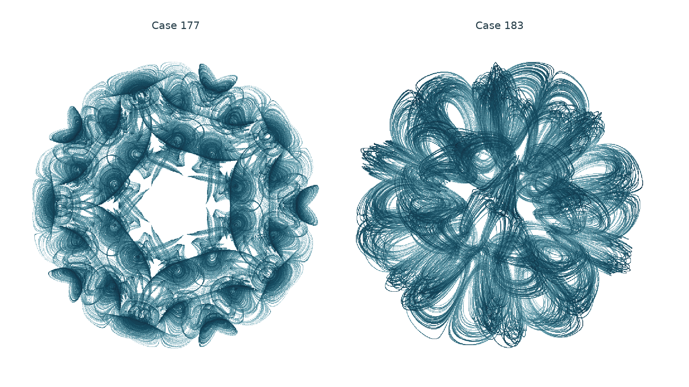

<!-- drawing-date -->
*First recorded portrait: **2026-11-01**.*
<!-- /drawing-date -->

Full three-state coordinates; archived orthographic cameras.

**Numerical chaos; certified bounds and local equilibria.** A smooth three-state field produces thirty spiral regions around a stable center. Cases 177 and 183 survive 16,000-unit observations, step refinement and independent integration. The 60-edge geometric skeleton has a known integrable counterpart; the sampled return strips are not yet a covering proof.

[Equations and evidence](docs/icosahedral-flow.md) · [Equilibria](docs/icosahedral-structure.md) · [Periodic orbits](docs/icosahedral-cycles.md) · [Return map and prior art](docs/icosahedral-returns.md)

## Numerical algorithms

### RAAR projection algorithm

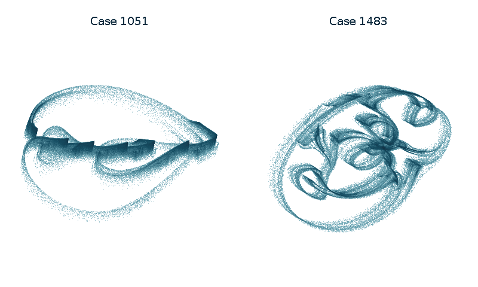

<!-- drawing-date -->
*First recorded portrait: **2026-11-01**.*
<!-- /drawing-date -->

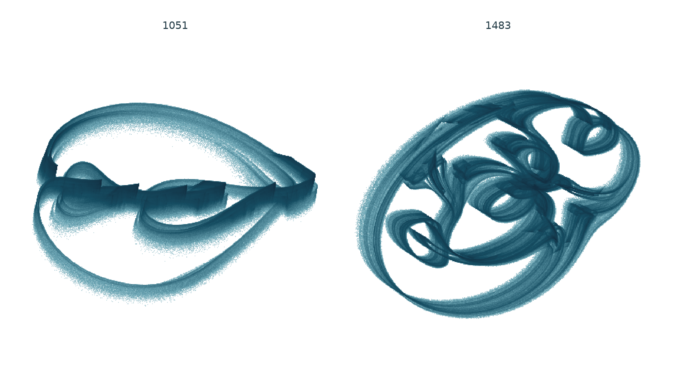

<!-- drawing-date -->
*First recorded portrait: **2026-11-01**.*
<!-- /drawing-date -->

Full spatial state (x, y, z); archived orthographic cameras.

**Certified attracting positive-entropy set.** For case 1051, an explicit strict trapping region contains the certified symbolic dynamics. Its maximal invariant set attracts a neighborhood and has topological entropy at least `log(2)/49` per iteration. A certified fold in this attracting set excludes ambient-neighborhood conjugacy to locally injective maps. Transitivity and equality with the numerical portrait remain unresolved; case 1483 is a numerical companion.

[Trapping theorem and article](docs/raar-trapping.md) · [Fold membership and article](docs/raar-critical-membership.md) · [Symbolic certificate](docs/raar-symbolic-dynamics.md) · [Model and trajectories](docs/raar-circles.md) · [Prior art](docs/raar-priority.md)

### Circle and finite-point projections

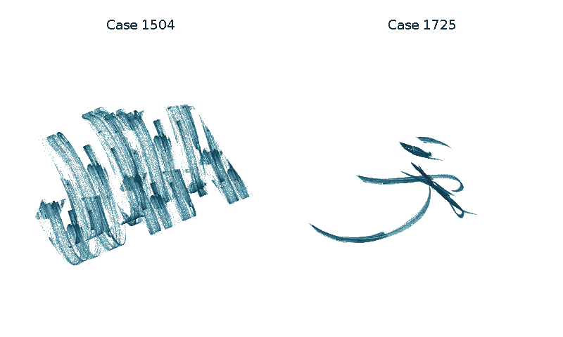

<!-- drawing-date -->
*First recorded portrait: **2026-11-01**.*
<!-- /drawing-date -->

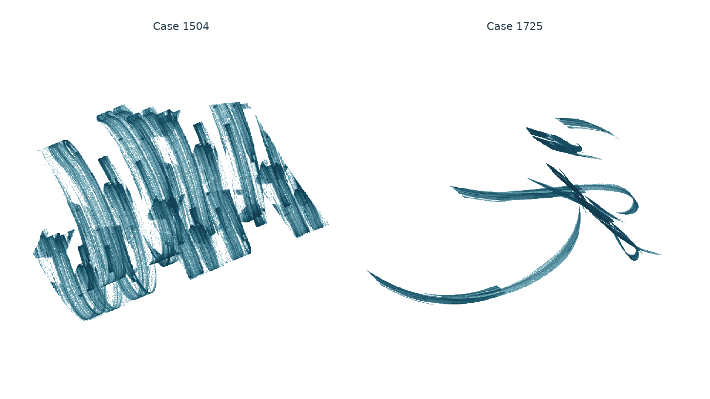

<!-- drawing-date -->
*First recorded portrait: **2026-11-01**.*
<!-- /drawing-date -->

Full three-state iterates; rigid camera and equal spatial units within each panel.

**Numerical candidates with layered spatial structure.** A circle and a finite set of points produce separated curved sheets in the three-state RAAR iteration. Cases 1504 and 1725 survive five-million-step observations, 33 initial states and 70/100-digit checks. Both use three sites in the observed post-transient motion. Finite-alphabet phase retrieval and projection-map chaos are known; historical uniqueness of these configurations remains unresolved.

[Model, controls and prior art](docs/raar-constellations.md)

### Acceleration memory in a scalar iteration

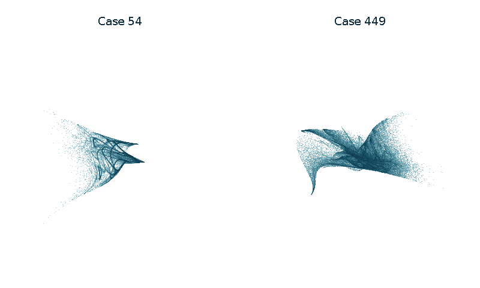

<!-- drawing-date -->
*First recorded portrait: **2026-11-01**.*
<!-- /drawing-date -->

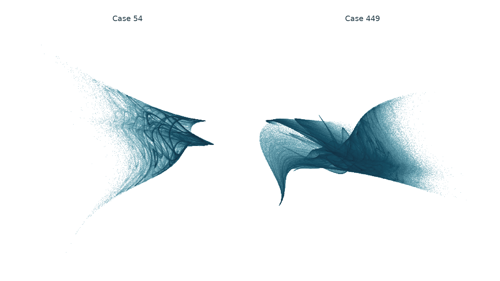

<!-- drawing-date -->
*First recorded portrait: **2026-11-01**.*
<!-- /drawing-date -->

Three-history state; archived orthographic cameras.

**Numerical chaos with a convergent scalar baseline.** The unaccelerated maps have interval-verified unique fixed points and globally convergent iteration. Adding regularized three-history acceleration produces irregular memory states that persist under 80- and 110-digit checks.

[Model, controls and limitations](docs/anderson-memory.md) · [Reproduction](research/unexpected_search/README.md)

### Adaptive integration of a decaying oscillator

<!-- drawing-date -->
*First recorded portrait: **2026-11-01**.*
<!-- /drawing-date -->

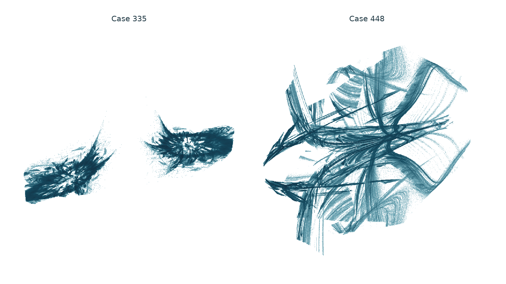

<!-- drawing-date -->
*First recorded portrait: **2026-11-01**.*
<!-- /drawing-date -->

Position / atol, velocity / atol, proposed step; archived orthographic cameras.

**Numerical chaos in the solver state.** The physical linear oscillator decays, while RK45's position, velocity and proposed step can remain irregular near the error tolerance. Five-million-step, high-precision and unmodified-library controls agree. RK23 has related retained regimes.

[RK45 results](docs/rk45-oscillator.md) · [RK23 results](docs/rk23-oscillator.md) · [RK45 manuscript](docs/rk45-controller/manuscript.md) · [Prior art](docs/rk45-priority.md)

### Optimizer memory on a scalar quadratic

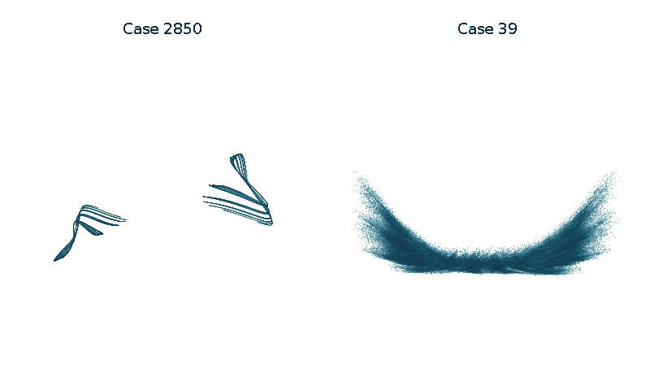

<!-- drawing-date -->
*First recorded portrait: **2026-11-01**.*
<!-- /drawing-date -->

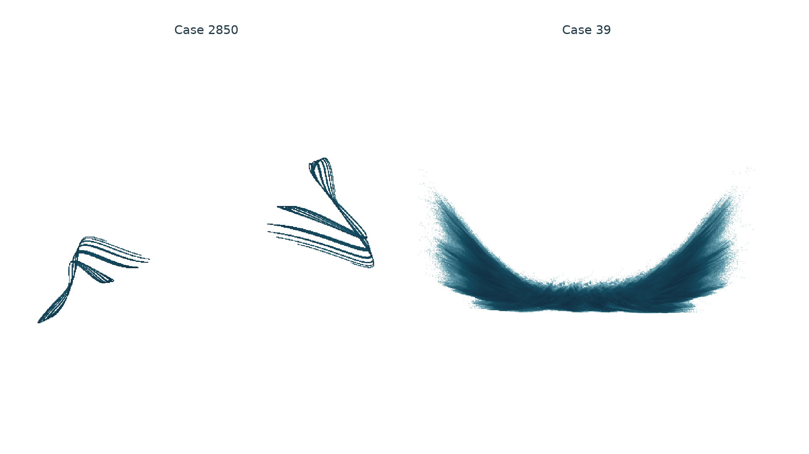

<!-- drawing-date -->
*First recorded portrait: **2026-11-01**.*
<!-- /drawing-date -->

Normalized optimizer state (x, m, v); archived orthographic cameras.

**Numerical evidence for two expanding directions.** The published tanh variant of Yogi retains two positive growth rates in selected regimes under five-million-step, high-precision and TensorFlow checks. Separate results cover standard Yogi, Adamax and AdaBelief. These are regimes of existing algorithms.

[Smooth Yogi](docs/yogi-tanh.md) · [Manuscript](docs/yogi-memory/manuscript.md) · [Standard Yogi](docs/yogi-parameter-plane.md) · [Adamax](docs/adamax-geometry.md) · [AdaBelief](docs/adabelief-quadratic.md)

## Molecular-motor dynamics

### Four-row irregular motion

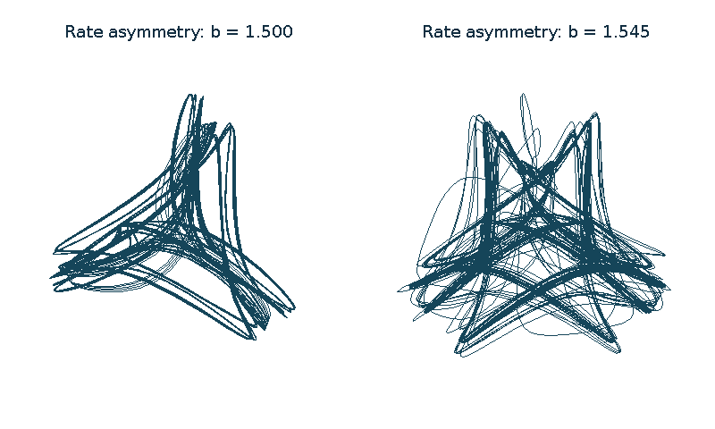

<!-- drawing-date -->
*First recorded portrait: **2026-11-01**.*
<!-- /drawing-date -->

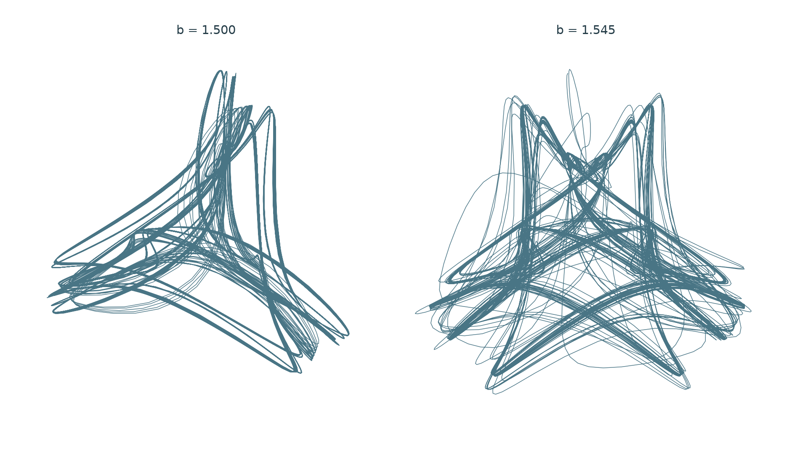

<!-- drawing-date -->
*First recorded portrait: **2026-11-01**.*
<!-- /drawing-date -->

Three orthonormal displacement contrasts; final 1,200 saved time units; common scale.

**Numerical chaos in an eleven-dimensional physical model.** Changing the dimensionless transition-rate asymmetry `b` changes a narrow braid into a broader regime. Long full-spectrum calculations retain a positive leading rate. The portraits show orthonormal displacement contrasts, not three-dimensional embeddings.

[Four-row comparison](docs/motor-four-b-study.md) · [Five-row geometry](docs/motor-five-geometry.md) · [Source equations](docs/motor-rows-source-audit.md)

### Eight-row periodic attraction

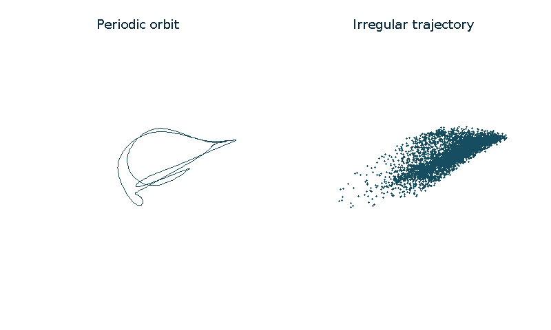

<!-- drawing-date -->
*First recorded portrait: **2026-10-30** · Current rendering: 2026-11-01.*
<!-- /drawing-date -->

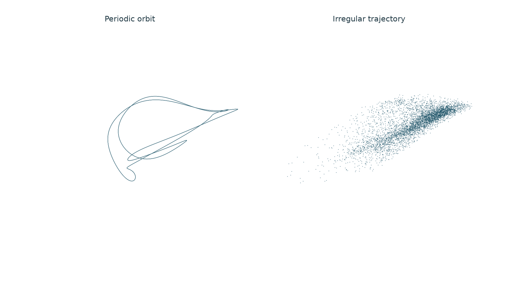

<!-- drawing-date -->
*First recorded portrait: **2026-10-30** · Current rendering: 2026-11-01.*
<!-- /drawing-date -->

Physical coordinates (X0, X1, s0) of the 23D model; common scale.

**Certified periodic attraction in 23 dimensions.** At the stated exact parameters, a five-cluster periodic orbit has all 22 transverse Floquet multipliers inside the unit circle. The irregular comparison has six positive finite-time exponents over 20,000 units. The two panels show the same physical projection and scale; only the periodic attractor is certified.

[Periodic-attractor certificate](docs/motor-five-cycle-certificate.md) · [Replication instability](docs/motor-five-replication-limit.md) · [Irregular regimes](docs/motor-activity-continuation.md)

## Further portraits

Additional numerical candidates and comparison regimes, grouped by system. Each entry links to its evidence and limitations.

### Constructed systems

#### Tetrahedral Gaussian flow

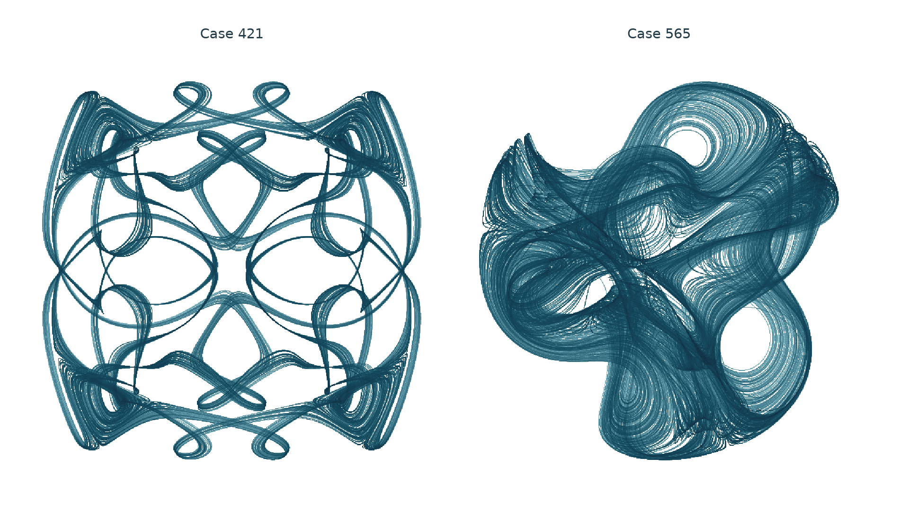

<!-- drawing-date -->
*First recorded portrait: **2026-11-01**.*
<!-- /drawing-date -->

Cases 421 and 565 have a stable central equilibrium and sustained irregular outer motion. Three-dimensional tetrahedral chaos is established prior work.

Full three-state coordinates; archived orthographic cameras.

[Report](docs/tetrahedral-flow.md)

#### Localized Gaussian vortices

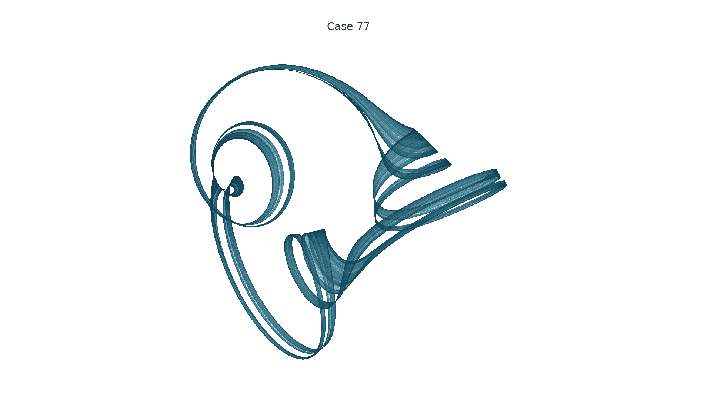

<!-- drawing-date -->
*First recorded portrait: **2026-11-01**.*
<!-- /drawing-date -->

Case 77 survives a 30,000-unit spectrum and independent integration. A competing periodic orbit and resemblance to known threefold geometries limit interpretation.

Full three-state coordinates; archived orthographic camera.

[Report](docs/gaussian-vortex.md)

#### Dissipative three-axis twist map

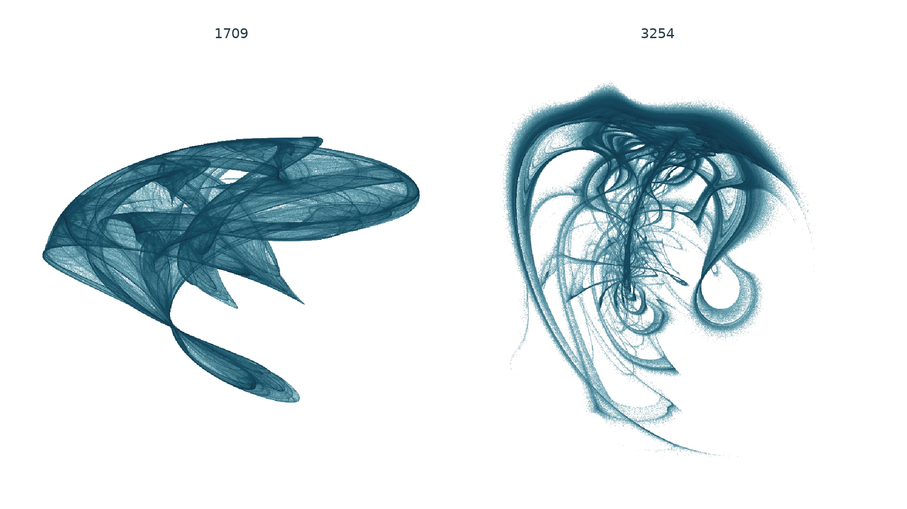

<!-- drawing-date -->
*First recorded portrait: **2026-11-01**.*
<!-- /drawing-date -->

Cases 1709 and 3254 retain positive finite-time growth under long and high-precision controls. The first case also has a regular regime.

Full three-state coordinates; archived orthographic cameras.

[Report](docs/twist-geometry.md)

### Algorithmic dynamics

#### Finite-point RAAR: fragmented columns and sheets

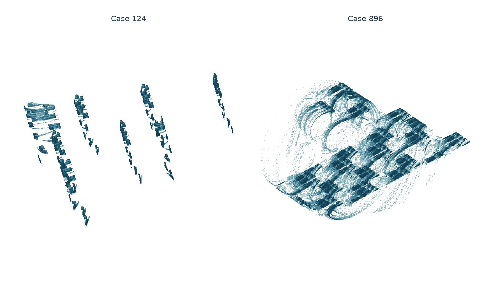

<!-- drawing-date -->
*First recorded portrait: **2026-11-01**.*
<!-- /drawing-date -->

Numerical candidates in a known projection algorithm. Five-million-step observations and 33-start cohorts retain positive finite-time growth. Finite-alphabet phase retrieval is established prior art; historical uniqueness remains open.

Full three-state iterates, centered and rigidly rotated. Equal spatial units within each panel; independent scales. Two million consecutive states per static portrait.

[Report and prior art](docs/raar-constellations.md)

#### Finite-point RAAR: fans and sparse branches

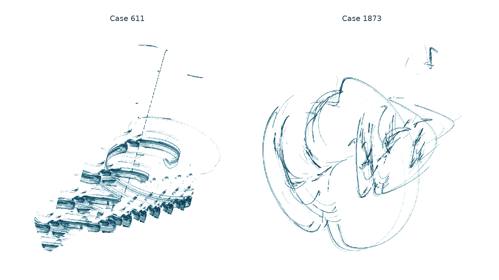

<!-- drawing-date -->
*First recorded portrait: **2026-11-01**.*
<!-- /drawing-date -->

Numerical candidates in a known projection algorithm. Five-million-step observations and 33-start cohorts retain positive finite-time growth. Finite-alphabet phase retrieval is established prior art; historical uniqueness remains open.

Full three-state iterates, centered and rigidly rotated. Equal spatial units within each panel; independent scales. Two million consecutive states per static portrait.

[Report and prior art](docs/raar-constellations.md)

#### RK23 step-size controller

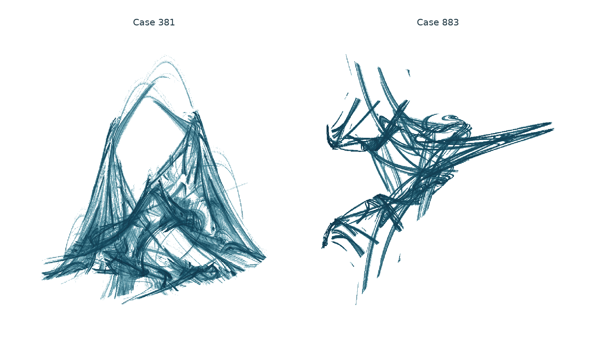

<!-- drawing-date -->
*First recorded portrait: **2026-11-01**.*
<!-- /drawing-date -->

The physical linear oscillator decays. The adaptive solver has a persistent irregular internal state near its error tolerance, reproduced with the original library and high-precision arithmetic.

Position / atol, velocity / atol, proposed step; archived orthographic cameras.

[Report](docs/rk23-oscillator.md)

#### Yogi parameter-plane candidate

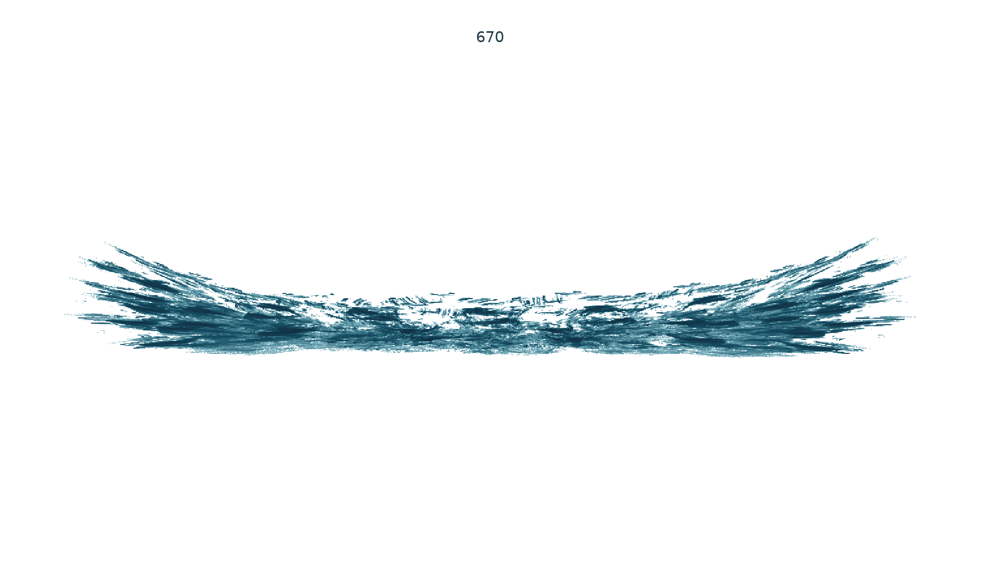

<!-- drawing-date -->
*First recorded portrait: **2026-11-01**.*
<!-- /drawing-date -->

Case 670 is retained after five million steps and independent controls. Case 125 has stronger evidence for a second expanding direction; their rates remain finite-time quantities.

Normalized optimizer state (x, m, v); archived orthographic camera.

[Report](docs/yogi-parameter-plane.md)

#### Yogi memory

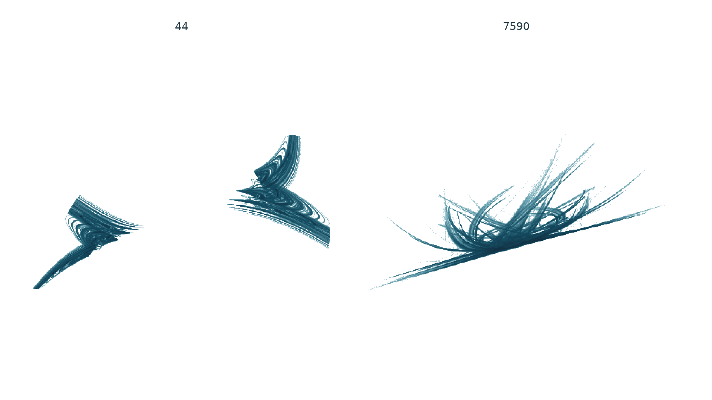

<!-- drawing-date -->
*First recorded portrait: **2026-11-01**.*
<!-- /drawing-date -->

Cases 44 and 7590 are visually distinct numerical regimes of the same published optimizer. Initialization and precision controls are retained in the report.

Normalized optimizer state (x, m, v); archived orthographic cameras.

[Report](docs/yogi-geometry.md)

#### Yogi: additional expanding regimes

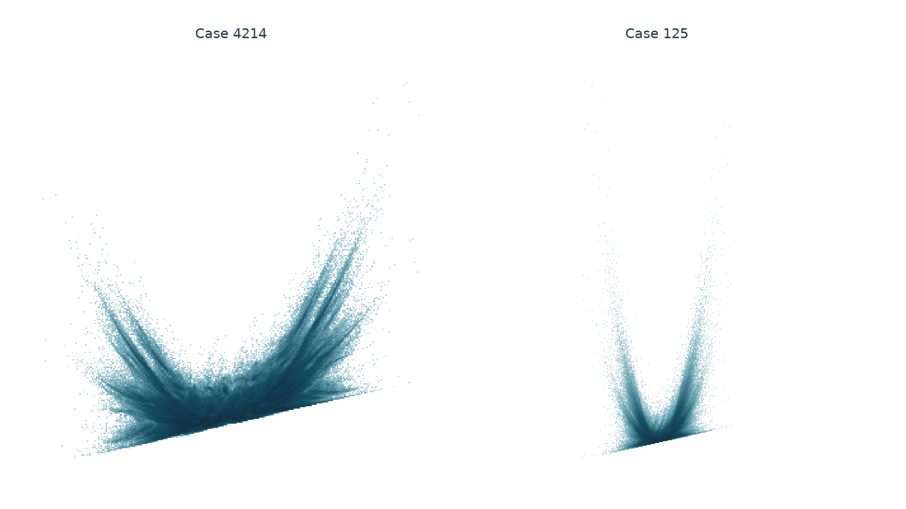

<!-- drawing-date -->
*First recorded portrait: **2026-11-01**.*
<!-- /drawing-date -->

Cases 4214 and 125 have numerical evidence for two expanding directions. Window lengths, library differences and branch discontinuities are reported separately.

Normalized optimizer states; archived preview cameras. Panels have separate scales.

[Report](docs/yogi-parameter-plane.md) · [Related result](docs/yogi-geometry.md)

#### Adamax memory

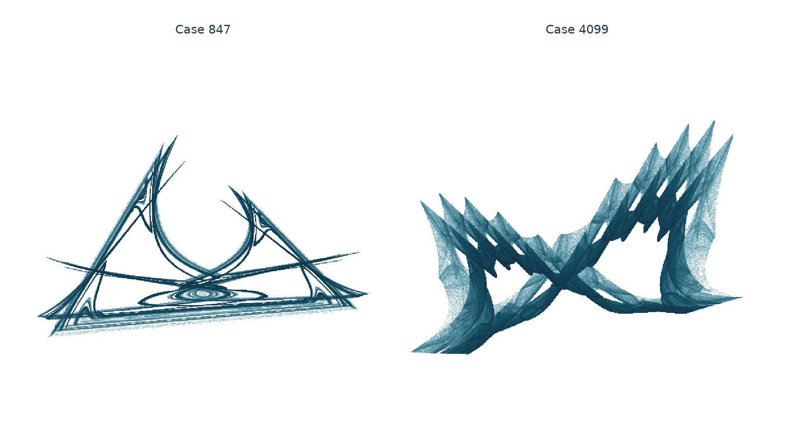

<!-- drawing-date -->
*First recorded portrait: **2026-11-01**.*
<!-- /drawing-date -->

Four-million-step, high-precision and PyTorch controls support the selected regimes. Case 4099 coexists with two reflected periodic orbits.

Normalized optimizer state; archived orthographic cameras.

[Report](docs/adamax-geometry.md)

#### AdaBelief memory

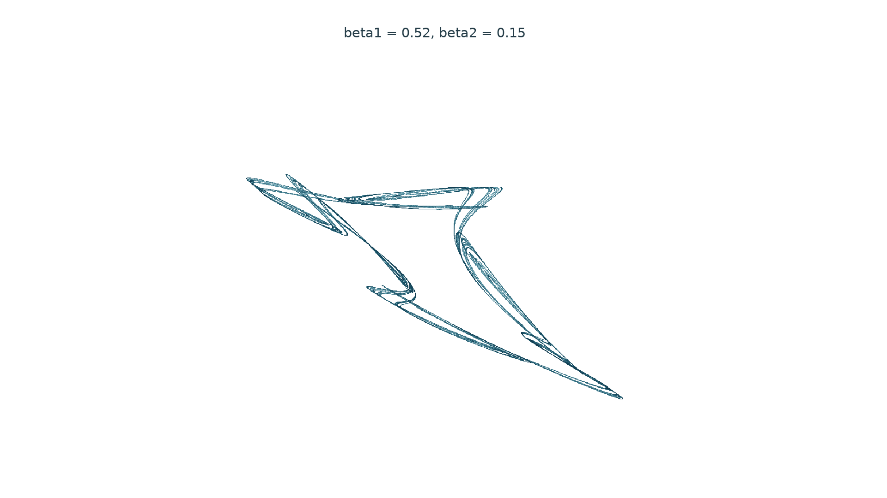

<!-- drawing-date -->
*First recorded portrait: **2026-11-01**.*
<!-- /drawing-date -->

A scalar quadratic objective supports irregular full optimizer states at the selected memory parameters. Finite-time numerical evidence is separated from convergence and novelty claims.

Normalized state (x, m, s); equal displayed coordinate units.

[Report](docs/adabelief-quadratic.md)

#### Finite-sample FastICA

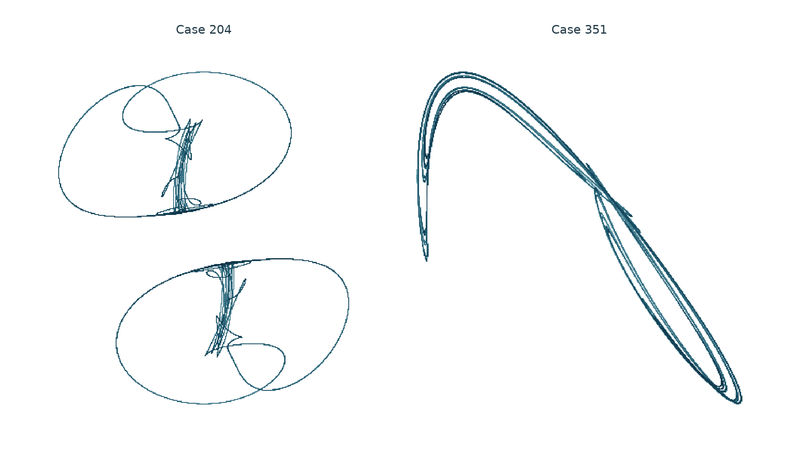

<!-- drawing-date -->
*First recorded portrait: **2026-11-01**.*
<!-- /drawing-date -->

Cases 204 and 351 retain positive finite-time tangent growth over five million
steps and at 70 and 100 digits. Case 351 has regular competing outcomes. These
are regimes of an established algorithm; historical priority and asymptotic
chaotic attraction remain unresolved.

Projection of the unit weight on $(w_1,w_2,w_4)$; every consecutive state is
retained. No sign folding. Spatial scale and density saturation differ between
panels. Case numbers identify the exact data sets in the report.

[Report and stopping-rule audit](docs/fastica-dynamics.md)

### Physical and biological models

#### Five motor rows

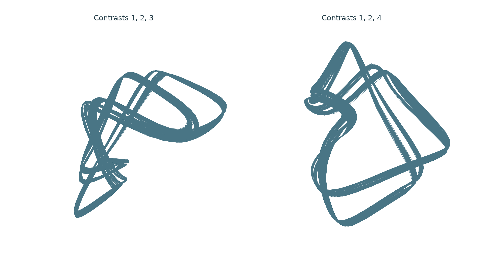

<!-- drawing-date -->
*First recorded portrait: **2026-11-01**.*
<!-- /drawing-date -->

The same saved fourteen-dimensional trajectory is shown in two projections of its four displacement contrasts. Neither view defines a three-dimensional embedding.

Fourier displacement contrasts; final 800 saved time units.

[Report](docs/motor-five-geometry.md)

#### Three motor rows with unequal rates

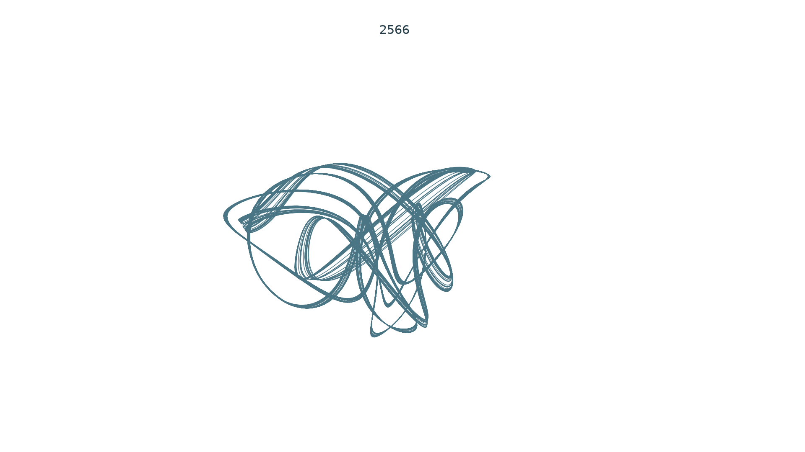

<!-- drawing-date -->
*First recorded portrait: **2026-10-31** · Current rendering: 2026-11-01.*
<!-- /drawing-date -->

Case 2566 is an eight-dimensional numerical candidate. The projection uses a fixed orthogonal rotation of the three cosine occupancies.

Rotated cosine occupancies; final 600 saved time units; stride 2.

[Report](docs/motor-asymmetry-geometry.md)

#### Three symmetric motor rows

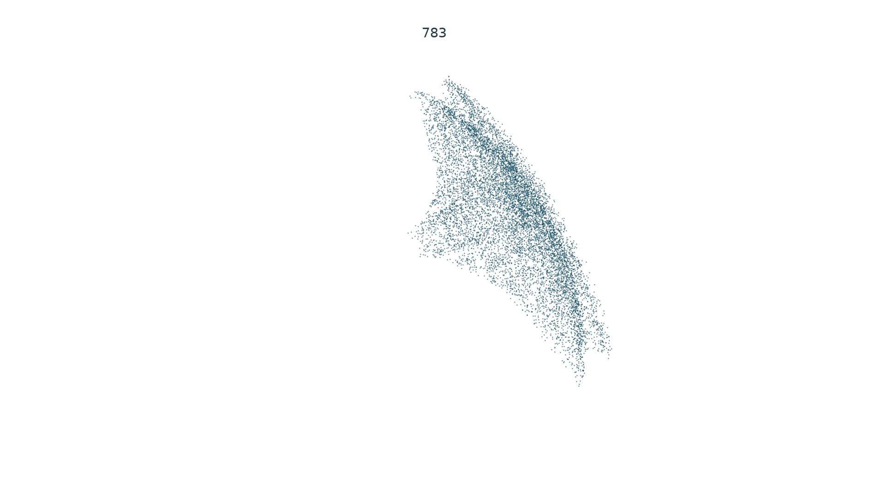

<!-- drawing-date -->
*First recorded portrait: **2026-10-30** · Current rendering: 2026-11-01.*
<!-- /drawing-date -->

Case 783 has an independently computed eight-dimensional spectrum with one positive and one near-zero rate. This image shows the three sine occupancies.

Sine occupancies (s0, s1, s2); a projection of the 8D flow.

[Report](docs/motor-rows-gpu-survey.md)

#### Motor-pair model

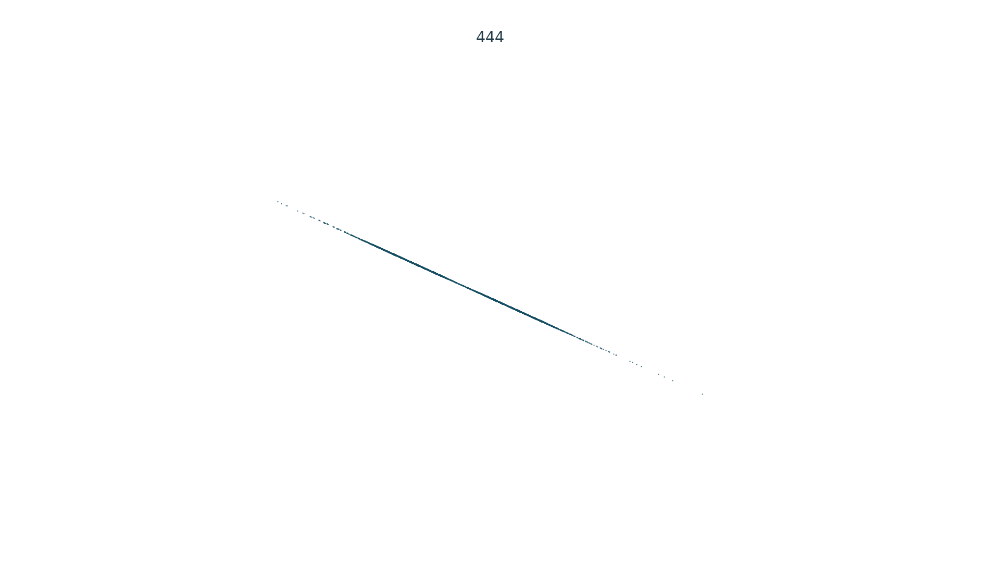

<!-- drawing-date -->
*First recorded portrait: **2026-10-30** · Current rendering: 2026-11-01.*
<!-- /drawing-date -->

Case 444 retains positive growth in a long independent CPU calculation. The neutral rate still needs convergence; priority and asymptotic attraction remain unresolved.

Physical coordinates (h, Y, Z); final 2,000 saved time units.

[Report](docs/motor-pair-gpu-survey.md)

#### Synchronematic oscillators

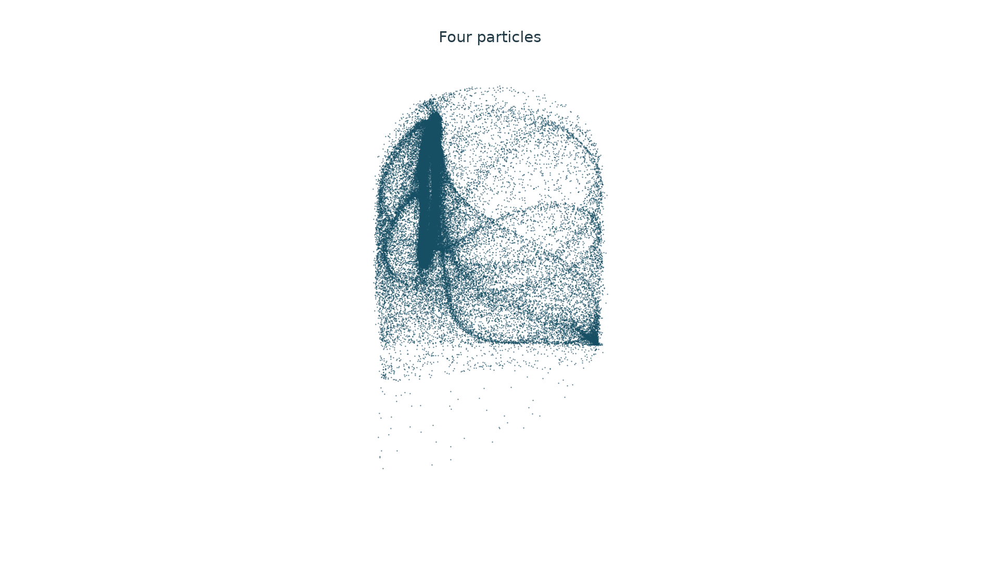

<!-- drawing-date -->
*First recorded portrait: **2026-10-29** · Current rendering: 2026-11-01.*
<!-- /drawing-date -->

The four-particle candidate is displayed through gauge-invariant collective observables. These do not form an embedding of the seven-dimensional reduced angular dynamics.

Collective observables (Re Q, Im Q, C), not state coordinates.

[Report](docs/synchronematic-research.md)

#### Light-driven elastomer slider

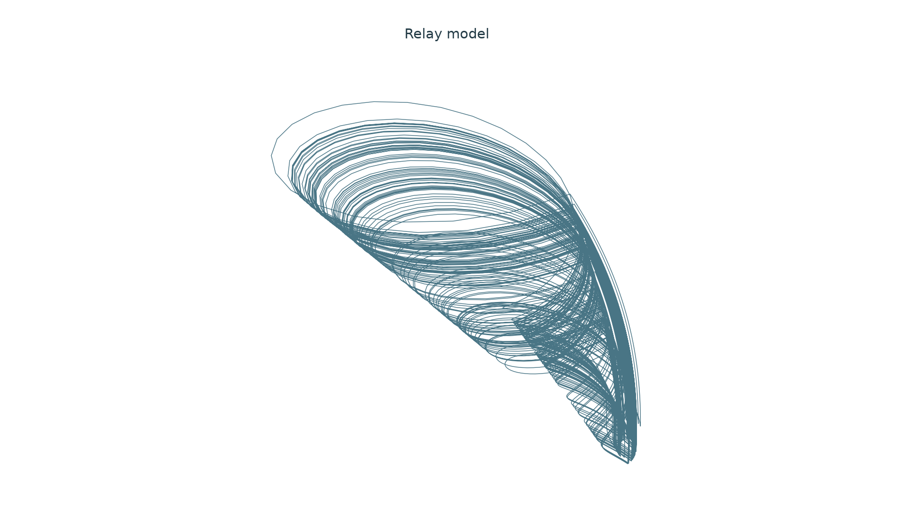

<!-- drawing-date -->
*First recorded portrait: **2026-10-29** · Current rendering: 2026-11-01.*
<!-- /drawing-date -->

The retained regime belongs to a three-state relay model. The report separates transverse growth estimates, switching assumptions and known related mechanisms.

Scaled full state (u/q, v/(sqrt(k) q), phi/q); scaling is explicitly physical.

[Report](docs/lce-slider-research.md)

#### Two-strain epidemic model

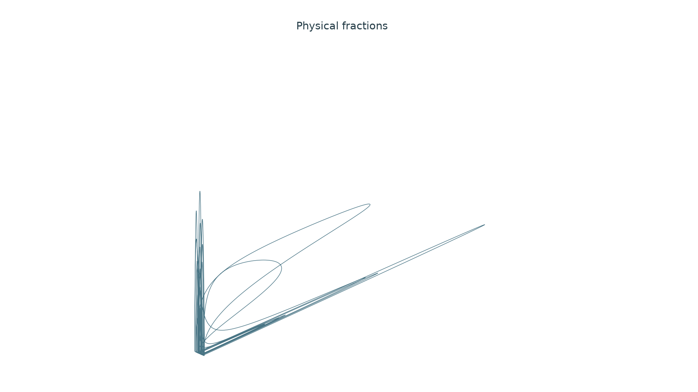

<!-- drawing-date -->
*First recorded portrait: **2026-10-30** · Current rendering: 2026-11-01.*
<!-- /drawing-date -->

The numerical five-state regime contains unequal outbreaks and extremely small prevalence. Related epidemic chaos is established; physical interpretation requires the qualifications in the report.

Projection (S, 1000 I1, 1000 I2); explicit axis units, not an embedding.

[Report](docs/two-strain-research.md)

#### Coupled optical operators

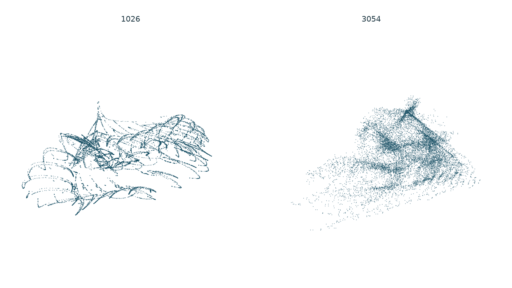

<!-- drawing-date -->
*First recorded portrait: **2026-10-29** · Current rendering: 2026-11-01.*
<!-- /drawing-date -->

These six-state relay histories have persistent irregular motion in the recorded observation. Later continuations, captures and source-model assumptions are retained in the report.

Projection (x_minus, x_plus, y_minus - y_plus); all saved adaptive event/QR knots. The knots are nonuniform in time. Point density is sampling density, not an invariant measure.

[Report](docs/coupled-operators-research.md)

#### Smooth optical feedback

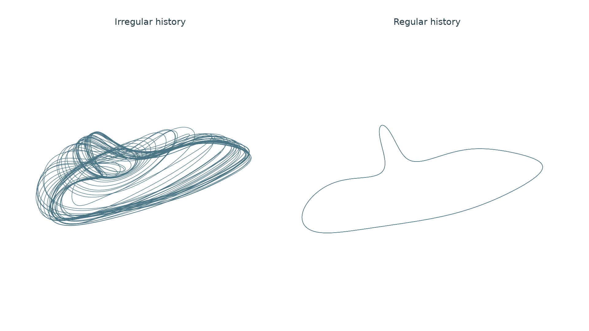

<!-- drawing-date -->
*First recorded portrait: **2026-10-29** · Current rendering: 2026-11-01.*
<!-- /drawing-date -->

At the same logistic-width parameters, saved starts produce regular and irregular histories. This is a finite coexistence observation, not an asymptotic attractor classification.

Projection (x_minus, x_plus, y_minus - y_plus); common scale.

[Report](docs/coupled-operators-research.md)

## Research index

This index covers the illustrated studies above, periodic captures, failed searches, source discrepancies and structural exclusions.

“Certified” refers to the particular interval or analytical statement in a report. Positive finite-time growth and a persistent point cloud are numerical evidence. Neither category establishes historical priority without a separate comparison.

### Constructed flows and maps

| System | Main result | Further evidence |
| --- | --- | --- |
| [Icosahedral Gaussian flow](docs/icosahedral-flow.md) | Numerical chaos; certified absorbing balls | [Equilibria](docs/icosahedral-structure.md), [numerical cycles](docs/icosahedral-cycles.md), [return proposal and known spherical skeleton](docs/icosahedral-returns.md) |
| [Tetrahedral Gaussian flow](docs/tetrahedral-flow.md) | Numerical chaos around a stable center | [Equilibrium certificates](docs/tetrahedral-equilibria.md), [1995 predecessor](docs/tetrahedral-homoclinic-prior.md), [earlier literature audit](docs/polyhedral-priority-followup.md) |
| [Localized Gaussian vortices](docs/gaussian-vortex.md) | Three-state numerical candidate | [Known-shape comparison](docs/attractor-novelty-audit.md) |
| [Dissipative twist map](docs/twist-geometry.md) | Two numerical geometries | [Mechanism and prior art](docs/twist-priority-and-mechanism.md) |

### Numerical algorithms

| System | Main result | Further evidence |
| --- | --- | --- |
| [Spatial-circle RAAR](docs/raar-circles.md) | Certified attracting positive-entropy set at R1051; numerical companion portraits | [Trapping certificate](docs/raar-trapping.md), [fold membership and equivalence obstruction](docs/raar-critical-membership.md), [Symbolic-dynamics certificate](docs/raar-symbolic-dynamics.md), [cycle structure](docs/raar-cycle-structure.md), [folding and preimages](docs/raar-folding.md), [exact structure](docs/raar-structure.md), [prior art](docs/raar-priority.md) |
| [Circle / finite-point RAAR](docs/raar-constellations.md) | Layered spatial numerical candidates; three active sites in the selected observations | [Complete survey and controls](results/raar-constellations/README.md), [known phase-retrieval connections](docs/raar-constellations.md#prior-art-and-equivalent-terms) |
| [Cyclic three-circle RAAR](docs/cyclic-raar-search.md) | Positive finite-time growth, but visually thin configurations | [Complete survey](results/cyclic-raar-search/README.md) |
| [Scalar acceleration memory](docs/anderson-memory.md) | Convergent plain iteration and irregular accelerated memory | [Search and controls](research/unexpected_search/README.md) |
| [Finite-sample FastICA](docs/fastica-dynamics.md) | Four numerical regimes; five-million-step spectra and independent precision controls; one rejected long transient | [Portrait and stopping-rule audit](docs/fastica-dynamics.md), [complete evidence](results/fastica/README.md), [reproduction](research/fastica/README.md) |
| [RK45](docs/rk45-oscillator.md), [RK23](docs/rk23-oscillator.md) | Irregular adaptive-controller states for a decaying oscillator | [RK45 structure](docs/rk45-controller-structure.md), [RK23 structure](docs/rk23-controller-structure.md), [RK45 prior art](docs/rk45-priority.md), [RK23 prior art](docs/rk23-priority.md) |
| [Smooth Yogi](docs/yogi-tanh.md) | Two positive finite growth rates in selected regimes | [Structure](docs/yogi-tanh-structure.md), [manuscript](docs/yogi-memory/manuscript.md) |
| [Yogi parameter plane](docs/yogi-parameter-plane.md) | Retained irregular regimes and regular windows | [Earlier cases](docs/yogi-geometry.md), [smoothing control](docs/yogi-smoothing-control.md), [boundedness theorem](docs/scalar-optimizer-boundedness.md), [prior art](docs/yogi-priority.md) |
| [Adamax](docs/adamax-geometry.md) | Irregular memory and competing cycles | [Structure](docs/adamax-structure.md), [prior art](docs/adamax-priority.md) |
| [AdaBelief](docs/adabelief-quadratic.md) | Numerical scalar-quadratic candidate | [AdaDelta cycle audit](docs/adadelta-cycle-audit.md) |

### Molecular motors

| Result | Evidence |
| --- | --- |
| Exact model and physical normalization | [Motor rows](docs/motor-rows-source-audit.md), [motor pair](docs/motor-pair-source-audit.md) |
| Certified periodic saddle and transverse crossing | [Cycle and least-period audit](docs/motor-cycle-certificate.md), [crossing](docs/motor-crossing-certificate.md), [implementation review](docs/motor-proof-review.md) |
| Certified paired periodic attractor and later saddle | [Paired attractor](docs/motor-paired-certificate.md), [crossing](docs/motor-paired-crossing-certificate.md), [saddle](docs/motor-saddle-certificate.md), [postcritical observations](docs/motor-postcritical.md) |
| Certified five-cluster periodic attraction | [Certificate](docs/motor-five-cycle-certificate.md), [replication limit](docs/motor-five-replication-limit.md), [branch observations](docs/motor-cluster-cycle-branch.md) |
| Numerical irregular geometry | [Four rows](docs/motor-four-geometry.md), [rate-parameter slice](docs/motor-four-b-study.md), [five rows](docs/motor-five-geometry.md), [three asymmetric rows](docs/motor-asymmetry-geometry.md) |
| Collective chaos and hyperchaos candidates | [Activity continuation](docs/motor-activity-continuation.md), [row-count survey](docs/motor-rows-gpu-survey.md), [activity path](docs/motor-rows-activity-path.md), [replication index](docs/motor-replication-index.md) |
| Coordinate and long-time controls | [Motor-pair survey](docs/motor-pair-gpu-survey.md), [physical coordinates](docs/motor-pair-coordinate-audit.md), [log contrasts](docs/motor-log-contrast-audit.md), [long departure](docs/motor-log-seventh-departure.md), [original seed](docs/motor-original-seed-log.md) |
| Additional structural work | [Cluster transverse modes](docs/motor-cluster-transverse.md), [network combinatorics](docs/motor-network-combinatorics.md), [excluded tuple](docs/motor-tuple15-excluded.md) |

### Other physical and biological models

| System | Result and qualifications |
| --- | --- |
| [Synchronematic oscillators](docs/synchronematic-research.md) | Numerical collective motion; [bifurcations](docs/synchronematic-bifurcations.md), [source and priority audit](docs/synchronematic-priority-audit.md) |
| [Elastomer slider](docs/lce-slider-research.md) | Relay-model candidate; [switching-width controls](docs/lce-slider-switching.md), [relay limit](docs/lce-slider-relay-limit.md) |
| [Two-strain epidemic model](docs/two-strain-research.md) | Numerical outbreak irregularity with extremely small prevalence |
| [Coupled optical operators](docs/coupled-operators-research.md) | Irregular histories and periodic captures; [lifetime extension](docs/optical-lifetime-extension.md), [cycle branch](docs/optical-cycle-continuation.md), [arclength continuation](docs/optical-cycle-arclength.md), [saddle departure](docs/optical-saddle-departure.md) |
| Optical model interpretation | [Heat-balance source audit](docs/light-operators-audit.md), [restricted exclusion theorem](docs/coupled-operators-order-audit.md), [known feedback equivalence](docs/coupled-operators-priority-audit.md) |

### Negative, incomplete and excluded searches

These studies are retained to document tested mechanisms and prevent repeated false positives. An incomplete integration is not a negative result.

| System | Outcome or unresolved issue |
| --- | --- |
| [NIFTE thermofluidic engine](docs/nifte-research.md) | Periodic controls and unresolved chaos claims; [physical audit](docs/nifte-physical-priority-audit.md) |
| [Rayleigh spring pair](docs/rayleigh-pair-research.md) | Long transients and weak instability; [structural derivation](docs/rayleigh-pair-structure.md) |
| [HHS mechanochemical cell](docs/hhs-research.md) | Periodic and neutral controls; [source audit](docs/hhs-source-audit.md) |
| [Urease reactor](docs/urease-research.md) | No promoted chaotic attractor |
| [Long-cavity whistle](docs/whistle-screen.md) | No retained chaos among 514 declared trajectories |
| [Ice-cloud microphysics](docs/ice-cloud-screen.md) | Weak signals resolve to numerical cycles |
| [Core–shell gel](docs/core-shell-gel-research.md) | Stiff cases; one endpoint resolves to a [stable periodic orbit](docs/core-shell-gel-stiff-followup.md) |
| [Rigid microfluidic network](docs/microfluidic-research.md) | Published periodic control not recovered; [supplement audit](docs/microfluidic-source-audit.md) |
| [Contact rotors](docs/dcr-research.md) | Continuation ambiguity at strict event boundaries; [source audit](docs/dcr-source-audit.md) |
| [Pulsating heat pipe](docs/heat-pipe-source-audit.md) | Complete source closure unavailable |
| [Solar-array flutter](docs/thermal-flutter-source-audit.md) | Reduced model not uniquely specified by retrieved material |
| [Mineral protocells](docs/mineral-protocell-screening.md) | Planarity or monotone growth excludes the proposed route |
| Further source and structural screens | [Candidate queue](docs/candidate-queue.md), [material memory](docs/material-memory-screening.md), [physical meminductor](docs/meminductor-followup-audit.md), [thermal sheet](docs/thermomechanical-sheet-audit.md), [epithelial chain](docs/epithelial-chain-audit.md) |

### Archive

[All report files](docs) · [Result directories](results/README.md) · [Sources and checks](RECORDS.md) · [Dependency notices](THIRD_PARTY_NOTICES.md)

Portraits use a common rendering convention and declared coordinates. Dates refer to our drawings, not discovery priority. [Figure records](tools/README-portraits.md) · [License](LICENSE)
