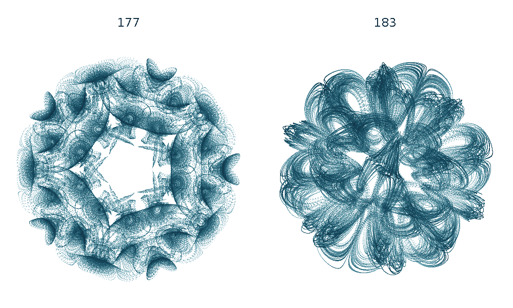
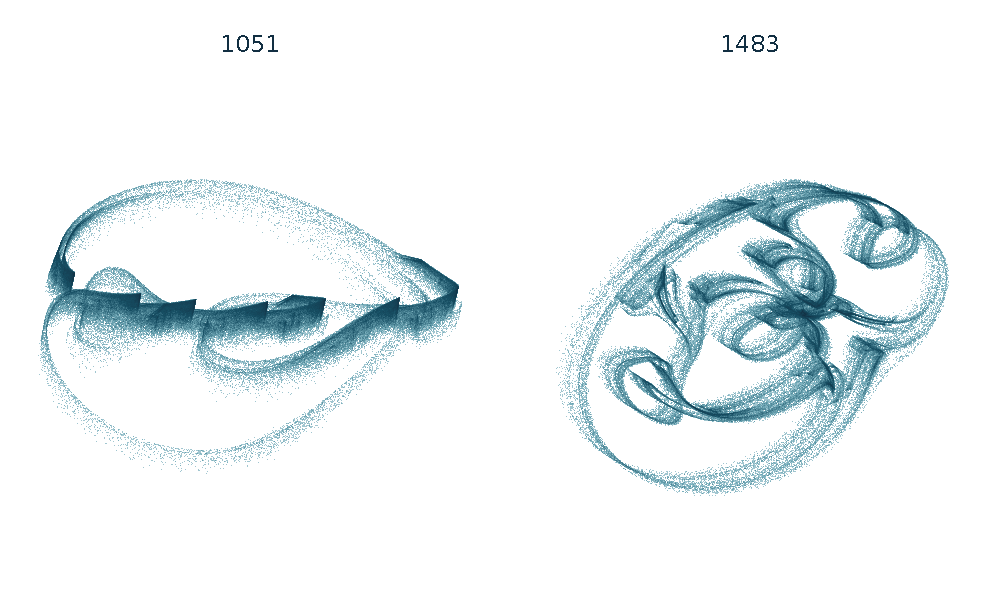
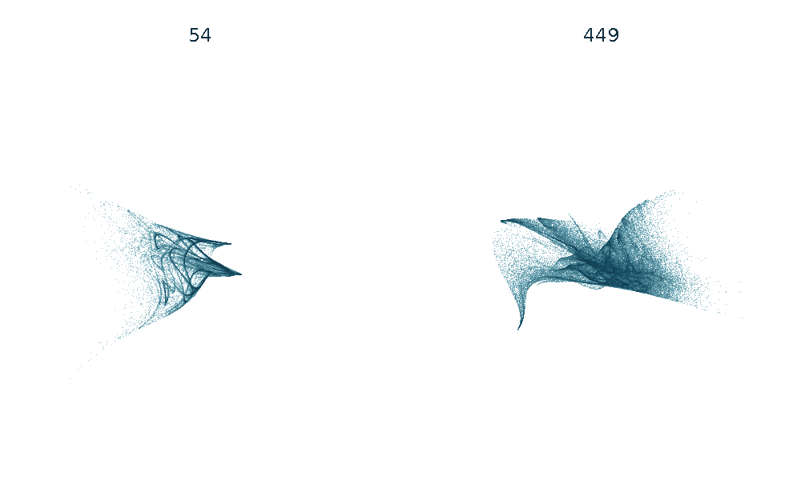
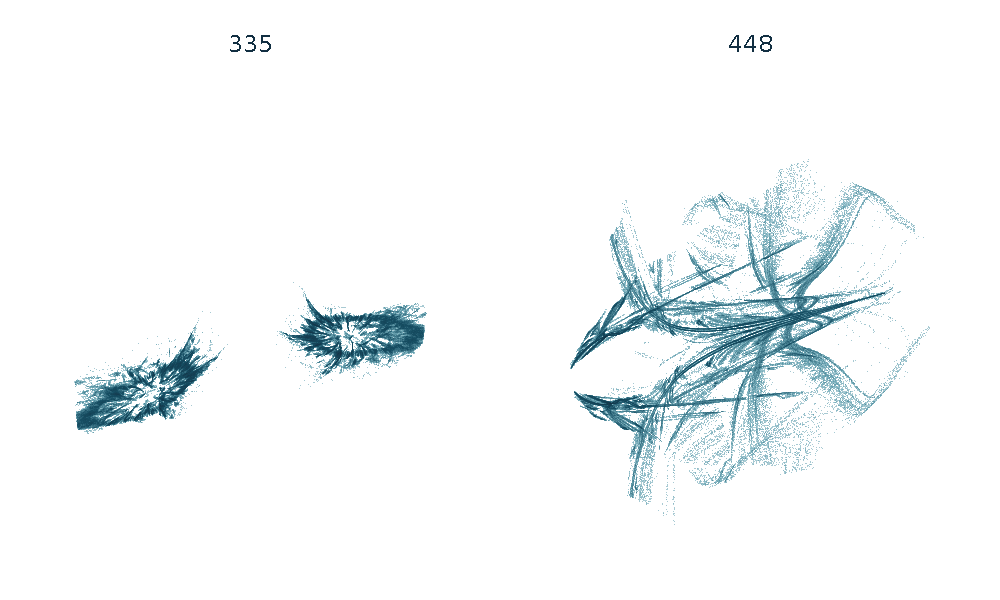
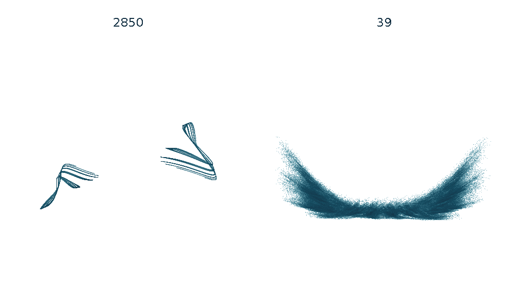
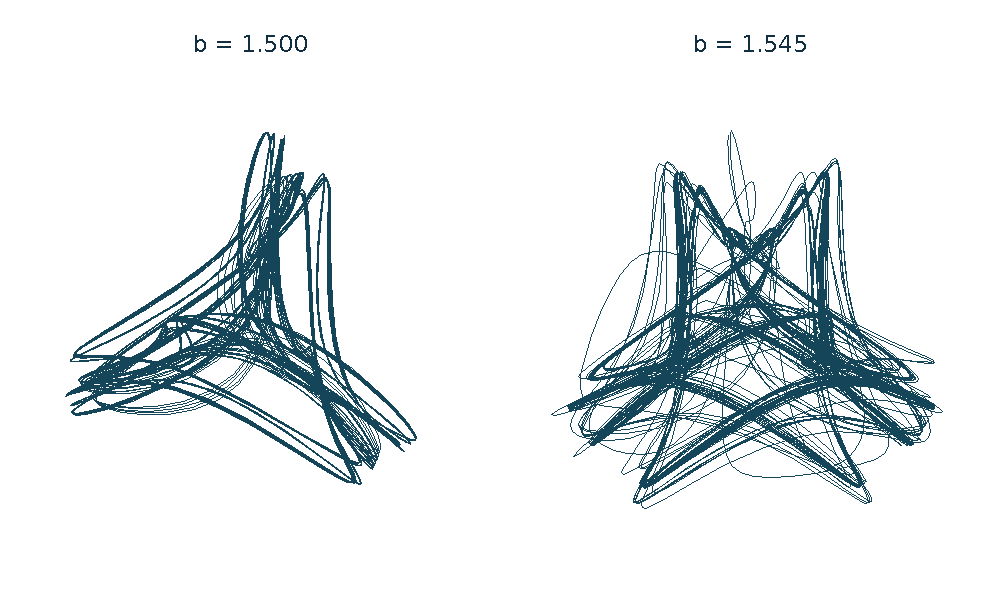
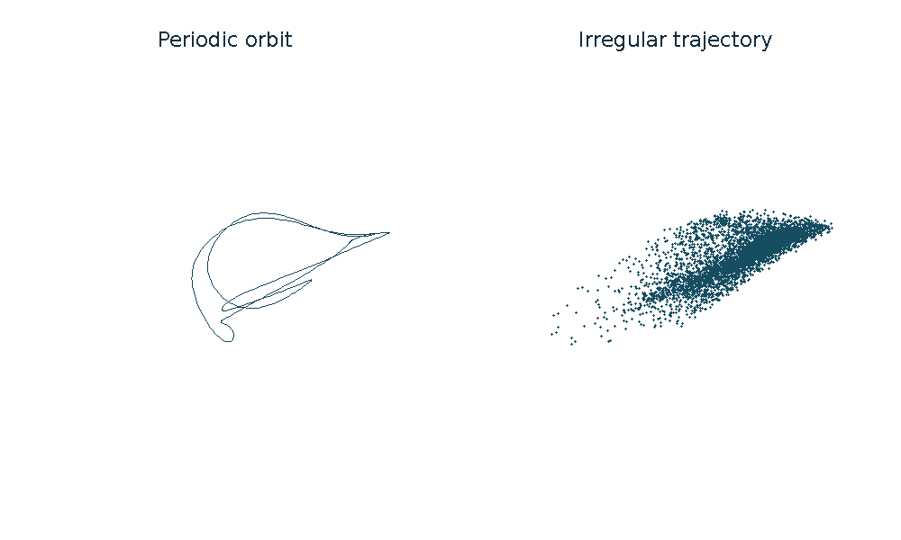

# Chaos Attractor Lab

Computational studies of unusual attracting dynamics in continuous systems and numerical algorithms. The repository separates **certified dynamical properties**, **numerical chaos candidates**, and **unresolved or negative results**. Historical novelty is not established by visual appearance or by an unsuccessful literature search.

[Portrait gallery](docs/attractor-gallery.md) · [Research index](docs/research-index.md) · [Reproduction](docs/reproduction.md) · [Data](results/README.md)

The portraits rotate once every 24.48 seconds. Each view uses fixed trajectory data and a constant scale; links below open the static portraits.

## Constructed flows

### Icosahedral flow

<!-- drawing-date -->
*First recorded portrait: **2026-11-01**.*
<!-- /drawing-date -->

[Static portrait](docs/assets/portraits/icosahedral.png)

**Numerical chaos; certified bounds and local equilibria.** A smooth three-state field produces thirty spiral regions around a stable center. Cases 177 and 183 survive 16,000-unit observations, step refinement and independent integration. The 60-edge geometric skeleton has a known integrable counterpart; the sampled return strips are not yet a covering proof.

[Equations and evidence](docs/icosahedral-flow.md) · [Equilibria](docs/icosahedral-structure.md) · [Periodic orbits](docs/icosahedral-cycles.md) · [Return map and prior art](docs/icosahedral-returns.md)

## Numerical algorithms

### RAAR projection algorithm

<!-- drawing-date -->
*First recorded portrait: **2026-11-01**.*
<!-- /drawing-date -->

[Static portrait](docs/assets/portraits/raar.png)

**Certified symbolic dynamics.** For case 1051, interval covering relations establish a compact invariant set with topological entropy at least `log(2)/49` per iteration. A least-period-49 saddle is certified separately. Attraction of the symbolic set remains unproved; the second portrait is a numerical companion.

[Theorem and certificates](docs/raar-symbolic-dynamics.md) · [Manuscript](papers/raar-symbolic-dynamics/manuscript.pdf) · [Model and trajectories](docs/raar-circles.md) · [Prior art](docs/raar-priority.md)

### Acceleration memory in a scalar iteration

<!-- drawing-date -->
*First recorded portrait: **2026-11-01**.*
<!-- /drawing-date -->

[Static portrait](docs/assets/portraits/anderson.png)

**Numerical chaos with a convergent scalar baseline.** The unaccelerated maps have interval-verified unique fixed points and globally convergent iteration. Adding regularized three-history acceleration produces irregular memory states that persist under 80- and 110-digit checks.

[Model, controls and limitations](docs/anderson-memory.md) · [Reproduction](research/unexpected_search/README.md)

### Adaptive integration of a decaying oscillator

<!-- drawing-date -->
*First recorded portrait: **2026-11-01**.*
<!-- /drawing-date -->

[Static portrait](docs/assets/portraits/rk45.png)

**Numerical chaos in the solver state.** The physical linear oscillator decays, while RK45's position, velocity and proposed step can remain irregular near the error tolerance. Five-million-step, high-precision and unmodified-library controls agree. RK23 has related retained regimes.

[RK45 results](docs/rk45-oscillator.md) · [RK23 results](docs/rk23-oscillator.md) · [RK45 manuscript](papers/rk45-controller/manuscript.pdf) · [Prior art](docs/rk45-priority.md)

### Optimizer memory on a scalar quadratic

<!-- drawing-date -->
*First recorded portrait: **2026-11-01**.*
<!-- /drawing-date -->

[Static portrait](docs/assets/portraits/yogi-tanh.png)

**Numerical evidence for two expanding directions.** The published tanh variant of Yogi retains two positive growth rates in selected regimes under five-million-step, high-precision and TensorFlow checks. Separate results cover standard Yogi, Adamax and AdaBelief. These are regimes of existing algorithms.

[Smooth Yogi](docs/yogi-tanh.md) · [Manuscript](papers/yogi-memory/manuscript.pdf) · [Standard Yogi](docs/yogi-parameter-plane.md) · [Adamax](docs/adamax-geometry.md) · [AdaBelief](docs/adabelief-quadratic.md)

## Molecular-motor dynamics

### Four-row irregular motion

<!-- drawing-date -->
*First recorded portrait: **2026-11-01**.*
<!-- /drawing-date -->

[Static portrait](docs/assets/portraits/motor-four.png)

**Numerical chaos in an eleven-dimensional physical model.** Changing one transition-rate parameter changes a narrow braid into a broader regime. Long full-spectrum calculations retain a positive leading rate. The portraits show orthonormal displacement contrasts, not three-dimensional embeddings.

[Four-row comparison](docs/motor-four-b-study.md) · [Five-row geometry](docs/motor-five-geometry.md) · [Source equations](docs/motor-rows-source-audit.md)

### Eight-row periodic attraction

<!-- drawing-date -->
*First recorded portrait: **2026-10-30** · Current rendering: 2026-11-01.*
<!-- /drawing-date -->

[Static portrait](docs/assets/portraits/motor-eight.png)

**Certified periodic attraction in 23 dimensions.** At the stated exact parameters, a five-cluster periodic orbit has all 22 transverse Floquet multipliers inside the unit circle. The irregular comparison has six positive finite-time exponents over 20,000 units. The two panels show the same physical projection and scale; only the periodic attractor is certified.

[Periodic-attractor certificate](docs/motor-five-cycle-certificate.md) · [Replication instability](docs/motor-five-replication-limit.md) · [Irregular regimes](docs/motor-activity-continuation.md)

## Further results

The [gallery](docs/attractor-gallery.md) includes tetrahedral flows, localized vortices, twist maps, additional optimizer regimes and physical models. The [research index](docs/research-index.md) also retains periodic captures, failed searches, source discrepancies and structural exclusions.

Portraits use a common rendering convention and declared coordinates. Dates refer to our drawings, not discovery priority. [Figure provenance](tools/README-portraits.md) · [Original project provenance](PROVENANCE.md) · [License](LICENSE) · [Third-party notices](THIRD_PARTY_NOTICES.md)
