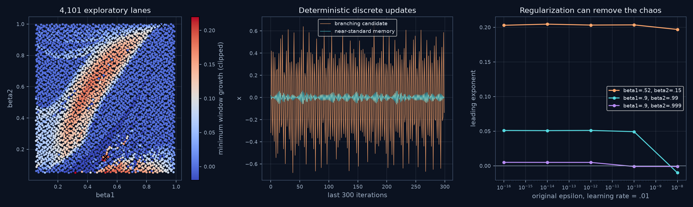

# Chaos inside a scalar optimizer

Status: 1 November 2026. **A different search direction has produced a well-checked numerical candidate: the internal state of AdaBelief while minimizing one strictly convex quadratic. Historical priority and a new topological attractor class are not established.** This is a discrete algorithm, not a new physical oscillator or a learned approximation to one.


The objective is only `f(theta) = theta^2 / 2`. The three coordinates are the parameter, gradient memory and prediction-error memory. The picture therefore shows the complete autonomous state, with separate linear axis scales, rather than a projection of an eleven- or twenty-three-dimensional flow. Points are actual iterates, not interpolated curves. Color represents the error memory `s`. [Rotating view](assets/adabelief-rotation.gif).

## The change in approach

Previous searches began with published physical oscillators and asked whether their parameters conceal unusual dynamics. Here the starting question is structural: **can a rule intended to reduce error create its own expanding, folding dynamics when it remembers how trustworthy its corrections were?** The loss landscape is deliberately trivial, so all complexity must come from the update rule.

We use an existing algorithm with explicit options, not a new fitted nonlinear feedback law. AdaBelief compares the current gradient with its moving prediction and reduces the step when they disagree [1]. The selected options are `rectify=False`, `amsgrad=False`, and zero weight decay. **Rectification is enabled by default in the pinned 0.2.1 author code. Our candidate is in its supported nonrectified branch, not the default package configuration.** The primary memory coefficients are also atypical.

## Exact model and selected parameters

For learning rate `alpha=0.01`, original `epsilon=1e-16`, and `f(theta)=theta^2/2`, set

```math
x=\theta/\alpha,\qquad m=M/\alpha,\qquad s=S/\alpha^2,
\qquad e=\epsilon/\alpha^2=10^{-12},\qquad d=\epsilon/\alpha=10^{-14}.
```

The autonomous limit of the bias-corrected algorithm is

```math
m^+=b m+(1-b)x,\qquad
s^+=c s+(1-c)(x-m^+)^2+e,\qquad
x^+=x-\frac{m^+}{\sqrt{s^+}+d}.
```

The `epsilon` inside the memory recurrence is retained. Removing it, moving it inside a different square root, using the previous rather than updated `m`, or enabling rectification changes the system. The initial normalized state is `(0.73,0,0)`, corresponding to `theta=0.0073` and zero optimizer memories. The primary parameters are `b=0.52, c=0.15`.

Bias-corrected cold starts were checked separately, including actual execution of the pinned upstream PyTorch class. That class continues to apply both corrections throughout the run. The main long-run spectra concern the autonomous map. No ODE solver, integration step, stochastic gradient, random perturbation, clipping or projection is used in these trajectories. Randomness only specifies the recorded parameter/start designs.

## What survived verification

Each long run has 20,000 warm-up iterations followed by 2,000,000 observed iterations, with every-step full-state QR and 200 consecutive windows of length 10,000.

| Memory coefficients `(b,c)` | Full finite-time spectrum, per iteration | Smallest leading window | Interpretation |
|---|---|---|---|
| `(0.52,0.15)` | `(0.20261076, -0.37937983, -2.37427738)` | `0.19346377` | Selected branching candidate |
| `(0.9,0.99)` | `(0.05102284, 0.00000045, -0.16643414)` | `0.04674725` | Persistent candidate; nearly neutral second rate remains unclassified |
| `(0.9,0.999)` | `(0.00509707, -0.00000147, -0.11145662)` | `0.00326253` | Weaker persistent candidate at common memory coefficients, with the stated nondefault options/learning rate |

For the primary candidate, every observed state lies within the **sampled** ranges

```text
x: [-0.68613655, 0.68613900]
m: [-0.28353775, 0.28353719]
s: [ 0.00809352, 0.14032124]
```

These are outward-rounded summaries of observed extrema, not a proved trapping box. The Lyapunov-dimension formula gives about `1.5341`; this is a finite-spectrum estimate, not a measured or certified fractal dimension. A full-state lag comparison finds no repeat within lags 1–4096: the smallest normalized RMS discrepancy is `0.1982` at lag 13, using 8,192 comparison states. Longer periods and later escape are not excluded.

Independent checks of the primary leading exponent are:

| Implementation/control | Observed iterations | Leading estimate |
|---|---:|---:|
| Compiled full three-direction QR | 2,000,000 | `0.202611` |
| Actual upstream PyTorch state updates, continuously bias corrected | 100,000 | `0.202065` |
| 70-decimal arithmetic, two renormalized nearby trajectories | 100,000 | `0.202785` |
| 90-decimal arithmetic, smaller trajectory separation | 100,000 | `0.203163` |

The high-precision calculations use original units, independent scalar recurrence evaluation and finite secants instead of the analytic Jacobian. Separations are `1e-25` and `1e-35` in normalized state units. All their 10,000-step leading windows are positive. Different long chaotic trajectories are compared statistically, not pointwise. These estimates are not confidence intervals.

The upstream code's state path is independent of our state evaluator; its reported tangent growth uses our separately checked limiting Jacobian. For `(0.52,0.15)`, bias-correction differences after the warm-up are negligible at the working precision. The first 25 corrected updates agree with the normalized implementation within `2.43e-14`. The independent NumPy/Householder and compiled/reorthogonalized Gram–Schmidt implementations agree on short state paths within `8.55e-15`. Complex-step differentiation at 400 declared parameter/state combinations gives maximum scaled Jacobian discrepancy `2.28e-15`.

## Broad screen, starts and negative results

The original design comprises 4,096 scrambled Sobol parameter points plus five declared controls. After 10,000 warm-up iterations, **1,804 of 4,101 lanes** exceed `0.005` in all four 5,000-step leading-growth windows. This is a short exploratory screen, not 1,804 discovered attractors. A replay with the published driver reproduces every stored parameter, window, endpoint and extremum array exactly.

For each of the two main candidates, 24 autonomous histories and eight bias-corrected-start histories were followed for 200,000 observed steps. All 32 histories per parameter pair retain positive growth in every observed window. The autonomous starts comprise eight zero-memory starts and sixteen arbitrary full-state starts. The cold starts contain sign-related pairs and are repeated under the two update modes; these are **not 32 independent basin samples**. In the primary case their sampled tails lie near the reference support: the largest 95th-percentile nearest-reference distance is `0.00160` in fixed range-normalized coordinates, versus `0.00145` for the reference split-sample control. This supports a common observed attracting regime, without proving a basin or uniqueness.

A 5-by-5 neighborhood with offsets `{-0.002,-0.001,0,0.001,0.002}` in each coefficient produces 24 of 25 persistent positive-window histories around the primary point and 25 of 25 around `(0.9,0.99)`. **The exception matters.** At `(0.522,0.15)`, the 100,000-step mean is still positive, but later windows are negative. Continuing its saved endpoint for another 20,000 warm-up plus 2,000,000 observed steps gives leading rate `-0.00037564` and an observed return of 54 iterations. At `(0.53,0.21)`, a separate control reaches an observed period-three orbit with all three rates negative. These floating-point returns are not interval certificates of least period. A positive mean alone would have misclassified the first case.



Five original epsilon values from `1e-16` to `1e-8`, with fixed `alpha=0.01`, preserve positive growth for the primary candidate. For `(0.9,0.99)`, epsilon `1e-8` instead leads to numerical convergence; for `(0.9,0.999)`, this happens already at `1e-10`. These are five-point controls, not located transition thresholds.

The actual upstream class also removes the primary observed regime when rectification or AMSGrad is enabled separately. After 20,000 steps, rectification reduces `|theta|` below `1e-86` throughout the last 1,000 steps; AMSGrad reaches subnormal floating-point scale. Neither observation alone proves global convergence. The rectified low-`c` branch stays in the author's SGD fallback because its maximum variance-length statistic is below five. This distinction prevents a claim about default AdaBelief behavior.

## Exact algebraic controls

For `0<b,c<1`, the map is smooth on positive memory and has the exact identity

```math
\det DF=b c,\qquad \sum_i\lambda_i=\log(bc)
```

whenever the Lyapunov limits exist. To see the determinant, first map `(x,m,s)` to `(x,m+,s+)`, whose triangular factor has determinant `bc`; then update `x` while holding the two new memories fixed, which is a unit-determinant shear. This argument also works for a general differentiable scalar objective under the same update ordering. It is an algebraic control, not a novelty claim or a trapping theorem.

The primary spectrum sum agrees with `log(0.078)` within `4.45e-16`. A separate symbolic calculation returns exactly zero for the determinant identity's residual. The explicit inverse recovers the declared control states within `8.89e-15`:

```math
x=x^++\frac{m^+}{\sqrt{s^+}+d},\qquad
m=\frac{m^+-(1-b)x}{b},\qquad
s=\frac{s^+-(1-c)(x-m^+)^2-e}{c}.
```

The inverse is asserted on the image of the physical domain; arbitrary positive-memory targets need not have positive-memory predecessors. Volume contraction alone does not prove boundedness or chaos. Sign symmetry `(x,m,s) -> (-x,-m,s)` is exact, so mirrored starts and branches are not additional discoveries. The source also has explicit sign-alternating period-two solutions when the computed amplitude is real; the checked examples are unstable and are not the observed attracting period-three/54 controls.

## Prior art and the remaining novelty question

- AdaBelief and its error-memory mechanism are due to Zhuang and colleagues [1]. Algorithm 2 includes the inner epsilon used here. Its convergence theorems impose additional hypotheses, including decreasing learning-rate schedules and memory/gradient assumptions; this constant-rate experiment is not a disproof of those theorems.
- Bock and Weiss [2, section 4] already report chaotic behavior for scalar-quadratic **Adam**, and explicitly describe fountain-like state geometry. Our near-standard-memory silhouette is not evidence of a new shape or mechanism.
- Loh and colleagues [3] explicitly study chaotic motion, invariant circles and other bounded RMSProp dynamics on positive-definite quadratics. The inspected abstract also discusses an autonomous Adam variant. This is a direct, recent priority warning, not a source of our equations.
- Searches for AdaBelief with “chaotic”, “bifurcation”, “Lyapunov” and “limit cycles” did not identify a direct match to this particular constant-rate candidate in the retrieved results. That bounded search does **not** establish absence, priority, or nonconjugacy to a known map. No complete citation-tree or topological classification has been performed.

The defensible result is a new, reproducible investigation **in this repository** of a concrete algorithmic candidate. A previously unseen attractor remains an open objective. The next useful scientific step is a reduced return-map/bifurcation analysis near the periodic windows and a closer comparison with existing adaptive-optimizer dynamics, rather than counting visually different parameter points as discoveries.

## Evidence and reproduction

The [evidence packet](../results/adabelief-quadratic/README.md) contains all scout endpoints, declared cohorts, selected full-state tails, window spectra, independent checks, source provenance, environment versions and hashes. All new working files and calculations were kept on drive D:. No GitHub Actions were used.

Install `requirements-adabelief.txt` in a separate environment. The published runs used Python 3.12.14; the original exploratory/gallery pass also ran under Python 3.14.3. All output directories below must be new. `outputs/` is ignored by Git; these commands leave the archived evidence untouched.

```powershell
python research/search_adabelief.py --output outputs/adabelief-screen
python research/check_adabelief.py --mode controls --output outputs/adabelief-controls
python research/check_adabelief.py --mode long --output outputs/adabelief-long
python research/check_adabelief.py --mode ensemble --output outputs/adabelief-ensemble
python research/check_adabelief.py --mode neighborhood --output outputs/adabelief-neighborhood
python research/check_adabelief.py --mode epsilon --output outputs/adabelief-epsilon
python research/check_adabelief_independent.py --digits 70 --separation 1e-25 --output outputs/adabelief-precision70
python research/check_adabelief_independent.py --digits 90 --separation 1e-35 --output outputs/adabelief-precision90
python research/analyze_adabelief.py --source results/adabelief-quadratic --output outputs/adabelief-analysis
python research/analyze_adabelief.py --source results/adabelief-quadratic --followups --output outputs/adabelief-followups
python research/render_adabelief.py --source results/adabelief-quadratic --output outputs/adabelief-figures --gif
python research/verify_adabelief_packet.py
```

The optional upstream checks require a CPU PyTorch install plus `tabulate`, `colorama` and, for the symbolic control, `sympy`. Use the bundled attributed source path `results/adabelief-quadratic/source/upstream-AdaBelief.py` with `--author-source` in `check_adabelief_independent.py` or `check_adabelief_options.py`, plus a fresh `--output` directory. Its executable content matches upstream; the downloaded text copy adds a terminal newline. The exact upstream blob and executed-file hash are recorded separately.

## Primary references

1. Zhuang et al. (2020), *AdaBelief Optimizer: Adapting Stepsizes by the Belief in Observed Gradients*. [Paper, Algorithm 2 and convergence assumptions](https://arxiv.org/html/2010.07468v5). [Pinned author implementation](https://github.com/juntang-zhuang/Adabelief-Optimizer/blob/2855178eff6776762793f915ce2c615f776a1e4b/pypi_packages/adabelief_pytorch0.2.1/adabelief_pytorch/AdaBelief.py).
2. Bock and Weiss (2022 preprint), *Non-Convergence and Limit Cycles in the Adam optimizer*. [Full text, especially section 4](https://arxiv.org/html/2210.02070).
3. Loh, Mireles James, Xu and Tao (2026), *The Dynamics of RMSProp Beyond the Stability Threshold*. [Primary abstract, submitted 21 October 2026](https://arxiv.org/abs/2610.30078). Only the abstract-level scope is used here.
