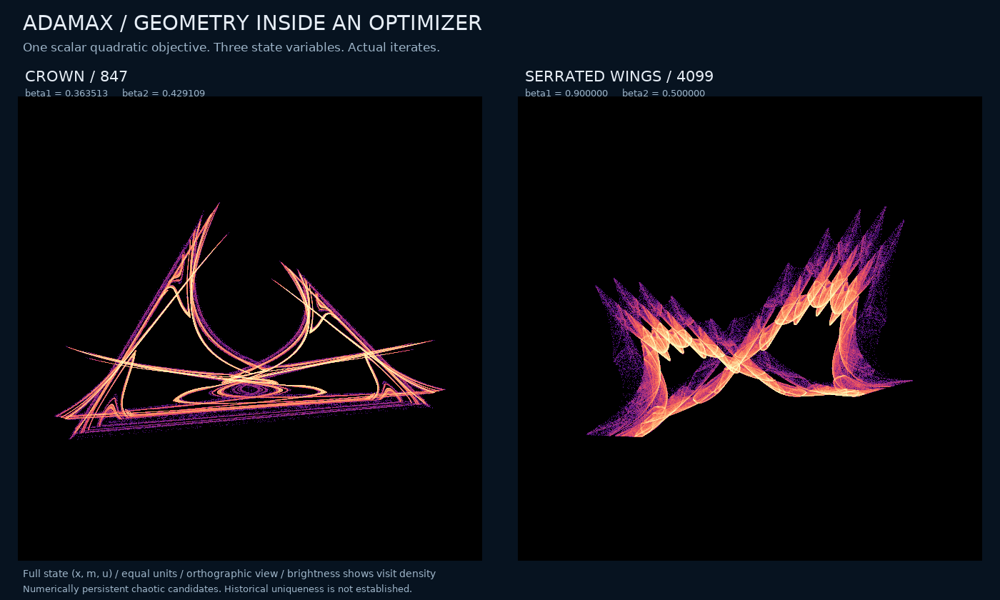
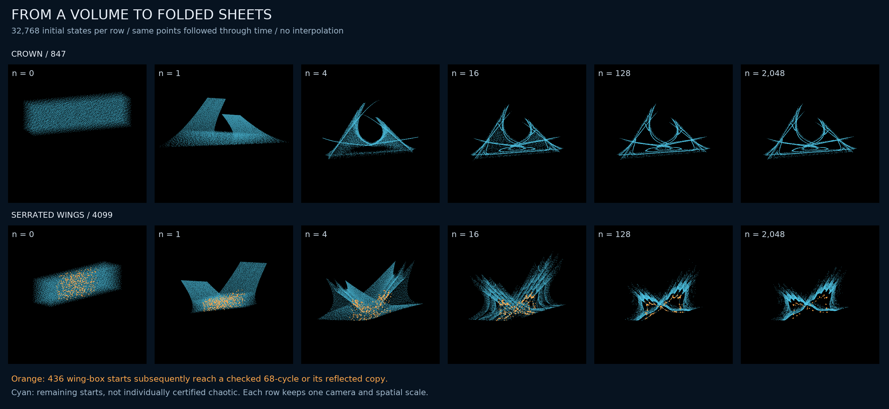
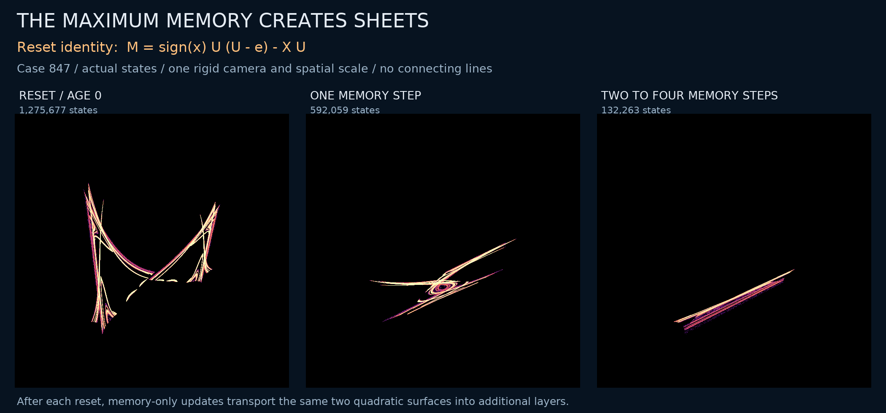

# Crowns and serrated wings inside scalar-quadratic Adamax

Status: 1 November 2026. **A known optimizer produces two visually distinct, numerically persistent chaotic candidates while minimizing a single strictly convex quadratic.** The crown is the stronger attraction candidate in the tested cohorts. Neither asymptotic chaotic attraction nor historical uniqueness is proved. Optimizer chaos and Adamax instability have established precedents; the [priority audit](adamax-priority.md) states them explicitly.



<!-- drawing-date -->
*First recorded drawing: **2026-11-01** ([record](https://github.com/Griboedow/chaos-attractor-lab/blob/c388a6daad6ac84be88aae1b44ab18b5550761e9/docs/assets/adamax-rotation.gif)).*
<!-- /drawing-date -->

[High-resolution still](assets/adamax-geometry.png) · [Exact structural results](adamax-structure.md) · [Prior and equivalent formulations](adamax-priority.md) · [Evidence packet](../results/adamax-geometry/manifest.json)

Each portrait contains eight million actual iterates. The animation rotates a fixed, contiguous one-million-state tail; it does not evolve or deform the data. The three axes have the same units, and only translation and proper rigid rotation are applied. Brightness represents logarithmic visit density. Descriptive labels identify silhouettes, not new dynamical classes.

## The unexpected setting is a one-variable optimization problem

Use `f(theta)=theta^2/2`, learning rate `alpha=.002`, `epsilon=1e-8`, no weight decay, and Adamax's ordinary first-moment and maximum-memory updates. With `(x,m,u)=(theta,M,U)/alpha`, let `e=epsilon/alpha=5e-6`. The autonomous limiting map is

```text
m_next = beta1*m + (1-beta1)*x
u_next = max(beta2*u, abs(x) + e)
x_next = x - m_next/u_next
```

The actual optimizer divides the last increment by `1-beta1**t`. Cold-start warmups retain that bias correction; the separate long PyTorch experiment retains it throughout. All three variables are necessary to describe the internal state, although the objective has only one variable. There is no stochastic forcing, nonconvex loss, neural network, learned surrogate or extra decorative state.

This is the [PyTorch 2.15 epsilon placement](https://docs.pytorch.org/docs/2.15/generated/torch.optim.Adamax.html): epsilon is added before the maximum. [Kingma and Ba's Algorithm 2](https://arxiv.org/pdf/1412.6980v9) already defines Adamax. The crown and wings use atypical memory coefficients; a standard default pair is included as a control.

| Role | Case | beta1 | beta2 | e |
| --- | ---: | ---: | ---: | ---: |
| Main crown | 847 | 0.36351296468637884 | 0.42910876222886146 | 0.000005 |
| Serrated wings | 4099 | 0.9 | 0.5 | 0.000005 |
| Similar crown with competing cycles | 239 | 0.3394757778476924 | 0.38000645535066724 | 0.000005 |
| Standard default memory pair | 4096 | 0.9 | 0.999 | 0.000005 |

The main long runs start from `(x,m,u)=(.73,0,0)`. Common rescalings, changing quadratic curvature while preserving normalized epsilon, and the exact reflection `(-x,-m,u)` do not count as new examples; see the [normalization audit](adamax-priority.md#exact-reductions-that-prevent-artificial-novelty).

## Numerical persistence and independent implementations

Four million observed autonomous updates follow 100,000 bias-corrected warmup updates. Two tangent directions are orthogonalized every step; each number below is per update. Eighty disjoint 50,000-update windows are retained for each case.

| Case | First exponent | Second exponent | Smallest first-exponent window |
| ---: | ---: | ---: | ---: |
| 847 | 0.465634 | -0.664282 | 0.460945 |
| 4099 | 0.064049 | -0.003222 | 0.062042 |
| 239 | 0.410316 | -0.696588 | 0.404536 |
| 4096 | 0.021429 | -0.016218 | 0.020275 |

The third derivative-product exponent is exactly minus infinity after a smooth reset, because a reset erases the input memory direction. It is not an autonomous-flow neutral exponent or a numerically estimated large negative number. The [structural note](adamax-structure.md) explains the distinction and the nonsmooth exceptions.

An independent scalar implementation uses **70 and 90 decimal digits**, exactly promoting the same binary64 coefficients. It evolves two nearby trajectories and renormalizes their Euclidean separation without an analytic Jacobian. After 100,000 bias-corrected updates and 5,000 alignment updates, each run observes 100,000 updates in ten windows. All eight runs have positive leading windows. Their mean estimates are about `0.464` for 847, `0.407` for 239, `0.065` for 4099 and `0.021` for 4096. They need not reproduce the same chaotic path.

The **actual installed PyTorch Adamax** also runs each case for 300,000 updates in float64. The objective gradient is assigned exactly as `theta`. Complete optimizer states are retained. Normalized one-step discrepancies against the model remain below `3.8e-16`; tangent estimates along the actual library trajectories agree statistically, with positive leading estimates in all nineteen observation windows per case. Short independent controls cover twelve additional cold starts. Library version, source hash and update conventions are frozen in the packet.

These controls address implementation mistakes, ordinary roundoff and short transients. Finite positive exponents are still not a proof of an asymptotic chaotic attractor.

## Watching a volume approach the geometry



<!-- drawing-date -->
*First recorded drawing: **2026-11-01** ([record](https://github.com/Griboedow/chaos-attractor-lab/blob/c388a6daad6ac84be88aae1b44ab18b5550761e9/docs/assets/adamax-approach.png)).*
<!-- /drawing-date -->

Each row follows 32,768 scrambled Sobol points from a declared three-dimensional box through 2,048 updates. Every point is retained at all six displayed times. One camera and one spatial scale apply throughout each row. The picture therefore shows collapse and folding of an initial volume, not just a long curve already on the candidate.

For **847**, no member meets the short-period criterion through period eight. The largest final distance to the two-million-state reference cloud is `0.003135` times its extent norm. All 128 predeclared volume starts followed for another 100,000 discarded and 200,000 observed updates have four positive leading windows; the smallest is `0.459332`.

For **4099**, most endpoints approach the wing cloud, but 436 are farther than `0.01` reference extents. One of the 128 longer volume checks has negative leading windows. All 436 far endpoints and that weak check receive another 50,000 discarded and 500,000 observed updates. Every continuation reaches a numerical **68-cycle**, in either of two sign-related orientations. The weak record starts from the same original Sobol point as one far-endpoint record: these are 437 continuations of 436 distinct original starts, not 437 independent samples.

Independent numerical closure gives residual `6.7e-16`, spectral radius `0.876109`, and minimum separation from the initial phase to the other 67 phases of `0.004691`. Every saved continuation tail is within `9.5e-14` of one of the two reflected cycle sets. The initially observed bitwise repeat lag of 136 is a floating-point multiple; the 68-step discrepancy is already about `3.1e-15`. The failed period assertion and its correction are retained. Orange markers identify these 436 starts throughout the approach figure; cyan marks the remaining starts without individually certifying them chaotic. The wing picture therefore coexists with a regular destination.

The separate cold-start and parameter cohorts are also fully reported. Each case receives twenty signed logarithmically spaced amplitudes of magnitude `1e-6` to `100`, two signed `.73` controls, and 32 nearby memory settings. Neighbors perturb each memory loss rate `1-beta` by a factor within approximately two percent; they are sampled points, not a proved open neighborhood.

| Case | Cold starts with all four leading windows > .005 and no detected short cycle | Neighboring settings meeting the same rule |
| ---: | ---: | ---: |
| 847 | 22/22 | 32/32 |
| 4099 | 22/22 | 32/32 |
| 239 | 8/22 | 14/32 |
| 4096 | 22/22 | 32/32 |

An exactly zero cold start is an absorbing fixed state and is checked separately. It is not counted as chaotic. The sampled counts do not estimate a certified basin probability.

## Why the crown has these layers



<!-- drawing-date -->
*First recorded drawing: **2026-11-01** ([record](https://github.com/Griboedow/chaos-attractor-lab/blob/c388a6daad6ac84be88aae1b44ab18b5550761e9/docs/assets/adamax-sheets.png)).*
<!-- /drawing-date -->

At a reset, the old position can be eliminated from the update equations. The output lies on one of two quadratic sheets:

```text
M = sign(old_x)*U*(U-e) - X*U.
```

The first panel shows reset outputs; the next two show states after one and after two to four intervening memory updates. All panels use the same rigid camera and scale. Group counts partition 1,999,999 states; the first preview state has unknown reset age and is explicitly omitted.

The [proof note](adamax-structure.md) gives a closed period-two branch and its multipliers, and a finite-sheet description implying Hausdorff dimension at most two for every autonomous omega-limit set from a legal finite initial state when `e>0`. A subsequent [scalar first-exit proof](scalar-optimizer-boundedness.md) establishes boundedness for all the stated memory parameters, including case 4099 and nonzero initial memories; the earlier sharper cold-start bound remains available when `beta1<beta2`. These results explain structure and constrain interpretation. They do not prove chaos or supply a historical priority theorem.

## Negative results are part of the result

The search declared 4,096 Sobol settings and five controls. Of 4,101 runs, 4,091 completed the short numerical scout. The initial rule flagged 2,169 runs; that is **not a count of chaotic attractors**. Two flagged trajectories have exactly zero position and first moment throughout their saved tail while the memory decays. Their positive tangent estimates do not turn that regular zero-line motion into chaos. In total, 82 flagged tails have position range below `1e-8` and require caution.

The visually attractive case **1103** eventually reaches a four-point cycle in its million-update follow-up, despite a positive whole-run average expansion estimate. It is rejected as a persistent-chaos candidate. At **239**, fourteen of the 22 cold starts reach a four-cycle. Independent numerical closure yields spectral radius `0.431534`, well inside the unit disk. The selected chaotic trajectory and this regular outcome coexist numerically.

The first gallery attempt was invalid because nonfinite features caused duplicate selection. Its completed outputs were rejected, and a corrected gallery selected 36 unique cases. The failed precision launch and a failed analysis compilation produced no scientific results; their records are retained. Numerical failures, image-layout revisions and negative outcomes are not silently replaced.

## What could become a manuscript

The promising result is the combination of unusual full-state geometry, a simple unexpected setting, exact maximum-memory structure, actual-library reproduction and transparent negative controls. The [priority audit](adamax-priority.md) compares Adam, RMSProp, earlier Adamax instability and max-type/Lozi transformations. No direct match to these scalar Adamax geometries was identified in the inspected material, but non-equivalence and historical priority remain unresolved.

The defensible present description is **a reproducible numerical and structural study of scalar-quadratic Adamax**, with a particularly persistent crown candidate. A proof of chaotic attraction, an invariant-set classification, and a stronger prior-art exclusion would be separate advances.

## Reproduction and evidence

The source modules under `research/` separate the map, survey, long spectra, independent precision check, actual PyTorch runs, cohorts, approach experiment, algebraic controls and rendering. Every archived run includes its executed source and declared protocol. Run `python research/verify_adamax_packet.py` to check the frozen evidence and regenerate its principal numerical summaries from the archived arrays.

The archive retains the complete scout, gallery, all declared follow-up outcomes, precision windows, actual-library states and fixed animation point clouds. Full eight-million-state render arrays and two-million-state preview arrays remain in local storage with hashes and exact generation settings; the static histograms and complete contiguous animation tails are archived. Rejected gallery trajectory arrays are inventoried locally rather than redistributed as accepted evidence. Source papers are cited and inventoried rather than redistributed.
