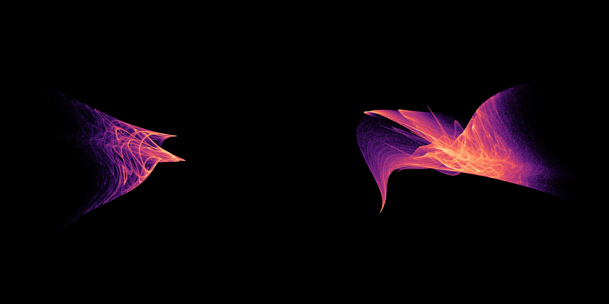

# Chaos in the memory of a scalar fixed-point algorithm

**An unexpected setting, with a precise distinction between proved scalar convergence and numerical chaos of the accelerated algorithm.** Two bounded increasing scalar maps have exactly one fixed point, and their ordinary iterations converge from every real starting value. A fixed-regularization, three-history acceleration can instead remain in a separate chaotic cloud.



The pictures use three consecutive scalar states and rigid orthographic cameras. They are not delay embeddings of an unrelated known oscillator, and contain no image synthesis. Each panel uses 3.2 million observed states. The geometric shapes' historical uniqueness is unresolved.

## The exact algorithm

For history `z=(x0,x1,x2)`, let `g_i=g(x_i)`, `r_i=g_i-x_i`. At every step solve

```text
minimize (sum alpha_i r_i)^2 + lambda sum alpha_i^2
subject to sum alpha_i = 1,
```

and replace the history by `(x1,x2,sum alpha_i g_i)`. The regularization `lambda>0` is fixed and absolute. There is no residual normalization, acceptance safeguard, line search, adaptive regularization or restart. Those choices matter: this is not a claim about every implementation called Anderson acceleration.

For this scalar problem the minimizer has a stable closed form. With `mu=mean(r)`, `d=r-mu`, `D=lambda+dot(d,d)`,

```text
alpha_i = 1/3 - mu*d_i/D,
x_new = mean(g) - mu*dot(d,g)/D.
```

The weighted least-squares mechanism is established prior work. See [Scieur, d'Aspremont and Bach, 2016](https://proceedings.neurips.cc/paper/2016/file/bbf94b34eb32268ada57a3be5062fe7d-Paper.pdf) and [Scieur et al., Online Regularized Nonlinear Acceleration](https://arxiv.org/html/1805.09639v2), especially the residual-coefficient formulation and online reinjection. We use a sliding window of three inputs. Fixed absolute regularization should not be confused with the scale-normalized forms in other presentations or safeguarded convergence theorems.

## One scalar root, two algorithmic outcomes

The selected base maps are `g(x)=c+k tanh(x)`:

| Quantity | Case 54 | Case 449 |
|---|---:|---:|
| `k` | 3.6654575131969844 | 2.603332208979775 |
| `c` | 2.061882544308901 | -1.0547139253467321 |
| `lambda` | 0.03329627201071343 | 0.0007167296313181746 |
| Scalar starting value | -1.558028880506754 | 1.4754167087376118 |
| Unique fixed point, approximately | 5.727262340382053 | -3.6545631158596508 |

The initial three-state histories are **cold histories** `(x,g(x),g(g(x)))`, not independently chosen hidden-memory states.

Here is an elementary convergence argument. A bounded increasing `g` makes a Picard trajectory monotone after its first step: the sign of `x1-x0` propagates under monotonicity. Boundedness then gives a limit, and continuity makes that limit a fixed point. For `k>1`, the only stationary points of `r(x)=g(x)-x` are

```text
t=sqrt(1-1/k), a=atanh(t), x=+-a;
B=k*t-a; r(-a)=c-B, r(a)=c+B.
```

If `|c|>B`, both extrema have the same nonzero sign. Together with the signs at infinity this proves the scalar fixed point is unique. **Outward interval arithmetic at 60 decimal digits verifies the strict inequality for both parameter pairs.** The intervals and full argument are archived in `anderson-basins/unique-root.json`. Thus every ordinary scalar Picard iteration converges to the listed root.

The accelerated history map has a diagonal fixed point only when `g(x)=x`, so it also has exactly one fixed point. Nevertheless, numerical trajectories started elsewhere can approach the pictured nontrivial sets. This is evidence of coexistence of the correct fixed point and an attracting chaotic component, not a contradiction of safeguarded algorithm theory. The tanh maps are not contractions, and an associated scalar optimization objective need not be convex.

## Numerical checks and failures

An initial 4,096-row screen of genuinely contracting sine, cosine, tanh and rational base maps found **zero chaotic survivors**: all reached their unique scalar fixed points. Independent root bracketing agrees with the final histories within `2.11e-9`; terminal residuals are below `9.82e-11`. The sampling design and early stopping rule are preserved.

A separate 4,096-row extended screen found 132 short-run positives. At 50,000 discarded and 500,000 observed steps, **119 retained the declared gate**, nine converged to fixed points and four failed the positive-window gate without satisfying the fixed-point stop. All 13 downgraded candidates remain in the packet.

The closed form agrees with independently solved coefficient-space linear systems to `8.71e-14`, and the analytic Jacobian agrees with complex-step differentiation of those solves to `8.27e-13` on the declared checks. Selected full spectra use 100,000 warm-up steps and one million observed steps:

| Case | Full spectrum per iteration | Minimum leading exponent over ten windows |
|---|---|---:|
| 54 | `(0.144714, -0.119792, -0.328310)` | 0.140940 |
| 449 | `(0.213740, -0.037921, -0.287766)` | 0.210251 |

Independent arbitrary-precision arithmetic gives leading exponents **0.145164 at 80 digits and 0.143439 at 110 digits** for 54; the 80-digit value for 449 is **0.214574**. These runs discard 10,000 and observe 50,000 iterations. Statistical agreement, not pointwise agreement after exponential separation, is the relevant check. Both final 3.2-million-step image runs retain positive growth in every window.

Fresh basin scans test 257 scalar cold starts per case across the declared interval: **71** reach the positive-growth regime for 54 and **94** for 449; all other cold starts satisfy the fixed-point stop. Each case also retains **16/16** local perturbations in the positive-growth regime, while **8/8** starts near the true root converge. Independent three-history starts split between both outcomes. This supports attraction on sampled initial sets, not a rigorous invariant trapping region or asymptotic chaos theorem.

## Exact linear reduction prevents false novelty claims

For `g(x)=kx`, the same algorithm simplifies exactly to

```text
x_new = k mean(x) lambda /
        [lambda+(k-1)^2 sum(x_i-mean(x))^2].
```

For `k!=1`, rescale `u=(k-1)x/sqrt(lambda)` to obtain

```text
(u0,u1,u2) -> (u1,u2,
              k mean(u)/(1+sum(u_i-mean(u))^2)).
```

Changing `lambda` in this linear family therefore changes only the spatial scale: those are not separate discoveries. Three selected linear rows were evaluated by both the general algorithm and an independently coded reduced map, with agreeing full spectra. If `|k|<1`, `|u_new| <= |k| max |u_i|` implies convergence after successive three-step blocks. The positive linear examples have `k>1`; their plain linear iterations diverge. They must not inherit the global Picard convergence claim proved above for the bounded tanh cases.

## Prior art and next falsification targets

Instability of acceleration is established; [the official SCS documentation](https://www.cvxgrp.org/scs/algorithm/acceleration.html) discusses practical instability and safeguards. Chaos associated with root-finding is also established: [Fontich, Garijo and Jarque (2024)](https://arxiv.org/abs/2405.08812) prove chaotic dynamics on a basin boundary for a map arising from secant dynamics. That result is not itself a proof of an attracting three-history cloud for the fixed-regularization rule used here. It prevents a broad claim that root solvers generating chaos are new.

Targeted searches for Anderson/RNA chaotic attractors did not identify this exact scalar tanh example in the returned sources. That bounded search cannot certify first discovery. Fixed vs normalized regularization, window updates, restarts, and affine reduction all need attention in further prior-art comparisons.

Against 108 frozen reference regimes and six earlier repository candidates, the nearest raw-cloud descriptor matches for 54 and 449 are Rucklidge and WangSun. After whitening they become SprottC and SanUmSrisuchinwong. The best local alignment discrepancies exceed the temporal-half controls in each reported comparison. These finite geometric tests neither prove dynamical inequivalence nor establish historical uniqueness. The comparison report includes the linear reduced-family candidate and its nearest earlier twist cloud as well.

The [evidence packet and reproduction instructions](../results/unexpected-search/README.md) retain all successful and unsuccessful screens, spectra, arbitrary-precision checks, interval root arguments, basin data and rendering provenance. The stronger finding here is an explicit, reproducible algorithmic phenomenon on a globally convergent scalar base iteration; a first-ever attractor claim remains open.
