# Attractor drawings and their dates

Dates identify our drawings, not historical discovery or a proof of chaos. For older work, **First recorded drawing** is the earliest image-bearing Git record found in the complete project history or its source repository. It is an evidenced record date, not a recovered rendering timestamp. Dates retain each record's stated timezone. New renders record their actual date when created.

Paired panels share the displayed date. Repeat views, periodic skeletons and symmetry copies do not become separate discoveries. Each linked report retains its own status and limitations.

[Date records and evidence](../provenance/render-dates.json) · [How to date future drawings](../tools/README-render-dates.md)

## Icosahedral spiral fans — case 177

[Evidence and current status](icosahedral-flow.md) · [Return-map proposal and closer prior art](icosahedral-returns.md)

<!-- drawing-date -->
*First recorded drawing: **2026-11-01** ([record](https://github.com/Griboedow/chaos-attractor-lab/blob/8d5d8b58d0087a4f0ed59cc4258838b2d22568ac/docs/assets/icosahedral-177.png)).*
<!-- /drawing-date -->

## Icosahedral looped companion — case 183

[Evidence and current status](icosahedral-flow.md)

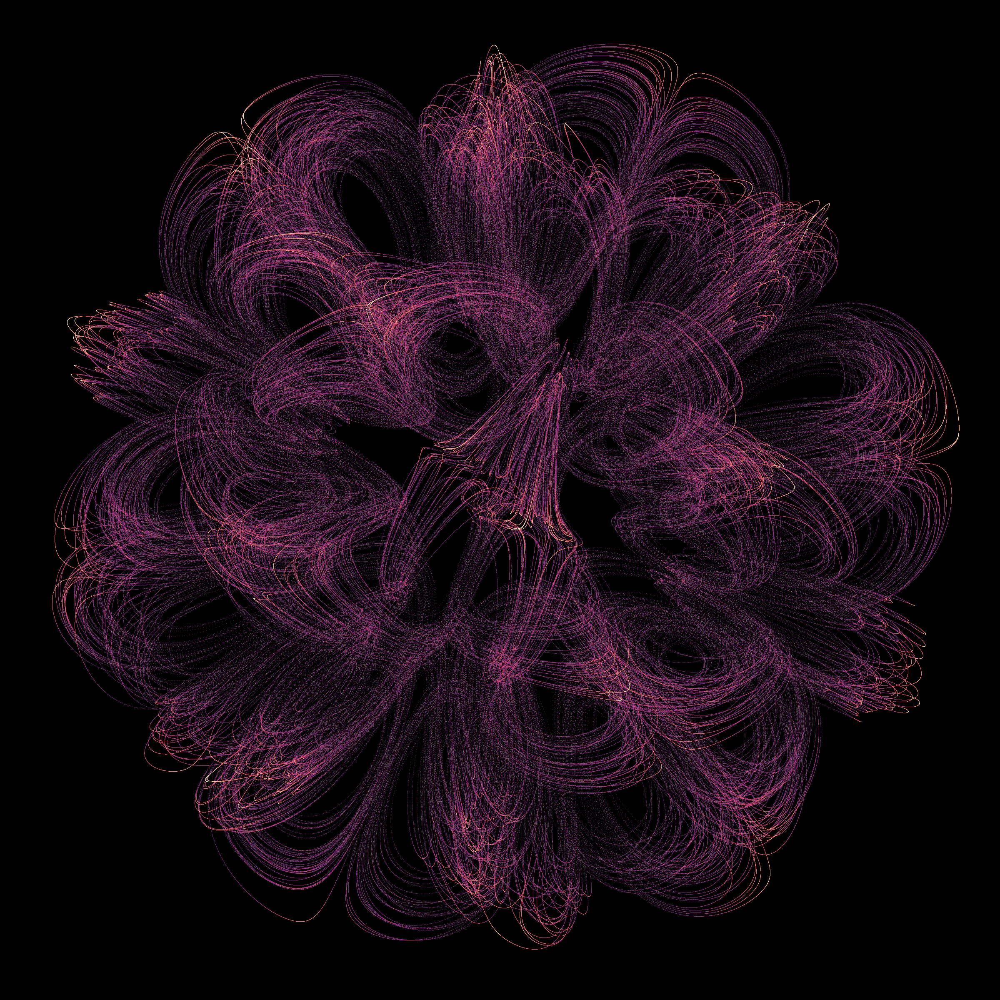

<!-- drawing-date -->
*First recorded drawing: **2026-11-01** ([record](https://github.com/Griboedow/chaos-attractor-lab/blob/8d5d8b58d0087a4f0ed59cc4258838b2d22568ac/docs/assets/icosahedral-183.png)).*
<!-- /drawing-date -->

## Tetrahedral ribbons — case 421

[Evidence and current status](tetrahedral-flow.md)

<!-- drawing-date -->
*First recorded drawing: **2026-11-01** ([record](https://github.com/Griboedow/chaos-attractor-lab/blob/13d474ac6acd6edf65fcd2b54d497f33b699d316/docs/assets/tetrahedral-flow.png)).*
<!-- /drawing-date -->

## Tetrahedral companion — case 565

[Evidence and current status](tetrahedral-flow.md)

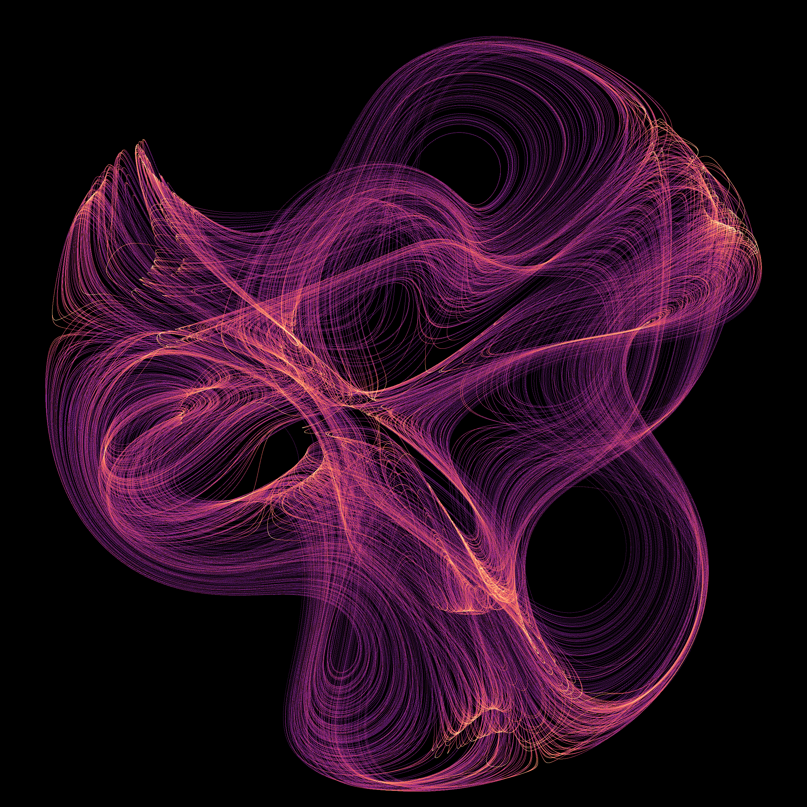

<!-- drawing-date -->
*First recorded drawing: **2026-11-01** ([record](https://github.com/Griboedow/chaos-attractor-lab/blob/13d474ac6acd6edf65fcd2b54d497f33b699d316/docs/assets/tetrahedral-vortex-565.png)).*
<!-- /drawing-date -->

## Scalar acceleration memory — cases 54 and 449

[Evidence and current status](anderson-memory.md)

<!-- drawing-date -->
*First recorded drawing: **2026-11-01** ([record](https://github.com/Griboedow/chaos-attractor-lab/blob/13d474ac6acd6edf65fcd2b54d497f33b699d316/docs/assets/anderson-memory.png)).*
<!-- /drawing-date -->

## Gaussian-vortex triskelion — case 77

[Evidence and current status](gaussian-vortex.md)

<!-- drawing-date -->
*First recorded drawing: **2026-11-01** ([record](https://github.com/Griboedow/chaos-attractor-lab/blob/6371acfa83c293b60c3f2a3b2b455b928020ac6a/docs/assets/gaussian-vortex-triskelion.png)).*
<!-- /drawing-date -->

## Spatial-circle RAAR — serrated arch and layered loops

[Evidence and current status](raar-circles.md)

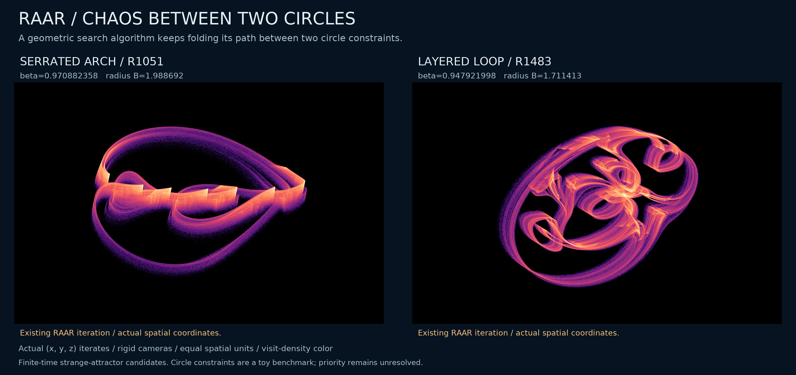

<!-- drawing-date -->
*First recorded drawing: **2026-11-01** ([record](https://github.com/Griboedow/chaos-attractor-lab/blob/8207072661685646c5e201a99c742cfafef20706/docs/assets/raar-circles-geometry.png)).*
<!-- /drawing-date -->

## RK45 controller — twin rosettes and folded fans

[Evidence and current status](rk45-oscillator.md)

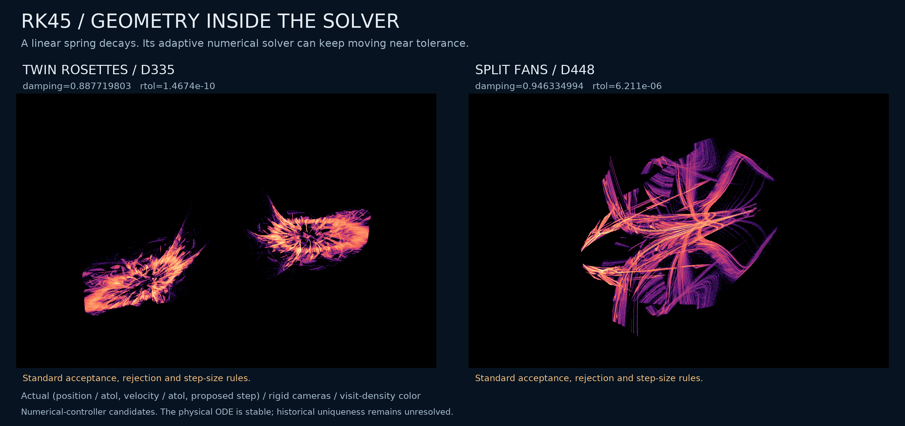

<!-- drawing-date -->
*First recorded drawing: **2026-11-01** ([record](https://github.com/Griboedow/chaos-attractor-lab/blob/990d8e8a138a924679ba97c0f8a859bf7b22bba2/docs/assets/rk45-oscillator-geometry.png)).*
<!-- /drawing-date -->

## RK23 controller — folded triangles and scissor wings

[Evidence and current status](rk23-oscillator.md)

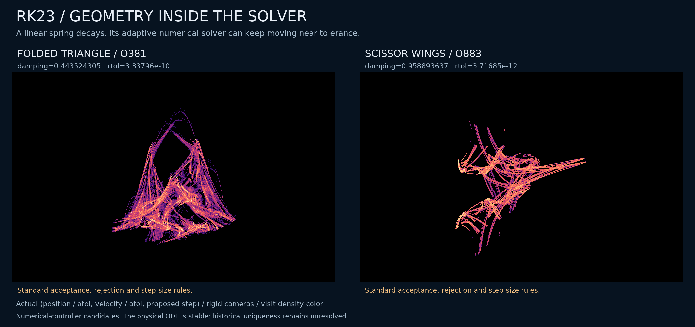

<!-- drawing-date -->
*First recorded drawing: **2026-11-01** ([record](https://github.com/Griboedow/chaos-attractor-lab/blob/d67a116f4074ec6ae0920c57568474ab18948984/docs/assets/rk23-oscillator-geometry.png)).*
<!-- /drawing-date -->

## Smooth Yogi — folded ribbons and feathered crescent

[Evidence and current status](yogi-tanh.md)

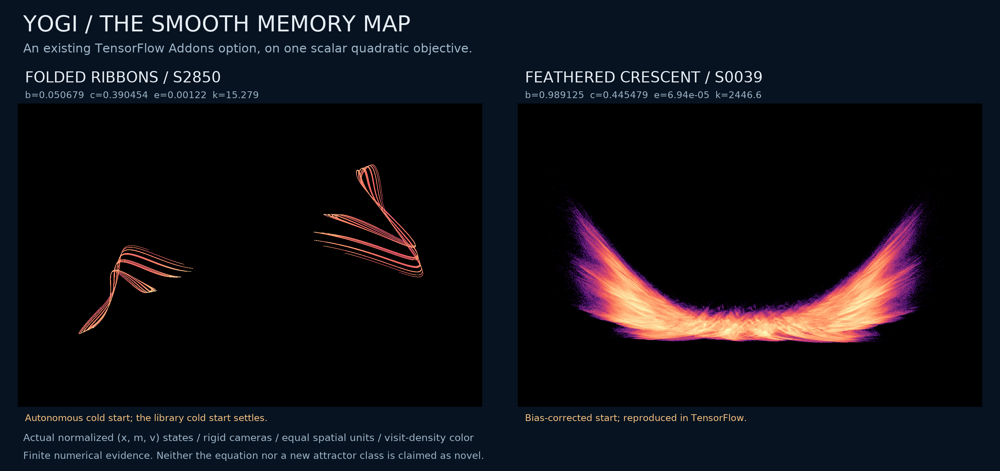

<!-- drawing-date -->
*First recorded drawing: **2026-11-01** ([record](https://github.com/Griboedow/chaos-attractor-lab/blob/c612e8b7da73d63645ab89e82ef5b77d668fbc1c/docs/assets/yogi-tanh-geometry.png)).*
<!-- /drawing-date -->

## Yogi — feathered arc

[Evidence and current status](yogi-parameter-plane.md)

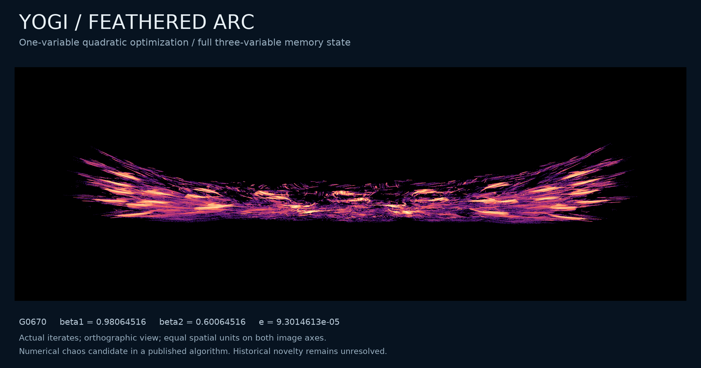

<!-- drawing-date -->
*First recorded drawing: **2026-11-01** ([record](https://github.com/Griboedow/chaos-attractor-lab/blob/c26d685d207acdbfb40f01f2ad6e72605596f6f5/docs/assets/yogi-feathered-arc.png)).*
<!-- /drawing-date -->

## Yogi — paired fans (44) and sunburst (7590)

[Evidence and current status](yogi-geometry.md)

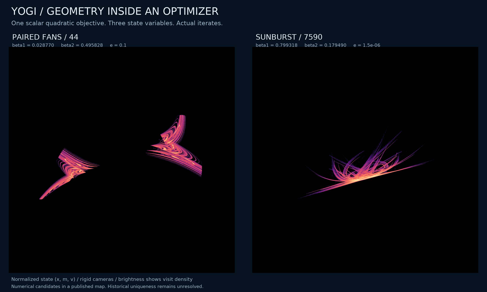

<!-- drawing-date -->
*First recorded drawing: **2026-11-01** ([record](https://github.com/Griboedow/chaos-attractor-lab/blob/2e5b356a7e2b1bf51e832fb815ae6b29c8afaba3/docs/assets/yogi-geometry.png)).*
<!-- /drawing-date -->

## Yogi — two expanding directions (4214)

[Evidence and current status](yogi-geometry.md)

<!-- drawing-date -->
*First recorded drawing: **2026-11-01** ([record](https://github.com/Griboedow/chaos-attractor-lab/blob/2e5b356a7e2b1bf51e832fb815ae6b29c8afaba3/docs/assets/yogi-two-directions.png)).*
<!-- /drawing-date -->

## Yogi grid — stronger two-direction candidate

[Evidence and current status](yogi-parameter-plane.md)

<!-- drawing-date -->
*First recorded drawing: **2026-11-01** ([record](https://github.com/Griboedow/chaos-attractor-lab/blob/c26d685d207acdbfb40f01f2ad6e72605596f6f5/docs/assets/yogi-grid-directions.png)).*
<!-- /drawing-date -->

## Adamax — crown (847) and serrated wings (4099)

[Evidence and current status](adamax-geometry.md)

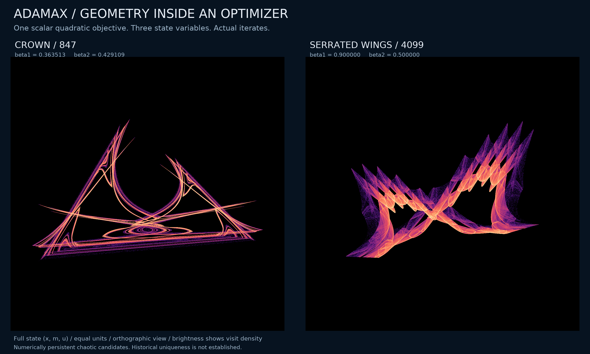

<!-- drawing-date -->
*First recorded drawing: **2026-11-01** ([record](https://github.com/Griboedow/chaos-attractor-lab/blob/c388a6daad6ac84be88aae1b44ab18b5550761e9/docs/assets/adamax-geometry.png)).*
<!-- /drawing-date -->

## Three-axis twist — folded sail (1709)

[Evidence and current status](twist-geometry.md)

<!-- drawing-date -->
*First recorded drawing: **2026-11-01** ([record](https://github.com/Griboedow/chaos-attractor-lab/blob/b4a35631e4044937842926f5d2630d2baec3957e/docs/assets/twist-folded-sail.png)).*
<!-- /drawing-date -->

## Three-axis twist — medusa (3254)

[Evidence and current status](twist-geometry.md)

<!-- drawing-date -->
*First recorded drawing: **2026-11-01** ([record](https://github.com/Griboedow/chaos-attractor-lab/blob/b4a35631e4044937842926f5d2630d2baec3957e/docs/assets/twist-medusa.png)).*
<!-- /drawing-date -->

## AdaBelief — branching memory cloud

[Evidence and current status](adabelief-quadratic.md)

<!-- drawing-date -->
*First recorded drawing: **2026-11-01** ([record](https://github.com/Griboedow/chaos-attractor-lab/blob/a981c87439785808cd38cb6507d5b51c1716ebc7/docs/assets/adabelief-candidate.png)).*
<!-- /drawing-date -->

## Four motor rows — thin braid

[Evidence and current status](motor-four-geometry.md)

<!-- drawing-date -->
*First recorded drawing: **2026-11-01** ([record](https://github.com/Griboedow/chaos-attractor-lab/blob/de10ae8327d743a10f1f602cafc2fc607ae3d899/docs/assets/motor-four-rotation.gif)).*
<!-- /drawing-date -->

## Four motor rows — braid and larger regime

[Evidence and current status](motor-four-b-study.md)

<!-- drawing-date -->
*First recorded drawing: **2026-11-01** ([record](https://github.com/Griboedow/chaos-attractor-lab/blob/76288182a8ba4dffc3d655819b6a0f4765d641ef/docs/assets/motor-b-regimes.gif)).*
<!-- /drawing-date -->

## Five motor rows — interwoven ribbon

[Evidence and current status](motor-five-geometry.md)

<!-- drawing-date -->
*First recorded drawing: **2026-11-01** ([record](https://github.com/Griboedow/chaos-attractor-lab/blob/e809319c54abd65d7c32642e9eab561ed13e94c3/docs/assets/motor-five-ribbon.gif)).*
<!-- /drawing-date -->

## Three motor rows — asymmetric ribbon

[Evidence and current status](motor-asymmetry-geometry.md)

<!-- drawing-date -->
*First recorded drawing: **2026-10-31** ([record](https://github.com/Griboedow/chaos-attractor-lab/blob/cc4ac5c77a48cab8f3520d22bb645f64336e4569/docs/assets/motor-ribbon-rotation.gif)).*
<!-- /drawing-date -->

## Motor model — periodic attractor and hyperchaos candidate

[Evidence and current status](motor-activity-continuation.md)

<!-- drawing-date -->
*First recorded drawing: **2026-10-30** ([record](https://github.com/Griboedow/chaos-attractor-lab/blob/efd6cf451595d47335b30225c92a1904ddead33c/docs/assets/motor-regimes-rotation.gif)).*
<!-- /drawing-date -->

## Three motor rows — physical projection of case 783

[Evidence and current status](motor-rows-gpu-survey.md)

<!-- drawing-date -->
*First recorded drawing: **2026-10-30** ([record](https://github.com/Griboedow/chua-gpu-atlas/blob/ece041347ed4bb2b99c856dda10a8b417c7c29db/results/motor-rows/cpu-candidate-N3-783.gif)).*
<!-- /drawing-date -->

## Motor pair — physical-coordinate candidate

[Evidence and current status](motor-pair-gpu-survey.md)

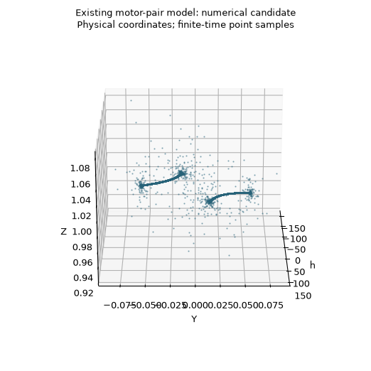

<!-- drawing-date -->
*First recorded drawing: **2026-10-30** ([record](https://github.com/Griboedow/chua-gpu-atlas/blob/d52a5d1f604348dcc2848088ac444e408aa5b1f4/docs/assets/motor_pair_candidate_rotation.gif)).*
<!-- /drawing-date -->

## Synchronematic collective oscillators

[Evidence and current status](synchronematic-research.md)

<!-- drawing-date -->
*First recorded drawing: **2026-10-29** ([record](https://github.com/Griboedow/chua-gpu-atlas/blob/6c24df76aa739b9a9c68f09166547f35471baa3b/docs/assets/synchronematic_projection_rotation.gif)).*
<!-- /drawing-date -->

## Liquid-crystal elastomer slider

[Evidence and current status](lce-slider-research.md)

<!-- drawing-date -->
*First recorded drawing: **2026-10-29** ([record](https://github.com/Griboedow/chua-gpu-atlas/blob/0e8678d2f6d8dde8df8313472d3b5663a0864ec1/docs/assets/lce_slider_evidence.png)).*
<!-- /drawing-date -->

## Two-strain epidemic model

[Evidence and current status](two-strain-research.md)

<!-- drawing-date -->
*First recorded drawing: **2026-10-30** ([record](https://github.com/Griboedow/chua-gpu-atlas/blob/2e20f636a960a6b0ff1564bde9d396bd91140800/docs/assets/two_strain_rotation.gif)).*
<!-- /drawing-date -->

## Optical operators — reference 1026

[Evidence and current status](coupled-operators-research.md)

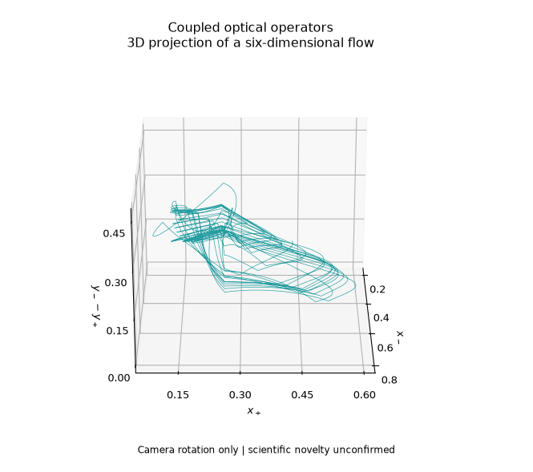

<!-- drawing-date -->
*First recorded drawing: **2026-10-29** ([record](https://github.com/Griboedow/chua-gpu-atlas/blob/2ccb13b406e7553d4afbeecf26bedf386c10fef9/docs/assets/coupled_operators_1026.gif)).*
<!-- /drawing-date -->

## Optical operators — reference 3054

[Evidence and current status](coupled-operators-research.md)

<!-- drawing-date -->
*First recorded drawing: **2026-10-29** ([record](https://github.com/Griboedow/chua-gpu-atlas/blob/2ccb13b406e7553d4afbeecf26bedf386c10fef9/docs/assets/coupled_operators_3054.png)).*
<!-- /drawing-date -->

## Smooth optical operators — coexisting regular and irregular motion

[Evidence and current status](coupled-operators-research.md)

<!-- drawing-date -->
*First recorded drawing: **2026-10-29** ([record](https://github.com/Griboedow/chua-gpu-atlas/blob/4176154684c5dc49a2990dadb0d3c27916286035/docs/assets/coupled_operators_smooth_coexistence.gif)).*
<!-- /drawing-date -->
