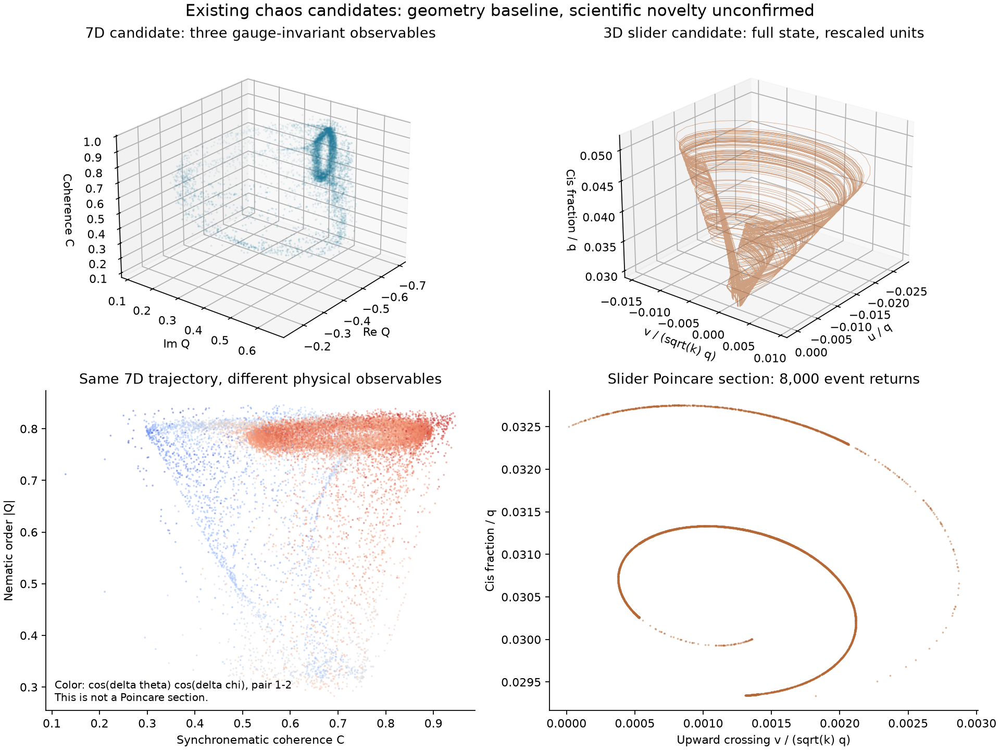

# Searching for an attractor with a different geometry

The added research objective is to find a robust chaotic-attractor candidate that looks substantially different from familiar examples. This complements the search for overlooked regimes in concrete physical models. The objective remains open. The figures distinguish certified periodic motion from numerical chaos candidates; visual appearance alone does not establish a new attractor type.

## Motor regimes in physical coordinates


The left panel shows one saved period of the [five-cluster periodic attractor](motor-five-cycle-certificate.md). Its floating-point starting state differs from the certified shooting-box midpoint by at most `5.39e-14`; the plotted curve is an illustration, rather than an interval enclosure. The right panel displays all 5,000 saved samples from the final 1,000-unit block of the [full CPU continuation](motor-activity-continuation.md). The six positive finite-time exponents were measured over the full 20,000 observed time units; they are not inferred from the cloud's shape.

Both panels directly plot `(X0, X1, s0)` with zero-based row labels: the normalized displacements of rows 0 and 1 and row 0's sine-density coefficient. No fitted embedding, nonlinear coordinate transform or per-panel rescaling is used. The axis limits and camera angles are identical. The 96-frame looping GIF rotates the camera through 360 degrees around fixed saved data; it does not animate elapsed simulation time. A projection of the 23-dimensional model can have apparent crossings that are absent from its full state space.

[Full-size GIF](assets/motor-regimes-rotation.gif) · [High-resolution still](assets/motor-regimes-rotation.png) · [Input hashes, projection and animation checks](assets/motor-regimes-rotation.json).

Rebuild the assets from the unchanged archived trajectories:

```powershell
python research/render_motor_regimes.py
```

The [renderer](../research/render_motor_regimes.py) uses NumPy, Matplotlib and Pillow. It checks the cycle closure and certificate proximity, retains the complete final candidate block, and verifies that quarter-turn GIF frames differ. It performs no new integration or proof calculation.

## Approach to the periodic orbit


The dashed black curve is the periodic reference orbit. Each colored trajectory starts at a different phase with a generic perturbation of all physical row variables. Initial pair differences are nonzero, and the full 23-dimensional equations evolve freely: no cluster equality, projection or artificial damping is imposed. The left panel plots the physical displacements `(X0, X1, X4)`, including a singleton cluster as well as paired clusters. These coordinates differ from the comparison above, which uses `(X0, X1, s0)`.

The right panel measures Euclidean distance using all 24 physical `(c,s,X)` components, with the displacement sum constrained to zero. It minimizes phase on the reference orbit, rather than comparing states at the same clock time. Thus trajectories can approach the same cycle while remaining at different points along it. Distance initially grows in parts of the transient; attraction need not be monotone at every instant.

The displayed six starts have perturbation norm `0.03` and fixed random seed `2026103031`, at phases `0,1/6,...,5/6` of the period. After six periods, distances fall from approximately `0.0285–0.0300` to `1.32e-7–3.42e-7`. Two solver settings agree to within `8.62e-11` in every saved state component over the whole interval. This is a numerical illustration of the separately certified local attraction, not a validated basin radius.

[Animate the actual approach](assets/motor-cycle-attraction.gif) · [Full-resolution still](assets/motor-cycle-attraction.png) · [Rendering provenance](assets/motor-cycle-attraction.json) · [All declared numerical experiments](../results/motor-cycle-attraction-visual/README.md).

The new animation keeps the camera fixed and advances all six saved trajectories uniformly from zero to six periods. Hollow circles mark their initial states; filled dots show their current positions. It depicts time evolution, unlike the rotating-camera comparison above.

All experiments remain archived. An initial, much larger perturbation norm of `0.6` did not produce controlled convergence of the six starts to this labeled reference orbit within the observed interval: five histories also failed the long pointwise solver comparison. No asymptotic outcome is assigned to those runs. All six smaller `0.001` starts passed, followed by all six `0.03` starts used in the picture. The amplitudes were chosen sequentially for this local visualization, so these counts are not a basin probability or a survey of arbitrary initial conditions.

To reproduce in a fresh destination:

```powershell
python research/illustrate_motor_cycle_attraction.py --output outputs/cycle-approach --amplitude .03
python research/render_motor_cycle_attraction.py --source outputs/cycle-approach --output outputs/cycle-approach-figure --animate
```

The numerical driver records the protocol before integration and retains every declared start under both solver settings. Input hashes, state histories, phase-matched distances and source snapshots are included in the archive.

## Earlier geometry baseline



## Three separate questions

1. **Does the geometry look different?** Inspect several views, original state variables and physically meaningful observables. Record the scaling and projection. Do not generate apparent novelty by changing the camera, wrapping angles, adding redundant copies, or applying a nonlinear coordinate distortion.
2. **Is the dynamical organization different?** Examine Poincare return maps, branches, symmetries, bifurcations and selected periodic orbits. Full Lyapunov spectra help characterize a candidate but do not classify its topology. In appropriate low-dimensional cases, periodic-orbit organization and linking can be more discriminating than a picture.
3. **Is that precise result new in the checked literature?** Compare the actual equations and their reductions with primary papers, not just names or thumbnails. Report the limits of the search; an absent result in a query is not a proof of novelty.

Letellier and Aguirre [1] explicitly distinguish a new system from a new attractor and analyze the unusual-looking cord attractor. Its existence is a useful reminder that the comparison set extends beyond Lorenz, Rossler and Chua. Their publisher abstract was inspected in this block; we have not reproduced the cord model or completed its full topology analysis. Gilmore [2] describes the role and dimensional scope of topological methods. These sources motivate the investigation; they are not an automated certificate of novelty.

## What the existing trajectories already tell us

The [four-unit synchronematic candidate](synchronematic-research.md) has seven effective angular states after the common phase is removed. Its saved long CPU spectrum gives a Kaplan–Yorke estimate of **3.11054**, with estimates **3.0970–3.1173** across the four observation windows. This is an estimate from finite-time exponents, not a rigorous Hausdorff dimension or a measured embedding dimension. It cautions against interpreting a three-observable picture as a faithful three-dimensional reconstruction.

The top-left panel uses collective observables:

```text
Q = mean(exp(2*i*chi))
U = mean(exp(i*(theta+chi)))
V = mean(exp(i*(theta-chi)))
C = sqrt((abs(U)**2 + abs(V)**2)/2)
plotted coordinates = (Re Q, Im Q, C).
```

These observables are invariant under the physical equivalence `(theta_i,chi_i) -> (theta_i+pi,chi_i+pi)` and under a common phase shift. An earlier version used `R=abs(mean(exp(i*theta)))`, which changes under equivalent local phase/orientation choices. The figures and GIF now use `C`; no trajectory was changed. The [priority and symmetry audit](synchronematic-priority-audit.md) explains this correction and verifies all 16 local choices along 64,000 saved states.

The bottom-left panel shows the same orbit through different invariant observables. Neither is a Poincare section. No angular discontinuities are joined by artificial straight lines, and no additional orbit is generated. Four-oscillator phase chaos is itself established prior art: Bick et al. [3] reported it in a symmetric phase network in 2011. The later audit compares its full primary equations and symmetries with our phase-plus-orientation system. We make no first-four-oscillator claim or proof of inequivalence to all known systems.

The [slider candidate](lce-slider-research.md) has three states. Its full-state view here only rescales the existing physical coordinates by `q=I/(1+I)` and the mechanical frequency scale. The visually funnel-like structure and curved two-dimensional event section do not establish a new topological class. Inserting the autonomous flow's zero exponent between the two measured transverse exponents gives a Kaplan–Yorke estimate of **2.11292**. The existing relay-equivalence audit already provides a concrete reason to compare it closely with older relay attractors.

The two dimension estimates are descriptive evidence, not a ranking of novelty. Higher dimension alone does not meet the objective either.

## Rotation preview


This preview rotates the camera around the saved synchronematic data, changing azimuth and elevation. It shows a projection of a seven-dimensional flow. It is not a new simulation, a time evolution animation, or evidence that its topology differs from known examples.

## Next comparisons

Prioritize candidates with reproducible bounded dynamics and a recognizable change in their return structure. The newly recovered [six-state coupled optical operators](light-operators-audit.md) offer a concrete next system. For a positive candidate, first validate the dynamics and switching treatment, then produce a full-state or clearly labeled observable comparison. In three dimensions, investigate return branches and periodic-orbit organization before assigning a new name. In higher dimensions, avoid inferring topology from a three-dimensional crossing pattern.

The repository retains separate labels for **visually distinctive**, **dynamically characterized**, and **novelty unconfirmed**. A successful bonus result would need an explicit account of what is different, what comparisons were made, and what remains unproved.

## Reproduction and references

```powershell
.venv/Scripts/python.exe research/attractor_geometry.py
```

The script reuses saved trajectories; no mass calculation is repeated. Numerical estimates and exact observable definitions are saved in `results/attractor-geometry/baseline.json`.

1. Letellier, C., and Aguirre, L. A. (2012). Required criteria for recognizing new types of chaos: Application to the “cord” attractor. *Physical Review E* **85**, 036204. [doi:10.1103/PhysRevE.85.036204](https://doi.org/10.1103/PhysRevE.85.036204). Publisher abstract inspected; full comparison pending.
2. Gilmore, R. (1998). Topological analysis of chaotic dynamical systems. *Reviews of Modern Physics* **70**, 1455. [doi:10.1103/RevModPhys.70.1455](https://doi.org/10.1103/RevModPhys.70.1455). Publisher abstract inspected for the method's scope.
3. Bick, C., Timme, M., Paulikat, D., Rathlev, D., and Ashwin, P. (2011). Chaos in Symmetric Phase Oscillator Networks. *Physical Review Letters* **107**, 244101. [doi:10.1103/PhysRevLett.107.244101](https://doi.org/10.1103/PhysRevLett.107.244101); [publisher issue cover](https://journals.aps.org/prl/issues/107/24). Full primary equations inspected in the later priority audit; global equivalence questions remain open.
