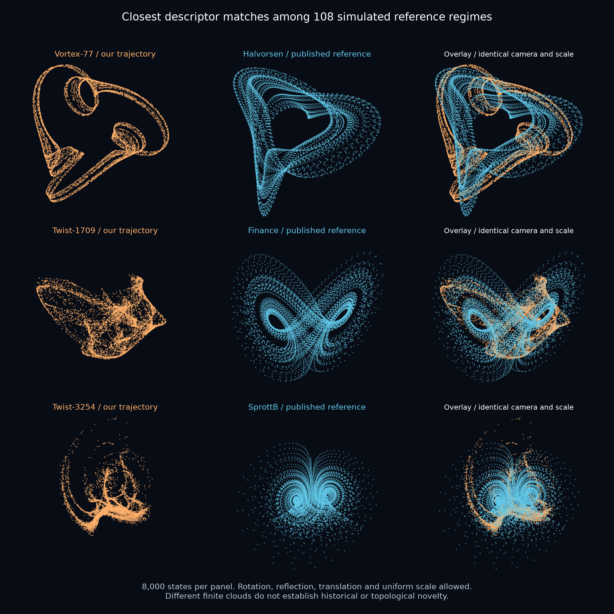

# A bounded novelty audit of the twist and Gaussian-vortex candidates

**No claim that anybody has found an unprecedented attractor is established here.** This audit compares the three archived twist-map candidates and three new Gaussian-vortex candidates with 108 simulated reference regimes, checks trivial coordinate changes, and records relevant prior work. It provides reproducible nearest comparisons and identifies known visual motifs.



All reference images above were generated from equations in this study. No third-party gallery image was copied. Each panel uses 8,000 states; the displayed rigid alignment is fitted on 1,500. The report's metric table uses its separately seeded, archived comparison fits.

## What was actually compared

| Source | Included regimes | Scope |
|---|---:|---|
| [GilpinLab/dysts](https://github.com/GilpinLab/dysts/tree/2a03f1ae7b0680b0470458783dcb4664660e131a) | 89 | Default three-state autonomous, nondelayed models without metadata-declared unbounded coordinates. All 89 integrations completed. Some are regular controls, not chaotic attractors. |
| [Sakeeb91/attractor-atlas](https://github.com/Sakeeb91/attractor-atlas/tree/821ebb816d3e90bb9f589556f48cb455c4d9f545) | 4 | Aurelia, Naiad, Cassiopea and Mobula, independently transcribed from the pinned public README. Its priority and certification claims are not adopted. |
| Published three-dimensional Hénon regimes | 4 | `(M1,M2,B) = (0,.85,.7), (0,.815,.7), (1.4,.2,.1), (-.02,.85,.7)` in `(x,y,z) -> (y,z,M1+B*x+M2*y-z*z)`. |
| Halvorsen parameter follow-up | 9 | Successful additional values `a=1.3,1.5,1.6,1.7,1.8,1.85,1.89,1.95,2.0`, with `b=4`; the catalog default is `a=1.4`. |
| Pumped kicked top, 1988 | 2 | Frozen prior-model recomputations already in this repository: `(A,b)=(35,.1)` and `(15,.5)`, represented in affinely conjugate twist coordinates. |

The Hénon parameters come from [Gonchenko et al.'s author manuscript](https://www.ma.imperial.ac.uk/~dturaev/mypapers/bc2005.pdf) and [the conjoined-Lorenz-twins paper](https://doi.org/10.1063/5.0123426). Additional Halvorsen attempts at `a=1.1` and `1.2` did not complete from the chosen initial state and were excluded, not silently replaced. Their failed status is retained. This does not establish absence of a bounded attractor at those parameters.

The catalog source is pinned to commit `2a03f1ae7b0680b0470458783dcb4664660e131a`; the external atlas to `821ebb816d3e90bb9f589556f48cb455c4d9f545`. Catalog trajectories use DOP853, `rtol=1e-9`, `atol=1e-11`, 100 requested points per metadata period, 10,000 states and a 2,000-state discard. Atlas and Halvorsen follow-ups have their own explicit warm-up/sample intervals. The two kicked-top tails retain 20,000 final states after a million-step observation. A third prior-model run reached a fixed point and is excluded from shape normalization; its source-figure reproduction gap remains documented in the earlier packet. The full selections, 46 catalog exclusions, initial states, parameters, integration records and 108 point clouds are [archived](../results/attractor-novelty/reference/).

This is a finite comparison set with aliases and selected parameter values, not a census of known attractors. It does not include every family in Sprott's older galleries or every parameter of the included equations. It also does not compare projections of the repository's higher-dimensional motor systems as if they were full three-dimensional states. Their [separate comparison study](motor-four-b-study.md) retains its own scope. The [RAAR](raar-priority.md), [RK45](rk45-priority.md) and [Yogi](yogi-priority.md) investigations have separate priority audits; their clouds were not added to this six-candidate comparison.

## Comparison method and controls

First, each full-state cloud is centered and divided by its RMS radius, preserving its aspect ratios. Its descriptor contains a 65-bin pair-distance distribution from 60,000 sampled pairs, three covariance eigenvalue fractions, and a 33-bin radial distribution. Histogram probabilities are square-rooted. The reported score is

```text
||D2_A-D2_B|| + 0.5 ||eigenfractions_A-eigenfractions_B||
                + 0.25 ||radial_A-radial_B||.
```

This ignores translation, rotation, reflection and uniform scale. It is a deliberately chosen screening score, **not a novelty probability, a topological invariant or a calibrated hypothesis test**. D2/PCA catalog screening has an existing precedent in the external atlas; our implementation adds radial information and avoids orientation-dependent voxel-fill terms.

For the five nearest descriptors per candidate, we also fit point clouds using 48 PCA/sign/permutation starts and 20 iterative closest-point steps, allowing reflections. The symmetric nearest-neighbor RMS residual is dimensionless after normalization. It is the best local fit found, not a certified minimum. Matching a distribution or a projection would not establish dynamical equivalence either.

We repeat comparisons on disjoint temporal halves and four independent 6,000-point subsamples. A rotated, translated and uniformly rescaled Lorenz cloud returns a descriptor difference below `3e-16` and a fitted RMS below `3e-15`.

| Candidate | Closest descriptor reference | Score | Own temporal-half score | Best fitted RMS | Own temporal-half fitted RMS |
|---|---|---:|---:|---:|---:|
| Folded sail, twist 1709 | Finance | 0.14516 | 0.02560 | 0.18217 | 0.04009 |
| Medusa, twist 3254 | Sprott B | 0.13233 | 0.02718 | 0.26919 | 0.06815 |
| Twist 307 | External atlas Mobula | 0.23360 | 0.02422 | 0.21828 | 0.05354 |
| Gaussian vortex 77 | Halvorsen | 0.16043 | 0.02590 | 0.18085 | 0.03002 |
| Gaussian vortex 233 | Hadley | 0.14891 | 0.02850 | 0.16595 | 0.05963 |
| Gaussian vortex 738 | Halvorsen | 0.18407 | 0.04398 | 0.21822 | 0.04448 |

Finance, Sprott B and Halvorsen remain the nearest descriptor references for the two published twist images and primary vortex image in all four subsample runs. The full rankings and controls are in [summary.json](../results/attractor-novelty/comparison/summary.json). Reference clouds have their own finite-time variability; the candidate's self-distance alone cannot define a universal rejection threshold.

Next, an independent pass removes **general nonsingular affine coordinate changes** by whitening each cloud's empirical covariance. Affinely related full-rank empirical clouds then differ only orthogonally. All 108 references have usable full-rank covariance. A sheared, anisotropically scaled and translated Lorenz control returns a descriptor difference below `3e-15`.

| Candidate | Nearest after whitening | Score | Own temporal-half score |
|---|---|---:|---:|
| Folded sail | 3D Hénon `(0,.85,.7)` | 0.10405 | 0.02401 |
| Medusa | Qi–Chen | 0.09661 | 0.03005 |
| Gaussian vortex 77 | Halvorsen | 0.12955 | 0.02444 |

The medusa's Qi–Chen and Sprott B scores differ by only about `1e-5`; their rank is not meaningful at that precision. [All six affine results](../results/attractor-novelty/comparison/affine-summary.json) are retained. This pass concerns empirical distributions. It does not remove nonlinear coordinate transformations, arbitrary changes of time, different invariant measures or incomplete exploration of a basin.

The closest finite clouds are not coincident in these tests, but **we have not proved that any pictured attractor is inequivalent to every known one**.

## Prior work that limits the claim

- **Cyclic and three-lobed geometry is old.** [Sprott's cyclic-symmetry gallery](https://sprott.physics.wisc.edu/fractals/symmetry/) contains images dated 1997 and credits Halvorsen's suggestion. The Halvorsen equations also appear in [a primary 2023 Chaos article's Appendix A5](https://elib.dlr.de/198138/1/103109_1_5.0164013.pdf). The new vortex image visibly shares this established motif.
- **Gaussian vortices and chaotic attracting particle dynamics are old.** [The 2004 Physical Review E study](https://chaos1.la.asu.edu/~ylai1/papers/PRE_04_DL2.pdf) uses Gaussian wake vortices and inertial particles. Its forcing, state dimension and equations differ from our steady three-state field. That difference leaves exact-model priority open; it does not establish a new general mechanism.
- **The twist family contains an explicitly known special case.** The repository's [separate mechanism follow-up](twist-priority-and-mechanism.md), incorporated when synchronizing with commit `689f1b7`, gives an exact affine embedding of the equal-damping map from [the 1988 pumped kicked-top paper](https://doi.org/10.1016/0375-9601(88)90503-8). Its equation comes from author-linked public full-text OCR; the restricted typeset PDF was not obtained. Our initial abstract-only access gap therefore no longer describes the repository's evidence. The chosen sail and medusa tuples are outside that simple parameter slice, but this does not prove their inequivalence to older attractors. The two expanding prior-model regimes are included above.
- **Three-dimensional stretching/folding maps have established Lorenz-like regimes.** The Hénon sources above are included numerically. A related family can have a different displayed shape; visual difference alone is weak evidence of novelty.
- **Recent named visual attractors are public predecessors.** The four external-atlas equations are included even though their author's terminology about novelty and certification is stronger than what this audit independently establishes.

For the primary Gaussian field, a limited analytic distinction is available: its nonlinear contribution is nonzero and tends to zero at infinity, so it is nonpolynomial. Global affine conjugacy and constant time rescaling preserve polynomiality. Thus this exact field cannot be such a rewriting of Halvorsen, Lorenz or the polynomial atlas examples. This does not settle the topology of its attracting component or exclude earlier nonpolynomial models.

Search queries, sources and inspection limits are recorded in [literature-review.json](../results/attractor-novelty/literature-review.json), dated 1 November 2026. No exact match was located in that bounded search. Unindexed papers, supplementary code, other parameter regimes and nonlinear equivalences remain possible. The words “nobody has ever seen this” are therefore not supported by this packet.

## Reproduction and attribution

The frozen reference trajectories allow geometric checks without downloading a catalog or rerunning integrations. With the [pinned environment](../requirements-gaussian-vortex.txt), use a disposable checkout for recomputation:

```text
python research/verify_gaussian_packet.py
python research/compare_attractor_shapes.py
python research/compare_affine_shapes.py
python research/render_novelty_comparison.py

# Rebuild the reference clouds in a new directory:
python research/build_attractor_references.py --out D:/attractor-work/reference
python research/build_atlas_references.py --out D:/attractor-work/reference
python research/build_nearby_references.py --out D:/attractor-work/reference
python research/import_kicked_top_references.py --out D:/attractor-work/reference
```

The pinned dysts `flows.py` and metadata are retained with its Apache-2.0 license. The external atlas README is retained with its MIT license and author attribution. Those licenses and authorship are separate from this repository's independently generated trajectories and figures. The study preserves the earlier twist evidence packet unchanged.
