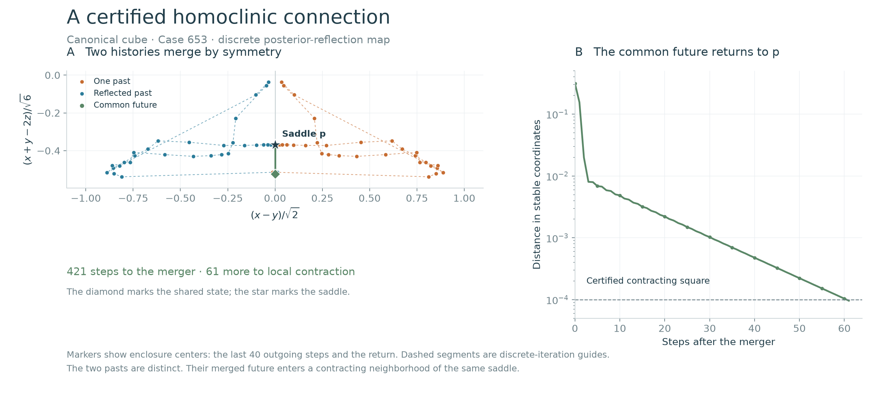

# Folded ribbons and spatial networks in canonical posterior-reflection maps

**Research article with interval certificates · 2026-11-01.** Asymptotic chaotic attraction
and historical uniqueness remain unresolved.

## Abstract

We simplify a Gaussian posterior-reflection iteration to regular tetrahedral
and cubic sites with short decimal parameters. The ideal posterior is exactly
a three-spin mean: independent spins for a cube and one parity constraint
for a tetrahedron. A complete 656-case exploration produces a folded ribbon
and a spatial network of curved sheets. Both selected regimes retain positive
leading growth over five million iterations, 33 fresh starts, and independent
70- and 100-digit calculations. The cubic candidate also has two positive
finite-time QR rates. Periodic numerical captures, including unstable fixed
points with positive tangent growth, are excluded from promotion. The
contribution combines a reproducible parameter study with an interval-certified
trapping box, intrinsic noninjectivity, and a homoclinic connection for the
cubic case. These certificates concern a specified maximal attracting set;
its equality with the sampled portrait remains open. Neither polyhedral appearance, sigmoid feedback,
nor hyperchaos is a new general mechanism.

## 1. Visual candidates


<!-- drawing-date -->
*First recorded portrait: **2026-11-01**.*
<!-- /drawing-date -->

Case 163 forms an elongated ribbon with several curled edges; Case 653
forms a spatial network of folded sheets. Each panel contains two million
consecutive states of a native three-coordinate discrete map. These are
density images, not interpolated curves or rendered surfaces. The
[24-second rotation](../assets/portraits/canonical-sphere.webp) keeps the
terminal 250,000 states fixed and rotates only the camera. Centering and
orthogonal rotations preserve geometry. Units are equal within each panel;
panel scales and density saturation are independent.

**Case numbers are local to this canonical-site campaign.** They do not
refer to the identically numbered cases of earlier studies. The
[preceding sphere article](../soft-sphere/manuscript.md) uses rotated,
separately rounded site arrays and a different temperature sweep.

## 2. Model and exact ideal reductions

For sites $`b_\sigma=c+a\sigma`$, define

```math
p_\sigma(x)=\frac{\exp(-\|x-b_\sigma\|^2/\tau)}
 {\sum_\eta\exp(-\|x-b_\eta\|^2/\tau)},\quad
m(x)=\sum_\sigma p_\sigma(x)b_\sigma,\quad
F(x)=\beta x+\beta\frac{2m(x)-x}{\|2m(x)-x\|}+(1-2\beta)m(x).
```

The sphere is centered at the origin and has radius one. For cubic sites,
$`\sigma\in\{-1,1\}^3`$. For tetrahedral sites retain the four signs with
$`\sigma_1\sigma_2\sigma_3=1`$. The map is smooth wherever
$`2m(x)-x\ne0`$. The derivative, reflection interpretation and elementary
boundedness inequality are given in the
[preceding article, Section 2](../soft-sphere/manuscript.md#2-map-derivative-and-elementary-bound).
Boundedness does not prove avoidance of the singular set or chaotic attraction.

Put $`h=2a(x-c)/\tau`$ and $`t_i=\tanh h_i`$. Factorizing the cube's
partition function and restricting it to even parity for the tetrahedron gives

```math
m_i(x)=c_i+a t_i\quad\text{(cube)},\qquad
m_i(x)=c_i+a\frac{t_i+t_jt_k}{1+t_1t_2t_3}
\quad\text{(tetrahedron)},\quad \{i,j,k\}=\{1,2,3\}.
```

Thus the four-site model is also an exact posterior for a three-bit
even-parity code, with signs $`\sigma_i=(-1)^{q_i}`$. This is an algebraic
interpretation of the posterior, not an identity between the full iteration
and belief propagation. The production implementation retains shifted
exponentials: direct evaluation of the tetrahedral quotient can produce
`0/0` when floating-point tangents saturate.

Orthogonal coordinate changes preserve the sphere and remove the initial
site rotation. Translation alone does not. The identities above hold for
ideal regular sites. Executed inputs are separately rounded binary64 arrays
computed from the displayed parameters; their exact hexadecimal values are
retained. Numerical reconstruction of an earlier rotated array is not an
exact conjugacy certificate for that array. The
[shared equivalence review](../soft-constellation-priority.md#canonical-spin-and-neural-formulations)
gives the derivation and related neural formulations.

| Case | Site set | beta | tau | a | Center c |
| --- | --- | --- | --- | --- | --- |
| 7 | Tetrahedron | 0.93 | 0.059 | 0.8 | (-0.1, -0.2, 0.2) |
| 148 | Tetrahedron | 0.93 | 0.06 | 0.8 | (-0.1, -0.2, 0.2) |
| **163** | **Tetrahedron** | **0.93** | **0.1** | **0.8** | **(-0.1, -0.2, 0.2)** |
| 361 | Tetrahedron | 0.99 | 0.2 | 0.8 | (0.1, 0.1, 0.1) |
| 407 | Cube | 0.9 | 0.02 | 0.25 | (0, 0, 0) |
| 565 | Cube | 0.96 | 0.04 | 0.3 | (-0.5, -0.5, -0.5) |
| 638 | Cube | 0.99 | 0.04 | 0.3 | (-0.6, -0.4, -0.2) |
| **653** | **Cube** | **0.99** | **0.08** | **0.35** | **(-0.5, -0.5, -0.5)** |

## 3. Complete selection history

The screen contains eight reconstructions or joint decimal simplifications
of the earlier sphere Cases 155 and 251, followed by complete Cartesian
grids of 360 tetrahedral and 288 cubic inputs. The
[protocol](../../results/canonical-sphere/runs/canonical-sphere-scout01/protocol.json)
lists every parameter and selection reason. Every run starts at
`(0.317,-0.211,0.419)`. All 656 complete a 5,000-step discard and 15,000
observations. The 262 cases whose leading rate exceeds 0.005 in every one
of ten windows receive fresh 30,000-step discards and 500,000 observations.

Of those follow-ups, 254 retain positive leading windows and 18 have
detected periods from 1 to 512. Ten satisfy both conditions. Excluding every
period flag leaves 244 positive, nonrepeating numerical candidates. These
are finite tests with a scale-adjusted `1e-8` terminal return tolerance,
not claims of asymptotic aperiodicity or 244 distinct attractors.

All 22 pages of the [complete preview](../assets/experimental/canonical-sphere-first-look/render.json)
were visually inspected. Cases 7, 163, 361, 407, 565, 638 and 653 were
selected for fresh runs discarding 100,000 iterations and observing five
million in twenty windows. Case 148 was subsequently added to test the
simplest neighboring temperature, 0.06, rather than 0.059. Its selection
is explicit and retained separately. All eight outcomes are reported.

| Case | Mean finite-time QR rates, per iteration | Smallest leading window | Terminal period flag |
| --- | --- | --- | --- |
| 7 | 0.70302, -0.01148, -0.84507 | 0.70033 | None through 512 |
| 148 | 0.66329, 0.00750, -0.84556 | 0.65990 | None through 512 |
| **163** | **0.20665, -0.04250, -0.46071** | **0.20497** | **None through 512** |
| 361 | 0.68171, -0.32731, -1.04273 | 0.67874 | None through 512 |
| 407 | 0.28220, 0.12535, -0.04682 | -0.05151 | 6 |
| 565 | 0.19000, -0.08930, -0.98743 | 0.18865 | None through 512 |
| 638 | 0.16237, -0.33747, -1.93404 | 0.16111 | None through 512 |
| **653** | **0.16191, 0.01395, -0.62918** | **0.15973** | **None through 512** |

Case 407 is rejected despite its initially elaborate spherical portrait:
it enters a detected six-cycle. Its positive run average includes a long
transient; later windows are negative. Case 638 has a smallest covariance
fraction of only `3.58e-5` and is nearly planar. For Cases 163 and 653 the
three terminal covariance fractions are respectively
`(0.01764,0.03086,0.95150)` and `(0.10210,0.41866,0.47925)`.
The ribbon is thin, whereas the cubic network has substantial extent in
all three principal directions.

## 4. Precision, fresh starts and false positives

For Cases 7, 163, 361 and 653, the original start and 32 scrambled Sobol
starts in `[-4,4]^3` each receive a 100,000-step discard and 500,000
observations. All 33 starts for each case retain positive leading growth
in every window. For the two displayed cases the minimum windows over
all starts are 0.20194 and 0.15482. Finite basin sampling does not establish
global attraction or a unique invariant measure.

None of these 132 cohort trajectories has a terminal period flag through
512. Iterating the posterior mean alone reaches a `1e-12` stopping residual
from all cohort starts, in at most 3, 4, 4 and 10 steps for Cases 7, 163,
361 and 653. This control is consistent with known mean-shift convergence;
it does not transfer a descent property to the reflected composition.

Independent scalar calculations use posterior inner-product logits and
nested reflections, without the production Jacobian. Exact binary64
inputs are lifted to 70 and 100 decimal digits. After 10,000 discarded
steps, renormalized finite separations are observed for 50,000 steps;
separations are `1e-30` and `1e-40`, respectively. Case 163 has minimum
leading windows 0.20314 and 0.19974; Case 653 has 0.15207 and 0.15784.

Case 653 has two positive QR rates in all twenty 250,000-step windows of
the long run; the smallest second rate is 0.01234. A separate calculation
propagates three finite separations and orthogonalizes them in high precision.
At 70 digits it gives `(0.16088,0.01401,-0.62008)` over 100,000 observations,
with smallest second window 0.00511. This supports a numerical hyperchaos
candidate; it is not an interval proof of positive asymptotic exponents.
At 100 digits the mean spectrum is `(0.16179,0.01372,-0.62585)`, but the
smallest second 5,000-step window is negative, `-0.00963`. Agreement of
the positive long averages therefore does not imply uniformly positive
short-time expansion.

Full QR calculations from the same 33 starts also retain two positive
rates in every 25,000-step window for Case 653; the smallest second window
is 0.00419. Case 148 is less uniform: all 33 full-run second means are
positive, but only four starts have positive second rates in every shorter
window. Its 70-digit second mean is 0.00729 with negative short windows.
The 100-digit second mean is 0.00427, also with negative short windows.
The full window records are retained rather than replacing this variation
by a single favorable average.

The rejected short-run Cases 35 and 300 illustrate a different failure mode.
Their stored terminal trajectories are exactly constant in binary64, yet
their computed largest multipliers are about 19.73 and 128. Independent
80-digit trajectories starting `1e-40` apart in the computed unstable
direction separate by more than 0.01 after 30 and 19 iterations. A positive
tangent rate at a numerically captured unstable fixed point is not evidence
of a chaotic attractor. The [inspection record](../../results/canonical-sphere/runs/canonical-sphere-inspection01/report.json)
preserves these controls; neither a certified root nor a certified basin is
inferred from them.

## 5. Certified attraction, merged histories and a homoclinic return

The following result concerns **the exact stored Case 653**, including its
binary64 site endpoints and parameters interpreted as real numbers. All eight
sites are the Cartesian product of the same two endpoints. Their exact
half-sum and half-difference therefore give an exact scalar factorization
$`m_i(x)=g(x_i)`$, where $`g(t)=c+a\tanh(2a(t-c)/\tau)`$.
Here $`c,a`$ are derived from the stored endpoints, rather than silently
replacing them by the rounded table entries. The map commutes with every
coordinate permutation, in particular $`S(x,y,z)=(y,x,z)`$.

**Theorem.** Let $`Q=[\ell,h]^3`$, where $`\ell,h`$ are the exact binary64
values stored by the literals `-1.65` and `-0.08`.
Then $`F(Q)\subset\mathrm{int}(Q)`$ and $`F`$ is smooth on a neighborhood
of $`Q`$. The set

```math
K=\bigcap_{n\ge0}F^n(Q)
```

is nonempty, compact, connected, symmetric under $`S`$, and attracts $`Q`$;
moreover $`F(K)=K`$. Its restricted map $`F|_K`$ is not injective. There
is a nonconstant full orbit in $`K`$ converging in both time directions to
the fixed point

```math
p=(s,s,t),\qquad
s\approx-0.57439219040015117,\qquad
t\approx-0.12382390454884010.
```

Consequently, $`F|_K`$ is not topologically conjugate to an injective map
on any invariant set, including a fixed-time map of a uniquely defined flow.

The [certificate packet](../../results/canonical-collision/README.md) retains
all inequalities, exact rational coordinate changes, executed code and
unsuccessful preliminary checks. The primary calculation uses 250-digit
interval arithmetic. A separate 300-digit implementation uses eight Gaussian
weights, nested reflections and automatic derivatives, without importing
the factored posterior or analytic Jacobian. The homoclinic revalidation
shares its driver and nominal centers with the primary calculation, but
substitutes the eight-site automatic derivatives in every enclosing
evaluation. Both use mpmath 1.3.0 interval arithmetic; they are not
independent arithmetic libraries.

### 5.1. A strict trapping box

Put $`q(t)=t-2g(t)`$. The increasing scalar mean allows endpoint bounds
on each of 4,096 equal subintervals of $`[\ell,h]`$. The certificate gives
the outward-rounded bounds

```math
\begin{gathered}
0.03710<q(t)<0.96290,\qquad
\|2m(x)-x\|>0.06426\quad(x\in Q),\\
F(Q)\subset[-1.63971,-0.09001]^3\subset\mathrm{int}(Q).
\end{gathered}
```

To obtain the image bound, each component of the normalized reflection is
$`-q_i/\sqrt{q_i^2+q_j^2+q_k^2}`$. This expression decreases with positive
$`q_i`$ and increases with the sum of the other two squares. Bounding those
squares globally and the remaining scalar terms cell by cell gives the
displayed strict inclusion. The independent verifier repeats the argument
with 8,192 cells and a two-weight Gaussian formula for the scalar mean.
The positive radius excludes the singularity. Nested compact connected
images give compactness and connectedness of $`K`$. Compactness also gives
$`F(K)=K`$ and uniform convergence of the distance of $`F^n(Q)`$ from $`K`$.
Equivariance and symmetry of $`Q`$ give $`S(K)=K`$.

### 5.2. A local unstable graph with a certified error bound

A two-dimensional interval Krawczyk test in the plane $`x=y`$ encloses
$`(s,t)`$ in a box of radius $`10^{-220}`$. The independent verifier
encloses that entire box in its own uniqueness box, using binary endpoint
tuples rather than rounded display strings.

Use the exact rational matrix $`E`$ retained in the certificate. Its first
column is $`(1,-1,0)^T`$; its other columns lie in $`x=y`$. Write
$`G(u,v)=E^{-1}(F(p+E(u,v))-p)`$, with $`v\in\mathbb R^2`$.
On $`|u|\le r=2\cdot10^{-80}`$, $`\|v\|_\infty\le Lr`$,
$`L=10^{-70}`$, the derivative blocks satisfy

```math
\begin{gathered}
\partial_uG_u\ge a_0,\qquad
\|\partial_vG_u\|_1\le b_0,\\
\|\partial_uG_v\|_\infty\le c_0,\qquad
\|\partial_vG_v\|_\infty\le d_0,\\
a_0>1.5841,\quad b_0,c_0<10^{-73},\quad d_0<0.9267.
\end{gathered}
```

The certificates check the stronger, unrounded inequalities

```math
\begin{gathered}
\alpha=a_0-b_0L>1,\qquad
\frac{c_0+d_0L}{\alpha}<L,\\
\kappa=d_0+\frac{(c_0+d_0L)b_0}{\alpha}<1,\qquad
c_0+d_0L<L.
\end{gathered}
```

For completeness, these finite inequalities give an elementary graph proof.
Consider continuous graphs $`v=h(u)`$ on $`[-r,r]`$ with $`h(0)=0`$ and
Lipschitz constant at most $`L`$. Along such a graph the horizontal image
is increasing with lower secant slope $`\alpha>1`$ and covers $`[-r,r]`$.
Restrict the image graph to that interval. Its slope is at most
$`(c_0+d_0L)/\alpha<L`$, so the transformation preserves this closed
complete space of graphs. For two graphs, their inverse horizontal
parameters differ by at most $`b_0/\alpha`$ times their uniform distance.
Their transformed graphs therefore differ by at most $`\kappa`$ times
that distance. The contraction theorem supplies a unique graph $`h`$.

Every point of this graph has a backward orbit on the graph. The horizontal
coordinates shrink by at least $`1/\alpha`$ at each backward step, and the
vertical coordinates are bounded by $`L|u|`$, so the backward orbit tends
to $`p`$. The whole local block lies in $`Q`$; trapping supplies its future.
Thus every graph point belongs to $`K`$. This argument requires neither
a visually fitted manifold nor an assumption that the graph is a straight line.

### 5.3. A collision inside the attracting set

Let $`\gamma(u)=p+E(u,h(u))`$. A numerical phase search only supplies the
test parameter $`\varepsilon\approx1.301496357894908\cdot10^{-80}`$;
the certificate propagates the entire stable uncertainty
$`|h_i(\varepsilon)|\le L\varepsilon`$. Centered interval mean-value
propagation in the fixed coordinates $`E`$ encloses all 421 iterates inside
$`Q`$, and proves

```math
\bigl(F^{421}\gamma(\varepsilon)\bigr)_1
-\bigl(F^{421}\gamma(\varepsilon)\bigr)_2
\in[-0.001112403,-0.001112401].
```

For sufficiently small positive $`u`$, the first 421 iterates remain in
the local graph domain. Their horizontal coordinates remain positive,
because the horizontal graph map is increasing and fixes zero. Hence the
same difference is positive there. Continuity gives $`u_*\in(0,\varepsilon)`$
whose image lies in $`x=y`$. The points $`\gamma(u_*)`$ and
$`S\gamma(u_*)`$ are distinct members of $`K`$ but have the same 421st
image. If $`F|_K`$ were injective, all of its iterates would be injective;
this is a contradiction. This proves **intrinsic** noninjectivity on $`K`$,
which is stronger than finding a fold in an ambient neighborhood.

### 5.4. A separately enclosed homoclinic connection



The homoclinic certificate locates a separate crossing near
$`u=1.0000635194016073\varepsilon`$. A parameter bracket of half-width
$`10^{-115}`$ has opposite endpoint signs after 421 iterations. The
whole bracket, including the unstable graph's vertical uncertainty,
maps into a small box meeting $`x=y`$ near
$`(-0.85137278885317687,-0.85137278885317687,-0.21144548698939289)`$.
The endpoint secant slope with respect to $`u`$ is enclosed in
$`[-9.369,-9.368]\cdot10^{80}`$ throughout that bracket. This bound
comes from products of interval Jacobians applied to every initial
secant cone $`(1,v)`$, $`\|v\|_\infty\le L`$; it does not assume
that the unknown graph is exactly tangent to its numerical starting line.

At the zero, the image lies exactly in the invariant plane. Restricting
the box to that plane and propagating in the two stable coordinates proves
entry after 61 more steps into a square of radius $`10^{-4}`$ around $`p`$.
The derivative norm there is less than 0.95940, proving convergence to $`p`$.
The independent formula verifies the same crossing and enters a smaller
$`10^{-6}`$ square after 121 steps, with contraction bound below 0.93145.
Backward convergence follows from the unstable graph construction, giving
the asserted nonconstant full homoclinic orbit. Its reflected past is distinct
and shares the future after the merger.

The plot uses centers of certified enclosures. Its dashed lines connect
successive discrete states for orientation; they are not continuous flow
trajectories. The final image belongs to the invariant plane by the
intermediate value argument, not because plotting arithmetic made two
coordinates equal.

### 5.5. Scope of the theorem

Injectivity is preserved by topological conjugacy, so the collision excludes
every injective model as a conjugate of $`F|_K`$. It does not exclude
noninjective maps, semiconjugacies, projections of a higher-dimensional
flow, or equivalences involving a different invariant subset. In particular,
**equality of $`K`$ with the density portrait is not proved**. The box
may contain additional invariant dynamics. The theorem does not certify
positive asymptotic Lyapunov exponents, transitivity, a horseshoe, positive
entropy, or a new topological class. A homoclinic connection is not used
as an unqualified substitute for any of those additional conclusions.

## 6. What is established, and what was already known

The reduction exposes established descriptions of the same averaging step:
Gaussian mean shift, finite-prior MMSE denoising, softmax attention, and
spin posteriors. Leaky sigmoid chaos appears in
[Chen and Aihara (1997)](https://arxiv.org/html/chao-dyn/9701020v1);
radial neural normalization appears in
[Verzelli, Alippi and Livi (2019)](https://pmc.ncbi.nlm.nih.gov/articles/PMC6761167/).
Neither reviewed recurrence is literally the displayed posterior-reflection
map. That formula distinction does not exclude a nonlinear conjugacy.

The parity interpretation likewise does not establish a first chaotic
decoder: [Sibel, Reynal and Declercq](https://perso.etis-lab.fr/declercq/PDF/ConferencePapers/Sibel_2012_CMSIM.pdf)
report chaos in iterative belief propagation. Their state consists of graph
messages, whereas this study reflects a three-coordinate exact posterior.
The [shared review](../soft-constellation-priority.md) records which equations
and assumptions were actually read.

Polyhedral chaotic maps predate this study by decades. Reiter's
[n-cube maps (1996)](https://emis.de/ft/51972),
[tetrahedral study (1997; author abstract)](https://webbox.lafayette.edu/~reiterc/abstracts/mv_1997c.html),
and [dodecahedral maps (1999)](https://webbox.lafayette.edu/~reiterc/dodec/dodec02_pp.pdf)
are direct comparison targets. The last paper's Figures 1–2 already display
spatial threads, loops and diffuse interior structure. Its polynomial
group-averaged construction differs from our posterior-reflection formula,
but broad visual motifs and symmetry cannot establish uniqueness.

Two positive exponents in a three-dimensional discrete map are also known.
For example, [Toker, Sommer and D'Esposito (2020), equation (12)](https://www.nature.com/articles/s42003-019-0715-9)
uses the generalized Hénon recurrence

```math
s_{n+1}=1.76-s_{n-1}^2-0.1s_{n-2}
```

as a hyperchaotic reference. Thus the sign pattern of Case 653's estimated
spectrum is a useful dynamical observation, not a first-discovery claim.

A separate [finite cloud comparison](../../results/canonical-sphere/runs/canonical-sphere-catalog01/report.json)
uses 108 frozen reference regimes. Under similarity normalization, the
first fingerprint-ranked references are `WindmiReduced` for Case 163 and
`SprottM` for Case 653; the fitted local ICP residuals are 0.19183 and
0.24189, against time-half self-residuals 0.02489 and 0.04557. After affine
whitening, the first labels become `BelousovZhabotinsky` and `SprottQ`.
These are archived software labels, not newly verified reproductions of
every cited primary model. Only three fingerprint-ranked references per
representation receive 48-start local alignment. The comparison neither
finds a global geometric optimum nor tests nonlinear conjugacy, other
parameter regimes, or every known attractor.

Symmetric noninvertible maps with intersecting unstable sets are established
prior art. [Jelleyman and Osinga (2022), Sections 1–2](https://link.springer.com/article/10.1140/epjs/s11734-022-00440-w)
reviews a complex angle-doubling map with reflection symmetry, two preimages,
and unstable sets that can intersect themselves. Its formula and planar
state space differ from this posterior-reflection map; the generic merging
mechanism and homoclinic geometry are not new. That paper's wild-chaos
criteria are not transferred to our system.

The present result is a reproducible numerical pair with exact ideal
posterior reductions, negative controls, and the explicit theorem of
Section 5 for the cubic maximal attracting set. The collision excludes
injective conjugate models on that set. Equivalence with previously known
noninjective maps, identification of the sampled attractor, and historical
priority remain open. The separate certificates for earlier circle maps
are not used to establish these sphere results.

## 7. Reproduction

The [evidence packet](../../results/canonical-sphere/README.md) retains the
complete search, source snapshots, exact inputs, numerical controls and
commands. Large unthinned arrays remain in a hash-addressed external cache.
Replay checks account for every screen output and follow-up, repeat the
long observations and dense rendering, and compare local QR arithmetic
with LAPACK and determinant accumulation. These checks establish numerical
reproducibility in the recorded environment, not a mathematical chaos proof.

The separate [collision and homoclinic packet](../../results/canonical-collision/README.md)
contains the interval proof runs, independent formulas, failures and
reproduction commands for Section 5. It leaves the original numerical
campaign frozen.
