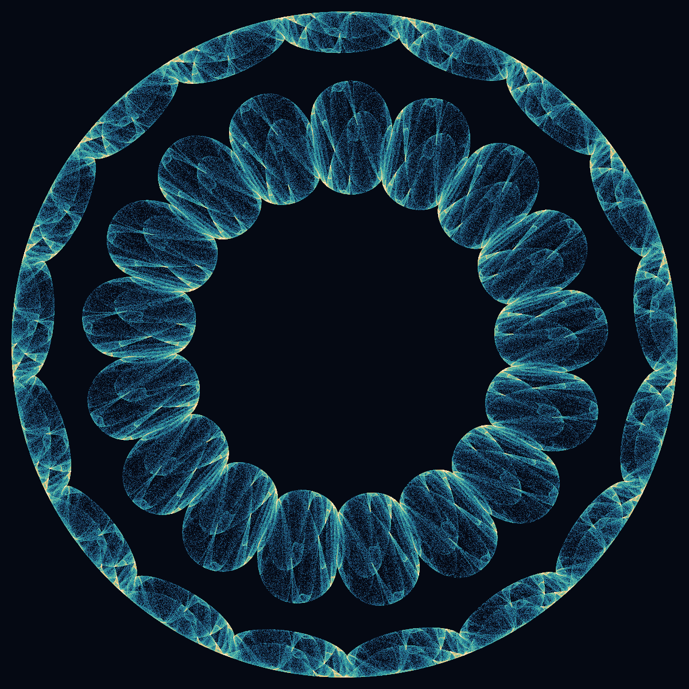
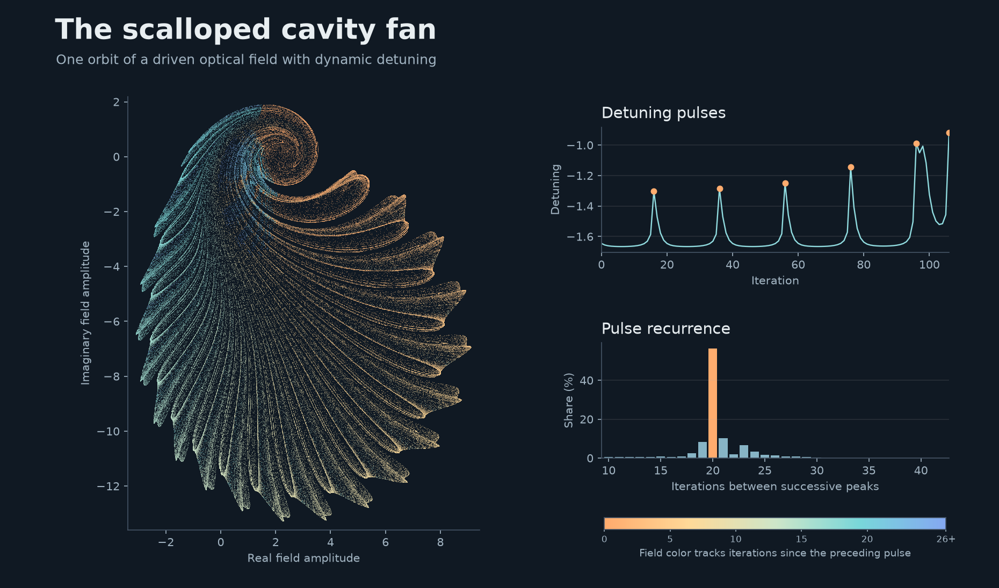

# Chaotic forms from four dynamical systems

[Two rings, one orbit](#two-rings-drawn-by-one-point) · [Optical fan](#a-scalloped-fan-from-one-optical-orbit) · [Fifteen Newton basins](#fifteen-basins-have-the-same-boundary) · [Straight geodesic](#a-straight-line-inside-a-uniformly-chaotic-flow)

## Two rings drawn by one point

Follow the gold dot. On every step it switches between the inner and outer ring. The animation shows 108 consecutive steps of Case 13745 against the density of two million visits. The five fainter dots mark its preceding positions.

<!-- drawing-date -->
*First recorded portrait: **2026-11-22**.*
<!-- /drawing-date -->

The equation imposes seventeenfold symmetry. One orbit visits all seventeen lobes. Interval arithmetic proves that the map sends each annulus strictly inside the other. Each contains one connected component of the local attractor. Both measured Lyapunov exponents are positive. A proof of chaos on the rings remains open. [Equation, exact coefficients and checks](../results/wow_search_20261122/symmetry/README.md)

<!-- drawing-date -->
*Drawn: **2026-11-22**.*
<!-- /drawing-date -->

Other coefficients give three, four or five components. In the three-ring case, call the inner gap A and the outer gap B. Every infinite A/B sequence without consecutive A’s occurs as the itinerary of some point in the gaps. [Proof and trapping intervals](../results/wow_search_20261122/symmetry/README.md#entropy-forced-between-the-bands)

## A scalloped fan from one optical orbit

A model of a pumped optical cavity produces this spiral fan without imposing a rotational symmetry. Each of the 786,432 points on the left is one successive value of the complex field. Color counts the steps since the last detuning peak. On the right, 56.5% of measured intervals between peaks last exactly twenty steps. [Cavity equation and Case 45941](../results/wow_search_20261122/orbit/README.md)

<!-- drawing-date -->
*Drawn: **2026-11-22**.*
<!-- /drawing-date -->

At a second setting, 822 of 2,313 initial states reached a lower detuning range and 1,491 a higher one. Eight long runs stayed on their respective sides of the gap for over sixteen million steps each. Whether the separation persists forever is open. [Both regimes at the same scale](../results/wow_search_20261122/orbit/coexisting-cavity-regimes.png) · [Initial states and counts](../results/wow_search_20261122/orbit/case-86780-basins.json)

## Fifteen basins have the same boundary

Newton’s method for a sixth-degree polynomial has six attracting roots and one attracting cycle of period nine. Looking at every ninth step distinguishes the nine cycle phases. All fifteen outcomes have the same basin boundary. A disk of radius 3 × 10⁻³² around the marked pole contains starting points for every outcome. [Polynomial, coefficient and proof](../results/wow_search_20261122/boundary/README.md)

<!-- drawing-date -->
*Drawn: **2026-11-22**.*
<!-- /drawing-date -->

The right panel spans just 2 × 10⁻³⁰ in the coordinates of the left panel. Near the pole, an exact change of coordinates preserves the six root colors and shifts the nine cycle colors back by one phase. Its local scale factor is 5/6. [Derivation and numerical zoom](../results/wow_search_20261122/boundary/README.md#a-zoom-that-permutes-nine-colors)

## A straight line inside a uniformly chaotic flow

Three cosine waves define a periodic surface. Identifying opposite faces of one cell gives a closed surface with fifteen handles. One ray follows an exact straight line that winds (7, −7, −2) times around the coordinate directions before closing. Along the unstable direction, its linearized return amplifies a perturbation between 4.45 and 4.47 million times per lap. [Flow equations and multiplier proof](../results/wow_search_20261122/lattice/README.md)

<!-- drawing-date -->
*Drawn: **2026-11-22**.*
<!-- /drawing-date -->

In a numerical check, turning the initial velocity by one millionth of a radian separated two trajectories by 0.2 length units after 47.454 time units. A full lap of the straight orbit takes 63.457.
