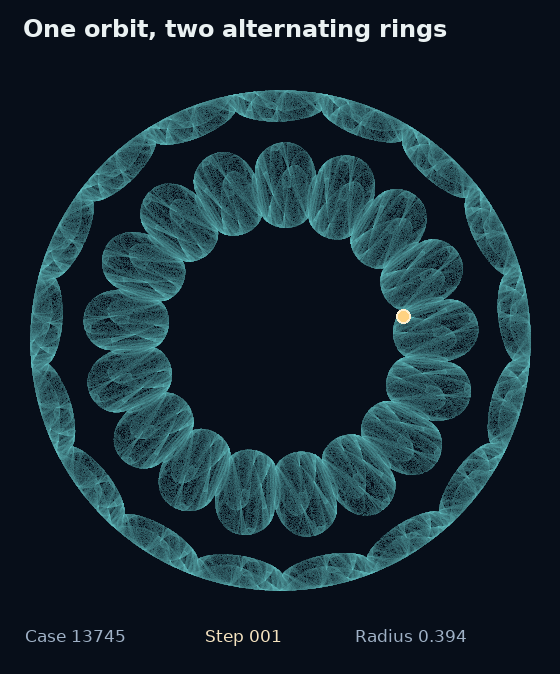
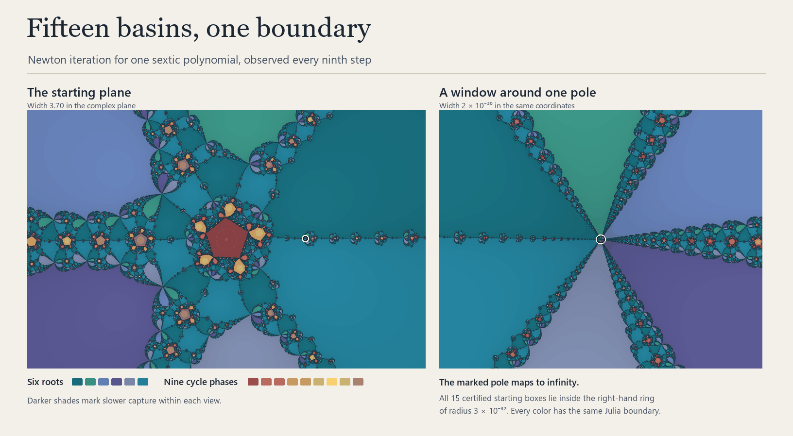
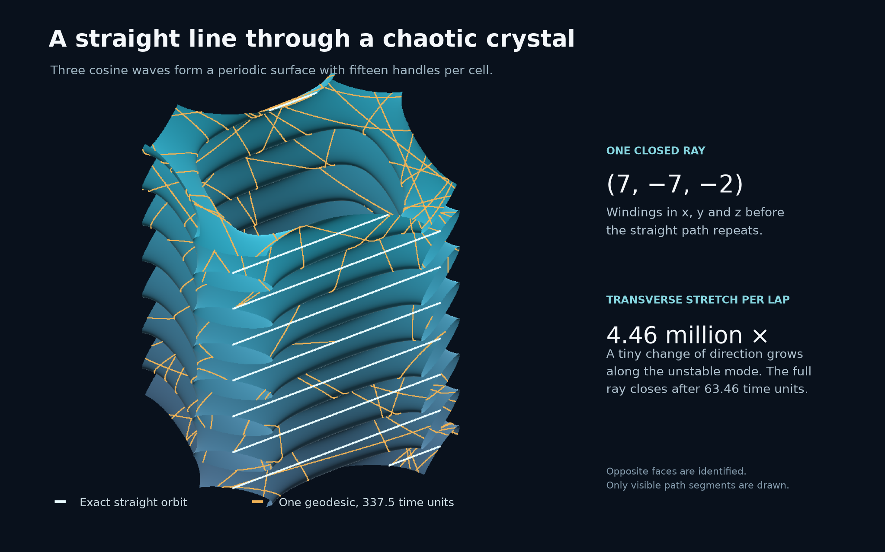

# Chaotic forms from four dynamical systems

## Two rings drawn by one point

One dot jumps from the inner band to the outer band on every step. After two million updates of the same planar polynomial, its density shows seventeen scalloped lobes inside a braided-looking rim. The equation enforces seventeenfold rotational symmetry. No rotated copies were added to the portrait. Interval arithmetic proves that two disjoint nested annuli map strictly into one another and that each contains exactly one connected component of the local attractor. Both surround the origin. Two positive Lyapunov exponents are numerical evidence in Case 13745. [Equation, coefficients, starts and interval checks](../results/wow_search_20261122/symmetry/README.md)

<!-- drawing-date -->
*Drawn: **2026-11-22**.*
<!-- /drawing-date -->

The gold dot below follows 108 consecutive updates, then restarts. The background shows the two-million-point density. The five faint preceding positions indicate the direction of time. The dot advances by one full update per frame with no interpolation.

<!-- drawing-date -->
*First recorded portrait: **2026-11-22**.*
<!-- /drawing-date -->

Changing the polynomial coefficients produces examples with three, four and five nested components. The four-component case visits radii in the order first, third, second, fourth. For the three-component example the permutation forces positive topological entropy on a separate invariant set in the two gaps. Symbolic itineraries there include every left/right gap sequence without consecutive visits to the first gap. The annular components and the intervening invariant set describe different initial states. [Case certificates](../results/wow_search_20261122/symmetry/annuli.json)

## A scalloped fan from one optical orbit

A pumped optical field rotates by an angle that depends on its intensity and on a relaxing memory variable. The portrait shows 786,432 consecutive complex field values. The color measures the time since the last peak of the memory. Among the measured peak-to-peak intervals, 56.5% lasted exactly twenty updates. The spiral and scalloped edge are visible in the native real and imaginary field coordinates. The model contains no imposed rotational symmetry of the fan. [Map, numerical spectra and controls](../results/wow_search_20261122/orbit/README.md)

<!-- drawing-date -->
*Drawn: **2026-11-22**.*
<!-- /drawing-date -->

At a second setting, Case 86780, changing only the initial state selects two long-lived detuning ranges. Of 2,313 tested starts, 822 reached the lower range and 1,491 the upper. Eight independent continuations of 16,777,216 iterations each stayed clear of the interval (6.108, 7.957). Interval arithmetic verifies 6,145 consecutive updates on each of two starts. Permanent separation remains open. [Common-scale comparison](../results/wow_search_20261122/orbit/coexisting-cavity-regimes.png) · [Basin counts and controls](../results/wow_search_20261122/orbit/case-86780-basins.json)

## Fifteen basins have the same boundary

Newton's method for a particular sextic has six attracting roots and a separate attracting nine-cycle. Observing every ninth update turns the nine phases into separate attracting fixed points. All fifteen full basins have exactly the same Julia boundary. Interval arithmetic locates fifteen open sets of initial conditions, one for each outcome, inside the same disk of radius 3 × 10⁻³² around a pole. The right panel resolves a window only 2 × 10⁻³⁰ wide in the same coordinates as the left. The colored areas describe forward attraction. The common boundary was sampled independently from preimages of the poles. [Algebraic coefficient, interval witnesses and prior work](../results/wow_search_20261122/boundary/README.md)

<!-- drawing-date -->
*Drawn: **2026-11-22**.*
<!-- /drawing-date -->

At the marked pole an exact local change of coordinates has derivative 5/6. It leaves the six root outcomes unchanged and shifts each of the nine cycle phases back by one. An ordinary Euclidean contraction by 5/6 approximates this change at small scales. In the microscopic window, all 204 interval-checked pairs showed the predicted outcome and exactly one extra Newton iteration before capture. [Local rescaling control](../results/wow_search_20261122/boundary/scale-control.json)

## A straight line inside a uniformly chaotic flow

Three cosine terms define a periodic surface with fifteen handles in each phase cell. A unit-speed particle can follow an exact straight line, winding seven, minus seven and minus two times in the three coordinates before returning. The unstable transverse multiplier of this periodic orbit is strictly between 4.45 and 4.47 million per lap. Rotating the initial velocity by a millionth of a radian produces a 0.2-unit departure after about 47.454 time units. The full lap lasts about 63.457. [Equations, geometric proof and numerical controls](../results/wow_search_20261122/lattice/README.md)

<!-- drawing-date -->
*Drawn: **2026-11-22**.*
<!-- /drawing-date -->
