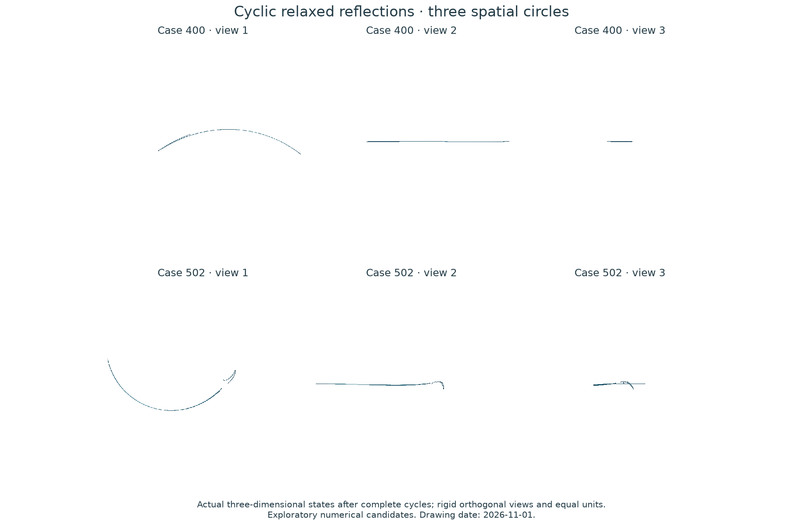
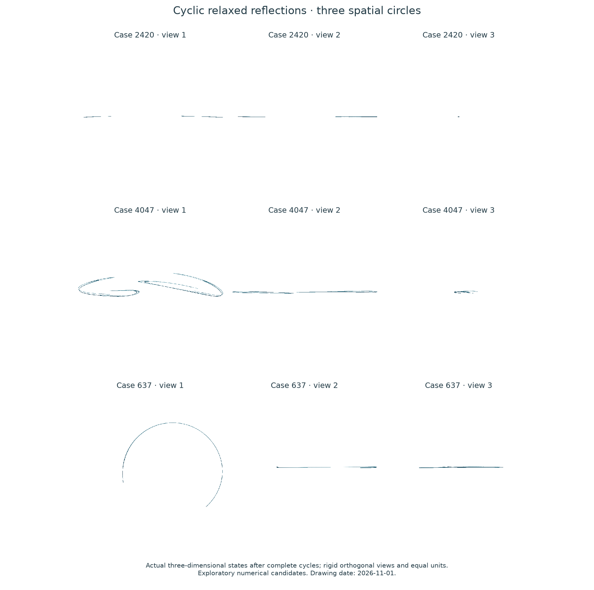

# Cyclic relaxed reflections between three spatial circles

**Status, 2026-11-01:** numerical survey of a known cyclic algorithm. Five selected configurations retain positive finite-time growth after one million complete cycles, but their native spatial clouds are thin arcs or ribbons. This branch was deprioritized for the search for a visually distinctive spatial attractor. No novelty or rigorous chaos claim is made.

For three circles, use the known full-cycle composition `T12 o T23 o T31`, evaluated right to left. Each pair map is `beta/2*(R_i R_j + I) + (1-beta)*P_j`. The model follows [Dinh, Jansen and Luke, *Cyclic Relaxed Douglas–Rachford Splitting for Inconsistent Nonconvex Feasibility*](https://arxiv.org/abs/2502.12285), equations 3b–3c. The three intermediate phases are not superimposed to manufacture a spatial shape. The displayed state is the actual iterate after each complete cycle.

The first screen uses 512 scrambled Sobol configurations with beta in `[0.6,0.999]`, plus an identical-circle control. The second uses 4,096 configurations with beta in `[0.93,0.9999]`, plus the control. Both use 5,000 discarded and 15,000 measured cycles. All 4,610 runs complete; two and three cases, respectively, exceed 0.005 in every growth window. Every flag is followed from a fresh start, with 50,000 discarded and one million measured cycles.

| Screen | Case | Leading rate | Other rates | Smallest leading window |
|---|---:|---:|---|---:|
| 1 | 400 | 0.309132 | -0.730349, -3.312456 | 0.30435 |
| 1 | 502 | 0.253445 | -1.262504, -2.187306 | 0.24888 |
| 2 | 637 | 0.499607 | -1.502727, -2.867602 | 0.49524 |
| 2 | 2420 | 0.186057 | -0.049952, -2.754033 | 0.18307 |
| 2 | 4047 | 0.046526 | -0.612062, -3.741645 | 0.04460 |

Rates are per complete cycle. No period from 1 through 512 is detected under the recorded finite-tail criterion. Neither this test nor a positive finite-time rate proves an asymptotic chaotic attractor.

<!-- drawing-date -->
*Drawn: **2026-11-01**.*
<!-- /drawing-date -->

<!-- drawing-date -->
*Drawn: **2026-11-01**.*
<!-- /drawing-date -->

Case numbers identify stored configurations within their screen. Each row uses three orthogonal views of the same native three-state cloud, with equal spatial units. Their visual thinness is a selection judgment, not a theorem of dynamical equivalence.

The [complete run inventory](../results/cyclic-raar-search/README.md) retains all configurations, outcomes, source snapshots and optional-array receipts. The algorithm and its general nonconvex setting are established prior work. An exact equivalent-attractor search for these five cases has not been completed; this negative visual screen is not promoted as a new discovery. The three-circle examples in Wenjie Mei's 2024 thesis remain an unreviewed follow-up lead.
