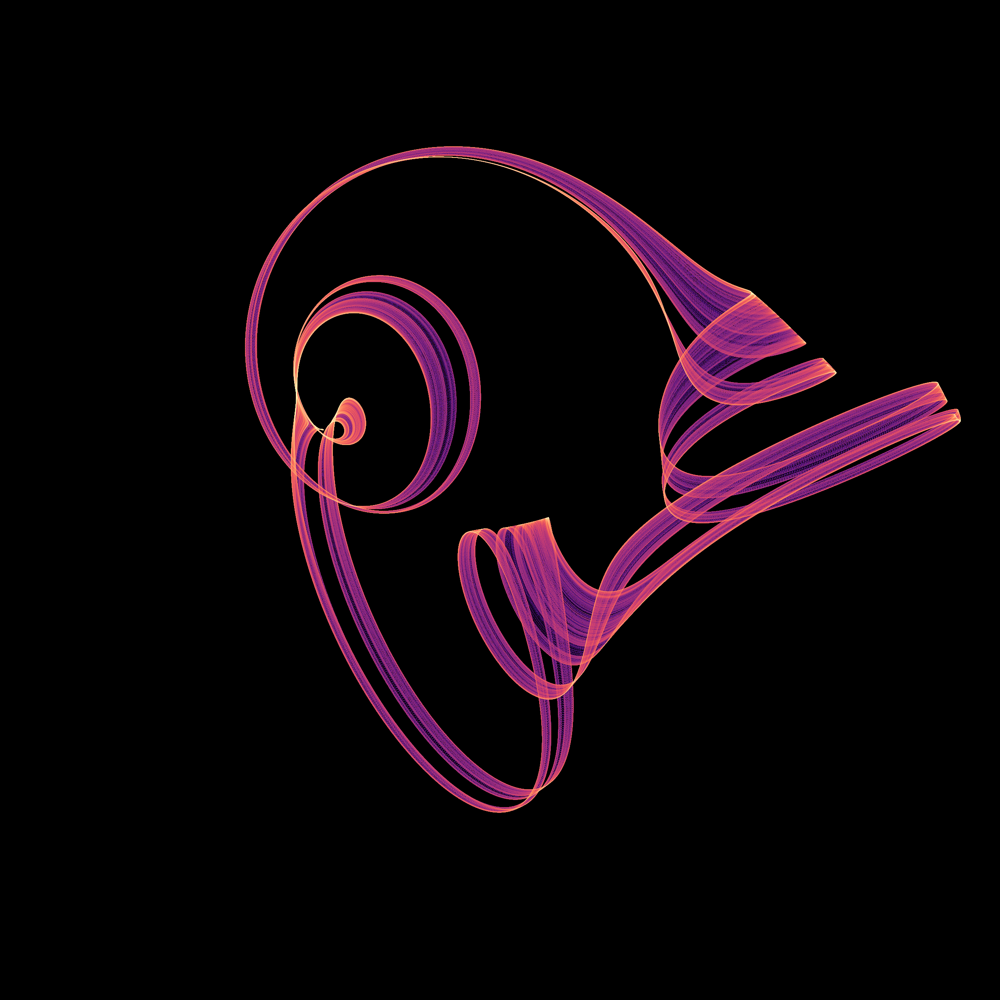

# Localized Gaussian vortices: a three-throat candidate



[Rotate the fixed trajectory](assets/gaussian-vortex-triskelion.gif) · [Novelty audit and comparisons](attractor-novelty-audit.md) · [Exact parameters and evidence](../results/gaussian-vortex/)

A continuous autonomous flow produces three spiral throats joined by thin folded bands. This changes the construction from the earlier discrete twist maps to a superposition of localized rotational fields and linear confinement. The image is a numerical chaos candidate, not a certified new attractor class. Its closest reference in the present geometric audit is **Halvorsen**: the three-lobed appearance and cyclic symmetry have clear precedents.

## The equation

For the coordinate basis vectors `e0,e1,e2`, with indices taken modulo three,

```text
r_n = x - d e_n
dx/dt = -gamma x + b
        + sum(n=0..2) omega_n (e_(n+1) cross r_n)
                         exp(-dot(r_n,r_n)/(2 sigma_n^2)).
```

The three centers and rotation axes are fixed. This is a deliberately constructed mathematical velocity field, not a derived Navier–Stokes solution or a validated physical device. There is no forcing clock, stochastic term, trajectory deformation or artificial reinjection.

The primary row, **77**, has equal strengths and widths and equal drift components:

| Parameter | Stored value |
|---|---:|
| `gamma` | 0.18557545144110918 |
| Each `omega_n` | 5.611788131296635 |
| Each `sigma_n` | 0.690724453702569 |
| `d` | 1.6117840299382804 |
| Each component of `b` | 0.1000276630744338 |
| Initial state | `(0.1, 0.2, 0.3)` |

The full vector field is equivariant under cyclic permutation of its coordinates. This symmetry is an equation property; finite trajectories need not sample all symmetry-related regions equally.

## What can be established analytically

Each rotational term is divergence-free: its linear cross-product matrix has zero trace, and the radial Gaussian gradient is perpendicular to the cross product. Consequently,

```text
div f = -3 gamma,
det D Phi_t = exp(-3 gamma t).
```

Moreover, `|r| exp(-|r|^2/(2 sigma^2)) <= sigma exp(-1/2)`, so

```text
d|x|/dt <= -gamma |x| + |b| + exp(-1/2) sum |omega_n| sigma_n.
```

For positive `gamma` and widths, every ball with radius strictly above the resulting threshold is forward invariant and absorbs bounded sets. The smooth field has a bounded derivative and therefore a complete flow. A compact global attractor exists. Its finite three-dimensional volume must equal itself multiplied by `exp(-3 gamma t)`, hence is zero. For row 77 the conservative radius threshold is **38.94025**; the observed primary trajectory stays below radius **2.69435**.

These statements do **not** prove that the pictured component is chaotic or attracting. The global attractor also includes other bounded invariant dynamics, including the competing numerical cycle below.

## Numerical evidence and unsuccessful outcomes

The search used 1,024 scrambled Sobol parameter rows. The first 256 enforce cyclic symmetry; the remaining 768 vary the strengths, widths and drift components separately. Forty-five rows pass the initial finite-growth and terminal-speed gates. A denser follow-up retains 41 under the declared growth gate; rows **299, 397, 590 and 713** fail it. All summaries and galleries are retained. Rows 77, 233 and 738 were selected visually, before the reference-catalog comparison.

Each selected row was restarted, warmed for 2,000 time units and observed for 12,000 at two RK4 step sizes. State and full tangent matrix are advanced together, with QR normalization at every step.

| Row | Leading exponent, `h=0.0125` | Leading exponent, `h=0.00625` | Minimum 500-unit window, finer run |
|---|---:|---:|---:|
| 77 | 0.033225 | 0.032843 | 0.018324 |
| 233 | 0.207436 | 0.196884 | 0.161968 |
| 738 | 0.122808 | 0.122164 | 0.093569 |

These are separate chaotic realizations; the finite estimates are not error bars or identical-orbit comparisons. The sum of all three exponents matches `-3 gamma` within `9e-8` in every reported 500-unit window, and within `7e-9` at the finer step. Row 233's leading estimate varies appreciably between runs, although all windows remain positive.

For the primary picture, a further run observes **30,000 time units** at `h=0.00625`, after a 2,000-unit warm-up. Its full spectrum is

```text
(0.0321221167, 0.0000074557, -0.5888559273).
```

Every one of its thirty 1,000-unit leading-exponent windows is positive; the minimum is **0.019900**. An independently coded cross-product/Jacobian evaluator with adaptive **DOP853** gives a leading estimate **0.032344** over 6,000 observed units. All twelve of its 500-unit windows are positive. Complex-step Jacobian, cyclic-symmetry, divergence and vortex-free exact-solution controls pass. A short direct trajectory comparison shows the expected fourth-order reduction in RK4 error.

The primary regime is **multistable** in these numerical checks:

- **12/16** fresh states from `[-3,3]^3` retain positive growth in every observed window over 6,000 units. The other four have nearly zero leading growth.
- Independent adaptive continuations of all four regular outcomes give a repeated section return with numerical period **63.83832949**. The largest closing error is below `7e-11`. This is numerical periodic-return evidence, without an interval existence or stability certificate.
- **9/12** independent parameter perturbations within ±0.5% retain the window criterion. Three do not. The separate two-decimal rounding control also passes, with leading estimate **0.029002**.

Thus neither a unique basin nor chaos throughout a parameter neighborhood is asserted. Positive finite-time expansion, repeated solvers and long bounded trajectories remain evidence rather than a proof of asymptotic chaotic attraction.

## What the image contains

The still bins **4,800,000 actual states** into a 2,400 × 2,400 orthographic count image. The camera uses an orthonormal basis adapted to `(1,1,1)`, a translation, and a rigid view rotation. Color represents log occupancy with the `magma` palette and gamma 0.72. There is no smoothing; no spatial points are clipped. The histogram, camera and trajectory hash are archived.

The 72-frame GIF rotates the camera around the same final 600,000 states. It does not animate a changing attractor or interpolate invented intermediate states. The full large render cloud remains hash-indexed on the D: drive; the final 100,000 states and complete still histogram are committed, and the render can be regenerated from the equations.

## Priority boundary

Gaussian vortex models and chaotic particle attractors have older precedents, including [a 2004 inertial-particle study](https://chaos1.la.asu.edu/~ylai1/papers/PRE_04_DL2.pdf). That model uses time-dependent wake vortices and inertial dynamics, unlike this autonomous three-state field. Cyclic three-dimensional strange attractors also appear in [Sprott's 1997 gallery](https://sprott.physics.wisc.edu/fractals/symmetry/). Neither Gaussian localization nor threefold appearance is claimed as new.

Our nonzero Gaussian contribution decays at spatial infinity. A polynomial with that property would be identically zero. Therefore this field is nonpolynomial and cannot be globally affinely conjugate, even with constant time rescaling, to a polynomial field such as Halvorsen, Lorenz or the four compared external atlas equations. This narrow equation-level distinction does not exclude nonlinear conjugacy, the same attractor topology, or an earlier equivalent Gaussian construction.

The [108-regime audit](attractor-novelty-audit.md) found no matching sampled cloud under its declared comparisons, but **historical uniqueness and new topology remain unestablished**.

## Reproduction

Python 3.12 and exact executed package versions are recorded in [provenance.json](../results/gaussian-vortex/provenance.json). Install [requirements-gaussian-vortex.txt](../requirements-gaussian-vortex.txt) in a virtual environment on the chosen work drive. On Windows, place temporary files and caches there as well:

```powershell
$env:PYTHONUTF8 = '1'
$env:PYTHONDONTWRITEBYTECODE = '1'
$env:TEMP = 'D:/attractor-work/tmp'
$env:TMP = $env:TEMP
$env:MPLCONFIGDIR = 'D:/attractor-work/mpl'
$env:NUMBA_CACHE_DIR = 'D:/attractor-work/numba'
New-Item -ItemType Directory -Force $env:TEMP,$env:MPLCONFIGDIR,$env:NUMBA_CACHE_DIR | Out-Null

python research/verify_gaussian_packet.py
python research/search_gaussian_vortex.py --out D:/attractor-work/scout
python research/followup_gaussian_vortex.py --scout D:/attractor-work/scout/data.npz --out D:/attractor-work/followup
python research/study_gaussian_vortex.py --out D:/attractor-work/checks
python research/check_gaussian_vortex.py --out D:/attractor-work/checks
python research/render_gaussian_vortex.py --out D:/attractor-work/render-data --assets D:/attractor-work/images
```

The regular-outcome and comparison scripts default to the archived packet paths; run them in a disposable checkout when recomputing rather than verifying the frozen evidence. Original executed source snapshots preserve the initial search and render; portable wrappers expose output paths.
