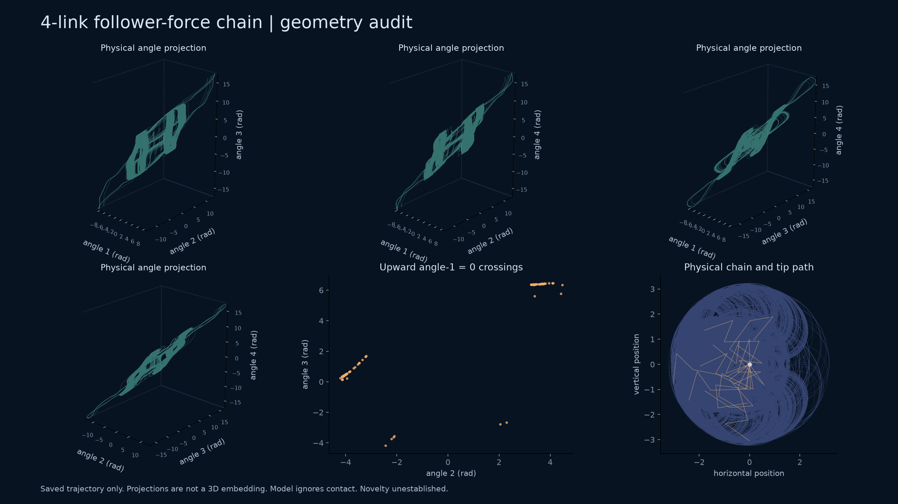

# Geometry-led search: motor models and follower-force chains

Status: 31 October 2026. **The requested distinctive new attractor remains unfound.** The strongest new numerical signal in this block is a four-link overdamped chain. Independent integration supports chaotic motion in its mathematical model, but the trajectory repeatedly crosses physical links and its geometry does not meet the visual objective. It is not promoted as a new physical attractor.

## What was tested

| Family | Completed observations | Outcome |
|---|---|---|
| Existing motor pair | Four parameter points, 800 additional time units each, dense adaptive sampling | Familiar two-lobed spiral geometry; not selected for visual novelty |
| Three motor rows | Nine-point grid, 200 warm-up + 1,000 observed units, full eight-dimensional spectra | Positive cases include one with two resolved positive finite-time exponents; triangular/cloud-like physical projections do not establish a new geometry |
| Three straight follower-force links | 48 equal-stiffness cases; 432 stiffness/force combinations including that same equal-stiffness subset | No leading mean above 0.004; no convincing chaotic candidate in this finite survey |
| Three curved, heterogeneous links | 4,096 Sobol samples; the earlier 512-case pilot is a prefix, not an additional independent cohort | No case passes four observed windows above 0.01 |
| Strongest three-link pilot signal, ID 92 | Independent full spectrum over 2,000 observed units | Leading estimate decreases to 0.000339 in the final window; no resolved positive-plus-neutral spectrum |
| Four follower-force links | 2,048 Sobol samples, 200 warm-up + 1,000 observed units | One retained scout, ID 824, followed independently below |

These are finite, explicitly bounded searches. Negative screening results do not exclude chaos throughout a model's parameter space. Full histories are indexed in the [compact evidence packet](../results/geometry-search-20261031/manifest.json); the selected adaptive traces and all GPU terminal states are included there. Large motor and straight-chain traces remain local and have recorded hashes. Their published drivers can reproduce fresh histories.

## Four-link candidate: why it is not our desired result



The figure uses all 200,000 saved samples from the independent continuation. Four panels show literal triples of unwrapped physical angles with equal units along each axis. The section is the upward crossing of angle 1 through zero, projected onto angles 2 and 3. The final panel shows the physical tip path and twelve chain configurations. No nonlinear embedding, angle wrapping, fitted projection, or duplicated trajectory is used. A three-coordinate projection of a four-dimensional flow is not a certified embedding.

The dimensionless parameters, with the first length, spring stiffness and bead drag fixed to one, are:

```text
force = 28.358176965602198
stiffness = [1, 0.3832723147931191, 2.447721949165214, 2.038221509614029]
drag = [1, 1.0287666059825502, 0.5339326496959879, 0.5210166081349753]
length = [1, 1.3913399468105048, 0.9198551809858749, 1.1904811314644916]
rest turns = [0, 0, 0, 0]
```

DOP853 full variational integration, after another 100-unit warm-up, gives the 2,000-unit finite-time spectrum

```text
(+0.2683756372, +0.0010662118, -4.9115836572, -14.6128379964).
```

The four 500-unit leading estimates are `0.28806, 0.21088, 0.29431, 0.28025`. The small second estimate changes sign between windows, consistently with the expected neutral flow direction. The variational-volume and integrated-divergence rates agree within `6.95e-12`. An independently assembled general-matrix field and complex-step Jacobian agree within `8.18e-16` relative error on the endpoint and sixteen declared control states. Short two-unit DOP853/Radau trajectories differ by at most `7.39e-11`. This is substantial numerical evidence, not an interval proof of an attracting chaotic invariant set.

**Nonadjacent physical links intersect at 29,178 of 200,000 sampled states (14.589%).** Angles reach approximately ±17.6 radians. The model contains no contact force, no thickness, no nonlocal hydrodynamics, and no out-of-plane freedom. The crossing fraction is a sample fraction, not a certified continuous-time fraction. These observations block a claim about a realizable confined filament. They also make the distinction between unwrapped spring strain and a principal-angle bending law consequential.

## Equations and prior-art boundary

For planar link angles `theta_i`, positive lengths `l_i`, bead drags `zeta_i`, spring constants `k_i`, and rest turns `c_i`, let `D` have diagonal 1 and subdiagonal -1. Set `K = D.T diag(k) D`, `theta_rest = cumulative_sum(c)`, and

```math
M_{ij}(\theta)=l_i l_j\cos(\theta_i-\theta_j)
\sum_{a=\max(i,j)}^N\zeta_a,
\qquad
M(\theta)\dot\theta
=F\,l\sin(\theta-\theta_N)-K(\theta-\theta_{\rm rest}).
```

These equations follow by virtual work from isotropic drag at each bead, linear torsional strain, and a compressive force tangent to the terminal link. `M` is positive definite. Angles are unwrapped elastic coordinates; replacing them by angles modulo `2*pi` changes this model.

This construction is **not a new chain model**. De Canio, Lauga and Goldstein [1] derive the equal two-link version. The inspected arXiv version's second displayed equation in the pair has a missing minus sign before its second angular velocity; virtual work and its characteristic equation fix the sign used here. Our two-link control reproduces `lambda^2 + 2(3-F)lambda + 1`.

Ling, Guo and Kanso [2, section 7] already give a general bead-chain construction and study two through six links. Their unrestricted chain moves in three dimensions, whereas our survey imposes a plane. Their angle-between-tangents elastic convention must not be declared globally identical to unwrapped linear spring strain after large turns. They also show that planar flapping may be unstable to out-of-plane perturbations. Their section 6 already discusses chaotic-like filament motion. Clarke, Hwang and Keaveny [3] subsequently analyze quasiperiodic and chaotic follower-force dynamics; related 2026 work [4] compares active-filament models. Intrinsic curvature and asymmetric beating are themselves established topics [5].

Consequently, neither adding links, finding chaos in a follower-force filament, nor introducing rest curvature is a defensible novelty claim. A precise new regime would require a much narrower comparison and a physically appropriate contact/stability audit. The current candidate does not pass our visual/physical selection.

## Other source gates checked in this block

- **Stomatal water regulation:** the 2003 Prytz–Futsaether–Johnsson study reports complex experimental rhythms and period doubling in its model [6]. The 2025 Brogardh–Johnsson model [7] adds active feedback and explicit delays; it is not a ready-made three-state ODE. Its diagrams and nonlinear response curves need faithful transcription before simulation. The 2024 Cong–Li–Hu aperture model [8] was located, but its complete equations were not recovered in this pass. No substitute equations were invented, and no novelty conclusion follows from these gaps.
- **Self-propelled liquid surfers:** the full 2026 preprint [9], not merely its abstract, already contains chaos and positive finite-time Lyapunov estimates in its three-variable model. Excluded from a first-chaos claim.
- **Bubble-driven rolling cylinders:** Zhao and Spagnolie [10] explicitly identify a generalized Lorenz reduction and chaotic motion. The unusual experimental setting does not make the attractor new.
- **Photothermocapillary trapping:** the 2018 main paper and supplement [11] were recovered. The main paper already discusses irregular behavior near a possible chaos transition. Its fitted constants are not interchangeable with those of the previously audited 2021 particle model; the [earlier closure gap](late-candidate-screening-5.md) remains.
- **cAMP signalling and slime-mould aggregation:** primary older work already reports autonomous chaos [12]. The appearance of a recent geometric-analysis paper does not restart the priority clock.

## Reproduction and failure accounting

The new drivers are in `research/`. A suitable environment contains NumPy, SciPy, Matplotlib, Numba and PyOpenCL; the GPU runs used FP64 on a GTX 1080. Example fresh runs:

```powershell
python research/search_follower_chain.py --links 4 --output outputs/follower-N4-reproduction
python research/check_follower_chain.py --source outputs/follower-N4-reproduction/complete.npz --id 824 --output outputs/follower-N4-independent
python research/render_follower_geometry.py --source outputs/follower-N4-independent/trace.npz --output outputs/follower-N4-figure
```

The CPU check starts from the saved scout endpoint, not a newly chosen initial condition. Short pointwise agreement between independent solvers is checked; long chaotic trajectories are not claimed to agree pointwise.

Three failures remain explicit. An empty event-array shape interrupted the first motor-grid attempt; a separately named corrected run completed all nine jobs. A disk-full error interrupted aggregation of the 432 straight-chain jobs: 429 complete histories were retained, and jobs 247, 249 and 252 were rerun with exactly their original inputs in a separate recovery directory. All 432 terminal-history hashes were checked when freezing the compact packet. A disk-full error also interrupted the first 4,096-case curved-chain batch; a fresh run on another drive completed it. Failed intervals are not counted as negative scientific results.

## References

1. De Canio, G., Lauga, E., and Goldstein, R. E. (2017). *Spontaneous oscillations of elastic filaments induced by molecular motors*. [Primary preprint](https://arxiv.org/abs/1707.02346).
2. Ling, F., Guo, H., and Kanso, E. (2018). *Instability-driven oscillations of elastic microfilaments*. [doi:10.1098/rsif.2018.0594](https://doi.org/10.1098/rsif.2018.0594).
3. Clarke, B., Hwang, Y., and Keaveny, E. (2024). *Bifurcations and nonlinear dynamics of the follower force model for active filaments*. [Primary preprint](https://arxiv.org/abs/2309.06294), [doi:10.1103/PhysRevFluids.9.073101](https://doi.org/10.1103/PhysRevFluids.9.073101).
4. *A comparison of instabilities and dynamic states in active filament models* (2026). [Primary article](https://www.cambridge.org/core/journals/journal-of-fluid-mechanics/article/comparison-of-instabilities-and-dynamic-states-in-active-filament-models/4B422099B6ACE7EC252A75BB15464AC5).
5. *Structural anisotropy stabilises asymmetric beating in instability-driven filaments*. [Primary preprint](https://arxiv.org/abs/2502.17140), [doi:10.1017/jfm.2025.10787](https://doi.org/10.1017/jfm.2025.10787).
6. Prytz, G., Futsaether, C. M., and Johnsson, A. (2003). *Self-sustained oscillations in plant water regulation: Induction of bifurcations and anomalous rhythmicity*. [doi:10.1046/j.1469-8137.2003.00742.x](https://doi.org/10.1046/j.1469-8137.2003.00742.x).
7. Brogardh, T., and Johnsson, A. (2025). *A model for the analysis of stomatal dynamics – applied to critical simulations of experiments on oscillatory transpiration in oat plants*. [Primary PDF](https://www.mic-journal.no/PDF/2025/MIC-2025-2-1.pdf).
8. Cong, X., Li, S., and Hu, D. (2024). *Stomatal aperture dynamics coupling mechanically passive and ionically active mechanisms*. [doi:10.1111/pce.14726](https://doi.org/10.1111/pce.14726).
9. Kawamura et al. (2026). *A Simple Model for Self-Propelled Liquid Surfers*. [Primary preprint](https://www.preprints.org/manuscript/202605.1371).
10. Zhao, M., and Spagnolie, S. E. (2026). *Autonomous route to the strange attractor: the many life stages of the chaotic bubblewheel*. [Author publication record and paper links](https://people.math.wisc.edu/~spagnolie/publications.html).
11. Hauser, A. W., Sundaram, S., and Hayward, R. C. (2018). [Primary main paper](https://subras.github.io/papers/PRL_18.pdf), [supplement](https://subras.github.io/papers/PRL_PTCO_SI.pdf), [doi:10.1103/PhysRevLett.121.158001](https://doi.org/10.1103/PhysRevLett.121.158001).
12. Martiel and Goldbeter, earlier cAMP-chaos work discussed in their [1987 primary model paper](https://utc.ulb.be/ARTICLES/1987_Martiel_Biophys_J.pdf). The low-dimensional reductions and ATP-dependent chaotic model must be distinguished.
