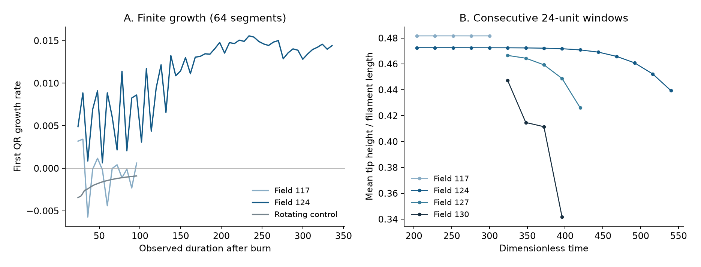

# Hydrogel filament: finite growth and slow transients

## Result

Longer integrations of the circular morphoelastic filament expose a slow
instability that short tip traces conceal. At field 124, the first computed
growth rate remains positive over 336 observed time units, but the mean tip
height drifts substantially. At field 130, an initially sustained coiled
motion eventually develops subdiameter clearances and loses Newton convergence.
Neither run establishes a chaotic attractor. Field 117 has three growth rates
close to zero in the tested window; its dynamics remain unclassified.

This study adds mesh and time-step controls, derivatives of the implicit
two-step evolution, and a rotating control with the expected neutral and
decaying directions. It retains all 20 declared runs, including the pilot
and the failed continuation. No new attractor portrait is promoted.

[Model and spatial discretization](hydrogel-spatial-controls.md) ·
[Numerical packet and reproduction](../results/hydrogel-variational-checks/README.md).

## Finite growth versus drift



The left panel shows the first QR growth rate, averaged from the end of the
declared burn interval. The right panel uses consecutive, complete 24-unit
windows of physical tip height. These are descriptive diagnostics, not
confidence intervals or a stationarity test. The rotating control uses
slenderness 50 and field −33; the other cases use slenderness 127.

All runs have circular cross-section, viscosity ratio `5e-6` and Poisson
ratio `0.5`. The three rates below are in QR-column order, without sorting
individual finite-window estimates. Time is nondimensionalized by the
curvature-relaxation time.

| Field | Segments | Step | Observed interval | Three finite growth rates |
| ---: | ---: | ---: | --- | --- |
| −33, rotating control | 64 | 0.004 | 124.12–220.12 | `−0.000896, −0.124153, −0.122252` |
| 117 | 64 | 0.006 | 216–312 | `0.000615, 0.000546, −0.000080` |
| 124 | 64 | 0.006 | 216–312 | `0.008621, 0.000235, 0.000594` |
| 124, continued | 64 | 0.006 | 216–552 | `0.014417, −0.000352, −0.000029` |
| 124, refined mesh | 128 | 0.006 | 360–456 | `−0.003474, −0.002651, 0.014098` |
| 124, smaller step | 64 | 0.003 | 360–456 | `0.001982, 0.012827, 0.008927` |
| 127 | 64 | 0.006 | 336–432 | `0.005253, 0.025893, 0.002823` |

For field 124, the mean tip height changes from `0.47247` in the first
24-unit window of the continuation to `0.43934` in the last. Field 127
also drifts: its corresponding means decrease from `0.46657` to `0.42603`.
Positive finite growth during these changes may describe an escaping
transient or an evolving instability. It does not identify an invariant,
attracting chaotic set.

### Refinement

Field 117 was restarted from the same time-96 state at 64 segments with
steps 0.006 and 0.003, and at 128 segments with step 0.006. All three runs
reach time 192. The late common-lag comparison, allowing axial rotation,
has its best minimum near 3.57, with nonzero full-state RMS discrepancies
of `0.08295`, `0.08221` and `0.09594`, respectively. This is neither an
exact period nor a spatial-convergence certificate.

Extending the lag search to 20 on the later time-312 states finds smaller
minima: lag `17.11048`, RMS `0.01320` for field 117, and lag `12.50470`,
RMS `0.04347` for field 124. Seven common anchor times are used in each
minimization. A short lag search would miss these near-returns; neither
minimum establishes a cycle or excludes quasiperiodicity.

For field 124, refinement starts from the time-312 coarse endpoint. The
128-segment run first relaxes for 24 units, then uses a further 24-unit
tangent burn and 96 observed units. It also has a positive finite growth
direction, but the columns have not settled into asymptotic ordering.
Its mean tip height decreases from `0.47664` to `0.47279` across the first
and last 24-unit windows of the tangent run. The minimum sampled clearance
is `0.03684`, with no subdiameter outcome among 2,501 samples.

Halving the step at 64 segments uses the same restart time, relaxation and
burn durations. Its mean tip height decreases from `0.47267` to `0.46936`;
the minimum sampled clearance is `0.04332`, with no subdiameter outcome
among 2,501 samples. Finite amplification survives both changes, but the
three rates differ in magnitude and ordering. These separately restarted
trajectories and finite tangent windows do not establish a converged
asymptotic spectrum.

### Geometric rejection

The field-130 run starts from the field-124 coiled endpoint at time 192.
Its first 120 time units have no tested clearance below the nominal diameter.
A further endpoint restart fails at attempted time `409.356`; the last
accepted state is at `409.350`, and the last saved trajectory sample at
`409.344`. In this continuation, 496 of 2,029 tested centerlines have a
nonlocal segment distance below `2/127 ≈ 0.015748`. The minimum is
`3.34e-5`. Thus changing the initial shape delays the failure but does not
provide evidence of a second safe attractor.

Field 124's coarse continuation has minimum sampled clearance `0.03504`,
with zero subdiameter outcomes among 5,001 samples. Field 127 has minimum
`0.02747`, with zero among 2,501. The screen omits nearby material neighbors
and tests sampled polygonal centerlines only. It is not a finite-thickness,
between-sample or continuum contact certificate.

## Differentiating the implicit evolution

The reference trajectory uses the same spatial mechanics and BDF2
curvature/position updates as the earlier solver. The new implementation
rearranges the drag Jacobian assembly algebraically; it introduces no
additional force, damping or reduced model. Both implementations are retained.

Let $`A=\mathrm{diag}(1,\eta^{-2})`$, and let $`F(R)`$ denote the
orientation-dependent curvature drive. Differentiating its eliminated
update gives

```math
(1.5I+\Delta t A)\,\delta\kappa_{n+1}
=2\delta\kappa_n-0.5\delta\kappa_{n-1}
+\Delta t\,DF(R_{n+1})[\delta\theta_{n+1}].
```

The old-position contribution to the velocity variation is

```math
\delta v_{\mathrm{old}}
=\frac{-2\delta r_n+0.5\delta r_{n-1}}{\Delta t}.
```

These terms drive a linear solve with the converged mechanical Jacobian.
The old-state elastic and drag variations are analytic; the new curvature
drive uses a centered directional difference. New nodal variations follow
from the rotated segment tangents. Every QR basis change is applied to
both retained time levels of curvature and nodal variations.

The normalization uses the current physical state, with mean squared
body-orientation variation plus squared curvature variation divided by
the field squared. It is not a norm of every coordinate in the enlarged
two-step history space. Three propagated directions are retained; this
does not compute the full spectrum. Initially they are independent Gaussian
curvature variations, copied to both history levels with zero nodal variations.
A 24-unit burn is excluded. The continued field-124 run restores both tangent
histories and accumulated logarithmic growth without a second burn.

If $`R^{(m)}`$ is the triangular factor at accepted step $`m`$, the reported
quantity is

```math
\widehat\lambda_j(T)=\frac1T\sum_m\log|R^{(m)}_{jj}|.
```

It is a finite-time rate of the constant-step implicit map under the stated
normalization. Asymptotic limits, continuous-time limits and spatial limits
have not been established.

## Implementation controls

| Control | Recorded discrepancy |
| --- | ---: |
| Rearranged versus earlier drag Jacobian, both BDF orders and two section shapes | at most `4.13e-16` relative |
| Rearranged drag Jacobian versus independent differences | at most `8.30e-11` relative |
| Complete old/new 128-segment histories, time 96–192 | orientation `7.46e-13`, curvature `1.87e-11`, tip `3.51e-14` maximum absolute |
| Complete nonlinear-step differences versus tangent propagation, 12 segments | at most `1.31e-8` relative |
| Exact circular-rotation tangent, 12 segments | at most `8.04e-12` absolute |
| Two-step propagation before/after QR basis change | at most `6.18e-13` relative |
| Nonlinear-step differences at the refined 128-segment field-124 state | at most `2.03e-10` relative |

Remeshing interpolates frames geodesically at segment centers and curvature
at its hinge midpoints. Axial moment equilibrium is then restored by material
spins that preserve the centerline. A constant-strain frame field is recovered
to `1.11e-16`. A 20-step pilot replays bitwise, including its saved BDF history;
the next step from the loaded checkpoint agrees exactly with the live state.
These controls check implementation, not continuum accuracy.

Endpoint restarts deliberately take one backward-Euler step and then BDF2.
They are new initial-value runs, not exact continuations of the previous
two-step history. Tangent runs instead load the complete saved BDF checkpoint.
The packet records every seed, source hash and distinction.

## Prior work and remaining question

[Boiardi et al.](https://arxiv.org/html/2604.09486v1) already describe this
morphoelastic model and periodic three-dimensional beating and rotation.
The [2023 planar predecessor](https://doi.org/10.1016/j.jmps.2023.105225)
reports flutter and self-sustained oscillations. Neither model nor generic
three-dimensional filament motion is a new result here.

Chaotic active filaments also have established precedents.
[Clarke, Hwang and Keaveny (2024)](https://doi.org/10.1103/PhysRevFluids.9.073101)
describe quasiperiodic states, intermittency and chaotic beating under a
compressive follower force.
[Krishnamurthy and Prakash (2023)](https://pmc.ncbi.nlm.nih.gov/articles/PMC10334789/)
report chaos under time-dependent follower forcing. These forcing laws differ
from steady-field internal-curvature relaxation; that difference alone does
not prove inequivalence of their attracting dynamics.

The bounded search recorded in the packet found no matching chaos result
for the exact 2026 morphoelastic law. This is not an absence proof. The present
numerics first need a persistent regime with converged growth and geometry
before an attractor-level novelty comparison becomes justified.

[Research index](../README.md#research-index) ·
[Reproduction](../results/hydrogel-variational-checks/README.md#reproduction)
