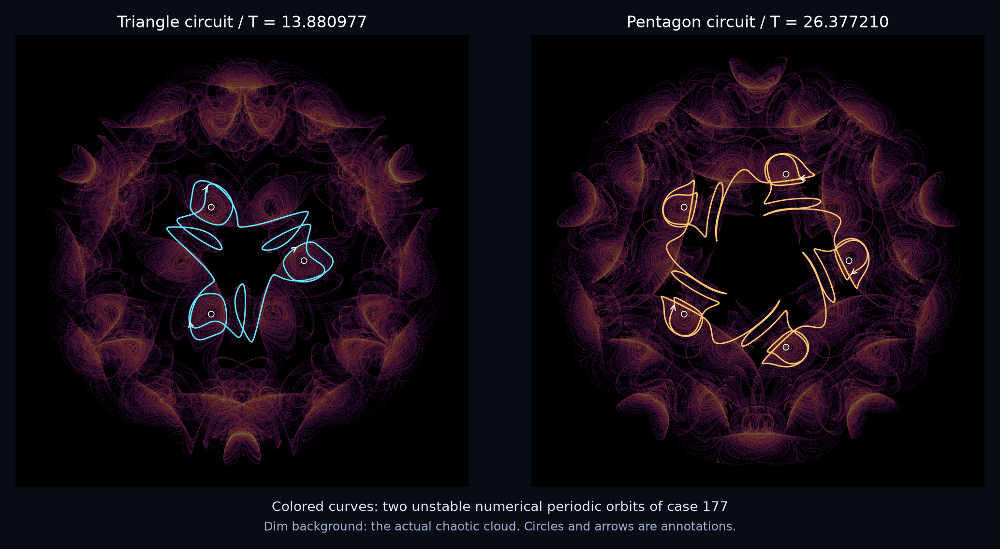

# Two short circuits inside the icosahedral cloud

Case 177 now has two independently checked **numerical unstable periodic orbits**: one visits three spiral centers around a triangular face, the other five around a pentagonal face. A neighborhood-size audit also sharpens the earlier visit graph: each of its sixty geometric edges has one observed direction. These results describe internal organization; they do not certify periodic existence, chaos or historical novelty.



Each panel uses its own rigid camera, facing the relevant circuit. Colored curves are direct full-period integrations, with no rotated trajectory copies. The dim background is the previously computed chaotic cloud; circles and arrows are annotations. These are periodic orbits of the same candidate, not two new attractors.

The [later return-map follow-up](icosahedral-returns.md) adds two sampled return strips and a closer known sphere flow with the same directed geometric skeleton after time reversal. This corrects the scope of any geometric novelty claim without changing the frozen cycle evidence.

## Correcting the interpretation of the visit graph

The [previous report](icosahedral-structure.md) used disjoint radius-0.12 neighborhoods around thirty certified equilibrium boxes. That finite record remains valid, but its 118 directed edges depend on which shallow visits the measurement misses.

| Neighborhood radius | Merged visits | Observed directed edges | Non-geometric transitions |
| ---: | ---: | ---: | ---: |
| 0.06 | 408 | 267 | 221 |
| 0.08 | 1,057 | 287 | 306 |
| 0.10 | 1,496 | 219 | 172 |
| 0.12 | 1,797 | 118 | 0 |
| 0.16 | 1,992 | 60 | 0 |
| 0.20 | 1,992 | 60 | 0 |
| 0.25 | 1,993 | 60 | 0 |
| 0.30 | 1,993 | 60 | 0 |

Radii 0.16 and 0.20 give exactly the same ordered center labels. Radii 0.25 and 0.30 agree with one another and add only the last visit. At these four radii there is exactly one orientation per geometric edge, two incoming and two outgoing edges per vertex. Every triangular and pentagonal face forms a directed cycle in this **observed graph**.

All 194 radius-0.12 transitions that oppose this orientation skip exactly one intermediate radius-0.20 visit. For example, the narrow record says `7 -> 14`, while the wider record says `7 -> 5 -> 14`. The small neighborhood turns two sides of a triangle into an apparent reversed third side. Still smaller neighborhoods miss enough visits to create apparent non-edge jumps.

All radii in the table are smaller than half the minimum separation of these centers, so the balls remain disjoint. Nearest-center assignment and merging of successive equal labels follow the older convention, including excursions outside every ball. This is a measurement sensitivity check, not an invariant Markov partition or a proof that all trajectories obey this graph.

## Finding and checking the circuits

A rotation-reduced recurrence search found 4,769 qualifying pairs and retained forty guesses. Adaptive relative shooting tried the first twenty-four; six met its numerical acceptance threshold and eighteen failed. All attempts are archived. Short near-returns around equilibria were not counted as successful cycles merely because they looked close.

The two selected candidates then underwent full-cycle multiple shooting with three or five independently adjustable nodes. That calculation uses the actual rounded coefficients and does **not** impose exact rotational closure. Independent full-period integrations use DOP853, fixed-step RK4 and a recursively generated high-precision Taylor expansion of the Gaussian field.

| Quantity | Triangle circuit | Pentagon circuit |
| --- | ---: | ---: |
| Search index | 0 | 20 |
| Full period | 13.880976643354348 | 26.37720988869418 |
| Visited center labels, cyclic | 0, 2, 1 | 26, 29, 28, 24, 22 |
| Multiple-shooting residual | 3.33e-14 | 2.20e-13 |
| Full DOP853 closure error | 4.53e-12 | 5.92e-10 |
| 110-digit Taylor closure error | 3.07e-12 | 6.25e-11 |
| Unstable Floquet multiplier, numerical | -456.1723 | -137613.7475 |
| Stable magnitude inferred from divergence | 6.7863e-9 | 2.4686e-16 |

The stable magnitude uses `exp(-3*gamma*T)/abs(mu_unstable)` and the autonomous neutral multiplier. Direct extraction of the tiny stable multiplier is poorly conditioned, especially for the pentagon; its inaccurate direct value remains in the raw report and is not promoted as reliable.

RK4 closure errors decrease from `1.31e-7` to `2.21e-11` for the triangle and from `2.06e-3` to `5.53e-7` for the pentagon as the step halves from 0.004 to 0.0005. The much larger unstable multiplier amplifies errors around the pentagon. Taylor endpoint differences between order 24 at step 0.02 and order 32 at step 0.04 are `5.72e-20` and `1.57e-17`. Raising arithmetic precision from 80 to 110 digits at the latter settings changes endpoints by about `6.41e-77` and `6.23e-74`; this isolates arithmetic precision, not truncation error. First- and second-order coefficients independently agree with `f` and `J f / 2` to binary64 accuracy.

The high-precision method discards step-end arithmetic radii and does not enclose the Taylor remainder. Its use of Arb therefore **does not make it a validated ODE solver**. The saved starting coordinates and periods remain approximate binary64 shooting results. Neither existence in an interval box, least period, nor membership in an asymptotic chaotic attractor has been proved.

## Additional prior-art check

Giedrius Alkauskas's [2017 preprint, published in 2020](https://arxiv.org/abs/1706.09295) constructs explicit proper-icosahedral Beltrami fields satisfying `curl B = B`. Its Theorem 1, Section 6 and rendered Figures 1, 2, 5 and 6 were inspected. The paper explicitly uses icosidodecahedral geometry. Figure 2 is a short trajectory from `(5,6,7)`; Figure 6 plots field values along a line, rather than an attractor orbit. The displayed equations differ from this damped Gaussian field. This comparison credits prior geometry and flow construction; it does not establish historical uniqueness or exclude later related work.

The abstract of [Grines and Osipov (2015)](https://doi.org/10.1134/S1560354715060040) describes three-dimensional equivariant flows with multiple heteroclinic networks. Only the abstract was reviewed, so it remains a full-text comparison lead. The earlier [broader audit](icosahedral-flow.md#prior-art-and-the-limits-of-uniqueness) still applies; a new parameter tuple or camera is not a discovery claim.

## Evidence and reproduction

The [new frozen packet](../results/icosahedral-cycles/README.md) preserves all attempts, full-cycle states, precision controls, neighborhood records, source snapshots and source metadata. Older packets are unchanged. [Portable reproduction instructions](../research/icosahedral_cycles/README.md) keep output separate from inputs.

```text
python research/verify_icosahedral_cycles.py --scratch D:/Codex/verify-icosahedral-cycles
```

The verifier checks hashes, reconstructs the finite graph and skipped visits, checks the cycle itineraries, repeats independent adaptive full-period integrations and reruns the low-order Taylor consistency checks. It does not certify historical priority.
