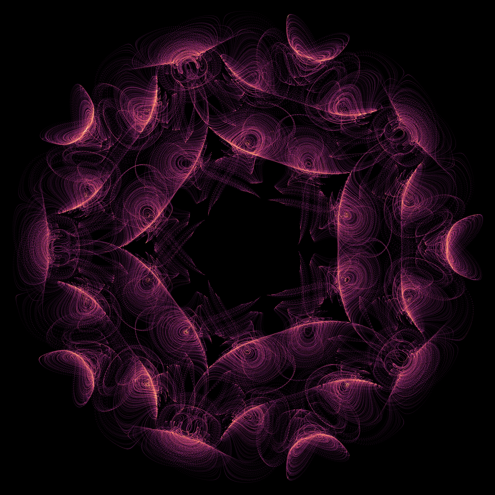

# Sixty rotations in one three-dimensional flow

**Two visually distinct numerical chaos candidates, with historical priority still open.** The primary image below is case 177: one trajectory passes through a hollow arrangement of folded ribbons and spiral fans. Case 183 has longer outward loops. Both come from a smooth autonomous three-state velocity field and survive independent integration. They are not assembled from rotated copies.



<!-- drawing-date -->
*First recorded drawing: **2026-11-01** ([record](https://github.com/Griboedow/chaos-attractor-lab/blob/8d5d8b58d0087a4f0ed59cc4258838b2d22568ac/docs/assets/icosahedral-177.png)).*
<!-- /drawing-date -->

[Rotate case 177](assets/icosahedral-177.gif) · [Looped case 183](assets/icosahedral-183.png) · [Rotate case 183](assets/icosahedral-183.gif) · [Full view-selection gallery](../results/icosahedral-flow/icosa-render/gallery.png)

The [return-map and prior-art follow-up](icosahedral-returns.md) records a two-strip numerical proposal and identifies the observed directed geometric skeleton in an earlier integrable sphere flow. The skeleton itself is not a novelty claim.

## Equation and selection

Let `I` be the sixty proper rotations of an icosahedron. For unit vectors `c,u`, define

```text
dx/dt = -gamma x + Omega sum(G in I)
        [(G u) cross (x-G c)] exp(-|x-G c|^2/(2 sigma^2)).
```

This extends the [tetrahedral construction](tetrahedral-flow.md) to a different rotation group. It is a deliberately constructed field, not a derived fluid experiment. Group averaging is established mathematics. The search aims to find unusual actual orbit geometry and examine its evidence, not claim that the averaging operation itself is new.

| Parameter | Primary case 177 | Looped case 183 |
| --- | --- | --- |
| `c` | `(0.3213743110381084, 0.33337145812310887, 0.8863306511193514)` | `(-0.6541024696644714, -0.25846930169810095, 0.7108752205967903)` |
| `u` | `(-0.9861789830371915, 0.00844992784220647, 0.16546785831451416)` | `(-0.3116266521766094, -0.8137996562705287, -0.49052925407886505)` |
| `sigma` | `0.1871655274834484` | `0.5021080202050507` |
| `gamma` | `0.3046252981039999` | `0.01296443751986359` |
| `Omega` | `12.567476945458692` | `8.412505832135071` |
| Initial state | `(-0.8540205471217632, -0.5178900741040706, 0.586555241793394)` | `(-1.1424379482865332, -0.25617291927337643, 0.18412337824702263)` |

The [stored arrays](../results/icosahedral-flow/icosa-v1/input.npz) are authoritative for numerical reproduction. The ideal equation uses the exact algebraic rotation group; SciPy's stored binary64 matrices approximate it. Selected-case equivariance residuals are below `4.3e-15`, and the complex-step Jacobian checks below `5.8e-15`. Exact symmetry statements concern the ideal equation, not a claim that rounded matrices close exactly under multiplication.

The initial screen used 256 scrambled Sobol rows. For each row, `Omega` was fixed to make the undamped field's RMS speed one on 144 predefined spatial probes. This sets the relative damping scale before integration; it does not deform rendered states. Fifty-one rows passed a short four-window positive-growth gate. Five underwent full-spectrum step refinement. **Case 85 failed**: its attractive short cloud collapsed to the stable central state during the longer runs. Case 29 retained positive growth but had larger step discrepancies and was not promoted. Cases 183, 43 and 177 proceeded to long integration. All scout data and selection reasons are retained.

## What is established analytically

Every localized cross-product term has zero divergence. Thus `div f=-3 gamma`, including for the rounded stored coefficients. The derivative is bounded, so solutions form a complete flow. For the ideal icosahedral group, equivariance implies `f(0)=0`, and the scalar central linearization is `Df(0)=-gamma I`. The origin is locally stable; complicated outer motion is not ruled out by that local fact.

A sharper radial bound is checked using **70-decimal outward interval arithmetic**. Write `C=1.0000000001`, larger than every stored center norm, and `U=sum_j |u_j|`, with the amplitude already included in each stored axis. For `r >= R >= C+sigma`,

```text
dr/dt <= -gamma r + U (r-C) exp(-(r-C)^2/(2 sigma^2)).
```

The ratio of the positive term to `gamma*r` decreases on this range. Strict interval inequalities at `R` therefore establish inward motion for every `r >= R`. The resulting closed balls are positively invariant and absorb every bounded set in finite time:

| Case | Certified absorbing radius | Largest observed radius in the long run |
| --- | ---: | ---: |
| 177 | 1.8 | 1.23896 |
| 183 | 3.3 | 2.41717 |
| 43 | 2.8 | 2.18167 |

The [certificate](../results/icosahedral-flow/icosa-absorbing/certificate.json) uses exact integer-ratio conversions of the stored binary64 coefficients. This proves boundedness of the equations, not chaos of the pictured component. A compact global attractor exists; constant negative divergence makes its three-dimensional volume zero. The global attractor can include the stable center and other invariant components.

## Chaos and attraction evidence

Three-step full spectra use RK4 steps `0.025`, `0.0125` and `0.00625`, starting from the original state, discarding 500 time units and observing 2,000. The three retained cases have positive leading growth in every 250-unit window. Longer runs discard 2,000 units and observe **16,000**, divided into eight windows:

| Case | Long-run step | Full mean spectrum | Smallest leading window | Independent DOP853 leading rate |
| --- | ---: | --- | ---: | ---: |
| 177 | 0.00625 | `(0.325129, 0.000083, -1.239088)` | 0.308986 | 0.323703 |
| 183 | 0.0125 | `(0.084554, -0.000042, -0.123406)` | 0.079809 | 0.088316 |
| 43 | 0.0125 | `(0.120131, -0.000045, -0.145965)` | 0.111089 | Not run |

The independent DOP853 implementation uses NumPy field and Jacobian expressions, tolerances `1e-10/1e-12`, maximum step `0.25`, and QR every two units. It discards 2,000 units and observes 6,000. Its spectrum-sum error relative to `-3 gamma` is below `4.0e-12`. Leading rates remain positive in every window. Individual chaotic paths are not expected to agree pointwise across solvers, and finite-window rates vary.

Fresh basin tests discard 1,000 units and observe 4,000 at `h=.0125`. The positive gate requires all four leading windows above `0.01` and nonzero terminal speed:

| Case | Fresh volume starts in `[-3,3]^3` | Nearby cloud perturbations | Small central starts |
| --- | --- | --- | --- |
| 177 | 16/16 positive | 8/8 positive | 4/4 approach center |
| 183 | 11/16 positive; 5 regular outcomes | 8/8 positive | 4/4 approach center |

The five regular outcomes for 183 have near-zero leading rates and two negative transverse rates. They are retained as competing motion, not discarded. These finite tests support local chaotic attraction and coexistence; they do not certify a basin boundary, asymptotic chaos, or exclude a very long chaotic transient.

A numerical shooting follow-up finds a competing periodic orbit with period **11.6191908544** and closure residual `3.4e-15`. Its two nontrivial Floquet multipliers have modulus **0.79775447**, supporting transverse stability. All five regular basin outcomes match rotated copies of this sampled orbit, with RMS discrepancies below `1.26e-4`. This is numerical periodic-orbit evidence, not an interval existence or least-period certificate. [Shooting report](../results/icosahedral-flow/icosa-cycle/report.json).

## Symmetry, chirality and the actual image

Each portrait contains **1,280,000 actual states** over the same 16,000-unit observation. Case 177 retains every second RK4 state, and 183 retains every state. Every retained point contributes to the image histogram. Cameras are orthographic and rigid; there is no spatial smoothing, artificial reinjection, nonlinear display transform or symmetry replication. GIFs rotate the same fixed 320,000-state subset.

The trajectories visit all sixty direction sectors. A disjoint-half nearest-neighbor check compares 8,000 later states with 40,000 earlier states, scaled by the orbit's RMS radius. For 177 the largest discrepancy across proper rotations is **1.029 times** the identity discrepancy; the smallest discrepancy across the sixty corresponding improper transformations is **2.576 times** identity. For 183 these ratios are **1.154** and **2.460**. Sampling imbalance remains visible, particularly for 183; this is not an exact invariant-measure symmetry proof.

A second diagnostic uses the product of the fifteen scalar projections onto the twofold axes, evaluated on `x/|x|`. This degree-15 angular quantity is invariant under proper icosahedral rotations and odd under inversion. Its overall sign convention is arbitrary. For 177 its mean divided by its RMS is `+0.04037`; for 183 it is `-0.37952`. All sixteen disjoint block means retain the respective sign. This supports a handed empirical distribution. Blocks are not assumed independent, and no p-value or asymptotic chirality theorem is assigned. [Full diagnostics](../results/icosahedral-flow/icosa-chirality/report.json).

## Prior art and the limits of uniqueness

Reiter's **Chaotic attractors with the symmetry of the dodecahedron**, The Visual Computer 15 (1999), 211–215, already contains polyhedral chaotic-map images. [Author preprint](https://webbox.lafayette.edu/~reiterc/dodec/dodec02_pp.pdf), [DOI](https://doi.org/10.1007/s003710050173). We independently implemented the Figure 1 formula and reproduced its four published rounded iterates to within `4.7e-7`. Its cloud is now a direct comparison reference. The second figure has visually relevant loops, but its parameters are absent from the appendix; that comparison remains incomplete. Neither polyhedral appearance nor group averaging is claimed as new.

The [1996 flow-literature follow-up](polyhedral-priority-followup.md) also matters. Field, Melbourne and Nicol's low-dimensional construction in Section 5 uses a limiting graph of equilibria; their Axiom A construction applies in higher dimension. That particular construction does not supply an explicit moving chaotic three-state flow. It also does not establish first discovery for our candidates.

The [Attractor Atlas](https://sakeeb91.github.io/attractors/) reports unsuccessful searches for polyhedral chaotic flows. Its central-linearization argument is local and does not prove a global prohibition. Our evidence is a reproducible numerical challenge to that broad interpretation, not an interval proof of chaos.

The expanded geometric comparison includes **109 literature regimes and six earlier repository candidates**. It allows rotation, reflection and uniform scale, then repeats after covariance whitening. The following figures are best local ICP RMS discrepancies; smaller means closer:

| Candidate and preprocessing | Temporal halves | Nearest descriptor match | Its ICP discrepancy | Reiter Figure 1 discrepancy |
| --- | ---: | --- | ---: | ---: |
| 177, similarity | 0.06223 | Atlas-Mobula | 0.16965 | 0.18662 |
| 177, affine whitening | 0.06280 | BeerRNN | 0.20572 | 0.19309 |
| 183, similarity | 0.07449 | Atlas-Mobula | 0.15850 | 0.15952 |
| 183, affine whitening | 0.07644 | OurVortex-233 | 0.16601 | 0.15407 |

The descriptor ranking and alignment objective differ, so the nearest descriptor match need not have the smallest alignment discrepancy. ICP has 48 local starts and no global-optimum certificate. These are finite geometric differences, not a proof against nonlinear conjugacy, another parameter regime, a different invariant measure, or an unexamined publication. Reiter's complete 1997 tetrahedral examples and 1999 Figure 2 remain gaps. **A calibrated “99% nobody has seen this” claim is not supported.**

## Reproduce and inspect

The [112 MB frozen packet](../results/icosahedral-flow/README.md) records all screens, failed cases, selected runs, independent solvers, basin starts, comparison clouds, histograms, interval bounds, source snapshots and input hashes. All scratch computation was on drive D. Dense arrays can be regenerated; their byte hashes and samples are retained.

[Portable scripts and execution order](../research/icosahedral_search/README.md). To verify the archived evidence and re-evaluate the absorbing-ball inequalities:

```text
python research/verify_icosahedral.py --scratch D:/Codex/verify-icosahedral
```

This checkpoint provides two substantial images and stronger numerical evidence. The search for an unambiguously new attractor remains open.
