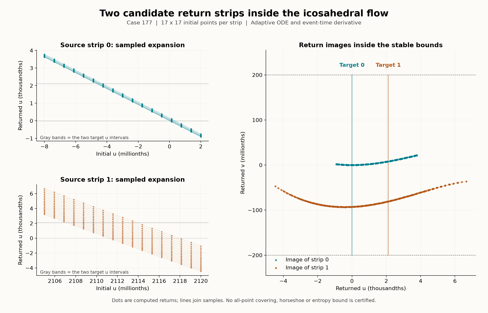

# Two return strips and a closer geometric predecessor

Case 177 has a promising **numerical two-strip return configuration** near its triangular periodic-orbit candidate. All 578 sampled starts return with positive boundary margins and strong measured expansion. This is a proposal for a future covering proof, not a certified horseshoe or an entropy bound.

The novelty audit also found a closer predecessor: an integrable icosahedral sphere flow has the same directed geometric graph after an explicit coordinate change and time reversal. The graph itself is therefore not a novelty claim.



The dots are computed section crossings. Lines only connect samples. The targets are intentionally narrow; neither the displayed lines nor the shaded bands enclose behavior between samples. This is a diagnostic of the existing case 177, not a new attractor portrait.

## What was actually computed

The section passes through the approximate triangle-cycle point from the [cycle follow-up](icosahedral-cycles.md). Its normal is the normalized vector field there. The two columns of the saved basis are numerical eigenvectors of the event-corrected return derivative, ordered by decreasing multiplier magnitude. They have unit length and need not be orthogonal. The numerical coordinate convention is

```text
x = x0 + B (u,v),             (x-x0) dot n = 0,
x0 = (-1.0776618005076668, 0.04561237206305864, 0.11748519187281951).
```

The full frame, including all binary64 coefficients, is stored in `icosa-return-scout/data.npz`. Its small rounding residuals are not an exact interval parametrization of a plane.

We select the first numerically detected positive crossing after time 1 that satisfies `|u| < 0.15`, `|v| < 0.01` and `n dot f > 0.05`. An earlier spiral crossing lies outside this local patch. These exclusions are part of the definition; this is not a claim about the first crossing of the entire infinite plane. The DOP853 horizon is 25, with `rtol=2e-12`, `atol=2e-14`, and maximum step 0.04.

The two source rectangles are:

```text
R0: -0.000008 <= u <= 0.000002,  -0.0002 <= v <= 0.0002
R1:  0.002105 <= u <= 0.002120,  -0.0002 <= v <= 0.0002.
```

Each has a uniform 17 by 17 grid, including its boundary. Every sampled left edge returns to the right of both target intervals; every sampled right edge returns to their left. All sampled returned `v` coordinates stay strictly inside the common stable interval.

| Sampled quantity | R0 | R1 |
| --- | ---: | ---: |
| Number of starts | 289 | 289 |
| Minimum left-edge margin beyond both targets | 0.0015013 | 0.0010865 |
| Minimum right-edge margin beyond both targets | 0.0007426 | 0.0010611 |
| Stable-coordinate margin | 0.0001784 | 0.0001068 |
| Return time range | 13.8674–13.9549 | 19.7989–20.0578 |
| Minimum positive crossing speed | 0.7749 | 0.7514 |
| Minimum unstable-coordinate cone expansion | 447.91 | 499.64 |
| Maximum image cone slope | 0.008953 | 0.024877 |

For a tangent vector with `|dv| <= 0.1 |du|`, the reported expansion is `|J00|-0.1|J01|`, and the image slope bound at that point is `(|J10|+0.1|J11|)/expansion`. These are coordinate quantities evaluated at the sampled points, not uniform bounds on either rectangle. `J` includes the event-time correction

```text
J = B^+ [Id - f n^T/(n^T f)] D Phi_t B.
```

The initial 513-point line scout, all three local-patch filters, the preliminary 54-point rectangle grid, the complete 578-point grid and the controls are archived. Failed or missing returns in the broader scout are not silently replaced by successful local samples.

## Independent numerical controls

Two separately written field/Jacobian implementations agree to `1.78e-15` on thirty seeded states. Ten corner/center controls use tighter DOP853 tolerances and fixed-step RK4 with event bisection. Tightening the adaptive calculation changes returned coordinates by at most `1.47e-12` and derivatives by `2.28e-8`.

Maximum RK4 coordinate discrepancies decrease from `2.61e-8` to `1.44e-9` to `8.41e-11` as the step halves from 0.005 to 0.00125. Every individual refinement ratio exceeds 16.29. Two central-difference checks of the event-time derivative have maximum entry errors below `1.91e-5`, compared with expanding entries of magnitude roughly 450–520.

These checks support numerical reliability at tested points. No validated ODE tube, all-point section crossing, interval covering relation, invariant set or asymptotic attraction certificate is supplied. Even a future horseshoe certificate would need to be distinguished from proof that the displayed cloud is an attracting chaotic set.

## The graph has a known integrable counterpart

Giedrius Alkauskas's author-uploaded [The simplest icosahedral flow on the sphere](https://www.researchgate.net/publication/408109303_The_simplest_icosahedral_flow_on_the_sphere), dated 2026-06-26, studies

```text
phi = (1+sqrt(5))/2,       rho = x^2+y^2+z^2,
P6 = (phi^2 x^2-y^2)(phi^2 y^2-z^2)(phi^2 z^2-x^2),
F = (5/2-sqrt(5)) grad(rho) cross grad(P6).
```

Both `rho` and `P6` are conserved. On the unit sphere, the zero level of `P6` gives thirty saddle vertices and sixty great-circle arcs bounding twenty triangles and twelve pentagons. Regular levels instead give closed curves. Sections 1–2 were read through the author's full-text upload; PDF retrieval failed, so no figure-level comparison is claimed. This is a preprint, not an independently established peer-review record. [DOI](https://doi.org/10.13140/RG.2.2.20034.95689).

Our new comparison uses the explicit swap `S(x,y,z)=(y,x,z)` and pulls back the entire vector field as `S^T F(Sx)`. This handles the orientation change in the cross product. At the spherical midpoint of each of the sixty observed directed edges, its normalized field points opposite the edge tangent: every dot product is `-1` to binary64 rounding accuracy. The maximum absolute sextic level at those midpoints is `3.53e-16`. Thus the finite directed graph matches the **time-reversed known skeleton**. It is not evidence that our trajectories are heteroclinic connections.

The same explicit comparison does not identify the full flows. On 10,000 frozen states of our trajectory, the radius ranges from `0.80597` to `1.23859`, and the sextic evaluated on normalized states ranges from `-0.44452` to `0.08356`. This motion does not remain on one of that reference's fixed-radius, fixed-level curves. It is not a general proof against nonlinear equivalence or an exhaustive literature search. Historical uniqueness remains open.

## Evidence and reproduction

[Frozen packet](../results/icosahedral-returns/README.md) · [Portable stages](../research/icosahedral_returns/README.md) · [Drawing date records](../records/render-dates.json)

```text
python research/verify_icosahedral_returns.py --scratch D:/Codex/verify-icosahedral-returns
```

The verifier checks hashes and all sampled margins, repeats selected integrations with the separate NumPy implementation, compares fixed-step returns, and reruns the spherical-reference comparison. Earlier numerical packets and their manifests remain unchanged.
