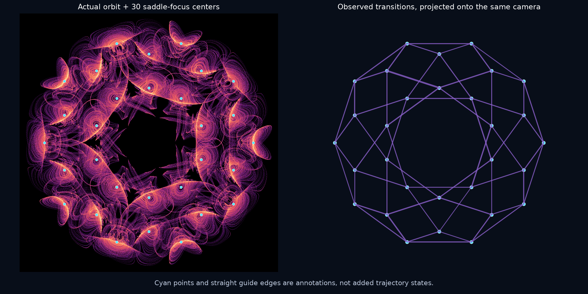
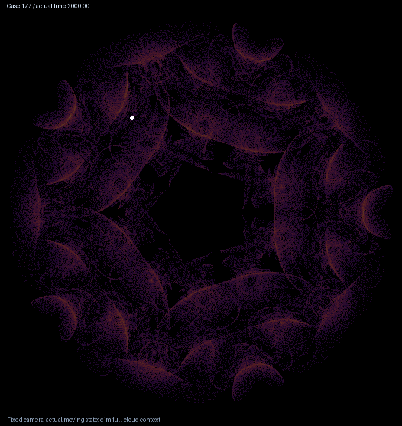

# Thirty spiral centers and an icosidodecahedral itinerary

The [icosahedral flow's primary case 177](icosahedral-flow.md) has a concrete internal organization. Thirty outer equilibria sit at the centers of its spiral fans. A long orbit repeatedly visits all thirty neighborhoods, and every recorded transition connects neighboring directions of an icosidodecahedron. This is an empirical description supported by certified local equilibria, not a proof of a new chaotic topology.



The cyan markers and straight edges are explanatory annotations. They are not additional trajectory points. Both panels use the same rigid orthographic camera. Edge thickness records the number of observed transitions in both directions.



The bright point follows the actual numerical state for approximately 320 time units; the trail shows the preceding 12 units. The dim background is the full cloud. Playback restarts at the beginning; that jump is not a dynamical recurrence.

## Certified local equilibria

An inventory used 1,024 Sobol volume starts and 500 points from each long orbit, analytic Jacobians and completion under the sixty numerical rotations. Subsequent outward interval calculations at **60 and 90 decimal digits** certify at least **161 distinct roots for case 177** and **101 for case 183**. Each coordinate box has radius `1e-8`. Exact integer ratios define all stored binary64 coefficients.

Strict Krawczyk inclusion and an interval contraction norm below one establish a unique root in each box. Pairwise interval comparisons establish box disjointness. Strict signs of the cubic Routh first column establish the number of unstable eigenvalues. The calculation applies to the actual rounded coefficient field; it does not require its rotation matrices to form an exact algebraic group.

| Case | Approximate radius | Root boxes | Unstable directions per root |
| --- | ---: | ---: | ---: |
| 177 | 0 | 1 | 0 |
| 177 | 0.5525187 | 20 | 1 |
| 177 | 0.7055904 | 30 | 2 |
| 177 | 1.0408942 | 30 | 2 |
| 177 | 1.2374565 | 60 | 1 |
| 177 | 1.2885348 | 20 | 2 |
| 183 | 0 | 1 | 0 |
| 183 | 0.2294413 | 20 | 1 |
| 183 | 0.2667308 | 30 | 2 |
| 183 | 2.4284623 | 30 | 1 |
| 183 | 2.5033438 | 20 | 2 |

Thus case 177 has one stable equilibrium, eighty with one unstable direction and eighty with two. Case 183 has corresponding counts one, fifty and fifty. **The inventory is not exhaustive.** Group completion and balanced counts do not exclude additional roots. The certificates rely on the stated interval implementation and runtime, rather than a proof-assistant formalization.

At a representative outer fan center of case 177, the numerical eigenvalues are approximately `-1.436623` and `0.261374 ± 3.974258 i`: transverse spiraling expands while the third direction contracts. The interval certificate establishes the unstable-direction count; these displayed complex eigenvalues are numerical. At a representative outer saddle of radius `1.2374565`, they are approximately `4.164610` and `-2.539243 ± 0.894691 i`.

## Finite visits between the fans

**Follow-up:** a [neighborhood-size audit](icosahedral-cycles.md#correcting-the-interpretation-of-the-visit-graph) finds 60 consistently oriented edges at radii 0.16–0.30. All 194 apparently reversed transitions in the radius-0.12 record below skip one intermediate visit. The original measurements are retained; the larger-neighborhood comparison sharpens their interpretation.

We place disjoint radius-`0.12` neighborhoods around the thirty fan centers. From the previously archived 16,000-unit orbit, sampled every `0.0125` units, consecutive visits to the same center are merged even if an excursion temporarily leaves all neighborhoods. The resulting record contains:

- 1,797 visits, covering all thirty centers;
- 1,796 transitions, each between directions separated by 36 degrees;
- 118 observed directed edges out of 120 geometric possibilities;
- 43.86% of stored states inside these neighborhoods.

The thirty normalized directions have sixty undirected edges, degree four at each vertex, twenty triangular faces and twelve pentagonal faces. A convex-hull calculation checks this icosidodecahedral geometry. Every observed transition is along one of its edges; two directed edges are absent from this finite record. The identification is consistent with the standard twofold-axis orbit described in [Słomczyński and Szymusiak's primary geometry discussion](https://link.springer.com/article/10.1007/s11128-015-1157-z).

The neighborhood radius was selected for this exploratory diagnostic. Its transition graph is not a Markov partition, an all-orbit transition rule or a topological invariant. No heteroclinic connections have been proved, and a straight guide edge does not assert that a trajectory travels along a straight segment.

## Starts close to the saddles

Twelve additional starts use perturbations of sizes `1e-4` and `1e-6` near representative equilibria of radii `1.0408942` and `1.2374565`. At the first, four directions span the numerically unstable plane; at the second, both directions of the unstable line are used. Each run discards 500 time units and observes 2,000 at RK4 step `0.00625`, with full variational equations.

All twelve retain positive leading growth in every 500-unit window; the smallest window rate is `0.29315`. This supports access to the chaotic cloud near other unstable equilibria even though the central equilibrium is stable. It does not establish an arbitrary-neighborhood basin property, a formal hidden/self-excited classification or an exact saddle connection.

## Prior work and reproduction

Symmetric bifurcation and heteroclinic dynamics are established subjects. Rebecca B. Hoyle's [Shapes and cycles arising at the steady bifurcation with icosahedral symmetry](https://doi.org/10.1016/j.physd.2003.11.011), Physica D 191 (2004), 261–281, reports stable heteroclinic cycles in a five-dimensional representation. We inspected the publisher abstract and section excerpts; the complete paper was not retrieved. This prior work is relevant context, not something excluded merely by a different dimension or by a failed title search. The earlier [map and flow audit](icosahedral-flow.md#prior-art-and-the-limits-of-uniqueness) remains applicable.

The [separate frozen packet](../results/icosahedral-structure/README.md) preserves local certificates, inventory, perturbation runs, visit data, geometry, figures and source snapshots. It leaves the earlier search packet unchanged. [Reproduction instructions](../research/icosahedral_structure/README.md) explain the two input/output locations and regeneration of dense orbit data.

```text
python research/verify_icosahedral_structure.py --scratch D:/Codex/verify-icosahedral-structure
```

The verifier checks hashes, finite visit counts and graph geometry, then recalculates all 262 local interval certificates at 60 digits. Historical novelty and asymptotic chaos are not certified.
