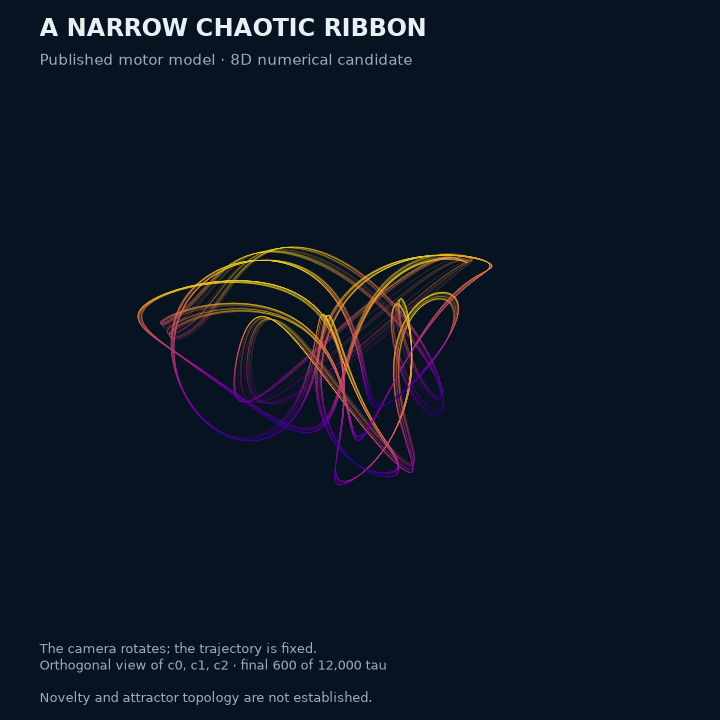
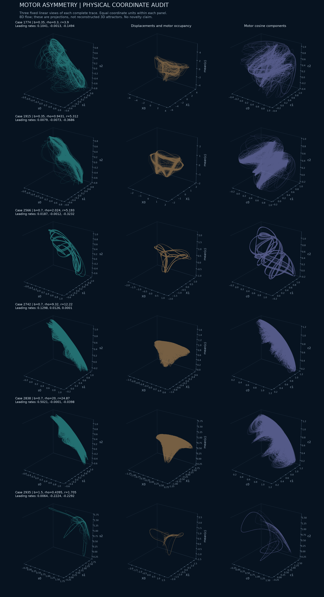
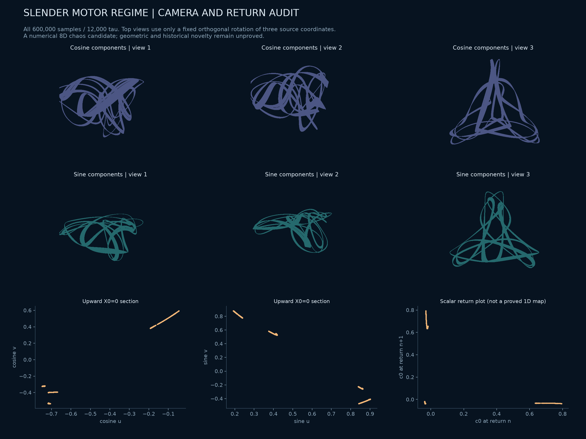
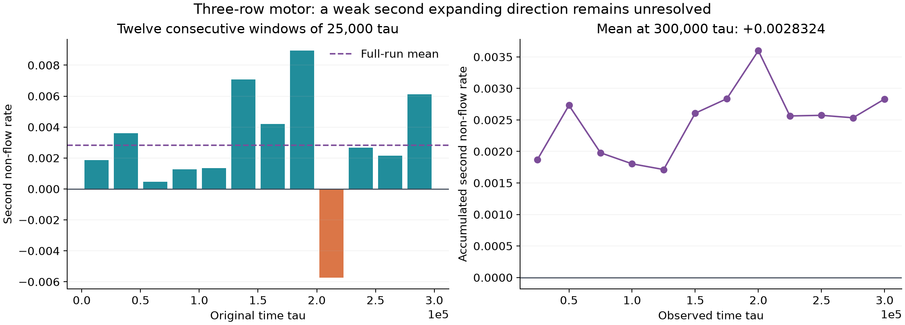
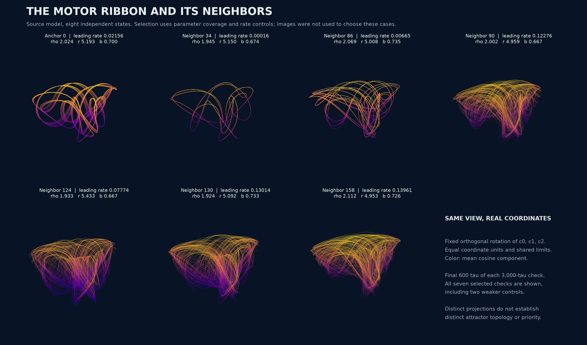

# A slender chaotic motor regime: geometry before a novelty claim

The asymmetry survey finds a more legible ribbon-like numerical candidate in the **existing eight-dimensional, three-row motor model**. Its leading finite-time exponent stays positive over 12,000 time units. The figure is a projection of that flow; neither a new attractor topology nor scientific priority has been established.



The camera rotates around the final 600 units of one saved trajectory. Coordinates are a fixed orthogonal rotation of the literal cosine components `(c0,c1,c2)`. Color is their mean, and coordinate units remain equal. The displayed segment uses every second saved sample, at spacing `0.04`. There is no nonlinear embedding, wrapping, smoothing, or simulated deformation of the trajectory. [Poster](assets/motor-ribbon-poster.png) · [Rendering provenance](../results/motor-asymmetry/animation/animation.json).

## What was varied

The [source audit](motor-rows-source-audit.md) defines the exact equations and physical rate constraints. This survey varies their prescribed transition-rate asymmetry `b=B/A`, rather than introducing another reaction or feedback. The dimensionless family is exploratory, not an experimentally calibrated ATP path.

The declared grid has 12 logarithmic values of `rho` from 0.3 to 20, 24 values of `r/(rho+1)` from 1.03 to 3, and `b` in `{0,.05,.15,.35,.7,1.5,3}`. Two fresh, seeded zero-sum displacement starts per tuple give **4,032 trajectories**, all completed. Each uses 300 warm-up and 1,200 observed original `tau` units. The preliminary rule retains 125 lanes; the stricter rule requiring all four leading-rate windows above `0.01` retains 122. These are screening counts, not counts of distinct attractors or basin probabilities.

For each `b`, the follow-up takes the first retained start per parameter tuple, sorts by leading rate and selects the endpoints and median. This yields six independent full eight-direction QR calculations. The first gallery is deliberately retained, including the weak cases.

| Scout ID | b | First three rates over 1,200 tau | Follow-up interpretation |
| --- | --- | --- | --- |
| 1774 | .35 | .104140, −.001337, −.149429 | Positive leading windows; tangled projection |
| 1915 | .35 | .007889, −.007279, −.368559 | Weak and imperfectly resolved neutral direction |
| 2566 | .7 | .018741, −.001203, −.323228 | Slender geometry selected for a longer calculation |
| 2742 | .7 | .129848, .012627, .000142 | Two positive finite-time directions; dense geometry |
| 2838 | .7 | .502138, −.000129, −.039754 | Strong leading growth; broader triangular projection |
| 2935 | 1.5 | .006423, −.222359, −.229170 | Leading growth loses persistence across windows |



## Longer numerical checks

The slender case is

```math
N=3,\qquad \rho=2.0238144033191343,\quad
r=5.193274038098629,\quad b=0.7.
```

After a separate 200-unit warm-up, its 12,000-unit full spectrum is

```text
 0.02382088, -0.00021576, -0.33160845, -0.48833590,
-0.74941491, -0.80220738, -0.80278519, -0.92109230
```

The four 3,000-unit leading estimates are `0.0195491, 0.0261372, 0.0252373, 0.0243599`. The near-zero direction changes sign across windows. This supports sustained numerical chaos; it is not an interval proof of an attracting chaotic invariant set. The full history contains 600,000 samples and 2,430 upward `X0=0` crossings.

A fresh 12,000-unit calculation with relative tolerance tightened from `2e-10` to `2e-11` and maximum step halved from `0.02` to `0.01` gives leading estimates `0.02275977, -0.00020998, -0.32956918`. All four leading windows remain positive, between `0.0217656` and `0.0247362`. Their variation is compatible with the first run's finite-time spread; long chaotic trajectories are not compared point by point. This recomputation also records 2,430 upward crossings and a disk maximum below 1.367.

The stronger but less distinctive case 2838 also retains positive leading growth over 12,000 units: its first three estimates are `0.496980, 0.000616, -0.044417`, with four leading windows between `0.492423` and `0.503021`.

For case 2566, the source force-constraint formulation and its complex-step Jacobian agree with the implementation on 17 distributed states to relative error below `3.32e-16`. Independent source-form Radau and DOP853 state integrations agree within `2.79e-13` over three separate two-unit intervals. The accumulated QR sum agrees with integrated divergence to `4.25e-15` per unit in the long run. These checks have different purposes; none establishes historical novelty.

The maximum observed motor-disk radius squared is `1.366514`, below the invariant bound `1+b²=1.49`. The permitted source harmonic amplitude is 0.1. Pairwise row-state distances stay above `0.3263` in the sampled history, so the picture is not obtained by silently imposing a fixed two-plus-one cluster. These observed minima are not all-time separation proofs.



This audit uses **all** 600,000 samples. The bottom panels display the unfiltered upward section; the scalar successive-return plot is not asserted to be a single-valued one-dimensional map. Multiple thin bands or apparent crossings in a projection do not establish knot type, branched-manifold topology, or inequivalence to a known attractor.

## Fresh starts and a local parameter neighborhood

### Separate follow-up of the two-positive case 2742

Case 2742 uses `(rho,r,b)=(9.319877940708889,12.219982160401562,.7)`. Its preliminary full eight-dimensional calculation gave a positive second finite-time rate but an imperfectly resolved autonomous neutral direction. A subsequent calculation explicitly removes the flow direction from the tangent dynamics at every QR boundary. This seven-dimensional quotient concerns the full three-row state; it does not impose a synchronized cluster.

The 60,000-unit quotient run gives leading means `(0.130689,0.001957)`. A continuation with another 1,000 warm-up units and **300,000 observed units** gives `(0.130440,0.002832)`. The second rate is positive in 11 of twelve consecutive 25,000-unit windows; its range is `[-0.005724,0.008940]`. This is evidence for a weak second expanding direction, with its asymptotic sign still unresolved. We do not classify the case as established hyperchaotic attraction.



Both runs use DOP853 with relative tolerance `2e-11`, absolute tolerance `2e-13`, maximum step `0.01`, and QR every `0.5` original time units. The transported flow agrees with the exact vector field to `7.0e-14`; the quotient sum plus the endpoint logarithmic speed ratio agrees with integrated divergence to `7.9e-14` per unit time. These checks validate the flow-direction removal numerically, not the infinite-time sign of the small rate. The continuation is not an independent initial-condition experiment.

The [separate frozen packet](../results/motor-three-transverse/) includes the preliminary full spectrum, both quotient calculations, all full-state histories and exact source snapshots. The [reproduction script](../research/check_motor_transverse_spectrum.py) accepts `--source`, `--output`, `--warm`, `--duration`, `--rtol` and `--max-step`; the frozen protocols record the executed values. The existing motor priority audit remains applicable.

### Local neighborhood of the ribbon case 2566

A separate declared experiment tests 32 fresh starts at the ribbon tuple and 64 logarithmic Sobol neighbors within approximately five percent in each of `rho`, `r`, and `b`, with two fresh starts per neighbor. Starts have `c=1`, `s=b`, and seeded small zero-sum displacements; they are not selected from a saved attractor. After 500 warm-up units, each trajectory is observed for 6,000 units. The rule requires a mean leading rate above `0.01` and all four 1,500-unit windows above `0.005`.

All 160 trajectories finish. **All 32 anchor starts pass, and both starts pass at 42 of the 64 neighboring tuples.** The anchor mean estimates range from `0.02170` to `0.02588`. These finite samples support repeatability in this initialization family; they do not estimate a basin probability or prove an open chaotic parameter region.

Seven full eight-direction DOP853 checks follow a selection declared before rendering: the anchor, four retained neighbors chosen for parameter-space coverage, and the lowest- and highest-rate nonretained controls. Each uses a further 200 warm-up and 3,000 observed units. The anchor's first three rates are `0.02156, -0.00013, -0.33300`. The four retained neighbors keep positive leading windows; the weak controls are deliberately included in the figure. In particular, case 86 has an imperfectly resolved neutral direction and is not classified as hyperchaotic.



The same literal coordinate projection, camera, color scale and equal-axis limits are used throughout. **The thin ribbon shape is sensitive to parameters:** several neighbors have broader triangular projections even though their numerical leading growth persists. A visually distinct projection alone is not a distinct attractor topology.

The [separate frozen neighborhood packet](../results/motor-ribbon-neighborhood/) contains all 160 scout records, exact starts, executed source snapshots, all seven spectra, rendering provenance and hashes of the large local histories. It leaves the original long-run packet unchanged.

## Priority and the remaining research decision

A subsequent [full-state permutation audit](motor-four-geometry.md#equation-symmetry-is-not-attractor-symmetry) finds only the identity close to this three-row trajectory at the declared empirical threshold. The triangular silhouette is therefore not evidence for cyclic or full permutation symmetry of its invariant set. The same audit on a separate four-row candidate supports a different, candidate cyclic organization; neither result proves an invariant-set symmetry group.

The [exact-model priority audit](motor-rows-priority-audit.md) and [follow-up audit](motor-followup-priority.md) remain applicable. Motor and sarcomere chaos, and permutation-symmetric cluster chaos, already have prior literature. The complete Anello and Levillain theses remain unread gaps. Varying `b`, obtaining a new tuple, or improving a camera view does not close those gaps.

This is a retained visual candidate, not the requested completed discovery of a unique attractor. The local study above is a first reproducibility check. A stronger claim still needs a broader basin analysis, an identified global mechanism, geometric invariants appropriate to the full state, and a more complete equivalence/priority comparison. The search in other physical models continues.

## Reproduction and evidence

The [frozen packet](../results/motor-asymmetry/) contains the full scout, all declared starts and executed source snapshots, every selected spectrum, the independent audit, and the dense case-2566 history. Other large local histories are hash-indexed. Its manifest preserves exact bytes. Figures and their source hashes are linked above.

```powershell
python research/search_motor_asymmetry.py --output outputs/asymmetry-scout
python research/check_motor_asymmetry.py --source outputs/asymmetry-scout/complete-or-budgeted.npz --output outputs/asymmetry-checks
python research/check_motor_asymmetry.py --source outputs/asymmetry-scout/complete-or-budgeted.npz --output outputs/asymmetry-long --duration 12000 --ids 2566 2838
python research/animate_motor_ribbon.py --source results/motor-asymmetry/long/case-2566.npz --output outputs/ribbon-animation
```

Every output directory must be fresh. Source scripts and parameters, not a screenshot, define the numerical experiment.
