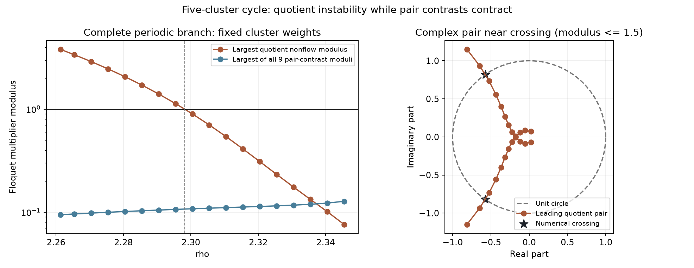

# A complex quotient instability of the five-cluster cycle

Numerical continuation of the case-16 five-cluster periodic orbit finds a complex conjugate pair of quotient Floquet multipliers crossing the unit circle near **rho = 2.29823502**. All nine pair-contrast multipliers remain inside the circle at the 18 sampled branch points. This is a different linear instability from the [transverse loss of stability of the four-pair cycle](motor-postcritical.md).

The periodic branch reaches the parameter of the [one-positive cluster candidate](motor-lane46-spectrum.md), where it has two unstable quotient directions. This identifies a possible related periodic structure. It does not prove that the chaotic trajectory originates from this branch, that an invariant torus is born, or that a particular sequence of bifurcations connects them.

## Fixed model and numerical branch

The starting [case-16 periodic result](../results/motor-activity-continuation/probe-destinations/case-16/periodic/analysis.json) has groups `[[0,3],[1,2],[4],[5,6],[7]]` and exact cluster weights `(2,2,1,2,1)/8`. The saved parameters are initially `(2.3454545454545457, 4.7551460477513405, 1.0)`. Only rho changes; the source field, row count, weights, r and b remain fixed.

The [continuation](../results/motor-activity-continuation/cluster-cycle-branch/analysis.json) follows the 14-dimensional weighted quotient with the same phase section, using the previous periodic solution as the next Newton seed. All three independent 3-dimensional pair-contrast monodromies are computed separately. Together these blocks exhaust the original 23-dimensional tangent space.

All 18 requested points succeeded with steps at most `0.005`; there were no failed branch points. The output format nevertheless records every attempted point and preserves failures when they occur.

| rho | Period | Largest quotient nonflow modulus | Largest pair-contrast modulus |
|---:|---:|---:|---:|
| 2.345454545 | 25.001684 | 0.075980 | 0.127482 |
| 2.300454545 | 24.600682 | 0.900951 | 0.107804 |
| 2.295454545 | 24.571044 | 1.134521 | 0.106304 |
| 2.261363636 | 24.402771 | 3.809716 | 0.094402 |

At the final parameter, the periodic branch's unstable directions are within the quotient. The nine pair-contrast directions remain numerically contracting. The cluster-size partition is the same as the lane-46 candidate after a row relabeling; the two trajectories are not identified with one another.



## Refined numerical crossing

The [refinement record](../results/motor-activity-continuation/cluster-cycle-branch/crossing-refinement/analysis.json) gives

```math
\rho_*\approx2.2982350236,\qquad T_*\approx24.5873283026,
```

with critical pair

```math
\mu_\pm\approx-0.5729449387\pm0.8195938611\,i.
```

The angle divided by $2\pi$ is approximately `0.34709956`. The numerical distances from resonances of orders 1 through 4 are nonzero; the smallest is the order-3 distance `0.25876`. A centered finite difference with rho increment `1e-5` gives $d|\mu|/d\rho\approx-46.27947$.

At `rho_* - 1e-5`, the computed modulus minus one is `+0.000462870`; at `rho_* + 1e-5`, it is `-0.000462720`. These are floating-point sign checks, not interval enclosures. They support a complex-pair crossing as rho decreases. No bifurcation normal-form coefficient or invariant torus is computed, so a nondegenerate torus bifurcation is not asserted.

## Symmetry and independent controls

Direct strict integration at the initial and final branch points verifies the same sixth-period group permutation

```text
current group j = initial group P[j],  P = [3,0,4,1,2].
```

It cycles the three paired clusters and swaps the two singleton clusters. The maximum component residuals are `1.42e-13` and `3.42e-13`. This is a numerical spatiotemporal symmetry check; the full-period Floquet computation above does not depend on replacing the orbit by that shorter relative return.

Every branch point compares the quotient shooting matrix with a tighter independent integration, checks the closure and flow direction, and checks the constant 23-dimensional Jacobian decomposition. The largest closure residual across the 18 points is `1.37e-11`; the largest difference between the two quotient matrices is `2.19e-11`. The [independent audit](../results/motor-activity-continuation/cluster-cycle-branch/audit/analysis.json) passes 205 checks of saved hashes, parameter and weight preservation, state chaining, spectra and the refinement. The [inventory](../results/motor-activity-continuation/cluster-cycle-branch/manifest.json) freezes all 56 evidence files and source snapshots.

## Reproduction and scope

Use a fresh output folder and Python with NumPy, SciPy and Matplotlib:

```console
python research/continue_motor_cluster_cycle.py --output outputs/motor-cluster-cycle-branch
```

The [executed source](../research/continue_motor_cluster_cycle.py) stores the parent seed, each attempted periodic point, all monodromy blocks and every failure. The saved `refine.source.py` and `analyze.source.py` expect to be placed beside the newly created `analysis.json`; copying those two scripts into the new output folder and running them reproduces the refinement and audit without changing the frozen archive.

This package concerns a numerical periodic branch and its linear stability. It does not prove chaos, attraction, a branch connection to the lane-46 trajectory or scientific novelty. The rigorous certificates elsewhere in the repository have their own stated parameter and orbit scopes.
