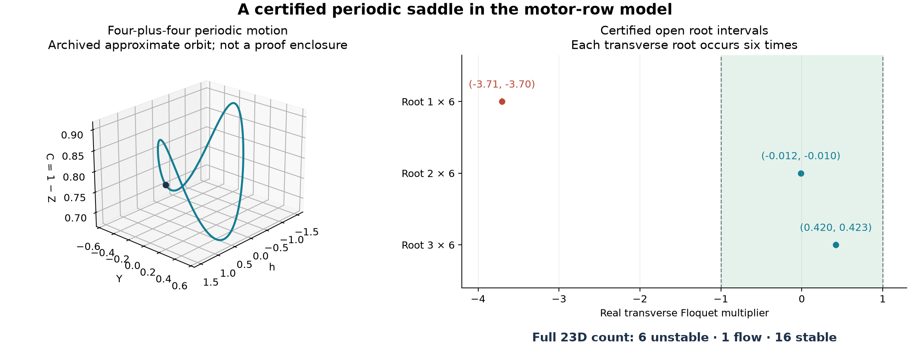

# Certified periodic motor motion and a transverse stability change

The interval calculations establish a nonconstant periodic four-plus-four motor orbit and count its expanding directions. They also establish a nearby continuous family whose endpoint stability differs, with at least one intermediate orbit having transverse multiplier $-1$. These are local results about periodic motion in the published model. They do **not** establish a chaotic attractor, a unique crossing, a nonlinear period-doubling bifurcation or scientific novelty.

The proof uses a custom interval Taylor integrator with Picard existence bounds, Arb ball arithmetic and a Krawczyk inclusion. CAPD is a methodological reference, not the implementation used here. The proof data, exact arithmetic representation and executable reproduction are linked below.

A subsequent [parameter-sensitivity certificate](motor-crossing-certificate.md) strengthens the crossing result in a smaller interval: uniqueness, nonzero speed and exact multiplicity six. The original certificates and their narrower claims below remain unchanged.

An exact [density-PDE lifting argument](motor-pde-lifting.md) transfers the local orbit and stability statements to the source's sinusoidal density model. Its additional population modes are stable; the extension does not require a numerical Fourier truncation.



The trajectory panel uses an approximate archived orbit for illustration. The spectral panel shows certified transverse root brackets. The drawing of the trajectory is not an interval enclosure and is not used to prove the statements.

## Model and exact parameter meanings

For eight rows, the normalized equations are

```math
\begin{aligned}
V_j&=-\rho X_j+r(s_j-\bar s),&
\bar s&=\frac18\sum_{k=1}^{8}s_k,\\
c_j'&=-c_j-V_js_j+1,&
s_j'&=-s_j+V_jc_j+1,&
X_j'&=V_j,\\
\sum_{j=1}^{8}X_j&=0.
\end{aligned}
```

This is the 23-dimensional constrained first-harmonic model of Alouges et al. [1], with source asymmetry $b=1$. Time is the original normalized time $\tau$. The fixed gain is the exact algebraic number

```math
r=1+\frac{19/20}{\sqrt{32001/500000}}.
```

It follows from the source parameter prescription used in this repository; the displayed decimals defining its constants are treated as exact mathematical inputs. This convention does not claim experimental certainty for those constants. Source activity is related to the remaining parameter by

```math
\delta=\frac{451250}{32001\rho^2}-1.
```

All finite decimals specifying parameter endpoints below mean exact rational decimals. The target value is exactly $\rho=1291/440$, rather than the binary floating-point number obtained by rounding its decimal expansion. Details of the normalization and source units are in the [source audit](motor-rows-source-audit.md) and [algebraic proof strategy](motor-proof-strategy.md).

## Computer-assisted statements

**1. A periodic saddle orbit at the target parameter.** At $\rho=1291/440$, a nonconstant four-plus-four periodic orbit exists with a positive period satisfying

```math
3.4740565601539886315\lt T\lt3.4740565601539886317.
```

The half-period shooting root is unique in the stored initial box, with approximate coordinates

```math
(Y_0,Z_0,L)\simeq
(-0.47314433123904439450,\ 0.28120531790457431106,\
1.73702828007699431579),\qquad h_0=0,\quad T=2L.
```

Uniqueness is local to this shooting box and phase convention. A subsequent interval-tube certificate establishes that the displayed period is the **least positive period**; no global uniqueness of the orbit is asserted.

For the certified positive period, the full system has **six Floquet multipliers outside the unit circle, one multiplier equal to one, and sixteen inside**. It is orbitally attracting inside the equal-cluster subspace, but transversely unstable in the full system. The three simple roots in each transverse block lie in

```math
(-3.71,-3.70),\qquad(-0.012,-0.010),\qquad(0.420,0.423).
```

Each transverse root is repeated six times by the cluster decomposition and half-period symmetry. The root outside the unit circle therefore supplies six independent expanding directions. [Target certificate](../results/motor-proof/target-recheck.json).

**2. A continuous local family and an intermediate multiplier $-1$.** Let

```math
I=[3.370218399569,\ 3.370218399589].
```

For every $\rho\in I$, the uniform parameter certificate establishes a locally unique half-period shooting root in one common box. These roots form a continuous periodic family. The endpoint classifications are

| Exact rho | Outside the unit circle | Flow multiplier | Inside the unit circle |
| ---: | ---: | ---: | ---: |
| 3.370218399569 | 6 | 1 | 16 |
| 3.370218399589 | 0 | 1 | 22 |

The endpoint boxes belong to the same uniformly validated family. At some $\rho_*\in\mathrm{int}(I)$, the orbit has multiplier $-1$ with multiplicity **at least six**. The corresponding activity is enclosed by

```math
0.2414738453980627\lt\delta_*\lt0.2414738454127974.
```

The endpoint certificates isolate all their transverse roots. This family certificate does not uniformly isolate the remaining roots throughout I, so it does not prove that the multiplicity at the intermediate parameter is exactly six. It also does not prove uniqueness or a nonzero derivative of the crossing. [Family certificate](../results/motor-proof/crossing-family-attempt-01.json), [lower endpoint](../results/motor-proof/crossing-low.json), [upper endpoint](../results/motor-proof/crossing-high.json), [recomputed branch-link verification](../results/motor-proof/continuation-recheck-20261030/crossing-link.json).

The target orbit in statement 1 and the short local family in statement 2 are separate validated results. The earlier floating-point continuation suggests they belong to the same long branch; the present certificates do not validate that entire connecting parameter interval.

## Why the certificates imply these statements

**Exact reduction.** With $C=1-Z$, the three-state motor core is

```math
h'=(-\rho+rC)h-rY,\qquad Y'=hC-Y,\qquad C'=1-C-hY.
```

Every periodic equal-cluster solution has exactly $u=Y$ and $v=C$: deviations satisfy $(d^2+e^2)'=-2(d^2+e^2)$ and therefore vanish on a periodic orbit. Four rows are reconstructed as

```math
(c_A,s_A,X_A)=(C+Y,C-Y,(h-rY)/\rho),
```

and the other four as $(c_B,s_B,X_B)=(C-Y,C+Y,-X_A)$. The discarded cluster deviations contribute exactly two stable multipliers $e^{-T}$. This is an exact invariant restriction, not a numerical approximation to all eight-row dynamics.

These periodic solutions also lie in the normalized row disk $c_j^2+s_j^2\leq2$. Indeed, the core satisfies $(C^2+Y^2)'=2C-2(C^2+Y^2)$. At a maximum over a period, writing $R=(C^2+Y^2)^{1/2}$ gives $R^2=C\leq R$, hence $R\leq1$ throughout the cycle. The reconstructed row radius is exactly $2R^2$. This is an algebraic bound for the model, independent of an approximate plotted trajectory.

**Existence and symmetry.** The core commutes with $R(h,Y,Z)=(-h,-Y,Z)$. The validated equation is

```math
F(Y_0,Z_0,L;\rho)=\phi_L(0,Y_0,Z_0;\rho)
-(0,-Y_0,Z_0)=0.
```

Commuting symmetry and flow uniqueness give a periodic orbit of positive period $2L$. The certified inequalities $Y_0<0$ and $L>0$ make it nonconstant: $h'(0)=-rY_0>0$.

For each integration step the code constructs a Picard tube, verifies strict inclusion of its integral image, and bounds its weighted Lipschitz contraction below one. It then encloses the Taylor remainder using coefficients evaluated over that tube. The same procedure integrates the state variational equations. Arb bounds rounding errors in the operations. A separate Krawczyk inclusion and contraction test proves the shooting root exists and is unique in its box; ordinary Newton iterations only select a center [2,3].

The target recheck uses 256-bit arithmetic, 160 steps and Taylor order 26. It revalidates the initial box from the earlier successful attempt, with Krawczyk contraction below $1.45\times10^{-15}$. The family uses 256 bits, 128 steps, order 24 and a shooting-box radius near $10^{-6}$. Its contraction is below 0.032351, and its largest relative Krawczyk image radius is below 0.033099, uniformly over I. Thus the family is not inferred from isolated successful points.

**Spectral count.** On a cycle, one core multiplier is exactly one because the system is autonomous. Interval Schur inequalities place the other two core multipliers strictly inside the unit circle. The two passive multipliers $e^{-T}$ are also inside. The core Schur margins at the target exceed 0.844, so this part of the classification is separated from the stability boundary.

For each cluster, a zero-sum contrast obeys the three-dimensional variational block

```math
J_\perp=
\begin{pmatrix}
-1&-V-rs&\rho s\\
V&-1+rc&-\rho c\\
0&r&-\rho
\end{pmatrix}.
```

Opposite certified characteristic-polynomial signs at the endpoints of three disjoint real intervals put one root in each interval. Since the polynomial is cubic, these are all its roots and they are simple. There are three contrasts per group of four; the two cluster monodromies are similar by the certified half-period exchange. Their spectra therefore contribute six copies of every block root. Together with the five cluster directions this accounts for all 23 multipliers.

**The intermediate parameter.** Put $g(\rho)=\det(I+M_A(\rho))$ on the validated family. The saved endpoint enclosures are

```math
g(3.370218399569)\in
[-1.0405551\times10^{-10}\ \mathbin{\pm}\ 9.90\times10^{-19}],
```

```math
g(3.370218399589)\in
[1.0029362\times10^{-10}\ \mathbin{\pm}\ 1.53\times10^{-18}].
```

These signs are strict. Continuity gives an interior zero, hence an eigenvalue $-1$ in one transverse block. Similarity and the three contrasts in each cluster repeat it at least six times. Endpoint-box inclusion in the common family box is necessary here; without it, opposite signs could belong to unrelated cycles. The [linking verifier](../research/verify_motor_certificate.py) explicitly checks that inclusion and the parameter containment.

**Least positive period.** A separate [tube-sign validator](../research/validate_motor_period.py) first recomputes the shooting existence inclusion. It then records the validated Picard tubes covering the half-orbit. At the target, the first 85 of 160 tubes have strictly positive $h'$, the middle four have strictly positive $h$, and the final 71 have strictly negative $h'$. The exact shooting endpoints have $h(0)=h(L)=0$. Hence $h(t)>0$ throughout $0<t<L$. Half-period symmetry gives $h(t)<0$ throughout $L<t<2L$. There is exactly one upward zero in $[0,2L)$, which excludes a smaller positive period. The same argument holds uniformly for the crossing family, with 82 initial, four middle and 74 final tubes. [Target proof](../results/motor-period-proof/target.json), [uniform family proof](../results/motor-period-proof/family.json). The derivative-sign intervals need not be small: monotonicity from each certified zero is the relevant argument.

## Interpretation and limits

The result turns part of the earlier numerical picture into a local computer-assisted theorem: the model supports a periodic saddle with six expanding directions, and a small parameter interval contains a transverse stability change of a periodic family. This is consistent with the [numerical hyperchaotic candidate](motor-rows-activity-path.md), but its six positive finite-time Lyapunov exponents are a different calculation on a different trajectory.

A multiplier $-1$ of multiplicity at least six is not the simple-multiplier setting of the generic flip theorem. No doubled branches, period-doubling cascade, unique critical parameter, nonzero crossing speed or global attracting chaotic set is established by these certificates. The physical interpretation inherits the assumptions of the published motor model. Neither the interval calculation nor the source constants establish an experimental observation or scientific priority.

The proof is implemented in auditable numerical code rather than formalized in a proof assistant. Its computational basis is the interval-Taylor implementation, Python-FLINT/Arb and the arithmetic/runtime stack. Repeating the same validated algorithm with changed precision and discretization is a reproducibility check, not an independent integrator.

## Reproduce and inspect

The proof dependencies are separate from the simulation/GPU dependencies:

```bash
python -m pip install -r requirements-proof.txt
python research/verify_motor_certificate.py --output outputs/motor-proof-recheck
```

Choose a new output directory on each run: the scripts refuse to overwrite existing evidence. The verifier recomputes the target, family and both endpoint certificates using 320-bit arithmetic, 160 steps and Taylor order 26, then checks the common-branch inclusion, Floquet counts and opposite determinant signs. It does not accept stored success flags in place of those recomputations.

The underlying implementation is [validate_motor_cycle.py](../research/validate_motor_cycle.py). The [continuation-session link summary](../results/motor-proof/continuation-recheck-20261030/crossing-link.json) records the four fresh successful recomputations and their hashes. Each integration certificate also preserves the executed source snapshot and its hash. Exact ball values are stored as dyadic midpoint/radius pairs; decimal `display` strings are for reading and may have enlarged printed radii. The lossless fields are authoritative.

The [analytic controls](../results/motor-proof/analytic-controls-continuation.json) independently check exactly soluble linear, quadratic and oscillator flows, 216 direct matrix identities and the exact-dyadic containment edge case. They support software review and do not replace the existence proof. Reproduce the least-period extension with a fresh output path:

```bash
python research/validate_motor_period.py --input results/motor-proof/target-recheck.json --output outputs/motor-target-period.json
python research/validate_motor_period.py --input results/motor-proof/crossing-family-attempt-01.json --output outputs/motor-family-period.json
```

The original unsuccessful attempts remain in [the proof-results directory](../results/motor-proof/). Failure to certify a box means that attempt did not prove the result; it is not evidence that the periodic orbit does not exist. Archived approximate trajectories supply initial guesses and illustrations only.

## References

1. F. Alouges et al., “Some mathematical models for flagellar activation mechanisms,” *Mathematical Models and Methods in Applied Sciences* **35**, 2395–2424 (2025). [DOI](https://doi.org/10.1142/S0218202525500423); [complete primary manuscript](https://arxiv.org/html/2409.03506v2). Source of the motor equations and physical parameter prescription.
2. F. Johansson, “Arb: efficient arbitrary-precision midpoint-radius interval arithmetic,” *IEEE Transactions on Computers* **66**, 1281–1292 (2017). [DOI](https://doi.org/10.1109/TC.2017.2690633); [author's full paper](https://fredrikj.net/math/arbpaper.pdf); [Python-FLINT arithmetic documentation](https://python-flint.readthedocs.io/en/latest/general.html). Arb supplies rigorous arithmetic bounds; the ODE enclosure algorithm here is our implementation.
3. T. Kapela, M. Mrozek, D. Wilczak, P. Zgliczynski, “CAPD::DynSys: A flexible C++ toolbox for rigorous numerical analysis of dynamical systems,” *Communications in Nonlinear Science and Numerical Simulation* **101**, 105578 (2021). [DOI](https://doi.org/10.1016/j.cnsns.2020.105578); [primary manuscript](https://arxiv.org/pdf/2010.07097), Section 4.2. Methodological reference for periodic-orbit validation by rigorous integration and interval root inclusion; CAPD was not used for this certificate.
4. T. Kapela, D. Wilczak, P. Zgliczynski, “Recent advances in a rigorous computation of Poincare maps,” *Communications in Nonlinear Science and Numerical Simulation* **110**, 106366 (2022). [DOI](https://doi.org/10.1016/j.cnsns.2022.106366); [primary manuscript](https://arxiv.org/pdf/2104.08046). Floquet multipliers, the neutral flow direction and validated section computations.
