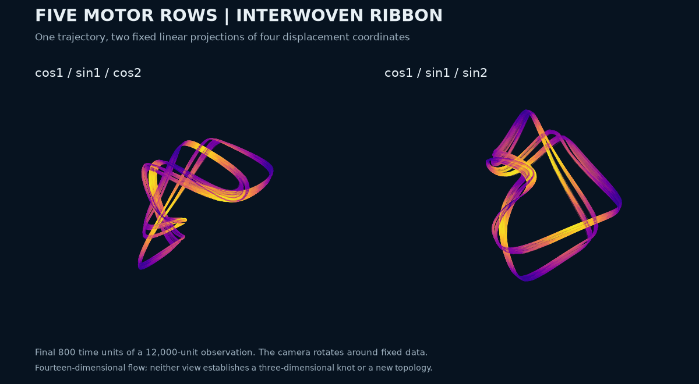

# A five-row motor ribbon with empirical cyclic symmetry

Five interacting motor rows produce a thin interwoven numerical geometry in the existing Alouges et al. model. The strongest visual candidate retains positive expansion in two independently integrated 12,000-unit observations. Its full-state point clouds match five cyclic row permutations closely, while the other 115 permutations remain separated. This is a numerical candidate inside a published model, not a new attractor class or an established three-dimensional knot.



<!-- drawing-date -->
*First recorded drawing: **2026-11-01** ([record](https://github.com/Griboedow/chaos-attractor-lab/blob/e809319c54abd65d7c32642e9eab561ed13e94c3/docs/assets/motor-five-ribbon.gif)).*
<!-- /drawing-date -->

[Full-resolution still](assets/motor-five-ribbon.png) · [Complete six-page selection gallery](../results/motor-five-geometry/gallery/) · [Evidence manifest](../results/motor-five-geometry/manifest.json)

## Model and selection

The exact first-harmonic closure has fourteen independent variables: five cosine coefficients `c_j`, five sine coefficients `s_j`, and five displacements constrained by `sum X_j = 0`. In dimensionless time,

```text
v_j = -rho*X_j + r*(s_j - mean(s))
c_j' = 1 - c_j - v_j*s_j
s_j' = b - s_j + v_j*c_j
X_j' = v_j.
```

The source is [Alouges et al., arXiv:2409.03506v2, Eq. (15)](https://arxiv.org/abs/2409.03506), published in [M3AS (2025)](https://doi.org/10.1142/S0218202525500423). General row number and motor-driven oscillation are already part of that work. The model derivation, physical interpretation and remaining priority gaps are documented in the [existing priority audit](motor-rows-priority-audit.md). This survey varies the dimensionless family; it is not a calibrated experimental activity sweep.

The same declared grid used for the smaller row counts supplies 4,032 trajectories: 12 values of `rho`, 24 relative gains, seven asymmetries `b`, and two fresh position vectors per tuple. Every trajectory completes 300 discarded and 1,200 observed time units. Of these, 751 meet the preliminary expansion rule and 724 have all four leading-exponent windows above 0.01. Twelve stratified candidates receive full fourteen-dimensional spectra and geometry panels. Four are then selected after visual inspection: two strong two-positive examples, a petal-like example, and the thin ribbon.

## Long observations and independent controls

Each long calculation discards 200 additional time units, observes 12,000, and records four disjoint 3,000-unit spectra. DOP853 uses relative tolerance `2e-10`, absolute tolerance `2e-12`, maximum step `0.02`, and tangent orthonormalization every `0.5`. The full spectra, parameters, endpoints and section events are archived.

| Case | First three finite-time exponents | Smallest second exponent across four windows | Visual role |
| --- | --- | --- | --- |
| 1816 | `(0.131589, 0.035966, -0.000018)` | 0.033337 | Dense two-positive comparison |
| 1870 | `(0.213804, 0.046012, -0.000011)` | 0.041456 | Dense two-positive comparison |
| 2601 | `(0.022155, 0.005001, -0.000073)` | 0.003069 | Petal-like, weaker second expansion |
| **2816** | **`(0.221803, 0.000075, -0.569632)`** | Near the neutral flow direction | **Thin ribbon** |

The pictured case has `(rho,r,b) = (13.652749130273284, 31.74947392484949, 0.7)`. Its four leading windows are `0.220005, 0.226269, 0.217942, 0.222997`. A fresh integration from the same declared start, with tenfold tighter tolerances and maximum step `0.01`, gives leading exponents `(0.223518, 0.000014, -0.572860)`; all four leading windows exceed `0.221698`. The small second exponent is consistent with the autonomous flow's neutral direction and is not evidence of a second expanding direction.

The difference between the summed exponents and integrated divergence is below `1.08e-10` per time unit in the main ribbon run and `5.24e-12` in the refined run. The largest observed `c_j^2+s_j^2` is below `0.970`, within the model's invariant disk bound `1+b^2 = 1.49`. Four independent force-constraint integrations with an implicit Radau solver agree with the compiled field over short intervals to a maximum scaled state error of `8.03e-13`. These short controls validate the implementation; long chaotic runs are compared statistically, not point by point.

## Full-state symmetry and fresh starts

The equation is equivariant under all 120 row permutations. The geometry audit uses all fifteen physical coordinates `(c,s,X)`, with a declared parameter-based scale, and compares each half of the observation with the other half. It does not use the displayed projection to decide similarity.

Five permutations meet the exploratory rule that both median and 95th-percentile nearest-cloud distances remain within three times the identity baseline. They form the cyclic group generated by the row order `0 → 1 → 4 → 2 → 3 → 0`. Their worst ratios to the identity baseline are only `1.032` and `1.022`; for the other 115 permutations, the smallest respective ratios are `76.77` and `51.20`. The identity median distance is `0.007290` and its 95th percentile is `0.017837` in the declared scaled metric.

This is strong finite-sample evidence of fivefold orbital symmetry, not a proof of the invariant set's exact symmetry group. The possible `120/5 = 24` relabeled copies would be copies of one regime, not 24 discoveries.

Sixteen fresh initial states are independently integrated for 500 discarded and 1,500 observed time units. Eight use the source-style occupancy start and small random zero-sum displacements; eight vary occupancy inside the physical disks and use larger displacements. All finish within the disk bound. Comparing 100 uniformly spaced samples from each tail against the reference under every fixed row permutation gives worst best-match median `0.007469` and 95th percentile `0.021839`. These are comparable in scale to the cross-half reference distances, although the sampling densities differ. This supports approach to relabeled reference geometry; it does not establish a basin probability, identical invariant sets, or chaos for each new trajectory.

A post-hoc Fourier calculation in the selected cyclic row order also finds a bounded sampled combination `theta_1 + 2*theta_2`, spanning about `1.777` radians during the long observation, with circular coherence `0.9484`. The mean angular speeds are approximately `5.46842` and `-2.73421`. This suggests a phase-locked rotating-wave organization with chaotic modulation. It is a diagnostic to investigate, not an exact synchronization theorem or a new mechanism claim.

## What the image shows

The five zero-sum displacements have four independent coordinates. We use the fixed orthonormal contrasts

```text
sqrt(2/5) * (cos(theta_j), sin(theta_j), cos(2*theta_j), sin(2*theta_j)),
theta_j = 2*pi*j/5.
```

The two panels display coordinates `(0,1,2)` and `(0,1,3)` of the same final 800-unit trajectory. The displayed row labels retain their original order; the post-hoc cyclic ordering above is not used to beautify the picture. Both views use equal units on their three axes and bounds computed from the full 12,000-unit observation. Color shows mean cosine occupancy. Only the camera rotates. The thin crossings are features of projections from a fourteen-dimensional flow and do not certify a knot, a three-dimensional embedding, or topological novelty.

## Reproduction and remaining scope

The [packet](../results/motor-five-geometry/) preserves every scout outcome, all twelve short spectra, four long spectra, the refined run, sixteen fresh starts, all 120 symmetry comparisons, all gallery panels and the unthinned displayed tail. To limit repository size, short state histories are sampled every tenth saved point; long, refined and fresh-start histories every fifth point, always retaining the endpoint. Section events, accumulated exponents, final tangent bases and initial states are unchanged. Compact files have distinct names, and [the inventory](../results/motor-five-geometry/local-inventory.json) records both the original and compact hashes. Full original local histories are preserved.

```powershell
python research/search_motor_asymmetry.py --rows 5 --output D:/Codex/motor-five-replay/scout
python research/check_motor_asymmetry.py --source D:/Codex/motor-five-replay/scout/complete-or-budgeted.npz --output D:/Codex/motor-five-replay/checks
python research/check_motor_asymmetry.py --source D:/Codex/motor-five-replay/scout/complete-or-budgeted.npz --ids 1816 1870 2601 2816 --duration 12000 --sample-step 0.05 --output D:/Codex/motor-five-replay/long
```

Further controls have their exact commands, seeds and saved starts in the packet protocols. The result adds a reproducible five-row geometry and useful symmetry diagnostics. It does not establish asymptotic chaotic attraction, historical priority for this regime, or a shape unlike every previously described attractor. The broader [motor priority audit](motor-followup-priority.md) still applies.
