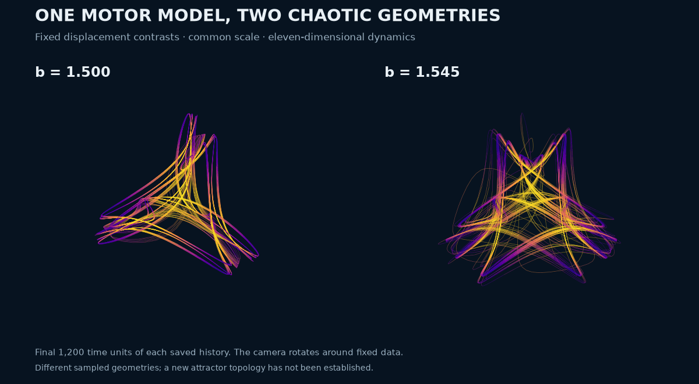
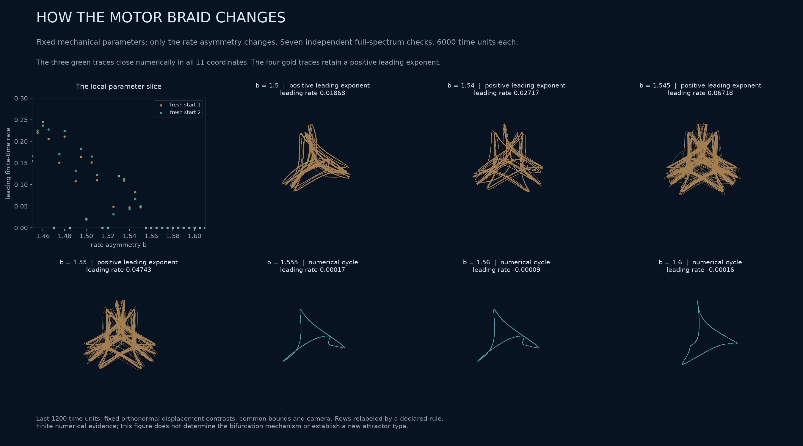
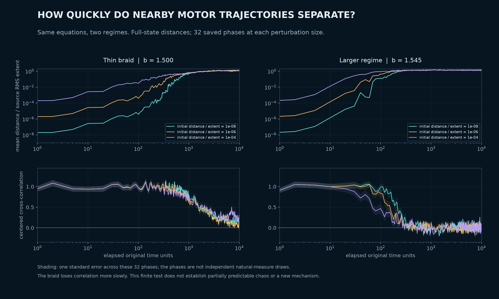
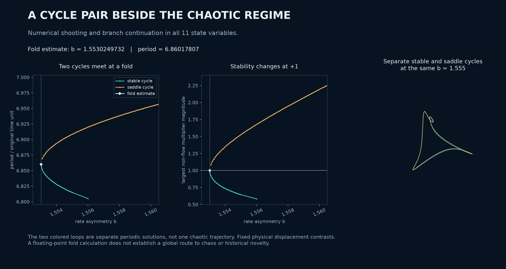

# Two chaotic motor geometries, close-pair dispersion and a neighboring cycle fold

The same published four-row molecular-motor equations contain a thin chaotic braid at `b=1.5` and a larger sampled regime nearby. Three **60,000-unit full-spectrum calculations** retain chaos at `b=1.54`, `1.545` and `1.55`. All 24 row permutations match the larger sampled sets closely, whereas only three match the thin braid. This is a reproducible numerical distinction in a known model; **a new attractor topology and historical priority remain unestablished**.



<!-- drawing-date -->
*First recorded portrait: **2026-11-01**.*
<!-- /drawing-date -->

The left history is the earlier 100,000-unit braid calculation; the right is the new 60,000-unit calculation at `b=1.545`. Each displays its final 1,200 units, with original row labels and no fitted deformation. Common bounds use both entire histories. The coordinates are the same orthonormal physical displacement contrasts described in the [original geometry report](motor-four-geometry.md). Color is mean cosine occupancy, with common limits. The 72-frame animation rotates the camera around fixed data. [Still image](assets/motor-b-regimes.png) · [Exact render inputs and settings](../results/motor-four-b-study/motor-four-b-regimes/).

## Declared parameter slice and long checks

Keep `rho=2.0238144033191343` and `r=5.193274038098629`, and vary only the source rate asymmetry `b`. The [Alouges et al. model](https://arxiv.org/html/2409.03506v2) and its [physical normalization](motor-rows-source-audit.md) are unchanged. This dimensionless parameter exploration is not a calibrated ATP experiment.

The scout contains 281 values from `b=.8` to `2.2` in steps of `.005`, with two declared fresh displacement starts at each value. All **562** lanes complete 1,000 warm-up and 4,000 observed units. The generic preliminary rule retains 252 lanes; these are screening results, not 252 distinct attractors. This is a fresh-start parameter slice, not orbit continuation.

Seven selected tuples receive independent full eleven-dimensional QR calculations over 6,000 units after an additional 200-unit warm-up. The four lower values retain a positive leading estimate in every observation quarter. The three higher values close numerically after one upward `X0=0` return in all eleven coordinates, with errors below `2e-12` in the declared scaled metric.



The figure uses a declared row relabeling solely for display. In particular, the row with minimum mean displacement is not asserted to be dynamically distinguished in the larger regimes. Narrow regular windows also occur below `b=1.555`; the slice does **not** establish one monotone transition from the braid to a symmetric attractor and then to a cycle.

The three larger chaotic cases were selected for longer checks after inspecting their short spectra and permutation comparisons. All three declared calculations are retained:

| `b` | Leading three estimates over 60,000 units | Range of four 15,000-unit leading estimates |
| --- | --- | --- |
| 1.540 | `.04193734, -.00002865, -.42215341` | `.03558780` to `.04689196` |
| 1.545 | `.06917552, -.00000574, -.41868080` | `.05998120` to `.07580872` |
| 1.550 | `.05139578, +.00005748, -.41106656` | `.04904474` to `.05505638` |

The method is DOP853, relative tolerance `2e-10`, absolute tolerance `2e-12`, maximum step `.02`, with QR every `.5`. The spectrum sums match integrated divergence within `9.67e-13` per unit. Sampled motor radii remain below the model's invariant bounds. Each run has one clearly positive estimate and one approximately neutral estimate; this is not a hyperchaos claim. Finite observations cannot exclude eventual capture or prove an asymptotic chaotic attractor.

## Full-state permutation comparison

For each 600,000-sample history, the two halves provide separate reference clouds, each sampled at stride two. Queries use every 37th reference point. All 24 row permutations are tested in both cross-half directions in the full `(c,s,X)` coordinates, including the constrained fourth displacement. Occupancy coordinates are divided by `sqrt(1+b²)` and displacements are additionally multiplied by `rho/r`.

The identity comparison supplies a finite-resolution baseline:

| `b` | Identity median distance | Identity 95th percentile | Permutations within three times both baseline distances |
| --- | --- | --- | --- |
| 1.540 | `.00563478` | `.04697941` | 24 of 24 |
| 1.545 | `.00543314` | `.05558570` | 24 of 24 |
| 1.550 | `.00399548` | `.05144023` | 24 of 24 |

At `b=1.545`, the permutation median ratios are approximately `.98–1.03` and the 95th-percentile ratios `.93–1.03`. Thus the result is not merely a marginal pass at the factor-three threshold. The equations' permutation covariance is checked separately. The [earlier braid audit](motor-four-geometry.md#equation-symmetry-is-not-attractor-symmetry) finds only an order-three subgroup close, with other median ratios above 46.

This supports a larger sampled set compatible with the full permutation group `S4`. It does not certify invariant-set symmetry or an attractor-merging bifurcation. The three-dimensional projection is not asserted to embed the eleven-dimensional dynamics.

## Nearby trajectories separate on different timescales

[Wernecke, Sándor and Gros (2017)](https://doi.org/10.1038/s41598-017-01083-x) already describe narrow chaotic braids and two stages of decorrelation in known systems. We therefore test nearby pairs instead of treating a thin silhouette as a new mechanism.

For each of the braid and the `b=1.545` regime, take 32 declared orbit phases and random perturbation directions. Use the same phases and directions at normalized initial distances `1e-8`, `1e-6` and `1e-4`. The resulting **192 pairs** are integrated for 10,000 units, retaining every declared checkpoint. Distances and centered cross-correlations use the same full-state metric as the symmetry audit, normalized by each source history's RMS extent.



The braid loses correlation more slowly. At time 10,000, its three cross-correlations are `.2261`, `.1174` and `.2054`, compared with `-.0054`, `.0112` and `-.0371` in the larger regime. These are measurements of the particular 32-phase cohorts. Their fluctuations, shared starting phases and finite source means matter; the shaded standard errors are not independent-natural-measure confidence intervals. We do not infer asymptotic scaling or classify partially predictable chaos from this test alone.

The integrator uses relative tolerance `2e-11` and a tightened step cap. A separate control checks **both members** at four phases, all three perturbation sizes and both parameter sets, at times 2 and 20. Independent Radau integration uses the source force-constraint formulation. Across the original and tighter GPU settings, the largest normalized state error is `1.23e-10`; the largest relative error in the separation vector is `1.26e-4`. This is short-horizon accuracy evidence, not a claim that long chaotic trajectories agree pointwise. The packet explicitly corrects an earlier control comment that called a single-base-trajectory test a pair test.

## A neighboring pair of periodic cycles

At `b=1.555`, the observed attracting cycle has period `6.81486913` and largest non-flow multiplier `.64446762`. At `b=1.56` and `1.6`, the corresponding values are periods `6.77757268` and `6.66886028`, and multipliers `.42983483` and `.08724462`.

Full-state shooting and a 162-point pseudoarclength branch locate a numerical fold near

```text
b = 1.553024973212159
T = 6.860178066460011
```

The augmented fold residual is `8.47e-12`. Its phase-fixed shooting derivative has one small singular value, approximately `7.95e-13`, with the next above `.099`. The parameter transversality projection is `.73361650`; three finite-difference quadratic projections agree near `-.634307`. A separate Radau integration of the normalized field closes the period within `3.11e-13`. These are floating-point nondegeneracy diagnostics, not an interval-certified fold theorem.



At the same `b=1.555`, the saddle cycle has period `6.90846815` and expanding multiplier `1.52644080`. Both cycles have numerical fourfold spatiotemporal symmetry: cyclic row permutations correspond to quarter-period shifts, verified in the full state. They are **separate periodic solutions**, not strands of one chaotic trajectory. The near-double unit multiplier at the fold is ill-conditioned; its tiny computed imaginary splitting is not interpreted as a torus bifurcation.

This identifies a local periodic structure near the irregular regimes. It does not establish that this fold creates the observed chaos, identify a crisis, or explain all intervening periodic windows.

## Prior art and the possible contribution

The [existing comparison and priority audit](motor-four-geometry.md#what-is-already-known-and-what-remains-open) remains binding. Thin chaotic braids, permutation-symmetric chaos, rotating waves, symmetry breaking and restoration, and folds of cycles are established phenomena. Relevant primary precedents include [Ashwin's 1991 thesis](https://wrap.warwick.ac.uk/3985/1/WRAP_THESIS_Ashwin_1991.pdf), [Haugland and Krischer's four-oscillator study](https://arxiv.org/html/2102.10138v1), [Karatetskaia et al. (2025)](https://doi.org/10.1103/PhysRevLett.134.167201), and the [2017 predictability study](https://doi.org/10.1038/s41598-017-01083-x). A different number of visible arms is insufficient to distinguish attractor types.

The concrete candidate contribution is the coexistence in this **specific published motor family** of markedly different numerical chaotic geometries and decorrelation behavior, together with a resolved nearby rotating-cycle pair. The present evidence does not determine whether these regimes are globally connected through a known symmetry-restoring scenario, establish topological inequivalence to published attractors, or settle exact-model priority. The unread [Anello and Levillain thesis chapters](motor-followup-priority.md) remain material gaps. No “first”, “unique”, or “previously unknown attractor type” claim follows from this packet.

## Reproduction and evidence

The [frozen packet](../results/motor-four-b-study/manifest.json) preserves all declared scout inputs and endpoints, spectra, all solver section events, full pair checkpoints, cycle branches, independent controls, source snapshots and rendering data. Large dense histories are hash-indexed and reduced to their final 1,200 units for the repository. Earlier failed and superseded attempts remain separate; [selection and correction notes](../results/motor-four-b-study/selection-and-corrections.json) identify the final versions.

```powershell
python research/search_motor_four_b_slice.py --source results/motor-four-geometry/long/case-3142.npz --output outputs/motor-b-slice
python research/check_motor_asymmetry.py --source outputs/motor-b-slice/complete-or-budgeted.npz --output outputs/motor-b-checks --duration 6000 --sample-step .05 --ids 280 296 298 300 302 304 320
python research/check_motor_asymmetry.py --source outputs/motor-b-slice/complete-or-budgeted.npz --output outputs/motor-b-long --duration 60000 --sample-step .1 --ids 296 298 300
python research/audit_motor_permutation_geometry.py --source outputs/motor-b-long/case-0298.npz --output outputs/motor-b-permutations
```

Every experiment requires a fresh output directory. The individual frozen protocols and driver help describe the cycle, pair and rendering follow-ups.
