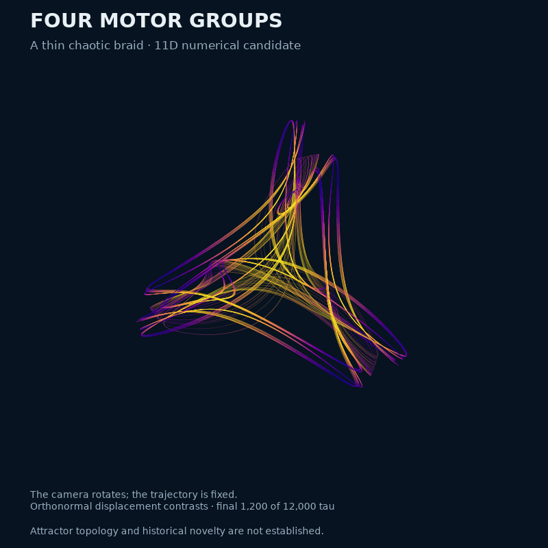
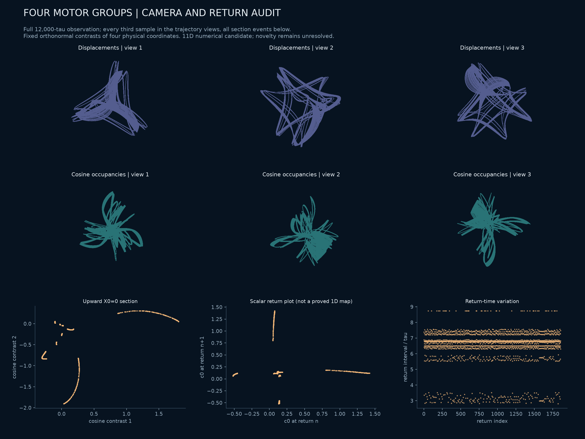
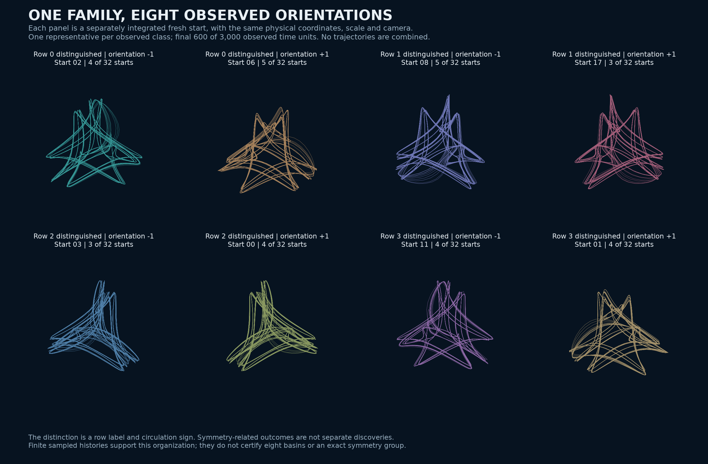
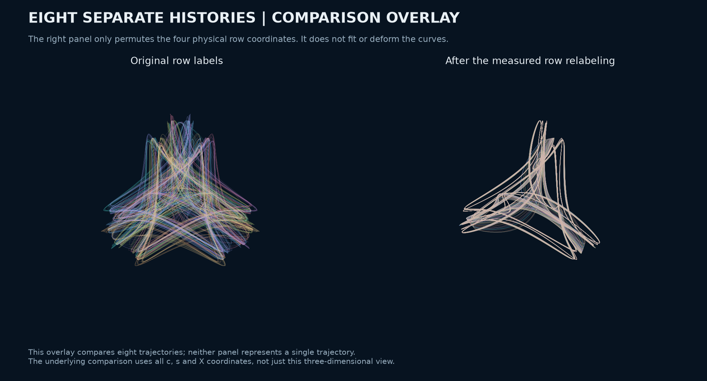
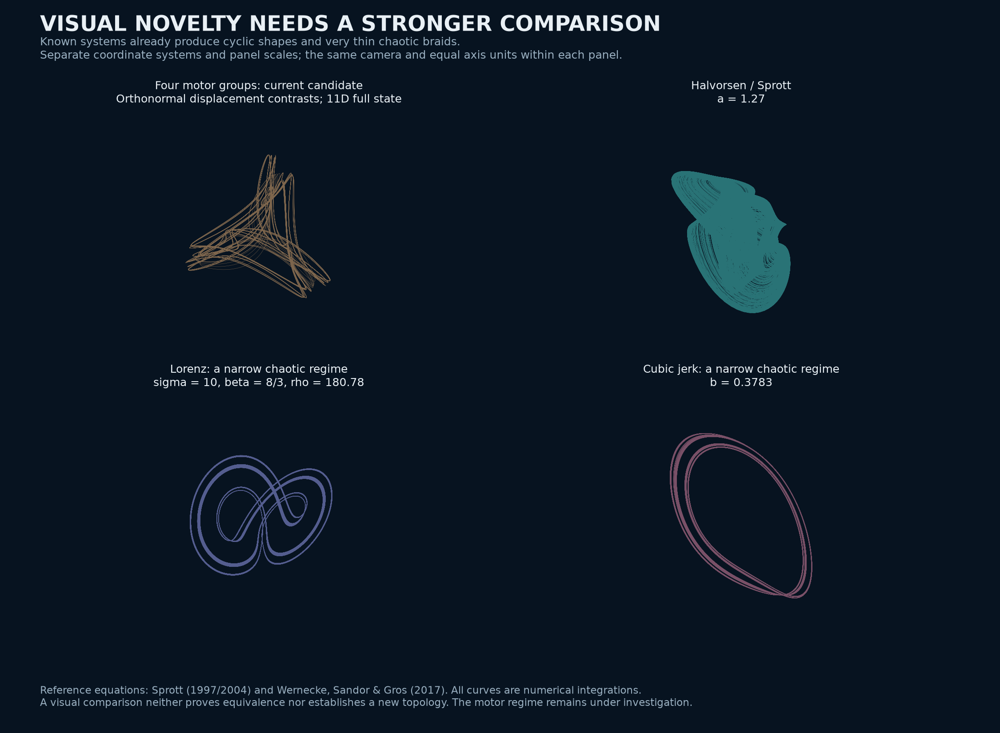

# Four motor groups: a thin chaotic braid under investigation

The published molecular-motor family contains an unusually slender numerical chaotic regime with four groups and **eleven state variables**. Two 12,000-unit full-spectrum calculations and a 100,000-unit continuation retain positive leading growth. Its physical displacement projection resembles a folded three-armed braid. This is a visual and dynamical candidate, **not an established new attractor topology or a priority claim**.



<!-- drawing-date -->
*First recorded portrait: **2026-11-01**.*
<!-- /drawing-date -->

The camera rotates around fixed data. The image uses the final 1,200 units of the saved trajectory, with 30,001 equally spaced samples; the axis bounds use the entire 12,000-unit observation. [Poster](assets/motor-four-poster.png) · [Rendering record](../results/motor-four-geometry/portrait/render.json).

A [subsequent parameter study](motor-four-b-study.md) compares this braid with larger near-`S4` sampled regimes, including three 60,000-unit spectra, a shared-camera rotation, close-pair dispersion and a neighboring numerical cycle fold. These extend the evidence without establishing a new attractor type.

## Model and coordinates

This is the existing first-harmonic reduction of [Alouges et al. (2025)](https://doi.org/10.1142/S0218202525500423), not a newly invented oscillator. The [source audit](motor-rows-source-audit.md) gives its derivation and admissible rates. For four rows,

```math
V_j=-\rho X_j+r(s_j-\bar s),\qquad
\dot c_j=1-c_j-V_js_j,\qquad
\dot s_j=b-s_j+V_jc_j,\qquad
\dot X_j=V_j,\qquad \sum_jX_j=0.
```

The displayed case, scout **3142**, has

```text
rho = 2.0238144033191343
r   = 5.193274038098629
b   = 1.5
```

The three plotted coordinates are `H X`, where

```text
H = 1/2 [[ 1,  1, -1, -1],
         [ 1, -1,  1, -1],
         [ 1, -1, -1,  1]].
```

These orthonormal contrasts preserve displacement lengths on the zero-sum subspace. They do not preserve distances in the full eleven-dimensional state. Equal axis units, a fixed camera and color given by mean cosine occupancy define the rendering; there is no fitted or nonlinear shape transformation. Choosing `A=-0.1/sqrt(1+b²)` and `B=bA` keeps the source transition-rate harmonic admissible. The dimensionless tuple is exploratory, not an experimentally calibrated ATP operating point.

## Numerical evidence

The declared survey varies the same grid as the [three-row study](motor-asymmetry-geometry.md): 12 values of `rho`, 24 values of `r/(rho+1)`, seven asymmetries and two seeded fresh starts. All **4,032** lanes finish. The preliminary rule retains 424; requiring all four leading-rate windows above `0.01` retains 416. These are screening counts, not distinct attractors.

Ten stratified full-spectrum checks cover the endpoints and median rate for each represented asymmetry, after selecting the first retained start per tuple. All are retained in the five-page gallery: [1](assets/motor-four-gallery-01.png), [2](assets/motor-four-gallery-02.png), [3](assets/motor-four-gallery-03.png), [4](assets/motor-four-gallery-04.png), [5](assets/motor-four-gallery-05.png). Cases 2650 and 3142 were selected for longer checks after viewing this gallery.

For case 3142, each long calculation has an additional 200-unit warm-up and a 12,000-unit observation. All eleven tangent directions are evolved, with QR every 0.5 units.

| Check | Leading three finite-time exponents | Range of four 3,000-unit leading windows |
| --- | --- | --- |
| DOP853, relative tolerance `2e-10`, maximum step `.02` | `.02202147, -.00036725, -.41119430` | `.01950425` to `.02420499` |
| DOP853, relative tolerance `2e-11`, maximum step `.01` | `.02252796, -.00022200, -.41206203` | `.02214310` to `.02311292` |

The near-zero exponent changes sign across windows, consistent with an unresolved finite-time flow direction. The spectrum has one persistently positive leading estimate; this is not a hyperchaos claim. Statistical agreement between settings is meaningful here; long chaotic trajectories need not agree point by point.

A separate **100,000-unit continuation** at the first settings gives leading exponents **`.02079795, -.00001102, -.41171974`**. Its four 25,000-unit leading estimates are `.02190172, .02133481, .01948040, .02047486`. All eleven tangent directions are retained, the divergence residual is `5.62e-13` per unit, and the solver records 15,543 upward section events. This longer observation shows no numerical capture into a stable periodic orbit. It does not turn finite-time evidence into an asymptotic theorem. The full million-point history is hash-indexed; [all section events, the terminal segment and full spectrum](../results/motor-four-extension/motor-four-100k/) are archived separately from the original packet.

The accumulated QR sum matches integrated divergence within `5.64e-13` per unit in the first run and `7.28e-14` in the refined run. The independent source force-constraint field and complex-step Jacobian agree on 17 distributed states within `8.13e-16` relative error. Three separate two-unit source-form Radau comparisons agree with DOP853 within `1.61e-13`. The long and refined runs contain 1,858 and 1,866 upward `X0=0` returns, respectively.

The largest sampled `c_j²+s_j²` is below `2.85456`, inside the invariant bound `1+b²=3.25`. All six row pairs remain distinct in the sampled full row coordinates `(c_j,s_j,X_j)`, with a minimum distance of `0.289295`. This rules out a silently imposed synchronized pair in these samples; it is not an all-time separation proof.

Case 2650 also retains positive growth over 12,000 units, with leading estimates `.02630677, .00054216, -.00284009`. Its nearly neutral third direction remains poorly resolved, so it is not classified as hyperchaotic.



The trajectory panels use the entire observation at every third sample. The bottom panels use every section event. The scalar successive-return plot is not asserted to be a single-valued one-dimensional map. Projected crossings do not prove a knot, a branched-manifold topology or a three-dimensional embedding.

## Equation symmetry is not attractor symmetry

The equations commute with every permutation of the four rows: the group `S4` has 24 elements. A particular attractor need not retain that whole symmetry.

An empirical full-state comparison splits the 600,000-sample history into two halves. Each reference cloud contains 150,000 points and each query set 4,055 points. Cosine and sine coordinates are divided by `sqrt(1+b²)`; displacement coordinates are additionally multiplied by `rho/r`. Every row permutation is tested in both cross-half directions. The identity's median distance is `0.00186482` and its 95th percentile `0.01041387`, providing a finite-sampling baseline.

Only the identity and the two cyclic permutations of rows **0, 1 and 3**, with row **2** fixed, have both distances within three times that baseline. Their median ratios are about `1.00–1.05`; every other permutation has a median ratio above 46. The equations' covariance is checked separately for all 24 permutations.

This supports a **candidate cyclic threefold set symmetry**, with one distinguished row. It does not certify an invariant-set symmetry group. In particular, the picture is not evidence for a tetrahedrally symmetric attractor. If the exact set symmetry were precisely that order-three group, its permutation orbit would have eight members; this is a conditional group-theoretic count, not eight independent discoveries or a proof of eight attracting basins.

The same audit on the earlier three-row ribbon finds only the identity close at the stated threshold. Its visually triangular projection therefore does not establish threefold symmetry of the full sampled set. [Four-row audit](../results/motor-four-geometry/permutations/audit.json) · [Three-row audit](../results/motor-four-geometry/three-row-permutations/audit.json).

## Fresh starts and nearby parameters

A separate declared study uses 32 fresh starts at the anchor and 64 logarithmic Sobol neighbors within five percent in each parameter, with two starts per neighbor. All 160 lanes finish a 500-unit warm-up and 6,000-unit observation. The retention rule requires a mean leading rate above `.01` and all four 1,500-unit estimates above `.005`.

**All 32 anchor starts pass, and both starts pass at 41 of 64 neighboring tuples.** Anchor mean rates range from `.0181853` to `.0227875`. These observations support repeatability in the sampled initialization family. They do not establish a basin probability or a robust-chaos theorem.

All 32 anchor starts have now also been integrated independently with DOP853: 500 units of warm-up and 3,000 observed units, sampled every `.05`, with relative tolerance `2e-10` and maximum step `.03`. For each history, **all 24 permutations** are compared in the full scaled `(c,s,X)` coordinates. Queries use every 61st new sample; the reference is every second point of the original 12,000-unit history. This is a one-direction nearest-cloud comparison, not a symmetric Hausdorff distance.

The best-permutation median distances range from `.00124647` to `.00144932`; their 95th percentiles range from `.00642984` to `.00804067`. Every start has exactly three permutations whose median and 95th percentile are at most three times its best comparison. This supports a common sampled family after relabeling, with the earlier cyclic ambiguity. The threshold is descriptive, not an attractor-identity proof.



The classes use the row with smallest mean displacement and the sign of the time-averaged circulation of the remaining rows, in their sorted label order. Their counts are `4,5,5,3,3,4,4,4` for rows 0 through 3 and signs minus/plus. These frequencies describe the 32 declared starts only. A net circulation sign does not imply monotonic phase rotation or exact phase/frequency locking.



Each color is a separately integrated trajectory. The right panel applies only the measured row permutation; it neither fits nor deforms the curves. Neither overlay is a single attractor trajectory. [Complete comparisons and source snapshots](../results/motor-four-extension/motor-four-start-histories02/) · [Selection and rendering record](../results/motor-four-extension/motor-four-start-gallery/). The original failed sampling-grid attempt is preserved in the extension packet alongside the corrected completed run.

## What is already known, and what remains open

The physical model is published, and symmetric chaos is old. The relevant comparisons include more than famous two-winged pictures:



This comparison reintegrates the [Halvorsen system in Sprott's 1997/2004 technical note](https://sprott.physics.wisc.edu/chaos/symmetry.htm), and two examples of [partially predictable chaos studied by Wernecke, Sándor and Gros (2017)](https://doi.org/10.1038/s41598-017-01083-x). The latter include a narrow chaotic regime of the Lorenz system itself and a cubic jerk equation. Thin broadened loops and cyclic symmetry are therefore established precedents. The motor projection's particular appearance remains interesting, but neither feature alone is evidence of a new attractor type.

The reference systems use their original Cartesian coordinates, while the motor panel uses physical displacement contrasts. Axis units are equal within each panel; panel scales differ. Only one common camera is shown. These are qualitative references, not an exhaustive visual atlas or a topological test. Eleven state variables alone do not establish novelty: a lower-dimensional attractor can occur inside a larger system. [Equations, starts, numerical settings and complete reference traces](../results/motor-known-comparison/).

| Primary source | What it already establishes | Scope relative to this candidate |
| --- | --- | --- |
| [Alouges et al., source preprint](https://arxiv.org/abs/2409.03506) | The motor equations and their N-row extension | Exact model family; its novelty cannot be claimed |
| [Ashwin, 1991 thesis, Chapter 4](https://wrap.warwick.ac.uk/3985/1/WRAP_THESIS_Ashwin_1991.pdf) | Symmetry-breaking and symmetry-restoring chaos in three and four coupled, periodically forced electronic oscillators | Cyclic chaotic sets, mirrored copies and symmetry-increasing collisions are not new mechanisms by themselves |
| [Dias and Rodrigues, Hopf bifurcation with S_N symmetry](https://cmup.pt/cmup/apdias/SN_Final.pdf) | Standard permutation-symmetric Hopf branches, including four and five components | A symmetry label or rotating-wave organization alone is not a discovery |
| [Karatetskaia et al., PRL 134, 167201 (2025)](https://doi.org/10.1103/PhysRevLett.134.167201) | Robust chaos and four-winged Lorenz-like attractors in four globally coupled identical phase oscillators | Different equations and a three-dimensional phase-difference reduction, but a strong predecessor against broad four-oscillator novelty claims |
| [Letellier and Gilmore, 2007](https://doi.org/10.1088/1751-8113/40/21/011) | Symmetry, image and covering descriptions of three-dimensional systems | More apparent arms need not mean a new mechanism; their rotoreflection `S4` has order four, unlike the permutation group here |
| [Sprott's symmetric-flow note, 1997/2004](https://sprott.physics.wisc.edu/chaos/symmetry.htm) | Cyclically symmetric quadratic chaos and a period-doubling route in the Halvorsen system | Threefold shape is not new; no conjugacy to the motor invariant set has been shown |
| [Wernecke, Sándor and Gros, 2017](https://doi.org/10.1038/s41598-017-01083-x) | Narrow chaotic braids, two stages of decorrelation, and partially predictable chaos in known systems | A thin braid with a small positive exponent is not a new mechanism by itself; a [finite motor pair-dispersion test](motor-four-b-study.md#nearby-trajectories-separate-on-different-timescales) now exists, while asymptotic classification and the global route to chaos remain open |
| [Ashwin and Burylko, 2015](https://arxiv.org/abs/1407.8070), [Bick and Ashwin, 2016](https://arxiv.org/abs/1509.08824), [Bick, 2017](https://doi.org/10.1007/s00332-016-9345-2) | Weak chimeras, chaotic partial frequency synchronization, and the distinction between set symmetry and frequency symmetry | A distinguished motor row alone is not a new mechanism or a proved weak chimera. The exclusion for fully symmetric phase-only networks does not automatically apply to this amplitude/occupancy model |

Swift and Barany's 1991 work on chaos at a tetrahedral Hopf bifurcation is another relevant precedent; its bibliographic existence is confirmed in the [author's publication list](https://math.nmsu.edu/_files/professorcvs/barany_CV_24.pdf), but its full equations have not been compared. The complete Anello and Levillain theses remain unresolved exact-model priority gaps, as recorded in the [motor follow-up audit](motor-followup-priority.md).

No explicit conjugacy to these systems has been established, and no proof of inequivalence has been obtained. The defensible result is currently a reproducible, visually distinctive numerical regime in a known motor model. A stronger contribution requires identifying its global mechanism and full-state geometry, checking attraction, and resolving the remaining prior-art comparisons. The search in other physical systems continues.

## Reproduction

The [frozen evidence packet](../results/motor-four-geometry/) includes all scout records and exact starts, ten short spectra, both long spectra, the refined spectrum, source checks, all permutation comparisons, rendering provenance and the complete 600,000-point case-3142 history. Other large histories remain hash-indexed locally. Its manifest covers exact archived bytes.

```powershell
python research/search_motor_asymmetry.py --rows 4 --output outputs/motor-four-scout
python research/check_motor_asymmetry.py --source outputs/motor-four-scout/complete-or-budgeted.npz --output outputs/motor-four-checks
python research/check_motor_asymmetry.py --source outputs/motor-four-scout/complete-or-budgeted.npz --output outputs/motor-four-long --duration 12000 --ids 2650 3142
python research/render_motor_four_ribbon.py --source results/motor-four-geometry/long/case-3142.npz --output outputs/motor-four-portrait
python research/audit_motor_permutation_geometry.py --source results/motor-four-geometry/long/case-3142.npz --output outputs/motor-four-permutations
```

Use a fresh output directory for every experiment. Source snapshots in the evidence packet preserve the exact executed versions.
