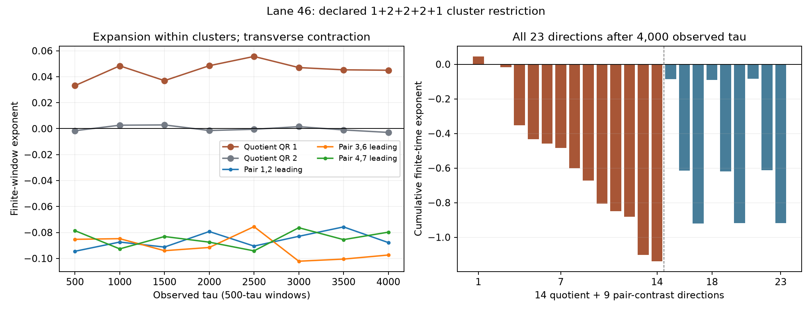
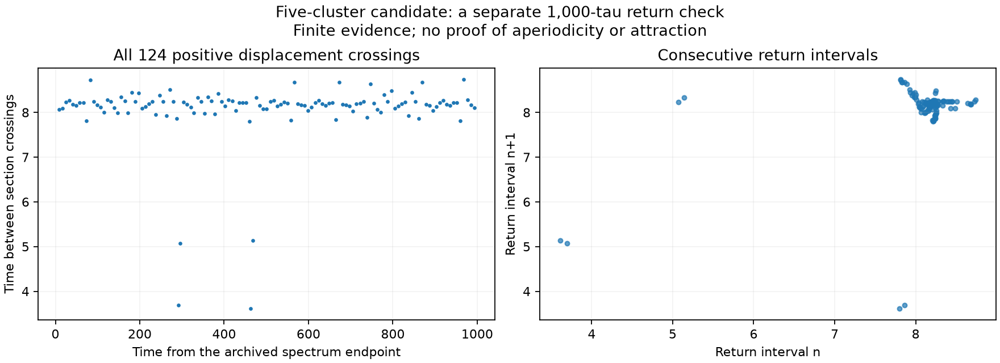

# Complete conditional spectrum of motor lane 46

The archived lane-46 state lies within `5.586e-15` of the five-cluster restriction `[[0],[1,2],[3,6],[4,7],[5]]`. This follow-up computes every tangent direction along that declared restriction: 14 directions within the cluster subspace and nine directions that split its three pairs. It complements the [full-space activity continuation](motor-activity-continuation.md); it does not replace physical perturbation tests or establish an attracting chaotic set.

## Initial state and exact restriction

The starting point is the original 7,100-tau checkpoint in [`N8-lifetime-history.npz`](../results/motor-rows/activity-path/N8-lifetime-history.npz), selected by `source_lane_indices == 46`. Its parameters are `(rho, r, b) = (2.2613636363636367, 4.7551460477513405, 1.0)`. The measured one-time projection is retained in the [seed archive](../results/motor-activity-continuation/cluster-spectrum/lane-46/seed.npz). No later state projection or noise is applied.

The cluster weights are exactly `(1,2,2,2,1)/8`, with the source normalization and mean force unchanged. Five population pairs and four independent weighted-zero-sum displacements give the 14-dimensional quotient. The eliminated displacement is reconstructed using the final cluster's weight `1/8`.

For each paired cluster $j$, the within-pair contrast evolves under the original field's three-dimensional variational matrix

```math
B_j=\begin{pmatrix}
-1&-V_j-rs_j&\rho s_j\\
V_j&-1+rc_j&-\rho c_j\\
0&r&-\rho
\end{pmatrix}.
```

The constant embedding $T$ places the quotient vectors and the three pair-contrast blocks in the full 23-dimensional coordinates. Its exact determinant is `-512`, so these blocks exhaust the tangent space. On the restriction,

```math
J_{\rm full}T=T\operatorname{diag}(J_q,B_1,B_2,B_3).
```

In particular, the four block traces sum to the full divergence. The spectrum union is therefore complete in dimension. The reported finite-time QR rates use a separate Euclidean norm in each block; they are not claimed to equal finite-time singular-value rates in the original full-state norm. If the asymptotic Lyapunov limits exist, a constant invertible change of coordinates preserves their union.

## Numerical result

After 200 warmup tau, the run completed 4,000 observed tau in 578.84 seconds using DOP853, maximum integration step `0.03`, relative/absolute tolerances `1e-11`/`1e-13`, and QR interval `0.5`. The leading quotient estimates are

```text
 0.04501302, -0.00004209, -0.01769824, -0.35331758, ...
```

There is one clearly positive estimate, one estimate near the neutral flow rate and 12 negative quotient estimates. All nine contrast estimates are negative:

| Pair split | Three conditional estimates |
|---|---|
| Rows 1,2 | -0.086165, -0.615252, -0.921325 |
| Rows 3,6 | -0.091402, -0.619323, -0.917617 |
| Rows 4,7 | -0.084700, -0.612315, -0.917367 |

The quotient leading rate is positive in all eight 500-tau windows, with minimum `0.033148`. Each contrast leader is negative in every window; their largest window estimates are `-0.075713`, `-0.075517` and `-0.076322`. The five distinct cluster trajectories remain separated in the saved samples: the smallest pairwise RMS distance between different clusters is `1.72751` over the observed segment.

This finite-time evidence supports a candidate for cluster chaos with contracting transverse directions. It supports one positive exponent in this restriction, rather than a claim of hyperchaos here. The separate 20,000-tau CPU continuation concerns another parameter point and trajectory with six positive estimates.

The original activity mapping places this candidate at `delta=1.75748308`, about 176% above onset, with source activity 0.17648443 and rate scale 420.1005 per second. Its transition-rate and reconstructed-density lower bound is 0.46645714. These retain the source's coefficient convention and positivity conditions, while extending well beyond its illustrated 10% activity increase; they are not an experimental calibration.



## Controls and limitations

The [run record](../results/motor-activity-continuation/cluster-spectrum/lane-46/analysis.json) records the exact original endpoint, source hashes, measured projection and parent 2,000-tau metadata. Before integration, the field, all 23 Jacobian columns and trace decomposition are tested at the initial state and 12 deterministic random states. The weighted quotient also passes complex-step and full-field restriction checks. A separate one-tau integration of the original full 23-dimensional state and tangent map agrees with the transformed block evolution: maximum state error `5.80e-15` and tangent-column error `5.33e-14`. The complete basis is used in this check, including contrasts involving dependent row 7.

During the run, every QR interval checks each block's determinant against its integrated trace and checks the quotient's transported flow vector against the endpoint field. The observed segment also integrates the weighted velocity-square expression from the [exact volume identity](motor-volume-contraction.md). The independent [analysis](../results/motor-activity-continuation/cluster-spectrum/analysis/analysis.json) verifies source and data hashes, the exact rational embedding determinant, all 8,400 sampled times, every saved basis and all nine restart checkpoints. The [inventory](../results/motor-activity-continuation/cluster-spectrum/manifest-final.json) freezes the numerical evidence and executed sources.

All 34 analysis checks pass. The largest block QR/trace discrepancy per tau is `1.36e-13`; the weighted-volume residual over 4,000 tau is `-1.46e-11`. The transported quotient-flow estimate `0.000129237110047` agrees with the endpoint telescoping estimate within `2.98e-14`. These checks include all contracting directions, not only the reported leaders.

Negative contrast estimates over this trajectory are conditional finite-time evidence. They do not establish uniform transverse stability, exclude exceptional trajectories or guarantee a full-space basin. Likewise, a positive quotient estimate does not prove asymptotic chaos. This is a separate cluster candidate, with no claim of novelty or of 32 verified chaotic attractors in the original cohort.

At this lane, $a_8=-16+7(r-\rho)>0$. The weighted-volume identity remains valid, but the sufficient inequality used to prove zero global-attractor volume at other parameter points does not apply here. The general compact global-attractor result still applies for positive $\rho$.

## Separate return-period diagnostic

A [tighter state continuation](../results/motor-activity-continuation/cluster-return-check/analysis.json) starts from the exact saved endpoint of this spectrum calculation and runs another 1,000 tau, with maximum step 0.025 and tolerances `2e-12`/`2e-14`. This is a separate state diagnostic; the frozen QR history is unchanged. It retains all 124 positive crossings of the first cluster displacement through zero.

The return intervals range from 3.6123 to 8.7380 tau, with standard deviation 0.71149. Across all recorded pairs of section states at lags 1 through 64, the smallest full reduced-state distance is 0.0012540 (lag 36). The smallest RMS distance among these lags is 1.55259 (lag 3). Thus this finite sample does not show a closed periodic orbit at the tested return lags. It cannot exclude a longer period or prove aperiodicity.



The [return program](../research/check_motor_cluster_returns.py) and [figure program](../research/plot_motor_cluster_returns.py) retain their executed sources and input hashes. The original figure remains available; the displayed revision only improves its labels and retains every section crossing.

## Longer strict conditional control

The [stricter calculation](../results/motor-activity-continuation/cluster-strict-completed/analysis.json) uses maximum step 0.015 and tolerances `2e-12`/`2e-14`, starting from the same original projected endpoint. It completes 10,000 observed tau with leading quotient estimate 0.04408481 and pair-contrast leaders `−0.08497591`, `−0.08931910`, `−0.08849586`. The quotient leader is positive in every one of twenty 500-tau windows, with minimum 0.033740; all three contrast leaders are negative in every window.

The original bounded run reached its wall limit after 9,000 complete observed tau plus 134 additional state steps whose QR logs had not yet been committed to the block totals. A guard rejected that partial endpoint. The [resumption](../research/resume_motor_cluster_control.py) instead used a separately verified 8,500-tau complete checkpoint, restoring every state, tangent basis and logarithm sum without warmup. It reproduces every state and time in the original partial history bitwise, then completes the remaining observation. A fresh one-tau step-halving check differs by at most `7.44e-15` in state and tangent entries. Failed metadata serialization and the rejected partial checkpoint remain archived. This establishes the scope of the continuation; it is not an interval trajectory enclosure.

## Source starts can still suffer numerical saddle capture

The [two excluded original starts](motor-tuple15-excluded.md), at the same parameter as lane46, show why attraction cannot be inferred from a single positive history. Lane45 escapes a neighborhood of a periodic saddle; lane47 remains on a numerically synchronized periodic state. That orbit has period 62.76836810 and three expanding Floquet exponents near 0.04818038, despite its near-zero carried growth estimate.

A separate [predeclared sixteen-start ensemble](../results/motor-activity-continuation/tuple15-ensemble/protocol.json) includes all three original source-style initial states and thirteen additional fixed seeds. All 16 complete 1,000 warmup plus 9,000 observed tau at the strict GPU settings. Five retain every growth window above the screening thresholds, with means between 0.0431 and 0.0477 and three near-synchronized pairs at their endpoints. The other eleven end near symmetry images of the independently checked period 62.768 saddle: [phase/permutation matching](../results/motor-activity-continuation/tuple15-ensemble-audit/analysis.json) gives distances below `3.16e-13`, and a separate full-state integration over its period closes to below `5.26e-13`.

All three original seeds belong to that latter group in this rerun, including the original seed of the long positive lane46 history. The initial states are verified bitwise identical; the subsequent solver settings, diagnostic tangent and numerical history differ. This exposes sensitivity to numerical synchronization and prevents interpreting the 5/16 count as a physical basin fraction. It does not erase the independently observed cluster-chaos candidate, nor does it prove that the exact real trajectory from a source seed approaches either numerical endpoint.

The [follow-up inventory](../results/motor-activity-continuation/followup-publication-01/manifest.json) passes 140 checks and freezes 142 evidence/source files, including the original partial run, exact complete-block resumption, spectrum and return studies, all sixteen starts and every periodic-destination result. Later source-start logarithmic calculations and interval proofs are separate packages.

A subsequent [logarithmic rerun of the original source start](motor-original-seed-log.md) completes 10,000 units at two settings. Selected contrasts recover after contraction below `10^-106`; one retained contrast reaches below `10^-455`. The two distant histories disagree substantially, so they establish neither a verified long orbit nor a final attracting regime. They show why small terminal row differences alone do not establish permanent capture.

## A related periodic branch

A separate [five-cluster periodic continuation](motor-cluster-cycle-branch.md) reaches the same parameter with the same cluster-size partition. Near `rho=2.29823502`, a complex pair of quotient Floquet multipliers crosses the unit circle numerically, while all nine pair-contrast directions remain contracting at the sampled points. At the lane-46 parameter the cycle has two unstable quotient directions. This supplies a candidate periodic structure for further study; it does not establish a branch connection to this irregular trajectory or prove the birth of an invariant torus.

## Reproduction

Use fresh output paths and Python with NumPy, SciPy and Matplotlib. The original source checkpoint and recorded parent metadata must be present in the repository.

```console
python research/full_motor_activity_cluster_spectrum.py --output outputs/motor-lane46-spectrum/lane-46
python results/motor-activity-continuation/cluster-spectrum/analyze.source.py --root outputs/motor-lane46-spectrum
```

The [integration source](../research/full_motor_activity_cluster_spectrum.py) preserves partial runs if the wall budget is reached. The saved 4,000-tau result is a complete run, not a concatenation with the separate parent conditional estimate.
