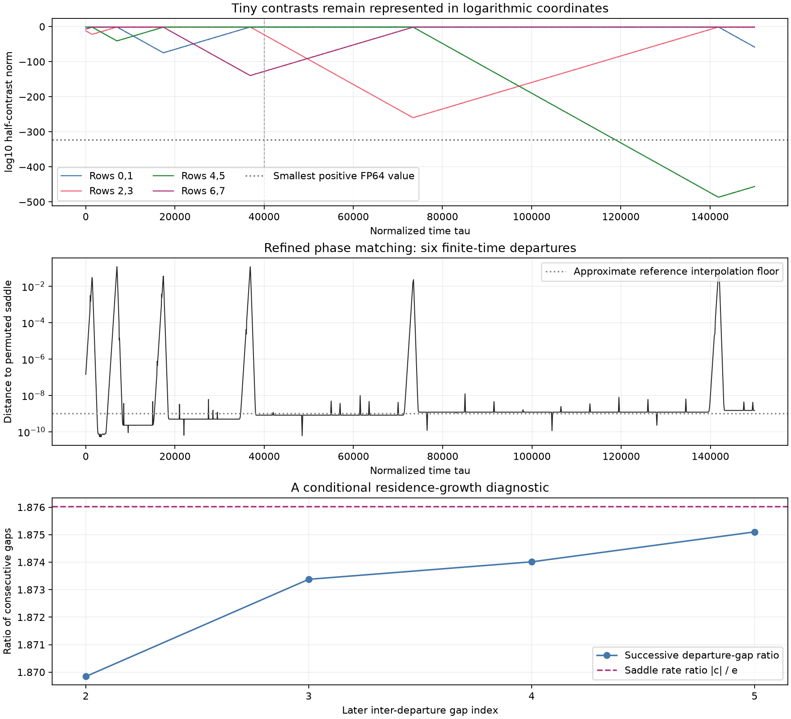

# Logarithmic contrast extension of the motor precision diagnostic

Status: both independent histories are complete through `tau=150000`, with matching departure events and verified source/data hashes. This is a frozen extension of the [40,000-time-unit pair-coordinate audit](motor-pair-coordinate-audit.md); later continuations belong to separate output folders and reports.

The experiment retains a nonzero contrast without storing its exponentially small amplitude as an ordinary floating-point number. It tests continued departures from symmetry-related periodic saddles. It does not prove a heteroclinic connection, asymptotic network attraction, or chaos.

Prior work already discusses slow switching and round-off capture in other globally coupled oscillator models: [Kori and Kuramoto (2001)](https://arxiv.org/html/cond-mat/0012456v2), Introduction and Sections IV–V, DOI [10.1103/PhysRevE.63.046214](https://doi.org/10.1103/PhysRevE.63.046214). This study makes no general mechanism-priority claim.

## Exact equations and gauge freedom

Use the four fixed row pairs `(0,1)`, `(2,3)`, `(4,5)`, `(6,7)`, with the eleven pair-mean coordinates of the preceding audit. For pair `a`, write its three-component half-difference as

```math
\delta_a=(d c_a,d s_a,d X_a)^T=e^{\ell_a}u_a,
\qquad u_a\ne0.
```

The exact contrast equation is linear and homogeneous conditional on the evolving means:

```math
\dot\delta_a=A_a\delta_a,\quad
A_a=\begin{pmatrix}
-1&-\bar V_a-r\bar s_a&\rho\bar s_a\\
\bar V_a&-1+r\bar c_a&-\rho\bar c_a\\
0&r&-\rho
\end{pmatrix},
\quad
\bar V_a=-\rho\bar X_a+r(\bar s_a-\langle\bar s\rangle).
```

Set

```math
\alpha_a=\frac{u_a^T A_a u_a}{u_a^T u_a},\qquad
\dot u_a=A_a u_a-\alpha_a u_a,\qquad
\dot\ell_a=\alpha_a.
```

Then, by direct differentiation,

```math
\frac{d}{d\tau}(e^{\ell_a}u_a)
=e^{\ell_a}(\alpha_a u_a+\dot u_a)
=A_a\delta_a,
\qquad
\frac{d}{d\tau}\|u_a\|^2=0.
```

This identity holds for any positive, constant direction norm. It does not rely on imposing `||u_a||=1` during a run. During integration the code never normalizes, projects, clips, reseeds, or adds noise to a direction. Its initial conversion chooses `u_a=delta_a/||delta_a||` and `ell_a=log||delta_a||` once. Floating-point norm drift is measured rather than removed.

There are 27 stored variables, comprising eleven means, twelve direction components, and four logarithmic amplitudes. The four transformations

```math
u_a\mapsto g_a u_a,\qquad
\ell_a\mapsto\ell_a-\log g_a,\qquad g_a>0,
```

leave the physical state unchanged. Fixing the four positive direction norms gives the original 23 physical dimensions. Auxiliary gauge invariants must not be counted as physical neutral Lyapunov or Floquet directions.

For a continuous finite-time mean trajectory, each contrast equation has an invertible fundamental matrix. Thus a nonzero initial contrast cannot become exactly zero at finite time. The logarithmic chart covers such trajectories without a finite-time zero-amplitude singularity; it does not cover an exactly invariant zero contrast.

## Mean feedback and floating-point limits

Write `u_a=(u_c,u_s,u_X)` and `dV_u=-rho u_X+r u_s`. The exact mean equations become

```math
\begin{aligned}
\dot{\bar c}_a&=1-\bar c_a-\bar V_a\bar s_a
-e^{2\ell_a}dV_u u_s,\\
\dot{\bar s}_a&=b-\bar s_a+\bar V_a\bar c_a
+e^{2\ell_a}dV_u u_c,\\
\dot{\bar X}_a&=\bar V_a.
\end{aligned}
```

The fourth mean displacement is still the negative sum of the first three. No model term has been intentionally removed from these equations. Nevertheless, an FP64 evaluation of `exp(2 ell_a)` eventually underflows to zero, and even larger but tiny feedback terms may disappear when added to an order-one mean derivative. This experiment explicitly records the former event. It cannot restore arbitrary precision to the mean dynamics.

For each omitted quadratic component, the algebraic bound at a given state is

```math
|e^{2\ell_a}dV_u u_c|,\quad
|e^{2\ell_a}dV_u u_s|
\le e^{2\ell_a}(|\rho|+|r|)\|u_a\|_\infty^2.
```

The code records the logarithm of this full bound at every right-hand-side stage where `exp(2 ell_a)==0`. It retains the first such evaluation time, counts, and the largest logged bound. Trial and rejected solver stages are included, so the first evaluation time is not a certified first crossing on the accepted numerical trajectory. A bound on instantaneous omitted forcing is not a bound on accumulated or amplified trajectory error.

Physical contrast magnitudes are reported directly as

```math
\log_{10}\|\delta_a\|
=\frac{\ell_a+\tfrac12\log(u_a^Tu_a)}{\log 10},
```

including the actual numerical direction norm. Reconstructing ordinary row coordinates is reserved for coarse phase/permutation matching and loses tiny contrasts as in the preceding audit.

## Initial conditions and validation

Both integrations resume the corresponding saved state at `tau=40000` from the independently controlled 23-state chart histories. The parameter vector remains `(rho,r,b)=(3.268,4.755146047751339,1)`. Each source NPZ, source summary, executed program, and imported pair-coordinate program is hashed. The new floating-point logarithm/exponential conversion has its own recorded reconstruction error; the initial physical state is not regenerated from rounded Cartesian rows.

The algebra audit uses 32 random states and random nonunit gauges. The largest scaled pushed-field discrepancy is `4.55e-16`; the normalized gauge-invariant derivative discrepancy is `3.11e-15`. The mean feedback agrees under the independent gauge rescaling to `3.16e-16`.

Each run first compares the logarithmic equations with the full 23-state chart over 200 time units, using DOP853, maximum step `0.025`, and relative tolerance `2e-12`. Across both initial states, the maximum physical chart discrepancy is `1.36e-13`, the maximum `log10` magnitude discrepancy is `3.21e-12`, and the maximum squared direction-norm drift is `1.41e-11`. An explicit `1e-7` acceptance guard makes a failed comparison stop the run. This short check is not a long-time error bound.

Long-run configurations:

| Run | Maximum step | Relative tolerance | Mean/direction/logarithm absolute tolerance | Requested final time |
| --- | ---: | ---: | ---: | ---: |
| `step-0p1` | 0.1 | `1e-10` | `1e-12` | 150000 |
| `step-0p05` | 0.05 | `2e-11` | `2e-13` | 150000 |

Every 500 time units the program saves all 27 state coordinates at period-spaced checkpoints and at the block endpoint. It records direction-norm drift, finite logarithmic magnitudes, and upward crossings of the physical halfcontrast norm through `1e-4`. As in the frozen audit, only recoveries preceded by a checkpoint below `1e-12` classify departures; raw oscillatory threshold crossings do not.

## Results and limits

Both runs reproduce two further departures:

| Departure | Recovering pair | Main time | Strict-control time | Difference |
| --- | --- | ---: | ---: | ---: |
| Fifth | 6,7 | 72604.73104865011 | 72604.73104929946 | `6.49e-7` |
| Sixth | 2,3 | 141092.6338799517 | 141092.6338841212 | `4.17e-6` |

The observed near-saddle path is `L0a -> L1b -> L2a -> L3a -> L0a -> L1b -> L2a`. It visits four of the eight candidate graph nodes. Through the complete histories the successive departure-gap ratios are `1.869842`, `1.873376`, `1.874012`, and `1.875101`, approaching the local rate ratio about `1.876033`. This is finite-time evidence compatible with the proposed network mechanism, without a connection or attraction theorem.



Pair `(4,5)` first reconstructs as zero in ordinary FP64 at the stored checkpoint `tau=118881.03109548356` in both runs, while its logarithmic representation remains finite. Its minimum **stored** `log10` norm is `-486.3740103711` in the main run and `-486.3740107682` in the strict run. By `tau=150000` it has regrown to `-455.6469731377` and `-455.6469738949`. This is partial regrowth by about thirty orders of magnitude while the amplitude remains unrepresentable as an ordinary FP64 number; a seventh threshold departure is not part of this frozen block.

Across common checkpoints from 40k to 150k, the largest mean/representable-chart discrepancy is `1.23e-7`, the largest difference in `log10` contrast norms is `1.09e-6`, and the largest normalized direction-component discrepancy is `3.60e-7`. Squared gauge norms drift by at most `6.98e-7` and `1.25e-7` in the two histories, without renormalization. The evidence supports reproducibility of these events and the reported precision diagnostic. It is not a certified error enclosure for the exact distant trajectory.

The separate fixed-phase fits also resolve growth below the amplitude representation limit. Over `145000..150000`, pair `(4,5)` in the strict run has fitted growth rate `0.008696267790887842`; pair `(0,1)` contracts at `-0.01631448594126165`. Their fitted magnitude ratio is `1.8760330676978874`. The local rates are close to the independent certified values below, but these floating-point fits are **not** claimed to lie inside those much narrower rigorous intervals.

Quadratic mean-feedback underflow begins much earlier than amplitude-reconstruction underflow: the first main-run zero-weight RHS stages occur near `59439.17` for pair `(2,3)` and `95964.08` for pair `(4,5)`. The largest recorded full omitted-component bound across both runs is approximately `1.97e-323`. The [manifest](../results/motor-log-contrasts/manifest-150k.json) retains the logarithmic bounds and high-precision decimal conversions. These are instantaneous bounds at sampled floating-point stages, not bounds on accumulated trajectory error or all roundoff.

Plot review found two false large distance spikes in the original 80-phase nearest-orbit search, at `tau=55000` and `85000`. The [separate review](../results/motor-log-contrasts/orbit-matching-review/audit.json) searches all 1,000 reference phases, refines every sampled local minimum, and applies safeguarded Newton phase refinement. It reduces those apparent distances from `0.0463` and `0.0732` to `4.89e-9` and `1.22e-8`. The revised figure above was inspected. Original diagnostics and figures remain archived; no trajectory, event time, or node path changed. Residual phase/interpolation errors remain, so this distance plot is not a certified proximity estimate.

The first plotting command saved its artifacts but failed while printing a Unicode Windows path through a CP1252 terminal. Repeating it with `python -X utf8` succeeded; the numerical data were unaffected, and the terminal failure is recorded separately.

## Audited optional scalar evaluator

[motor_log_scalar.py](../research/motor_log_scalar.py) evaluates the same real equations without many small NumPy allocations. It is separate from the NumPy evaluator used for both 150k histories. The [final recheck](../results/motor-log-contrasts/scalar-benchmark-recheck/audit.json) covers 32 random nonunit gauges, the full state Jacobian, the derivative of reconstruction against the original Cartesian analytic Jacobian, and five deep-amplitude underflow cases. The largest scaled derivative discrepancy is `3.73e-16`; underflow-bound records agree exactly for the test states.

A 200-time-unit scalar/NumPy control differs by `5.16e-14` in means and `2.59e-12` in logarithmic magnitudes. Its measured full-integrator speedup is 2.82, with tracking enabled. The optional scalar run mode requires a passed audit with matching source hashes. It can resume all 27 stored logarithmic coordinates exactly, without rebuilding tiny contrasts from zero Cartesian differences. This benchmark does not itself establish a later departure.

## Conditional residence-growth prediction

The archived numerical saddle has expanding Floquet exponent `e=0.008696267790971083` and the relevant contracting exponent `-c=-0.01631448594129444`, giving `kappa=c/e=1.8760330676837005`. A local entry-to-exit map near a hyperbolic periodic saddle would give a residence time proportional to `-log(epsilon)/e` and a departing stable amplitude proportional, up to bounded periodic factors, to `epsilon^(c/e)`. If the global transition maps this amplitude nondegenerately to the next unstable coordinate, and the relevant connections exist, successive residence times would satisfy `T_next=kappa*T+O(1)`. These are additional mathematical assumptions; the exponent ratio alone proves neither a connection nor network attraction.

The frozen four departure times are `621.7836635209453`, `6185.783113604954`, `16589.582279899285`, and `36079.81343168635`. Their successive gap ratios are `1.86984187536849` and `1.873376334957567`. Before either new run reached the fifth event, [pre-event-prediction.json](../results/motor-log-contrasts/pre-event-prediction.json) fixed the slope to the independently measured saddle ratio and fitted only an additive gap offset from the last two gaps. This heuristic predicts the fifth and sixth departure times near `72616.49` and `141132.87`. Threshold phase and finite transition times can shift them; the prediction is not a validated return map.

The later, independent [saddle certificate](motor-saddle-certificate.md) and [leading-rate enclosure](../results/motor-saddle-proof/leading-rates.json) give `e=0.00869626779094932 +/- 3.79e-18`, `c=0.0163144859413539 +/- 3.58e-17`, and `c/e=1.87603306769524 +/- 6.41e-15` at the exact benchmark. They also establish that `c` is the leading stable rate. These local results strengthen the interpretation of the comparison but do not supply the unproved global transition maps. The pre-event prediction retains its original floating-point coefficient; it has not been recomputed with the later enclosure.

The [exact symmetry-coset graph](motor-network-combinatorics.md) classifies the existing near-saddle matches as `L0a -> L1b -> L2a -> L3a -> L0a`. This is one four-node path in the eight-node candidate graph. It does not traverse the complete graph or prove its directed connections. The classification is saved separately in [frozen-40k-node-visits.json](../results/motor-log-contrasts/frozen-40k-node-visits.json), using only reference distances below `1e-6`.

## Reproduction

Run from the repository root with the NumPy/SciPy environment:

```powershell
python research/motor_log_contrasts.py run --resume-from results/motor-pair-coordinates/seed-1e-12-step-0p1-extended --output results/motor-log-contrasts/step-0p1 --horizon 150000 --max-step .1
python research/motor_log_contrasts.py run --resume-from results/motor-pair-coordinates/seed-1e-12-step-0p05-extended --output results/motor-log-contrasts/step-0p05 --horizon 150000 --max-step .05 --rtol 2e-11 --mean-atol 2e-13 --direction-atol 2e-13 --logarithm-atol 2e-13
python research/motor_log_contrasts.py analyze --output results/motor-log-contrasts/step-0p1
python research/motor_log_contrasts.py analyze --output results/motor-log-contrasts/step-0p05
python research/motor_log_contrasts.py compare --output results/motor-log-contrasts/step-0p1 --other results/motor-log-contrasts/step-0p05
python -X utf8 research/motor_log_contrasts.py plot --output results/motor-log-contrasts/step-0p1
python -X utf8 results/motor-log-contrasts/review_orbit_matching.py
python -X utf8 results/motor-log-contrasts/check_manifest.py
```

These are the recorded output locations; use fresh folder names when repeating integrations. Run outputs refuse to overwrite an existing folder. The program is [motor_log_contrasts.py](../research/motor_log_contrasts.py); the [150k manifest](../results/motor-log-contrasts/manifest-150k.json) verifies 36 files totaling about 5.26 MB, including both 8,289-checkpoint histories and the separate matching review. Its explicit scope excludes future continuation folders.
