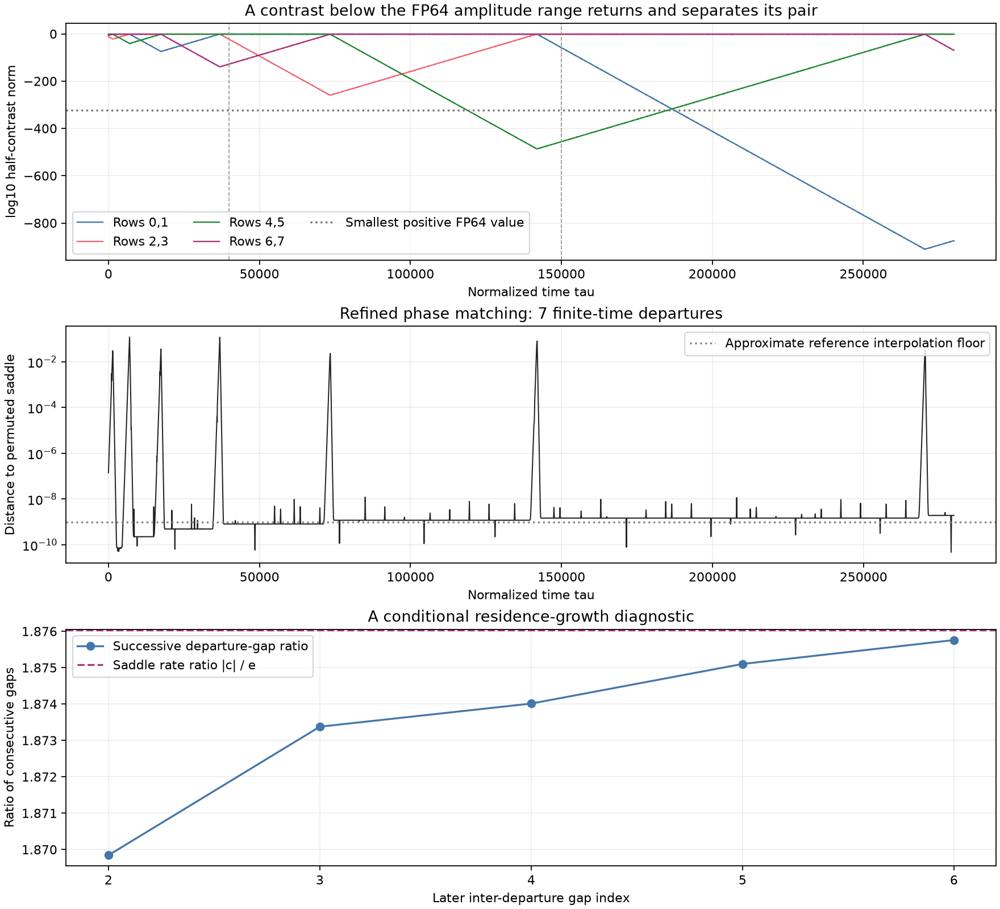

# Motor logarithmic continuation beyond the amplitude range of FP64

Status: both separate continuations from `tau=150000` to `280000` completed. A pair contrast that had fallen below `10^-486` recovered and separated its rows again; the seventh departure agrees between controls within `4.27e-6` time units. The [150k report](motor-log-contrast-audit.md), its trajectories, forecasts, and all 36 manifested files remain unchanged.

This experiment asks whether the tiny but nonzero contrast of rows `(4,5)` can eventually separate that pair again. In the preceding histories its minimum stored norm was about `10^-486.374`, and it had regrown to about `10^-455.647` by time 150k. Both scales lie below the ordinary FP64 amplitude range. Logarithmic amplitudes extend the represented range; the means and directions still use ordinary FP64 arithmetic.

## Exact continuation and numerical controls

Each run starts from the complete saved 27-coordinate state of its own 150k parent. Byte comparisons verify that all means, directions, and logarithmic amplitudes were copied unchanged. There is no reconstruction from zero Cartesian differences, new seed, noise, direction renormalization, or projection onto a cluster subspace.

The [audited scalar evaluator](../research/motor_log_scalar.py) computes the same real equations as the preceding NumPy evaluator. Before starting, the wrapper verifies matching source hashes against the passed [scalar audit](../results/motor-log-contrasts/scalar-benchmark-recheck/audit.json). That audit includes nonunit gauges, state Jacobians, reconstruction derivatives checked against the original Cartesian Jacobian, underflow bounds, and a short integration comparison.

| History | Maximum step | Relative tolerance | Absolute tolerances | Source endpoint |
| --- | ---: | ---: | ---: | --- |
| Main scalar continuation | 0.1 | `1e-10` | `1e-12` | Main 150k logarithmic state |
| Strict scalar continuation | 0.05 | `2e-11` | `2e-13` | Strict 150k logarithmic state |

The comparison uses identical checkpoint times and fixed row labels. Event times, physical means, logarithmic magnitudes, and normalized direction vectors are compared without a time shift or permutation alignment. Orbit matching against the reference saddle is a separate diagnostic.

## Forecast and results

Before the continuation reached a seventh departure, [the original four-event affine recurrence was extended once more](../results/motor-log-contrasts/pre-seventh-prediction.json), predicting `tau=269644.2145172922`. This forecast did not assimilate the observed fifth or sixth event times and did not replace its original coefficient with the later rigorous rate enclosure. It is a heuristic timing prediction, not a validated return map.

| Quantity | Main | Strict |
| --- | ---: | ---: |
| Seventh departure, rows `(4,5)` | 269559.38387906924 | 269559.3838833381 |
| Earliest-history minimum log10 norm of that contrast | -486.3740103711 | -486.3740107682 |
| New minimum log10 norm, rows `(0,1)` | -911.0580731550 | -911.0580748547 |
| Final log10 norm, rows `(0,1)` | -875.2134065854 | -875.2134081454 |
| New checkpoint count | 9797 | 9797 |
| Continuation wall time, seconds | 2183.58 | 2525.47 |

The departure is the first upward crossing of half-contrast norm `1e-4` after a deep contraction. Repeated crossings during the same oscillatory departure are retained in the raw event arrays but do not count as new departures. The seventh forecast residual is `-84.830638223` time units, about `0.0315%` of its predicted time. The latest consecutive-gap ratio is `1.8757582681`, continuing toward the local saddle rate ratio near `1.8760330677`. This finite trend is not an asymptotic return-map proof.



<!-- drawing-date -->
*First recorded drawing: **2026-10-30** ([record](https://github.com/Griboedow/chaos-attractor-lab/blob/08769b249a224e233f272d77f1dc77a58dfb9cd7/results/motor-log-contrasts/seventh-review/log-contrast-diagnostic.png)).*
<!-- /drawing-date -->

The refined phase matching identifies the sequence `L0a → L1b → L2a → L3a → L0a → L1b → L2a → L3a` in the [exact candidate graph](motor-network-combinatorics.md). Its threshold for a near visit is distance `1e-6`. A further false excursion from the coarse matcher at `tau=163000` changes from distance `0.04375` to `9.76e-9` after refinement; both raw and refined diagnostics are preserved. The displayed seven excursions remain after this check. The figure was inspected locally; no GitHub browser rendering check was available.

## Numerical audit

Across matching checkpoints in the new interval, maximum main/strict differences are `2.21e-7` for physical means and representable chart components, `2.37e-6` for logarithmic contrast magnitudes, and `7.13e-7` for normalized direction components. These comparisons use no phase or row alignment. They support the reproduced events in this recorded interval, without guaranteeing an exact arbitrarily distant trajectory.

Gauge norms remain positive. The maximum drift in their squares during the new continuation is `8.43e-7` and `1.52e-7`; cumulative drift from the first logarithmic start at 40k is `1.51e-6` and `2.69e-7`. The equations explicitly allow nonunit gauges, and no normalization is applied. All stored logarithmic states remain finite, including the new contrast below `10^-911`.

Zero quadratic-feedback weights are explicitly tracked at RHS evaluations, including trial stages. The largest recorded full omitted mean-component bound in these continuations is below `1.968e-323`, including its direction and parameter coefficients. This is an instantaneous algebraic forcing bound, not a bound on accumulated floating trajectory error. Among rows outside the four protected pairs, the smallest stored row-triple separation over the full combined history is about `0.16057`; this sampled check is not a continuous-time lower bound.

Fixed-phase growth and contraction fits after the seventh departure again reproduce the local saddle rates numerically. The strict 275k–280k fit gives approximately `e=0.00869626779087`, `c=0.01631448594124`. These floating fits are not interval enclosures and need not lie within the much tighter [certified local-rate intervals](../results/motor-saddle-proof/leading-rates.json).

The [final comparison](../results/motor-log-contrasts/seventh-review/comparison.json) records exact endpoint-byte restoration, checkpoint comparisons, rate fits, gauge drift, and underflow bounds. The separate [25-file manifest](../results/motor-log-contrasts/seventh-review/manifest.json) freezes the two continuation directories, phase review, comparison, figure, and progress record. Its finalizer also verifies every file in the earlier 150k manifest.

## Scope

The logarithmic chart preserves the four selected pair contrasts directly. It does not confer arbitrary precision on every possible row difference or the mean dynamics. The analysis therefore also records the smallest sampled separation between rows outside those four pairs.

When a quadratic mean-feedback weight underflows, the run records a full algebraic bound on the omitted mean derivative component. Such instantaneous bounds do not bound accumulated trajectory error. A reproducible finite sequence of saddle visits does not prove a heteroclinic connection, network attraction, or chaos. The underlying slow-switching mechanism and round-off trapping have established precedents, as cited in the frozen 150k report.

## Recorded commands

```powershell
python -X utf8 research/motor_log_contrasts.py run --resume-from results/motor-log-contrasts/step-0p1 --output results/motor-log-contrasts/step-0p1-to-280k --horizon 280000 --max-step .1 --rhs-mode scalar --rhs-audit results/motor-log-contrasts/scalar-benchmark-recheck/audit.json
python -X utf8 research/motor_log_contrasts.py run --resume-from results/motor-log-contrasts/step-0p05 --output results/motor-log-contrasts/step-0p05-to-280k --horizon 280000 --max-step .05 --rtol 2e-11 --mean-atol 2e-13 --direction-atol 2e-13 --logarithm-atol 2e-13 --rhs-mode scalar --rhs-audit results/motor-log-contrasts/scalar-benchmark-recheck/audit.json
```

These commands record the executed output locations; repeated runs require fresh folders. The sources and passed kernel audit are copied into each continuation folder.
