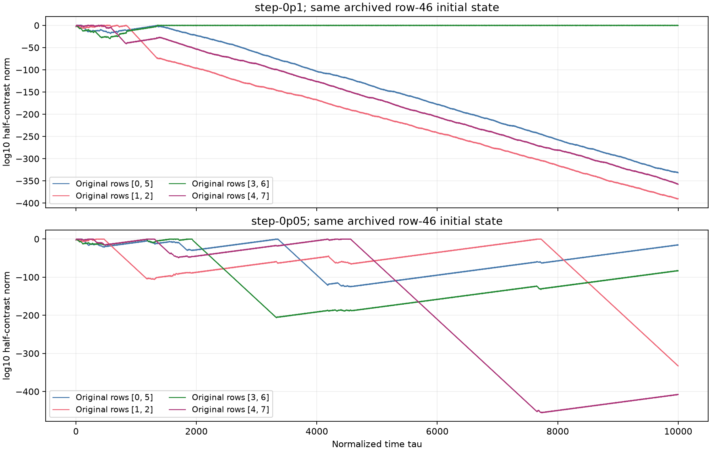

# Original source-style motor seed in logarithmic pair coordinates

Status: both separate 10k histories completed. They show recovery of tiny contrasts but disagree on their distant trajectory and final cluster pattern. Short equivalence checks passed; a fixed 200-unit scalar comparison failed and is retained explicitly below. The asymptotic regime of the exact archived start remains unresolved.

This follow-up tests the original row-46 initial state from [the activity-path archive](../results/motor-rows/activity-path/N8.npz), at its exact stored floating parameters `(2.2613636363636367, 4.7551460477513405, 1)`. The motivation is the later apparent capture of that same original start into four pairs in a Cartesian ensemble. The experiment starts again from the archived initial state; it does not repair a captured endpoint or insert a new perturbation.

The row permutation `[0,5,1,2,3,6,4,7]` makes the original pairs `(0,5)`, `(1,2)`, `(3,6)`, `(4,7)` adjacent. All initial cosine and sine half-differences vanish, but every displacement half-difference is nonzero, so the [logarithmic chart](motor-log-contrast-audit.md) is defined. All 23 physical degrees of freedom remain present; four additional direction norms are constant gauge quantities in exact arithmetic. Directions are not normalized during integration.

## Initialization and controls

The [initial audit](../results/motor-original-seed-log/initial/initial-audit.json) records the original 23 coordinates and source hash. They are copied byte-for-byte from row 46. Reordering and reconstructing the displacement constraint gives zero measured error; the chart and logarithmic round trips, returned to original row labels, differ from the archived state by at most `8.67e-19` and `1.74e-18`, respectively. These are floating conversion errors, so the converted state is not claimed to have an identical distant trajectory to the original Cartesian representation.

The runner checks the chart field and Jacobian, logarithmic reconstruction, and arbitrary nonunit gauges at these exact archived parameters. The [20-unit Cartesian/chart/log comparison](../results/motor-original-seed-log/initial/short-control.json) passed, with maximum row-triple discrepancy `1.05e-11`, below its `1e-8` guard.

The original scalar audit's fixed 200-unit integration guard **failed**: the NumPy and scalar evaluators differed by `0.0211` in means and `0.1005` in the full logarithmic state. Its [failure record and original source](../results/motor-original-seed-log/scalar-audit/failure.json) are preserved. The algebra checks before that comparison did not raise an error. This failure prohibits treating the two implementations as pointwise agreement evidence through time 200 for this start.

A separate [bounded audit wrapper](../research/motor_log_original_scalar_audit.py) retains the same scalar RHS and every original field, Jacobian, nonunit-gauge, and underflow check, while explicitly limiting its integration comparison to 20 time units. That [audit passed](../results/motor-original-seed-log/scalar-audit-20tau/audit.json): scaled field and Jacobian errors are below `4e-16`, the scaled gauge derivative error is below `4e-15`, and the maximum 20-unit log-state difference is `1.17e-11`. The long runs require this bounded audit and use the unchanged scalar kernel. The initial source snapshot predates only this switch of the required audit path; its numerical initializer is unchanged.

The long controls use maximum steps `0.1` and `0.05`, relative tolerances `1e-10` and `2e-11`, and absolute tolerances `1e-12` and `2e-13`. Both start from the same stored logarithmic conversion. Checkpoints are spaced by one time unit; each 500-unit block saves the complete state and underflow records. They are independent far-time outcomes, not a pointwise verification of one long trajectory.

## Bounded outcomes



The main history ends with three tiny selected pair contrasts and a macroscopic contrast for original rows `(3,6)`. The stricter history ends with all four selected contrasts below `1e-4`, while several logarithmic magnitudes have been growing for thousands of time units. The main history has no checkpoint with all four below that threshold in its final 1000-unit window; the strict history has 1001 such checkpoints. These different outcomes prohibit claiming convergence of the distant trajectory under the step/tolerance change.

| Original pair | Main final log10 half-contrast norm | Strict final log10 half-contrast norm |
| --- | ---: | ---: |
| `(0,5)` | -332.03684 | -15.74499 |
| `(1,2)` | -389.87055 | -332.87496 |
| `(3,6)` | -0.26460 | -83.80130 |
| `(4,7)` | -358.01990 | -407.53346 |

Several completed contraction/recovery episodes are observable before the endpoints. In the main run, original pair `(3,6)` reaches log10 norm `-29.9943` near time 569 and first exceeds `1e-4` again at saved checkpoint 1236. In the strict run, pair `(1,2)` reaches `-106.5842` near 1303 and exceeds `1e-4` again at checkpoint 7466. These are checkpoint-based event brackets, not continuously located crossing times. The strict `(4,7)` contrast reaches `-455.7619` near 7730 and recovers about 48 logarithmic orders by 10k, while remaining far below the ordinary FP64 amplitude range.

The two histories diverge substantially much earlier: their maximum mean-coordinate difference is about `9.58e-10` through time 20, `0.00246` through 100, and `3.35` through 200. Their observed later behavior is therefore reported independently. A log-coordinate integration is not an arbitrary-precision evaluation of the exact archived orbit, and these results do not establish whether the separate Cartesian ensemble's final capture was spurious for that exact initial condition.

All 10,001 stored states in each history have finite logarithmic coordinates and positive gauge norms. Maximum squared-gauge drift is `1.20e-7` and `1.80e-8`; no normalization occurs. The largest recorded bound for an omitted quadratic mean-feedback component is below `1.718e-323`, including parameter and direction coefficients. This is an instantaneous RHS bound, including trial stages, not an accumulated trajectory error bound. Wall times were 156.82 and 189.23 seconds.

The analysis checks all 24 row pairs outside the four protected pairs. None has bitwise-equal reconstructed rows at any saved checkpoint in either history; the smallest sampled row-triple distance is about `3.9235e-4`, for original rows `(5,7)` near time 30. Every protected pair does at some time reconstruct to bitwise-equal Cartesian rows, even though its stored logarithmic contrast remains nonzero. In particular, a protected pair's apparent Cartesian equality cannot be used to restart this calculation. These sampled checks do not exclude closer encounters between checkpoints or protect arbitrary future changes in pairing.

The [comparison record](../results/motor-original-seed-log/comparison.json) includes all pair separations, equality times, recovery episodes, underflow bounds, and pointwise differences. The [27-file manifest](../results/motor-original-seed-log/manifest.json) freezes the source snapshots, failed audit, passed bounded audit, two histories, analysis, and figure. The figure was inspected locally, and document paths were checked; no browser rendering check was available.

## Scope

This is a bounded coordinate-precision diagnostic. It does not estimate basin fractions, Lyapunov exponents, or an asymptotic attractor. Agreement during the short equivalence control does not imply pointwise agreement between sensitive distant trajectories. Only the four selected pair contrasts receive an explicit logarithmic representation; other row differences still use ordinary floating arithmetic.

The [runner](../research/motor_log_original_seed.py) writes separate source copies and evidence under `results/motor-original-seed-log/`. The 150k and 280k switching experiments remain independent and unchanged.

## Recorded commands

```powershell
python -X utf8 research/motor_log_original_seed.py prepare
python -X utf8 research/motor_log_original_seed.py short-control
python -X utf8 research/motor_log_scalar.py --source results/motor-original-seed-log/initial --output results/motor-original-seed-log/scalar-audit
# The preceding 200-unit comparison failed; its failure is preserved.
python -X utf8 research/motor_log_original_scalar_audit.py --source results/motor-original-seed-log/initial --output results/motor-original-seed-log/scalar-audit-20tau
python -X utf8 research/motor_log_original_seed.py run --name step-0p1 --horizon 10000 --max-step .1 --rtol 1e-10 --atol 1e-12
python -X utf8 research/motor_log_original_seed.py run --name step-0p05 --horizon 10000 --max-step .05 --rtol 2e-11 --atol 2e-13
python -X utf8 results/motor-original-seed-log/analyze.py
```

Output folders are protected against accidental replacement. The current runner adds an `--output` option after the frozen experiment, without changing the field or integration settings. For a new reproduction, pass the same unused folder, for example `--output outputs/original-seed-reproduction`, to `prepare`, `short-control` and each `run`. Pass that folder's `initial` subfolder to the separate scalar audit and write its result to the new `scalar-audit-20tau` subfolder. To reproduce the analysis, copy the archived `analyze.py` into this new folder directly under `outputs/` and execute the copy. The source snapshots in the evidence archive remain the versions actually executed.
