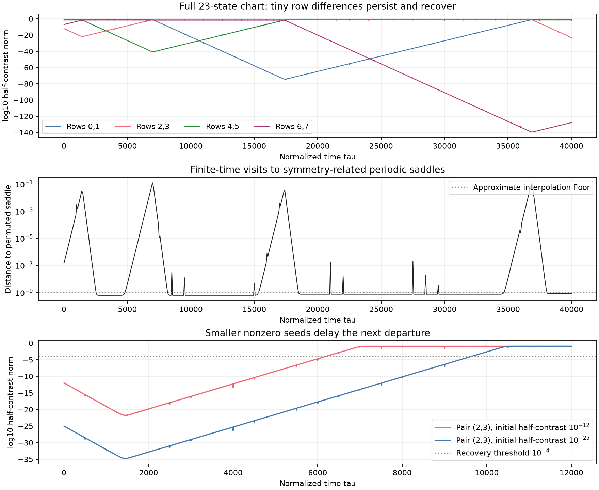

# Resolving tiny row contrasts during repeated saddle visits

**The full 23-state motor system repeatedly leaves the nearly synchronized states when its nonzero row differences are stored directly.** Two controlled binary64 integrations follow four successive departures over $`40\,000`$ normalized time units. Some sampled half-contrasts fall to approximately $`5\times10^{-140}`$ and remain dynamically active. Reconstructing individual rows in ordinary binary64 can erase these differences or replace them with constraint-roundoff errors.

This is a numerical coordinate-precision diagnostic in the existing model, not a proof of a heteroclinic cycle, an attracting set or chaos. It supports slow switching between symmetry-related periodic saddles near the secondary cluster instability. It does not classify the separate hyperchaotic candidate at a different parameter.



The top panel connects checkpoints sampled once per reference period and at integration-block endpoints. The middle panel uses approximate phase/permutation matching to the archived periodic saddle; its floor near $`10^{-9}`$ is dominated by interpolation. The bottom panel compares two nonzero initial seeds. The figure does not provide interval enclosures.

## An invertible change of all 23 coordinates

Use the fixed pairs $`(0,1),(2,3),(4,5),(6,7)`$, with zero-based row labels. For each pair write

```math
c_\pm=\bar c\pm d_c,\qquad s_\pm=\bar s\pm d_s,\qquad
X_\pm=\bar X\pm d_X.
```

Store four $`\bar c`$, four $`\bar s`$, three independent $`\bar X`$, and all twelve half-differences. The fourth mean displacement is $`\bar X_4=-\sum_{a=1}^3\bar X_a`$. This gives $`4+4+3+12=23`$ states. No pair is constrained to remain equal.

For each pair define

```math
\bar V=-\rho\bar X+r(\bar s-\langle\bar s\rangle),\qquad
d_V=-\rho d_X+r d_s.
```

Adding and subtracting the original row equations gives exactly

```math
\begin{aligned}
\bar c'&=1-\bar c-\bar V\bar s-d_Vd_s,&
d_c'&=-d_c-\bar Vd_s-\bar s d_V,\\
\bar s'&=b-\bar s+\bar V\bar c+d_Vd_c,&
d_s'&=-d_s+\bar Vd_c+\bar c d_V,\\
\bar X'&=\bar V,& d_X'&=d_V.
\end{aligned}
```

The chart retains the quadratic feedback of contrasts into the means. It is an exact linear coordinate change, not a cluster restriction or a modified coupling. Its contrast equations are homogeneous: an exactly zero pair difference remains zero, while a very small nonzero difference is evolved directly. The mechanical sum constraint is built into the coordinates. No noise, state clipping, reinjection or projection is applied during integration.

[The implementation](../research/motor_pair_coordinates.py) constructs both conversion matrices independently. Their products equal the identity exactly in binary64 because their entries are simple dyadic numbers. Over 32 seeded random states, independent full-field and complex-step Jacobian comparisons have maximum scaled discrepancies $`3.96\times10^{-16}`$ and $`2.63\times10^{-16}`$. A two-period Cartesian control differs by $`1.80\times10^{-14}`$ at its endpoint; the current implementation rejects discrepancies exceeding $`10^{-8}`$.

An explicit representation check sets every half-contrast to components of size $`10^{-80}`$. The direct chart retains their norms, $`3.74\times10^{-80}`$. Cartesian reconstruction and subtraction return zero in three pairs and a spurious $`4.44\times10^{-16}`$ difference in the last pair, whose omitted displacement is recovered from the sum constraint. The short Cartesian control therefore validates the coordinate equations at ordinary scales, not the preservation of arbitrarily small seeds.

## Initial condition and controls

The experiment starts from the [archived six-cluster saddle](../results/motor-postcritical/six-cluster-cycle-rho-3p268/cycle.npz), with $`(\rho,r,b)=(3.268,4.755146047751339,1)`$ and period approximately $`13.633145767830683`$. These are the stored floating-point parameters, not the exact algebraic parameter convention of the separate interval certificates.

At its stored phase, pair $`(6,7)`$ has an expanding multiplier approximately $`1.125871594581`$ and pair $`(2,3)`$ a contracting multiplier approximately $`0.800580839837`$. The selected contrast directions come from their three-dimensional blocks in $`E^{-1}ME`$ and are normalized to unit Euclidean length. The initial half-contrast norms are $`10^{-7}`$ in pair $`(6,7)`$ and $`10^{-12}`$ in pair $`(2,3)`$, with the declared positive signs. Other chart coordinates retain the archived values. Only this sign choice was tested in this chart experiment. [All complex block eigenvalues](../results/motor-pair-coordinates/eigenvalue-audit.json).

The primary DOP853 run uses maximum step $`0.1`$, relative tolerance $`10^{-10}`$, mean-coordinate absolute tolerance $`10^{-12}`$ and contrast absolute tolerance $`10^{-150}`$. Its independent control uses maximum step $`0.05`$, relative tolerance $`2\times10^{-11}`$ and mean tolerance $`2\times10^{-13}`$. Both first run to $`\tau=20\,000`$. Each then resumes from its own complete saved chart state to $`\tau=40\,000`$, using contrast tolerance $`10^{-200}`$. The continuations preserve the initial runs and record their hashes; they do not reset or recompute the tiny contrasts from Cartesian rows.

Each block spans at most 500 time units and records its final state, periodwise checkpoints, contrast extrema, event times and solver work. Norms are computed with scaling before squaring. Every saved pair norm stays nonzero. The smallest sampled norm in the first segments is approximately $`1.34\times10^{-75}`$, about 75 orders of magnitude above their absolute contrast tolerance. In the continuation it is approximately $`5.04\times10^{-140}`$, about 60 orders above the stricter tolerance. These are sampled minima, not lower bounds between checkpoints.

## Recovered contrasts and a return to the original saddle family

An initial departure is measured by an upward half-contrast crossing of $`10^{-4}`$. A recovery requires a prior checkpoint below $`10^{-12}`$ and then an upward crossing of $`10^{-4}`$. This separates departure from repeated within-period threshold oscillations.

| Pair leaving equality | Smallest preceding sampled half-contrast | Primary threshold time | Difference under stricter control |
| --- | ---: | ---: | ---: |
| $`(6,7)`$, initial seed | $`10^{-7}`$ initially | 621.783664 | $`1.56\times10^{-9}`$ |
| $`(2,3)`$, recovery | $`1.55\times10^{-22}`$ | 6185.783114 | $`1.48\times10^{-8}`$ |
| $`(4,5)`$, recovery | $`3.15\times10^{-41}`$ | 16589.582280 | $`5.36\times10^{-8}`$ |
| $`(0,1)`$, recovery | $`1.34\times10^{-75}`$ | 36079.813432 | $`1.14\times10^{-7}`$ |

The threshold times precede the completed transitions; they are not arrival times at the next saddle. Approximate phase/permutation matching identifies the sequence of expanding-pair roles

```math
(6,7)\ \longrightarrow\ (2,3)\ \longrightarrow\ (4,5)
\ \longrightarrow\ (0,1)\ \longrightarrow\ (6,7).
```

After the fourth departure the trajectory again approaches the original labeled saddle orbit. At a checkpoint near $`\tau=39\,986`$, its fitted row permutation is the identity and its distance is approximately $`8.1\times10^{-10}`$, near the interpolation floor. Pair $`(6,7)`$ has contracted to approximately $`5.04\times10^{-140}`$ during this passage and is regrowing, but its next departure lies beyond the saved horizon. This is finite-time evidence of a repeating organization by saddles, not proof of an infinite connection or an attracting heteroclinic cycle.

Through $`40\,000`$ time units the two trajectories differ by at most $`4.22\times10^{-8}`$ in chart coordinates at shared checkpoints. Their log10 half-contrast norms differ by at most $`1.21\times10^{-7}`$. The recovery times are reproducible over this horizon. These comparisons do not guarantee an exact farther-future trajectory.

Raw repeated threshold crossings are also retained. Their counts can differ between steps $`0.1`$ and $`0.05`$: a rapid oscillation may dip below the $`0.01`$ threshold and return between accepted integration steps. Those raw counts are not used as a dynamical invariant or as evidence of saddle escape. The declared small-to-large recovery events above pass the step-size comparison. [Initial comparison](../results/motor-pair-coordinates/seed-1e-12-step-0p1/comparison.json), [continuation comparison](../results/motor-pair-coordinates/seed-1e-12-step-0p1-extended/comparison.json).

## A seed-size check

A third run changes only the initial pair $`(2,3)`$ half-contrast from $`10^{-12}`$ to $`10^{-25}`$ and uses the stricter settings through $`\tau=12\,000`$. Up to $`\tau=5000`$, the log10 ratio of that pair's norms remains 13 within $`2.24\times10^{-12}`$. The fitted growth rate on reference-period samples over $`[2500,5000]`$ is $`0.008696267790908`$, compared with the archived expanding Floquet exponent $`0.008696267790971`$.

The predicted logarithmic delay is

```math
\frac{\log(10^{13})}{0.008696267790971}\simeq3442.12102576.
```

The fitted-envelope delay is approximately $`3442.12102578`$. Direct first-threshold times differ by $`3442.36490`$ because the norm also oscillates with the periodic orbit's phase. This deterministic seed dependence supports transverse growth from the retained contrast. [Seed-control record](../results/motor-pair-coordinates/seed-control.json).

An exactly zero contrast is a different initial condition and remains zero by the exact equations. The separate experiment that deliberately preserved pair $`(2,3)`$ therefore cannot test departure along that pair. Rounding a nonzero contrast to zero silently changes the initial-value problem into that invariant special case. The chart demonstrates why apparent capture after such a loss should not be identified as full-system attraction.

## Reproduction and limits

```bash
python research/motor_pair_coordinates.py run --output outputs/pairs-main --horizon 20000 --max-step 0.1
python research/motor_pair_coordinates.py run --output outputs/pairs-strict --horizon 20000 --max-step 0.05 --rtol 2e-11 --mean-atol 2e-13
python research/motor_pair_coordinates.py run --output outputs/pairs-main-extended --resume-from outputs/pairs-main --horizon 40000 --max-step 0.1 --contrast-atol 1e-200
python research/motor_pair_coordinates.py run --output outputs/pairs-strict-extended --resume-from outputs/pairs-strict --horizon 40000 --max-step 0.05 --rtol 2e-11 --mean-atol 2e-13 --contrast-atol 1e-200
python research/motor_pair_coordinates.py run --output outputs/pairs-small-seed --horizon 12000 --max-step 0.05 --rtol 2e-11 --mean-atol 2e-13 --seed 1e-25
```

Use the script's `analyze`, `compare`, `seed-compare` and `plot` commands for the saved diagnostics. Analysis requires the archived reference cycle. All executed script snapshots, source-data hashes, solver records and checkpoint arrays are retained in the [data manifest](../results/motor-pair-coordinates/manifest.json).

The method still uses binary64 arithmetic for its means and coefficients. It protects differences inside the four declared pairs; it does not provide arbitrary-precision coordinates for every possible row partition. The saddle, its eigendirections and the orbit matches are numerical. Establishing a heteroclinic connection, its robustness or attraction requires additional invariant-manifold and return-map analysis. No new chaotic-attractor claim follows from these precision controls.
