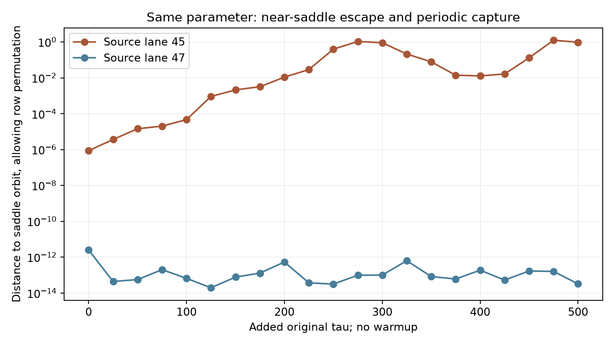

# Two excluded starts at the lane-46 parameter

The two other archived starts at `(rho, r, b) = (2.2613636363636367, 4.7551460477513405, 1.0)` do not provide evidence for a coexisting stable periodic attractor. One shadows a periodic saddle and leaves; the other remains numerically captured on a four-pair periodic saddle with three expanding full-space directions. These cases were outside the original fixed 32-lane positive cohort and do not change its counts.

## Exact input and clock chain

Source lanes 45 and 47 are starts 0 and 2 of tuple 15 in [`N8-refined.npz`](../results/motor-rows/activity-path/N8-refined.npz). Their stored `elapsed_original=1500` is the refinement segment clock. Each refinement initial state is checked byte-for-byte against the corresponding final state of [`N8.npz`](../results/motor-rows/activity-path/N8.npz), whose elapsed clock is 600. The cumulative starting clock is therefore 2,100 original tau, and the new 500-tau runs end at cumulative 2,600.

The [classification source](../research/classify_motor_tuple15_excluded.py) integrates the full 23-dimensional equations with no state projection or new warmup. It preserves the original leading tangent, completes it to a 23-vector orthonormal basis and computes new-only QR sums. There was no inherited full basis for these lanes. All five new 100-tau windows, initial states, sample histories and return diagnostics are retained for both cases.

## Periodic capture in source lane 47

The [lane-47 run](../results/motor-activity-continuation/tuple15-excluded/lane-47/analysis.json) remains in the four-pair pattern `[[0,5],[1,2],[3,4],[6,7]]`. Among return lags 1 through 16, the first accepted labeled return is lag 10, with fitted period **62.76836810152**. This is the full labeled period used for the variational calculation; a half-period visual pattern does not establish a shorter labeled period.

The [periodic shooting result](../results/motor-activity-continuation/tuple15-excluded/lane-47/periodic/analysis.json) has closure errors `2.14e-13` with DOP853 and `5.49e-13` with Radau. The complete quotient fundamental matrices agree within `2.10e-11`. The quotient's largest nonflow multiplier has modulus `0.000171863`, but the original full 23-dimensional variational equation has **three expanding Floquet exponents**, each approximately

```text
0.048180383169
```

Thus quotient contraction alone would misclassify this numerical orbit as an attractor. Its full-space instability is well separated from the unit circle. Strongly contracting multipliers over this long period approach floating-point noise; their individual negative exponents are not accurately resolved by the raw monodromy calculation. No interval certificate is claimed here.

The single carried tangent remains close to the neutral rate, whereas three additional full-basis QR directions grow. This illustrates why the old near-zero scalar estimate was not a transverse stability test.

## Near-saddle escape in source lane 45

The [lane-45 run](../results/motor-activity-continuation/tuple15-excluded/lane-45/analysis.json) already has three paired groups and two singles: `[[0,5],[1,3],[2],[4,6],[7]]`. Allowing row permutation and phase, its initial state is only `8.70e-7` from the same fitted periodic saddle. The [phase-matching calculation](../results/motor-activity-continuation/tuple15-excluded/phase-refinement/analysis.json) finds distance `0.970` after 500 tau, with substantial intermediate departure and a later closer approach. No final return at lags 1 through 16 passes the periodic shooting threshold.

All three initially paired groups remain paired in the saved full-equation samples. This is a finite departure within that cluster structure; it is not by itself evidence for generic full-space attraction or an asymptotic chaotic attractor. The separately studied [lane-46 cluster candidate](motor-lane46-spectrum.md) has the same cluster-size partition and contracting conditional directions, but this short continuation does not establish that lane 45 converges to it.



<!-- drawing-date -->
*First recorded drawing: **2026-10-30** ([record](https://github.com/Griboedow/chaos-attractor-lab/blob/bbe0edab55b3e18abee97b4ada9039b2f9d566e7/results/motor-activity-continuation/tuple15-excluded/phase-refinement/orbit-distance.png)).*
<!-- /drawing-date -->

The blue curve stays at numerical orbit-matching accuracy. The orange curve leaves the periodic saddle's neighborhood. An exploratory fit of log distance over added tau 0 through 150 gives slope `0.0509`, near the expanding Floquet rate `0.04818`; this descriptive fit was made after observing the data and does not prove a connection or predict an asymptotic trajectory.

## Checks, scope and reproduction

The [independent audit](../results/motor-activity-continuation/tuple15-excluded/analysis/analysis.json) passes 41 checks, including the exact source clock chain, saved hashes, complete sampling grids, QR basis orthogonality, endpoint Jacobians and force constraints, flow identities and full-period closure. The QR/trace discrepancy per tau is `1.09e-14` for lane 45 and `3.82e-14` for lane 47. Both retain every tested lag 1 through 16. The [final inventory](../results/motor-activity-continuation/tuple15-excluded/manifest-final.json) preserves the first phase-search result, its improved scalar refinement and an analysis-source syntax failure that occurred before any code executed. The trajectory and Floquet runs were unaffected by that preflight error.

From the repository root, with NumPy and SciPy installed, use a fresh output path:

```console
python research/classify_motor_tuple15_excluded.py --output outputs/motor-tuple15-excluded
```

The analysis and figure scripts under the saved result folder reproduce the archived audits in their original layout and refuse to overwrite an existing result. These are finite numerical observations and Floquet estimates, not a proof of chaos, basin coexistence or scientific novelty.
