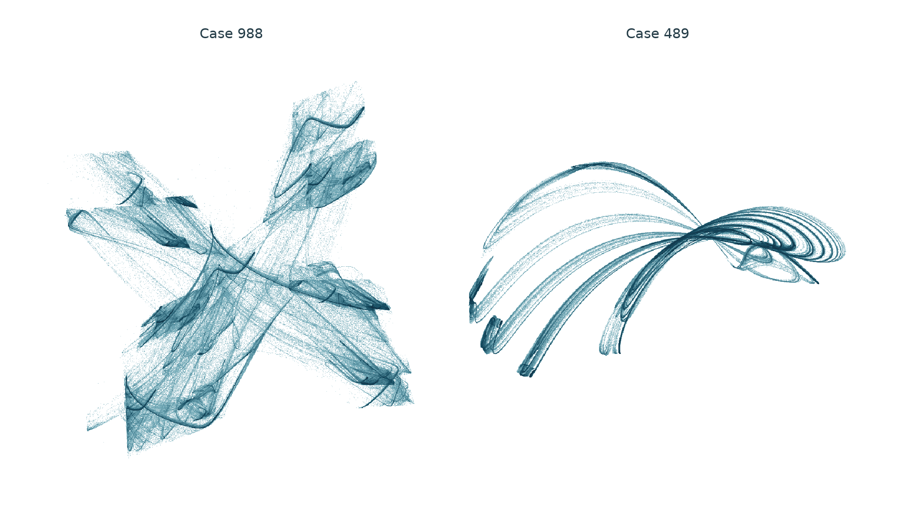
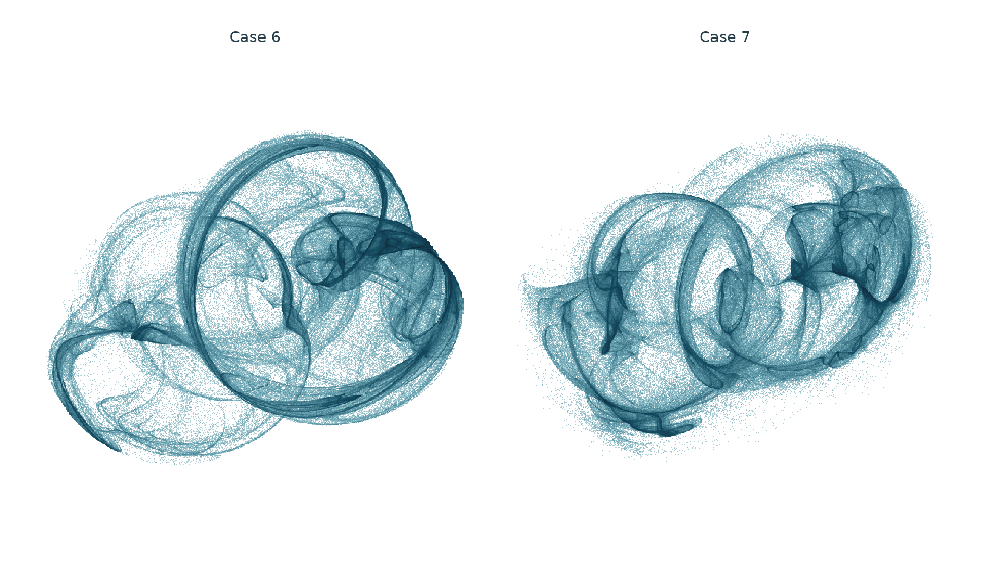
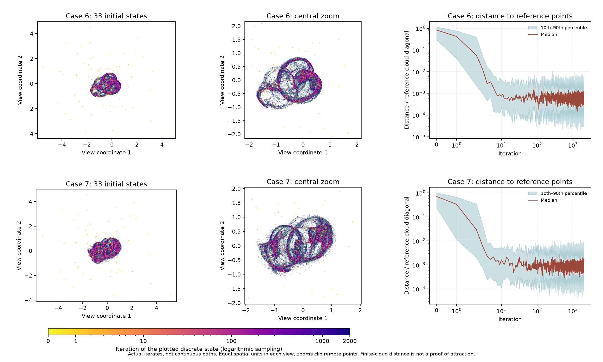
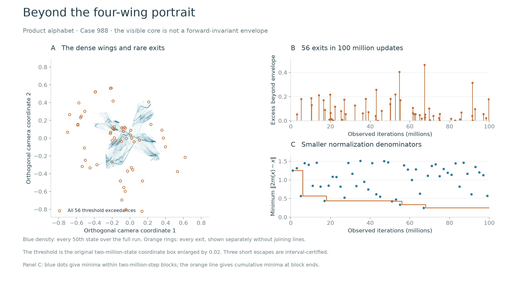
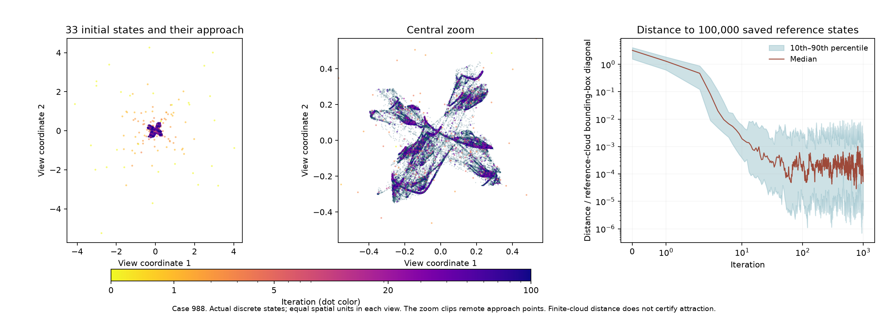
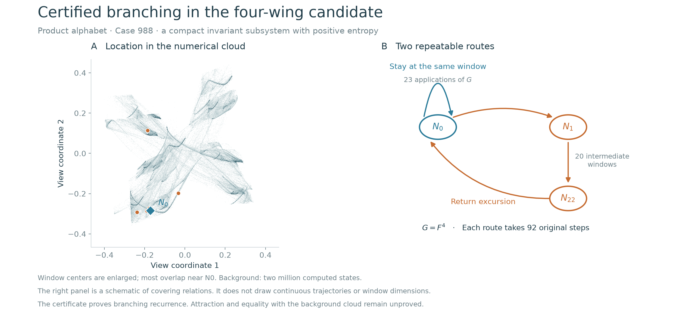
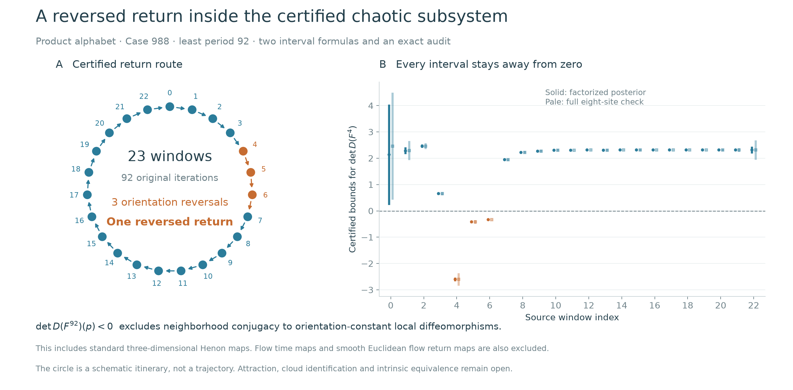

# Folded wings, positive entropy and reversed returns in posterior-reflection maps

**Computational research article · 2026-11-01.** A compact invariant subsystem
has certified positive entropy and an orientation-reversing period-92 orbit.
Chaotic attraction and historical uniqueness are not certified.

## Abstract

An exact Gaussian posterior for three independently quantized coordinates,
combined with unit-sphere reflection feedback, produces a spatial network of
four folded wings. A declared 1,753-case survey covers binary, ternary and
four-level Cartesian alphabets. All 175 initial nonperiodic flags receive
longer follow-up; twelve visually selected regimes receive five-million-step
observations. The principal binary candidate retains positive leading growth
at all 33 tested starts and in independent 70- and 100-digit calculations.
A subsequent hundred-million-step observation of both displayed cases retains
positive leading growth in every block. The principal case has rare excursions
beyond the original portrait envelope; short interval calculations certify
three such exits and isolate a nearby normalization singularity.
A separate interval certificate proves a compact invariant subsystem with
topological entropy above 0.0254 per original iteration for the exact binary
parameters. A second, full-eight-site automatic-derivative implementation
verifies every covering relation. An orientation audit places an exact
least-period-92 orbit with negative return determinant in that subsystem.
Local degree excludes ambient-neighborhood topological conjugacy to
orientation-constant local diffeomorphisms, including standard three-dimensional
Henon maps, and to smooth Euclidean flow return maps. This subsystem is not proved attracting
or equal to the sampled cloud. A four-level companion produces layered arches
but coexists with numerical fixed points. Complete selection records preserve periodic captures and
precision-sensitive planar behavior. The contribution is a reproducible
geometric study, a positive-entropy certificate and a precisely scoped
equivalence obstruction. Posterior means,
spin responses, reflection algorithms and feedback-induced chaos are known;
neither a new general operator nor historical priority is claimed.

## 1. Geometry and evidence level



<!-- drawing-date -->
*First recorded portrait: **2026-11-01**.*
<!-- /drawing-date -->

Case 988 is the principal candidate: four curved, folded wings occupy a
substantial volume in all three coordinate directions. Case 489 is a
more anisotropic companion with layered arches and curled edges. These
descriptions refer to numerical point clouds, not certified surfaces or
topological classifications. Each panel includes two million consecutive
states after 100,000 discarded iterations. No symmetry replication,
interpolation, smoothing, or nonlinear visual transformation is applied.
Centering and orthogonal cameras preserve native geometry; spatial units
are equal within each panel. Panel scales and density saturation differ.
The displayed window represents the frequently visited core. Section 4.1
shows rare exits found in a much longer run; this portrait is not a complete
boundary of an invariant set.

The [24-second rotation](../assets/portraits/product-alphabet.webp) uses
the last 250,000 consecutive states of the same rendering inputs, with
fixed states and scale throughout. The apparent curves are dense sets of
discrete iterates. No period at most 512 is detected in the recorded
selected tails; this finite test does not prove aperiodicity.

**Case identifiers are local to this product-alphabet campaign.** The
[canonical-site study](../canonical-sphere/manuscript.md) has separate case
numbers. In particular, this Case 988 is not a renaming of its cubic Case 653.
The full [evidence packet](../../results/product-alphabet/README.md) retains
exact inputs, source snapshots, unsuccessful selections and numerical checks.

## 2. Model, factorization and established interpretations

For coordinate alphabets $`A_i=\{\ell_{i,0},\ldots,\ell_{i,q-1}\}`$,
take the uniform prior on $`A_1\times A_2\times A_3`$. Independent Gaussian
observation noise with variance $`\tau/2`$ gives

```math
w_{i,k}(x_i)=\frac{\exp(-(x_i-\ell_{i,k})^2/\tau)}
 {\sum_{j=0}^{q-1}\exp(-(x_i-\ell_{i,j})^2/\tau)},
\qquad m_i(x_i)=\sum_{k=0}^{q-1}w_{i,k}(x_i)\ell_{i,k}.
```

The full posterior factors exactly into these three scalar distributions.
The initial campaign evaluates $`q=2,3,4`$, corresponding to 8, 27 and 64
spatial sites. Sections 3.1–3.2 extend the alphabet size and spacing.
The deterministic recurrence is

```math
v(x)=2m(x)-x,\qquad r(x)=\|v(x)\|,\qquad u(x)=v(x)/r(x),
\qquad F(x)=\beta x+\beta u(x)+(1-2\beta)m(x).
```

It is smooth wherever $`r(x)>0`$. If $`R_m=2m-I`$ and
$`R_S(v)=2v/\|v\|-v`$, then

```math
F=\frac{\beta}{2}(R_S R_m+I)+(1-\beta)m.
```

This is the established relaxed-reflection construction with a posterior
mean in place of one metric projector. The signal interpretation concerns
this deliberately specified iteration, not an observed communication
device or a standard decoder implementation. The sphere introduces a
known coupling through normalization. The [shared equivalence review](../soft-constellation-priority.md)
covers mean shift, MMSE estimation, proximal interpretations, plug-and-play
splitting, sigmoid networks and chaotic iterative decoding.

Write $`D=\mathrm{diag}(d_1,d_2,d_3)`$. The exact derivative is

```math
d_i=\frac{2}{\tau}\sum_k w_{i,k}(\ell_{i,k}-m_i)^2,
\qquad
DF=\beta I+(1-2\beta)D+
\frac{\beta}{r}(I-uu^{\mathsf T})(2D-I).
```

For an ideal symmetric binary alphabet $`\ell_{i,\pm}=c_i\pm a_i`$,
the familiar independent-spin response is

```math
h_i=\frac{2a_i(x_i-c_i)}{\tau},\qquad
m_i=c_i+a_i\tanh h_i.
```

For the ideal ternary alphabet $`c_i+a_i\{-1,0,1\}`$, it becomes

```math
m_i=c_i+a_i\frac{2\sinh h_i}{\exp(a_i^2/\tau)+2\cosh h_i}.
```

The latter is the standard spin-1/Blume–Capel single-site response, after
parameter identification. These identities prevent presenting the scalar
nonlinearity as a new invention. The initial campaign's alphabets are separately rounded
binary64 arrays built from $`c_i+a_i\,\mathrm{linspace}(-1,1,q)`$.
Their exact entries, rather than ideal symmetry identities or rounded
table entries, define the recorded experiments.

| Case | Levels per coordinate | beta | tau |
| --- | --- | --- | --- |
| **988** | **2** | **0.9268088431125507** | **0.020935697765931374** |
| 489 | 4 | 0.9699380761357025 | 0.035825792302107334 |

| Case | Halfwidths a | Center c |
| --- | --- | --- |
| 988 | (0.9987935485318303, 0.9138440923765302, 1.1366534527391194) | (-0.13522116094827652, 0.2182737350463868, -0.07052738964557648) |
| 489 | (1.0288301357999443, 0.17564048673957586, 0.18828875999897718) | (0.104424723982811, -0.5549065947532654, -0.0760837271809578) |

Exact hexadecimal parameters and alphabet entries are recorded in the
verification report. Translation or unequal coordinate scaling does not
preserve the unit-sphere normalization, so simply centering or stretching
the alphabet does not produce an immediate conjugacy to the earlier cubic
map. This observation excludes only that elementary identification.

## 3. Complete search and selection

The initial state is $`(0.317,-0.211,0.419)`$. The declared screen contains
one exact input control from canonical Case 653, a complete 216-case
centered isotropic grid, and 512 scrambled Sobol draws each evaluated at
all three alphabet orders. The Sobol seed is `2026110144`. The eight
coordinates determine beta, temperature, three halfwidths and three shifts;
the exact ranges and construction appear in the executed source.

After 5,000 discarded and 15,000 observed iterations, 177 cases have a
leading rate above 0.005 in all ten windows. A period test through lag 64
rejects two. All remaining 175 receive 30,000 discarded and 500,000
observed iterations with full three-direction QR calculations. Of these,
165 retain positive leading growth in every window without a detected
period: 46 binary, 60 ternary and 59 four-level cases. Nine others have
detected periods (four fixed, three period two, one period four and one
period 43); one additional case has a nonpositive leading window.

All fifteen preview pages were inspected before selecting twelve cases:
203, 287, 397, 489, 607, 893, 933, 988, 1351, 1450, 1660 and 1709.
Each receives a fresh 100,000-step transient, five million observed steps,
twenty full-spectrum windows, and a separate two-million-state portrait.
All twelve retain positive leading growth. Eight have an observed smallest
covariance fraction below $`10^{-5}`$; numerical growth alone does not make
them convincing spatial candidates. Five cases receive the start and
precision controls below. The two displayed cases were selected for
geometry and those controls, not through a preregistered visual score.

### 3.1. Higher-order visual search

A separate [extension packet](../../results/product-highorder/README.md)
tests five, seven and nine levels per coordinate: 125, 343 and 729 fixed
posterior sites. Its 851 inputs comprise two exact earlier controls,
81 centered grid cases and 256 Sobol geometries evaluated at all three
orders. Temperature is scaled by the squared geometric-mean level spacing;
the Sobol seed is `2026110152`. This changes the alphabet, not the established
posterior/reflection construction.

All 46 short flags retain positive leading growth in twenty windows over
500,000 observed updates, without a detected period through 512. After
inspection of all four preview pages, eight cases receive five million
observed updates and separate two-million-state portraits. All eight retain
positive leading windows. Their images are predominantly thin folded arcs,
frames and layered ribbons. They were not selected to replace the principal
four-wing portrait: this is a recorded visual judgment, not a mathematical
classification or evidence that higher-order alphabets cannot produce
other geometries. Extension identifiers are local; its Cases 0 and 1 are
the exact earlier Cases 988 and 489. The packet retains the full selection,
numerical controls and bounded reference-library comparisons.

Three of those higher-order cases, 109, 185 and 414, retain positive growth
in separate 70- and 100-digit observations. However, only 10, 14 and 11 of
33 fresh starts respectively retain positive growth in every window without
a detected period. The remaining outcomes include 22, 19 and 22 finite
periodic captures, plus one nonperiodic Case 109 trace with a nonpositive
leading window. Positive growth at one selected start is therefore insufficient
to establish a unique attracting regime.

### 3.2. Nonuniform alphabets and folded shells

A subsequent 770-input survey replaces uniform interior spacing by sorted
nonuniform levels, at three, four and five levels per coordinate. It includes
the same two earlier controls and 256 paired Sobol geometries, seed
`2026110154`. All 41 short flags receive 500,000-step observations and retain
positive leading windows without a detected period through 512. All four
preview pages are inspected before selecting Cases 6, 7, 102, 118, 212 and
673 for five-million-step observations and two-million-state portraits.
All six retain positive leading windows. These identifiers belong to the
nonuniform survey and are distinct from the higher-order identifiers above.



<!-- drawing-date -->
*First recorded portrait: **2026-11-01**.*
<!-- /drawing-date -->

Cases 6 and 7 are additional numerical visual candidates, with folded
shells and several curled openings. The wording describes appearance;
no torus, genus, smooth surface or closed-curve classification is asserted.
Each static panel contains two million consecutive states after 100,000
discarded updates, with an orthogonal camera and equal units. The
[24-second rotation](../assets/portraits/product-irregular.webp) keeps the
last 250,000 states and the spatial scale fixed.



The same 33 initial states are followed for their first 2,000 updates.
Colors mark actual discrete states at logarithmically sampled iteration
indices; they are not interpolated flow lines. The zooms clip remote
points and keep equal spatial units. The right panels measure distance
to 100,000 uniformly sampled reference states, divided by that reference
cloud's bounding-box diagonal. At update 2,000 the median distances are
0.0006974 and 0.001557. Their positive floors reflect finite reference
sampling as well as dynamics; neither the curves nor the finite start
cohort prove asymptotic attraction. The [approach packet](../../results/product-irregular-approach/README.md)
retains plotted states, all distance quantiles and independent expression
checks at 132 selected steps.

| Diagnostic | Nonuniform Case 6 | Nonuniform Case 7 |
| --- | --- | --- |
| Levels per coordinate | 4 | 5 |
| beta | 0.9984140746686607 | 0.9984140746686607 |
| tau | 0.17863014837168806 | 0.10047945845907452 |
| Five-million-step QR rates | (0.308444, -0.139512, -0.840100) | (0.357043, -0.041116, -0.404836) |
| Twenty-million-step QR rates | (0.308678, -0.139961, -0.840244) | (0.357078, -0.041303, -0.405067) |
| Smallest leading window | 0.306768 | 0.355429 |
| Positive nonperiodic outcomes among 33 starts | 33 | 33 |
| Smallest 70-digit leading window | 0.301826 | 0.348977 |
| Smallest 100-digit leading window | 0.298781 | 0.347495 |

The start and precision protocols are the same as in Section 4; they use
these cases' exact stored nonuniform levels. The
[extension packet](../../results/product-highorder/README.md) records every
level, all outcomes, complete numerical replays and the image selection.
The entropy, reversed-return and singularity certificates for Case 988
do not transfer to these new parameter sets.

A fresh twenty-million-step observation retains positive leading growth
in every two-million-step block. All twenty block endpoints and minimum
normalization radii are replayed exactly. Relative to each original
two-million-state coordinate box enlarged by 0.02, Case 6 has no recorded
exceedance and Case 7 has two. The threshold is inherited from the earlier
inspection protocol and selected after the extended calculation, before
this census. Neither result is a trapping certificate or an estimate of an
invariant probability; the portraits represent finite observation windows.

**Visual precedent matters.** Toroidal and folded-shell motifs are established.
[Letellier and Gilmore (2009), publisher abstract](https://doi.org/10.1088/1751-8113/42/1/015101)
describe a genus-three toroidal flow and its genus-one symmetry image.
[Rosalie and Letellier's 2011 author poster](https://perso.univ-perp.fr/mrosalie/_downloads/111017_poster.pdf),
whose diagrams were inspected, relates a symmetry-reduced Li template to a
Rossler template up to orientation and torsion. Thus a different-looking
portrait can conceal an established structure. For the nonuniform cases,
neither that identification nor its exclusion has been proved.

The 108-reference comparison gives Case 6 a similarity fingerprint nearest
to the frozen Sprott P cloud, with best local alignment residual 0.21966
against a within-case value 0.06626. For Case 7 the first fingerprint match
is SprottTorus; among its three shortlisted fits, Sprott O has residual
0.12149 against within-case 0.06238. These are finite, locally optimized
comparisons, not global minima or tests of nonlinear conjugacy. The O/P
equations were checked in [Sprott (1994), Table I](https://sprott.physics.wisc.edu/pubs/paper212.pdf).
Affine-normalized rankings and all six selected cases are retained. The
[review receipt](../../records/product-irregular-literature-20261101.json)
records the exact reading and figure scope. No claim of a previously unseen
shape or a new class of strange attractors follows from this extension.

## 4. Numerical validation and rejected interpretations

| Diagnostic | Case 988 | Case 489 |
| --- | --- | --- |
| Five-million-step QR rates per iteration | (0.251100, -0.280399, -0.440762) | (0.337780, -0.406624, -0.787602) |
| Smallest leading window | 0.248311 | 0.335313 |
| Covariance fractions, ascending | (0.237213, 0.327906, 0.434880) | (0.020710, 0.086140, 0.893149) |
| Positive, nonperiodic outcomes among 33 starts | 33 | 13 |
| Numerical fixed-point outcomes among 33 starts | 0 | 20 |
| Smallest 70-digit leading window | 0.235852 | 0.319821 |
| Smallest 100-digit leading window | 0.229787 | 0.322401 |

The start cohort combines the original initial condition and 32 scrambled
Sobol points in $`[-4,4]^3`$, seed `2026110146`. Each gets 100,000 discarded
and 500,000 observed iterations, twenty full-spectrum windows and a period
test through lag 512. Case 988 has a minimum leading window of 0.232913
over the entire cohort. The finite sample does not establish basin volume,
a unique attractor, or a global basin. Case 489's coexistence is a material
limitation. Other tested cases are retained: Case 933 gives seven positive
outcomes, twenty fixed points and six periodic captures; Case 1450 gives
eleven positive outcomes and twenty-two fixed points.

The arbitrary-precision controls lift the exact binary64 inputs into
70- and 100-digit arithmetic. They use scalar squared-distance Gaussian
weights, nested reflections and finite separation, without the production
Jacobian. Each discards 10,000 iterations and observes 50,000 in ten windows;
separation sizes are $`10^{-30}`$ and $`10^{-45}`$, respectively. This is an
independent numerical expression and precision control, not an interval
proof or an independent derivation of posterior factorization.

A separate 70-digit check sums all eight spatial posterior weights for
Case 988, without scalar factorization. Its mean leading rate is 0.245820
and its smallest window is 0.223730 over the same observation length.
This additional implementation retains the nested-reflection expression
and finite-separation method, so those components are shared.

Parameter neighborhoods contain regular windows. For each selected case,
64 Sobol directions are evaluated at two declared perturbation radii.
At radius 0.01, 45 of 64 runs retain positive leading growth without a
detected period for each case. At radius 0.05, the corresponding counts
are 39 for Case 988 and 26 for Case 489; all other runs in these cohorts
have detected periods. Beta changes by the radius times its distance from
one, temperature and halfwidths change multiplicatively in logarithmic
coordinates, and centers change in halfwidth units. Each run uses the
original initial state, a 100,000-step transient and 500,000 observed
iterations. These results support nearby recurrence but do not establish
an open region of robust chaos or preservation of the four-wing geometry.

**Case 203 exposes a precision-sensitive capture.** Its binary64 dense
trajectory lies on the exact floating plane $`x=z`$ and has leading growth
about 0.809. The high-precision calculations instead retain three comparable
covariance fractions and leading growth about 0.56 over their recorded
windows. Its attractive-looking projected cloud therefore cannot be
reported as evidence for the same spatial regime across precisions. No
claim about the infinite-time fate at arbitrary precision follows.

All screen arrays, all 175 follow-ups, all twelve long observations and all
twelve dense trajectories and histograms are replayed from the stored
inputs. Independent full-site posterior/covariance evaluations and nested
finite differences check the factorized map and derivative at 192 points.
QR steps are checked against LAPACK with the same incoming frame, and
accumulated volume changes against log determinants. Independently propagated
subordinate QR frames differ in two nearly planar cases; the first verifier
rejected this discrepancy and is preserved. The corrected verifier records
both rates and tests the local identity separately. Both selected candidates
also pass the accumulated three-rate agreement check. Numerical replay uses
the production recurrence and does not independently certify its dynamics.

### 4.1. A hundred-million-step horizon and rare excursions

The [horizon extension](../../results/product-horizon/README.md) restarts both
published cases from the same initial state, discards 100,000 updates and
observes 100 million binary64 updates in fifty blocks. Full QR spectra remain
positive in their leading component in every block. Neither final recorded
tail has a detected period through lag 512.

| Case | Mean QR rates per iteration | Leading block range | Smallest sampled normalization radius |
| --- | --- | --- | --- |
| 988 | (0.251237, −0.280582, −0.440516) | 0.249650–0.252559 | 0.246827 |
| 489 | (0.337895, −0.406882, −0.787966) | 0.336477–0.339178 | 0.416578 |



For Case 988, define E as the coordinatewise bounding box of the original
two-million-state portrait enlarged by 0.02 in each direction. Its exact
binary64 endpoints are retained in the extension. This threshold was selected
after inspecting the longer run, not preregistered. There are **56 observed
states outside E**, a finite-record fraction of $`5.6\cdot10^{-7}`$.
All are separated by more than 128 updates. This fraction is not an invariant
probability, a return-time law or a confidence estimate.

The left panel uses every fiftieth state of the full run for density, with
every threshold exceedance overlaid separately. The camera is the original
orthogonal projection, at equal coordinate scales and with a wider viewport.
No plotted state is clipped. Rings mark discrete observations; they do not
trace a continuous outer orbit. The right panels show exceedance magnitudes
and normalization minima in two-million-step blocks. Every Case 988 block
endpoint and normalization minimum is reproduced exactly in a second pass.
The same replay passes for Case 489, which has no observed exits from its
analogously enlarged original envelope over this window.

**Three finite escapes are certified.** Choose the three blocks with the
smallest normalization minima and restart 32 updates before each minimum,
using that stored binary64 state as an exact real initial center. Interval
boxes of radius $`10^{-80}`$, propagated for forty steps at 140 digits,
start strictly inside E and leave it at update 33. Full-eight-site automatic
derivatives at 180 digits repeat the check with radius $`2\cdot10^{-80}`$.
The respective certified exit margins exceed 0.46319, 0.40401 and 0.18140
in a coordinate direction. Every normalization denominator along these
short boxes is strictly positive. An exact rational endpoint audit and six
deterministic payload replays pass.

Consequently E is **not forward invariant** for the exact recurrence. These
certificates concern trajectories from tiny open neighborhoods of three
restart states; they do not shadow the full hundred-million-step numerical
orbit or put the restart neighborhoods in the certified subsystem C.
The largest midpoint discrepancy from the binary64 short segment is below
$`6.8\cdot10^{-7}`$ over the forty updates. The precise input states,
selection history and all enclosing endpoints are retained.

Rare bursts are an established phenomenon: the publisher abstract of
[Grebogi, Ott, Romeiras and Yorke (1987)](https://journals.aps.org/pra/abstract/10.1103/PhysRevA.36.5365)
describes intermittent departures after attractor-widening crises. No crisis
parameter, collision mechanism or critical scaling law is established here,
so these observations are not classified as crisis-induced intermittency.

## 5. Approach from multiple starts



The left panel shows the broad initial distribution; the middle panel
enlarges the central region. Colored dots are actual iterates 0 through
100, with color indicating iteration. The right panel shows the median
and 10–90 percentile band of the distance to a separate 100,000-state
reference tail, normalized by that tail's bounding-box diagonal. The
distance is a finite-cloud diagnostic, not a certified distance to an
invariant set. It need not approach zero at the displayed resolution.
The central zoom clips the distant initial points explicitly shown on the
left. No continuous orbit is inferred between dots.

For comparison, iterating the posterior mean alone from the same 33 starts
reaches the numerical stopping threshold within three steps in Case 988
and 82 steps in Case 489. Thus these sampled irregular regimes depend on
the reflection feedback. This control does not claim that posterior-mean
iterations are globally convergent for every finite prior.

## 6. A certified positive-entropy subsystem

The [separate symbolic packet](../../results/product-symbolic/README.md)
uses exactly the binary64 parameters and eight sites of Case 988. Put
$`G=F^4`$. Twenty-three affine windows
$`N_i=c_i+S_i[-1,1]^3`$ have one exit coordinate and two entry coordinates.
The centers, basis factors and radii are exact real lifts of stored binary64
values. The matrices $`S_i`$ and their inverses are formed over the rationals;
their complete entries are retained in
[input.json](../../results/product-symbolic/runs/product-coverings988-certificate04/input.json).

The certified graph is

```math
N_0\longrightarrow N_0,\qquad
N_0\longrightarrow N_1\longrightarrow\cdots\longrightarrow N_{22}
\longrightarrow N_0,
\qquad\text{each arrow represents }G=F^4.
```

For each arrow, the full source volume maps either strictly outside the
target exit interval, or strictly inside both target entry intervals.
The two exit faces map strictly to opposite exterior sides. These are
sufficient conditions for Theorem 16 of
[Zgliczynski and Gidea (2004)](https://ww2.ii.uj.edu.pl/~zgliczyn/papers/wts/cov.pdf).
Theorem 9 of that work realizes every closed chain by a periodic point.
These established covering theorems supply the topological step; the new
calculation supplies their hypotheses for the exact Case 988 map.

**Two interval implementations.** The primary calculation uses 80-digit
outward intervals, the exact binary posterior factorization and its analytic
Jacobian. It composes four original steps and applies mean-value enclosures
in exact rational window coordinates. The second calculation uses 110-digit
intervals, all eight Gaussian squared-distance weights, nested spherical
reflections and forward automatic derivatives. Its weighted sum is centered
at one site by an exact algebraic identity to reduce interval overestimation.
It revisits every primary leaf in reverse order and subdivides further when
needed. Both implementations share mpmath interval arithmetic, the supplied
windows and the mean-value enclosure principle.

| Coverings | Primary leaves | Full-site AD leaves |
| --- | ---: | ---: |
| 0 to 0 | 16 | 16 |
| 0 to 1 | 11 | 11 |
| Remaining 22 arrows | 151 | 183 |
| Total, including volumes and both exit faces | 178 | 210 |

Exact-rational audits check complete binary subdivision trees, all strict
inequalities using stored binary interval endpoints, matrix inverses,
source hashes and $`N_0\cap N_1=\varnothing`$. Minimum normalized margins
exceed 0.00629 and 0.01915, respectively. The sphere-normalization radius
exceeds 2.3799 throughout all four-step source enclosures in both checks.
These are bounds on the validated windows and their intermediate images,
not on the entire numerical cloud or a parameter neighborhood.



**Figure 3.** The background is the same two-million-state numerical cloud
seen through an orthogonal, equal-unit camera. Orange markers locate window
centers; the blue diamond marks N_0. Symbols are enlarged, and many centers
overlap at this scale. The right panel is schematic: 23 self-loops and one
23-arrow excursion each use 92 original iterations. Window centers are not
asserted to constitute an exact orbit. Attraction is not inferred from
their plotted proximity to the cloud.

**Theorem.** For the exact Case 988 instance, there is a nonempty compact set
$`C`$ in the smooth domain with $`F(C)=C`$ and

```math
h_{\mathrm{top}}(F|_C)\ge\frac{\log\rho}{4}>0.0254,
\qquad \rho>1,\qquad \rho^{23}-\rho^{22}-1=0.
```

**Proof.** A return to N_0 may use either one self-loop or the 23-arrow
excursion. Let $`a_n`$ count words in these two returns with total length n
in G-steps. Then $`a_0=1`$, $`a_n=0`$ for negative n, and
$`a_n=a_{n-1}+a_{n-23}`$. Each word gives a closed covering chain and hence
a point fixed by $`G^n=F^{4n}`$ with its prescribed visits.

Let $`\delta=\mathrm{dist}(N_0,N_1)>0`$. Two distinct equal-length words have
a first different return choice after a common prefix. One G-step later
their realizing points lie in N_0 and N_1. Therefore these $`a_n`$ points
are $`(4n,\delta/2)`$-separated for F. This argument does not require the
other windows to be pairwise disjoint.

All these periodic orbits lie in the compact set

```math
X=\bigcup_{i=0}^{22}\ \bigcup_{j=0}^{3}F^j(N_i).
```

The validated normalization bound puts X in the smooth domain. Let C be
the closure of the union of the selected periodic orbits. Continuity gives
$`F(C)\subset C`$. Compactness of X supplies a convergent subsequence of
periodic predecessors for each limit point, giving $`C\subset F(C)`$.
Thus $`F(C)=C`$. The positive root rho above obeys
$`\rho^n=\rho^{n-1}+\rho^{n-23}`$. Upper and lower positive multiples of
$`\rho^n`$ bound $`a_n`$, first for n from 0 to 22 and then by induction.
The separated-set definition of entropy gives the stated bound. The audit
checks $`(1.10695)^{22}(1.10695-1)<1`$ exactly and bounds its logarithm
by a positive rational series, establishing the displayed decimal lower
bound without a floating-point root assumption. ∎

As a simpler consequence, choosing 23 self-loops or one excursion in each
block gives arbitrary binary itineraries sampled every 92 original steps
and the weaker bound $`\log(2)/92>0.0075342`$. Compactness also realizes
infinite prescribed routes. Unique symbolic coding, a transverse homoclinic
orbit, uniform hyperbolicity and attraction of C are not asserted.

**Search and unsuccessful certificates.** The window search starts from
512 numerical cycle fits at periods 1–16, retaining 70 numerical cycles.
A period-four saddle proposal guides linear unstable-line searches and
multiple shooting with linear endpoint constraints. These guides are not
used as invariant-manifold certificates. Early window programs failed;
the default absolute linear-program feasibility tolerance also exceeded
some proposed widths. Rescaling and explicit constraint checks corrected
that numerical issue before the interval validation. Two grid-trapping
proposals in the symbolic packet did not close. A wider, uncentered full-site interval expression
was stopped incomplete after the algebraically centered implementation
passed. All these outcomes and executed sources are inventoried separately
from the frozen numerical survey. None of the unsuccessful trapping runs
is used to claim that C attracts a neighborhood.

### 6.1 A reversed return and an equivalence obstruction

The separate [orientation packet](../../results/product-orientation/README.md)
keeps the preceding certificate unchanged. On each complete window it bounds
$`\det DG`$ by multiplying the four one-step determinants. Taking the
determinant of an interval enclosure of the entire matrix product is also
valid, but was substantially wider in this calculation.

The factorized calculation uses 100 decimal digits and one box per window.
The full eight-site formula uses 140 digits and forward automatic derivatives;
it bisects only $`N_0`$. Its intermediate image boxes intersect natural
enclosures with mean-value enclosures. Both computations prove negative
determinants precisely on windows 4, 5 and 6, and positive determinants on
the other twenty windows. All normalization radii exceed 2.3799.
The 23 and 24 accepted boxes are audited using exact rational arithmetic,
including complete partitions, binary endpoints, determinant products and
hash links to the accepted covering certificate. The arithmetic library,
windows and determinant-product argument are shared between implementations.



**Figure 4.** Each arrow represents four original iterations. The circular
layout is a schematic itinerary, not an orbit in state space. Vertical bars
are rigorous interval bounds, not statistical error bars. Three negative
factors force a negative determinant for the complete return.

**Theorem.** The set C from Section 6 can be chosen to contain a point p
of least period 92 with $`\det D(F^{92})(p)<0`$. More specifically, every
periodic realization of the 23-arrow excursion satisfies the following
independently obtained outward bounds:

| Calculation | Boxes covering all windows | Bound on the complete return determinant |
| --- | ---: | --- |
| Factorized posterior, 100 digits | 23 | [−3,198,898, −173,698] |
| Full eight-site posterior, 140 digits | 24 | [−5,197,901, −198,607] |

**Proof.** The covering theorem supplies a point p whose successive G-images
visit $`N_0,N_1,\ldots,N_{22}`$ and return to p. Hence $`F^{92}(p)=p`$.
The chain rule gives

```math
\det D(F^{92})(p)
=\prod_{i=0}^{22}\det DG(G^i p)\lt 0.
```

The only proper divisors of 92 are 1, 2, 4, 23 and 46. The first three
would imply $`G(p)=p`$, contrary to the disjointness of $`N_0`$ and $`N_1`$.
For a period d of 23 or 46, the return derivative would satisfy

```math
\det D(F^{92})(p)
=\bigl(\det D(F^d)(p)\bigr)^{92/d}\ge 0,
```

since the exponent is even. This contradicts the certified negative sign.
Thus the least period is 92. The excursion is one of the closed routes used
to construct C, so its selected periodic realization belongs to C. ∎

**Corollary: ambient-neighborhood inequivalence.** There is no homeomorphism
between open neighborhoods of this orbit that conjugates F there to a local
diffeomorphism having a constant orientation sign on a domain containing
the corresponding orbit. In particular, the obstruction applies to any
local diffeomorphism on a connected open domain containing all its phases,
and therefore to the usual nonsingular three-dimensional Henon maps.

To see this, $`F^{92}`$ is a local diffeomorphism at p with local degree −1.
A conjugating homeomorphism has local degree +1 or −1; its contribution and
that of its inverse cancel at the return point. The local degree of the
return is therefore invariant under neighborhood conjugacy. A map with
constant orientation sign $`s\in\{-1,1\}`$ has return degree
$`s^{92}=1`$, a contradiction. This uses the standard multiplication and
regular-value properties of local Brouwer degree, recalled in
[Zgliczynski and Gidea (2004), Appendix 6.1](https://ww2.ii.uj.edu.pl/~zgliczyn/papers/wts/cov.pdf).
Differentiability of the conjugating homeomorphism is not required.
The target-domain condition matters: a map on disconnected components may
have different orientation signs on different components.

Fixed-time maps of smooth flows in Euclidean space are orientation preserving.
The same obstruction applies to a smooth Poincare return map on a
three-dimensional transverse section of an autonomous flow in four-dimensional
Euclidean space. At a periodic return, the full flow monodromy has determinant
$`\exp(\int_0^T \mathrm{div}\,v(\phi_t(q))\,dt)>0`$ and a tangent multiplier 1.
The transverse return determinant is consequently positive, including when
the section is visited several times before closing. These standard identities
are reviewed in [Garcia, Latorre and Maza (2026), Sections 2.1–2.2](https://link.springer.com/article/10.1007/s12346-026-01490-4).
This statement concerns smooth transverse returns, without resets,
symmetry quotients, nonorientable ambient identifications or dimension changes.

**Short periodic checks.** A separate Krawczyk calculation at 180 digits,
recomputed with full-site automatic derivatives at 220 digits, certifies
three short saddle cycles. The root-box radii are respectively $`10^{-60}`$
and $`2\cdot10^{-60}`$. Exact rational audits recompute the Krawczyk
arithmetic, exclude proper divisors and verify three disjoint real-root
brackets of width approximately $`2\cdot10^{-25}`$ for each characteristic
polynomial. The following numbers are rounded summaries of those brackets.

| Local cycle identifier | Least period | Return multipliers | Return determinant | Membership information |
| --- | ---: | --- | ---: | --- |
| 14 | 4 | −11.46142820, −0.65951618, 0.30644260 | 2.31639883 | Certified inside $`N_0`$; may realize the self-loop in C |
| 16 | 4 | 57.70879233, −0.73025254, 0.21613615 | −9.10840785 | No C or cloud membership claim |
| 23 | 7 | 66.89511321, −0.11247103, 0.05138757 | −0.38662787 | No C or cloud membership claim |

These identifiers name periodic-root proposals, not additional parameter cases.
All use the exact Case 988 parameters. The period-92 theorem does not depend
on locating a numerical root of the 92-step map or on these short-cycle fits.

**Limits.** The result excludes a specified class of ambient-neighborhood
models. It does not exclude a conjugacy defined only on the invariant set,
known noninvertible models, symbolic equivalence, or an alternative embedding.
It does not prove that C attracts or equals the plotted numerical cloud.
In the extension, a third grid proposal exhausted its eight-million-new-cell
budget. Two elementary-domain scouts tested 224 box/ball and normalization
cutoff combinations; every combination had a sampled violating witness.
Those unsuccessful proposals are retained and are not trapping proofs.

### 6.2. A normalization singularity and its local image limits

A separate interval Krawczyk calculation isolates a zero $`s`$ of
$`v(x)=2m(x)-x`$ near

```math
s\simeq(-0.13450686123118413,\ 0.21689038326807392,\ -0.07024042185930943).
```

The factorized calculation uses 160 digits and box radius $`10^{-50}`$;
the full-eight-site calculation uses 200 digits and radius $`2\cdot10^{-50}`$.
Both have strict Krawczyk inclusion and contraction bounds below
$`3\cdot10^{-47}`$. Positive diagonal-dominance margins above 156 prove
that $`Dv`$ is nonsingular throughout each root box. The two formulas share
mpmath interval arithmetic and a Newton center proposal; they are not
independent interval libraries. An exact rational audit verifies the supplied
Krawczyk inclusions and derivative inequalities.

The map F is undefined at s. The inverse-function theorem gives a useful
local consequence: its cluster set of images as x approaches s is exactly

```math
\left\{\frac{s}{2}+\beta u:\ u\in\mathbb R^3,\ \|u\|=1\right\}.
```

Indeed, local invertibility of v supplies points $`x(t)=v^{-1}(tu)`$ for
every unit direction u and small positive t. Since $`m(s)=s/2`$,
$`F(x(t))\to s/2+\beta u`$. Conversely, every accumulation direction
of $`v(x)/\|v(x)\|`$ is a unit vector and the remaining terms tend to s/2.
This is an elementary consequence of normalization and local invertibility,
not a new general theorem or a spherical-attractor claim.

The three certified short excursions pass close to this singularity before
their large jumps. We have not proved that s belongs to the closure of the
long numerical orbit. The positive-entropy subsystem C remains in its
separately certified smooth domain, away from zero normalization. A trapping
proof for the observed regime must address these exits rather than treating
the main portrait's visible envelope as invariant. Three additional completed
uniform/nonuniform grid proposals also fail closure; their sampled bounds
are retained as unsuccessful proposals, not interval proofs.

## 7. Prior art and geometric comparison

The literature audit explicitly includes equivalent terminology. Its
[receipt](../../results/product-alphabet/literature-review.json) distinguishes
reviewed equations, abstract-only evidence and uninspected figures.

| Earlier formulation | Relationship and limit |
| --- | --- |
| MMSE/mean shift, proximal denoisers, relaxed reflections | Established ingredients of the full construction; reviewed in the shared priority note. |
| Independent-spin tanh response | Exact ideal binary posterior identity. Calling it a new quantizer or neural activation would be incorrect. |
| Spin-1/Blume–Capel response | Exact ideal ternary posterior identity. The scalar response is established. |
| Chaotic spin-1 recursion | Tomé and Salinas (1989) already report strange-attractor evidence in a two-dimensional competing-interaction recursion. |
| Spin models with feedback | Sinelschikov and colleagues (2023) study oscillations and chaos in feedback lattice models, including a four-dimensional mean-field Potts flow. |
| Labyrinth and polyhedral attractors | Spatial loops, folded threads and polyhedral organization have direct precedents; their appearance alone is not novel. |
| Iterative phase retrieval | RAAR and RRR trajectories can retain stationary fluctuations; this algorithmic behavior predates the present examples. |
| Four-wing flows and generalized Henon maps | Four wings, double figure-eight forms and super figure-eight forms are established visual motifs. Section 6.1 supplies a neighborhood-conjugacy obstruction for particular ambient model classes, not a new shape classification. |
| Learning on a sphere | Projected neural-network training already exhibits sustained irregular regimes; sphere-normalized optimization is not a new setting for such behavior. |
| Recurrent attention and divisive normalization | Chaotic or nonstationary normalized neural dynamics have direct precedents, including a September 2026 repulsive-attention preprint. The fixed posterior sites and the complete reflected recurrence must be compared, not just the softmax component. |

[Ülgen and Sünel (2013)](https://dergipark.org.tr/en/download/article-file/192677)
give the Blume–Capel mean-state recurrence in Section 2.1. The reviewed
scalar formula matches the ideal ternary response after parameter
identification, but does not contain the present three-coordinate radial
feedback. [Tomé and Salinas (1989)](https://journals.aps.org/pra/abstract/10.1103/PhysRevA.39.2206)
report chaos in a spin-1 recursion; only their publisher abstract was
accessible in this audit, so no full equation or figure comparison is claimed.

[Sinelschikov, Poggialini, Abbate and De Martino (2023)](https://arxiv.org/abs/2306.01823)
derive mean-field feedback dynamics for Blume–Capel and Potts systems.
Sections 2.3–2.4, including equations (14)–(34) in the reviewed preprint,
establish a particularly relevant precedent for softmax/spin feedback and
chaos. Their reduced Potts model is a four-dimensional continuous flow,
whereas the present recurrence has three discrete coordinates and explicit
sphere normalization. This difference in displayed equations is not a
proof against nonlinear equivalence or equivalence to a return map.
Figure 5 was also visually inspected: its chaotic panels show Poincare
sections in two coordinates, so their curled islands are not directly
comparable to a full three-state cloud. The inspected figure and surrounding
text do not supply an equation-level identification with Case 988.

The finite geometric comparison uses 108 frozen reference regimes.
Fingerprint ranking is followed by local point-cloud alignment for the
three highest-ranked references, using 48 initial orthogonal alignments
and twenty local iterations on 1,500 points. Similarity normalization and
affine whitening are tested separately. For Case 988, the closest
similarity fingerprint is the frozen `ThomasLabyrinth` trajectory; its
local alignment residual is 0.24454, compared with 0.04702 between two
time halves of the candidate. After affine whitening, the leading
fingerprint is `Coullet`, with local residual 0.22509 versus a self-comparison
of 0.05269. These are dataset/code labels, not independently revalidated
historical attributions for every reference formula.

[Sprott and Chlouverakis, *Labyrinth Chaos* (2007)](https://sprott.physics.wisc.edu/pubs/paper302.pdf)
provide a primary precedent for the nearest similarity family. Its cyclic
sine flow, coexistence discussion and Figures 4–9 were reviewed. Figure 8
combines six coexisting strange attractors, whereas each of our selected
portraits comes from one orbit. This specific distinction does not rule out
similar single-attractor geometry elsewhere in that family. Case 489's closest similarity fingerprint
is `Chua` (local residual 0.16861 versus self-residual 0.04135). All 108
rankings and both normalization controls are retained, including references
whose local fit is better despite a worse fingerprint rank. No global
alignment optimum, topological invariant, nonlinear conjugacy test or
historical exclusion follows from these finite distances.

[Barnett, Millane and Kingston (2024)](https://journals.iucr.org/d/issues/2024/11/00/nz5017/index.html)
compare DM, RRR and RAAR in crystallographic phase retrieval. Their Section
2.1.4, equation (6), is the same RAAR algebra with metric projections;
Sections 6–7 discuss persistent fluctuations around a stationary mean.
Those observations prevent claiming the first irregular reflected
reconstruction trajectory. The reviewed constraints are Fourier amplitudes,
solvent flatness and histogram matching, rather than this three-coordinate
product posterior. The text and Figure 7 caption were reviewed; the image
download was inaccessible, so no visual comparison to that figure is claimed.
The supplementary [review receipt](../../results/product-symbolic/literature-review.json)
records this scope and the covering-theorem source.

There is an earlier communications precedent as well.
[Yedidia, Wang and Draper (2010 preprint; 2011 journal article)](https://arxiv.org/abs/1001.1730)
apply divide-and-concur/difference-map dynamics to LDPC decoding. Section II.B,
equations (1)–(2), gives the reflection-based update and explicitly notes
possible complicated cycles or strange attractors. Sections III–IV use
replicated graph messages, hard parity-check projections, an energy constraint
and min-sum updates. These are not the displayed three-coordinate posterior
and internal sphere normalization here. The comparison rejects novelty of
reflection-based decoding and of its possible irregular dynamics; it does not
establish a conjugacy exclusion or a matching attractor. The
[supplementary receipt](../../records/product-decoding-literature-20261101.json)
records the reviewed preprint equations; its figures were not visually audited.

[Gonchenko, Ovsyannikov, Simo and Turaev (2005)](https://www.ma.imperial.ac.uk/~dturaev/mypapers/bc2005.pdf)
study the three-dimensional Henon map
$`(x,y,z)\mapsto(y,z,M_1+Bx+M_2y-z^2)`$, with constant determinant B.
Its equation (1), surrounding discussion and Figures 1–2 were reviewed.
[Gonchenko and Gonchenko (2016)](https://arxiv.org/abs/1510.02252)
extend the comparison to generalized maps
$`(x,y,z)\mapsto(y,z,Bx+Az+Cy+g(y,z))`$ and describe double and super
figure-eight attractors. Their equation (1.4), relevant Sections 3–5,
the schematic Figure 4 and numerical Figures 7–8 were inspected.
The certified negative even-period return excludes neighborhood conjugacy
to these nonsingular constant-determinant maps for any nonzero B. It does
not exclude similarity of their silhouettes or equivalence restricted to
a fractal invariant set.

Four-wing geometry also predates these comparisons.
[Liu (2009)](https://doi.org/10.1088/0256-307X/26/9/090504)
reports a three-state cubic four-wing flow; only its publisher abstract was
reviewed here. [Deng, Wang and Yang (2020)](https://doi.org/10.1142/S0218127420500868)
give a four-state polynomial flow with a stable equilibrium and a four-wing
hidden-attractor regime. Equation (1), Section 3.1 and the four planar
projections in Figure 2 were reviewed in the author-hosted PDF. These are
explicit precedents for the name and visual motif; this study does not
claim a first four-wing attractor or classify Case 988 as hidden.

[Kodryan, Lobacheva, Nakhodnov and Vetrov (2022)](https://arxiv.org/abs/2209.03695)
study projected gradient training on a sphere and describe convergence,
chaotic equilibrium and divergence. Their abstract and Sections 1–3.1,
including the projected-gradient update (2), were reviewed; no figure
comparison was made. Their full state is constrained to a fixed sphere,
whereas Case 988 normalizes an internal reflected vector. This equation-level
distinction is not by itself an equivalence theorem. The updated
[review receipt](../../results/product-orientation/literature-review.json)
records all reviewed scopes, including the degree and flow identities.

The attention terminology requires a further comparison. Our posterior is
exactly a biased fixed-key attention update, as derived in the shared
priority note. [Poc-López and Aguilera (2024)](https://arxiv.org/html/2406.07247v1)
derive recurrent attention mean-field equations with tanh responses,
equations (13)–(16), and report irregular regimes with a four-token context.
Their Section 4 classifies the displayed regimes by visual inspection and
point counts. Figures 3–4 were inspected: the latter contains planar
projections of selected mean-field variables. Their history-dependent
attention and positional drive differ from our fixed eight-site memory;
the visual comparison does not establish dynamical inequivalence.

[Gao, Yang and Chen (September 2026)](https://arxiv.org/html/2609.28448v1)
study repulsive recurrent self-attention. Their equations (4)–(8) recompute
attention between moving tokens and normalize each updated token, whereas
our sites remain fixed and only an internal reflected vector is normalized.
Sections II and III.8 and Figures 1, 3 and 13 were reviewed. Those figures
show token configurations, a schematic and projected high-dimensional
states, rather than a three-state orbit matching the present portrait.
This is direct prior art for chaos with softmax and norm feedback; it is
not an identified equivalent of the full Case 988 recurrence.

[Tomihari and Karakida (2025)](https://arxiv.org/html/2505.19458v3)
likewise analyze recurrent attention through Jacobians and normalization;
their Section 3, equations (5)–(9), defines spherical normalization, AKOrN
and iterative self-attention. The abstract and Sections 3–5.1 were reviewed,
without a figure audit. [Morone and colleagues](https://pmc.ncbi.nlm.nih.gov/articles/PMC12139785/)
study dynamical divisive normalization in the ORGaNICs model; the reviewed
2025 preprint, Section II, equations (1)–(3), uses continuous principal and
inhibitory states. Its [2026 journal record](https://pubmed.ncbi.nlm.nih.gov/42490376/)
was checked separately. These precedents rule out claiming normalization
as a new neural feedback principle.

Even discrete leaky neural recurrences have established chaos results:
[Liz and Ruiz-Herrera (2014)](https://www.dma.uvigo.es/~eliz/pdf/nonlinearity.pdf),
abstract and Section 1, equation (1.1). Their fixed weighted sum of scalar
responses, with delays, differs from the state-dependent radial coupling
here. Only that displayed architecture was compared; the generality of
their result is not an equivalence exclusion. The supplementary
[attention and neural review](../../records/product-attention-literature-20261101.json)
records the reviewed versions and visual scope. None of these comparisons
supports a first-discovery claim for neural chaos or a proof of historical
uniqueness for this candidate.

## 8. Contribution and open questions

The supported result is a fully specified four-wing numerical regime of
an eight-site product posterior with sphere feedback, a multilevel
companion with documented coexistence, and a complete search and control
record. A separate certificate proves positive entropy on a compact invariant
subsystem for the exact principal parameters. Its least-period-92 reversed
return excludes ambient-neighborhood topological conjugacy to specified
invertible models and smooth Euclidean flow return maps. The unexpected setting is a quantized-signal posterior inside an
established numerical reflection construction. It is not a new physical
phenomenon established by measurement.

Neither a strange-attractor theorem nor a claim that the geometry has
never appeared before is justified yet. Positive finite-time growth,
multiple starts, precision controls and finite-library differences narrow
the candidates; those numerical tests do not prove asymptotic chaos,
transitivity, a fractal dimension, or historical uniqueness. Sections 6 and 6.1 supply
positive entropy and an orientation obstruction, but leave attraction and equality
with the depicted cloud open. The longer observation and certified finite
excursions show why the visible core is insufficient as a trapping region.
A useful next theoretical target is a verified trapping region containing
the certified subsystem, followed by structural
comparison with known noninvertible maps. The
independent certificates for earlier cases do not transfer to this parameter
set merely because the formulas belong to the same family.
