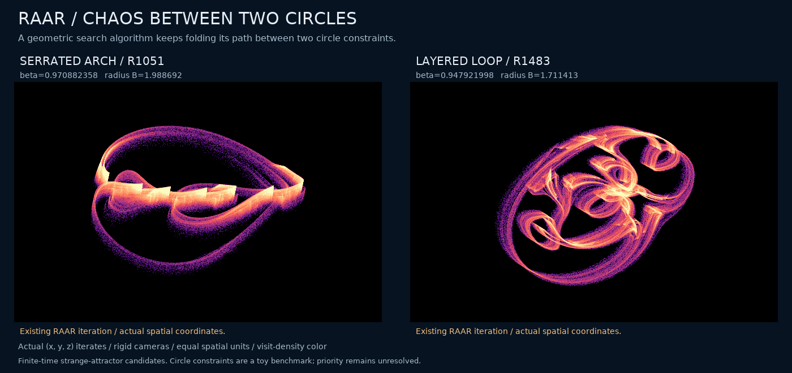
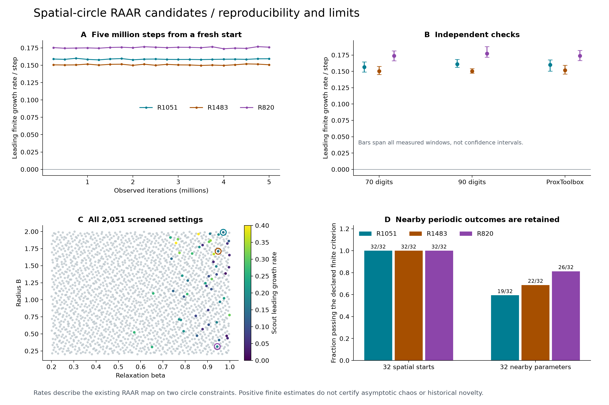
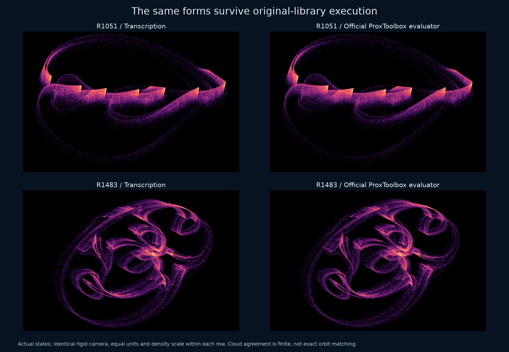
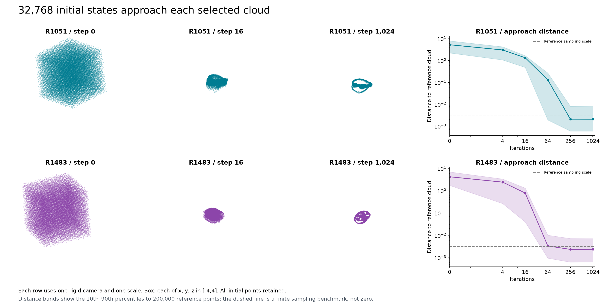
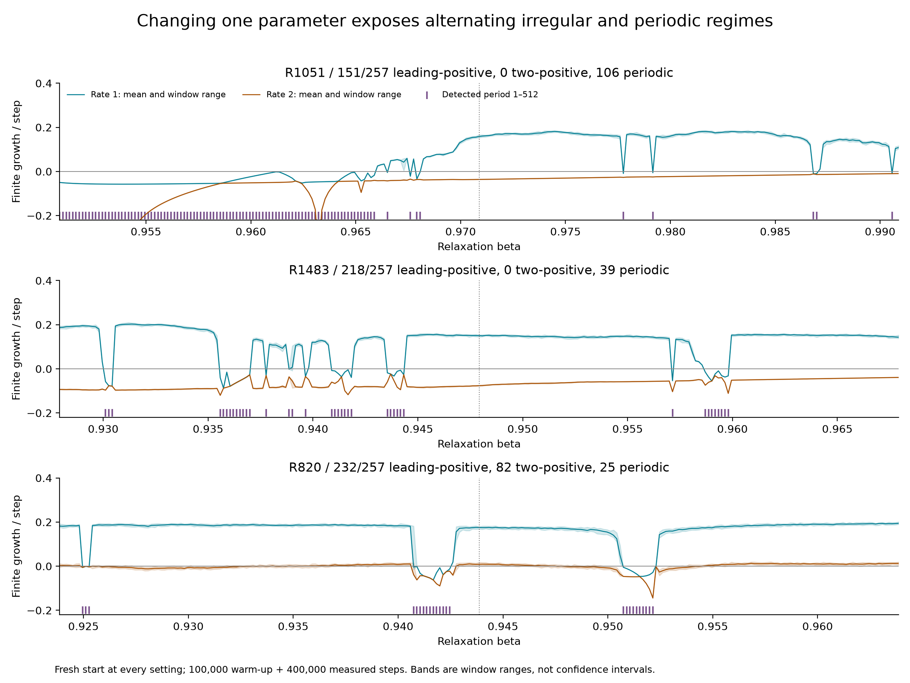

# Serrated arches and layered loops between two spatial circles

**Status: numerical strange-attractor candidates in the existing RAAR algorithm. Historical uniqueness and asymptotic chaotic attraction are unresolved.**



[Large portrait](assets/raar-circles-geometry.png) · [Research manuscript](../papers/raar-circles/manuscript.pdf) · [Exact structure and certificates](raar-structure.md) · [Prior-art and equivalence audit](raar-priority.md)

The unexpected setting is a geometric search algorithm: two circles in different planes have no common point, but repeated relaxed reflections generate intricate bounded spatial clouds. This is a toy feasibility benchmark, not a new algorithm or a physical experiment. The portraits are actual (x,y,z) states, with rigid cameras, equal units and visit-density color. The lines do not represent closed continuous-time orbits: the dynamics is a discrete map.

## Explicit existing map

A is the unit circle in the xy plane. B has center c, radius r and parametrization c+r(cos gamma, cos theta sin gamma, sin theta sin gamma). Using nearest-circle projections and R=2P−I,

```text
F(x) = beta/2 * (R_A(R_B(x)) + x) + (1-beta) * P_B(x)
```

The full nearest-circle formula and the exact mathematical parameter convention are in the structure note. A projection-axis distance below 1e-12 stops the calculation; all declared runs here completed.

| Case | beta | radius B | tilt B | center B (x, y, z) |
|---|---:|---:|---:|---|
| R75 | 0.940963711826 | 1.37183174156 | 0.420352728994 | -0.171179153025, 1.93520288542, -1.18267286569 |
| R820 | 0.943862862336 | 0.314259405062 | 0.828063770316 | -0.281223446131, -0.151279740036, 0.106562115252 |
| R1051 | 0.970882357907 | 1.98869154695 | 0.9028818256 | -0.143540911376, 0.574549652636, -0.774512469769 |
| R1311 | 0.767486063227 | 1.88724042419 | 0.817462528932 | 0.0225460901856, -0.0292569026351, -0.25734212622 |
| R1483 | 0.947921997786 | 1.71141268648 | 1.38062369369 | -0.201525039971, -1.29239022359, -0.358090057969 |
| R1679 | 0.733619934936 | 1.91292416975 | 1.43051603951 | 0.90612757206, -0.405090212822, 1.48603677377 |

Displayed decimals are shortened; exact binary64 values and their hexadecimal representations are archived.

## Long runs and independent checks

| Case | Mean three-direction spectrum / step | Minimum leading window |
|---|---|---:|
| R75 | 0.098331615, -0.061144566, -0.150267907 | 0.097457643 |
| R820 | 0.175433509, 0.009139377, -0.370171316 | 0.173771503 |
| R1051 | 0.158721044, -0.036102883, -0.612520810 | 0.157735617 |
| R1311 | 0.313346726, -0.170790483, -0.413823188 | 0.310948708 |
| R1483 | 0.150731424, -0.076157262, -0.336931482 | 0.149715762 |
| R1679 | 0.248057294, -0.174578224, -1.403380449 | 0.246239571 |

Each row uses 100,000 warm-up steps and five million measured steps in twenty windows, from the same fresh initial state (0.317, −0.211, 0.419). No period 1–512 was detected in the retained late samples. Positive finite estimates and a finite period search are evidence, not an asymptotic proof.



Twelve independent 70/90-digit calculations use the nested-reflector expression and finite separations, without the production Jacobian. All six cases retain positive leading growth. R820 has two positive directions in all of those windows and in the long run. Its original ProxToolbox evaluation has positive mean second growth (0.00984609) but one negative 10,000-step second-rate window (minimum −0.00281038). Uniform positivity across every window length is therefore not claimed.

Four 400,000-step runs execute the unmodified official ProxToolbox RAAR evaluator, constructor and relaxation schedule, with independent circle-projector adapters. The full imaging application is not run. Its spectra use the production analytic Jacobian along library states; the high-precision finite-separation check provides the independent tangent test.



## Approach and parameter dependence



Four sets of 32,768 starts in the full box [−4,4]³ were followed to step 1,024. All 131,072 completed. The distance plots use 200,000-point finite reference clouds and explicitly show their sampling floor. They do not certify a basin volume. In a separate cohort, all 32 starts for each of six cases pass the leading-growth criterion; nearby parameter settings include regular outcomes.



All 771 slice settings are retained. For R1051, R1483 and R820 respectively, 151, 218 and 232 of 257 settings pass the declared leading criterion; 106, 39 and 25 have detected periods. R820 has 82 two-positive settings. These are sampled parameter slices, not certified open intervals of structural stability.

## What is proved, and what remains numerical

The elementary bound ||F(x)|| ≤ beta ||x|| + beta + |1−2 beta| (||c||+r) gives an absorbing ball for every beta in (0,1). An 80-digit interval Sturm certificate exhaustively classifies fixed points at the six exact settings: the first five have none, while R1679 has exactly two, both unstable. All circle pairs are disjoint. A separate certificate gives linking number −1 for the two input circles in R1679; this does not classify its attracting cloud.

No fixed point plus boundedness does not imply chaos: periodic, quasiperiodic or singular-limit behavior must still be excluded. Our finite experiments support candidates but do not complete those exclusions.

## Complete retained evidence

The screen contains 2,048 Sobol settings plus three controls. All 2,051 complete; 53 pass the scout criterion. Every flagged setting receives a fresh million-step full-spectrum follow-up: 51 retain the leading criterion, R1540 becomes period two and R1792 is weak/near-neutral. All 53 gallery clouds are public, including these outcomes. The packet also retains six long checks, twelve independent precision checks, four original-library checks, all 384 cohort cases, four initial volumes, all parameter slices, source snapshots and failed audit versions.

The portrait contains eight million states per case; its exact histograms are archived. The 72-frame GIF rotates a fixed million consecutive states per case and clips no points. Full eight-million-state raw arrays remain local with hashes and exact generation inputs; this omission is explicit in copy-provenance.json.

```text
python research/verify_raar_circles.py --root results/raar-circles --assets docs/assets --output NEW_REVIEW.json
```

[Frozen packet](../results/raar-circles/) · [Verification record](../results/raar-circles-review.json) · [Priority limits](raar-priority.md)

The algorithm, planar-circle studies and projection-search chaos all have clear predecessors. The potentially interesting result is this particular spatial benchmark and its reproducible geometry/certificates; it is not yet a defensible claim to an unprecedented attractor.
