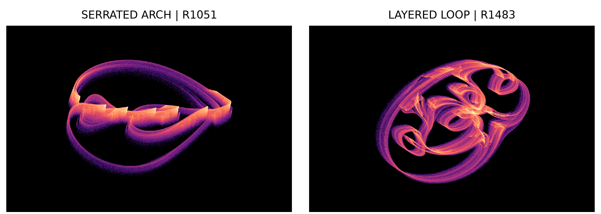
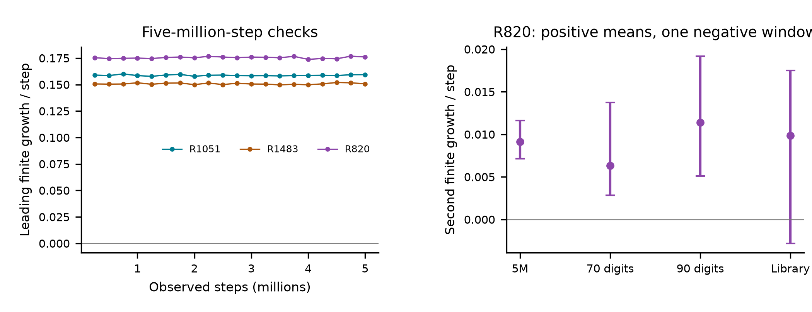
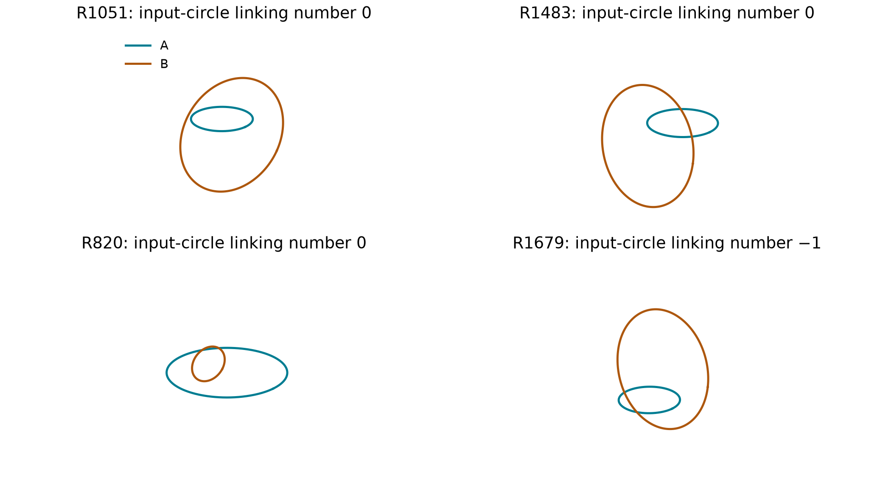
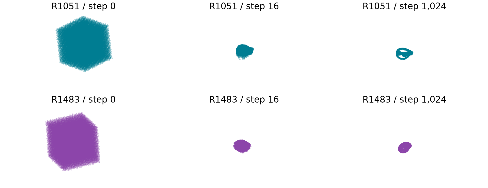

# Serrated arches and layered loops in relaxed reflections between spatial circles

A reproducible study of an existing feasibility algorithm

Chaos Attractor Lab | Research manuscript | 1 November 2026

## Abstract

Two noncoplanar circles provide a small geometric setting in which the established relaxed averaged alternating reflections (RAAR) iteration generates intricate bounded spatial clouds. We report a serrated arch and a layered loop selected from a complete 2,051-setting screen. Both persist through five-million-step calculations, independent 70- and 90-digit implementations, original ProxToolbox execution and full-state initial-volume experiments. A separate setting has two positive mean growth estimates, with a negative short second-rate window retained explicitly. An elementary absorbing bound and interval certificates establish fixed-point freedom for five selected maps; a sixth has exactly two unstable fixed points and linked input circles. These geometric statements are proved separately from the finite numerical evidence. RAAR, planar-circle examples and projection-search chaos are established prior work. The selected regimes are candidates for further study; asymptotic strange attraction and historical uniqueness remain unresolved.



<!-- drawing-date -->
*First recorded portrait: **2026-11-01**.*
<!-- /drawing-date -->

**Figure 1.** R1051 serrated arch and R1483 layered loop. Eight million actual (x,y,z) iterates per portrait; rigid cameras, equal units and visit-density color. Names describe appearance only. The repository includes a 72-frame rotation of fixed data.

## 1. Existing map and explicit geometry

Let A be the unit circle in the xy plane. Let B have radius r, center c and tilt θ, with the parametrization

```math
B(\gamma)=c+r(\cos\gamma,\cos\theta\sin\gamma,\sin\theta\sin\gamma).
```

For a circle of unit normal n, write v=(I−nn<sup>T</sup>)(x−c). Away from the projection axis v=0, its nearest-point projector and reflector are

```math
P(x)=c+r\frac{v}{\|v\|},\qquad R(x)=2P(x)-x.
```

The standard RAAR iteration of Luke [1], also called relaxed Douglas–Rachford [2], is

```math
F(x)=\frac{\beta}{2}(R_AR_Bx+x)+(1-\beta)P_Bx,\quad 0<\beta<1.
```

The ordered composition matters. Expanding it gives the familiar equivalent expression [6]

```math
F(x)=\beta x+\beta P_A(2P_Bx-x)+(1-2\beta)P_Bx.
```

The implementation stops if either projection-axis distance falls below 10<sup>−12</sup>; it introduces no arbitrary extension there. All declared trajectory experiments in this packet complete. The constraints are circumferences, not closed disks. The benchmark asks for feasibility of two sets that the certificates below show are disjoint.

| Case | Relaxation beta | Radius B | Tilt theta |
| --- | --- | --- | --- |
| R1051 | 0.970882357907 | 1.98869154695 | 0.9028818256 |
| R1483 | 0.947921997786 | 1.71141268648 | 1.38062369369 |
| R820 | 0.943862862336 | 0.314259405062 | 0.828063770316 |

The table shows the two portrait cases and the two-direction-expansion example. The center coordinates and all six selected settings are retained with full binary64 precision in the data packet. For mathematical certificates, those stored values are lifted exactly to rational numbers, and trigonometric values are enclosed by interval arithmetic. Rounded table decimals do not define the certified problem.

| Case | Center x | Center y | Center z |
| --- | --- | --- | --- |
| R1051 | -0.143540911376 | 0.574549652636 | -0.774512469769 |
| R1483 | -0.201525039971 | -1.29239022359 | -0.358090057969 |
| R820 | -0.281223446131 | -0.151279740036 | 0.106562115252 |

This is a geometric algorithm benchmark. It is not a physical experiment or a demonstration on imaging measurements. The displayed cloud consists of discrete iterates; a closed-looking outline does not imply a closed periodic orbit.

## 2. Complete search and long-run evidence

The screen uses 2,048 scrambled Sobol settings (seed 2026110191) and three controls. The box is β in [0.2,0.999], r in [0.2,2], θ in [0.05,π/2], and each center coordinate in [−2,2]. The initial state is always (0.317,−0.211,0.419). Each scout discards 10,000 steps and measures 30,000 steps in ten windows. A flag requires every leading growth window to exceed 0.001 per iteration.

| Stage | Settings | Completed | Leading criterion |
| --- | --- | --- | --- |
| Scout | 2051 | 2051 | 53 |
| Every scout flag | 53 | 53 | 51 |

Every scout flag receives a fresh 100,000-step warm-up and one million measured steps in twenty windows, using all three QR directions. A late period test checks lags 1–512 against an absolute coordinate tolerance of 10<sup>−9</sup> on 2,048 retained states. R1540 eventually passes the period-two test; R1792 has near-zero leading growth and fails the retained criterion. Both remain public, together with every other outcome and all 53 gallery clouds.

### Six selected five-million-step checks

| Case | Mean full spectrum / step | Minimum leading window |
| --- | --- | --- |
| R75 | 0.098332 / -0.061145 / -0.150268 | 0.097458 |
| R820 | 0.175434 / 0.009139 / -0.370171 | 0.173772 |
| R1051 | 0.158721 / -0.036103 / -0.612521 | 0.157736 |
| R1311 | 0.313347 / -0.170790 / -0.413823 | 0.310949 |
| R1483 | 0.150731 / -0.076157 / -0.336931 | 0.149716 |
| R1679 | 0.248057 / -0.174578 / -1.403380 | 0.246240 |

These six runs start afresh and use twenty 250,000-step measurement windows after 100,000 warm-up steps. All retain positive leading estimates and fail the stated short-period test. R820 has positive first and second estimates in every long-run window. The geometry selection followed inspection of the complete flagged gallery; it was not preregistered as a statistical discovery test.

At 256 sampled states, the analytic Jacobian agrees with a centered finite difference to maximum relative error 5.26×10<sup>−10</sup>. The expanded and nested-reflector formulas agree to 4.45×10<sup>−16</sup>. QR sums agree with accumulated log determinants to less than 1.44×10<sup>−13</sup> in the million-step follow-ups. These checks validate calculations, not asymptotic claims.

## 3. Independent arithmetic and original code



**Figure 2.** Left: leading growth estimates in the long calculations. Right: R820 second-direction means and full window ranges. The original-library range crosses zero. Ranges describe observed windows, not confidence intervals.

Twelve independent calculations use 70 or 90 decimal digits, exact lifts of the stored parameters and freshly evaluated trigonometric constants. They implement the nested-reflector formula directly and estimate two directions by finite separations, without the production map or analytic Jacobian. Separation scales are 10<sup>−30</sup> and 10<sup>−40</sup>, respectively. Each run uses 100,000 warm-up, 5,000 alignment and 100,000 measurement steps in ten windows. All six cases retain positive leading growth.

| R820 second rate | 5M | 70 digits | 90 digits | Library |
| --- | --- | --- | --- | --- |
| Mean | 0.009139 | 0.006299 | 0.011391 | 0.009846 |
| Minimum window | 0.007139 | 0.002823 | 0.005091 | -0.002810 |

The official ProxToolbox source [9] is pinned at commit 702154fc33a0b05747ef7f2980c88613236e3626. Four 400,000-step trajectories execute its unmodified RAAR evaluator, Algorithm constructor and relaxation schedule, with independent circle-projector adapters. Setting both relaxation endpoints to β produces the intended constant rule, up to initial roundoff at 1.12×10<sup>−16</sup>. The full imaging application and monitor are not invoked.

Library spectra use the production analytic Jacobian along actual library states, after 100,000 warm-up and 10,000 alignment steps. They therefore provide an independent map implementation, not an independent tangent implementation. The high-precision finite-separation tests supply the latter. All four leading estimates remain positive. R820 has a positive mean second estimate but one negative 10,000-step window; uniform positivity at every observed window length is not claimed.

## 4. Boundedness and local derivative structure

### An elementary absorbing ball

Because ||P<sub>A</sub>(y)||=1 and ||P<sub>B</sub>(x)|| ≤ ||c||+r, the expanded formula immediately yields

```math
\|F(x)\|\leq\beta\|x\|+C,\qquad C=\beta+|1-2\beta|(\|c\|+r).
```

Induction gives

```math
\|x_n\|\leq\beta^n\|x_0\|+\frac{1-\beta^n}{1-\beta}C.
```

Every ball of radius strictly greater than C/(1−β) absorbs every defined orbit. The estimate holds even for arbitrary nearest-point selections on projection axes. This elementary consequence for bounded constraints is not presented as a new general theorem. It does not prove a continuous invariant attracting set avoiding the axes.

### Rank-one projection derivatives

At a regular point, DP=(r/||v||)tt<sup>T</sup>, with unit circle tangent t. Write DP<sub>A</sub>(R<sub>B</sub>x)=a uu<sup>T</sup>, DP<sub>B</sub>(x)=b vv<sup>T</sup>, and d=u<sup>T</sup>v. Then

```math
J=\beta I-\beta a uu^T+(1-2\beta)bvv^T+2\beta abd\,uv^T.
```

The characteristic polynomial is (λ−β)(λ²−T λ+D), with

```math
T=2\beta-\beta a+(1-2\beta)b+2\beta abd^2,
```

```math
D=\beta[(1-a)(\beta+(1-2\beta)b)+abd^2],\qquad\det J=\beta D.
```

When u×v is nonzero, it is a left eigenvector with eigenvalue β. The same eigenvalue persists for parallel tangents. A separate symbolic calculation checks the complete characteristic polynomial after imposing the unit-tangent identity. Pointwise eigenvalues do not determine Lyapunov exponents of products whose eigendirections change; no exponent is asserted to equal log β.

Six additional million-step audits record axis distances, state radii, determinant signs and identity residuals. The smallest observed axis distance is approximately 0.0005784, in R820. This is a finite observation, not a certified invariant exclusion zone. Earlier audit failures, including an absolute residual threshold too strict near an axis, are retained with source and failure records.

## 5. Exhaustive fixed-point reduction

At a fixed point let b=P<sub>B</sub>x, a=P<sub>A</sub>(R<sub>B</sub>x), and k=β/(1−β). The map equation gives x=b+k(a−b). Projection stationarity requires a−b to be perpendicular to both circle tangents. Write

```math
X=c_x+r\cos\gamma,\quad Y=c_y+r\cos\theta\sin\gamma,\quad L=\sqrt{X^2+Y^2}.
```

If L>0, the A point has the form a=σ(X,Y,0)/L for σ=±1. The B stationarity condition becomes f+σ e/L=0, where

```math
f=-c_x\sin\gamma+(c_y\cos\theta+c_z\sin\theta)\cos\gamma,
```

```math
e=c_x\sin\gamma-c_y\cos\theta\cos\gamma+r\sin^2\theta\sin\gamma\cos\gamma.
```

Set t=tan(γ/2), D₀=1+t², S=2t and Q=1−t². The polynomial numerators are

```math
X_0=c_xD_0+rQ,\qquad Y_0=c_yD_0+r\cos\theta S,
```

```math
f_0=-c_xS+(c_y\cos\theta+c_z\sin\theta)Q,
```

```math
e_0=c_xSD_0-c_y\cos\theta QD_0+r\sin^2\theta SQ.
```

Consequently every fixed point in this chart arises from a real root of the degree-eight polynomial

```math
P(t)=f_0^2(X_0^2+Y_0^2)-e_0^2.
```

A regular stationary pair is a valid nearest-projection fixed point precisely when the two radial factors are positive:

```math
(2b-x)^Ta>0,\qquad (x-c)^T(b-c)/r>0.
```

The certificate rejects the spurious branch introduced by squaring, checks these signs, and separately excludes γ=π, omitted by the half-angle chart. It also verifies that B never meets the A axis: (c<sub>x</sub>/r)²+(c<sub>y</sub>/(r cos θ))²−1 is nonzero. Every radial factor at an isolated candidate has a strict sign, excluding axis-degenerate fixed points as well.

This reduction specializes established fixed-point reasoning [2,6]. Its purpose is a complete, reproducible classification at the selected parameters, not a new general characterization of RAAR.

## 6. Certificates and linked input geometry

| Case | Real polynomial roots | Fixed points | Certified result |
| --- | --- | --- | --- |
| R75 | 6 | 0 | Fixed-point free |
| R820 | 4 | 0 | Fixed-point free |
| R1051 | 6 | 0 | Fixed-point free |
| R1311 | 8 | 0 | Fixed-point free |
| R1483 | 6 | 0 | Fixed-point free |
| R1679 | 6 | 2 | Both unstable |

The interval certificate uses mpmath 1.3.0 at 80 decimal digits. Floating polynomial roots merely propose rational isolating intervals. Interval Sturm signs at both infinities count all real roots; each interval has variation drop one, and the disjoint intervals exhaust the total. All required leading coefficients and signs are separated from zero. Exactly one squared branch remains stationary at each isolated root.

For the two valid R1679 points, the quadratic of Section 4 has a root outside the unit disk by strict interval tests on D or q(±1). The two circles are disjoint in all six settings, certified by intersecting A with the plane of B and testing the possible points against B’s radius equation. These are executable software-assisted certificates, not proof-assistant formalizations.



**Figure 3.** The input circles, with equal spatial units in each panel. They are not the observed trajectories. A separate 80-digit interval calculation counts signed transverse crossings of B through the disk bounded by A. Only R1679 has nonzero linking number (−1 with the stated orientations). This is a property of the constraints, not a classification of the attracting cloud.

## 7. Initial volumes and nearby settings



**Figure 4.** Each row follows 32,768 Sobol starts from the full box [−4,4]³, with one fixed rigid camera and scale. All points are retained. Similar full-state experiments were performed for R820 and R75.

| Case | Median at step 0 | Median at step 1,024 | Reference sampling median |
| --- | --- | --- | --- |
| R1051 | 5.28033 | 0.00207403 | 0.00289179 |
| R1483 | 4.20437 | 0.00236468 | 0.00322491 |
| R820 | 3.22968 | 0.00271135 | 0.00367239 |
| R75 | 21.6383 | 0.000468917 | 0.00067988 |

Distances are Euclidean nearest-neighbor distances to finite 200,000-point reference clouds. The sampling benchmark compares two 100,000-point halves of each reference. It is not zero and is not an asymptotic error bound. All 131,072 initial-volume trajectories complete through step 1,024. This supports attraction of the sampled volume but does not certify basin measure or eventual fate of every point.

| Case | 32 starts: leading-positive | 32 neighbors: leading-positive | Periodic neighbors |
| --- | --- | --- | --- |
| R75 | 32 | 18 | 14 |
| R820 | 32 | 26 | 5 |
| R1051 | 32 | 19 | 13 |
| R1311 | 32 | 28 | 4 |
| R1483 | 32 | 22 | 10 |
| R1679 | 32 | 24 | 8 |

The separate cohort contains 32 spatial starts and 32 parameter neighbors for each of six cases: 384 runs, each with 100,000 warm-up and 300,000 measured steps. Neighbors perturb each of the six parameters within an absolute ±0.01 box. All start tests pass the leading criterion, whereas many parameter neighbors are periodic. Their negative outcomes remain in the packet.

## 8. Declared relaxation slices


**Figure 5.** Three 257-point slices vary β by ±0.02 around the selected value, with other parameters fixed and a fresh common initial state at every setting. Each calculation uses 100,000 warm-up and 400,000 measured steps in twenty windows. Curves show the first two mean rates; bands show full window ranges. Purple marks identify detected periods 1–512. Vertical dotted lines mark the base settings.

| Slice | Settings | Leading-positive | Two-positive | Periodic |
| --- | --- | --- | --- | --- |
| R1051 | 257 | 151 | 0 | 106 |
| R1483 | 257 | 218 | 0 | 39 |
| R820 | 257 | 232 | 82 | 25 |

All 771 calculations complete. R820 has 82 settings with a positive second estimate in every measured window. The extrema of these sampled settings do not define a continuous interval of hyperchaos: periodic gaps and weak cases remain. These finite slices demonstrate parameter dependence and supply regular controls, not a proof of structural stability or a certified bifurcation diagram.

## 9. Reproduction and interpretation


**Figure 6.** Two hundred thousand states per panel, comparing the transcription with the unmodified official evaluator. Each row shares its camera, units and density scale. The agreement concerns finite clouds, not pointwise equality of long chaotic trajectories.

The packet retains every declared scout/follow-up outcome, all 53 gallery clouds, all independent checks, parameter slices, cohort/approach arrays, source snapshots and copy hashes. Dense portraits contain eight million states each; their exact histograms are archived. The rotation uses the last million consecutive states with no clipping. The two full eight-million-state arrays remain local with trajectory hashes, starts and regeneration source; this omission is explicit.

The verifier recomputes counts, finite-rate criteria, array dimensions, media counts and file hashes. The interval and symbolic audits are separately executable. Third-party publication PDFs are not redistributed; source links, hashes and inspection scopes are retained. Pinned original ProxToolbox files include their repository license and attribution.

Boundedness and absence of fixed points do not imply chaos. A rigorous attracting-set claim still needs a trapping region that avoids projection singularities and an asymptotic argument excluding regular or singular limiting behavior. The positive finite growth estimates, late-period exclusions and sampled attraction experiments motivate that work; they do not replace it.

## 10. Prior art and the claim boundary

The algorithm is Luke’s RAAR [1]. Luke and Martins [2] explicitly analyze two planar circles, and their Example 3.17 already gives a fixed-point-free circle/point configuration. Borwein et al. [3] document periodic domains and complicated transients for ellipse/p-sphere projection problems. Elser, Rankenburg and Thibault [4] explicitly discuss strange-attractor search dynamics. Thus neither the algorithm, elementary circle feasibility nor chaos in projection search is a new general idea.

Marchesini’s two-circle illustration [5] uses a union of circles as one constraint and a line as the other. The present cases instead use two separate noncoplanar circumferences. Recent work on cyclic relaxed Douglas–Rachford [6] supplies general fixed-point relations; Dinh et al. [7] demonstrate escaping bad minima in actual orbital tomography and report nonvanishing iterate changes with converging gaps. Chen [8] supplies an ADMM/primal-dual interpretation in phase retrieval. These equivalent descriptions broaden the necessary priority search.

Our concrete contribution is the selected spatial benchmark: striking reproducible state geometry, complete retained searches, independent arithmetic and original-code comparisons, and exact case-specific fixed-point/disjointness/linking certificates. This combination is potentially useful. A lack of an exact literature match is not proof that it is unprecedented.

Rigid motions and common scaling give obvious conjugacies between equivalent input geometries. The normalization of A removes these redundancies. Noncoplanarity alone does not rule out a nonlinear conjugacy or known symbolic dynamics on an attracting subset. Neither visual difference nor two positive finite estimates completes that classification.

### Review scope and remaining work

The original RAAR definitions and selected theory sections were read; the planar-circle section of [2] was inspected; most descriptive portions and five figure pages of [3] were reviewed. For [4], only publisher-indexed abstract/body excerpts were accessible. For [5], the institutional figure caption and indexed text were inspected. Selected methods, fixed-point and numerical sections of [6,7] were read; [8] was reviewed at abstract level. The packet records these limits and further source links. No inaccessible source is presented as a full-paper review.

Historical priority and asymptotic strange attraction remain unresolved. The next substantive steps are an invariant-region/chaos certificate and a deeper equivalence comparison with projection/difference-map/ADMM literature. The present manuscript makes no claim that these are attractors nobody has previously seen.

## References and reproducibility

[1] D. R. Luke. Relaxed averaged alternating reflections for diffraction imaging. Inverse Problems 21 (2005), 37–50. [arXiv:math/0405208](https://arxiv.org/abs/math/0405208).

[2] D. R. Luke and A.-L. Martins. Convergence Analysis of the Relaxed Douglas–Rachford Algorithm. SIAM Journal on Optimization 30(1) (2020), 542–584. [doi:10.1137/18M1229638](https://doi.org/10.1137/18M1229638).

[3] J. M. Borwein, S. B. Lindstrom, B. Sims, A. Schneider and M. P. Skerritt. Dynamics of the Douglas–Rachford method for ellipses and p-spheres. Set-Valued and Variational Analysis 26 (2018), 385–403. [doi:10.1007/s11228-017-0457-0](https://doi.org/10.1007/s11228-017-0457-0); [arXiv:1610.03975](https://arxiv.org/abs/1610.03975).

[4] V. Elser, I. Rankenburg and P. Thibault. Searching with iterated maps. Proceedings of the National Academy of Sciences 104(2) (2007), 418–423. [doi:10.1073/pnas.0606359104](https://doi.org/10.1073/pnas.0606359104).

[5] S. Marchesini. A unified evaluation of iterative projection algorithms for phase retrieval. Review of Scientific Instruments 78 (2007), 011301. [Institutional copy, figure 5](https://digital.library.unt.edu/ark:/67531/metadc877846/m1/10/).

[6] T. L. Dinh, G. S. M. Jansen and D. R. Luke. Cyclic Relaxed Douglas–Rachford Splitting for Inconsistent Nonconvex Feasibility. 2025 preprint; 2026 publication. [arXiv:2502.12285](https://arxiv.org/abs/2502.12285); [doi:10.1007/s10957-026-02996-2](https://doi.org/10.1007/s10957-026-02996-2).

[7] T. L. Dinh, W. Bennecke, G. S. M. Jansen, D. R. Luke and S. Mathias. Algorithmic approaches to avoiding bad local minima in nonconvex inconsistent feasibility. [arXiv:2502.19052](https://arxiv.org/html/2502.19052v1). The accessed HTML identifies v1 (2025) but displays a 2026 manuscript date; this version-date discrepancy is retained in the review record.

[8] P. Chen. Local saddle structure in relaxed averaged alternating reflections Algorithms on phase retrieval. 2021 preprint. [arXiv:2101.11145](https://arxiv.org/abs/2101.11145); [doi:10.1088/1361-6420/ac37fa](https://doi.org/10.1088/1361-6420/ac37fa).

[9] ProxToolbox / ProxPython. Official source, commit 702154fc33a0b05747ef7f2980c88613236e3626. [Repository](https://gitlab.gwdg.de/nam/ProxPython). Original RAAR.py, algorithm.py and cell.py retained verbatim with the pinned repository license.

### Executable evidence

Repository: [github.com/Griboedow/chaos-attractor-lab](https://github.com/Griboedow/chaos-attractor-lab). The results/raar-circles packet contains the full manifest. Run research/verify_raar_circles.py for archive checks; research/certify_raar_fixed_points.py for the interval classification; research/audit_raar_algebra.py for symbolic identities and linking. Edit manuscript.md directly. Exact commands and dependency versions are in the companion README.
