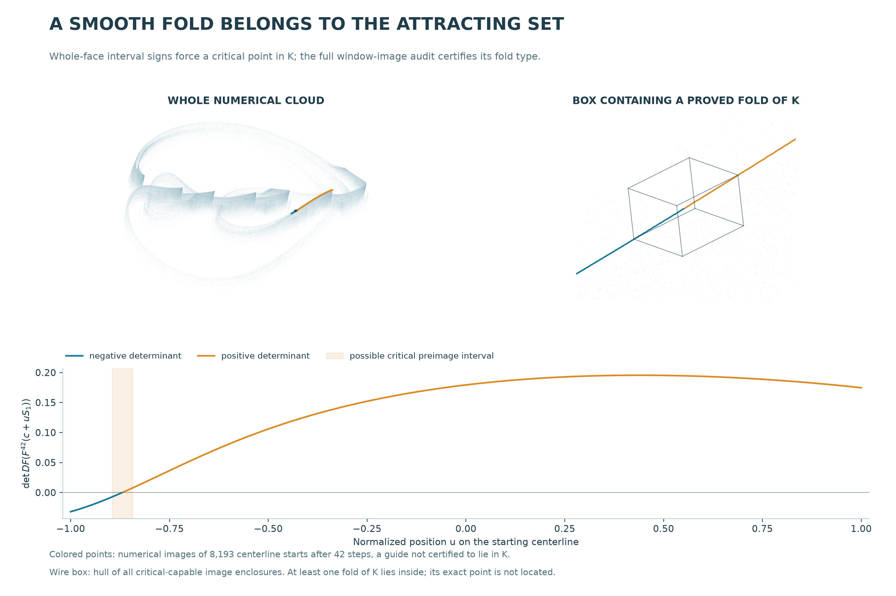

# A fold belongs to the attracting RAAR set

**A certified ambient-equivalence obstruction, with historical uniqueness still unresolved.**

The [strict trapping construction](raar-trapping.md) gave an attracting invariant
set K with positive topological entropy. We now prove that **K contains a smooth
Whitney fold of the actual three-dimensional map**. This closes the membership
gap left by the earlier [near-cloud fold certificate](raar-folding.md).

[Mathematical proof](../results/raar-critical-membership/theorem.md) ·
[Companion article](../papers/raar-critical-membership/manuscript.md) ·
[Reproduction](../papers/raar-critical-membership/README.md) ·
[Frozen evidence](../results/raar-critical-membership/README.md)

The wire box contains at least one proved fold of K. The colored guide consists
of 8,193 actual images of a starting centerline after 42 iterations. That
centerline is not certified to lie in K; it illustrates the geometry without
substituting a sampled curve for the proof.

## What distinguishes this result

At a fold, the full map is noninjective on every open neighborhood of that
point. Since the point belongs to K, **no ambient homeomorphism can conjugate
the map on an open neighborhood of K to a map locally injective throughout
the image of K**. This excludes local diffeomorphisms under this precise
notion of equivalence, even if the coordinate change is not differentiable.

For a concrete comparison, [Gierzkiewicz (2021)](https://arxiv.org/abs/2101.10416)
studies the known three-dimensional map
`H(x,y,z)=(1.76-y²-0.1z,x,y)` and certifies symbolic dynamics and hyperbolicity.
Its explicit inverse is `(X,Y,Z) -> (Y,Z,10(1.76-Z²-X))`. Our new result
therefore excludes an ambient-neighborhood conjugacy to that particular
generalized Hénon map. The word “folded” in its portrait name is not a
singular-Jacobian certificate.

This does **not** prove that `F|K` is noninjective: the nearby pairs witnessing
the fold need not both belong to K. It does not exclude a conjugacy defined
only on the invariant sets, identify the whole sampled cloud with K, prove
transitivity, or establish a new historical attractor class.

## How membership is proved

1. Reduce the two stable widths of the earlier saddle window to the exact
   binary64 lifts of `1e-5` and `1e-6`. The new window N remains inside Q.
2. Verify that `F^7` takes opposite faces past the opposite sides of N, while
   any image whose unstable coordinate lies in N has both stable coordinates
   strictly inside. Two implementations verify the whole volume and faces.
3. Repeatedly select crossing subpaths. A compact Hausdorff limit is a
   connected subset of K crossing both faces. This argument requires no
   certified smooth unstable-manifold chart.
4. On the two whole faces, `det DF(F^42(x))` has strictly opposite signs.
   Continuity forces a critical point in the image of the connected subset,
   hence in K.
5. Classify every 42-step window image as regular or satisfying the standard
   corank-one fold criterion at any critical point it contains.

| Complete check | Vector formulas, 70 digits | Scalar automatic derivatives, 100 digits |
|---|---:|---:|
| Self-covering volume leaves | 60 | 41 |
| Self-covering exit-face leaves | 2 | 2 |
| Opposite-sign face leaves | 2 | 2 |
| Regular image cells | 452 | 270 |
| Fold-capable image cells | 26 | 13 |

An additional unreconditioned face calculation passes with five leaves. The
implementations share their interval library and subdivision infrastructure;
they are not wholly independent software stacks. Separate accounting checks
verify full partitions, inequalities, exact window containment and all frozen
dependency hashes.

At least one fold lies in the outward box
`[0.20984,0.22744] × [-2.86973,-2.84328] × [3.86195,3.88395]`.
The proof does not select a unique point within that box.

## Prior art and remaining uniqueness question

The [priority record](../results/raar-critical-membership/priority.json) keeps
the reviewed sections, access limits and bounded queries. RAAR and projection
search chaos are established [prior work](raar-priority.md). The fold criterion
is classical; see [Montgomery, Appendix B](https://doi.org/10.3842/SIGMA.2014.101).
[Garst and Sterk (2016)](https://doi.org/10.1016/j.indag.2016.07.002) already
describe folded strange-attractor candidates in a noninvertible planar map.
Their institutional abstract was reviewed; the full paper remains a gap.

The contribution is a fold-membership certificate and a precise ambient
equivalence exclusion in this exact geometric instance. It strengthens the
case study without claiming that folding, algorithmic chaos, or every aspect
of the attractor is new.
