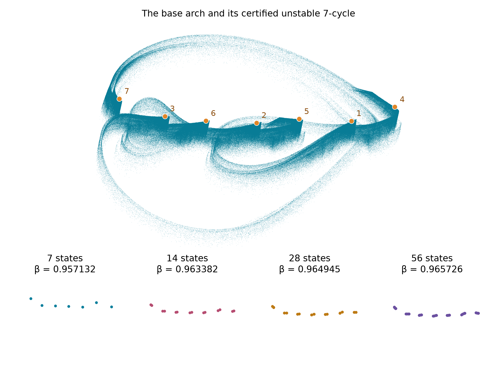
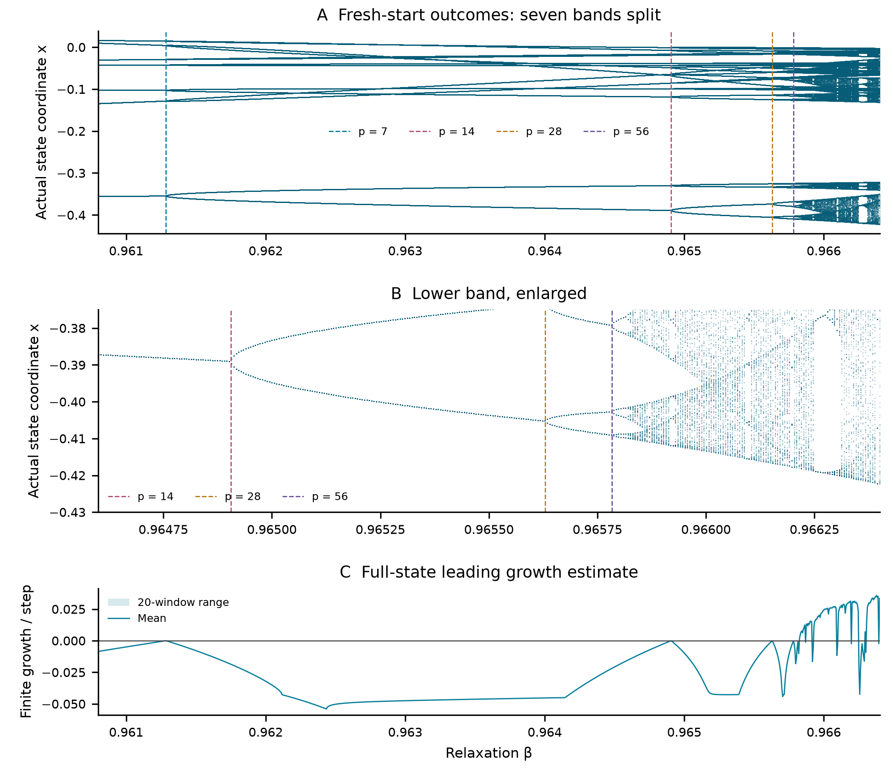

# Periodic structure behind the serrated RAAR arch

[Six-page companion note](../papers/raar-cycle-structure/manuscript.pdf) · [Reproduction](../papers/raar-cycle-structure/README.md) · [Base study](raar-circles.md) · [Rotation](assets/raar-circles-rotation.gif) · [Priority audit](raar-priority.md)

The selected R1051 arch contains a visible seven-fold arrangement. A certified unstable seven-cycle lies near its seven characteristic tips. Nearby parameter settings have certified attracting cycles of least periods **7, 14, 28 and 56**. These concrete results explain part of the observed structure; they do not establish a new chaos mechanism or historical uniqueness.

The orange points are separate discrete states, labeled in iteration order. They are not a continuous closed curve. Their distances from the finite million-state reference sample range from 0.003886 to 0.004947. This visual correspondence does not prove membership in an asymptotic attracting set. The four inset cycles occur at different relaxation parameters, rather than coexisting at the base setting.

## What is certified

| Least period | Relaxation β, stored binary64 value | Result |
|---|---|---|
| 7 | 0.9571323579074814 | Locally attracting |
| 14 | 0.9633823579074815 | Locally attracting |
| 28 | 0.9649448579074814 | Locally attracting |
| 56 | 0.9657261079074815 | Locally attracting |
| 7 | 0.9708823579074815 | One unstable and two stable real multipliers |

The independent interval evaluator uses the nested reflector definition of the existing RAAR map. Krawczyk inclusion certifies existence and local uniqueness; proper-divisor exclusions certify least period; interval characteristic-polynomial inequalities certify stability. These are applications of established verification methods, with mpmath interval arithmetic trusted.

Four additional uniform parameter certificates contain **simple −1 multiplier events**:

| Period | Event β, rounded for display |
|---|---|
| 7 | 0.961285429169138103 |
| 14 | 0.964905947931229226 |
| 28 | 0.965630021468317961 |
| 56 | 0.965783533575568158 |

At each event the other two multipliers are inside the unit disk. The unique local branch is attracting at the left bracket endpoint and unstable at the right. The full exact dyadic brackets are public; their tiny widths control interval wrapping and are not physical measurement precision. A nondegenerate flip normal form, a unique event per bracket, connections between the doubled branches and an infinite cascade are **not** certified.

## Every fine-slice outcome

All **1,025** independent settings complete: **90** pass the finite leading-growth criterion, **933** pass the numerical period test, and **2** remain unclassified. Each run discards 100,000 steps, then measures 400,000 in twenty windows. The slice was selected after the earlier broad scan exposed the sequence; it is an explanatory follow-up.

All 1,604 numerical continuation settings, every fine-slice outcome, the incomplete first interval attempt and all successful certificate revisions are retained in the [separate packet](../results/raar-cycle-structure/). The original RAAR evidence packet remains unchanged.

## A limited equivalence result

The base seven-cycle has multipliers in **(−2.571,−2.569)**, **(0.008,0.009)** and **(0.784,0.785)**. Its full-period determinant is negative. Therefore the map near this cycle cannot be smoothly conjugate to a fixed-time solution map of a smooth ODE on R³: ODE solution maps have positive Jacobian determinant, and a periodic-orbit coordinate conjugacy preserves that determinant. The companion supplies the argument and credits the standard Liouville and Floquet identities.

This excludes one particular reinterpretation. It does not classify all return maps, higher-dimensional constructions, topological equivalences or previously described discrete attractors. Period doubling and periodic-orbit organization are well known. The [updated literature audit](raar-priority.md) includes a 2014 spatial nonconvergence construction and a 2026 DR/ADMM example with conjectural chaos. **The specific configuration remains a candidate, not a certified unprecedented attractor.**
