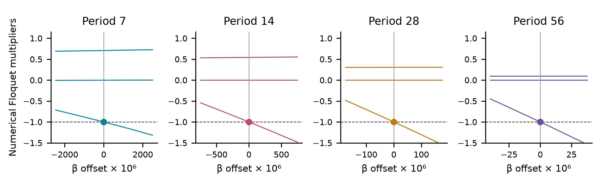

# Periodic structure behind a serrated spatial RAAR cloud

Chaos Attractor Lab | Research companion note | 1 November 2026

**Abstract.** We examine the periodic structure near one visually selected regime of the established relaxed averaged alternating reflections (RAAR) algorithm. The constraints are two disjoint, noncoplanar circles. Independent interval calculations certify attracting cycles of least periods 7, 14, 28 and 56 at four settings, an unstable least-period-seven cycle at the selected arch, and four parameter brackets containing simple minus-one multiplier events. Numerical continuation and a complete 1,025-setting fresh-start slice support a period-doubling interpretation. They do not prove an infinite cascade or chaotic attraction. The note adds concrete geometric and periodic-orbit evidence to the earlier manuscript [1]; neither a new chaos mechanism nor historical uniqueness is claimed.

**Figure 1.** One million actual base-map states and seven points of its certified unstable cycle. Labels follow iteration order. The four insets show actual attracting-cycle states at different parameters, using one rigid camera and common scale. Dots are not connected into fictitious continuous trajectories. Finite reference-cloud distances to the unstable cycle are 0.003886–0.004947; membership in an asymptotic attracting set remains unproved.

## 1. Model and isolated cycles

A is the unit circle in the xy plane. B has radius r, center c and tilt θ. The constraints are circumferences, not disks. Away from their projection axes, their nearest-point projectors P and reflectors R=2P−I define the existing ordered RAAR map of Luke [2]:

$$
B(\gamma)=c+r(\cos\gamma,\cos\theta\sin\gamma,\sin\theta\sin\gamma),
$$

$$
F_\beta(x)=\frac{\beta}{2}(R_AR_Bx+x)+(1-\beta)P_Bx.
$$

The geometry is fixed at r=1.9886915469542146, θ=0.9028818255996501 and c=(−0.1435409113764763, 0.5745496526360512, −0.7745124697685242). Exact binary64 rational lifts of the stored parameters define the certified problem; interval sine and cosine define its exact geometry. Rounded printed values are for identification. The arch uses β=0.9708823579074815.

### Proposition 1. Five isolated cycle certificates

At the exact settings in the table, a locally unique periodic point exists in each reported box. Its least period and the listed local stability are certified. The four attracting cycles are at different β values; this is not a claim of four coexisting attractors at the base setting.

| Least period | β (stored binary64 value) | Certified stability |
| --- | --- | --- |
| 7 | 0.9571323579074814 | Attracting |
| 14 | 0.9633823579074815 | Attracting |
| 28 | 0.9649448579074814 | Attracting |
| 56 | 0.9657261079074815 | Attracting |
| 7 | 0.9708823579074815 | Unstable |

**Verification.** Set G(x)=Fp(x)−x. A 200-digit mpmath interval calculation evaluates the nested reflector expression and its independently implemented derivative, including all intermediate projection distances. An interval Krawczyk inclusion gives a unique zero in a box of radius 10−120. For every proper divisor d of p, at least one coordinate of Fd(X)−X excludes zero. All projection-axis distances have positive lower bounds.

For M=DFp, write q(λ)=λ³+a₁λ²+a₂λ+a₃. Strict positivity of the following Schur/Jury margins certifies that all multipliers lie inside the unit disk:

$$
1-|a_3|,\quad 1+a_1+a_2+a_3,\quad 1-a_1+a_2-a_3,
$$

$$
1-a_2+a_1a_3-a_3^2.
$$

At the base seven-cycle, interval sign changes of q isolate three real multipliers in (−2.571,−2.569), (0.008,0.009) and (0.784,0.785). There is exactly one unstable direction and two stable directions. The seventh-iterate determinant lies in (−0.017096,−0.017095). Existence and stability follow from interval inequalities, not rounded eigenvalues.

## 2. Certified multiplier events

**Proposition 2.** For each p below, the exact dyadic β bracket in the packet contains a least-period-p cycle with a simple multiplier −1. The other two multipliers are strictly inside the unit disk at the event. The locally unique branch is attracting at the left endpoint and unstable at the right endpoint.

| Least period | Event β (rounded center) | Endpoint behavior |
| --- | --- | --- |
| 7 | 0.961285429169138103 | Attracting → unstable |
| 14 | 0.964905947931229226 | Attracting → unstable |
| 28 | 0.965630021468317961 | Attracting → unstable |
| 56 | 0.965783533575568158 | Attracting → unstable |

Each bracket has width approximately 2×10−300. These small widths control interval wrapping in repeated composition; they do not express physical measurement accuracy. The full dyadic endpoints, rather than shortened decimal centers, define the brackets.

**Figure 2.** Numerical multipliers on four separately continued branches; all 401 samples per branch are retained. Horizontal dashed lines mark −1. Dots locate the certified event brackets. The shrinking horizontal scales are explicit. Curves are numerical; interval inequalities certify the events.

**Verification.** At 600 digits, a uniform Krawczyk inclusion is evaluated over X×[β₋,β₊], with state radius 10−180. The residual at the center includes the entire parameter interval. The bound ‖I−CDxG‖∞<1 makes DxG nonsingular and the unique roots form a continuous local branch. Least period and positive axis distances hold throughout.

Separate endpoint boxes of radius 10−420 are explicitly contained inside X, so they belong to the same branch. Their certified signs are q(−1)<0 and q(−1)>0. Continuity forces an event. The uniform exclusion q′(−1)≠0 makes its −1 multiplier simple. At an event, q=(λ+1)[λ²+(a₁−1)λ+a₃]; strict positivity of 1−|a₃|, a₁+a₃ and 2−a₁+a₃ puts the other two roots inside the unit disk.

This proves neither a unique event in each bracket nor the transversality and nonlinear normal-form conditions for a nondegenerate flip. Connection to the next doubled branch, an infinite cascade and its accumulation remain unproved.

## 3. The complete numerical slice

**Figure 3.** All 1,025 uniformly spaced β values in [0.9608,0.9664]. Each independent run starts at (0.317,−0.211,0.419), discards 100,000 steps and measures 400,000 in twenty windows. Panels A–B show actual x coordinates from the final 2,048 states; B is a labeled coordinate crop. Vertical lines identify the certified events. Panel C uses the full three-dimensional tangent dynamics.

All 1,025 runs complete. The declared criterion retains 90 settings with every leading-growth window above 0.001 per iteration and no detected lag ≤512. The period test finds 933 periodic outcomes; two remain unclassified by either criterion. Periodic counts include 7:89, 14:662, 28:133, 56:28, 112:6 and 224:1, together with other windows. A finite period test is not an existence proof; only the isolated cases in Proposition 1 are interval-certified.

The fine interval was selected after the broad slice and continuation exposed the 7/14/28/56 pattern. It is an explanatory follow-up, not an independent discovery trial. The complete archive preserves every outcome, the initially incomplete interval attempt and all successful certificate revisions.

## 4. What distinguishes this example

The contribution is a reproducible case study: an intricate state cloud in a simple spatial feasibility model, with concrete cycle certificates and a complete surrounding parameter slice. Period doubling, unstable periodic orbits and their role in organizing geometry are standard dynamical concepts [6]. The plot and four events do not establish a new mechanism.

### A narrow equivalence exclusion

The certified base seven-cycle cannot be carried by a C¹ coordinate conjugacy to a fixed-time solution map of a C¹ ODE on R³, even with time-dependent forcing. Its seventh-iterate derivative has negative determinant. In contrast, Liouville’s standard formula [6] gives a positive determinant for each ODE solution map and hence for every composition:

$$
\det D\varphi^{t,s}(y)=\exp\!\left(\int_s^t\mathrm{tr}\,D_xv(\tau,x(\tau))\,d\tau\right)>0.
$$

At a periodic point, a smooth coordinate change conjugates the full-period derivatives by a similarity, preserving determinant. The opposite signs are a contradiction. Independently, a nonconstant periodic orbit of an autonomous flow must have a +1 multiplier along its velocity [6], whereas DF7−I is certified nonsingular here. These are applications of standard invariants. They do **not** classify possible return-map, higher-dimensional, nonsmooth/topological or discrete-map equivalences. The cycle’s membership in an asymptotic attracting set is not proved.

### Updated prior-art boundary

Two planar circles in relaxed Douglas–Rachford are explicit prior art [3]. Bauschke and Noll [4] constructed a bounded, nonconvergent spatial DR orbit using a cylinder and a double spiral; its accumulation circle lies in the fixed-point set. Consequently, spatial nonconvergence or a continuous limit set is not itself new here.

Calcan et al. [5] exhibit a six-cycle and conjecturally chaotic orbiting in a two-dimensional nonconvex basis-pursuit dual inclusion. Their affine constraint and inverse MCP-subdifferential selection differ from the present pair of spatial-circle projectors. Their example nevertheless directly rules out a general claim to discover chaos in DR/ADMM. The earlier manuscript also credits projection-search chaos, difference-map work and phase-retrieval examples [1].

These model distinctions and the limited flow exclusion do not establish inequivalence to every earlier attractor. The bounded literature review has not located the exact selected configuration, but historical uniqueness remains unresolved. A stronger claim needs a certified invariant region avoiding singularities, an asymptotic chaos/attraction argument and an explicit comparison with plausible equivalent discrete systems.

## 5. Verification and references

The companion packet contains four numerical branches (1,604 settings), five isolated-cycle certificates, four final parametric certificates, all 1,025 fresh-start outcomes, source snapshots, earlier attempts and provenance hashes. The base packet and its manuscript remain unchanged. Publication figures read frozen arrays and use rigid cameras; no learned or hand-drawn geometry is introduced.

Krawczyk verification is an established method [7]. For G=Fp−I, the computed enclosure is

$$
K(X)=x_0-CG(x_0)+(I-CDG(X))(X-x_0)\subset\operatorname{int}X.
$$

The preconditioner C need not be an exact inverse. All inclusions and margin signs use interval arithmetic; ordinary high-precision Newton solves only propose centers. The computations trust mpmath 1.3.0 interval arithmetic and Python. They are computer-assisted certificates, not proof-assistant formalizations or an independent audit of the arithmetic library. Reproduction commands and package versions are in the companion README.

[1] Chaos Attractor Lab. *Serrated arches and layered loops in relaxed reflections between spatial circles.* Research manuscript, 2026. [Base manuscript and frozen evidence](https://github.com/Griboedow/chaos-attractor-lab/tree/main/docs/raar-circles).

[2] D. R. Luke. Relaxed averaged alternating reflections for diffraction imaging. *Inverse Problems* 21 (2005), 37–50. [Original RAAR preprint](https://arxiv.org/abs/math/0405208).

[3] D. R. Luke and A. L. Martins. Convergence Analysis of the Relaxed Douglas–Rachford Algorithm. *SIAM Journal on Optimization* 30 (2020), 542–584. [doi:10.1137/18M1229638](https://doi.org/10.1137/18M1229638). Relevant review: Section 5, planar-circle examples.

[4] H. H. Bauschke and D. Noll. On the local convergence of the Douglas–Rachford algorithm (2014). [arXiv:1401.6188](https://arxiv.org/abs/1401.6188). Review scope: abstract, introduction, Section 4 Theorem 3 statement and Corollaries 8–9.

[5] A. Calcan, J. Collard, A. De Marchi and S. B. Lindstrom. Resolvent Moreau identities without monotonicity: theory and applications to Gabay duality, Douglas–Rachford and ADMM (2026). [arXiv:2605.18158](https://arxiv.org/abs/2605.18158). Review scope: abstract, Section 4.1, Figure 2 pixels, selected Section 6.1.

[6] P. Cvitanović, R. Artuso, R. Mainieri, G. Tanner and G. Vattay. *Chaos: Classical and Quantum.* ChaosBook.org, edition 17.6.8 (2025). [Sections 4.7 and 5.3–5.5](https://chaosbook.org/chapters/ChaosBook.pdf#page=134): Liouville formula, flow multiplier +1, smooth-conjugacy invariance and return-map distinction.

[7] S. M. Rump. Verification methods: rigorous results using floating-point arithmetic. *Acta Numerica* 19 (2010), 287–449. [Author PDF](https://www.tuhh.de/ti3/rump/intlab/ActaNumerica2010.pdf). Review scope: Section 13, Theorems 13.1–13.3 and their local proofs.
