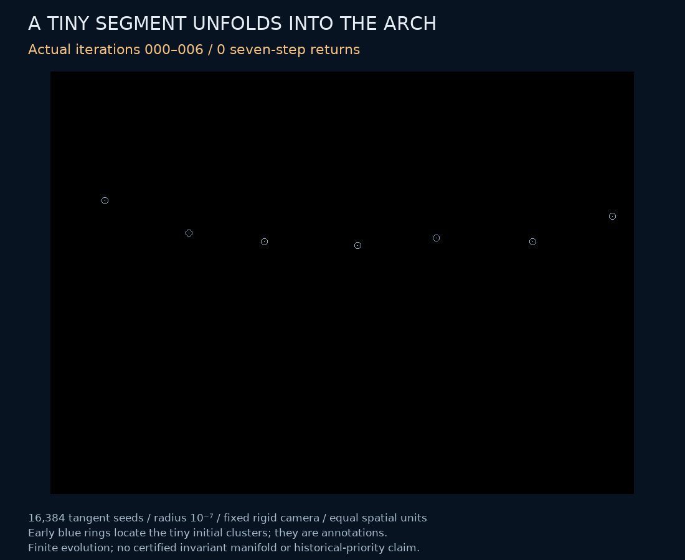
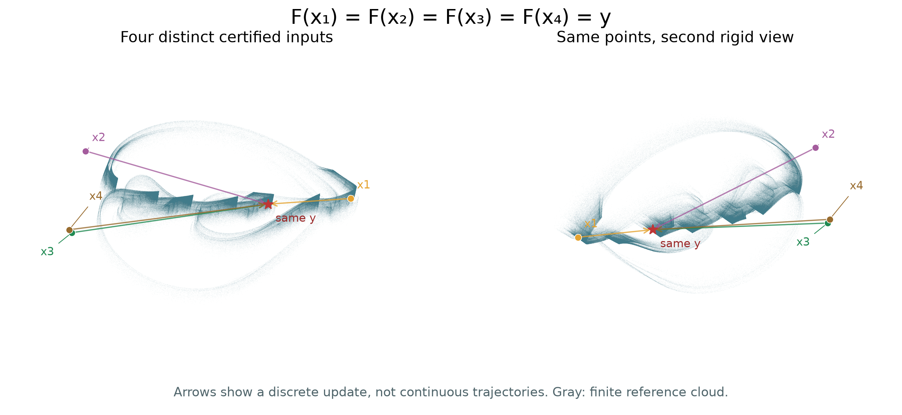

# How a tiny segment unfolds into the serrated arch

**A finite evolution experiment and complete inverse-image certificates in an existing algorithm. Historical uniqueness remains unresolved.**

The animation shows actual states of the spatial-circle RAAR map. We start with 16,384 points on a straight segment of radius `1e-7`, tangent to the unstable direction of its certified seven-cycle. Each frame combines seven successive phase offsets. The camera, spatial scale and density scale are fixed; the early blue rings only locate subpixel clusters. The frames run from iterations 0–6 to 448–454. No interpolation connects states into artificial continuous orbits.

[Seven-page research note](../papers/raar-folding/manuscript.pdf) · [Editable source and reproduction](../papers/raar-folding/README.md) · [Rotate the long-run cloud](assets/raar-circles-rotation.gif) · [Periodic structure](raar-cycle-structure.md) · [Priority audit](raar-priority.md)

## All six controls

Three initial radii (`1e-5`, `1e-7`, `1e-9`) and two counts (4,096 and 16,384) give six runs. **All 61,440 trajectories complete.** Smaller radii delay the visible unfolding. Final median distances to the million-state reference are `0.00097658–0.00099755`; the median distance between two half-reference samples is `0.00136408`. These are unequal-density finite-sample comparisons, not proof of equality of invariant sets or asymptotic attraction.

The initial segment is a numerical tangent construction, **not a certified invariant-manifold chart**. All ten saved snapshots and all 65 original histograms reproduce exactly in the higher-resolution rendering replay. Every point contributes to the histogram; no count is clipped by the common crop. The final animation displays native histogram pixels, with density normalized by pixel area.

## Exactly two or four preimages

For 25 exact binary64 targets selected at evenly spaced indices of the reference cloud, an interval-Sturm calculation gives complete counts in the map's regular domain:

| Complete count | Targets |
|---|---:|
| Exactly two preimages | 18 |
| Exactly four preimages | 7 |
| Total certified preimages | 64 |

The four-preimage indices are `254999, 499999, 540832, 826665, 867499, 908332, 949165`. The figure uses target `254999`; arrows denote a single discrete update. An independent nested-reflector map and derivative verify all 64 inputs by strict Krawczyk inclusion, positive projection-axis distances and containment in the corresponding Sturm boxes.

The proof reduces `F(x)=y` to a degree-eight polynomial in `tan(γ/2)`. It isolates all real roots, removes extraneous sign branches using both nearest-projection radial tests, and excludes the omitted angle and zero-length exceptional case. The [note](../papers/raar-folding/manuscript.pdf) provides the derivation. The [packet](../results/raar-folding/) retains numerical proposals, complete interval certificates, every revision and independent checks.

The initial near-cloud numerical search found one preimage per target. The subsequent global search found the extra inputs away from the finite reference sample. Both outcomes are retained. Thus **the full map is noninjective**, but noninjectivity of its restriction to an asymptotic attracting set is unproved. This excludes a global coordinate conjugacy to an injective map on a domain containing the certified inputs and common image. It does not distinguish the candidate from all known noninvertible chaotic maps.

## A certified smooth fold near the sampled cloud

The figure follows all 999,999 consecutive-state pairs through one update. Blue and gold indicate the sign of the full three-dimensional Jacobian determinant at the input. The same colors follow the points to their outputs. Overlapping colors in this projection do not assert equality of three-dimensional states.

A 200-digit interval-Newton calculation certifies a critical point on the segment between exact reference states `857629` and `993053`, less than `0.000042` from the latter. A strictly nonzero Jacobian minor establishes rank two. The determinant gradient dotted with a certified kernel vector lies in `(-0.05230, -0.05228)`. Thus the critical hypersurface is smooth and the kernel is transverse to it: the standard smooth-fold criterion applies. Both projection-axis distances stay strictly positive.

A [later membership theorem](raar-critical-membership.md) proves that a smooth fold belongs to the certified attracting set K. It does not identify that fold with the particular near-cloud point located here.

This is a local property of the full map, not an artifact of viewing a three-dimensional object in a flat picture. However, membership of the certified point in an asymptotic attractor is unproved, and this calculation does not identify the cause of the entire arch. Folds themselves are classical; the normal form uses different source and target coordinates and is not a dynamical conjugacy. The criterion is stated in [Montgomery (2014), Appendix B](https://doi.org/10.3842/SIGMA.2014.101). The [complete packet](../results/raar-fold-certificate/) retains the proposal, sampled determinants, both proof revisions, independent Hessian cross-check and both rendering revisions.

## What this adds, and what remains open

The seven visible tips do not give seven separable time-residue clouds in this finite diagnostic. Labeling each of the million states by its iteration number modulo seven produces similar density portraits. A nearest-neighbor classifier in the actual three coordinates predicts the phase of 400,000 held-out states with accuracy `0.1429225`, close to `1/7`. Training and test segments are separated by 200,000 steps. This is not an ergodicity, mixing or connectedness theorem. [Complete arrays and source](../results/raar-phase-classes/).

The result adds a visible formation process and exact inverse-image structure to the existing spatial-circle case study. It does not introduce RAAR, projection-search chaos, period doubling, noninvertibility or interval verification as new ideas. The main text of [Elser, Rankenburg and Thibault (2007)](https://doi.org/10.1073/pnas.0606359104) is now reviewed; its supplement remains a gap. The [new review record](../results/raar-folding/priority/review.json) supplements earlier frozen reviews.

The [extended priority audit](raar-priority.md) also credits Elser's explicit 2001 attractor portrait and distinguishes the RRR relaxation from RAAR. The seven-page note includes the earlier citation, time-residue diagnostic and smooth-fold certificate.

No exact match has been located in the bounded review. Proving a new attractor class still requires a broader equivalence review and rigorous asymptotic dynamics. The current evidence supports an unusual, reproducible **candidate**, not the assertion that nobody has seen an equivalent attractor.
