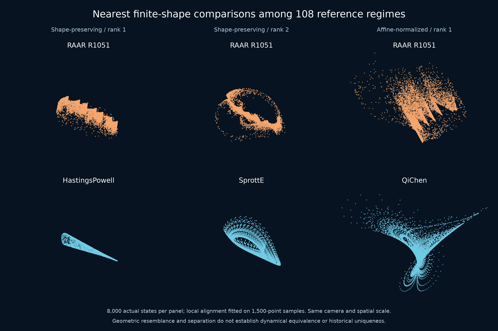

# RAAR candidates: prior art and equivalence audit

**Verdict as of 1 November 2026:** this is a reproducible study of particular spatial-circle configurations in an existing algorithm. We have not located an exact published match for the selected cases. Historical uniqueness, a new topological attractor class and inequivalence to every previously described map remain **unestablished**.

The working labels “serrated arch” and “layered loop” describe views of actual states. They are not mathematical names or priority claims. Changing a parameter, camera or coordinate system does not by itself create a new discovery.

## Closest known work

| Primary source | Already known | Difference and review limit |
|---|---|---|
| [Luke, Relaxed averaged alternating reflections for diffraction imaging (2004 preprint / 2005)](https://arxiv.org/abs/math/0405208) | The exact RAAR iteration, its relaxation and connections to related projection algorithms. | Our algorithm is this published algorithm. Abstract, introduction, Sections 2.1–2.3 and equations 10, 11, 14 inspected. |
| [Elser, Phase retrieval by iterated projections (2001 preprint / 2003)](https://arxiv.org/abs/math/0111080v1) | Explicit strange-attractor portraits, Figure 14. | Inconsistent Fourier-modulus/histogram constraints in 32 components; displayed phase sections differ from our full 3D states. Sections 2 and 8 plus Figure 14 pixels inspected. No attractor inequivalence proved. |
| [Luke and Martins, Convergence Analysis of the Relaxed Douglas–Rachford Algorithm (2020)](https://doi.org/10.1137/18M1229638) | Explicit RAAR examples with **two planar circles**, including intersecting, separated, nested and concentric cases; general fixed-point and local convergence theory. Example 3.17 already supplies a fixed-point-free circle/point case. | Our selected circles are noncoplanar in R³. Section 5 and selected earlier examples inspected; general proofs not fully re-audited. Fixed-point freedom in RAAR is not new in general. |
| [Borwein et al., Dynamics of the Douglas–Rachford method for ellipses and p-spheres (2017 online; 2018 volume)](https://arxiv.org/abs/1610.03975) | Rich periodic domains, long transients and earlier circle-line singular-set phenomena. | β=1 Douglas–Rachford and different constraints; our bounded β<1 spatial examples require separate analysis. Most descriptive text and five figure pages inspected, not every proof/figure. |
| [Elser, Rankenburg and Thibault, Searching with iterated maps (2007)](https://doi.org/10.1073/pnas.0606359104) | Strange-attractor search dynamics in projection/difference-map methods explicitly discussed. | Excludes any claim to discover chaos in constraint-search algorithms. Main article now read via the [Cornell-hosted PDF](https://pi.math.cornell.edu/~web401/keith.protein.pdf), including the formula, application sections, conclusions and Figure 3 schematic; supplementary information remains a gap. |
| [Marchesini, A unified evaluation of iterative projection algorithms for phase retrieval (2006 preprint / 2007)](https://arxiv.org/abs/physics/0603201v3) | Elementary circle examples and algorithmic failure modes. | Two circles form a **union in one constraint**, with a line as the other. Section III, equation 25 and Figure 4/5/6 pixels now inspected; other sections not fully reviewed. |
| [Dinh, Jansen and Luke, Cyclic Relaxed Douglas–Rachford Splitting for Inconsistent Nonconvex Feasibility (2025 preprint / 2026)](https://arxiv.org/abs/2502.12285) | Expanded RAAR formula, fixed-point linear combinations, shadow relations and local convergence theory. | Section 3.1 and selected definitions inspected. Our expansion and general fixed-point reasoning are not new algorithmic principles. |
| [Dinh et al., Algorithmic approaches to avoiding bad local minima in nonconvex inconsistent feasibility](https://arxiv.org/html/2502.19052v1) | Product-space relaxed Douglas–Rachford can escape bad minima in simulated and real orbital tomography. Section 4.1 reports nonvanishing iterate changes with convergent gaps. | Actual imaging application differs from our toy benchmark. Relevant methods, fixed-point characterizations and numerical sections inspected; figure captions, not all pixels. No inference that the reported behavior is our strange attractor. |
| [Chen, Local saddle structure in relaxed averaged alternating reflections Algorithms on phase retrieval (2021)](https://arxiv.org/abs/2101.11145) | ADMM and primal-dual interpretations; parameter-dependent basins and stationary-point screening. | Primary abstract only. These equivalent terms expand the necessary future search. |
| [Bauschke and Noll, On the local convergence of the Douglas–Rachford algorithm (2014)](https://arxiv.org/abs/1401.6188) | A cylinder/double-spiral construction in R³ gives bounded nonconvergence, vanishing increments and an accumulation circle in the fixed-point set. | Spatial nonconvergence and continuous limit sets are already known. This is not an identified chaotic strange attractor. Abstract, introduction, Theorem 3 statement and Corollaries 8–9 inspected. |
| [Calcan, Collard, De Marchi and Lindstrom, Resolvent Moreau identities without monotonicity (2026)](https://arxiv.org/abs/2605.18158) | A six-cycle and conjecturally chaotic orbiting in a 2D nonconvex basis-pursuit dual inclusion; explicit DR/ADMM connections. | Affine and inverse-MCP operators differ from two spatial-circle projectors. Section 4.1 and Figure 2 pixels inspected, with selected Section 6.1. Model difference does not prove attractor inequivalence. |
| [Elser, Solving Problems with Projections, Origins chapter (2025)](https://doi.org/10.1017/9781009475518.003) | Established context of nonconvex projection dynamics. | Publisher chapter excerpt only; full book not reviewed. |
| [Elser, Reflect-Reflect-Relax chapter (2025)](https://doi.org/10.1017/9781009475518.007) | Relevant global-behavior and RRR/ADMM sections identified. | Publisher summary, contents and index only; chapter body remains an explicit access/review gap. |

## What the present packet supports

1. Two visually selected noncoplanar-circle regimes, with actual-state density portraits and rigid rotations, survive long fresh-start, high-precision and original-library checks.
2. A third setting has two positive mean growth estimates, with an explicitly retained negative second-rate short window in the original-library run.
3. Complete fixed-point classifications and circle-disjointness certificates at six exact settings; one pair of input circles is certified linked.
4. All 2,051 screened settings, all 53 flagged follow-ups, periodic neighbors, 771 parameter-slice settings and the full declared initial-state experiments are retained.

These are concrete case-study results. Their combination may merit further study, but it does not establish priority. The interval certificates prove finite-dimensional geometric statements; the numerical evidence remains finite-time evidence.

## Equivalent descriptions and unresolved checks

Search terms include RAAR, relaxed Douglas–Rachford, averaged alternating reflections, projection-reflection dynamics, difference maps, circle feasibility, spatial/noncoplanar/linked circles, strange attractors and hyperchaos. The β=1 relation to AAR/HPR and a difference-map instance is explicit in Luke's original paper; the relaxed family should not be silently identified with that same difference-map formula. Chen's ADMM/primal-dual interpretation concerns its phase-retrieval setting and is not automatically an explicit conjugacy for this toy map.

Translation, rigid rotation and a common spatial scale conjugate geometrically equivalent circle instances. We normalize A to the unit xy circle and orient the B-plane tilt; relabeling A/B changes the ordered iteration and needs its own check. The selected input geometries being noncoplanar does not rule out a nonlinear conjugacy or a known symbolic dynamics on their attracting sets. A global topological/symbolic comparison has not been completed.

RRR is another relevant search term. The [2018 Cornell lecture](https://uuuuuu.lassp.cornell.edu/sites/default/files/origins.pdf), slides 4 and 7, gives its update and an ADMM variable change at relaxation one. With projector order aligned, write `Tγ(x)=x+γ[P_A(2P_Bx−x)−P_Bx]`. Direct subtraction gives `Fβ(x)=Tβ(x)+(1−β)(P_Bx−x)`. Thus the usual RRR and RAAR relaxations coincide at β=1; their β<1 formulas must not be silently conflated. This identity does not rule out a subtler coordinate equivalence.

The [later trapping study](raar-trapping.md) supplies a certified regular invariant region and a compact attracting set with positive entropy at R1051. The open requirements for a historical novelty claim still include a fuller review of older projection-chaos papers and supplements and a useful equivalence classification. Transitivity and equality with the finite visual cloud remain unresolved. We do not replace these requirements with a lack of search hits.

Source hashes, search terms and inspection scopes are frozen in [the priority packet](../results/raar-circles/priority/). Third-party publication PDFs remain local and are not redistributed. The pinned [official ProxToolbox evaluator](https://gitlab.gwdg.de/nam/ProxPython/-/blob/702154fc33a0b05747ef7f2980c88613236e3626/proxtoolbox/algorithms/RAAR.py) is retained with its repository license and attribution.

## Cycle-structure follow-up

The [companion study](raar-cycle-structure.md) adds certified least-period 7/14/28/56 cycles, four simple −1 multiplier events and a complete fine slice. Period doubling and periodic-orbit organization are established mechanisms, not priority claims. The events alone do not certify nondegenerate flips or an infinite cascade.

At the base seven-cycle, a negative full-period determinant excludes a C¹ coordinate conjugacy near that cycle to a fixed-time solution map of a C¹ ODE on R³, including time-dependent ODEs. This follows from the standard positive solution-map determinant and periodic-orbit conjugacy invariance; see [ChaosBook, Sections 4.7 and 5.3–5.5](https://chaosbook.org/chapters/ChaosBook.pdf). It is a narrow equivalence exclusion, not a classification against discrete maps, all return maps, higher-dimensional constructions or topological equivalences. The [later exact trapping audit](raar-trapping.md) now places this cycle inside the compact attracting invariant set it constructs.

The [additional review packet](../results/raar-cycle-structure/priority/review.json) records the 2014/2026 sources, inspection scopes, standard verification references and further queries. It supplements the original frozen review. **No exact match located remains the outcome of a bounded search, not proof that nobody has described an equivalent attractor.**

## Inverse-image follow-up

The [folding study](raar-folding.md) certifies complete two/four-preimage counts at 25 exact targets. Full-map noninjectivity excludes a coordinate conjugacy to an injective map on a domain containing those inputs and common image. The extra preimages are off the finite reference cloud; this does not establish noninjectivity on an asymptotic attractor or inequivalence to known noninvertible maps. The [new priority record](../results/raar-folding/priority/review.json) closes the Elser 2007 main-text access gap without changing earlier frozen records.

The [later primary-source review](../results/raar-priority-extension/review.json) adds the earlier explicit portrait, the checked Marchesini toy model and the RRR terminology. A separate modulo-seven diagnostic finds similar finite clouds and 14.29225% held-out phase prediction, close to 1/7; it does not prove mixing or connectedness. See the appendix of the [updated folding note](../papers/raar-folding/manuscript.pdf).

The [smooth-fold certificate](../results/raar-fold-certificate/) establishes a classical local singularity near the finite reference cloud. The standard equidimensional criterion is stated in [Montgomery (2014), Appendix B](https://doi.org/10.3842/SIGMA.2014.101); Section 3.1 discusses its normal form. Neither a new singularity type nor attractor membership is claimed. Separate source/target coordinate changes giving the fold normal form are not dynamical conjugacy. This result strengthens the local analysis without resolving historical uniqueness.

## Finite comparison with 108 reference regimes

The [frozen reference collection](attractor-novelty-audit.md) provides 108 simulated regimes: 89 catalog defaults, four external atlas examples, four three-dimensional Henon regimes, nine additional Halvorsen settings and two pumped-kicked-top settings. The new [RAAR comparison packet](../results/raar-catalog-comparison/) uses the already frozen million consecutive R1051 states and these exact reference files; it does not reintegrate or replace any reference. All 108 are retained in both comparisons.

The first representation removes translation and uniform scale while preserving aspect ratios. The second whitens empirical covariance, removing nonsingular affine distortions up to orthogonal transformations. The descriptor combines pair-distance and radial histograms with covariance eigenvalue fractions, using the [existing definition and limitations](attractor-novelty-audit.md#comparison-method-and-controls). Three nearest descriptor matches per representation receive a local point-cloud alignment with 48 initial orientations, allowing reflections. Each fit uses 1,500 states; its reported residual is a symmetric nearest-neighbor RMS, not a certified optimal alignment.

| Representation | Comparison | Descriptor distance | Best local alignment RMS |
|---|---|---:|---:|
| Aspect ratios preserved | R1051 temporal halves | 0.02753 | 0.04682 |
| Aspect ratios preserved | HastingsPowell | 0.13767 | 0.16547 |
| Aspect ratios preserved | SprottE | 0.15102 | 0.14902 |
| Aspect ratios preserved | CellularNeuralNetwork | 0.16269 | 0.17066 |
| Covariance whitened | R1051 temporal halves | 0.02545 | 0.08706 |
| Covariance whitened | QiChen | 0.09674 | 0.26210 |
| Covariance whitened | SprottC | 0.09954 | 0.24755 |
| Covariance whitened | SprottB | 0.10014 | 0.23689 |

Four independently seeded 6,000-point resamples all select HastingsPowell in the first representation. After whitening, three select QiChen and one selects SprottC. An exact affine transform of the R1051 sample passes the descriptor invariance control to within `1e-12`. The picture uses 8,000 actual states per panel, with each pair displayed in its fitted comparison coordinates. The rightmost column is covariance-whitened and therefore is not a native-coordinate portrait. Sampling and alignment indices, transforms and all plotted points are archived.

The closest selected reference discrepancies exceed the temporal-half comparison scales. This supports geometric distinctiveness relative to these finite samples under this protocol. It does **not** exclude all affine equivalents, because invariant measures, sampling and local optimization affect the comparison; it does not test nonlinear conjugacies or certify topology. The collection is not an exhaustive list of attractors or parameters. These distances are neither novelty probabilities nor a historical-priority certificate.

Reproduce with `research/compare_raar_catalog.py` and `research/render_raar_catalog.py`; audit with `research/verify_raar_catalog.py`. The earlier six-candidate audit remains unchanged and retains its own scope.

## Certified symbolic complexity in the selected instance

The [symbolic-dynamics study](raar-symbolic-dynamics.md) adds eight interval-certified covering relations and a compact invariant set with entropy at least log(2)/49. Two map implementations pass; a least-period-49 saddle is separately located and classified. This upgrades the exact-map evidence beyond finite growth-rate estimates. The [subsequent strict trapping construction](raar-trapping.md) places this symbolic set inside an attracting invariant set with the same entropy lower bound. Historical uniqueness remains unresolved.

The proof uses the established covering theory of [Zgliczynski and Gidea (2004)](https://doi.org/10.1016/j.jde.2004.03.013), specifically Theorems 9 and 16 of the author preprint. A targeted 1 November 2026 search under RAAR/Douglas-Rachford, symbolic dynamics, covering relations, horseshoe and topological entropy found no exact matching result among the returned sources. The [query and source record](../results/raar-symbolic-dynamics/priority.json) preserves that bounded scope. General projection-search chaos, RAAR and the covering method remain credited prior work. The unread 2007 supplement and 2025 chapter remain gaps.

## A proved fold in the attracting set

The [fold-membership study](raar-critical-membership.md) now certifies a smooth fold belonging to K. It excludes conjugacy on an open neighborhood of K, by an ambient homeomorphism, to a map locally injective throughout the corresponding set. This does not establish noninjectivity of F restricted to K or exclude conjugacies only between invariant-set restrictions. The new report gives a concrete known-map comparison and retains prior noninvertible folded-attractor literature; historical uniqueness remains unresolved.

## RRR flow-limit follow-up

[Lal, arXiv:2512.23843](https://arxiv.org/abs/2512.23843) analyzes local small-step RRR behavior near feasible intersections and finite-set switching. Its smooth no-recurrence result has local geometric assumptions; its numerical example concerns LEDM, and its outlook leaves infeasible global dynamics open. These statements do not cover our disjoint spatial-circle configuration. They also do not establish its novelty. The [review record](../results/raar-priority-flow-limit/review.json) pins the retrieved PDF and records the sections inspected and differing displayed dates. The RRR/RAAR formula distinction above still applies; different formulas alone are not an inequivalence proof.
