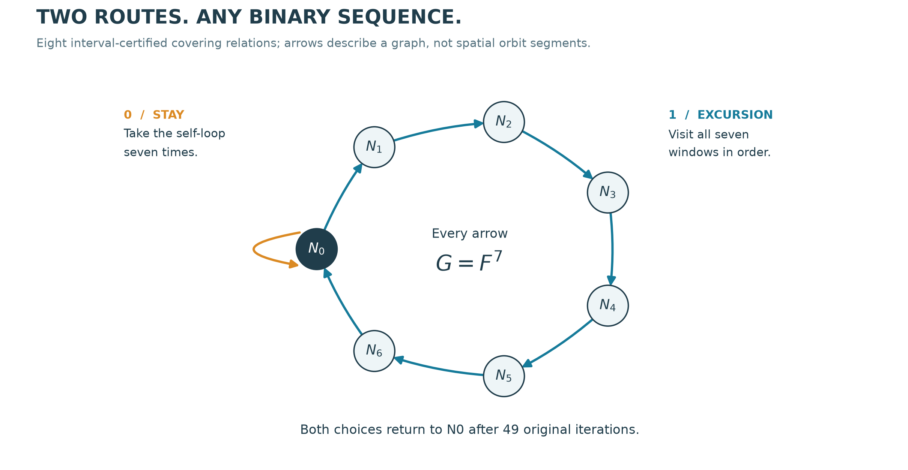
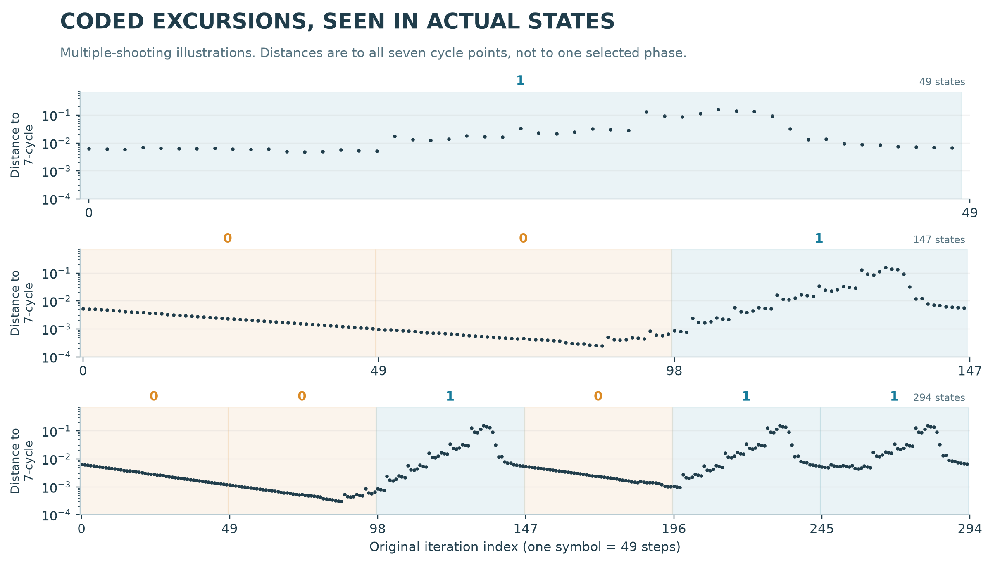

# Certified symbolic dynamics in spatial-circle RAAR

The serrated-arch example now has a computer-assisted proof of a compact invariant set with positive topological entropy. Eight covering relations pass two interval implementations. Arbitrary binary sequences are realized by concatenating two 49-step routes. A separately located saddle has exact least period 49.

This establishes chaotic complexity in the exact map. The [later trapping-region study](raar-trapping.md) places this symbolic set inside a compact attracting invariant set with the same entropy lower bound. Attraction of the symbolic subset itself, equality of the containing set with the displayed cloud, and historical uniqueness are not asserted. This page and its original manuscript describe the earlier covering result.

<!-- drawing-date -->
*First recorded drawing: **2026-11-01** ([record](https://github.com/Griboedow/chaos-attractor-lab/blob/90ade9c9edd87e8b181d56e33bca6095760161d2/docs/assets/raar-symbolic-geometry.png)).*
<!-- /drawing-date -->

[Manuscript](../papers/raar-symbolic-dynamics/manuscript.pdf) · [Reproduction](../papers/raar-symbolic-dynamics/README.md) · [Frozen evidence](../results/raar-symbolic-dynamics/README.md) · [Rotate the native geometry](assets/raar-circles-rotation.gif)

## Exact model and windows

We retain the existing ordered RAAR map

`F(x) = beta*x + beta*P_A(2*P_B(x)-x) + (1-2*beta)*P_B(x)`.

`A` is the unit xy circumference; `B(gamma)=c+r*(cos(gamma),cos(theta)*sin(gamma),sin(theta)*sin(gamma))`.

The exact parameters are the rational lifts of these binary64 values:

| Parameter | Value |
|---|---:|
| beta | 0.9708823579074815 |
| r | 1.9886915469542146 |
| theta | 0.9028818255996501 |
| c_x | -0.1435409113764763 |
| c_y | 0.5745496526360512 |
| c_z | -0.7745124697685242 |

Write `G=F^7`. Seven affine windows are `N_i = c_i + B_i diag(r_i) [-1,1]^3`. Every stored entry is lifted exactly; products are exact products of rational entries, not rounded binary64 matrix products. The complete machine-readable definition is [input.json](../results/raar-symbolic-dynamics/runs/raar-covering-refined01/input.json). All seven matrices are nonsingular. The first local coordinate of all of N1 relative to N0 lies between -2.491 and -2.393, so N0 and N1 are disjoint. The existing certified seven-cycle box lies strictly inside N0.

## Eight certified coverings

<!-- drawing-date -->
*First recorded drawing: **2026-11-01** ([record](https://github.com/Griboedow/chaos-attractor-lab/blob/90ade9c9edd87e8b181d56e33bca6095760161d2/docs/assets/raar-symbolic-graph.png)).*
<!-- /drawing-date -->

The directed edges are `0->0`, `0->1`, `1->2`, `2->3`, `3->4`, `4->5`, `5->6`, `6->0`. Each represents one application of G. A covering is an existence relation, not a claim that every point in a source window lands inside the target window.

In target coordinates y, every source subcell satisfies at least one strict condition: `y_0 < -1`, `y_0 > 1`, or both entry coordinates lie strictly inside `(-1,1)`. The two exit faces map strictly to opposite exterior sides. These are sufficient conditions for a covering with one exit direction under Theorem 16 of Zgliczynski and Gidea (2004). Theorem 9 then supplies periodic points for closed chains.

| Edge | Primary accepted cells | Second accepted cells |
|---|---:|---:|
| 0 -> 0 | 2,464 | 1,312 |
| 0 -> 1 | 1,019 | 840 |
| 1 -> 2 | 1,261 | 944 |
| 2 -> 3 | 733 | 579 |
| 3 -> 4 | 1,018 | 676 |
| 4 -> 5 | 577 | 305 |
| 5 -> 6 | 717 | 471 |
| 6 -> 0 | 8,678 | 4,322 |
| Total | 16,467 | 9,449 |

The primary implementation uses 70-digit interval vector projectors and analytic derivatives. The second uses 100-digit scalar circle coordinates, nested reflectors, automatic derivatives and exact rational Gaussian inversion. The subdivision driver and interval library are shared. Every dyadic tiling, strict inequality, source hash and input hash is audited. The smallest certified projection-axis distance exceeds 0.10367 in either implementation.

## Consequence: arbitrary binary itineraries and positive entropy

Use seven consecutive self-loops for symbol 0 and the complete seven-edge excursion for symbol 1. Both routes start and finish in N0 after 49 original iterations. A binary word of length n gives a closed covering chain and therefore an F^(49n)-fixed point. If two words first differ at position k, their points lie in disjoint N0 and N1 at time 49k+7. Thus there are at least 2^n distinct separated points over 49n steps.

All these periodic orbits, including their intermediate phases, lie in a compact regular-domain set. The closure of their union is compact and F-invariant. Consequently

`h_top(F restricted to this set) >= log(2)/49 > 0.01414`.

Compactness also realizes every infinite one-sided binary itinerary. This argument does not require a proved transverse homoclinic orbit, cone conditions, or a hyperbolic Smale horseshoe. Those stronger properties are not asserted.

## Located period-49 saddle

A separate 200-digit Krawczyk certificate encloses a root of `F^49(x)-x`, excludes the proper divisors 1 and 7, and checks the full window itinerary. One multiplier lies in `(579.0979,579.0981)`; quadratic Schur inequalities place the other two strictly inside the unit disk. There is exactly one unstable direction. The longer numerical examples below illustrate the coded routes; only the 49-cycle receives this additional located-root certificate.

<!-- drawing-date -->
*First recorded drawing: **2026-11-01** ([record](https://github.com/Griboedow/chaos-attractor-lab/blob/90ade9c9edd87e8b181d56e33bca6095760161d2/docs/assets/raar-symbolic-itineraries.png)).*
<!-- /drawing-date -->

## What is new in this repository, and what is already known

The additional result is the exact spatial-circle parameter instance, its certified branching graph, the explicit entropy bound and the located 49-cycle. RAAR itself, chaos in projection-based search and the covering proof method are prior work. Different formulas or pictures do not exclude nonlinear conjugacy to known systems. The [priority audit](raar-priority.md) retains the explicit 2001 strange-attractor portrait and the bounded 108-regime geometric comparison.

A targeted search on 1 November 2026 did not locate this exact covering result. That is a bounded negative search, not a proof of priority. Elser's 2007 supplement and the full 2025 global-behavior chapter remain unread gaps. The exact attracting set and its equivalence class remain unresolved.

Primary method reference: P. Zgliczynski and M. Gidea, *Covering relations for multidimensional dynamical systems*, Journal of Differential Equations 202 (2004), 32-58, [DOI](https://doi.org/10.1016/j.jde.2004.03.013). The [author preprint](https://ww2.ii.uj.edu.pl/~zgliczyn/papers/wts/cov.pdf) gives Theorems 9 and 16 on pages 11 and 17. The method is credited, not presented as a new proof technique.
