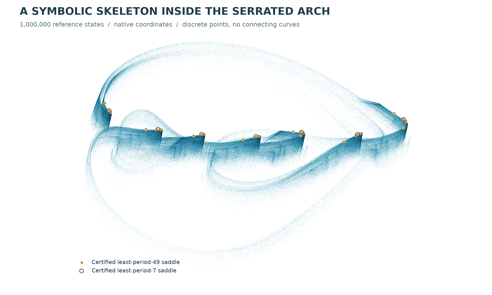

# Certified symbolic dynamics in a spatial-circle RAAR map

A branching return graph behind a serrated numerical cloud<br>Chaos Attractor Lab | Computer-assisted research note | 1 November 2026

**Abstract.** We certify symbolic complexity in a three-dimensional instance of the existing relaxed averaged alternating reflections (RAAR) algorithm between two spatial circles. Seven affine windows and eight covering relations support arbitrary binary itineraries, with one symbol occupying 49 original iterations. Standard covering theory gives a compact invariant set with topological entropy at least log(2)/49 > 0.01414. Two interval implementations verify the complete graph, using 16,467 and 9,449 accepted subcells. A separate 200-digit certificate locates a saddle of exact least period 49 and proves that exactly one multiplier is unstable. These are exact-map results beyond finite Lyapunov estimates. Attraction of the symbolic set, equality with the displayed numerical cloud, and historical uniqueness remain unresolved.



**Figure 1.** One million actual reference states of the serrated-arch case R1051, with the certified 7- and 49-cycles. A rigid orthographic camera preserves relative geometry; no points are joined by trajectory curves. Cycle markers overlap near the tips. Proximity in this picture does not prove membership in an attracting set. The repository also provides a rotating view of the native cloud.

## 1. Exact system and theorem

Let A be the unit xy circumference and B be the tilted circumference given below. P denotes nearest-point projection onto a circumference, defined off its axis. We retain the ordered RAAR convention of the companion studies [1,3], with no change to the algorithm.

```math
B(\gamma)=c+r(\cos\gamma,\ \cos\theta\sin\gamma,\ \sin\theta\sin\gamma).
```

```math
F(x)=\beta x+\beta P_A(2P_Bx-x)+(1-2\beta)P_Bx,\qquad G=F^7.
```

| Parameter | Exact binary64 input |
| --- | --- |
| beta | 0.9708823579074815 |
| r | 1.9886915469542146 |
| theta | 0.9028818255996501 |
| c_x | -0.1435409113764763 |
| c_y | 0.5745496526360512 |
| c_z | -0.7745124697685242 |

Each displayed parameter denotes its exact binary64 rational lift, not an uncertain physical measurement. Sine and cosine of the exact angle are enclosed by interval arithmetic. The circle formula and the projection order are part of the model definition.

### Theorem 1 (computer-assisted symbolic complexity)

For this exact map, the seven windows N<sub>i</sub> specified in the frozen input support the eight G-coverings 0 to 0, 0 to 1, 1 to 2, 2 to 3, 3 to 4, 4 to 5, 5 to 6, and 6 to 0. Windows N<sub>0</sub> and N<sub>1</sub> are disjoint. There exists a compact F-invariant set C in the regular domain whose topological entropy is at least log(2)/49 > 0.01414 per iteration. Every one-sided binary itinerary formed from the two routes in Section 3 is realized. There is a located orbit of exact least period 49 with one unstable and two stable multipliers.

### Exact window definition

```math
N_i=c_i+S_i[-1,1]^3,\qquad S_i=B_i\,\mathrm{diag}(r_i),\qquad 0\leq i\leq6.
```

All centers, basis entries and radii are stored in runs/raar-covering-refined01/input.json. Each factor is lifted exactly before multiplication. The SHA-256 digest is d6330277f1f10f5c7bc2118acb69dba5a10fbd025761c8f5b83beb5344b13b60. All S<sub>i</sub> are nonsingular. The first N<sub>0</sub>-coordinate of every point in N<sub>1</sub> belongs to (-2.491,-2.393), proving disjointness. The certified seven-cycle box from [3] lies strictly inside N<sub>0</sub>.

A covering relation is an existence statement for orbit segments. It does not say that every point of the source is mapped into the target, or that the two nominal entry directions contract everywhere.

## 2. Verified covering conditions

Use the first local coordinate as the exit direction and the other two as entry coordinates, with the maximum norm. For each edge i to j, write y=S<sub>j</sub><sup>-1</sup>(G(x)-c<sub>j</sub>). Every accepted volume subcell satisfies at least one of the following strict interval conditions:

```math
y_0<-1\quad\mathrm{or}\quad y_0>1\quad\mathrm{or}\quad (|y_1|<1\ \mathrm{and}\ |y_2|<1).
```

The two exit faces additionally map strictly into opposite exterior sides y<sub>0</sub><-1 and y<sub>0</sub>>1, with either orientation. The volume condition places the full image in the interior of the union of the target and its two exterior sides and excludes the entry boundary. It is stronger than the horizontal-line condition in Theorem 16 of [2]. Therefore each verified edge is an h-set covering with nonzero degree.

### Interval propagation and two implementations

For a dyadic cell with midpoint m and half-width vector d, write x = c<sub>i</sub> + S<sub>i</sub>m + S<sub>i</sub>δ, with |δ| ≤ d componentwise. At each of seven steps, a mean-value enclosure uses the interval derivative over the entire current enclosure. The center image and propagated derivative are kept separate. All projection-axis denominators are enclosed strictly away from zero. The target inverse then gives the local image enclosure.

The first engine uses 70-digit interval vector projectors, analytic Jacobians and an adjugate inverse. The second uses 100-digit scalar circle coordinates, nested reflectors, forward automatic differentiation of the local map, and exact rational Gaussian inversion. They share the subdivision driver and mpmath 1.3.0 interval library. This is an independent map realization, not a wholly independent software stack or a proof-assistant formalization.

| G edge | Primary cells | Second cells |
| --- | --- | --- |
| 0 to 0 | 2,464 | 1,312 |
| 0 to 1 | 1,019 | 840 |
| 1 to 2 | 1,261 | 944 |
| 2 to 3 | 733 | 579 |
| 3 to 4 | 1,018 | 676 |
| 4 to 5 | 577 | 305 |
| 5 to 6 | 717 | 471 |
| 6 to 0 | 8,678 | 4,322 |
| Total | 16,467 | 9,449 |

Counts include volume and both exit-face tilings. Every leaf has its interval image and dyadic address stored. A separate exact-rational trie audit checks complete tilings with no missing children, strict inequalities, matrix invertibility, disjointness and source identity. The global certified projection-axis distance exceeds 0.10367 in both engines. The audit checks saved enclosures; the two engines separately recompute them.

## 3. From the graph to entropy


**Figure 2.** Schematic covering graph. One arrow is seven original iterations. Symbol 0 takes seven self-loops at N<sub>0</sub>; symbol 1 visits N<sub>0</sub>, N<sub>1</sub>, ..., N<sub>6</sub>, N<sub>0</sub>. Both routes last 49 original iterations. Node positions in this diagram are not spatial coordinates.

**Periodic realizations.** Concatenate the closed routes for a binary word of length n. The resulting closed chain has 7n G-steps. Theorem 9 of [2] gives a point fixed by F<sup>49n</sup>, with all prescribed visits. No injectivity, global hyperbolicity, or transverse homoclinic connection is assumed.

**Separation.** Put δ = dist(N<sub>0</sub>,N<sub>1</sub>) > 0. If two words differ in block k, their realizations lie in N<sub>0</sub> and N<sub>1</sub> at original time 49k+7. Thus the 2<sup>n</sup> selected points are distinct and (49n,δ/2)-separated. They need not represent 2<sup>n</sup> distinct periodic orbits; the assertion concerns separated initial points.

**Compact invariant set.** Let Q be the finite union of F<sup>j</sup>(N<sub>i</sub>) for 0 ≤ i,j ≤ 6. Every selected periodic orbit, including intermediate phases, stays in Q. The certified axis bounds make F continuous on a neighborhood of Q. Let C be the closure of the union of these periodic orbits. Compactness gives C compact and F(C)=C: forward invariance follows by continuity, and preimages follow by taking limits of periodic predecessors in Q.

```math
h_{\mathrm{top}}(F|_C)\ \geq\ \lim_{n\to\infty}\frac{\log 2^n}{49n}=\frac{\log2}{49}>0.01414.
```

For an infinite one-sided binary sequence, periodic realizations of its successively longer prefixes have a convergent subsequence in N<sub>0</sub>. Continuity and closed windows preserve every finite prefix in the limit. Hence every such sequence is realized. This does not assert unique coding points, a hyperbolic Smale horseshoe, or attraction.

## 4. A located saddle and coded examples

A multiple-shooting solution for the excursion word 1 supplies a seed for a separate 200-digit interval Krawczyk certificate [4]. A radius-10<sup>-120</sup> box contains a unique root of F<sup>49</sup>(x)-x. Strict proper-divisor exclusions rule out periods 1 and 7, so the least period is 49. The interval orbit visits all seven windows in the prescribed order. The representative point begins:

```math
x\simeq(0.00630627102880642,\ -2.448779781118031,\ 4.144176440279049).
```

Interval signs of the characteristic cubic at 579.0979 and 579.0981 bracket an unstable real root. After deflation with that root interval, all three quadratic Schur margins are positive, placing the other two multipliers strictly inside the unit disk. Thus exactly one direction is unstable. Numerical 200-digit estimates are 579.0979600389606, 0.183541441192713 and -2.8374880613 x 10<sup>-15</sup>; the interval inequalities, not these rounded estimates, certify the classification.


**Figure 3.** Numerical multiple-shooting realizations for words 1, 001 and 001011. Each point is an actual computed discrete state. The ordinate is Euclidean distance to the entire seven-cycle; the shaded blocks are the 49-step symbols. The first example has the additional located-root certificate. The longer plotted examples are not individually root-certified.

All seven declared numerical words converge with maximum physical shooting residual below 1.8 x 10<sup>-14</sup> and local window coordinates below 0.938 in magnitude. Long binary64 monodromy products are ill-conditioned; their small eigenvalues are retained in the raw records but are not used as stability evidence. A trajectory plot or a small residual alone is not an existence proof.

## 5. Reproduction and claim boundaries

The results/raar-symbolic-dynamics packet retains every declared stage: a numerical return scout, all 36 initial window proposals, the refined proposal, both complete interval runs, an interrupted first automatic-differentiation pilot, structural audits, coded orbit proposals, the 49-cycle certificate and both rendering revisions. SHA-256 manifests identify every frozen file. Earlier evidence packets are unchanged.

### Discovery is separated from certification

A degree-24 numerical parameterization of the unstable direction near the seven-cycle proposes a returning excursion. Roots in the linear stable plane guide window placement. This polynomial chart is not a validated invariant manifold and the plane is not a proved stable manifold. The initial linear window proposals all fail their sampled nonlinear tests. A later radius refinement passes the numerical screen, after which complete interval tilings certify the eight edges independently of the search heuristics.

The interrupted pilot propagated automatic derivatives in a form with excessive interval dependency. Its partial stream is retained as incomplete and is never counted as a proof. The final second engine differentiates each local map first, then propagates the enclosed Jacobian. All completed certificates and the failed pilot remain distinguishable by their original directory names.

### Practical reproduction

The repository verifier recomputes every saved strict inequality and complete tiling, checks exact window separation, validates source hashes and replays the plotted data. Full enclosure recomputation uses certify_raar_coverings.py at 70 digits and check_raar_coverings_ad.py at 100 digits, one invocation per edge. The README gives complete commands. No third-party publication PDF is redistributed.

| Established here | Not established here |
| --- | --- |
| Eight covering relations; positive entropy on a compact invariant set | Attraction of that set or equality with the numerical cloud |
| Every binary route sequence has a realization | Unique coding, uniform hyperbolicity or a transverse homoclinic orbit |
| Located least-period-49 saddle with one unstable multiplier | Stability of all longer numerical shooting examples |
| Exact instance and reproducible proof data | Historical uniqueness or a new dynamical equivalence class |

The earlier long-run spectra, initial-volume approach experiments, fixed-point exclusion, smooth-fold certificate and finite 108-regime shape comparison [3] remain relevant numerical or exact-map evidence. None supplies the missing implication that the compact symbolic set certified here is an attractor. A trapping region, a basin argument and an appropriate identification of the attracting set remain further work.

## 6. Prior work and references

RAAR is an established algorithm [1]. Its planar-circle behavior is treated by Luke and Martins [5]. Elser already displayed strange-attractor sections for a projection-based search map in a 2001 preprint [6], and subsequent work explicitly used chaotic search dynamics [7]. The general claims "projection algorithms can be chaotic" and "circle projections can have nontrivial dynamics" are not new discoveries here. The covering method itself is also established [2].

The present contribution is the exact spatial-circle instance together with an explicitly reproducible branching graph, a topological entropy lower bound and a located least-period-49 saddle. A targeted search on 1 November 2026 under RAAR, Douglas-Rachford, symbolic dynamics, covering relations, horseshoe and topological entropy located no exact matching result in the returned sources. This is a bounded review, not a proof of priority. Different equations or appearances do not exclude nonlinear conjugacy.

The broader repository audit records related difference-map, relaxed-reflection, RRR and ADMM terminology, a prior circle-union/line example, and recent nonconvex splitting cycles. Elser's 2007 supplement and the full global-behavior chapter of the 2025 book remain review gaps. Historical uniqueness of an attracting set is unresolved; no new attractor class or first-ever projection chaos is claimed.

[1] D. R. Luke, Relaxed averaged alternating reflections for diffraction imaging, Inverse Problems 21 (2005), 37-50. [arXiv:math/0405208](https://arxiv.org/abs/math/0405208).

[2] P. Zgliczynski and M. Gidea, Covering relations for multidimensional dynamical systems, Journal of Differential Equations 202 (2004), 32-58. [doi:10.1016/j.jde.2004.03.013](https://doi.org/10.1016/j.jde.2004.03.013). The author preprint dated 20 April 2004 gives Theorems 9 and 16 on pages 11 and 17: [author-hosted text](https://ww2.ii.uj.edu.pl/~zgliczyn/papers/wts/cov.pdf).

[3] Chaos Attractor Lab (2026), Serrated arches and layered loops in relaxed reflections between spatial circles; Periodic structure behind a serrated spatial RAAR cloud; From a tiny segment to a serrated arch. Reproducible companion notes in docs/raar-circles, docs/raar-cycle-structure and docs/raar-folding. The current bounded comparison is in results/raar-catalog-comparison.

[4] S. M. Rump, Verification methods: rigorous results using floating-point arithmetic, Acta Numerica 19 (2010), 287-449, Section 13. [Author-hosted text](https://www.tuhh.de/ti3/rump/intlab/ActaNumerica2010.pdf).

[5] D. R. Luke and A.-L. Martins, Convergence Analysis of the Relaxed Douglas-Rachford Algorithm, SIAM Journal on Optimization 30 (2020), 542-584, Section 5. [doi:10.1137/18M1229638](https://doi.org/10.1137/18M1229638).

[6] V. Elser, Phase retrieval by iterated projections, JOSA A 20 (2003), 40-55. [2001 preprint](https://arxiv.org/abs/math/0111080v1), Section 8 and Figure 14.

[7] V. Elser, I. Rankenburg and P. Thibault, Searching with iterated maps, PNAS 104 (2007), 418-423. [doi:10.1073/pnas.0606359104](https://doi.org/10.1073/pnas.0606359104).
