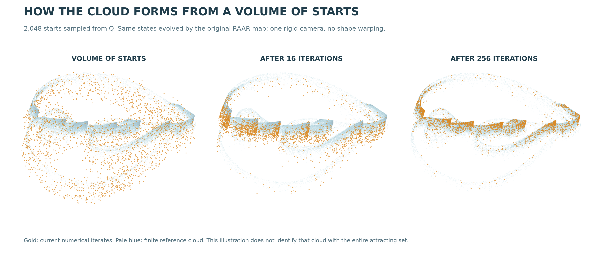

# A trapping region with positive entropy in spatial-circle RAAR

The serrated-arch instance now has a computer-assisted proof of a **compact attracting invariant set with positive topological entropy**. An explicit region of 21,405,802 cubes maps strictly into itself, and contains the previously certified symbolic dynamics. This establishes attraction for a containing invariant set. Transitivity, equality with the pictured cloud and historical uniqueness remain unresolved.



[Manuscript](../papers/raar-trapping/manuscript.pdf) · [Subsequent fold-membership theorem](raar-critical-membership.md) · [Reproduction](../papers/raar-trapping/README.md) · [Frozen evidence](../results/raar-trapping/README.md) · [Native-state rotation](assets/raar-circles-rotation.gif)

Gold points show the same 2,048 starts sampled from the surrounding region, after 0, 16 and 256 iterations. All points are actual discrete states; the camera is rigid and unchanged. All 4,196,352 tested finite state memberships through iteration 2,048 stay in the region. That numerical illustration is separate from the exhaustive proof.

## What was proved

Use the existing ordered RAAR map and the exact binary64-lift parameters of [R1051](raar-symbolic-dynamics.md#exact-model-and-windows). Let Q be the finite union of closed cubes defined by the archived mask, with grid step the exact binary64 value `0.005`. The exhaustive calculation proves

```text
F(Q) + [-epsilon,epsilon]^3 ⊂ Q,       epsilon = 2^-35.
```

The positive margin implies `F(Q) ⊂ interior(Q)`. Every accepted source leaf has both projection arguments bounded away from their singular axes by more than **0.0118**. Thus F is smooth on a neighborhood of Q.

Define `K = intersection over n >= 0 of F^n(Q)`. These are nested nonempty compact sets. Their intersection is compact and satisfies `F(K)=K`; compactness also makes their distance to K tend uniformly to zero. A neighborhood of Q enters its interior and is attracted to K. The manuscript gives the argument without assuming invertibility.

All seven symbolic windows lie in Q, checked using exact rational arithmetic. The coded periodic orbits and their closure therefore lie in K. Two distinguishable choices every 49 original iterations give

```text
h_top(F restricted to K) >= log(2)/49 > 0.01414.
```

The strict trapping and covering inequalities persist under sufficiently small parameter changes by continuity. This is a qualitative open-neighborhood statement; no explicit parameter radius is certified.

## Complete computational coverage

| Quantity | Verified result |
|---|---:|
| Original source cubes | 21,405,802 |
| Accepted dyadic leaves | 23,055,541 |
| Eight-way subdivisions | 235,677 |
| Leaves accepted by occupied bounding boxes | 20,505,561 |
| Newly required target cubes | 0 |
| Projection-axis lower bound | greater than 0.0118 |
| Image margin in each coordinate | 2^-35 |
| Approximate volume of Q | 2.67572525 |


The pale shape is the surrounding region, whose volume is not the volume of the attractor. Each projection includes every occupied cube. A gap or overlap in a projection does not determine three-dimensional topology.

The enclosure uses the analytic Hessian bound for normalization `n(v)=v/||v||`, two successive Taylor remainder estimates for the circle projectors, and explicit bounds on numerical center/Jacobian mismatch. Every relevant arithmetic result is rounded outward. Target cubes are excluded only by outward separating-axis inequalities. Unresolved cases subdivide into all eight children; no source is skipped on the strength of a sampled image.

Four declared ranges cover every source key exactly once. A separate auditor independently unpacks the mask, verifies its complete correspondence with the sorted keys, checks source-range hashes and subdivision accounting, rechecks the exact window inclusion, and confirms every new-cell list is empty. The original and optimized raster control flows agree on all **21,054,351** sources completed by both. They share the same interval arithmetic and enclosure formula; they are not independent proof stacks.

Assumptions include ordinary IEEE-754 binary64 arithmetic with correctly rounded basic operations and square root, preserved by the recorded runtime. Sine and cosine are enclosed separately at arbitrary precision. Full replay recomputes the enclosures; a hash/accounting check alone does not. The implementation checks and failed/incomplete stages are explicitly retained.

## Cycles and the narrow equivalence exclusion

The located least-period-7 and least-period-49 root boxes each lie wholly in an occupied cube. Their periodic orbits therefore belong to K. This resolves their membership in this attracting invariant set; it does not identify them with any particular finite sampled cloud.

The seven-cycle's full-period determinant is certified negative, approximately `-0.0170952663`. Consequently there is no ambient C1 coordinate conjugacy near that cycle identifying F with a fixed-time solution map of a C1 ODE on R3. Such solution maps have positive Jacobian determinant, while a periodic-orbit conjugacy preserves the determinant. This standard exclusion does not classify arbitrary return maps, higher-dimensional embeddings, topological conjugacies or known discrete attractors.

## Novelty boundary

The concrete addition is a reproducible strict trapping construction at the selected spatial-circle parameters, together with the entropy consequence. RAAR, covering theory, periodic saddles and projection-search chaos are established prior work.

The additional review of [Fannjiang and Zhang (2020)](https://doi.org/10.1137/19M128781X) records bounded Gaussian-DRS iterates and discussion of possible nontrivial/strange attractors in imaging. The inspected statements and discussion do not identify the present spatial-circle example; their different setting is not an inequivalence proof. The [source record](../results/raar-trapping/priority.json) specifies the inspection limits.

The [existing audit](raar-priority.md) includes an explicit 2001 strange-attractor portrait and a finite comparison against 108 reference regimes. A bounded new search located no exact matching trapping/entropy result. The unread 2007 supplement and full 2025 chapter remain gaps. Neither a new equivalence class nor the claim that nobody has seen an equivalent attractor is established.
