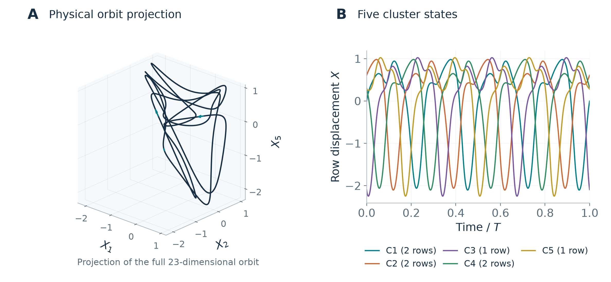
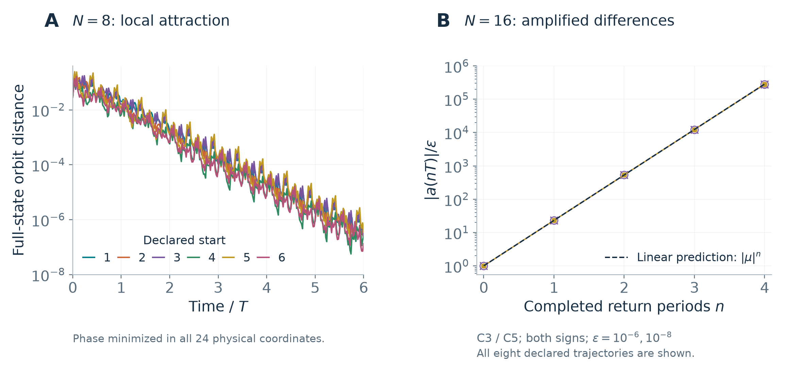

# Replication-induced instability of a certified five-cluster motor cycle

2026-10-30 · Pre-submission manuscript

## Abstract

We certify an attracting five-cluster periodic orbit and classify every balanced replica in the first-harmonic molecular-motor model of Alouges and collaborators. At explicit parameters, an eight-row system has an attracting periodic orbit with five distinct cluster states and multiplicities $`2+2+1+2+1`$. Interval integration, multiple shooting and spectral tests certify its existence and place all 22 nonflow Floquet multipliers inside modulus $`0.13`$. Exact replication to $`N=8k`$ rows preserves the orbit and the cluster weights, but gives precisely $`2k-2`$ unstable, one neutral and $`22k`$ stable directions. The instability is carried by internal differences in the two groups that were singletons at $`N=8`$. Each newly available block has one real multiplier in $`(-23.084,-23.083)`$ and two multipliers of modulus below $`0.13`$. The contribution is a model-specific existence and complete stability result, using established cluster decomposition and reproducible interval certificates. Full-system numerical trajectories illustrate attraction and sign-reversing departure without serving as premises of the theorem.

**Keywords:** cluster synchronization; periodic orbit; Floquet stability; molecular motors; validated numerics.

## 1. Introduction

Collective oscillations are often represented by a small collection of distinct group states. Such a description retains the motion within the cluster subspace but can hide perturbations that split an individual group. This distinction becomes consequential when a small configuration is replicated: the same group trajectories may survive exactly while new internal degrees of freedom make them unstable.

Alouges et al. [\[1\]](#ref-1) introduced a model for interactions between rows of molecular motors in an axonemal cross-section. Their eight-row numerical examples display periodic motion organized into two groups; the organization of the general $`3N-1`$ dimensional system is left open. We study an explicit five-cluster cycle in its exact first-harmonic specialization. The question is whether attraction of this motion survives balanced enlargement of every cluster.

### 1.1. Relation to established results

Replacing cells by synchronized copies while retaining quotient dynamics belongs to the established theory of network inflation [\[2\]](#ref-2). For globally coupled phase oscillators, Orosz, Moehlis and Ashwin [\[3\]](#ref-3), Sec. 2, Eqs. (2.19)–(2.23) give internal eigenvalues with multiplicity equal to cluster size minus one and explicitly exclude singletons from that count. Thus the absence of a splitting mode in a singleton, and its appearance on enlargement, are already contained in that framework. General symmetry-based stability decompositions are developed further in [\[6\]](#ref-6); [\[7\]](#ref-7). Our block formula specializes this reasoning to the motor equations; it is not a new general mechanism.

The terminology also overlaps with *evaporation* or *split* stability. Zaks and Pikovsky [\[4\]](#ref-4), Methods compute it using opposite perturbations to two synchronized units. For a periodic internal block, the largest such exponent is $`T^{-1}\log\max_{\mu\in\mathrm{spec}M_a}|\mu|`$. Our full Floquet spectrum additionally resolves the number of unstable directions and the sign of the real unstable multiplier. The latter information is lost in the exponent. A real scalar internal phase equation $`\dot\xi=a(t)\xi`$ has positive return multiplier $`\exp(\int_0^T a(t)\,dt)`$; it cannot represent the negative multiplier certified here in a three-dimensional motor block. This distinguishes the present calculation from that scalar approximation without asserting that negative Floquet multipliers are themselves new.

Model equivalence requires a separate check. The closed three-state core of the two-row motor problem is an invertible rescaling of the earlier equations of Oriola et al. [\[5\]](#ref-5), Eq. (10); the coordinate map is recorded in the repository’s source audit. This equivalence concerns that core, not the five-cluster quotient studied here. Periodic motor motion, the source model, and its first-harmonic closure are inherited results. Likewise, cluster symmetry breaking and chaotic states in other oscillator models [\[8\]](#ref-8) do not supply an exact conjugacy to these equations.

### 1.2. Contribution of the present work

The contribution is the explicitly enclosed orbit and the certified values of every block needed to classify its entire replicated family (Table [1](#tab-contribution)). Established decomposition alone does not prove that this five-cluster orbit exists at the stated motor parameters, or determine which of its internal blocks are unstable. The interval certificate supplies precisely those missing model-specific facts.

The central result is that the $`N=8`$ cycle attracts locally, whereas all replicas with $`N=8k`$, $`k\geq2`$, are saddles. The instability is strong: a perturbation in each new unstable mode reverses sign and grows in magnitude by about $`23.08`$ over a certified return period. This is a change in the available perturbation space as the system size changes. The theorem concerns fixed normalized parameters and fixed cluster weights. It makes no identification of this enlargement with changing the anatomy of a physical flagellum while holding all dimensional constants fixed.

<a id="tab-contribution"></a>

**Table 1.** Scope of the contribution. The right column describes the result proved in this manuscript; it does not assert exhaustive historical priority.

| Question | Established background | Result supplied here |
|:---|:---|:---|
| Equations | Published motor model and harmonic closure [\[1\]](#ref-1); [\[5\]](#ref-5) | An explicit parameter point in the existing model |
| Replication | Quotient lifting and internal stability [\[2\]](#ref-2); [\[3\]](#ref-3); [\[6\]](#ref-6); [\[7\]](#ref-7) | Explicit motor variational blocks and their interval spectra |
| Periodic motion | Collective motor oscillations [\[5\]](#ref-5); [\[1\]](#ref-1) | Certified five-cluster orbit, return period and full $`N=8`$ attraction |
| Stability of the family | Cluster splitting as a transverse instability | Exact $`(2k-2,1,22k)`$ index for every $`N=8k`$, with strict spectral bounds |

## 2. Model and main result

For $`N\geq2`$, write the state of row $`j`$ as $`(c_j,s_j,X_j)`$ and impose $`\sum_j X_j=0`$. In normalized time $`\tau`$, the equations are

<a id="eq-velocity"></a>

```math
V_j=-\rho X_j+r(s_j-\bar s),
 \bar s=\frac1N\sum_{i=1}^N s_i,\tag{1}
```

<a id="eq-model"></a>

```math
c_j'=1-c_j-V_js_j,
 s_j'=b-s_j+V_jc_j, X_j'=V_j.\tag{2}
```

The first harmonic of the motor density determines $`(c_j,s_j)`$; $`X_j`$ is the normalized relative displacement. Eliminating $`X_N`$ gives a $`3N-1`$ dimensional autonomous polynomial system. The mean term in [(1)](#eq-velocity) follows from the mechanical displacement constraint. The normalization and its relation to the published equations are given in the accompanying source audit. This manuscript uses

<a id="eq-parameters"></a>

```math
\rho_* = \frac{129}{55},\qquad
 r_* = 1+\frac{19/20}{\sqrt{32001/500000}},\qquad b_*=1.
 \tag{3}
```

The value of $`r_*`$ agrees with the activity path implemented from the source model. The rational value of $`\rho_*`$ specifies the theorem exactly and avoids identifying a floating-point grid point with an exact parameter.

<a id="thm-main"></a>

**Theorem 1** (Certified cycle and complete replication index). At [(3)](#eq-parameters), the $`N=8`$ system has a nonconstant periodic orbit with five pairwise distinct cluster states and multiplicities $`(m_1,\ldots,m_5)=(2,2,1,2,1)`$. It has a positive return period satisfying

<a id="eq-period"></a>

```math
25.0016843758970971<T<25.0016843758970972.\tag{4}
```

For every integer $`k\geq1`$, replication to multiplicities $`(2k,2k,k,2k,k)`$ is an exact periodic solution of the $`N=8k`$ system at the same parameters and with the same return period. Its Floquet index is

<a id="eq-index"></a>

```math
(u,n,s)=(2k-2,\,1,\,22k),\tag{5}
```

where $`u,n,s`$ count multipliers outside, on and inside the unit circle, with algebraic multiplicity. The sole neutral multiplier is the simple flow multiplier $`1`$. Every stable multiplier has modulus below $`0.13`$. Every unstable multiplier belongs to $`(-23.084,-23.083)`$. In particular, the $`N=8`$ orbit is locally orbitally exponentially attracting; the $`N=8k`$ replicas are hyperbolic periodic saddles for $`k\geq2`$.

The theorem certifies a return period. It does not assert that the displayed $`T`$ is the least positive period. The stability and index conclusions do not require such an assertion: taking a positive integer power of a minimal-period monodromy preserves the numbers of stable and unstable directions. The simplicity of the flow multiplier is certified for the displayed return.

<a id="fig-cycle"></a>



<!-- drawing-date -->
*First recorded portrait: **2026-10-30**.*
<!-- /drawing-date -->

**Figure 1.** The certified five-cluster orbit. (A) A numerical rendering in three physical displacement coordinates; the full state has 23 independent coordinates. Arrows indicate increasing time. (B) One row displacement from each distinct cluster over the certified return period, with cluster sizes in the legend. Geometric closure in panel A is illustrative; existence follows from interval multiple shooting.

## 3. Invariant splitting and replication

We retain a direct derivation of the established cluster decomposition only to specify the exact blocks used by the interval checker. No new general decomposition theorem is claimed. Partition the rows into $`K`$ nonempty groups of sizes $`m_a`$ and write $`w_a=m_a/N`$. On the cluster subspace, all rows of group $`a`$ have the same state $`(c_a,s_a,X_a)`$. Substitution in [(1)](#eq-velocity)–[(2)](#eq-model) gives the weighted quotient

<a id="eq-quotient"></a>

```math
V_a=-\rho X_a+r\left(s_a-\sum_{b=1}^K w_b s_b\right),
 \qquad \sum_{a=1}^K w_a X_a=0,\tag{6}
```

with the same three row equations. It has dimension $`3K-1`$. Multiplying every $`m_a`$ by the same positive integer leaves all weights unchanged. Therefore every quotient trajectory, periodic or otherwise, embeds exactly in every balanced replica.

Along a cluster trajectory, an internal perturbation has zero sum within one cluster in each of its three coordinates. It changes neither the global mean of $`s`$ nor the displacement constraint. Each independent internal contrast in group $`a`$ obeys

<a id="eq-contrast"></a>

```math
\xi'=A_a(\tau)\xi,\qquad
 A_a=\begin{pmatrix}
 -1&-V_a-rs_a&\rho s_a\\
 V_a&-1+rc_a&-\rho c_a\\
 0&r&-\rho
 \end{pmatrix}.\tag{7}
```

There are $`m_a-1`$ such three-dimensional copies. The remaining tangent directions are constant within each cluster and form the quotient tangent space. This is a direct sum: decomposing row perturbations into their cluster averages and zero-sum residuals gives unique components.

<a id="prop-splitting"></a>

**Proposition 2** (Motor-model specialization of the replication spectrum). Let $`M_Q`$ be the quotient monodromy over a positive period $`T`$, and let $`M_a`$ be the return matrix of [(7)](#eq-contrast), whether or not the group is a singleton in the original system. The monodromy of the replica with multiplicities $`km_a`$ is similar to

<a id="eq-split"></a>

```math
M_Q\ \oplus\ \bigoplus_{a=1}^K
      \left(\mathrm{I}_{km_a-1}\otimes M_a\right).\tag{8}
```

Equivalently, its characteristic polynomial is

<a id="eq-polynomial"></a>

```math
\chi_{8k}(z)=\chi_Q(z)\prod_{a=1}^5\chi_a(z)^{km_a-1}
 \tag{9}
```

for the five-cluster family considered here.

*Proof.* The cluster-average and zero-sum spaces described above are invariant under the variational equation. On each contrast copy the equation is [(7)](#eq-contrast); on the average space it is the derivative of [(6)](#eq-quotient). The dimensions sum to $`(3K-1)+3\sum_a(km_a-1)=3kN-1`$, so no direction is omitted. Integration over $`T`$ preserves the direct sum and gives [(8)](#eq-split). The determinant factorization yields [(9)](#eq-polynomial). ◻

For a singleton, $`m_a-1=0`$. Its matrix $`M_a`$ describes a mathematically well-defined response along the orbit, but contributes no direction to the original tangent space. Replication makes this matrix dynamically relevant. Consequently attraction at $`N=8`$ puts no stability restriction on the two absent singleton blocks. This identifies precisely the information needed in addition to the original stability certificate.

## 4. Computer-assisted proof

The proof uses outward-enclosing Arb ball arithmetic through Python-FLINT 0.9.0 [\[9\]](#ref-9). The inclusion argument is a finite-dimensional verification argument of the type surveyed in [\[10\]](#ref-10). The custom flow integrator, complete inputs, lossless interval outputs and executed source snapshots are provided in the repository. Ordinary numerical shooting supplies initial proposals only.

### 4.1. Relative periodicity and validated shooting

Let $`q`$ denote the 14 independent quotient coordinates, with the last displacement eliminated using [(6)](#eq-quotient). Define a weight-preserving permutation by

<a id="eq-permutation"></a>

```math
(Pq)_a=q_{\pi(a)},\qquad \pi=(4,1,5,2,3),\qquad P^6=\mathrm{I},
 \tag{10}
```

where the list specifies the image index for each group. The certified relative closure is $`\phi_L(q_0)=Pq_0`$ with $`L=T/6`$. It cyclically exchanges the three paired groups and swaps the singletons.

We divide $`L`$ into three equal segments of duration $`\ell=L/3`$. Unknowns are $`q_0,q_1,q_2`$ and $`\ell`$, with the phase fixed by $`X_1(q_0)=0`$. There are 42 free scalar unknowns and 42 equations:

<a id="eq-shoot"></a>

```math
F(q_0,q_1,q_2,\ell)=
 \begin{pmatrix}
 \phi_\ell(q_0)-q_1\\
 \phi_\ell(q_1)-q_2\\
 \phi_\ell(q_2)-Pq_0
 \end{pmatrix}=0.\tag{11}
```

The Jacobian includes the endpoint vector field as the derivative with respect to duration. A ball $`\mathcal B`$ around an approximate solution $`\hat q`$ and a fixed invertible preconditioner $`C`$ satisfy

<a id="eq-kraw"></a>

```math
-CF(\hat q)+\bigl(\mathrm{I}-C[DF(\mathcal B)]\bigr)
       (\mathcal B-\hat q)
       \subset\mathrm{int}(\mathcal B-\hat q).\tag{12}
```

The induced infinity norm of $`\mathrm{I}-C[DF(\mathcal B)]`$ is strictly below one. Thus $`q\mapsto q-CF(q)`$ is a contraction of the box into itself; its unique fixed point is a zero of $`F`$ because $`C`$ is invertible. The verified positive section velocity and duration exclude a stationary solution. Pairwise disjoint coordinate enclosures at the section verify that all five cluster states are distinct. Uniqueness of the ODE then prevents any two cluster states from coinciding at another time.

Each flow step first encloses a Picard tube for all uncertain initial states and durations and checks a contraction bound. The polynomial Taylor recurrence is then evaluated at the input box; its next-order coefficient is enclosed over the entire tube to bound the remainder. The same procedure integrates the variational blocks. Bounds therefore include truncation, rounding and input uncertainty.

### 4.2. Full-space attraction at eight rows

Write $`H=D\phi_L(q_0)`$ and $`Q=P^{-1}H`$. Equivariance gives

<a id="eq-relative"></a>

```math
M_Q=Q^6.\tag{13}
```

The nonzero vector field at the section is an exact eigenvector of $`Q`$ with eigenvalue one. After an invertible, exactly stored dyadic similarity, the interval characteristic polynomial is divided by the exact factor $`z-1`$. A Schur recursion certifies all 13 remaining roots of $`Q`$ inside radius $`0.7`$. Consequently the 13 nonflow multipliers of $`M_Q`$ satisfy $`|\mu|<0.7^6=0.117649`$.

Let $`B_a`$ be the return of [(7)](#eq-contrast) over the relative interval $`L`$, starting from the certified section. The ordered full-period return for the first paired group is

<a id="eq-pairs"></a>

```math
M_1=(B_2B_4B_1)^2.\tag{14}
```

The other two paired groups use the corresponding cyclic products. Each of these three enclosed cubic characteristic polynomials passes a Schur test at radius $`0.13`$. At $`N=8`$, these blocks supply nine stable directions. Together with the quotient, this proves the $`(0,1,22)`$ index and full-space local attraction. The spectrum in a restricted cluster subspace alone would not imply this conclusion.

### 4.3. The formerly absent blocks and their exact index

The two singleton blocks follow the alternating group path $`3,5,3,5,3,5`$, so their full returns are

<a id="eq-singleton"></a>

```math
M_3=(B_5B_3)^3,\qquad M_5=(B_3B_5)^3.\tag{15}
```

These matrices are similar because $`B_3`$ is a fundamental matrix and is invertible. They therefore have the same spectrum. We nevertheless enclose and check both separately, retaining the uncertainty in every matrix product.

For each cubic $`p(z)=z^3+a_2z^2+a_1z+a_0`$, strict interval signs first give a real root outside the unit disk. Bisection yields the common outward-readable bracket

<a id="eq-root"></a>

```math
-23.083470<\mu_u<-23.083469.\tag{16}
```

For an exact root $`u`$ in this bracket, synthetic division gives

<a id="eq-division"></a>

```math
p(z)=(z-u)\left[z^2+\alpha z+\beta\right],\quad
 \alpha=a_2+u,\quad \beta=a_1+u(a_2+u).\tag{17}
```

All admissible coefficients and roots are enclosed when evaluating $`\alpha`$ and $`\beta`$. For a real monic quadratic, roots lie within radius $`R`$ if

<a id="eq-jury"></a>

```math
1-|\beta|/R^2>0,\qquad
 1+\alpha/R+\beta/R^2>0,\qquad
 1-\alpha/R+\beta/R^2>0.\tag{18}
```

These strict inequalities hold at $`R=0.13`$ for the entire enclosing coefficient box. Thus each singleton block has exactly one unstable root and two stable roots. A failed stability test alone would not give this classification; the root bracket and quadratic inequalities supply it.

In the replica, the paired groups provide $`3(2k-1)`$ copies of stable three-dimensional blocks. The two formerly singleton groups provide $`2(k-1)`$ copies of blocks with index $`(1,0,2)`$. Including the quotient,

```math
\begin{aligned}
 u&=2(k-1),\qquad n=1,\\
 s&=13+9(2k-1)+4(k-1)=22k.
\end{aligned}
```

This proves Theorem [1](#thm-main). All stable block bounds are below $`0.13`$, so this same bound holds for every replicated stable multiplier.

**Corollary 3** (Persistence near the certified parameters). *There is an open neighborhood of $`(\rho_*,r_*,b_*)`$ in which the relative five-cluster orbit continues and every balanced replica retains the index [(5)](#eq-index).*

*Proof.* The verified nonsingularity of the shooting Jacobian and the implicit function theorem continue the relative orbit locally. The weights and permutation remain fixed. Its quotient and five contrast return matrices depend continuously on the parameters. All nonflow spectra are separated strictly from the unit circle. A common sufficiently small neighborhood therefore preserves the index of these finitely many blocks, and Proposition [2](#prop-splitting) gives the statement for every $`k`$. ◻

This corollary is qualitative; no numerical radius of the parameter neighborhood has been validated.

### 4.4. Recomputation and quantitative margins

Table [2](#tab-validation) separates periodic-orbit validation, new variational integrations and spectral replay. The original periodic certificate and its recomputation use the same implementation and arithmetic library with different precision, subdivision and Taylor settings. They are not independent proof implementations. Independent field/Jacobian embeddings and exact rational Taylor-coefficient controls supplement them.

<a id="tab-validation"></a>

**Table 2.** Distinct roles of the validated computations. Steps are counted within each of the three shooting segments. Spectral replay rereads the complete stored interval matrices and retains their radii.

| Calculation | Bits | Steps/segment | Order | Verified conclusion |
|:---|---:|---:|---:|:---|
| Cycle inclusion and spectrum | 448 | 144 | 48 | Attracting $`N=8`$ cycle |
| Cycle recomputation | 512 | 160 | 50 | Same orbit and sharp bounds |
| Singleton integration | 512 | 160 | 50 | Real unstable roots |
| Singleton reintegration | 640 | 192 | 54 | Same enclosed spectrum |
| Spectral replay (both records) | 768 | — | — | Exact $`(1,0,2)`$ block index |

For the 512-bit cycle recomputation, the Krawczyk contraction bound is below $`1.960\times10^{-19}`$ and the maximum component inclusion ratio is below $`2.574\times10^{-12}`$. The shooting-box radius is $`10^{-38}`$. The 640-bit singleton reintegration also passes the independent embedding check against the full 47-dimensional $`N=16`$ Jacobian, including the group containing the eliminated displacement coordinate. There are 1,692 checked components at rational test states. These algebra controls detect implementation inconsistencies; the invariant splitting itself is derived in Section 3.

The quadratic radius-$`0.13`$ inequalities remain well separated from zero; their smallest interval lower margin exceeds $`0.9999`$. Source snapshots, input hashes, interval matrices and the separate spectral replay are preserved for both integration settings. The computational proof remains conditional on the correctness of the stated algorithms, implementation and arithmetic library; it is not proof-assistant formalization.

## 5. Nonlinear numerical illustrations

The figures use ordinary floating-point integrations of the full $`3N-1`$ dimensional equations. They provide geometric and dynamical interpretation of the certified linear stability. They are not used to prove the existence of the periodic orbit or its Floquet classification.

### 5.1. Approach to the eight-row orbit

Six starts were declared at phases $`jT/6`$, $`j=0,\ldots,5`$, with random perturbations of full physical-state norm $`0.03`$. The displacement perturbations have zero sum, and all three paired groups are initially split. The fixed random seed and all initial states are retained. No clustering condition is imposed during the integration.

Distance is measured in all 24 physical coordinates, including the reconstructed displacement, and minimized numerically over the phase of the reference orbit. After six periods, all six distances fall from approximately $`0.03`$ to between $`1.32\times10^{-7}`$ and $`3.42\times10^{-7}`$ (Fig. [2](#fig-dynamics)A). Some trajectories first move farther from the orbit, so local attraction does not imply monotone decay in this norm. Tightening the DOP853 settings changes any displayed state by less than $`8.62\times10^{-11}`$.

These six local examples do not estimate a basin volume or a certified basin radius. The repository also retains an earlier declared amplitude $`0.6`$ set: none of those six starts passed the six-period approach gate, and five failed long-horizon pointwise solver agreement. Their eventual destinations are not classified. All amplitudes remain in the data audit.

<a id="fig-dynamics"></a>



**Figure 2.** Full-system numerical checks of the two stability outcomes. (A) Every declared nearby $`N=8`$ trajectory, with numerical phase minimization in the full physical state. (B) All eight $`N=16`$ starts: two newly available contrast blocks, two signs and two perturbation norms. The signed contrast component $`a`$ is sampled at $`nT`$; absolute values are normalized by the initial norm $`\varepsilon`$. Solid and dotted curves correspond to $`10^{-8}`$ and $`10^{-6}`$, respectively; circles and crosses distinguish signs. The dashed line is the linear Floquet prediction. Overlapping curves are retained.

### 5.2. Sign-reversing departure at sixteen rows

We replicate the certified section state to groups of sizes $`(4,4,2,4,2)`$. For each formerly singleton group, a numerical eigenvector $`v`$ of the midpoint return matrix proposes an unstable direction. Its two rows receive perturbations $`\pm\varepsilon v/\sqrt2`$, so the full physical perturbation has norm $`\varepsilon`$ and leaves all group means unchanged at the initial instant. Both overall signs and $`\varepsilon\in\{10^{-6},10^{-8}\}`$ give eight declared starts. The full nonlinear dynamics are integrated for four periods.

For the normalized row contrast $`\xi=(\delta q_a-\delta q_b)/\sqrt2`$, let $`a=v^\mathsf{T}\xi`$. At small amplitude the stroboscopic prediction is $`a(nT)\simeq a(0)\mu_u^n`$. The negative multiplier produces alternation of sign, while its magnitude gives rapid amplification (Figs. [2](#fig-dynamics)B and [3](#fig-replication)C). For all four $`10^{-8}`$ starts, relative discrepancies from this prediction at the first three returns are below $`10^{-6}`$. The larger-amplitude starts also remain in the archived ensemble when nonlinear corrections become visible.

Both DOP853 settings are retained for every trajectory. Their maximum pointwise state difference is below $`2.69\times10^{-8}`$. A separate Radau integration, using the analytic full Jacobian, checks one complete larger-amplitude history and differs by less than $`1.97\times10^{-8}`$. These are finite numerical controls and do not identify the eventual attractors reached after departure.

<a id="fig-replication"></a>


**Figure 3.** The mechanism and its quantitative consequence. (A) Enlarging all groups preserves their weights. Red arrows mark new internal differences in the two original singletons. (B) The exact unstable count $`2k-2`$; displayed points are discrete system sizes, and the theorem holds for every integer $`k\geq1`$. (C) Both signs in both new blocks at $`\varepsilon=10^{-8}`$, shown on a symmetric logarithmic vertical scale. The displayed multiplier bounds are interval-certified; the return trajectories are numerical illustrations.

## 6. Discussion

The five-group state supplies a concrete distinction between preserving a collective motion and preserving its attraction. The quotient orbit does not change under balanced replication, yet the admissible tangent space does. Two previously absent blocks become available, and their unstable multiplier fixes the complete growth in saddle index. Existing cluster-stability theory provides the organizing framework; the explicit periodic orbit, interval enclosures and exact index formula establish the model-specific result.

In equivalent terminology, this is a validated network-lifting example whose newly populated fibers are transversely unstable. Its contribution is the complete certificate in an existing motor model, rather than a new class of synchronization instability. The bounded literature audit did not identify the same orbit and certified index in the inspected sources. This does not establish historical priority: the relevant full theses of Anello (2025) and Levillain (2024) remain uninspected, as recorded in the accompanying priority audit.

The bounds also show that the effect is robust to sufficiently small parameter changes. It does not rely on a multiplier lying close to one or on a long transient whose classification is uncertain. Quantifying the parameter neighborhood and locating the nonlinear destinations of departing replicas are natural extensions.

Separate computations in this model exhibit a candidate regime with six positive finite-time Lyapunov estimates and very long switching trajectories. Those results are documented in the repository, but do not enter the theorem proved here. A connection from the certified cycle or its replicas to those regimes would require additional global analysis. Finite-precision merging of identical units is already documented in [\[4\]](#ref-4), Methods; our separate long-switching calculations therefore do not claim discovery of that numerical pitfall. The present paper establishes a periodic-attractor and periodic-saddle result, without an asymptotic chaos claim or a claim of historical priority for cluster desynchronization as a general mechanism.

## Data and code availability

The complete materials are available in the [`chaos-attractor-lab`](https://github.com/Griboedow/chaos-attractor-lab) repository. The manuscript directory is `docs/replication-instability`. Its README maps claims and figures to immutable evidence records and gives regeneration commands. The historical article manifest supplies raw-byte SHA-256 hashes for its original edition. The certificate inputs use lossless dyadic midpoint/radius serialization. All numerical initial conditions, settings and outcomes are retained. The figures are available as editable SVG and high-resolution PNG and a rotating view whose camera motion is explicitly distinguished from dynamical evolution.

## A. Density interpretation and physical admissibility

Let $`\ell`$ be the spatial period, $`a_0>0`$ the constant total transition rate, $`\kappa`$ the elastic stiffness, $`\eta`$ the drag coefficient and $`U`$ the potential amplitude. With dimensional density $`Q_j`$ and relative shift $`\Delta_j`$, the normalization is

```math
\theta=\frac{2\pi\xi}{\ell},\quad \tau=a_0t,\quad
 q_j=\ell Q_j,\quad X_j=\frac{2\pi\Delta_j}{\ell},\quad
 \rho=\frac{\kappa}{\eta a_0},\quad
 \gamma=\frac{2\pi^2U}{\eta\ell^2a_0}.
```

For transition-rate Fourier coefficients $`a_1,b_1`$, put $`A=a_1/a_0`$ and $`B=b_1/a_0`$. Under a cosine interaction potential, constant total transition rate and sinusoidal forcing, write the normalized density equation as

```math
\partial_\tau q_j+V_j\partial_\theta q_j
 =-q_j+\frac12+A\cos\theta+B\sin\theta.\tag{19}
```

Setting the first Fourier coefficients to $`Ac_j`$ and $`As_j`$, with $`b=B/A`$ and $`r=-\gamma A`$, gives [(2)](#eq-model). Only the first sine coefficient enters the force. Thus this finite system is an exact closure under the stated assumptions. Higher-mode relaxation is already present in the source model [\[1\]](#ref-1).

For $`b=1`$, the row amplitude satisfies

```math
(c_j^2+s_j^2)'=-2(c_j^2+s_j^2)+2(c_j+s_j).
```

At a maximum along a periodic solution this implies $`c_j^2+s_j^2\leq2`$. Hence the lifted density $`q_j=1/2+A(c_j\cos\theta+s_j\sin\theta)`$ is positive whenever $`|A|\sqrt2<1/2`$. The source activity-path convention satisfies this condition at the parameter used here. This statement concerns the specified density model; a mechanically bending flagellum coupled to fluid would require additional state variables and analysis.

An omitted Fourier coefficient of order $`n\geq2`$ evolves as

```math
z_{j,n}(\tau)=
 e^{-\tau+in[X_j(\tau)-X_j(0)]}z_{j,n}(0).
```

The omitted mean relaxes at the same exponential rate. Since $`X_j(T)=X_j(0)`$, these residual modes have return multiplier $`e^{-T}`$ and add only stable directions. More directly, the residual density is an exponentially damped spatial translation; its periodic Sobolev norm is multiplied exactly by $`e^{-\tau}`$. This proves local attraction of the lifted $`N=8`$ cycle in these norms. The replicas’ finite-dimensional unstable directions persist within the invariant zero-tail subspace.

## B. A compact verification recipe

The decisive records, all relative to the repository root, are

1.  `results/motor-five-cycle-proof/recheck-01.json`: periodic inclusion, quotient and paired spectra at 512 bits;

2.  `results/motor-replication-article/reintegration-640.json`: new singleton return matrices from a 640-bit variational integration;

3.  `results/motor-replication-article/exact-index-recheck.json`: strict real-root brackets and quadratic radius tests at 768 bits;

4.  `results/motor-replication-article/nonlinear/`: the declared eight-start illustration and a different-solver control.

The new index checker recomputes each cubic from the stored interval matrix, cross-checks the coefficients with explicit $`3\times3`$ formulas, brackets the negative root by strict signs and verifies [(18)](#eq-jury). It never substitutes a midpoint eigenvalue for an interval statement. A second replay uses the earlier 512-bit matrices. Reproduction writes to unused output paths and preserves all earlier records. The README supplies the separate proof and visualization dependency sets; the proof requires no GPU, NumPy or SciPy.

## References

<a id="ref-1"></a>

\[1\] F. Alouges, I. Anello, A. DeSimone, A. Lefebvre-Lepot, and J. Levillain, Some mathematical models for flagellar activation mechanisms, *Mathematical Models and Methods in Applied Sciences* **35** (2025), 2395–2424. [doi:10.1142/S0218202525500423](https://doi.org/10.1142/S0218202525500423). [arXiv:2409.03506](https://arxiv.org/abs/2409.03506), version 2.

<a id="ref-2"></a>

\[2\] M. Aguiar, P. Ashwin, A. Dias, and M. Field, Dynamics of coupled cell networks: synchrony, heteroclinic cycles and inflation, *Journal of Nonlinear Science* **21** (2011), 271–323. [doi:10.1007/s00332-010-9083-9](https://doi.org/10.1007/s00332-010-9083-9).

<a id="ref-3"></a>

\[3\] G. Orosz, J. Moehlis, and P. Ashwin, Designing the dynamics of globally coupled oscillators, *Progress of Theoretical Physics* **122** (2009), 611–630. [doi:10.1143/PTP.122.611](https://doi.org/10.1143/PTP.122.611).

<a id="ref-4"></a>

\[4\] M. Zaks and A. Pikovsky, Chimeras and complex cluster states in arrays of spin-torque oscillators, *Scientific Reports* **7** (2017), 4648. [doi:10.1038/s41598-017-04918-9](https://doi.org/10.1038/s41598-017-04918-9).

<a id="ref-5"></a>

\[5\] D. Oriola, H. Gadêlha, C. Blanch-Mercader, and J. Casademunt, Subharmonic oscillations of collective molecular motors, *EPL* **107** (2014), 18002. [doi:10.1209/0295-5075/107/18002](https://doi.org/10.1209/0295-5075/107/18002).

<a id="ref-6"></a>

\[6\] L. M. Pecora, F. Sorrentino, A. M. Hagerstrom, T. E. Murphy, and R. Roy, Cluster synchronization and isolated desynchronization in complex networks with symmetries, *Nature Communications* **5** (2014), 4079. [doi:10.1038/ncomms5079](https://doi.org/10.1038/ncomms5079).

<a id="ref-7"></a>

\[7\] F. Sorrentino, L. M. Pecora, A. M. Hagerstrom, T. E. Murphy, and R. Roy, Complete characterization of the stability of cluster synchronization in complex dynamical networks, *Science Advances* **2** (2016), e1501737. [doi:10.1126/sciadv.1501737](https://doi.org/10.1126/sciadv.1501737).

<a id="ref-8"></a>

\[8\] S. W. Haugland and K. Krischer, Connecting minimal chimeras and fully asymmetric chaotic attractors through equivariant pitchfork bifurcations, *Physical Review E* **103** (2021), L060201. [doi:10.1103/PhysRevE.103.L060201](https://doi.org/10.1103/PhysRevE.103.L060201).

<a id="ref-9"></a>

\[9\] F. Johansson, Arb: efficient arbitrary-precision midpoint-radius interval arithmetic, *IEEE Transactions on Computers* **66** (2017), 1281–1292. [doi:10.1109/TC.2017.2690633](https://doi.org/10.1109/TC.2017.2690633).

<a id="ref-10"></a>

\[10\] S. M. Rump, Verification methods: rigorous results using floating-point arithmetic, *Acta Numerica* **19** (2010), 287–449. [doi:10.1017/S096249291000005X](https://doi.org/10.1017/S096249291000005X).
