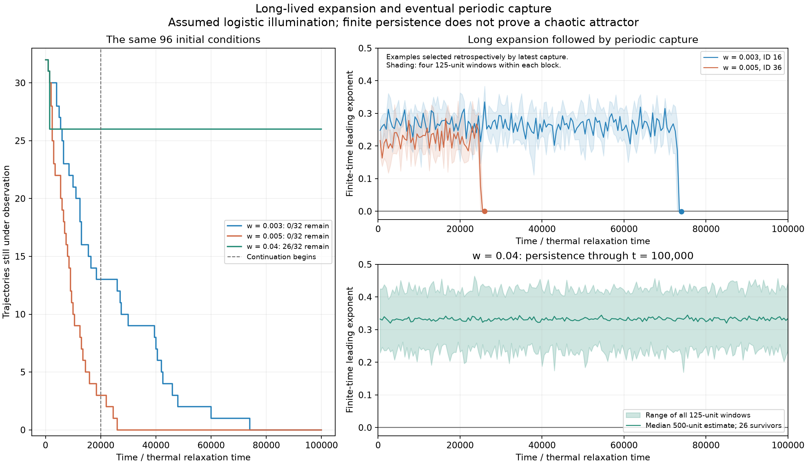
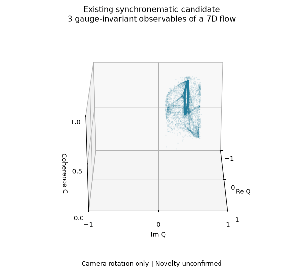

# What this search found

Research snapshot, 30 October 2026. **We have several independently checked numerical chaos candidates, but no established discovery of a previously unpublished attractor or a new topological attractor class.** That distinction is the central result of this investigation.

## The most informative observations

**Coupled optical material operators are the strongest current case study of persistence versus transient chaos.** Each operator combines a mechanical displacement, velocity and thermal response. They control one another's illumination. We implemented a continuous-heat interpretation of the published switching equations, then separately examined an explicitly assumed smooth logistic illumination profile. The smooth profile is not a measured property of the source experiment.

In a fixed cohort of 32 initial conditions per optical width, all starts at widths 0.003 and 0.005 eventually reach independently checked periodic cycles. The last capture first qualifies at time 73,500. Before capture, that trajectory had 583 consecutive positive-exponent windows spanning 72,875 time units. At width 0.04, 26 starts instead remain irregular through time 100,000; every one of their 800 recorded windows has a positive estimate. Six other starts at that width approach a coexisting cycle early. These counts describe this cohort, not basin probabilities or a proof of asymptotic attraction. [Full lifetime experiment](optical-lifetime-extension.md).

The capture cycles at all three widths lie on the same continued periodic branch. It loses and regains stability between them. A separately checked unstable doubled branch approaches the first stability crossing, supporting a local subcritical period-doubling picture. This describes part of the model's organization; it does not establish the global route to chaos or identify the set responsible for long transients. [Periodic-orbit study](optical-cycle-continuation.md).

Following the branch through a [numerically resolved fold](optical-cycle-arclength.md) finds a second, unstable periodic orbit at the same broad width 0.04. Stable and saddle cycles meet at width 0.0404788044. Independent Radau calculations confirm both cycles and the unit-multiplier crossing. This supplies a concrete target for basin-boundary work, without yet identifying that boundary or a chaotic crisis.

The [first departure test](optical-saddle-departure.md) takes four small perturbations near that saddle: two signs at two amplitudes. One sign reaches the known cycle; the other retains positive finite-time expansion and irregular returns through 500 units. Two independent long Radau runs confirm the first amplitude's cycle-proximity outcomes, while one smaller-amplitude run is incomplete and another unstarted. This supports a specific boundary hypothesis. The four new trajectories are distinct from the earlier 100,000-unit cohort, and the test is not a global basin computation.

**Four coupled synchronematic colloid oscillators remain a promising collective-chaos candidate.** The published phase-and-orientation approximation has seven effective angular states after removing its common phase. A long independent CPU spectrum, GPU step checks, different initial states and coefficient variants retain positive leading exponents. We found a sign discrepancy between the printed paper and author code; both variants were tested and remain separate in the archive. The simpler two-oscillator case admits a first-integral restriction. Single-particle Quincke chaos and chaos in other four-oscillator networks are already known, so a priority claim would have to concern this precise collective model. [Model and evidence](synchronematic-research.md), [symmetry and priority](synchronematic-priority-audit.md).

This rotating picture is a projection of a seven-dimensional flow. Its physical observables respect the particle symmetries. The appearance does not demonstrate a new three-dimensional topology. [Geometry comparison](attractor-geometry.md).

**Two other candidates have especially important scope limits.** The three-state LCE slider retains event-resolved chaos candidates at stiffness and damping outside the source's numerical range; older relay chaos is close prior art. The five-state two-strain model retains long numerical candidates, but the source already discusses possible aperiodicity, and extremely small prevalence limits a finite-population interpretation. [Slider report](lce-slider-research.md), [two-strain report](two-strain-research.md).

## Useful negative and mathematical results

| Outcome | What was actually established | Scope |
| --- | --- | --- |
| Quantum memristive neuron | 36,864 trajectories and 58 selected rechecks did not confirm chaos | The tested model and parameter search; not a global exclusion. [Report](candidate-research.md) |
| Reciprocal physical meminductor under constant drive | An energy argument excludes recurrent chaos for the stated reciprocal model | The source's printed force/flux pair and optical-feedback closure need separate resolution. [Audit](meminductor-energy-audit.md) |
| Smooth optical pair with real mechanical poles | An exact coordinate change gives a cyclic order structure; a known theorem excludes compact equilibrium-free chaotic limit sets | Explicit smooth law and overdamped/critical mechanics; not the underdamped candidates or a global theorem about equilibrium-containing sets. [Derivation](coupled-operators-order-audit.md) |
| Long/stiff numerical false positives | Several preliminary signals approach stable cycles, including an independently checked stiff-gel endpoint | An unresolved integration remains unresolved; checking its endpoint does not complete its missing interval. [Gel case](core-shell-gel-stiff-followup.md), [candidate queue](candidate-queue.md) |
| Source-definition gates | The printed microfluidic periodic control was not recovered; strict motor-contact rules have a continuation ambiguity | No coefficients were silently fitted and no contact regularization was substituted. [Microfluidics](microfluidic-research.md), [rotors](dcr-research.md) |

Negative searches, failed source controls and mathematical exclusions are retained because they explain why a promising-looking signal was rejected or left open.

## What is known, observed and still hypothetical?

**Known literature:** chaos in Quincke rotation, relay feedback, coupled nonlinear oscillators and multi-strain epidemic models predates this work. The monotone-feedback theorem used above is an existing result. Renaming an equivalent response law or rotating a projection does not establish novelty.

**Our reproducible observations:** the specified model implementations, positive finite-time spectra with independent numerical checks, the optical capture lifetimes and periodic branches, source discrepancies, structural calculations and negative search archives. Each report records its exact equation interpretation and numerical settings.

**Open hypotheses:** whether the broad optical regime is an asymptotically attracting chaotic set; which nonattracting invariant structures organize its long transients; whether any precise collective or optical regime lacks an earlier equivalent analysis; and whether its dynamical organization differs from known attractor classes. A bounded literature search cannot settle absence of prior publication.

The next useful work would target these questions with continuation of relevant invariant solutions, basin-boundary analysis, stronger numerical or computer-assisted validation, source-model clarification and a focused equation-level priority review. Another striking image or larger grid alone would not resolve them.

## Selected references

1. Leyva, S. G., Zhang, Z., Olvera de la Cruz, M., and Bishop, K. J. M. (2026). Self-oscillating synchronematic colloids. *Nature Communications* **17**, 1841. [doi:10.1038/s41467-026-68552-8](https://doi.org/10.1038/s41467-026-68552-8).
2. Guo, H., et al. (2025). Light-mediated communication in responsive materials ranging from individual self-oscillators to feedback-driven network. *Nature Communications* **16**, 11315. [doi:10.1038/s41467-025-66395-3](https://doi.org/10.1038/s41467-025-66395-3).
3. Ge, D., Hong, Q., Liu, X., and Liang, H. (2024). Self-Oscillation of Liquid Crystal Elastomer Fiber-Slide System Driven by Self-Flickering Light Source. *Polymers* **16**, 3298. [doi:10.3390/polym16233298](https://doi.org/10.3390/polym16233298).
4. Potter, F., Zagoskin, A., Savel'ev, S., and Balanov, A. G. (2024). Hysteresis and self-oscillations in an artificial memristive quantum neuron. *Physical Review A* **110**, 042604. [doi:10.1103/PhysRevA.110.042604](https://doi.org/10.1103/PhysRevA.110.042604).
5. Weiss, E., and Margaliot, M. (2021). A Generalization of Linear Positive Systems with Applications to Nonlinear Systems: Invariant Sets and the Poincare–Bendixson Property. *Automatica* **123**, 109358. [doi:10.1016/j.automatica.2020.109358](https://doi.org/10.1016/j.automatica.2020.109358).
6. Letellier, C., and Aguirre, L. A. (2012). Required criteria for recognizing new types of chaos: Application to the “cord” attractor. *Physical Review E* **85**, 036204. [doi:10.1103/PhysRevE.85.036204](https://doi.org/10.1103/PhysRevE.85.036204). Its publisher abstract informed the scope; a full topology comparison remains open.

The linked model reports provide complete source trails, access limitations and precise prior-art comparisons. Source papers retain their own licenses.
