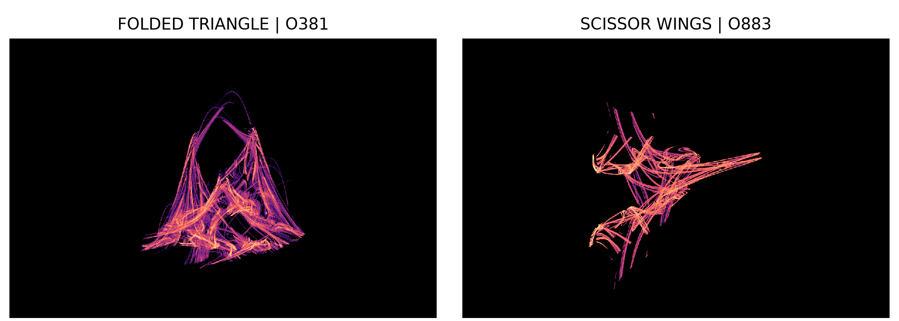

# Tolerance-scale geometry and numerical hyperchaos in an adaptive Runge-Kutta solver

**[Research manuscript (Markdown)](manuscript.md)** · [Figures](figures) · [Detailed experiment report](../rk23-oscillator.md) · [Priority audit](../rk23-priority.md)

The research manuscript studies intricate accepted-step dynamics in the **existing standard RK23 solver** applied to a stable linear spring. The physical solution decays. The displayed geometry belongs to the numerical algorithm's position, velocity and proposed step.



<!-- drawing-date -->
*First recorded portrait: **2026-11-01**.*
<!-- /drawing-date -->

The [rotating view](../assets/rk23-oscillator-rotation.gif) changes only the camera. All plotted points are actual recorded states, with equal spatial units. The paper also shows how 32,768 initial states per case approach the sampled clouds.

## Claims and limits

| Result | Status |
| --- | --- |
| Explicit bound on accepted solution values | Proved under a sufficient relative-tolerance condition, independent of the proposal policy |
| Sharper bound for O526 | Exact-rational Sturm and gain certificate, with the induction written out |
| Folded-triangle and scissor-wing regimes | Five-million-step evidence, independent 70/90-digit checks and actual SciPy execution |
| Two expanding directions in O526 | Positive finite estimates in every declared independent window |
| O37 and O689 second directions | Positive long-window estimates, but mixed shorter independent windows; not promoted under the stricter criterion |
| Full-state trapping region, asymptotic chaotic attraction or historical uniqueness | Unresolved |

Adaptive-controller instability, tolerance-scale oscillation and error-norm dependence are established prior work. The manuscript credits that literature and records full-text access gaps. Its proposed contribution is a concrete, reproducible description of selected regimes and accompanying solution bounds; it does not establish a new attractor class. No author identities or affiliations were inferred.

## Reproduction

The figures use archived accepted states, density histograms and numerical summaries. Audit the scientific packet and independently recompute the exact polynomial checks with SymPy:

```bash
python research/verify_rk23_controller.py --root results/rk23-controller --assets docs/assets
python research/audit_rk23_structure.py --out output/rk23-structure-audit.json
```

The complete text is edited directly in [manuscript.md](manuscript.md). Run `python tools/check_manuscripts.py` after editing. The original build, review and manifest records describe the historical publication edition; see [editing and archive instructions](../manuscript-editing.md). Frozen numerical verifiers may require the explicitly restored files described there.

This is a research draft for author and scientific review, not an externally peer-reviewed publication.
