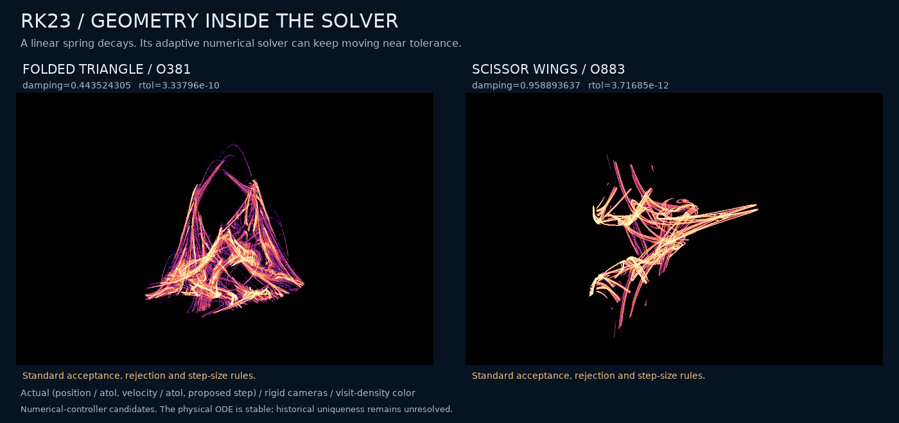
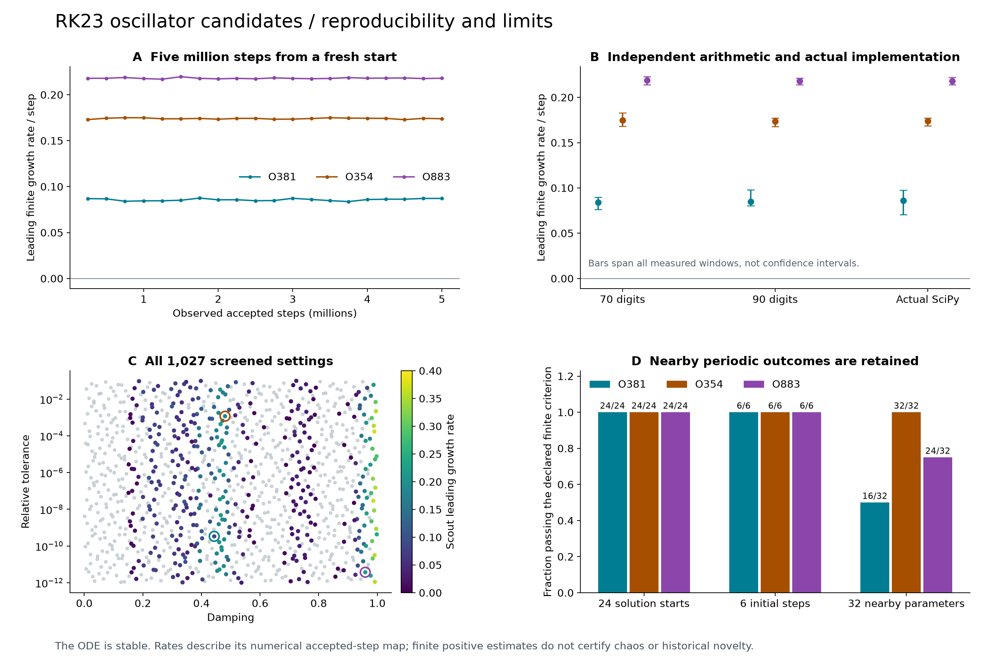
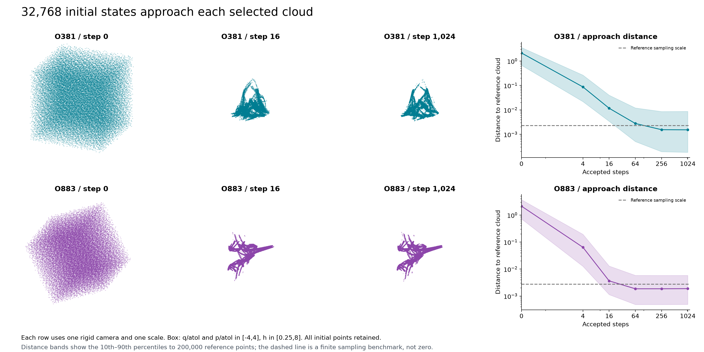

# Folded triangles and scissor wings inside an adaptive solver

A stable linear spring gives two striking **numerical-controller candidates**
when the standard RK23 algorithm is studied as a dynamical system in its own
right. The folded triangle and scissor wings below are actual accepted-step
states, not deformed versions of another attractor. **Historical uniqueness and
asymptotic chaotic attraction remain unproved.**



<!-- drawing-date -->
*First recorded portrait: **2026-11-01**.*
<!-- /drawing-date -->

[Research manuscript (PDF)](../papers/rk23-controller/manuscript.pdf) ·
[Proof, evidence and reproduction](../papers/rk23-controller/README.md) ·
[Large portrait](assets/rk23-oscillator-geometry.png) ·
[Independent evidence](assets/rk23-oscillator-evidence.png) ·
[Initial volumes approaching](assets/rk23-oscillator-approach.png) ·
[Exact structure and boundedness](rk23-controller-structure.md) ·
[Prior-art and equivalence audit](rk23-priority.md)

## Where the geometry lives

The physical equation is only

\[
\dot q=p,\qquad \dot p=-q-2\zeta p,\qquad 0<\zeta<1.
\]

Every exact solution decays to zero. The three plotted coordinates are
`(q/atol, p/atol, proposed next step)`. Near the requested absolute tolerance,
the adaptive solver can keep taking steps around its stability boundary. That
numerical feedback, including rejected trials, produces the displayed clouds.
The result is not physical chaos in a linear oscillator.

We use the existing Bogacki–Shampine 3(2) pair with SciPy's standard weighted RMS
error, componentwise scales, safety factor `0.9`, factor limits `0.2` and `10`,
and the post-rejection growth restriction. The source and implementation match
are documented in the [structure note](rk23-controller-structure.md).

Each portrait contains eight million consecutive actual states after a further
100,000-step warm-up. The animation uses the last consecutive million states.
The cameras are proper orthogonal rotations with equal coordinate units,
constant envelopes and zero clipped points. Color indicates visit density;
there is no geometric warping, smoothing, interpolation between iterates or
curve invented to join them. The visual names are descriptions, not dynamical
classifications.

## Selected cases and independent checks

| Case | Damping `zeta` | Relative tolerance | Five-million-step mean spectrum |
| --- | ---: | ---: | --- |
| O381, folded triangle | 0.4435243054088205 | 3.3379616873243337e-10 | `(0.085762, -0.109390, -0.182760)` |
| O354, folded wings | 0.4803776211887598 | 0.0011646941675974745 | `(0.174079, -0.121821, -0.302704)` |
| O883, scissor wings | 0.9588936367407441 | 3.71684809666591e-12 | `(0.217953, -0.272192, -0.407174)` |

Rates are per accepted iteration of the numerical map. These are finite
estimates, not exact asymptotic Lyapunov exponents. All 20 windows of each
five-million-step run have a positive leading estimate. The smallest leading
window values are `0.083727`, `0.172882` and `0.216943`, respectively.



The verification has several independent components:

- **Analytic derivative and implementation.** The real-coordinate Jacobian was
  compared with 256 central finite differences (maximum absolute difference
  `1.68e-9`), and 256 one-step states were compared with the unmodified installed
  SciPy routine (maximum difference `6.00e-15`). Rejections were included.
- **Long fresh starts.** Three full QR directions, with two-pass modified
  Gram–Schmidt, were followed from normalized `(q,p,h)=(1,0,0.1)` for 100,000
  warm-up and five million measured steps. The sum of the three window rates
  agrees with an independently accumulated log determinant to below `2e-14`.
- **Independent arithmetic.** A separate four-stage implementation, importing
  neither the production recurrence nor its Jacobian, used 70 and 90 decimal
  digits, finite separations, 100,000 warm-up, 5,000 alignment and 100,000
  measured steps. Every leading window is positive for all three cases. The
  exact rational method coefficients are used; this is not a repetition of
  rounded binary64 stage coefficients.
- **Actual library.** Unmodified SciPy 1.18.1 ran from physical `(q,p)=(1,0)`
  with `atol=1e-6` for 400,000 accepted steps. Its floating-point clock is
  retained. Analytic tangents evaluated on the actual states give positive
  leading rates in all 29 measured 10,000-step windows. Maximum one-step
  transcription residuals are below `2.55e-10` in normalized solution/log-step
  coordinates. These tangents are mathematical-map derivatives, not a
  derivative of floating-point rounding.

The first O381 library trajectory was completed before an analysis-driver
compilation error. It was reused byte for byte after fixing that driver. A
subsequent input-path mistake occurred before any solver run. Both failures,
their sources and the recovery are retained. The completed O381 trajectory's
function-evaluation count was not recorded before the first failure and is
reported as unknown.

## Approach and nearby periodic regimes



For each portrait, 32,768 scrambled Sobol initial states fill the declared box
`q/atol,p/atol in [-4,4]`, `h in [0.25,8]`. All 65,536 trajectories complete
1,024 steps. The median distance to a separate 200,000-point reference cloud
decreases from approximately `2.14` to `0.00153` for O381 and `0.00189` for
O883. The reference's own finite sampling scale is shown. These are distances
to data, not certified distances to an invariant set or a basin-measure proof.

Each selected case also passes all 24 declared nonzero solution starts (four
radii, six phases) and all six alternative initial step proposals. Nearby
parameters give a more qualified result:

| Case | Positive leading rate in all ten windows | Periodic neighbors |
| --- | ---: | ---: |
| O381 | 16 / 32 | 16 / 32 |
| O354 | 32 / 32 | 0 / 32 |
| O883 | 24 / 32 | 8 / 32 |

The neighbors independently vary both parameters by up to `exp(±0.02)`.
Detected periods range from 3 to 56. They are retained rather than counted as
chaotic outcomes. The exact-zero control has zero physical solution and an
ever-growing ideal step proposal; all three zero controls leave the declared
step-size box. Thus there is no compact global attractor on the unrestricted
full state domain.

## Search accounting and other directions

The main screen contains 1,024 scrambled Sobol parameter pairs plus three
controls, with 20,000 warm-up and 50,000 measured steps. It flags 396 settings
whose leading estimates exceed `0.001` in every one of ten windows. Every flag
receives a fresh 100,000-step warm-up and one million measured steps. **393
retain the declared finite chaos criterion; three settle into periods 14, 19
and 172.** Twenty-four geometrically diverse flagged settings are rendered
before the three portrait candidates are selected.

Three further settings have two positive finite growth estimates throughout
the million-step follow-up. Their separate longer, high-precision and
actual-library checks are retained in the `hyper-*` directories. Their visual
forms are not substituted for the more distinctive portrait candidates.

| Case | Five-million mean second rate | Smallest second window, 70 digits | 90 digits | Actual SciPy |
| --- | ---: | ---: | ---: | ---: |
| O37 | 0.003838 | -0.000440 | 0.000539 | -0.000027 |
| O526 | 0.004799 | 0.003191 | 0.001849 | 0.000466 |
| O689 | 0.002281 | 0.000926 | -0.004088 | -0.004142 |

All three retain two positive estimates in every 250,000-step window of their
five-million-step checks. **O526 is the stronger independently supported
two-direction candidate:** both 70/90-digit runs and every actual-library
window also have positive second estimates. O37 and O689 have mixed short-window
results, despite positive overall second means. These failures of the stricter
criterion are explicit, not averaged away.

O526 uses `(zeta,rtol)=(0.1717106344755739,0.03929059404001495)` and has mean
spectrum `(0.024016,0.004799,-0.034250)`. The [structure audit](rk23-controller-structure.md#a-sharper-certificate-for-o526)
provides a separate exact-rational bounded-solution certificate for this case;
the conservative general tolerance threshold alone does not cover it.

Two preliminary directions are also retained:

- A scalar Heun/Euler PI experiment screens 8,198 settings. No raw unguarded
  case passes the declared screen; 1,089 cases with a **custom declared guard**
  do. Of those, 1,079 retain the longer finite criterion, four become periodic
  and six do not finish within the declared conditions. This is not a complete
  SUNDIALS solver replay. Its log-coordinate pictures are not promoted as
  undistorted actual-state geometry.
- A complex-scalar RK23 screen tests 1,027 settings and follows all 35 flags
  for one million steps; all 35 retain positive quotient expansion. Three
  actual SciPy checks and a regular control agree. The exact phase symmetry
  makes the three-dimensional clouds rotations of an amplitude/step quotient,
  so they are not treated as separate new mechanisms.

## A controlled change of error norm

The change `z=q-i*(p+zeta*q)/sqrt(1-zeta^2)` turns the physical equation into
`z'=(-zeta+i*sqrt(1-zeta^2))*z`. Using a complex absolute-value error scale in
those coordinates is a deliberate change of numerical error rule, not simply
a new view of the same accepted-step map. Starting from the corresponding
physical `(q,p)=(1,0)`, a million-step comparison gives:

| Original-coordinate case | Detected period of the complex amplitude/step quotient | Mean quotient spectrum |
| --- | ---: | --- |
| O381 | 3 | `(-0.016995,-0.116763)` |
| O354 | 23 | `(-0.017457,-0.068499)` |
| O883 | 1 | `(-0.212297,-0.212297)` |
| O37 | 3 | `(-0.044500,-0.052529)` |
| O526 | 30 | `(-0.044378,-0.087734)` |
| O689 | 29 | `(-0.012290,-0.013337)` |

The complex phase supplies a neutral direction. A periodic amplitude/step
quotient does not by itself imply a closed full complex-state trajectory.
This control locates the observed difference in the numerical feedback rule;
it does not establish a new coordinate-dependence principle or prove
inequivalence of invariant sets. Hall and Higham's earlier norm analysis is
explicitly credited in the [priority audit](rk23-priority.md).

## What can be claimed

The [exact bound](rk23-controller-structure.md) proves bounded solution
coordinates for all accepted-step sequences when
`rtol < (1-zeta)/(128*sqrt(2))`. All three main candidates satisfy this
condition. It does not bound the step coordinate or certify a chaotic
attracting invariant set.

The evidence supports reproducible, bounded sampled clouds with sustained
finite expansion in a standard numerical algorithm. Persistent tolerance-scale
oscillations, adaptive-controller instability, polynomial-map analysis and
the role of error norms are prior work. The [priority review](rk23-priority.md)
identifies those overlaps and important unread sources. Neither distinctive
appearance nor a different error norm proves historical or topological
uniqueness.

## Reproduction and retained evidence

The frozen packet is [results/rk23-controller](../results/rk23-controller).
It includes all screened outcomes and follow-ups, declared starts, finite
window rates, actual-library states, independent precision records, source
snapshots, figures, hashes and the failed drivers. Large raw portrait inputs
and non-promoted preliminary gallery clouds remain local with hashes and
complete regeneration information. The large PI follow-up is split losslessly
into row blocks.

Example commands, from the repository root:

```text
python research/search_rk23_oscillator.py --out NEW-SCOUT-DIRECTORY
python research/follow_rk23_oscillator.py --source NEW-SCOUT-DIRECTORY/screen.npz --out NEW-FOLLOW-DIRECTORY
python research/check_rk23_oscillator_precision.py --cases results/rk23-controller/oscillator/precision/input.json --out NEW-PRECISION-DIRECTORY
python research/verify_rk23_controller.py --root results/rk23-controller --assets docs/assets
```

The search programs require NumPy, SciPy and Numba; rendering adds Matplotlib
and Pillow; independent precision uses mpmath; the symbolic audit uses SymPy.
The stored protocols specify seeds, counts, versions and initial states.
