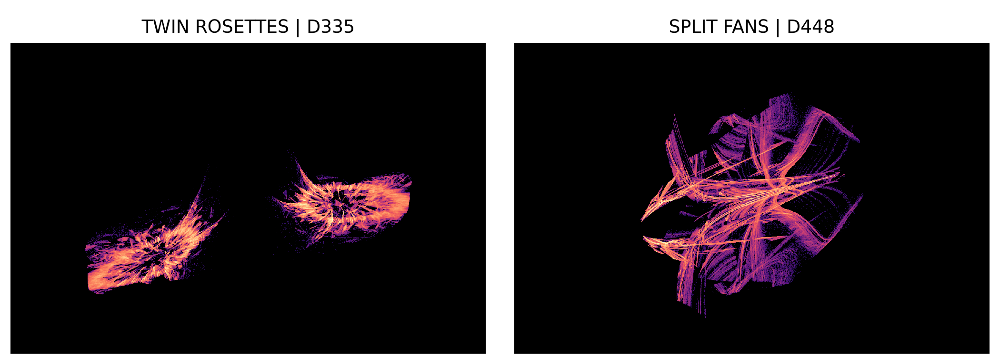
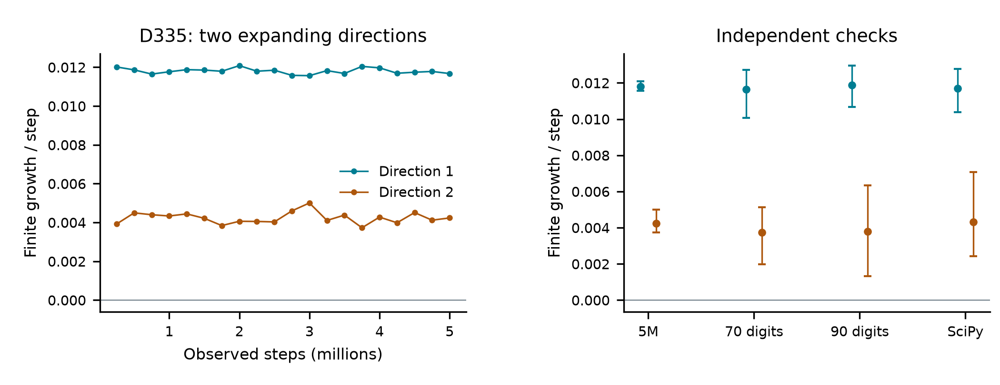
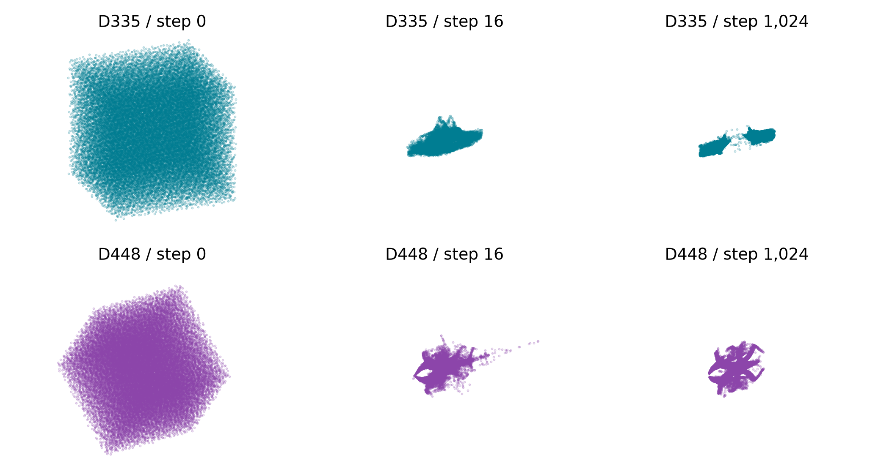
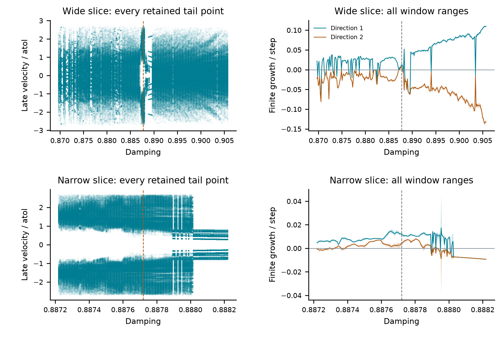

# Twin rosettes and two expanding directions in an adaptive Dormand–Prince solver

A reproducible geometry study of an existing numerical algorithm

Chaos Attractor Lab | Companion research manuscript | 1 November 2026

## Abstract

A stable linear spring supplies an unexpectedly rich numerical state when its adaptive step proposal is included. We examine the existing Dormand–Prince 5(4) pair with the standard SciPy RK45 acceptance and rejection policy. One selected regime forms two interchanged rosettes and retains two positive finite growth estimates across five million steps, independent 70- and 90-digit stage calculations, and unmodified-library execution. A second regime forms folded fans with one positive estimate. We retain every declared screen outcome, test initial-state and parameter dependence, and prove sufficient bounds for accepted solution coordinates using exact rational polynomial certificates. A deliberate error-norm change alters the observed dynamics. Adaptive controller instability, numerical oscillation and norm dependence are established prior work. The evidence supports specific numerical candidates; asymptotic chaotic attraction and historical uniqueness remain unresolved.



<!-- drawing-date -->
*First recorded portrait: **2026-11-01**.*
<!-- /drawing-date -->

**Figure 1.** D335 twin rosettes and D448 split fans. Each portrait contains eight million actual accepted-step states (position/atol, velocity/atol, proposed step), viewed with a rigid camera and equal units. Color records visit density. The repository includes a rotation of the fixed data. Names describe appearance only; the physical oscillator has no chaotic attractor.

## 1. Existing solver, explicit mathematical map

Let 0 < ζ < 1. The equation and its eigenvalues are

```math
\dot q=p,\quad \dot p=-q-2\zeta p,\qquad \lambda=-\zeta+i\sqrt{1-\zeta^2}.
```

Writing y=(q,p)<sup>T</sup> and y'=Ay, every exact solution tends to zero. The existing Dormand–Prince 5(4) pair [1,2] advances the fifth-order value and estimates error with its embedded pair. Its signed polynomials are

```math
R(z)=1+z+\frac{z^2}{2}+\frac{z^3}{6}+\frac{z^4}{24}+\frac{z^5}{120}+\frac{z^6}{600},
```

```math
E(z)=\frac{z^5(5z^2-39z+97)}{120000},\qquad v=R(hA)y,\quad e=E(hA)y.
```

The audit derives these polynomials from the exact rational seven-stage tableau. With τ=atol > 0 and ρ=rtol ≥ 0, the existing original-axis scale and RMS error are

```math
s_i=\tau+\rho\max(|y_i|,|v_i|),\qquad w=\left[\frac{1}{2}\sum_{i=1}^2(e_i/s_i)^2\right]^{1/2}.
```

Acceptance requires w < 1. The next proposed step is h min(10,0.9 w<sup>-1/5</sup>), additionally capped at h after any rejected trial. A rejected trial replaces h by h max(0.2,0.9 w<sup>-1/5</sup>) and retries the same y. Zero error selects the maximum growth factor. These are existing SciPy rules, not a proposed integrator.

Absolute tolerance scales out with u=y/τ. The transcription computes (u<sub>1</sub>,u<sub>2</sub>,log h); portraits use (u<sub>1</sub>,u<sub>2</sub>,h). It omits the finite endpoint, floating-point clock subtraction and minimum-clock-step test. Actual SciPy runs retain those operations. Thus exact arithmetic, a binary64 transcription and library execution remain distinct experiments.

| Case | Damping | Relative tolerance |
| --- | --- | --- |
| D335 | 0.8877198030073 | 1.467400950323e-10 |
| D448 | 0.9463349944558 | 6.210996908104e-06 |
| D1890 | 0.03178502897918 | 0.08298635177977 |
| D2006 | 0.4370074770469 | 0.03663624012811 |

The table displays the four independently checked cases. Exact binary64 values and all six selected long-run cases are retained in the packet. D335 and D448 were selected for geometry; D1890 and D2006 provide additional independent checks. A different parameter or a different solver pair alone does not establish a new attractor class.

## 2. Two expanding directions and independent checks



**Figure 2.** D335 retains two positive finite growth estimates. Left: twenty 250,000-step windows after 100,000 warm-up steps. Right: means and full measurement-window ranges for the long run, independent 70/90-digit stage implementations and actual SciPy states. Ranges are not confidence intervals.

| Case | Mean full spectrum | Minimum leading window |
| --- | --- | --- |
| D335 | 0.011805 / 0.004238 / -0.081455 | 0.011567 |
| D448 | 0.068721 / -0.053777 / -0.453422 | 0.068036 |
| D1890 | 0.156809 / -0.003690 / -2.195911 | 0.156161 |
| D2006 | 0.175838 / -0.078293 / -0.673106 | 0.175085 |

| Minimum second rate | 5M | 70 digits | 90 digits | SciPy |
| --- | --- | --- | --- | --- |
| D335 | 0.003729 | 0.001969 | 0.001328 | 0.002438 |

Long runs start afresh at normalized (q,p,h)=(1,0,0.1). A full three-column QR calculation uses the analytic branch Jacobian in (q,p,log h). Its summed rates agree with independently accumulated log determinants within 9.1 x 10<sup>-14</sup>. No selected tail closes in the declared lag-1–512 test at tolerance 10<sup>-9</sup>; that is not proof of aperiodicity.

Independent precision calculations evaluate all seven rational stages and import neither the production map nor its Jacobian. Two finite-separation directions in actual (q,p,h) are orthogonalized, with separations 10<sup>-30</sup> and 10<sup>-40</sup>. Each run uses 100,000 warm-up, 5,000 alignment and 100,000 measured steps in ten windows. Parameters and controller constants are exact lifts of the declared binary64 values.

Unmodified SciPy 1.18.1 takes 400,000 steps from physical (q,p)=(1,0), atol=10<sup>-6</sup>, first h=0.1. After 100,000 warm-up and 10,000 tangent alignment, all 29 leading windows are positive for the four cases; all D335 second windows are positive too. One-step residuals stay below 9.4 x 10<sup>-9</sup>. Tangents describe the mathematical map on library states, not floating-point rounding.

## 3. One orbit, initial volumes and nearby outcomes



**Figure 3.** Every one of 32,768 initial states per row is retained. The box is q/atol,p/atol in [-4,4], h in [0.25,8]. Each row uses one rigid camera and one scale at steps 0, 16 and 1,024. This is finite approach evidence, not a certified basin.

All 65,536 trajectories complete 1,024 steps. Median distance to a separate 200,000-point cloud falls from 2.65124 to 0.00243 for D335 and from 2.42906 to 0.00131 for D448. Median distances between reference half-clouds are 0.00326 and 0.00188. These finite sampling scales prevent interpreting a small distance as exact convergence to a known invariant set.

| Case | 24 solution starts | 6 initial steps | 32 neighbors | Two-positive neighbors |
| --- | --- | --- | --- | --- |
| D335 | 24 / 24 | 6 / 6 | 26 / 32 | 0 / 32 |
| D448 | 24 / 24 | 6 / 6 | 29 / 32 | 0 / 32 |
| D2006 | 24 / 24 | 6 / 6 | 32 / 32 | 0 / 32 |
| D1890 | 24 / 24 | 6 / 6 | 32 / 32 | 0 / 32 |

Solution starts use four radii (0.01,1,100,10<sup>6</sup>) and six phases. Initial steps are 0.001,0.01,1,3,10,100. Neighbors vary both parameters within exp(± 0.02); each run has 100,000 warm-up and 300,000 measured steps. Every D335 solution/step start retains two positive rates, but no sampled parameter neighbor does. Its unflagged neighbors are six periodic cases; D448 has three. The wide-neighborhood claim is therefore limited.

Reflection (q,p,h) to (-q,-p,h) is an exact map symmetry. All 7,999,999 consecutive pairs in the dense D335 portrait change the sign of p, with minimum |p| about 0.17918. The two rosettes are exchanged by one sampled orbit, not two separate attractors. A second iterate or a reflected view cannot be counted as an independent discovery.

## 4. A sufficient bound for accepted solution values

Error-controlled stability and boundedness have an established literature [8]. The following auxiliary estimate is an explicit sufficient bound for this pair and component scale, independent of the step-proposal policy. It concerns accepted solution coordinates, not the full controller state. Let

```math
P_{11}=P_{22}=1,\quad P_{12}=P_{21}=\zeta,\qquad r=\|y\|_P,
```

```math
a=\sqrt{2(1+\zeta)},\qquad b=\sqrt{\frac{2(1+\zeta)}{1-\zeta}}.
```

**Theorem 1.** Suppose |R(h λ)| ≤ 1 for 0 < h ≤ H, and |R(h λ)/E(h λ)| ≤ K for all h ≥ H. If Kb ρ < 1, every sequence of accepted solution values satisfies

```math
\|y_n\|_P\leq\max\left\{\|y_0\|_P,\frac{Ka\tau}{1-Kb\rho}\right\}.
```

**Proof.** Direct multiplication gives A<sup>T</sup>P+PA=-2 ζ P. The matrix A+ζ I is skew-adjoint in this metric and its square is -(1-ζ<sup>2</sup>)I. Every real-coefficient polynomial f therefore obeys

```math
f(hA)^TPf(hA)=|f(h\lambda)|^2P.
```

Consequently r<sub>new</sub>=|R|r and ||e||<sub>P</sub>=|E|r. Acceptance gives ||e||<sub>2</sub> ≤ sqrt(2) max s<sub>i</sub>. Comparing Euclidean and P-norms with the eigenvalues 1-ζ and 1+ζ gives

```math
|E|r\leq a\tau+b\rho\max(r,r_{\rm new}).
```

For h ≤ H the radius cannot increase. For a larger step that does increase it, multiplication by |R/E| ≤ K yields r<sub>new</sub> ≤ Ka τ+Kb ρ r<sub>new</sub>. Rearrangement gives the claimed constant. Every accepted step either decreases the radius or lands below that constant; induction completes the proof.

### A broad polynomial certificate

The error polynomial has no nonzero zero on this oscillator ray. In fact,

```math
|5(h\lambda)^2-39h\lambda+97|^2=25h^4+390\zeta h^3
```

```math
\qquad +(551+1940\zeta^2)h^2+7566\zeta h+9409>0.
```

Thus |E| ≥ h<sup>7</sup>/24000. On 0 ≤ h ≤ 1/2 and 0 ≤ ζ ≤ 1, the degree-(11,6) polynomial (1-|R|<sup>2</sup>)/h has a nonnegative tensor Bernstein representation. All 84 rational coefficients and an exact reconstruction identity are archived. This proves contraction on the whole rectangle, not merely at sampled points.

## 5. Exact selected-case certificates and their limits

For H=1/2, the coefficient triangle bound gives

```math
\frac{|R(h\lambda)|}{|E(h\lambda)|}\leq K_H=24000\sum_{k=0}^{6}a_kH^{k-7}=5\,064\,880,\qquad h\geq H,
```

where a<sub>k</sub> are the coefficients of R. This broad constant is conservative. The selected cases admit substantially sharper exact certificates, treating their binary64 parameters as rational numbers.

### Finite algebra certifying unbounded step intervals

First, an exact Sturm count establishes zero roots of Q(h)=(|R(h λ)|<sup>2</sup>-1)/h on [0,H], and Q(0)<0. Thus the entire small-step interval contracts the P-radius. Next choose K such that every coefficient of the following polynomial in t is nonnegative and its constant is positive:

```math
K^2|E((H+t)\lambda)|^2-|R((H+t)\lambda)|^2.
```

This proves the ratio bound for every t ≥ 0, without a finite-grid extrapolation. Finally, (Kb ρ)<sup>2</sup><1 is checked as an exact rational inequality. The audit records all rational polynomial coefficients, endpoint values, chosen H and K, and gain inequalities.

| Case | H | K | Squared gain | Bound constant |
| --- | --- | --- | --- | --- |
| D1890 | 11/5 | 32 | 15.0301 | Not certified |
| D335 | 33/10 | 2 | 2.89616e-18 | 3.886098 |
| D448 | 33/10 | 2 | 1.11928e-08 | 3.946388 |
| D2006 | 33/10 | 4 | 0.10963 | 10.137847 |

The last column is C=Ka/(1-Kb ρ); the solution bound is max(||y<sub>0</sub>||<sub>P</sub>,C τ). D1890 fails this sufficient condition. Its finite numerical trajectory remains bounded in the recorded runs, but no accepted-solution certificate is claimed for it. Failure of a sufficient inequality is not proof of divergence.

### No compact global attractor for the unrestricted map

At the exact solution q=p=0, estimated error is zero and the proposed step grows tenfold at every iteration. There is no compact global attractor over the complete unrestricted state domain. All four zero controls reach the declared step-size cutoff, as expected. Imposing a finite maximum step would change the map.

The solution bounds do not give a uniform lower solution radius, a full-state trapping region, a physical invariant measure, or a proof of strange attraction. The observed finite step-size ranges and positive growth estimates remain numerical statements. We do not infer topological inequivalence from them.

## 6. Error norm and equivalent descriptions

A linear coordinate change diagonalizes the oscillator:

```math
z=q-i\frac{p+\zeta q}{\sqrt{1-\zeta^2}},\qquad \dot z=(-\zeta+i\sqrt{1-\zeta^2})z.
```

Transforming the complete error rule would give a conjugate algorithm. Instead, as an explicit control, we replace it with complex error modulus divided by 1+ρ max(|z<sub>old</sub>|,|z<sub>new</sub>|), keeping the pair and step factors. The initial amplitude is 1/sqrt(1-ζ<sup>2</sup>), corresponding to (q,p)=(1,0). This is deliberately a different numerical algorithm for a conjugate ODE.

| Case | Quotient period | Mean quotient spectrum |
| --- | --- | --- |
| D335 | 0 | -0.000485 / -0.333884 |
| D448 | 0 | 0.003729 / -0.196592 |
| D1890 | 1 | -0.008482 / -3.800711 |
| D508 | 1 | -0.005445 / -0.005443 |
| D2006 | 0 | 0.001161 / -0.574569 |
| D726 | 111 | -0.037911 / -0.158075 |

These fresh runs measure one million steps in twenty windows after 100,000 warm-up. A zero period entry means no period was found in the lag-1–512 test. D335 has negative finite quotient estimates but no detected period; it is not declared a proven regular attractor. D448 retains weak positive expansion. D2006 has a small positive mean but a minimum leading window below the original 0.001 flag threshold. The evidence does not support a blanket assertion that changing this norm eliminates all chaos.

The new rule has exact phase-rotation symmetry. Its amplitude and step form a two-dimensional quotient. For bounded nonzero amplitudes, lifting adds a neutral phase direction. A periodic quotient need not produce a closed full complex-state orbit. The dependence of adaptive dynamics on norms and nonnormal coordinates is established in [3,4,6], not a new principle here.

The actual D335 phase increment is close to a half-turn: its median angular distance from pi is 0.031778 radians across 300,000 late library steps. The polynomial/complex-state identity agrees within 3.0 x 10<sup>-14</sup>. Earlier work [7, Section 5.2] already connects this mechanism with irregular-looking oscillation; alternating rosettes are not claimed as a new mechanism.

### What cannot count as a separate discovery

Absolute-tolerance scaling, reflection, exchanging orbit bands and taking a return map are equivalent descriptions of the same underlying experiment. Rotating a camera or changing density colors changes its presentation. None creates a new invariant set. The published portraits retain actual coordinates and equal units; they contain no nonlinear visual deformation.

Likewise, an accepted-step map includes numerical memory and is not a three-dimensional physical flow. The two positive finite estimates of D335 are interesting evidence about that map. They are neither physical chaos of the spring nor a proof that the map is inequivalent to every known chaotic system.

## 7. Parameter slices through the rosette regime



**Figure 4.** Two declared damping slices at the D335 relative tolerance, each with 257 fresh starts. Left: all 2,048 retained late velocities per setting; no tail points are dropped. Right: means and full ranges of twenty finite windows for the first two directions. Dashed vertical lines mark the original setting. This is a finite numerical diagram, not a certified bifurcation classification.

| Slice | Settings | Leading positive | Two positive | Periodic |
| --- | --- | --- | --- | --- |
| wide | 257 | 211 | 4 | 41 |
| narrow | 257 | 194 | 125 | 63 |

The wide slice covers ζ<sub>0</sub> ± 0.018; the narrow slice covers ± 0.0005. Both grids and their 400,000-step observation protocol were fixed before execution. Each setting uses a fresh normalized (q,p,h)=(1,0,0.1), 100,000 warm-up and twenty measured windows. The exact base parameter is included in both slices as a duplicate control.

The leading criterion requires every first-rate window above 0.001 and no tested numerical period. Two-positive requires every second window above zero as well. Sampled intervals containing these flags are not certified open hyperchaotic regions. Periodic and weak outcomes are retained; the wide-neighbor test already shows why structural stability must not be inferred from one striking portrait.

## 8. Search, priority and reproducibility

| Stage | Settings | Completed | Retained leading criterion |
| --- | --- | --- | --- |
| Scout | 2051 | 2050 | 1061 |
| Every scout flag | 1061 | 1061 | 1051 |

The scout has 2,048 Sobol settings plus three controls, seed 2026110181, damping 0.001–0.999 and relative tolerance 10<sup>-12</sup>–10<sup>-1</sup>. It measures 50,000 steps after 20,000 warm-up. Every flag receives a fresh million-step follow-up with 100,000 warm-up. D802 exits the solution cutoff 10<sup>10</sup> during the scout warm-up; this is an observed cutoff exit, not a divergence theorem. Regular, weak and failed outcomes are preserved.

The packet retains six five-million-step checks, eight independent precision checks, four actual-library trajectories, 252 start/parameter controls, 65,536 volume trajectories, both damping slices and exact figure inputs. In addition to the original 24 gallery clouds, all 13 million-step cases with both leading directions above 0.001 in every window receive retained portraits. A pre-execution syntax error and a conservative symbolic draft are recorded. Duplicate blocks are compared with their aggregates before omission. Two large raw portraits stay local with hashes and regeneration information; exact histograms and animation tails are public.

### Prior work and the narrow unresolved question

Hall and Higham [3] analyze coupled solution/step recurrences and practical norm dependence. Higham and Hall [4] already study the Dormand–Prince family, equilibrium stability and complex-dominant linear examples; all nine pages were inspected. Higham, Humphries and Wain [5] discuss tolerance-scale oscillation near stable physical equilibria. Ranocha and Giesselmann [6] develop related step-control stability analysis. Those phenomena and that framework are not our discoveries.

The candidate contribution is a reproducible characterization of these specific geometries and finite two-direction regimes, with exact accepted-solution bounds. The bounded review did not locate an exact published match. That absence is not a priority certificate. Hall (1986), Wain's 1998 thesis, Söderlind (2002), broader numerical-dynamics books and equivalent reduced maps remain material coverage gaps. The online audit also credits older spurious-solution and cosymmetric numerical-chaos literature, distinguishing abstract-only from full-text inspection.

This companion study extends the repository's RK23 investigation using the higher-order existing pair; it does not count changing the pair or parameters as an independent mechanism discovery. Proving asymptotic attraction and comparing invariant-set structure across switching surfaces remain open. Historical uniqueness remains unresolved.

Reproduction scripts, exact coefficients, rotating figures, reading scopes and SHA-256 manifests: [github.com/Griboedow/chaos-attractor-lab](https://github.com/Griboedow/chaos-attractor-lab/blob/main/docs/rk45-oscillator.md). This is a research manuscript, not a claim of completed peer review.

## References

[1] J. R. Dormand and P. J. Prince. A family of embedded Runge–Kutta formulae. *Journal of Computational and Applied Mathematics* 6(1), 19–26 (1980). Method attribution and bibliographic details verified in the official SciPy reference list; the original article was not fully reviewed here.

[2] SciPy. RK45 documentation and installed scipy.integrate._ivp.rk implementation, version 1.18.1, inspected 1 November 2026. [Official method documentation](https://docs.scipy.org/doc/scipy/reference/generated/scipy.integrate.RK45.html). The inspected online manual identifies itself as version 1.18.0; installed source bytes are separately frozen.

[3] G. Hall and D. J. Higham. Analysis of stepsize selection schemes for Runge–Kutta codes. *IMA Journal of Numerical Analysis* 8, 305–310 (1988). [doi:10.1093/imanum/8.3.305](https://doi.org/10.1093/imanum/8.3.305). Coupled polynomial recurrence and Section 3 norm comparison inspected.

[4] D. J. Higham and G. Hall. Embedded Runge–Kutta formulae with stable equilibrium states. *Journal of Computational and Applied Mathematics* 29, 25–33 (1990). [Author-hosted primary paper](https://webhomes.maths.ed.ac.uk/~dhigham/Publications/P6.pdf). All nine scanned pages visually inspected.

[5] D. J. Higham, A. R. Humphries and R. J. Wain. Phase space error control for dynamical systems. *SIAM Journal on Scientific Computing* 21(6), 2275–2294 (2000). [doi:10.1137/S1064827597331400](https://doi.org/10.1137/S1064827597331400). Abstract, stable-equilibrium discussion and reference chain inspected.

[6] H. Ranocha and J. Giesselmann. Stability of step size control based on a posteriori error estimates (2024). [doi:10.1007/s44207-024-00001-0](https://doi.org/10.1007/s44207-024-00001-0); [arXiv:2307.12677v3](https://arxiv.org/html/2307.12677v3). Introduction and Sections 2–3.2 inspected.

[7] A. R. Humphries and N. Christodoulou. Phase Space Error Control for Dynamical Systems II. University of Sussex Research Report 2000/13, 14 September 2000. [Author-hosted report](https://math.mcgill.ca/humphries/research/papers/psthetarep.pdf). Introduction and Sections 2, 5.2 and 7 inspected; not a complete review of all 34 pages.

[8] A. M. Stuart and A. R. Humphries. Model Problems in Numerical Stability Theory for Initial Value Problems. *SIAM Review* 36(2), 226–257 (1994). [Author-hosted review](https://math.mcgill.ca/humphries/research/papers/1036054.pdf). Abstract, introduction and portions of Sections 5 and 9 inspected; general error-control stability is prior work.

### Data and claim boundaries

The archive verifier checks file hashes, declared classifications, every displayed summary, determinant identities, independent positive windows and rendering point counts. The exact symbolic audit derives the method polynomials and checks the rational certificates. Neither verifier proves an asymptotic strange attractor or historical priority. Prior-paper PDFs are not redistributed.

The figure colors and names support communication. The mathematical object is the normalized accepted-step map with its complete numerical policy. Any future novelty claim must identify a structural contribution beyond appearance and compare it with equivalent formulations in the established numerical-dynamics literature.
